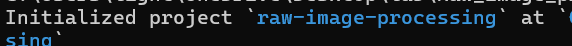
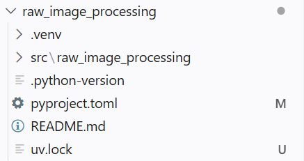
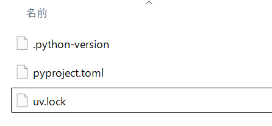
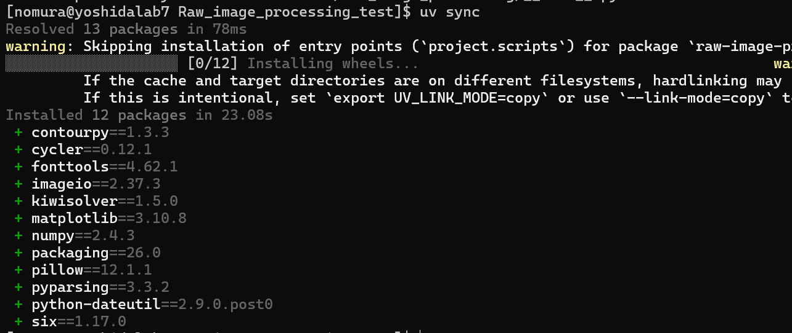
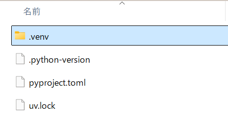

* uv による環境構築
uv のインストール、仮想環境の同期をします。
（環境の同期には ~.python-version~ , ~pyproject.toml~ , ~uv.lock~  の３つのファイルが必要です。）

** uv のインストール
[[https://www.docswell.com/s/2625216247/Z2Q3YV-2025-10-22-170737#p15][uvを使ったPython環境構築-人工知能応用特論Ⅰ 第3回]] を参考に
[[https://docs.astral.sh/uv/getting-started/installation/#installation-methods][インストールページ]] からダウンロードします。
参考：[[https://kumaroot.readthedocs.io/ja/latest/python/python-uv.html][パッケージ管理したい（uv）]]

#+begin_src bash
# （wsl 上の AlmaLinux9 / AlmaLinux10 で実行を確認しました）
curl -LsSf https://astral.sh/uv/install.sh | sh
#+end_src

** uv プロジェクトを作成（作成者のみ）
uv プロジェクトを作成したいディレクトリに移動し、作成します。
~--package~ を渡すと、src フォルダも一緒に作ってくれます。
#+begin_src bash
uv init --package （プロジェクト名）
#+end_src
無事作成できれば以下のように出力されます。

** uv にパッケージをインストールする（作成者のみ）
*** パッケージ名を指定してインストール
一時的に使うだけであれば ~uv pip install~ でもいいですが、基本的には ~uv add~ を使います。
#+begin_src bash
uv add numpy matplotlib imageio
#+end_src

*** ~requirements.txt~ でインストール
~requirements.txt~ を作成してインストールする方法もあります。

まず ~requirements.txt~ を作成するための ~pipreqs~ を開発環境にインストールします。
#+begin_src bash
uv add --dev pipreqs
#+end_src
次にコードディレクトリに対して ~requirements.txt~ を作成します。
#+begin_src bash
uv run pipreqs src --force
#+end_src
 ~requirements.txt~ からパッケージをインストールします。
 #+begin_src bash
uv add $(cat src/requirements.txt)
#+end_src

~--package~ を渡して作成すると以下のような構造で出力されます。 ~__init__.py~  も自動で作られます。

- ~.python-version~ : Python 本体のバージョンを固定する
- ~pyproject.toml~ : 依存関係やメタデータを管理する
- ~uv.lock~ : パッケージのバージョンを管理する

** 仮想環境を同期する
uv プロジェクトを作成したいフォルダに ~.python-version~ , ~pyproject.toml~ , ~uv.lock~  を置きます。（３つ揃っているか確認してください）

NVIDIA ドライバが入っていれば OS にかかわらず仮想環境で CUDA が使えるように ~pyproject.toml~ に追記しました。[[https://zenn.dev/mjun0812/articles/b32f870bb3cdbf][参考サイト]]
wsl / Windows ともに, ~nvidia-smi~ と打ちエラーが出なければ NVIDIA ドライバが入っています。

以下のコードで ~uv.lock~ ファイルの内容に基づいて仮想環境を最新の状態に同期します。
#+begin_src bash
cd (uv プロジェクトを作成したいフォルダ)
uv sync
#+end_src

新しく仮想環境（ ~.venv~ ）が作成されました。

** uv でコードを実行する
以下のコマンドで実行してください。
#+begin_src bash
cd src
uv run (実行したいPythonファイル)
#+end_src
