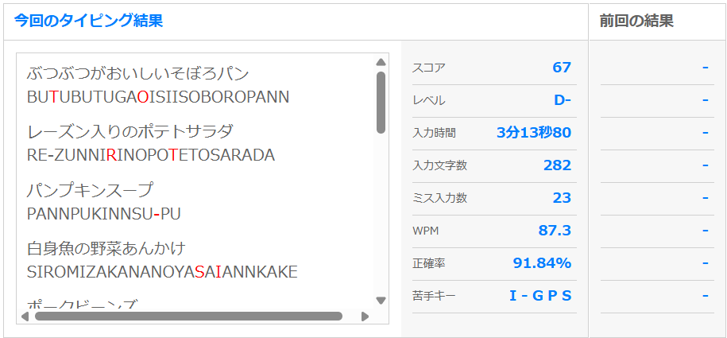
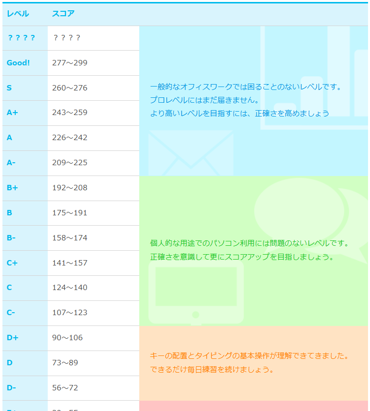

#+title: Harada Dashboard

* 長期目標
** 研究（実験 12 月末まで）
1/30 卒論完成提出
2/10 ポスター発表

** TOEIC *800 点* （5月まで）
** Kaggle Competition *Expert* （5月まで）
** GitHub Pages（5 月まで）
** AtCorder *緑* （5月まで）
** 応用情報技術者（2, 3 月まで）
** typing
【現在】 1.8 打/s（約 108 回/分）
   │    ※ 手元を見ずにキーを押す基本ができている状態
   ▼
【目標 1：日常会話レベル】 3.0 打/s（約 180 回/分）
   │    ※ 脳の思考を止めずに、日本語がスムーズに入力できるレベル
   ▼
【目標 2：実務エンジニアレベル】 4.5 打/s（約 270 回/分）+ 記号マスター
        ※ 予測変換や補完機能、記号入力を組み合わせ、ストレスなくコードが書けるレベル

*** e-typing
#+DOWNLOADED: ~/OneDrive/Pictures/Screenshots/スクリーンショット 2026-09-16 011206.png @ 2026-09-16 01:13:59

#+DOWNLOADED: ~/OneDrive/Pictures/Screenshots/スクリーンショット 2026-09-16 011835.png @ 2026-09-16 01:19:11

#+begin_example
000～100　【一般初心者】
練習あるのみ、パソコン買ったばかりでキーボードのキーを目で探してるレベル

100～150　【一般初級者】
キーの位置を覚えて、目で追いながら指一本で打っているレベル

150～200　【一般中級者】
キーの位置を覚えて、目で追いながらも指を数本使い始めるレベル

200～250　【一般上級者】
キーの位置を覚えて十分な速度を手に入れて、俺速いんじゃないかと思い始めるレベル

250～300　【一般最上級者】
指を数本使い、自己流タイプで周りの人間にタイピング速いねと言われるレベル

—————————– 一般人の壁 —————————–

300～350　【タイパー初心者】
タイピングでは周りに敵無し、タイピングの世界に入っても十分やっていけると勘違いし始めるレベル

350～400　【タイパー初級者】
タイピングをすれば友人に化け物と言われるレベル

400～450　【タイパー中級者】
タイピング、ここまでくれば一人前の中堅タイパーレベル

450～500　【タイパー上級者】
タイピング界でも十分な実力を手に入れたレベル、だが先は長い

500～550　【タイパー最上級者】
ここまでくればタイピングも相当の者、一般の人に対して極めたと言い張っても良いレベル
#+end_example

*** 寿司打

* 中期目標（１ヶ月）
** 研究
*** TODO パラメータ保存用のシェルスクリプト

*** TODO EfficientNet の論文を読む
*** TODO G-equivarence の論文を読む
*** TODO 畳み込みよくわからない
Conv -> MBConv
https://medium.com/@luis_gonzales/a-look-at-mobilenetv2-inverted-residuals-and-linear-bottlenecks-d49f85c12423

* 短期目標（１週間）
- *C-c C-s* （SCHEDULED: 予定日）:「この日に実行する」という実行日を設定
- *C-c C-d* （DEADLINE: 締切日）:「この日までに終わらせる」という期限を設定
- *C-c .* （日付スタンプ）: 単に日付だけを置く
- カレンダー画面で r : 更新
- *Shift + 矢印キー* : Org-Agenda 状態の遷移

** 研究
*** 解像度を下げた画像データを使用し、タイル分割の有用性を示す DEADLINE: <2026-09-27 日>
** TOEIC
*** TODO mikan 火水木金土日
** Kaggle
*** TODO プログラミング入門
*** TODO Python
*** TODO 機械学習入門

** GitHub Pages
*** TODO 今までの資料を外部用にまとめる

** AtCorder
** typing
*** TODO 50 音

* その他
*** TODO Emacs 内で半角全角が分かるようにする

*** TODO 文字列を選択した際に表示している全てのバッファについて同じ文字列がハイライトされるようにする

*** TODO スライド資料 reveal.js
*** TODO agenda 論文の property 検索
*** TODO Org-agenda TODO の管理
*** TODO 数式のプレビュー C-c C-x C-l
*** TODO Tangle : Org ファイル内のコードブロックをエクスポートする
*** TODO gt 翻訳
*** TODO org-table-canvas 表を書くのが簡単
*** TODO org-draw 手書き
*** TODO mermaid
*** TODO Emacs 内で Gemini, Copilot を使えるようにする
*** TODO Org ファイルでそのまま github-io できたりしないかな
*** TODO AI 接続（i-have-adhd 、yomiyasu 気になる）
*** TODO eww で DuckDuckGo(検索エンジン)をバッファとして開く

* 2026 / September
** 9/16〜9/20
*** DONE リファクタリング後のファイルでの追試手順  DEADLINE: <2026-09-18 金>
*** DONE calfw カレンダーの調整<2026-09-19 土>

*** DONE mikan 火✅水✅木✅金✅️土✅️日✅️
DEADLINE: <2026-09-20 日>

** 9/21〜9/27
*** DONE emacs-jupyter(python) の導入ファイルの提出 <2026-09-25 金>
*** DONE mikan 月☑️火✅水✅木✅️金✅️土✅️日✅️ DEADLINE: <2026-09-27 日>

** 9/28～10/4
*** DONE PSNR, LPIPS  SCHEDULED: <2026-09-19 土> DEADLINE: <2026-10-02 金>
**** DONE PSNR は skimage ライブラリ、LPIPS は Python ライブラリ
**** DONE evaluate.py から呼ぶ
**** DONE csv 列の追加
**** DONE 実行

*** DONE mikan 月✅️火✅️水✅️木✅️金✅️土✅️日
*** DONE 商品登録 10 件 DEADLINE: <2026-09-29 火>

* 2026 / October
** 10/5～10/11
*** DONE 商品登録 10件<2026-10-09 金>
*** DONE 低解像度フル画像による学習 DEADLINE: <2026-10-09 金>
**** DONE サイズ指定<2026-09-28 月>
**** DONE 専用の python ファイルを作成<2026-09-28 月>
そのファイルからの呼び出し時のみ解像度を下げた学習を行う

**** DONE 解像度を下げてサイズを小さくする関数<2026-10-01 木>
**** DONE Dataset クラス <2026-10-02 金>
**** DONE DataLoader<2026-10-03 土>
**** DONE 損失計算時にマスクを適用する<2026-10-04 日>
**** DONE 実行
**** DONE 提出
*** DONE PSNR と LPIPS の評価基準 DEADLINE: <2026-10-09 金>

*** DONE 論文を読む環境を構築する<2026-10-11 日>
***** DONE PDF 閲覧 ＋ Org ノート連携<2026-10-10 土>
***** DONE PDF のハイライト・コメント、ノートファイルとの連携<2026-10-11 日>
***** DONE 章ごとの抽出、和訳、図表、数式<2026-10-10 土>
***** DONE AI による数式説明<2026-10-11 日>

*** DONE WSL 環境に移行する DEADLINE: <2026-10-09 金>

** 10/12～10/18
*** TODO mikan 月火水木金土日 DEADLINE: <2026-10-19 月>
*** TODO 商品登録 10件<2026-10-19 月>

*** DOING 他研究との比較 DEADLINE: <2026-10-14 水>
***** Image-Adaptive-3DLUT
******* DONE 論文を読む<2026-10-13 火>
******* TODO 論文通りの結果が出るかどうか確認 DEADLINE: <2026-10-13 火>
******* TODO データ準備 DEADLINE: <2026-10-13 火>
******* TODO 実行
******* TODO 提出 DEADLINE: <2026-10-13 火>
***** Deep Bilateral Learning
******* TODO 論文を読む
******* TODO 論文通りの結果が出るかどうか確認 DEADLINE: <2026-10-14 水>
******* DOING データ準備 DEADLINE: <2026-10-14 水>
******* TODO 専用スクリプトの用意 DEADLINE: <2026-10-14 水>
******* TODO 実行
******* TODO 提出 DEADLINE: <2026-10-14 水>

*** TODO 論文を読む環境を構築する（発展）
***** TODO 数式の LaTeX 化 ＋ 数式プレビュー
***** TODO Zotero による文献管理
***** TODO 論文を横断した知識管理

*** TODO ghostel
*** TODO 実行時の描画ファイルを.fig に格納する
*** TODO 表成形を完璧にする
*** TODO tools のスクリプトの解説/改修
*** TODO Emacs の org-mode で論文を書こう 2025 を実装する
*** TODO ゼミ発表用のパワポを作成する
*** TODO wsl（Linux）について勉強する
*** TODO MSOfficce 再登録
