## ショートの３パターン
2026/5/19
ショートはこの3パターンだけ  
左からパターン１パターン２パターン３

真ん中は特にロングでも多い
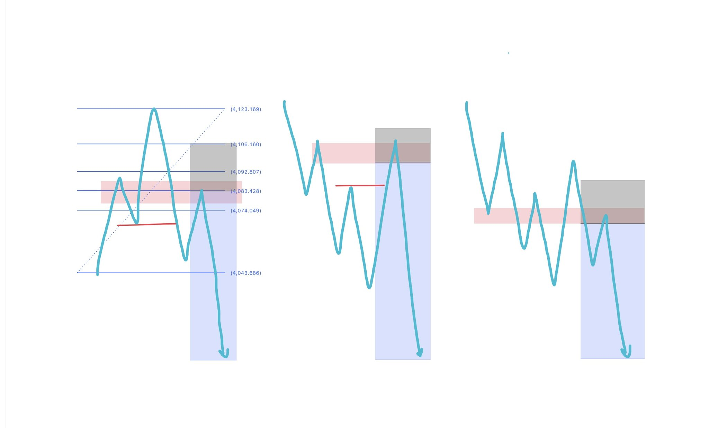

## HTFと流動性（Liquidity Sweep）
自主勉強  
トレード戦略を立てる上で最も基本的ながら、最も重要な概念が「上位足（HTF）」と「流動性（Liquidity）」です。

### HTF (Higher Time Frame) とは？

HTFは「**上位足**」のことで、**今あなたが見ているチャートよりも大きな時間軸のチャート**を指します。

*   **具体例**: 15分足でトレードしている場合、HTFは1時間足、4時間足、日足などです。
*   **なぜ重要か**: 「木を見て森を見ず」という言葉の通り、短い足（木）だけを見ていると、相場全体の大きな流れ（森）を見失います。HTFで大きなトレンド方向を把握することで、トレードの精度が格段に向上します。

### Sweep（スイープ）/ Liquidity Grab とは？

「Sweep」は「掃く」という意味で、相場の世界では **「流動性を狩る動き」** 、もっと簡単に言えば **「ダマシの動き」** を指します。

重要な高値や安値のすぐ外側には、多くのトレーダーの損切り（ストップロス）注文が溜まっています。大口投資家は、その注文を意図的に狩り取る（sweepする）ことで、自分たちの大きな注文を有利に成立させようとします。

価格が重要なレベルを一瞬だけブレイクし、すぐに逆方向へ強く動くのはこのためです。

### CRTにおけるSweepの活用

この「Sweep」の概念は、特に **CRT（ローソク足レンジ理論）** と組み合わせることで非常に強力になります。

**「HTF（上位足）の重要なローソク足の高値や安値を、価格が一瞬だけ突き抜けて（Sweep）、そこに溜まった損切り注文を狩り取ってから、すぐに逆方向へ強く動く」**

このダマシの動きこそが、大口投資家の仕掛けであり、我々が狙うべき絶好のエントリーチャンスとなります。この動きを見抜くことが、SMCの基本戦略です。

## CRT（Candle Range Theory）とは？
自主勉強  
CRTは「**たった1本の重要なローソク足が作る『戦場』**」と考える、非常にシンプルかつ強力な理論です。

### CRTの基本的な考え方

1.  **戦場の設定**:
    まず、日足や4時間足などの**上位足（HTF）** で、基準となる重要なローソク足が1本確定します。このローソク足の**高値が「上の壁（CRT High）」**、 **安値が「下の壁（CRT Low）」** となり、この壁に囲まれたエリアがその後の価格が戦う「戦場（レンジ）」となります。

2.  **壁際での攻防パターン**:
    この理論で最も重要なのは、価格がこの「壁」に到達したときに何が起こるかです。

    *   **パターン①：壁を「ダマして」破る（Sweep）**
        最も重要なパターンです。価格が壁（例：下の壁）を**一瞬だけ下に抜けます**が、すぐに壁の内側に戻ってきます。これは、大口投資家が損切りを狩り取った **「ダマシ」のサイン** です。この動きが出た後、価格は逆方向（上の壁）へ強く向かう可能性が非常に高くなります。

    *   **パターン②：壁を「本気で」破壊する（Break & Close）**
        価格が壁を勢いよく突き破り、 **壁の外側でローソク足が確定（Close）** します。これは「ダマシ」ではなく、本気でその方向に進みたいというサインです。この場合、価格はそのままブレイクした方向へ進み続ける可能性が高くなります。

### まとめ
CRTは、たった1本のローソク足の高値と安値に注目するだけで、「これは本気の動きか？それともダマシか？」を判断するための強力な考え方です。この上位足での分析を元に、下位足で具体的なエントリーポイントを探すのが基本戦略となります。

### 「Sweep」と「CRT Sweep」の違い

ここで重要な関係性を整理します。

*   **Sweep（スイープ）**: **アクション（行動）** そのもの。あらゆる重要な高値・安値で発生する「流動性を狩る動き」全般を指します。
*   **CRT Sweep**: **特定のセットアップ（型）** の名前。数あるSweepの中でも、特に「CRTで定義したローソク足の高値・安値」で発生したものに付けられた特別な名前です。

例えるなら、「シュートを打つ」という行動がSweepで、「ペナルティキック」という特定のセットアップがCRT Sweepです。

つまり、**すべてのSweepがCRT Sweepなわけではありません**。しかし、CRT Sweepは非常に強力で分かりやすいセットアップの一つであるため、特に重要視されます。

## Sweep（スイープ）が出たらどう考える？

Sweepは、SMCにおいて最も重要なエントリーのきっかけの一つです。これを正しく捉えることで、大口投資家の動きに乗り、非常に有利なトレードを展開できます。

### Sweepは「逆張りのサイン」

まず、最も重要なことは、Sweepは **「逆張りのサイン」** であるということです。

*   **High Sweep（高値を刈り取る動き）が出たら → 売りのチャンスを探す**
    価格が重要な高値を一瞬だけ上に抜けて（ダマして）、すぐに下落に転じる動きです。これは、大口投資家がショートポジションを仕込んだ可能性が高いことを示唆します。

*   **Low Sweep（安値を刈り取る動き）が出たら → 買いのチャンスを探す**
    価格が重要な安値を一瞬だけ下に抜けて（ダマして）、すぐに上昇に転じる動きです。これは、大口投資家がロングポジションを仕込んだ可能性が高いことを示唆します。

### Sweep発生後の思考ステップ

Sweepはあくまで「きっかけ」です。慌てて飛び乗るのではなく、以下のステップで冷静にチャンスを待ちましょう。

1.  **Sweepの発生を確認**: 「重要な高値/安値をヒゲで抜いたが、実体は内側で確定した」ことを確認します。
2.  **市場構造の転換（MSS/CHoCH）を待つ**: Sweepの後、価格が逆方向に強く動き、短期的なトレンドが転換するのを待ちます。これが「相場が本気で方向性を変えた」という証拠になります。
3.  **エントリーゾーン（POI）で待ち伏せる**: 構造転換が確認できたら、その強い動きの中で作られた**FVG（フェアバリューギャップ）**や**オーダーブロック（OB）**を見つけます。
4.  **POIへの戻りを待ってエントリー**: 価格が一度、先ほど見つけたFVGやOBまで戻ってきたタイミングで、エントリーを実行します。

この「**Sweep → 構造転換 → POIへの戻り**」という一連の流れが、SMCにおける王道のトレードセットアップです。

## CRT （Candle Range Theory）ローソク足レンジ理論　エントリーポイント
2026/5/20  
CRTとはローソク足の高値・安値を基準に、次の流れを予測するとても強力な戦略です。そして実はこれが基礎基本だったりもします。

価格がローソク足の高値・安値を一気に抜きさる、"流動性を狩った後"の本命を狙うイメージです。
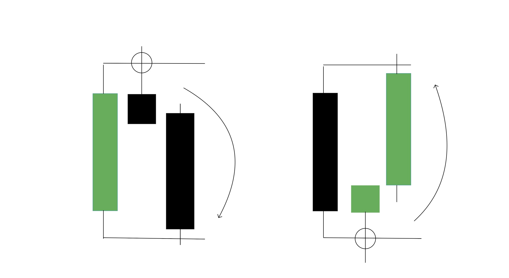

安値を抜きさりそれよりも上でクローズした場合、高値を目指す可能性が高くなります。（逆もそう）
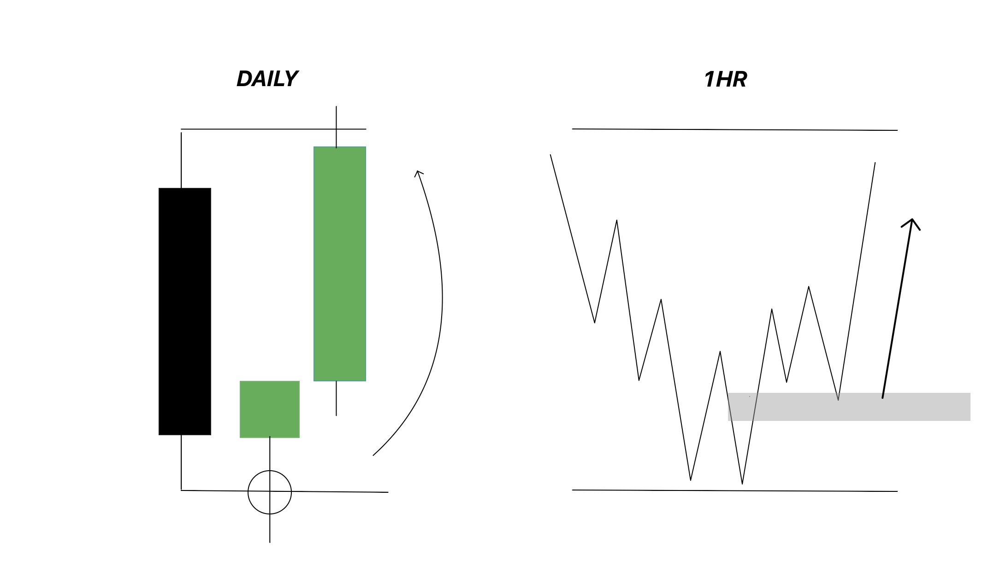

これらが理解できれば次のステップは時間軸を落とし、実際にこの動きをしたチャンス、セットアップを探す事になります。
左は4時間足のローソク足です。画像は価格を一気に抜き、その後下にクローズした為、CRTLOW 安値に向かって下がると予測することができます。
そして15分足チャートに降りた時、フェアバリューギャップでエントリーするというシンプルなセットアップです。
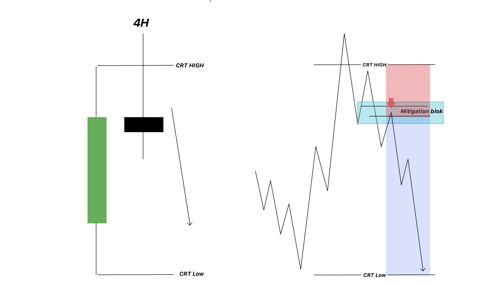

次は強気のセットアップです。価格は安値を抜きCRTの高値安値の位置が確定しました。次はそれよりも低い時間足に降ります。画像はフェアバリューギャップの中にインバースフェアバリューギャップもあった強気の例で、そこからエントリーする事ができます。
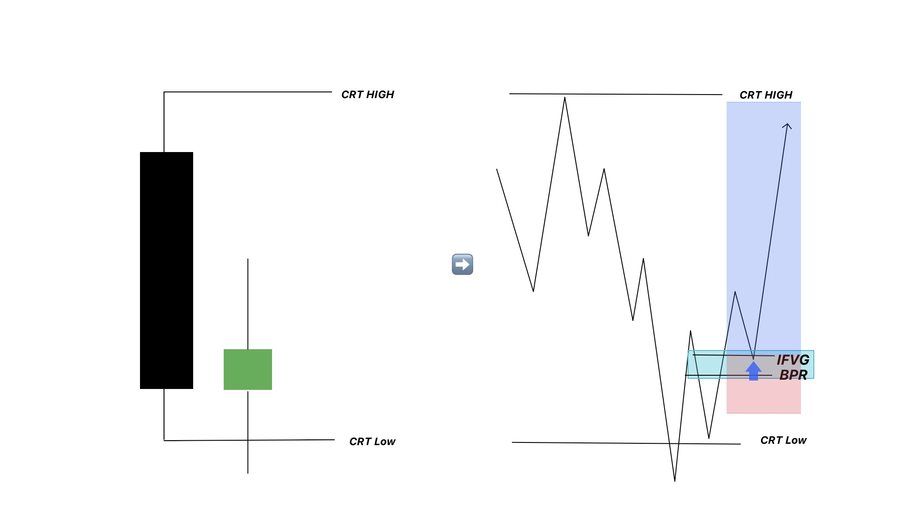

因みに一度FVGを無視した場合は上昇し続ける可能性が高いのも知っておくと便利です。

これは決して適当な時間軸を使うわけでは無く整合性がかなり重要です。
- 週足CRT→エントリーは4時間足
- 日足CRT→エントリーは1時間足
- 4時間CRT→エントリーは15分足
- 1時間CRT→エントリーは5分足
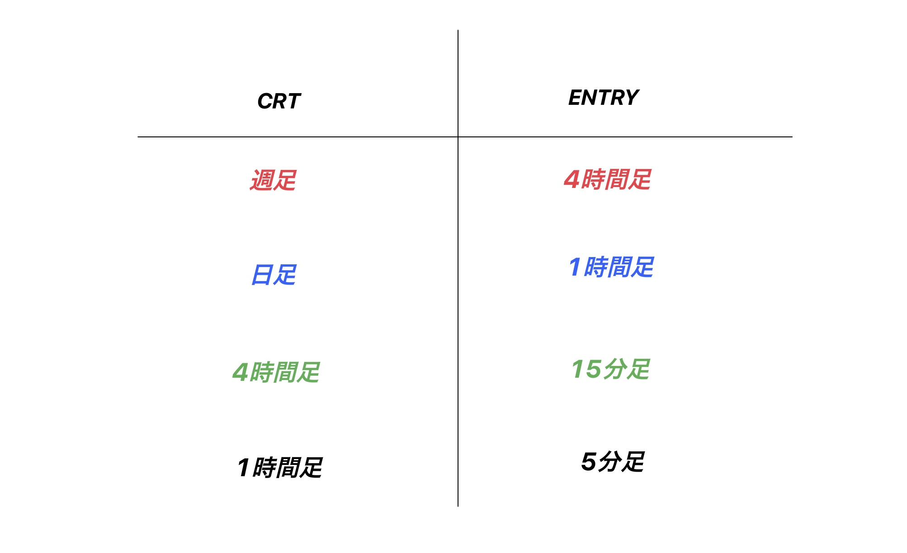
これより下はおすすめしません。

## エントリーするべき強い CRT とエントリーしてはならない弱い CRT

### 1. CRTを構成する3本のローソク足の役割
 * **1本目（基準足 / 標的）：** 高値・安値のレンジを作り、大衆のブレイクアウト注文や損切り（流動性）を上下に溜め込む。
 * **2本目（スイープ足 / 罠）：** 1本目のレンジを一時的に抜けて大衆を罠にハメる。注文を吸収した後は長いヒゲをつけて戻る。
 * **3本目（確認足 / 証明）：** 逆方向への本気の推進力（ディスプレイスメント）を見せ、機関投資家の意図を確定させる。
### 2. 強いCRTと弱いCRTの見極め
エントリーの優位性は、この「強弱」を正しく見極められるかにかかっています。
**「レンジ内であればどこで確定してもいい」わけではありません。** 2本目が1本目のレンジ内の **「どこまで深く戻って確定したか」** によって、その後の反発の信頼度が劇的に変わります。
###  確定する場所による「強さ」の違い
レンジ内に戻ったとして、「どこで確定するか」で以下の3パターンに分かれます。
#### ① 最強（積極的に狙いたい形）
 * **確定場所：** 1本目の **「実体の中」** 、あるいはそれよりも深く逆方向へ押し戻されて確定する。
 * **意味：** スイープ（ストップ狩り）をした直後、機関投資家が猛烈な勢いで逆方向に資金を入れた証拠です。ヒゲが非常に長くなり、ローソク足の色が反転（陽線で抜けた後、陰線になって確定など）していればさらに強力です。3本目を待たずに強い反発圧力が確認できます。
#### ② 普通〜やや弱い（3本目の確認が必須）
 * **確定場所：** 1本目のヒゲの範囲内には戻ったが、**「1本目の実体」には届かず確定する**。
 * **意味：** とりあえずブレイクは否定（ダマシ）になりましたが、即座に反発するほどのエネルギーは入っていません。この場合は **「3本目（確認足）が、1本目の実体の中までしっかり食い込んで確定するか」** が絶対条件になります。
#### ③ 危険・弱い（見送りを推奨）
 * **確定場所：** 1本目の高値/安値のラインの**ギリギリ内側（わずか数pips内側など）で確定する**。
 * **意味：** 辛うじてヒゲにはなったものの、価格を押し戻す力が弱く、元の方向への圧力がまだ強い状態です。ゴールドの場合、この形は「小休止」に過ぎず、次のローソク足であっさり実体でブレイクしていく（トレンドが継続する）リスクが非常に高いため警戒が必要です。
### まとめ
2本目のローソク足は、**「深く戻れば戻るほど強い（反発のエネルギーが大きい）」** と覚えてください。
ゴールドは狩る値幅も戻る値幅も大きいため、本当に優位性のある強いCRTであれば、2本目の時点で「誰が見ても明らかな長いヒゲ」をつけて、1本目の実体付近までグサッと深く戻ってくることが多いです。

### 3. 「実体の中」まで戻らないCRTへの対策
3本目の足が1本目の「ヒゲの範囲」に戻っても、「実体（合意された取引価格帯）」の中まで届かない場合は、反発させるエネルギー（資金）が不足している**弱いCRT**と判断します。ゴールドでこのパターンに遭遇した際の有効な対策は以下の通りです。
 * **見送る：** さらにストップを狩りに来る動きに巻き込まれないよう、安全を優先してスキップする。
 * **4本目を待つ：** 続く4本目のローソク足が、1本目の実体の中へ力強く進入して確定するか様子を見る。
 * **下位足を確認する：** 短期足（5分足や15分足など）に落とし、内部構造で明確なトレンド転換（CHoCH）が起きているか根拠を探す。

### 4. ゴールドトレードにおける最大の鉄則
ゴールドは値動きが激しいため、足が確定する数秒前で形が劇的に変わることが多々あります。ローソク足が形成されている途中で「強いCRTになりそうだ」と**見切り発車で飛び乗らないこと**が最大の防御策です。
必ずローソク足の確定を待ち、機関投資家が資金を入れた確実な「証明」を見届けてからエントリーを検討してください。

## CRT（Liquidity Sweep）の確実な見分け方まとめ

CRT Highで価格が反発して下がるか、そのまま突き抜けられてしまうかは、単なるラインでの動きだけでなく、**「直近の強力な帯（上位足のOrder BlockやFVG）が上と下のどちらにあるか」** という全体の環境（コンテキスト）で決まります。

### ① そのまま突破されるケース（ショート厳禁）
価格が **「下にある強力な帯（サポート）」** から反発して上昇してきた場合、上にあるCRT Highは反発ポイントではなく、単なる利確の目標地点（ターゲット）として機能します。下からの勢いが強いため、価格は跳ね返されることなく、ローソク足の「実体」を伴って力強くラインを上抜けていきます。
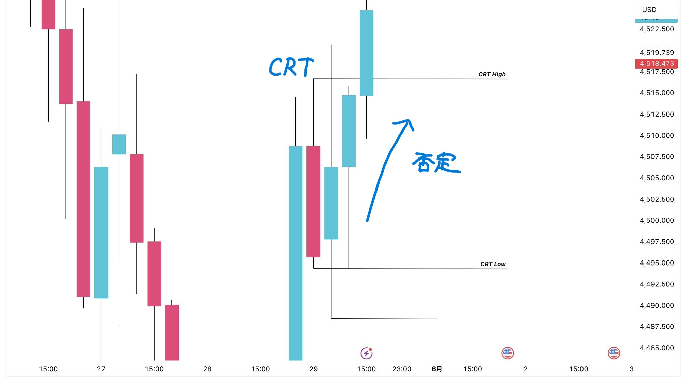
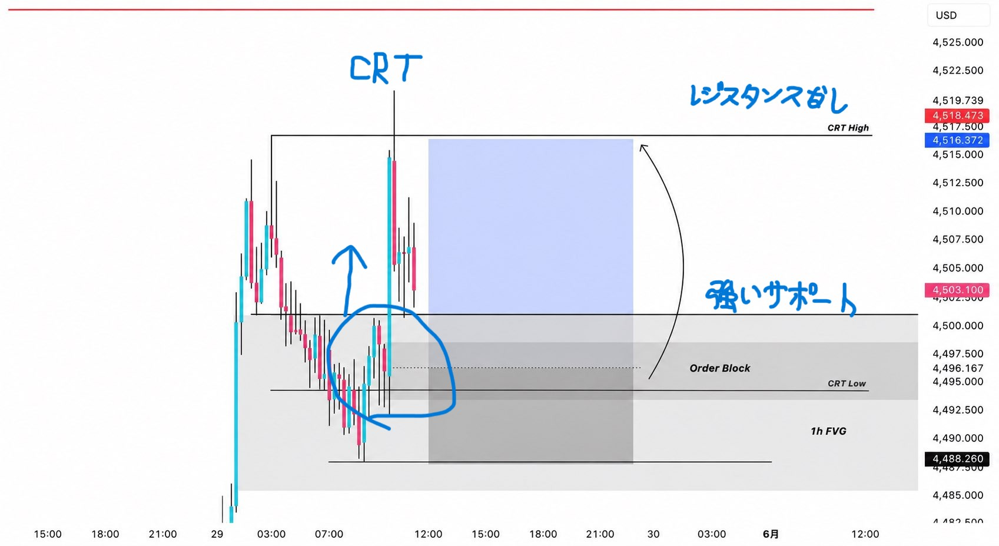
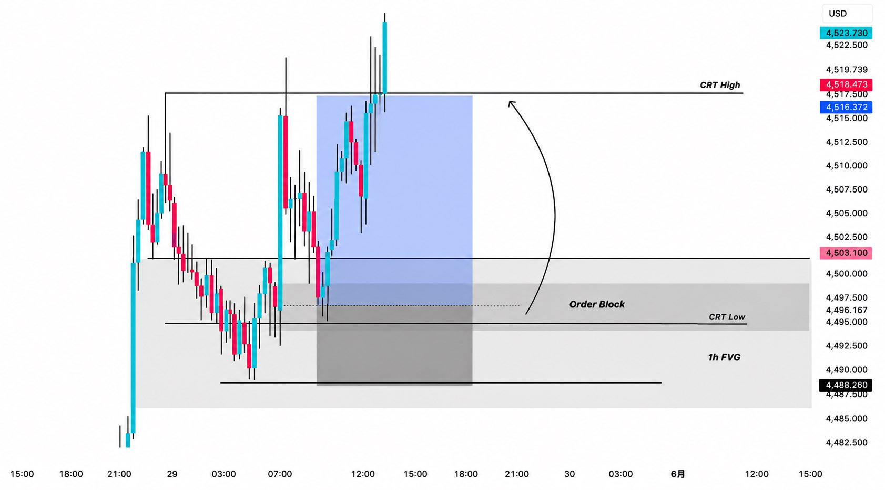

### ② 反発して下がるケース（ショートのチャンス）
CRT Highの **「すぐ上に強力な帯（レジスタンス）」** が控えている場合が、本来狙うべきSweep（騙し）のポイントです。価格がCRT Highを一時的に上抜けて上の帯にタッチすると、そこに溜まった強い売り圧力に叩き落とされます。その結果、ローソク足は「長い上ヒゲ」を残して実体がCRT Highの下に戻って確定し、明確な下落へと転じます。

### 結論として
Sweepが起きた時はライン単体で判断するのではなく、**「価格がどの帯から向かってきたのか（出発点）」** と **「すぐ先にどんな帯が待ち構えているのか（到達点）」** を確認してください。その上で、ローソク足が「実体で突き抜けるか、ヒゲで弾き返されるか」を見極めることが、騙しを回避して精度の高いトレードを行うための最大の鍵になります。

## CRT Sweep 後の反転でできた FVG に戻る（またはリテスト）のを待ってエントリーする例

### Buy
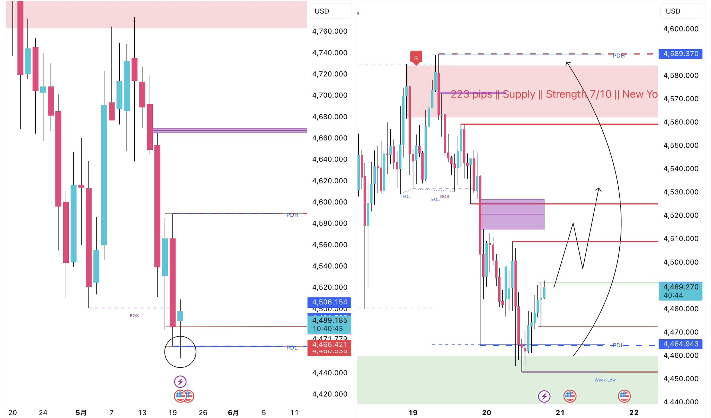

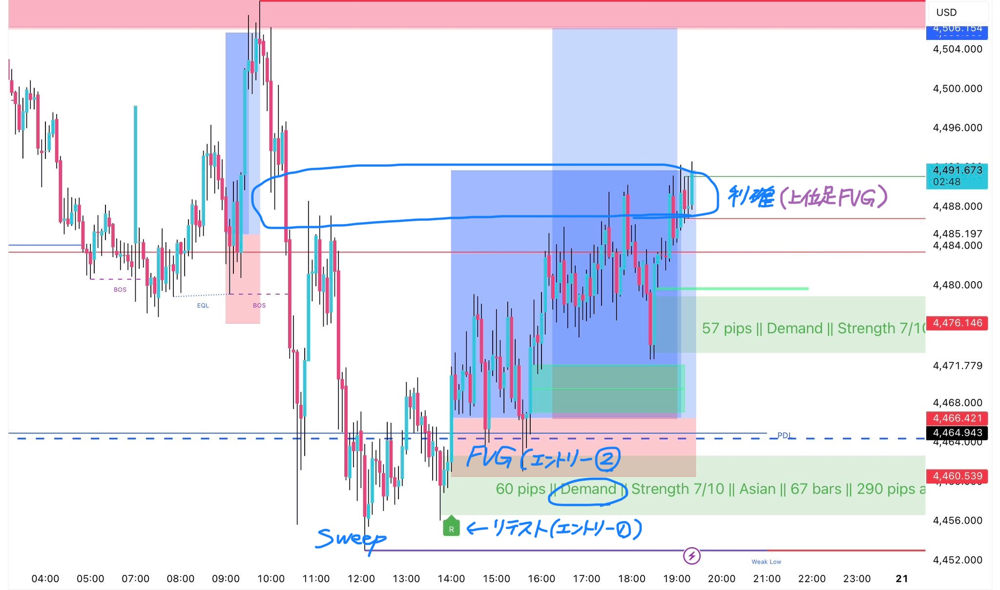

### Sell
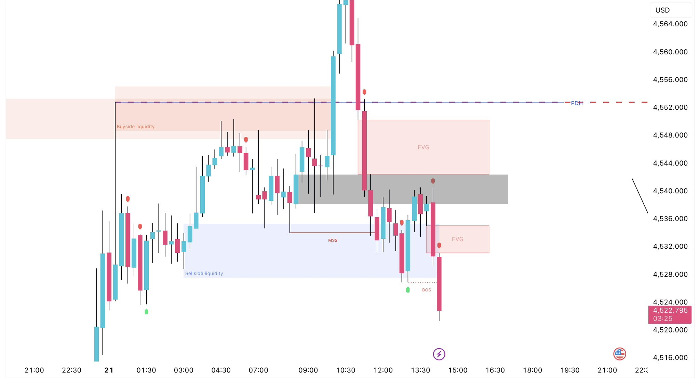

## 上位足 CRT ＋ 下位足 MSS によるエントリー例
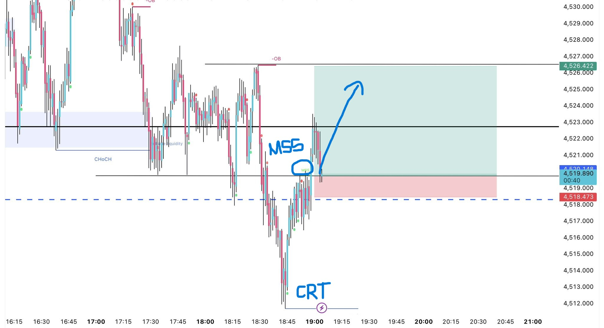
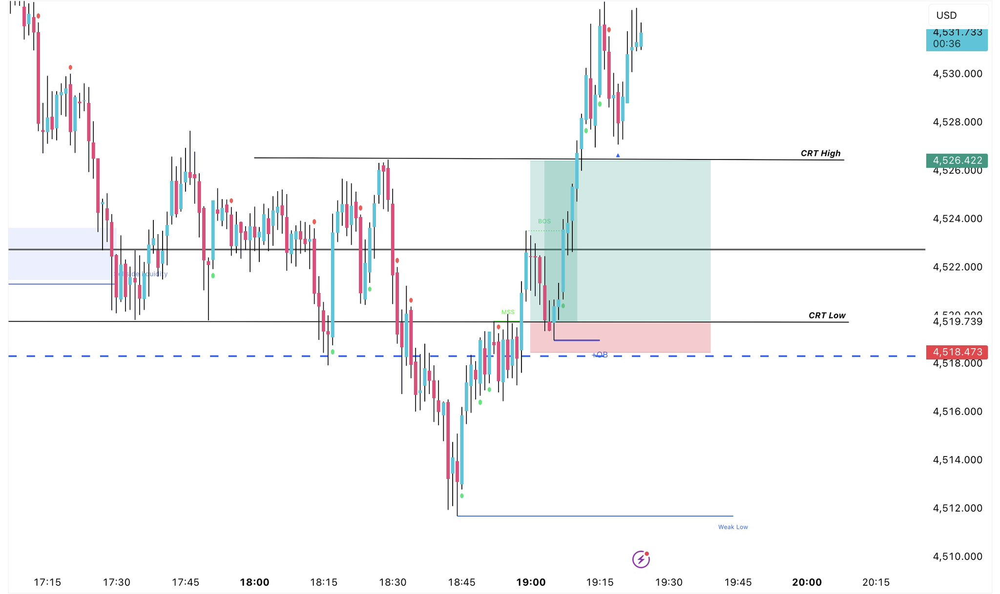
1時間足の `CRT Low Sweep` 確認後、1分足（または5分足）の `MSS` を確認、`CRT Low` まで戻ってきたところでエントリーします。  
利確位置は `CRT High` です。

## OB（Order Block）
Order BlockやFVGが形成された場合、参加者は反応を期待します。そこで反応があると誰しも勝てます。
.jpg)

### OB Sweep からの OB 反発の例
OB だからといって反発期待で脳死エントリーするのではなく、Sweep を確認して反発が強いことがわかってからエントリーしましょう。  
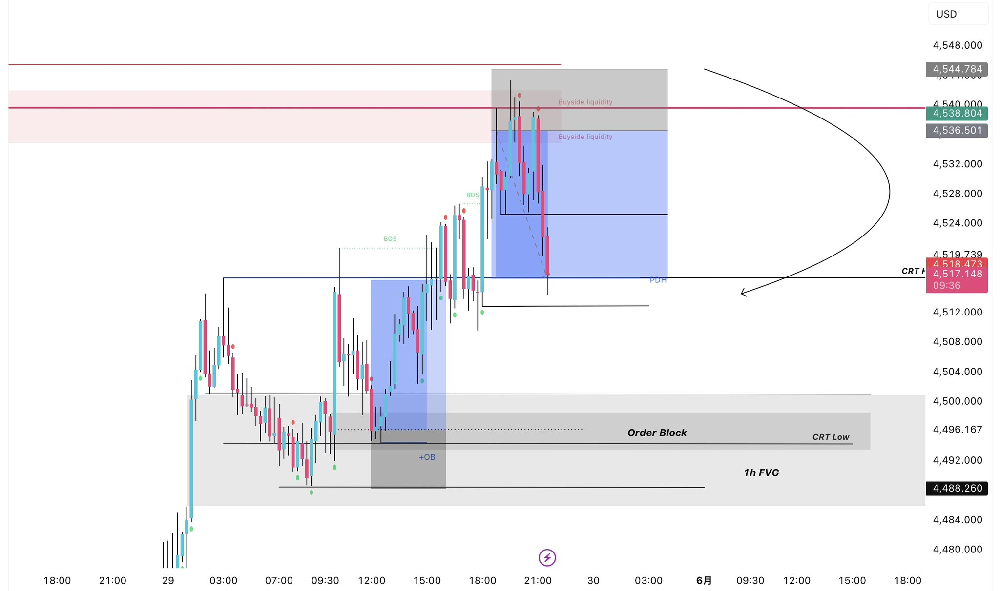

### 【強い】Order Block の条件（高勝率で反応する）

**1. FVG（インバランス）を伴って勢いよく離れている**

OBが形成された後、価格がそこから大陽線または大陰線で強く離れ、FVG（Fair Value Gap / 窓）を残していることが最も重要です。
価格がダラダラとしか動かず、隙間（FVG）がない場合、そこに大口の強い注文は入っていません。

**2. 明確な構造破壊（BOS / MSS（ChoCh））を起こしている**

そのOBを起点とした値動きが、**直近の目立つ高値や安値をブレイク（更新）** している必要があります。
「構造を破壊するほどの強いエネルギーを生み出した起点」だからこそ、後で価格が戻ってきたときに強いサポート/レジスタンスとして機能します。

**3. 事前に流動性（Liquidity）を刈り取っている**

これが最も強力なサインです。
OBが形成される直前に、過去の高値や安値（ダブルトップ/ボトムなど）を一度ヒゲなどで抜いて（騙し/スウィープして）から反転してできたOBは、大口が個人投資家のストップロスを巻き込んだ証拠であるため、非常に強力です。

**4. 未テスト（Unmitigated）である**

形成されてから、**まだ一度も価格が戻ってきて触れていない「フレッシュな状態」** のOBが最強です。 大口の未約定の注文が残っている可能性が高いからです。

**5. 上位足のトレンドに沿っている（環境認識）**

いくら下位足（例：5分足）で綺麗なOBがあっても、上位足（例：4時間足）のトレンドに逆らっている場合は簡単に突破されます。上位足の順張り方向にあるOBを選ぶのが基本です。

### 【弱い】（避けるべき）Order Block の条件
逆に、以下のようなOBはダマシになる（突き抜けられる）可能性が高いため、エントリーを見送るか、警戒する必要があります。

  - FVGがない: OB形成後の値動きが弱く、ローソク足同士が重なり合っている。
  - BOSしていない: 直近の高値・安値すら更新できなかった中途半端な起点。
  - すでにテストされている（Mitigated）: 一度または何度も価格が戻ってきて反発済みのOB。大口の注文はすでに消化されている可能性が高いです。
  - Inducement（誘導・罠）になる位置にある:
    本当に強いOBの「手前」にある中途半端なOBは、個人投資家を早めにエントリーさせてストップロスを置かせるための罠（流動性のエサ）になることが多く、あっさり貫かれます。

## Breaker Blokと使い方について
### そもそもBreaker Blok（BB）とは？
直近起点で形成されたOrder Block（OB）を強く否定。役割が反転し、逆方向のエントリーとして機能するもの。
なぜ信頼できるのか期待値が高いのか？通常の反応に基づいてるのではなく失敗・否定したゾーンに基づいてるからです。

### Breaker Blok
OrderBlock（OB）を否定。この時大事なのが
**実体でBlake・displacement（勢い）・初回Retestこの3つ**です。  
左側では売り注文が吸収されOBがBullish Breakerへと変化。
右側はBullishOBを下抜け、買い注文が崩れBearishBreakerへの変化。
Breaker Blokは **『機能しなくなったOB』『否定されたOB』** です。

OBが実体で否定され、役割が反転した価格帯がBreaker Blokとして機能しやすくなります。価格は一度Breaker Blokへ戻って来ることが多く、**"初回Retest"が高期待値のエントリーポイント**になります。
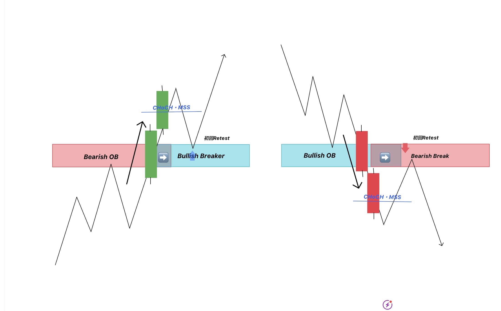

また**タイムフレームを落とした時のMSS/CHoCHの構造転換**が重要です。
**1分・5分足・15分足チャートにMSS・CHoChを確認してから** だと信頼性高まります。

### 流れ
1. OBでの反応
2. 相場の流れが崩れ始める
3. **実体で強くBleak**
4. 構造転換
5. OBがBreaker Blok化
6. 初回Retestからエントリー

## Breaker Blok の戻りエントリーを検討する例
>5分足チャート
>価格はOB付近に位置してますね。

>狙いはOB実体Blake。その後BearishBseakerは戻り売りとして反転機能
>抜けて戻ってきてからがショート狙い目

>その際、1分・5分足チャートにMSS・CHoChを確認してからだと信頼性高まります

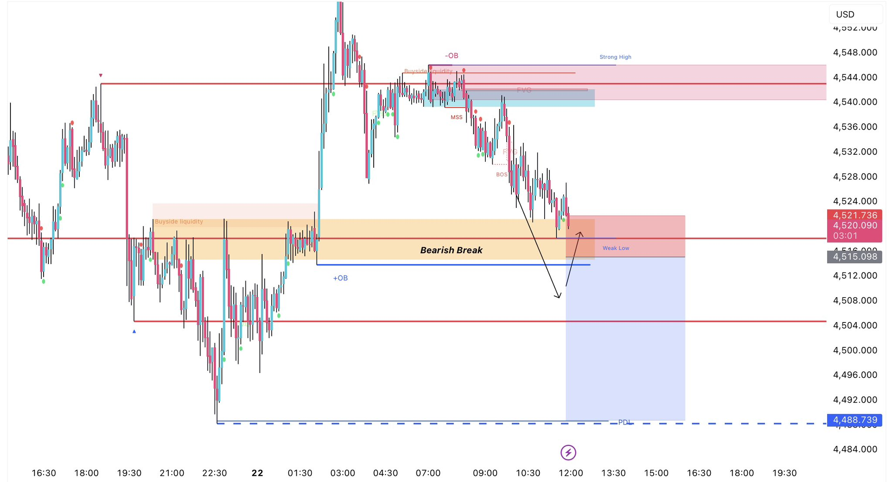

ただこのセットアップは実現せず、 **OB で反発、一瞬実体抜けるもリテストせずに戻し、その後急落、下の OB で sweep** しています。この Sweep によるロングは元の BB の位置が利確位置になります。  
一瞬の抜けが騙しにならないように、**MSS, CHoCH** の構造転換を確認してからにしましょう。  
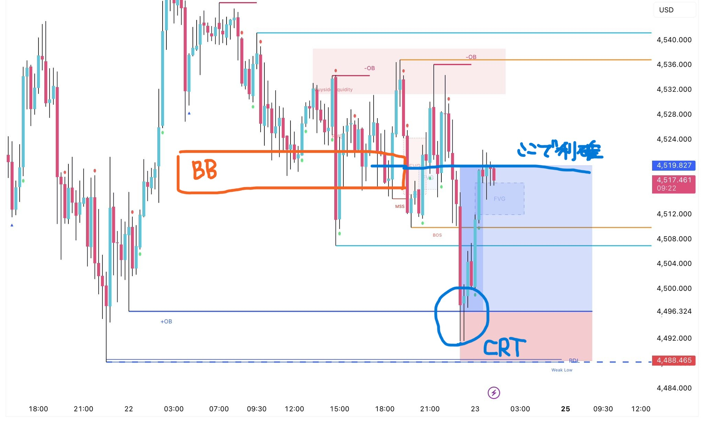

## 上位足 CRT ～ BreakerBlok での反応を見て利確する例（～リテスト確認でショートも可能なチャート）
.jpg)
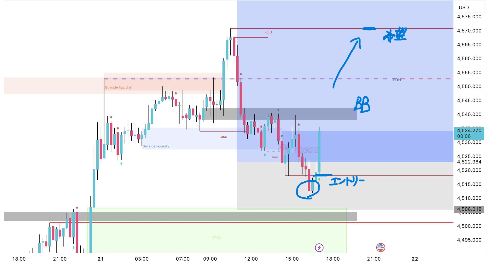
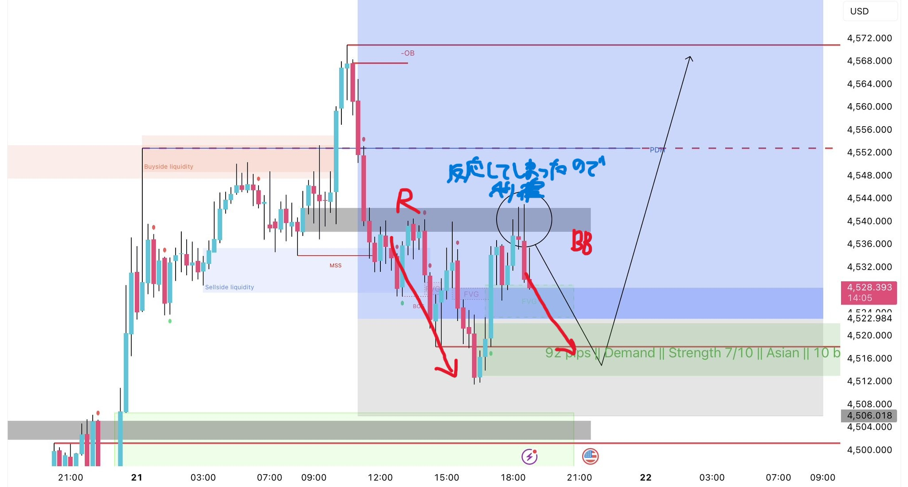

※BB 反発をエントリーする場合は **必ず1分・5分足・15分足チャートにMSS・CHoChを確認してからにする**

## FVG（フェアバリューギャップ  Fair Value Gap）
2026/5/23  
FVGとは価格が一方向へ強く動いた事で発生する  **"価格の不均衡"** のことですね。強い買・売りによって価格が処理されずローソク間に空間が生まれたもの。

左はBullish FVG  右はBearish FVG  

成立条件は基本的に3番のローソク足で形成されます。1本目の高値・3番目の安値と考えればわかりやすいです。またここで重要なのが **"displacement"（移動, 転移, 変位）** これは一方向へ強く飛ぶ動きです。
重要なのはFVGが出来たことではなく、何故そこに出来たのか、つまり強いdisplacement。価格が強く動いた事を認識しておく事が大切です。
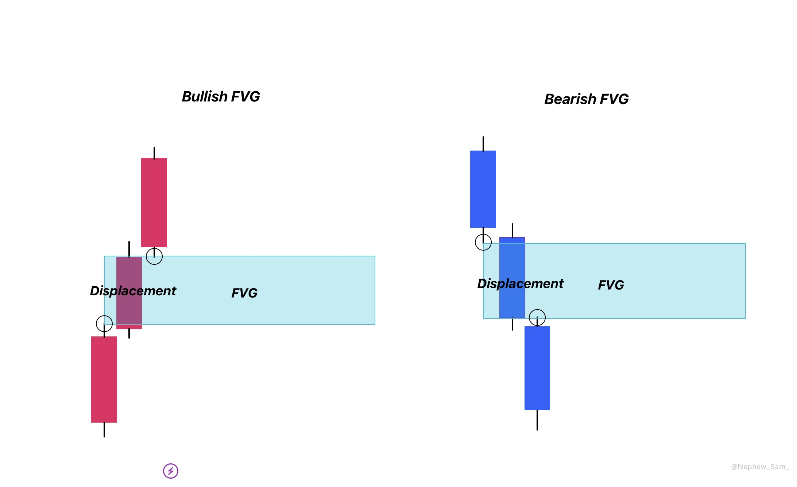

### 何故FVGは機能するのか
**市場は非効率な価格の動きを、調整しようとします。** よってFVGを埋める動きが起こりやすく押し目買い・戻り売りのゾーンとして機能する傾向が多いです。
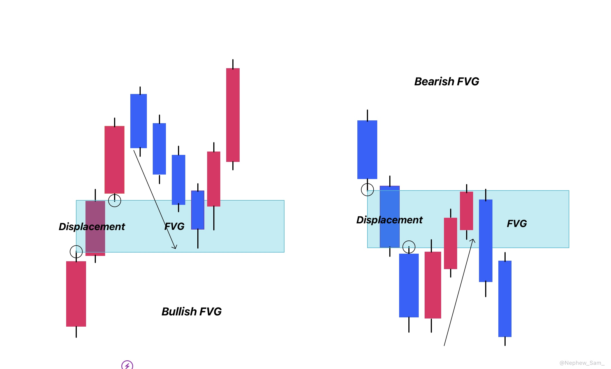

### エントリー位置
Liquidity Sweep  
→OB形成  
→強いdisplacement確認  
→MSS/CHoCHの構造転換
**FVG初回戻りをエントリー**  

※ MSS は CHoCH とほぼ同じ意味でトレンド転換を意味する

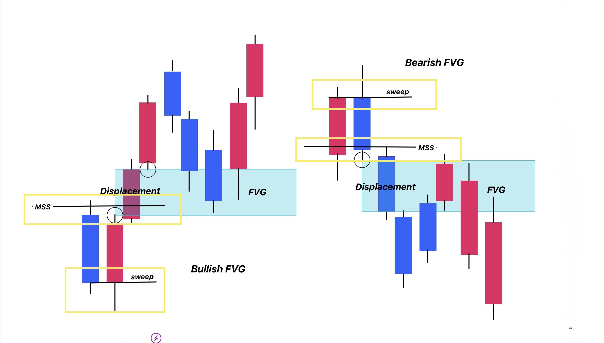

## よくあるセットアップ

> BearishOB ブレイク　MSS構造転換
> displacement強い・高いフレームCRT

> OB→Breaker Blokに重なるBullishFVG 
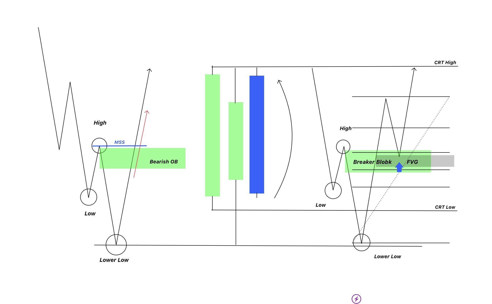

### 発展：OB との組み合わせ　Bleaker Blok との関係
BearishOBをBlakeすると尚期待値は上昇します。これは僕もエントリーしてるパターンです。
売り注文の入った起点となるBearishOBが形成され、市場参加者は戻り売りを狙う思考になります。

強いOBを否定陽線＋displacementの様に強くブレイクし、MSS.CHoCHの発生、売りの構造が崩れます。

強く上昇した中のFVGが形成され初回の戻りは高確率でのロングエントリーポイントとなります。
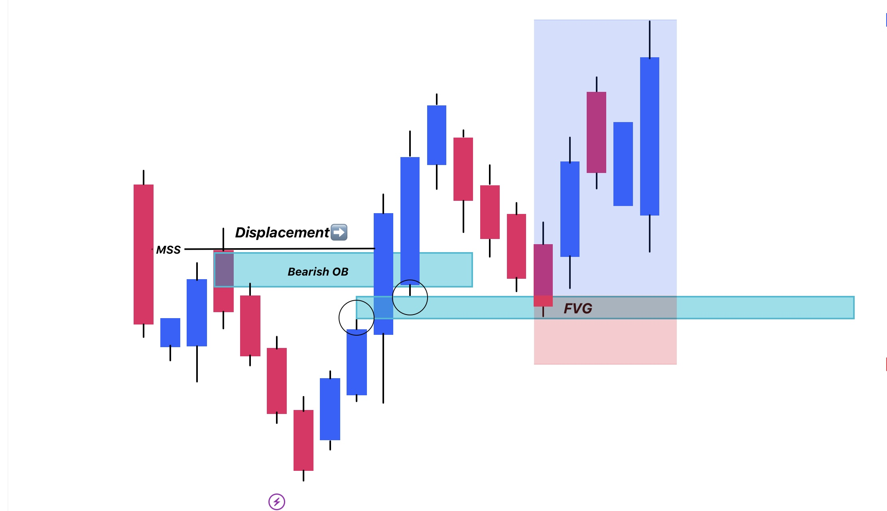

OBは否定され構造が変わると反転し逆方向へ向かうBreaker Blokへの変わります。Breaker BlokはFVGより少し上か少し下に発生する事が多いのでFVGにタッチする前に上昇する事が多いのでうまく使い分けてみてください。  
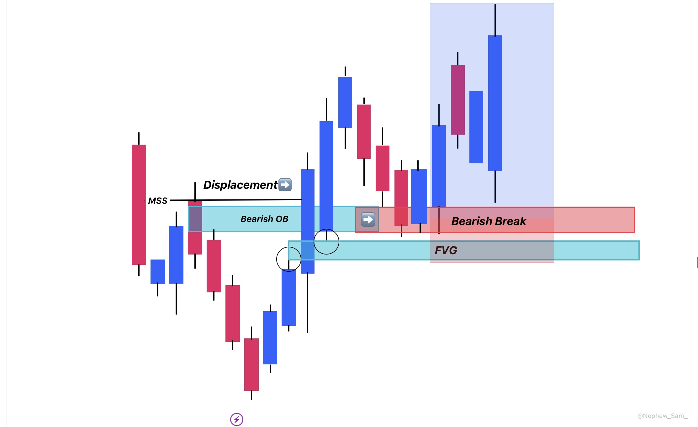

## 実例- OB Sweep からの FVG 貫通→戻って FVG を土台に順方向へ
Sweep の displacement（変化量）が大きいです。（＝その方向に強く行きたい）  
ただし、この例の FVG は後述の「弱い FVG」にあたるのでその点だけ注意してください。  
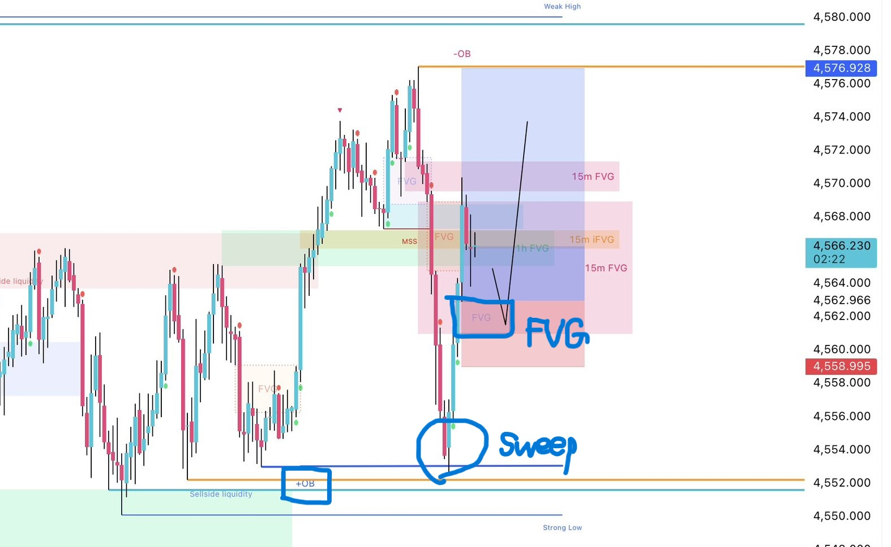
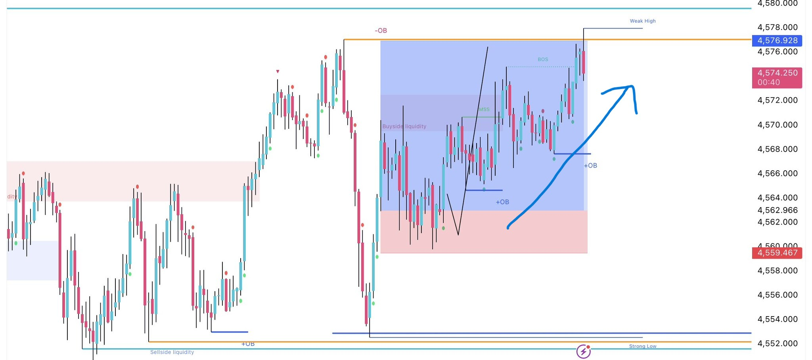

## 実例（発展）
> 1時間足チャート
> Order Block をdisplacementで下抜け
> →戻り売り候補（Breaker Blok）へ転換

> 15分足チャート
> 1時間FVGの中でBreaker Blok形成。更に15分FVGを形成の強い構造。また反発位置も根拠がない状態。

**OBは否定され構造が変わると反転し逆方向へ向かうBreaker Blokへの変わります。Breaker BlokはFVGより少し上か少し下に発生する事が多いです**
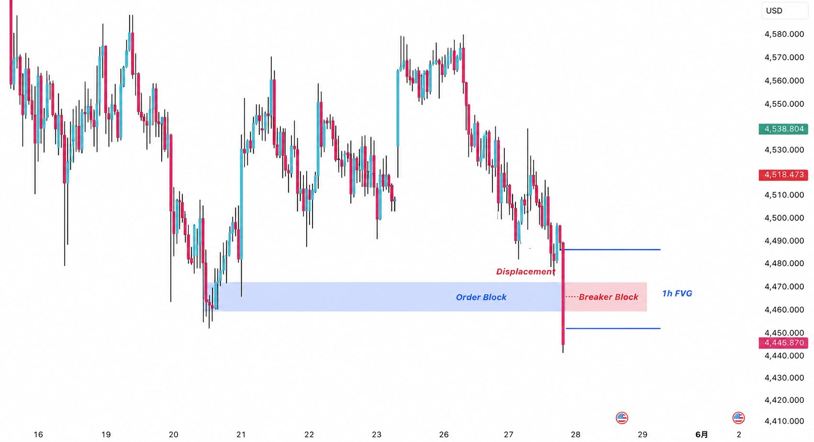
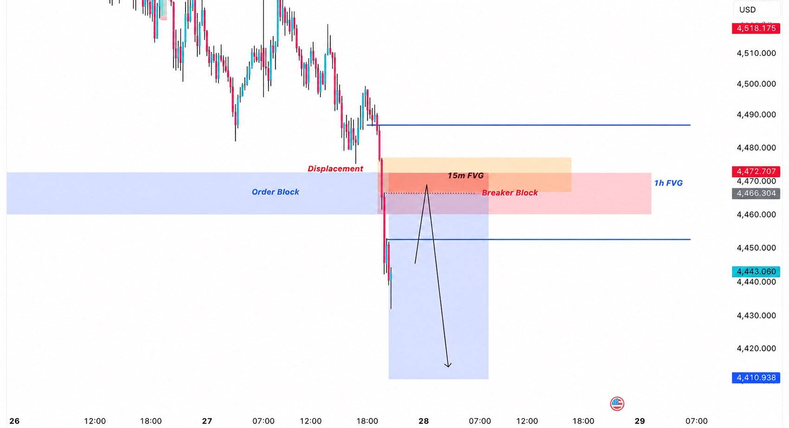

### 強い（反発されやすい）FVG と、弱い FVG
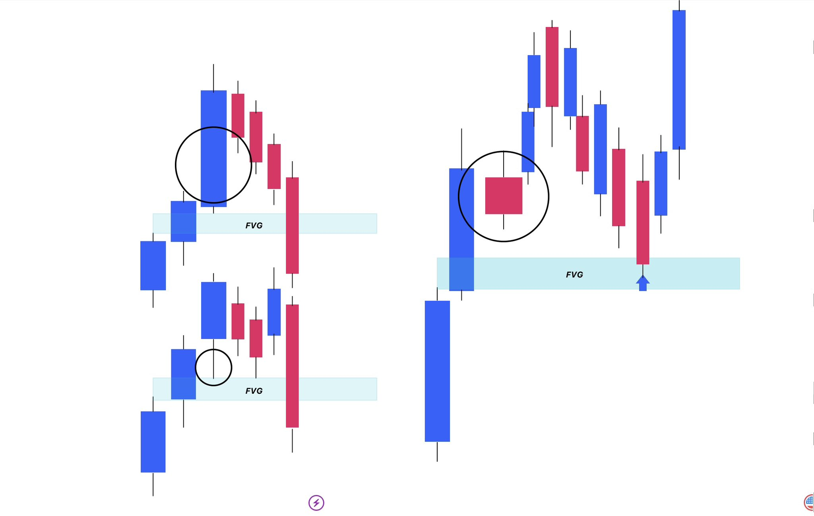
#### ❌ ダメなFVG（左側：反発せず突き破られる）
*   **3本目がデカすぎる（左上）：** 買いの勢いがここで息切れ（クライマックス）している。
*   **3本目のヒゲがFVGに刺さっている（左下）：** すでに大口の注文が消費（消化）されてしまい、反発する燃料が残っていない。

#### ⭕ 激アツなFVG（右側：爆益になる必勝パターン）
*   **3本目が小さく、2本目の中に収まっている（はらみ足）：** 
    FVGにヒゲが一切触れていないため、**大口の巨大な買い注文が「手付かずの新鮮な状態」で残っています。**

## なぜFVGインジケーターによって表示が違うのか？

「FVGインジケーターによって表示されるゾーンが全然違う」というのは、非常に的確で重要な気づきです。これはインジケーターのバグではなく、**それぞれのインジケーターが持つ「FVGをどう解釈し、何を重要と見なすか」という”哲学”が違う**ために起こります。

主な理由は以下の3つです。

### 1. 「強い動き（Displacement）」の定義が違う

FVGは、勢いのある強い動き（Displacement）の中で発生してこそ意味があります。しかし、この「強い動き」をどう判断するかがインジケーターごとに異なります。

*   **Aのインジケーター**: 「ローソク足の実体が平均の1.5倍以上なら強い動き」と判断するかもしれません。
*   **Bのインジケーター**: 「ATR（平均的な値幅）の2倍以上の動きがあった場合のみ」と判断するかもしれません。

この定義が違うため、あるインジケーターでは表示されるFVGが、別のインジケーターでは「ただの空間」として無視されることがあります。

### 2. 「波の高値・安値（スイングポイント）」の捉え方が違う

多くの高機能インジケーターは、ただのFVGではなく、「市場構造を破壊した（BOS/CHoCH）動きの中にあるFVG」を特に重要視します。しかし、その基準となる「波の高値・安値」をどう見つけるかが異なります。

*   **Aのインジケーター**: 過去5本のローソク足を見て高値・安値を判断するかもしれません。
*   **Bのインジケーター**: 過去20本のローソク足を見て、より大きな波の高値・安値を判断するかもしれません。

この「波」の捉え方が違うと、BOS/CHoCHが発生する場所が変わり、結果として重要視されるFVGの場所も全く違ってきます。

### 3. 「フィルター条件」が違う

さらに、各インジケーターは独自のフィルター条件を持っています。
*   **時間帯フィルター**: 「キルゾーン中に発生したFVGしか表示しない」
*   **流動性フィルター**: 「直前に重要な高値・安値を刈り取った（Sweep）動きの中で発生したFVGしか表示しない」
*   **P/Dゾーンフィルター**: 「ディスカウントゾーン（割安圏）で発生した買いのFVGしか表示しない」

`ICT HP PRO v4`のような高度なインジケーターは、これらのフィルターを駆使して、数あるFVGの中から「最も確度の高い」と判断したものだけを厳選して表示します。

## IFVG と強い構造
IFVG とは FVG が否定され（＝反発せずに）、逆方向へ転換したゾーンのこと。  
この失敗をエネルギーに変えるのがIFVGです。

まず重要なのがBreakした実体が **"displacement"（＝ゾーンを突き抜けている）** か。  
これはFVGも同様、ブレイクの仕方が弱い実体・強い実体なのかもポイントの一つで強ければ高確率なセットアップに繋がります。
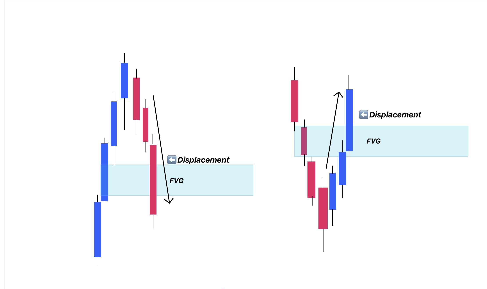

そしてBreak後、価格は **"MSS（構造転換）"し再度否定されたFVGまで戻してきた場合、失敗したFVGがIFVGとなり**強気の転換ゾーンとなりエントリーの候補となります。
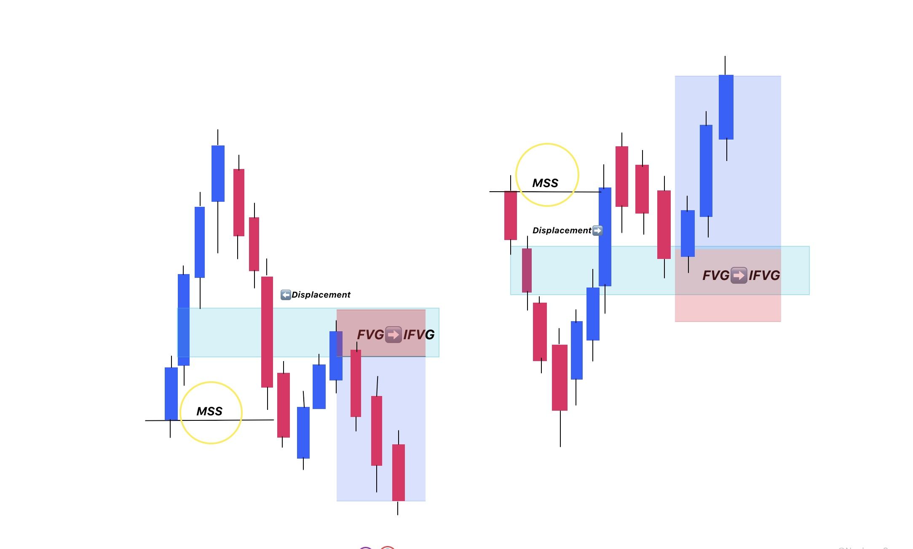

## ICT HP PRO v4 インジケーター解説
### 1. 市場構造と流動性 (Market Structure & Liquidity)

相場の骨格を理解するための基本要素です。

| 要素 (Element) | インジケーターでの表示 | 意味と使い方 |
|:---|:---|:---|
| **Smart Liquidity Zones** | チャート上の水平線（デフォルト：白/黄 → **青/黄に変更**） | **トレンド転換のサイン (MSS)**。高値・安値を一度刈り取った（Sweep）後に、その起点となったスイングポイントをブレイクしたことを示します。このラインは、反転後の押し目・戻りのサポート/レジスタンスとして機能します。 |
| **HTF Levels** | 日/週/月/年単位の水平線 | **重要な磁石**。前日/前週などの高値(PDH/PWH)・安値(PDL/PWL)や始値(Open)を示します。これらの価格帯には流動性（損切り注文）が溜まっており、価格が引き寄せられたり、強く反発したりする重要なポイントです。 |
| **SMT Divergence** | チャート上のライン（デフォルト：赤/緑 → **ピンク/紫に変更**）と`SMT`ラベル | **トレンド転換の強力な先行サイン**。相関関係にある2つの銘柄（例：ESとNQ）の一方が高値を更新したのに、もう一方が更新できなかった場合などに発生します。市場の内部的な弱さや強さを示唆します。 |
| **Displacement** | （内部ロジック） | **本気の動き**。ATR（平均的な値動き）やローソク足の実体の大きさに基づき、勢いのある値動きを判断します。この「本気の動き」が伴うブレイクやFVGは、信頼性が高いとされます。 |

### 「Smart Liquidity Zones」と「MSS」の関係 - 原因と結果

この2つは密接に関連していますが、役割が異なります。

*   **MSS (Market Structure Shift)**: **「イベント」そのもの**です。
    上昇トレンド中の押し安値や、下降トレンド中の戻り高値が破壊される**アクション（構造転換）**を指します。これは、相場の方向性が変わったことを示す「動詞」に当たります。

*   **Smart Liquidity Zone**: **MSSというイベントによって生まれる「結果」**です。
    このインジケーターでは、MSSを引き起こした動きの起点（強気のMSSならその前の安値）に引かれる**水平線（POI）**を指します。これは、構造転換後に価格が戻ってきたときに反発が期待される「名詞」に当たります。

**結論**:
MSSという**地殻変動**が起きた結果、チャート上に**新しい断層（サポート/レジスタンスライン）**として描画されるのがSmart Liquidity Zoneです。ドキュメントで「トレンド転換のサイン(MSS)」と書かれているのは、このラインが表示されることが、インジケーターのロジック上でMSSが確定したことの証明になるためです。

### 2. エントリー候補ゾーン (Point of Interest - POI)

価格が戻ってきたときにエントリーを検討する「待ち伏せエリア」です。

| 要素 (Element) | インジケーターでの表示 | 意味と使い方 |
|:---|:---|:---|
| **FVG (Fair Value Gap)** | 半透明のゾーン（デフォルト：緑/赤） | **価格の不均衡**。価格が一方向に強く動いたことで生じた「窓」や「空間」です。市場はこの不均衡を埋めに戻る傾向があり、絶好の押し目買い・戻り売りのポイントになります。 |
| **IFVG (Inverted FVG)** | FVGが反転したゾーン（デフォルト：青緑/オレンジ） | **役割の逆転**。一度FVGとして機能せず、逆に突き破られたゾーンです。サポートがレジスタンスに変わるように、買いのFVGが売りの抵抗帯（IFVG）に変化します。 |
| **C.E. (Consequent Encroachment)** | FVGゾーンの中間線 | FVGの**50%ライン**。価格がFVG全体を埋めずに、このC.E.で反発することも多いため、エントリーの目安として使われます。 |
| **HTF FVG/IFVG** | 上位足のFVG/IFVGゾーン | **より強力なPOI**。15分足などが見ているFVGよりも、4時間足や日足のFVGの方が影響力が強く、より大きな反発が期待できる重要なゾーンです。 |
| **MSS** | 黒い点線 | 構造転換のシグナル。とっても大事！！！！|
| **Retest（リテスト）** | 赤または緑のラベルで R の文字 | **ゾーンの有効性を示すサイン**。サプライ/デマンドゾーンに価格が接触（リテスト）したことを示します。ゾーンが市場に意識されている証拠であり、特に**初回のリテスト**は反発を狙う絶好のエントリーチャンスとなり得ます。リテスト回数が増えるほどゾーンは消耗し、強度が弱まる傾向にあります。 |

### 3. 時間帯とセッション (Time & Sessions)

特定の時間帯に現れる優位性を利用します。

| 要素 (Element) | インジケーターでの表示 | 意味と使い方 |
|:---|:---|:---|
| **Killzone (KZ)** | 背景色の変わるボックス（ロンドン/NY AM/NY PM） | **取引が活発になる時間帯**。ロンドンやニューヨーク市場の始まりなど、流動性が高まり、重要な値動きが起きやすい時間帯をハイライトします。この時間帯に絞ってトレードすることで、効率が上がります。 |
| **NY Midnight Open** | 水平線 | **ニューヨーク時間の真夜中0時の始値**。ICTでは1日の区切りとして重視され、この価格を上回っているか下回っているかで、その日の短期的なバイアスを判断します。 |
| **NDOG / NWOG** | 週末や日をまたぐ際にできる「窓」のゾーン | **価格が埋めに戻る傾向があるギャップ**。New Day Opening Gap (NDOG)やNew Week Opening Gap (NWOG)は、価格が一度そこに戻ってくる（窓埋め）傾向があるため、トレードの目標地点として利用できます。 |

---

### 4. AIハンターと総合判断 (AI Hunter & HUD)

インジケーターの中核となる機能です。

| 要素 (Element) | インジケーターでの表示 | 意味と使い方 |
|:---|:---|:---|
| **AI Hunter** | 売買シグナル（緑/赤の丸） | **高確率なセットアップの検出**。これまでに解説した複数のICT要素（流動性のスイープ、構造の転換、時間帯など）が複合的に発生した「おいしい」瞬間をAIが判断し、シグナルとして表示します。 |
| **AI Projections (TP)** | シグナル発生時に表示される複数の水平線 | **利食い目標の目安**。シグナルが発生した際の直近の値幅（Dealing Range）を基に、統計的に到達しやすい利食い目標（TP1, TP2, TP3）を自動で計算・表示します。 |
| **HUD (Heads-Up Display)** | 画面隅のダッシュボード | **相場環境のカンペ**。「AIのバイアスは？」「上位足のPOIはどっちに反応してる？」「今はキルゾーン内？」といった、トレード判断に必要な情報を一覧表示し、現在の状況を瞬時に把握できます。 |

これらの要素を組み合わせることで、「**どの時間帯に（Killzone）**」「**どのレベルの流動性を狩った後（HTF Levels）**」「**どのゾーンで待ち伏せ（FVG）**」「**AIのサインが出たらエントリーを検討する**」といった、一貫性のある高度なトレード戦略を立てることが可能になります。

---

## SMT Divergence とは？ (Smart Money Technique)

SMT Divergenceは、ICT/SMCにおいてトレンドの転換を早期に察知するための非常に強力な概念です。

一言でいうと、**「いつも一緒に動くはずの相関性の高い2つの銘柄の間に生じる『矛盾』や『足並みの乱れ』」**を指します。

### なぜ重要か？

通常、相関性の高い銘柄ペア（例：`ES`と`NQ`、`EURUSD`と`DXY`）は、同じように高値や安値を更新しながら動きます。しかし、スマートマネー（大口投資家）がトレンドの終焉で利益確定や逆ポジションの構築を始めると、その動きに「ズレ」が生じます。このズレを捉えることで、トレンド転換の初動を掴むことができます。

### 2つの基本パターン

#### 1. 弱気のSMT (Bearish SMT) - 売りのサイン

上昇トレンドの終焉を示唆します。

*   **状況**: 銘柄Aが高値を更新（Higher High）したにもかかわらず、相関銘柄Bが高値を更新できずに切り下げた（Lower High）。
*   **解釈**: 「上昇の勢いに陰りが見える。スマートマネーはもうこの上昇を全面的に支持していない」というサイン。**売りのチャンス**を探します。

#### 2. 強気のSMT (Bullish SMT) - 買いのサイン

下降トレンドの終焉を示唆します。

*   **状況**: 銘柄Aが安値を更新（Lower Low）したにもかかわらず、相関銘柄Bが安値を更新できずに切り上げた（Higher Low）。
*   **解釈**: 「下落の勢いが弱まっている。スマートマネーはもう売り一辺倒ではない」というサイン。**買いのチャンス**を探します。

### SMT Divergenceの使い方

SMTは単体でエントリーするのではなく、**他のSMC要素と組み合わせることで真価を発揮する「最終確認ツール」**です。

例えば、「上位足のPOIに到達」→「そこでSMTが発生」→「下位足でCHoCHを確認」→「FVGでエントリー」というように、複数の根拠（コンフルエンス）の一つとして使うことで、トレードの確度を劇的に高めることができます。

## NDOG / NWOG とは？

NDOG (New Day Opening Gap) と NWOG (New Week Opening Gap) は、それぞれ「日足」と「週足」の切り替わり時に発生する「窓（ギャップ）」のことです。

### 定義

*   **NDOG**: 「**今日の始値**」と「**昨日の終値**」の間にできる価格の”すきま”。
*   **NWOG**: 「**今週の始値**」と「**先週の終値**」の間にできる価格の”すきま”。

### なぜ重要か？

市場には「**窓は埋められる**」という強い傾向（アノマリー）があります。一度開いたギャップに向かって、価格は高い確率で戻ってこようとします。

そのため、NDOGやNWOGは、以下のような強力な目標として機能します。
*   **利食い目標 (Take Profit)**: ポジションの最終的な出口として。
*   **反発ポイント**: 窓埋めが完了した後の、新規エントリーの候補として。

## ICT HP PRO v4 実践的ワークフロー (A-Z)

このインジケーターを最大限に活用するための、具体的な思考と行動のステップです。

#### **ステップ1：環境認識 -「今日の戦場はどこか？」**

まず、トレードを始める前に、大きな視点で相場全体を把握します。

1.  **HTF Levels (日足/週足/月足の高値・安値) を確認する**
    *   **何を見るか？**: チャートに表示されている`PDH` (前日高値), `PWL` (前週安値) などの水平線。
    *   **どう考えるか？**: 「今日の価格は、まず前日の高値を目指すだろうか？それとも、前週の安値まで下落する余地があるだろうか？」と考えます。これらのレベルは、価格が引き寄せられる**磁石**であり、最終的な利食い目標（大きなゴール）になります。

2.  **HUD (ダッシュボード) を見る**
    *   **何を見るか？**: `HTF POI Bias` の項目。
    *   **どう考えるか？**: ここが `Bullish` なら「上位足では買いが優勢」、`Bearish` なら「売りが優勢」と、今日の**天気予報**をチェックする感覚で、大まかな風向きを把握します。

---

#### **ステップ2：方向性の決定 -「どちらのチームにつくか？」**

次に、より短期的な「今、どちらの方向に優位性があるか」を判断します。

1.  **SMT Divergence を探す**
    *   **何を見るか？**: チャート上の`SMT`というラベルと、2つの銘柄間の高値・安値のズレ。
    *   **どう考えるか？**: 「あれ、ESは高値を更新したのに、NQは更新できていないな…これは上昇の勢いが弱まっている**”内部的な亀裂”**かもしれない」と考えます。これは、トレンド転換の**最も早い先行サイン**の一つです。

2.  **Smart Liquidity Zones (MSS) の発生を待つ**
    *   **何を見るか？**: チャート上に引かれる水平線（デフォルト：白/黄）。
    *   **どう考えるか？**: これは「市場構造の転換 (Market Structure Shift)」を示します。例えば、上昇トレンドの後にこのサインが出たら、「買いチームの最後の砦が破られた！いよいよ売りチームの出番か？」と考えます。これは、**相場が「本気で」方向性を変えたことを示す決定的な証拠**です。

---

#### **ステップ3：エントリーポイントの特定 -「どこで待ち伏せるか？」**

方向性が決まったら、具体的なエントリーポイント（罠を仕掛ける場所）を探します。

1.  **Killzone (キルゾーン) の時間帯に入るのを待つ**
    *   **何を見るか？**: チャートの背景色が変わる時間帯（ロンドン、NY AMなど）。
    *   **どう考えるか？**: 「よし、ニューヨーク時間が始まった。ここからが本番だ」と考えます。重要な動きは特定の時間帯に集中するため、**この時間内でのみトレードする**と決めることで、無駄なエントリーを減らせます。

2.  **FVG (Fair Value Gap) を見つける**
    *   **何を見るか？**: チャート上の半透明のゾーン。
    *   **どう考えるか？**: 方向性が決まった後（例：MSSが発生した後）にできたFVGは、**絶好の待ち伏せポイント**です。「価格が一度このゾーンまで戻ってきたら、エントリーしよう」と計画を立てます。大口投資家が注文を補充するために、価格はFVGに戻ってくる傾向があります。

---

#### **ステップ4：最終確認と実行 -「引き金を引くか？」**

全ての準備が整い、いよいよエントリーの最終判断です。

1.  **AI Hunter のシグナルを待つ**
    *   **何を見るか？**: 緑または赤の丸いサイン。
    *   **どう考えるか？**: このサインは、「**ステップ1〜3で見てきた複数の優位性（HTFレベルへの到達、構造転換、キルゾーン、FVGへの回帰など）が、今この瞬間にすべて揃いましたよ！**」というインジケーターからの合図です。

2.  **AI Projections (TP) を確認する**
    *   **何を見るか？**: シグナルと同時に表示される`TP1`, `TP2`, `TP3`のライン。
    *   **どう考えるか？**: 「エントリーした場合、どこで利益を確定すべきか？」を判断します。これらのラインは、直近の値動きを基に統計的に計算された、**現実的な利食い目標**です。

このように、「ICT HP PRO v4」は、ただのサインツールではなく、**環境認識 → 方向性の決定 → エントリーポイントの特定 → 実行**という、一貫したトレード戦略の思考プロセスそのものをチャート上に描き出してくれる、強力なナビゲーションシステムなのです。

