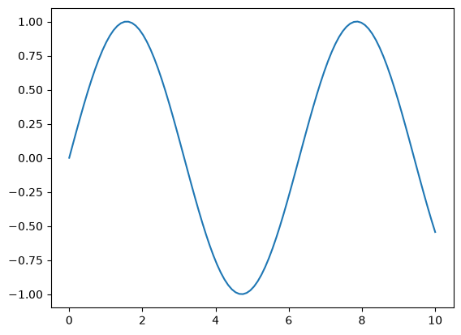

* Org-Babel + emacs-jupyter + Python 導入
非同期処理と描画埋め込みができる *emacs-jupyter* を導入します。

- *Org-Babel* : Org-mode でコードブロックを実行する仕組み
- *emacs-jupyter* : その中で Jupyter kernel を使って Python などを実行する拡張

** 処理の流れ
1. Org-mode で Org-Babel が提供するコードブロックに Python コードを記述する
2. *C-c C-c* で実行する（Org-Babel 経由での実行）
3. emacs-jupyter が *ZeroMQ* という通信を通して *Jupyter Kernel* に送る
4. Jupyter Kernel から出力が返ってくる
5. emacs-jupyter が結果を Org-mode（Org-Babel）に返す

** 環境構築
*** Emacs が動的モジュールサポート付きかどうか確認する

Elisp では記述しきれない *ZeroMQ* などの高度な技術を呼び出すために、
「動的モジュールサポート」が必要です。

最近の OS 標準パッケージや Homebrew 等でインストールした Emacs であれば概ね有効になっているそうですが、念のため確認します。

1. *M-:* を押し、評価モードに入る
2. ミニバッファに =Eval:= と出るので、以下を入力する
3. =t= (=True=) であれば動的モジュールサポートが付いている

#+begin_src emacs-lisp
(dynamic-module-p)
#+end_src

*** MELPA を使えるようにする
MELPA は「Emacs のための非公式パッケージストア」です。

GNU ELPA という公式のパッケージストアが標準機能としてありますが、
条件が厳しいためほとんどの拡張機能は MELPA にて配布されています。

Doom Emacs では既に有効化されています。

*** init.el で jupyter を有効にする

=(org +jupyter)= に変更します。

Org-Babel は Doom Emacs では既に有効化されているので書く必要はありません。

#+begin_src emacs-lisp
;; init.el
:lang
(org +jupyter)
#+end_src

*** package.el でパッケージを記述する

#+begin_src emacs-lisp
;; package.el
(package! jupyter)
(package! simple-httpd :recipe (:host github :repo "skeeto/emacs-web-server"))
(package! emacs-websocket :recipe (:host github :repo "ahyatt/emacs-websocket"))
#+end_src

*** 仮想環境を作成する
**** 1. 現在の環境の確認
ipykernel には Python 3.10 以上が必要です。
詳細は [[https://pypi.org/project/ipykernel/][ipykernel ドキュメント]]を参照してください。

***** Windows

#+begin_src powershell
python --version
#+end_src

***** WSL（AlmaLinux 10）

#+begin_src bash
python3 --version
#+end_src

**** 2. 仮想環境の作成
先ほど確認したバージョンと、仮想環境を作りたいディレクトリを指定して作成します。

***** Windows

#+begin_src powershell
py -3.12 -m venv C:\Users\nomura\myenv312
#+end_src

確認：

#+begin_src powershell
C:\Users\nomura\myenv312\Scripts\python.exe --version
#+end_src

***** WSL（AlmaLinux 10）

#+begin_src bash
python3.12 -m venv ~/myenv312
#+end_src

確認：

#+begin_src bash
ls -ld ~/myenv312
#+end_src

**** 3. 必要なパッケージのインストール
=ipykernel= をインストールします。

=ipykernel= は依存関係として =jupyter_client= と =jupyter_core= を一緒に入れてくれます。
よってインストール時に =jupyter= を指定することなく、jupyter コマンドが使用できます。

万が一 jupyter コマンドが使用できない場合は、別途 =jupyter= をインストールしてください。

詳細は [[https://github.com/ipython/ipykernel/blob/main/pyproject.toml][ipykernel 依存関係]]を参照してください。

***** Windows

#+begin_src powershell
C:\Users\nomura\myenv312\Scripts\python.exe -m pip install ipykernel
#+end_src

jupyter コマンドが使用できるかどうかを確認します。

#+begin_src powershell
C:\Users\nomura\myenv312\Scripts\jupyter.exe --version
#+end_src

使用できない場合は、以下のコマンドで jupyter を追加インストールします。

#+begin_src powershell
C:\Users\nomura\myenv312\Scripts\python.exe -m pip install jupyter
#+end_src

***** WSL（AlmaLinux 10）

ipykernel をインストールします。

#+begin_src bash
~/myenv312/bin/python -m pip install ipykernel
#+end_src

jupyter コマンドを確認します。

#+begin_src bash
~/myenv312/bin/jupyter --version
#+end_src

確認できない場合は、別途インストールします。

#+begin_src bash
~/myenv312/bin/python -m pip install jupyter
#+end_src

**** 4. 仮想環境を Jupyter のカーネルとして登録する
ipykernel を使って、仮想環境を Jupyter のカーネルとして登録します。

登録時にいくつか指定する項目があります。
詳細は [[https://github.com/jupyter/jupyter_client/blob/main/docs/kernels.rst][docs/kernels.rst]] または
[[https://ipython.readthedocs.io/en/latest/install/kernel_install.html][IPython kernel ドキュメント]]を参照してください。

#+begin_quote
 =--user= : Windows のユーザー単位で登録
 =--name= : カーネルの内部名（任意。Org-Babel のコードブロックにカーネルを指定するときに使う名前）
 =--display-name= : UI に表示されるカーネル名
#+end_quote

***** Windows

#+begin_src powershell
C:\Users\nomura\myenv312\Scripts\python.exe -m ipykernel install --user --name emacs-venv --display-name "Python (Emacs Venv)"
#+end_src

登録済みカーネルを確認します。

#+begin_src powershell
C:\Users\nomura\myenv312\Scripts\jupyter.exe kernelspec list
#+end_src

***** WSL（AlmaLinux 10）

#+begin_src bash
~/myenv312/bin/python -m ipykernel install --user --name emacs-venv --display-name "Python (Emacs Venv)"
#+end_src

登録済みカーネルを確認します。

#+begin_src bash
~/myenv312/bin/jupyter kernelspec list
#+end_src

*** config.el に jupyter.exe が入っているフォルダのパスを明記する
作成した仮想環境のパスを =config.el= に記述します。

#+begin_src emacs-lisp
;; config.el
(after! jupyter
(setq jupyter-executable "C:/Users/light/myenv312/Scripts/jupyter.exe")
(add-to-list 'exec-path "C:/Users/light/myenv312/Scripts"))
#+end_src

[[https://github.com/emacs-jupyter/jupyter#org-mode-source-blocks][emacs-jupyter ドキュメント Org Babel source block]]を参照して、
Org-Babel の言語に jupyter を登録します。

また、emacs-jupyter のデフォルトは同期実行です。
コードブロックで =:async yes= とすれば非同期実行になります。

デフォルトを非同期実行にしてほしいので設定に書き加えます。
同期実行のままでよい場合は飛ばしてください。

#+begin_src emacs-lisp
;; config.el
(after! org
(require 'jupyter)

;; jupyter を org-babel-load-languages に追加する
(org-babel-do-load-languages
'org-babel-load-languages
'((python . t)
(jupyter . t)))

;; デフォルト設定を非同期実行に変更
(setq org-babel-default-header-args:jupyter-python
'((:async . "yes")))
(setq org-babel-default-header-args:python
'((:async . "yes"))))
#+end_src

*** 実行の確認
グラフ描画のコードを実行してみます。
numpy と matplotlib をインストールします。

**** Windows

#+begin_src powershell
C:\Users\nomura\myenv312\Scripts\python.exe -m pip install -U numpy matplotlib
#+end_src

**** WSL（AlmaLinux 10）

#+begin_src bash
~/myenv312/bin/python -m pip install numpy matplotlib
#+end_src

**** テスト
Org ファイルにコードブロックを記述します。

セッション名（=:session=）は自由に決めてください。

カーネル名（=:kernel=）は、仮想環境を Jupyter のカーネルとして登録する際に指定した =--name= を使用します。

#+begin_src jupyter-python :session py :kernel emacs-venv
import matplotlib.pyplot as plt
import numpy as np

x = np.linspace(0, 10, 100)
plt.plot(x, np.sin(x))
plt.show()
#+end_src

以下のような sin カーブが出力されれば成功です。

*** 実行場所の確認

Python コード側から、実行場所を確認します。

作成した仮想環境のパスが出力されれば成功です。

#+begin_src jupyter-python :session py :kernel emacs-venv
import sys
print(sys.executable)
#+end_src

** コードハイライト

Org ファイルのコードハイライトは =org-src-lang-modes= という対応表を見て行われます。

初期状態では jupyter-python と python の対応
=("jupyter-python" . python)= が対応表にないため、コードに色がつきません。
（実行すればつきますが、ファイルを開いた時点でハイライトしてほしい場合）

ファイルを開いた段階ではハイライトがつきません。

[[file:figs/2026-09-12_02-21-10_screenshot.png]]

=config.el= に =("jupyter-python" . python)= を明記します。

これで jupyter-python と python の対応ができるので、コードがハイライトされます。

#+begin_src emacs-lisp
;; config.el
(after! org
(setq org-src-fontify-natively t)

;; jupyter 言語名 -> major mode の対応を追加
(add-to-list 'org-src-lang-modes '("jupyter-python" . python)))
#+end_src

** 参考リンク
 [[https://pypi.org/project/ipykernel/][ipykernel ドキュメント]]
 [[https://github.com/ipython/ipykernel/blob/main/pyproject.toml][ipykernel 依存関係]]
 [[https://github.com/jupyter/jupyter_client/blob/main/docs/kernels.rst][docs/kernels.rst]]
 [[https://ipython.readthedocs.io/en/latest/install/kernel_install.html][IPython kernel ドキュメント]]
 [[https://github.com/emacs-jupyter/jupyter#org-mode-source-blocks][emacs-jupyter ドキュメント Org Babel source block]]
