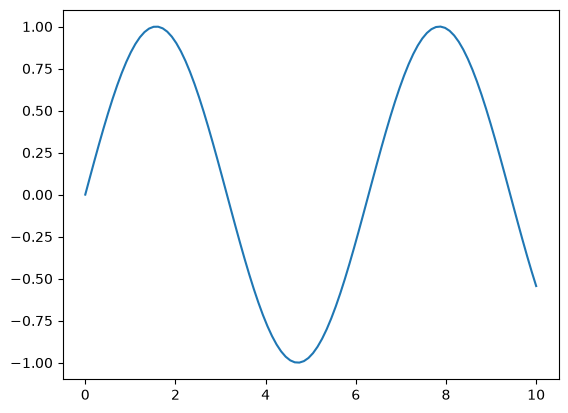
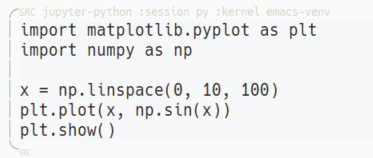
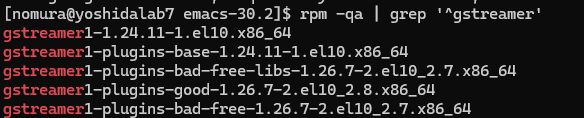
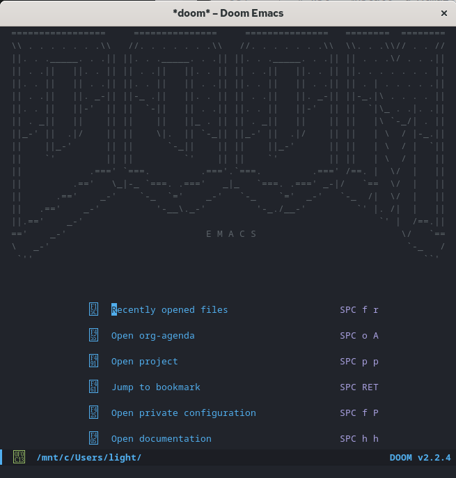
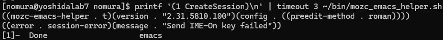
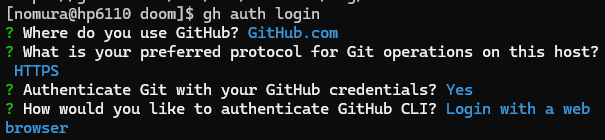
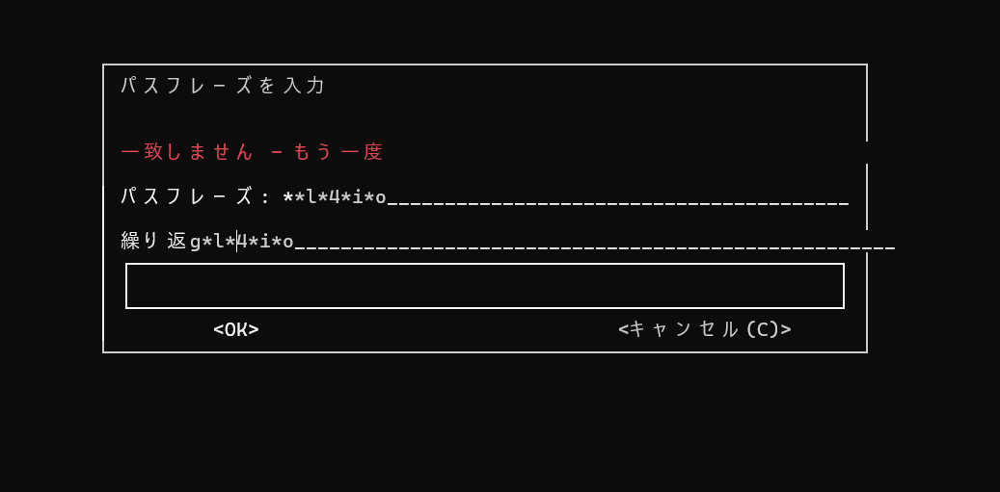

#+title: Emacs
* Emacs 画面構成と基本の操作
** 画面の構成
*** フレーム
Windows や Mac でウィンドウと呼ばれるアプリケーションの表示枠のことを Emacs では *フレーム* といいます。

*** ウィンドウ
フレーム内でファイル（≒ バッファ）を表示する領域を *ウィンドウ* といいます。
ウィンドウは分割が可能です。

*** フリンジ
ウィンドウの両端にある追加情報を視覚的に表示するための領域。空行を「~」で表したり、折り返しを示したりします。

*** バッファ
メモリ上に作成された *オブジェクト* を *バッファ* といいます。

**** *ファイルバッファ* ：実際のファイルと連結しているバッファ
**** *非ファイルバッファ* ：Emacs が画面表示や作業のために一時的に作っているバッファ
  - *eww*（プレビューバッファ）
  - *scratch*（スクラッチバッファ）
  - *Messages*（ログバッファ）
  - Dired（フォルダ一覧バッファ）

*** モードライン
ウィンドウの下部にある領域のことを *モードライン* といいます。
カレントバッファに関する情報や、その他 Emacs が取得できる情報であればなんでも表示させることができます。

*** ミニバッファ
モードラインの下にある領域。コマンドなどが表示されます。

** モード
*** メジャーモード
バッファに対して必ず 1 つ適用されるモードのこと。モードライン右端に表示されます。

*** マイナーモード
マイナーモードはメジャーモードとは異なり、いくつでも適用可能でそれぞれについて有効化／無効化が設定できます。
*** フック

** コマンド
C- : Ctrl キーを押しながらの操作
M- : Alt(Esc) キーを押しながらの操作

*** コマンド検索
- *M-x コマンド名*

*** まず覚えるコマンド
- *C-/* : UNDO
- *C-Shift-/* : REDO
- *C-g* : 現在行っている操作のキャンセル
- *C-x C-c* : Emacs を終了する

*** ファイル(バッファ)操作
- *C-x C-f* : ファイルの作成(File)
- *C-x C-s* : ファイルの保存(Save)
- *C-x C-w* : 別名で保存(Write)
- *C-x i* : 現在のバッファに別のファイルを挿入する(Insert)。別のファイルの内容を貼り付けできる

- *C-x b* : バッファを切り替える(Buffer)。削除しない限りバッファは残っているので、画面に表示されていなくても切り替えできる
- *C-x k* : バッファを削除する(Kill)

*** カーソル移動
- 前の行(Previous) *C-p* , 次の行(Next) *C-n* , 次の文字(Forward) *C-f* , 後ろの文字(Backward) *C-b* , 行頭(Abcde...) *C-a* , 行末(End) *C-e*
- *C-l* : カーソル行が画面中央の位置になるようにスクロールされる(Line)
- *C-v* : １画面下にスクロール(View)
- *M-v* : １画面上にスクロール(View)
- *M-<* : バッファの先頭へ
- *M->* : バッファの終端へ
- *M-g g* : 指定行に移動(Go to)

*** 文字の入力や文字列の操作
- *C-SPC* : リージョン(開始位置)を決定する→カーソル移動で範囲選択
- *C-M-SPC* : リージョンを決定、SPC でブロックごとに範囲選択
- *M-w* : コピー
  キルリング(= Emacs 内のクリップボード)に保存される
- *C-y* : ペースト
  Windows 内のクリップボードからペーストしたい場合は、Win+V でクリックしてから C-y で貼り付けできる
- *C-w* : カット＆コピー
- *範囲選択後 C-x TAB* → 十字キー : ブロックインデント

*** TODO 階層の操作

*** 検索
- *C-s* : バッファ内の文字の検索。次の候補に進むには再度 *C-s* 、前の候補に戻るには *C-r*
  init.el で ;;japanese のコメントアウトを外している場合は、cmigemo が必要です。

*** ウィンドウ操作
- *C-x 3* : 左右分割
- *C-x o* : ウィンドウ移動
- *C-x 0* : カレントウィンドウを閉じる（バッファは消えていないので *C-x b* で再表示できる）
- *C-x 1* : カレントウィンドウ以外のウィンドウを閉じる

*** ディレクトリ操作
- *C-x d* : Dired バッファを開く
- *+（Shift-;）*: 新規ファイル、新規フォルダを作る
- カーソル行で *d* → *x* : ファイルの削除フラグを立てる(delete) *x* で一括削除
- *R* : 名前の変更(Rename)
- *C* : ファイルのコピー、ペースト

*** org-mode 関連
- *M-x org-md-export-to-markdown* : .org ファイルを .md ファイルに変換する

** 設定ファイルの編集
Emacs は Elisp(Emacs Lisp エルリスプ) というプログラミング言語で書かれています。
設定ファイルを編集することでショートカットを作成したり表示を変更したりできます。

*** *;;* コメントはセミコロン
#+begin_src emacs-lisp
;; コメント
#+end_src

*** *t と nil* True/False
#+begin_src emacs-lisp
;; t=True  例）カーソルの点滅を有効にする
(blink-cursor-mode t)

;; nil=False  例）カーソルの点滅を無効にする
(blink-cursor-mode nil)
#+end_src

*** *' と #'* 変数と関数(関数名)の区別
#+begin_src emacs-lisp
;; my-list という変数にリストを代入する
(setq my-list '(apple banana orange))

;; M-y というキーに consult-yank-pop を登録する
(map! "M-y" #'consult-yank-pop)
#+end_src

*** *seq* 変数の定義と代入
#+begin_src emacs-lisp
;; my-name という変数に "Alice" という文字を代入する
(setq my-name "Alice")
#+end_src

*** *map!* キーの割り当て
#+begin_src emacs-lisp
;; (map! "押すキー" #'動かしたい関数名)
(map! "C-c f" #'find-file)
#+end_src

*** *add-hook* フック（特定のモードでのみ動かす）
#+begin_src emacs-lisp
;; (add-hook 'モード名-hook #'動かしたい関数)
(add-hook 'prog-mode-hook #'display-line-numbers-mode)
#+end_src

** 補足：追加設定
*** Ctrl と Alt キーを使いやすい位置に設定する
Windows の場合 Power Toys > Keyboard Manager > キーの再マップ から変更できます。
ただし Capslock キーへの割り当ては非推奨です。

(参考：[[https://qiita.com/EkaTaro3/items/37d7c19acea7bc777749][Windowsのキーボードの割り当てを変更して生産性を高める]])

* 標準機能
*** 選択範囲（リージョン）に文字を上書き入力できるようにする
#+begin_src emacs-lisp
(delete-selection-mode t)
#+end_src

*** next line で最終行の場合に改行を追加する
#+begin_src emacs-lisp
(setq next-line-add-newlines t)
#+end_src

*** マウスでテキストを選択したときに、自動的にキルリング(=クリップボード)に保存する
#+begin_src emacs-lisp
(setq  mouse-drag-copy-region t)
#+end_src

*** *treemacs* : ファイルツリーを表示する
#+begin_src emacs-lisp
## init.el
:ui
(treemacs)  ;; コメントアウトを外す
#+end_src
- *C-c o p* : ファイルツリーを表示する、非表示にする(Open Project)
- *C-x p* : ファイルツリーにフォーカスを合わせる(Project)
- *c f* : ファイル作成(File)
- *c d* : フォルダ作成(Directory)
- *R* (Shift + r) : 名前の変更(Rename)
- *d* : 削除(Delete)
- *y f* : コピー＆ペースト(Yank)
- *m* : 移動（カット＆ペースト, Move）

*** *eshell* : ターミナルバッファを使う
Windows 環境では vterm の導入が難しいそうです。そこで完全 Emacs 製の Eshell を導入します。
#+begin_src emacs-lisp
## init.el
:term
eshell    ;; コメントアウトを外す
#+end_src
- *M-x eshell* : eshell を開く
- *C-x p* : フォーカスを合わせる

*** *multiple-cursors* : 複数カーソル
#+begin_src emacs-lisp
  ;; init.el
  multiple-cursors
#+end_src

- *C-c m n* : 今カーソルが当たっている単語と同じ単語の「次の位置」に向か
ってカーソルを追加する
- *C-c m p* : 「前の位置」に向かって同じ単語にカーソルを追加する
- *C-c m m* : すべての同じ単語にカーソルを追加する

- *C-c m l* : 現在のリージョンのすべての行の末尾（または先頭）にカーソルを置く
- *C-c m a* : 現在のリージョンのすべての行の先頭にカーソルを置く
- *C-c m e* : 現在のリージョンのすべての行の末尾にカーソルを置く

* 拡張機能
*** *Magit* : Git 管理
#+begin_src emacs-lisp
;; init.el
;; magit のコメントアウトを外す
:tools
magit           ; a git porcelain for Emacs
#+end_src
1. *C-c v g*
2. *s* (Stage) : 変更があったファイルや行にカーソルを合わせて s を押すと、ステージ
3. *c c* (Commit) : c を 2 回押すと、コミットメッセージを書く画面が開く
4. *C-c C-c* (Commit) :
   コミット
5. *P p* （Push）: P（Shift + p）を押したあと、もう一度 p を押すとリモートへプッシュ
6. *F* (Fetch/Pull) : Pull 関連の操作
*** *consult* : キルリング(=クリップボード)を可視化する
#+begin_src emacs-lisp
;; config.el
;; クリップボード履歴（キルリング）を一覧から選んで貼り付ける設定
(map! "M-y" #'consult-yank)
#+end_src

*** *cmigemo* : ローマ字で打つだけで日本語がヒットするようにする
[[https://github.com/koron/cmigemo/releases/tag/v1.8.0][インストール]]して解凍後、環境変数に登録するか config.el に記述してください。
#+begin_src
## 環境変数の編集
変数 > Path > 新規 > .exe ファイルが入っている「フォルダ(￥bin)」のパスを登録

## 反映
再起動 → doom sync
#+end_src
Windows の場合は msvc 版と ucrt64 版がありますがどちらでもいいです。ucrt64 版は Windows10 以降の新しい標準規格に合わせて作られたものです。

*** *rainbow-delimiters* : コード内のカッコの色を、階層（深さ）ごとに自動で色分けする
#+begin_src emacs-lisp
;; package.el
(use-package! rainbow-delimiters
    :hook (prog-mode . rainbow-delimiters-mode))
#+end_src

*** *vundo* : ファイルの変更履歴（Undo/Redo）を、分岐を含めて視覚的に表示する(Visual Undo)
#+begin_src emacs-lisp
;; package.el
(package! vundo)
#+end_src
#+begin_src emacs-lisp
;; config.el
;; ショートカットを登録
(map! "C-c u" #'vundo)

;; vundo モードで Enter キーを押すと決定する
(after! vundo
  (define-key vundo-mode-map (kbd "RET") #'vundo-confirm))
#+end_src

*** *anzu* : 文字検索のヒット数と何番目かの表示
#+begin_src emacs-lisp
(package! anzu)
#+end_src
#+begin_src emacs-lisp
;; config.el
(use-package! anzu
  :defer t                     ;; 遅延
  :init (global-anzu-mode +1)  ;; 常時
  :config
   (setq anzu-use-migemo t))   ;; cmigemoに対応
#+end_src

*** *Org-download* : org ファイルに画像を追加する
非公式パッケージストア MELPA にて配布されています。
MELPA は Doom Emacs では既に有効化されています。

下記設定後、
- *C-S-y* : クリップボードから画像を挿入する
- *C-S-g* : ローカルから画像を挿入する

**** 基本設定
#+begin_src emacs-lisp
  ;; package.el
  (package! org-download)
#+end_src
#+begin_src emacs-lisp
;; config.el
(use-package! org-download
  :after org
  :config
  ;; 画像の保存先をカレントディレクトリの「images」フォルダに指定
  (setq org-download-image-dir "./images")
  ;; ファイルを開いた時にすべてのインライン画像を自動表示する
  (setq org-startup-with-inline-images t)
  ;; 画面上に表示するインライン画像の最大横幅を300ピクセルに制限
  (setq org-image-actual-width 300))
#+end_src

**** クリップボードの画像を挿入する関数＋ショートカット登録
#+begin_src emacs-lisp
(defun my/org-paste-image-from-clipboard ()
    ;; クリップボードの画像を保存し、バッファのインライン画像を即座に再描画
    (interactive)
    ;; 画像をダウンロードしてリンクを挿入。成功するとファイルパスが返る
    (let ((file (org-download-clipboard)))
      ;; ファイルが正しく生成された場合のみ処理を実行
      (when (and file (file-exists-p file))
        ;; バッファ全体のインライン画像を強制的に最新状態へ更新
        (org-display-inline-images nil t))))

  ;; キーバインドを登録
  (map! :map org-mode-map
        "C-S-y" #'my/org-paste-image-from-clipboard)
#+end_src

**** 既にローカルにある画像を挿入する関数＋ショートカット登録
#+begin_src emacs-lisp
  (defun my/org-insert-image-from-dired ()
    ;; ミニバッファから画像ファイルを選択し、org-download経由で挿入する
    (interactive)
    ;; 拡張子を指定して画像ファイルを選びやすくする
    (let* ((file (read-file-name "挿入する画像を選択: " nil nil t nil
                                 (lambda (f)
                                   (or (file-directory-p f) ;; ディレクトリなら常に表示
                                       (string-match-p "\\.\\(png\\|jpg\\|jpeg\\|gif\\|webp\\)$" f))))))
      (when (and file (file-exists-p file) (not (file-directory-p file)))
        ;; org-download にファイルのパスを渡して処理を実行
        (org-download-image file)
        ;; インライン画像を即座に再描画
        (org-display-inline-images nil t))))
#+end_src

*** *corfu + cape* : 補完候補を表示する UI + 補完拡張
corfu 自体はただの表示 UI です。
corfu のみを入れた場合は、Emacs 標準の補完である CAPF 由来の単語が並びます。
cape を入れることで、cape 由来の候補が増えます。

- *Enter* または *C-j* : 補完の決定

#+begin_src emacs-lisp
;; package.el
  ;; 補完UI
  (package! corfu)
  ;; 補完拡張
  (package! cape)
#+end_src
#+begin_src emacs-lisp
  ;;config.el
  ;;; =========================
  ;;; Corfu（補完UI）
  ;;; =========================
  (after! corfu
    ;; 自動補完
    (setq corfu-auto t
          corfu-auto-delay 0.1
          corfu-auto-prefix 2
          corfu-cycle t)

    ;; 候補ポップアップ中の操作
    ;; ※OrgではTAB競合が起きやすいので確定はRET(Enter)/C-j推奨
    (map! :map corfu-map
          "C-n"      #'corfu-next
          "C-p"      #'corfu-previous
          "RET"      #'corfu-insert
          "<return>" #'corfu-insert
          "C-j"      #'corfu-insert
          "M-g"      #'corfu-quit))

  ;;; =========================
  ;;; CAPE（補完候補ソース追加）
  ;;; =========================
  (after! cape
    (defun my/org-capf-setup ()
      "Org本文で使うCAPFを設定する。"
      (setq-local completion-at-point-functions
                  (list
                   (cape-capf-super
                    #'cape-file
                    #'cape-dabbrev))))
    (add-hook 'org-mode-hook #'my/org-capf-setup))
#+end_src

*** *calfw + org-gcal* : カレンダー機能(Google カレンダーとの同期)
日本の祝日に変更する場合には標準カレンダーが必要なので ON にします。
#+begin_src emacs-lisp
  ;; init.el
  : app
  calendar
#+end_src
#+begin_src emacs-lisp
;; package.el
;; カレンダー calfw
(package! calfw)
;; 日本の祝日対応
(package! japanese-holidays)
;; Google カレンダー同期用
(package! org-gcal)
#+end_src
#+begin_src emacs-lisp
  ;; config.el
  ;; --------------------------------------------------------
  ;; 日本の祝日設定
  ;; --------------------------------------------------------
    (use-package! japanese-holidays
      :after calendar
      :config
      (setq calendar-holidays (append japanese-holidays holiday-local-holidays holiday-other-holidays)))

  ;; --------------------------------------------------------
  ;; calfw 用のorg-agenda-files明示
  ;; --------------------------------------------------------
  (after! org
    (setq org-agenda-files
          '(
            ;; 1. ダッシュボード（TODOやクエスト管理用）
      "~/OneDrive/Apps/remotely-save/MyNotes/harada_dashboard.org"
            ;; 2. Googleカレンダー同期用のファイル
            "~/OneDrive/Apps/remotely-save/MyNotes/gcal.org"
            )))

  ;; --------------------------------------------------------
  ;; org-gcal の双方向同期設定
  ;; --------------------------------------------------------
  (use-package! org-gcal
    :defer t
    :config
    ;; Google Cloud Consoleで取得した認証情報を入力します
    ;; APIとサービス＞認証情報＞OAuth 2.0 クライアント ID
    (setq org-gcal-client-id "クライアントID"
          org-gcal-client-secret "クライアントシークレット"
          ;; メールアドレスと同期先のOrgファイルの紐付け
          org-gcal-fetch-file-alist '(("メールアドレス" . "~/OneDrive/Apps/remotely-save/MyNotes/gcal.org"))))

  ;; --------------------------------------------------------
  ;; 統合カレンダーの単体起動コマンドとキーバインド
  ;; --------------------------------------------------------
  (defun my/calfw-open ()
    "OrgのTODO/DONEとGoogleカレンダーを統合表示する"
    (interactive)
    (require 'calfw)
    (require 'calfw-org)
    (cfw:open-calendar-buffer
     :contents-sources
     (list (cfw:org-create-source "Green"))))

  (map! "C-c d c" #'my/calfw-open)
#+end_src

1. Google Auth Platform＞対象＞テストユーザーの追加＞メールアドレスの登録
2. API とサービス＞有効な API とサービス＞API とサービスの有効化＞Google Calendar API＞有効にする
3. ~M-x org-gcal-reload-client-id-secret~ で ID と CLIENT_SECRET の反映
4. ~M-x org-gcal-sync~ で Google カレンダーと同期

* Org-mode 基本の文法
** 見出し
#+begin_example
 * 第1階層の見出し（最上位）
 ** 第2階層の見出し
 *** 第3階層の見出し
#+end_example
** リスト
*** 箇条書き
- 箇条書きアイテム 1
- 見出し :: 箇条書きアイテム 2

1. 最初のステップ
2. 次のステップ

*** チェックリスト[1/2][50%]
チェックリストは *C-c* でチェックの付け外しができます。
また、チェックリストの親要素に *クッキー* を付けると進捗状況を自動計算して表示してくれます。
#+begin_example
 * 見出し[/]
 * 見出し[%]
#+end_example
- [ ] 未完了のタスク
- [X] 完了したタスク

** 文字装飾
フォントが対応していない場合は反映されません。例えば HackGen は Itaric に対応していません。

- 太字（Bold）: **太字**
- 斜体（Italic）: */斜体/*
- 下線（Underline）: *_下線_*
- 取り消し線（Strikethrough）: *+取り消し線+*
- インラインコード: *~コード~* または *=等幅フォント=*

 *太字*
 /斜体/
 _下線_

 +取り消し線+
 ~コード~  =等幅フォント=

** リンク
URL はもちろん、ファイルへのパスやファイル内の見出しへのリンクも可能です。
#+begin_src
[[https://orgmode.org][Org-mode 公式サイト]]
[[https://orgmode.org]] （説明文なし）

[[* 文字装飾][さっきのリストへ移動]]
[[file:Emacs.md][別のファイルを開く]]
[[file:./線形代数/入門微分積分代１章連続関数.md][別の階層のファイルを開く]]
#+end_src
[[https://orgmode.org][Org-mode 公式サイト]]
[[https://orgmode.org]] （説明文なし）

[[* 文字装飾][さっきのリストへ移動]]
[[file:Emacs.md][別のファイルを開く]]
[[file:./線形代数/入門微分積分代１章連続関数.md][別の階層のファイルを開く]]

** テーブル
- |表題１|表題２|表題３| + TAB ：表題揃え

- |- + TAB ：区切り線を補完
#+begin_src
| 名前     | 年齢 | 職業       |
|----------+------+------------|
| 田中太郎 |   28 | エンジニア |
| 山田花子 |   35 | デザイナー |
#+end_src
| 名前     | 年齢 | 職業       |
|----------+------+------------|
| 田中太郎 |   28 | エンジニア |
| 山田花子 |   35 | デザイナー |

** ToDo 管理
#+begin_src
 * TODO 今週のレポートを作成する
 * DONE 課題を提出する
#+end_src
*** TODO 今週のレポートを作成する
*** DONE 課題を提出する

** ブロック
*** コードブロック
#+begin_src python
## コードブロック
print("Hello world!")
#+end_src

*** メモ／example の枠
#+begin_example
メモ
#+end_example

*** 引用
#+begin_quote
引用文
#+end_quote

** エクスポートオプション
Org モードのエクスポートオプションは、Org 文書を HTML や Markdown などの外部フォーマットに変換する際の出力挙動を、ファイルごとに制御するために使われます。

*** 代表的なオプション
| キーワード     | 説明                                       |
|----------------+--------------------------------------------|
| #+TITLE:       | タイトルを指定する                         |
| #+AUTHOR:      | 著者名を指定する                           |
| #+DATE:        | 日付を指定する                             |
| #+EMAIL:       | メールアドレスを指定する                   |
| #+DESCRIPTION: | 文書の説明を記述する                       |
| #+KEYWORDS:    | 文書のキーワードを記述する                 |
| #+LANGUAGE:    | 文書の言語を記述する                       |
| #+TEXT:        | 文書の最初に現れる文章を記述する(複数行可) |
| #+OPTIONS:     | オプションを指定する                       |
|                |                                            |

*** #+OPTIONS の使用例
- ~#+OPTIONS: toc:nil~ : 目次を生成しない
- ~#+OPTIONS: num:t~ : 見出しに自動で番号を振る
- ~#+OPTIONS: author:nil~ : 著者名を非表示にする
- ~#+OPTIONS: \n:t~ : Org ファイル内の改行をそのままエクスポート結果の改行に反映する

* Org-Babel + emacs-jupyter + Python 導入
非同期処理と描画埋め込みができる *emacs-jupyter* を導入します。

- *Org-Babel* : Org-mode でコードブロックを実行する仕組み
- *emacs-jupyter* : その中で Jupyter kernel を使って Python などを実行する拡張

** 処理の流れ
1. Org-mode で Org-Babel が提供するコードブロックに Python コードを記述する
2. *C-c C-c* で実行する（Org-Babel 経由での実行）
3. emacs-jupyter が *ZeroMQ* という通信を通して *Jupyter Kernel* に送る
4. Jupyter Kernel から出力が返ってくる
5. emacs-jupyter が結果を Org-mode（Org-Babel）に返す

** 環境構築

*** Emacs が動的モジュールサポート付きかどうか確認する

Elisp では記述しきれない *ZeroMQ* などの高度な技術を呼び出すために、
「動的モジュールサポート」が必要です。

最近の OS 標準パッケージや Homebrew 等でインストールした Emacs であれば概ね有効になっているそうですが、念のため確認します。

1. *M-:* を押し、評価モードに入る
2. ミニバッファに =Eval:= と出るので、以下を入力する
3. =t= (=True=) であれば動的モジュールサポートが付いている

#+begin_src emacs-lisp
(dynamic-module-p)
#+end_src

*** MELPA を使えるようにする
MELPA は「Emacs のための非公式パッケージストア」です。

GNU ELPA という公式のパッケージストアが標準機能としてありますが、
条件が厳しいためほとんどの拡張機能は MELPA にて配布されています。

Doom Emacs では既に有効化されています。

*** init.el で jupyter を有効にする

=(org +jupyter)= に変更します。

Org-Babel は Doom Emacs では既に有効化されているので書く必要はありません。

#+begin_src emacs-lisp
;; init.el
:lang
(org +jupyter)
#+end_src

*** package.el でパッケージを記述する

#+begin_src emacs-lisp
;; package.el
(package! jupyter)
(package! simple-httpd :recipe (:host github :repo "skeeto/emacs-web-server"))
(package! emacs-websocket :recipe (:host github :repo "ahyatt/emacs-websocket"))
#+end_src

*** 仮想環境を作成する
**** 1. 現在の環境の確認
ipykernel には Python 3.10 以上が必要です。
詳細は [[https://pypi.org/project/ipykernel/][ipykernel ドキュメント]]を参照してください。

***** Windows

#+begin_src powershell
python --version
#+end_src

***** WSL（AlmaLinux 10）

#+begin_src bash
python3 --version
#+end_src

**** 2. 仮想環境の作成
先ほど確認したバージョンと、仮想環境を作りたいディレクトリを指定して作成します。

***** Windows

#+begin_src powershell
py -3.12 -m venv C:\Users\nomura\myenv312
#+end_src

確認：

#+begin_src powershell
C:\Users\nomura\myenv312\Scripts\python.exe --version
#+end_src

***** WSL（AlmaLinux 10）

#+begin_src bash
python3.12 -m venv ~/myenv312
#+end_src

確認：

#+begin_src bash
ls -ld ~/myenv312
#+end_src

**** 3. 必要なパッケージのインストール
=ipykernel= をインストールします。

=ipykernel= は依存関係として =jupyter_client= と =jupyter_core= を一緒に入れてくれます。
よってインストール時に =jupyter= を指定することなく、jupyter コマンドが使用できます。

万が一 jupyter コマンドが使用できない場合は、別途 =jupyter= をインストールしてください。

詳細は [[https://github.com/ipython/ipykernel/blob/main/pyproject.toml][ipykernel 依存関係]]を参照してください。

***** Windows

#+begin_src powershell
C:\Users\nomura\myenv312\Scripts\python.exe -m pip install ipykernel
#+end_src

jupyter コマンドが使用できるかどうかを確認します。

#+begin_src powershell
C:\Users\nomura\myenv312\Scripts\jupyter.exe --version
#+end_src

使用できない場合は、以下のコマンドで jupyter を追加インストールします。

#+begin_src powershell
C:\Users\nomura\myenv312\Scripts\python.exe -m pip install jupyter
#+end_src

***** WSL（AlmaLinux 10）

ipykernel をインストールします。

#+begin_src bash
~/myenv312/bin/python -m pip install ipykernel
#+end_src

jupyter コマンドを確認します。

#+begin_src bash
~/myenv312/bin/jupyter --version
#+end_src

jupyter_client と jupyter_core が確認できない場合は、
別途インストールします。

#+begin_src bash
~/myenv312/bin/python -m pip install jupyter
#+end_src

**** 4. 仮想環境を Jupyter のカーネルとして登録する
ipykernel を使って、仮想環境を Jupyter のカーネルとして登録します。

登録時にいくつか指定する項目があります。
詳細は [[https://github.com/jupyter/jupyter_client/blob/main/docs/kernels.rst][docs/kernels.rst]] または
[[https://ipython.readthedocs.io/en/latest/install/kernel_install.html][IPython kernel ドキュメント]]を参照してください。

#+begin_quote
 =--user= : Windows のユーザー単位で登録
 =--name= : カーネルの内部名（任意。Org-Babel のコードブロックにカーネルを指定するときに使う名前）
 =--display-name= : UI に表示されるカーネル名
#+end_quote

***** Windows

#+begin_src powershell
C:\Users\nomura\myenv312\Scripts\python.exe -m ipykernel install --user --name emacs-venv --display-name "Python (Emacs Venv)"
#+end_src

登録済みカーネルを確認します。

#+begin_src powershell
C:\Users\nomura\myenv312\Scripts\jupyter.exe kernelspec list
#+end_src

***** WSL（AlmaLinux 10）

#+begin_src bash
~/myenv312/bin/python -m ipykernel install --user --name emacs-venv --display-name "Python (Emacs Venv)"
#+end_src

登録済みカーネルを確認します。

#+begin_src bash
~/myenv312/bin/jupyter kernelspec list
#+end_src

**** 5.任意のパッケージをインストール
***** WSL（AlmaLinux-10）

パッケージ名を指定する方法
#+begin_src bash
~/myenv312/bin/python -m pip install numpy matplotlib
#+end_src

requirements.txt のパスを指定する方法
#+begin_src bash
~/myenv312/bin/python -m pip install -r /mnt/f/research-project/src/requirements.txt
#+end_src

*** config.el に jupyter.exe が入っているフォルダのパスを明記する
作成した仮想環境のパスを =config.el= に記述します。

#+begin_src emacs-lisp
;; config.el
(after! jupyter
  (setq jupyter-executable "C:/Users/light/myenv312/Scripts/jupyter.exe")
  (add-to-list 'exec-path "C:/Users/light/myenv312/Scripts"))
#+end_src

[[https://github.com/emacs-jupyter/jupyter#org-mode-source-blocks][emacs-jupyter ドキュメント Org Babel source block]]を参照して、
Org-Babel の言語に jupyter を登録します。

また、emacs-jupyter のデフォルトは同期実行です。
コードブロックで =:async yes= とすれば非同期実行になります。

デフォルトを非同期実行にしてほしいので設定に書き加えます。
同期実行のままでよい場合は飛ばしてください。

#+begin_src emacs-lisp
;; config.el
(after! org
  (require 'jupyter)

  ;; jupyter を org-babel-load-languages に追加する
  (org-babel-do-load-languages
   'org-babel-load-languages
   '((python . t)
     (jupyter . t)))

  ;; デフォルト設定を非同期実行に変更
  (setq org-babel-default-header-args:jupyter-python
   '((:async . "yes")))
  (setq org-babel-default-header-args:python
   '((:async . "yes"))))
#+end_src

*** 実行の確認
グラフ描画のコードを実行してみます。
numpy と matplotlib をインストールします。

**** Windows

#+begin_src powershell
C:\Users\nomura\myenv312\Scripts\python.exe -m pip install -U numpy matplotlib
#+end_src

**** WSL（AlmaLinux 10）

#+begin_src bash
~/myenv312/bin/python -m pip install numpy matplotlib
#+end_src

Org ファイルにコードブロックを記述します。

セッション名（=:session=）は自由に決めてください。

カーネル名（=:kernel=）は、仮想環境を Jupyter のカーネルとして登録する際に指定した =--name= を使用します。

#+begin_src jupyter-python :session py :kernel emacs-venv
import matplotlib.pyplot as plt
import numpy as np

x = np.linspace(0, 10, 100)
plt.plot(x, np.sin(x))
plt.show()
#+end_src

#+RESULTS:

以下のような sin カーブが出力されれば成功です。

[[file:figs/e03410b05b20b3d428358d6fb7d6b3217485e240.png]]

*** 実行場所の確認

Python コード側から、実行場所を確認します。

作成した仮想環境のパスが出力されれば成功です。

#+begin_src jupyter-python :session py :kernel emacs-venv
import sys
print(sys.executable)
#+end_src

** コードハイライト

Org ファイルのコードハイライトは =org-src-lang-modes= という対応表を見て行われます。

初期状態では jupyter-python と python の対応
=("jupyter-python" . python)= が対応表にないため、コードに色がつきません。
（実行すればつきますが、ファイルを開いた時点でハイライトしてほしい場合）

ファイルを開いた段階ではハイライトがつきません。

=config.el= に =("jupyter-python" . python)= を明記します。

これで jupyter-python と python の対応ができるので、コードがハイライトされます。

#+begin_src emacs-lisp
;; config.el
(after! org
(setq org-src-fontify-natively t)

;; jupyter 言語名 -> major mode の対応を追加
(add-to-list 'org-src-lang-modes '("jupyter-python" . python)))
#+end_src

** 参考リンク
 [[https://pypi.org/project/ipykernel/][ipykernel ドキュメント]]
 [[https://github.com/ipython/ipykernel/blob/main/pyproject.toml][ipykernel 依存関係]]
 [[https://github.com/jupyter/jupyter_client/blob/main/docs/kernels.rst][docs/kernels.rst]]
 [[https://ipython.readthedocs.io/en/latest/install/kernel_install.html][IPython kernel ドキュメント]]
 [[https://github.com/emacs-jupyter/jupyter#org-mode-source-blocks][emacs-jupyter ドキュメント Org Babel source block]]

** *LSP + pyright* コードの補完
Org 本文での ~Corfu + CAPE~ 補完( *M-TAB* ) に加えて、 +C-c ' 先での ~Confu + pyright~ 補完を設定します。+

まずデフォルトが ~eglot~ になっているので、削除します。
#+begin_src emacs-lisp
  ;; init.el
  : tools
  lsp        ;; +eglot を外す
#+end_src
**** TODO .py ファイルでは動作しましたが、C-c ' による一時バッファでは動作しませんでした。コードブロックのままで補完を行う実験的機能があるようなので検討してもいいかも）

*** TODO : 仮想環境に ~pyright~ をインストールします。
#+begin_src bash
C:\Users\nomura\myenv312\Scripts\python.exe -m pip install pyright
#+end_src

*** 設定ファイル
#+begin_src emacs-lisp
;; package.el
;; Pythonの高品質補完（LSP）
(package! lsp-mode)
(package! lsp-pyright)
#+end_src
#+begin_src emacs-lisp
;; config.el
;;; =========================
;;; LSP + Pyright（Python）
;;; =========================
(after! lsp-pyright
  (setq lsp-pyright-langserver-command "pyright")
  (setq lsp-pyright-type-checking-mode "basic")
  (add-hook 'python-mode-hook #'lsp-deferred))

#+end_src

** 補足 : Org-Babel の :session について
*** ~:session~ とは
~:session~ は、 *複数のコードブロック間で Python の状態を共有する* ための機能です。

*** 詳しく説明
1. *:session がない場合*
   - 各コードブロックは独立した別々の Python プロセスで実行される
   - 前のブロックで定義した変数は、次のブロックでは使えない
#+begin_src python
# ブロック1
x = 10

# ブロック2 (x は定義されていない状態)
print(x)  # エラー
#+end_src

2. *:session py がある場合*
   - 同じセッション名（ここでは `py`）のコードブロックは *同じ Python プロセス内* で実行される
   - 前のブロックで定義した変数や関数が、後のブロックで使える
#+begin_src python
# ブロック1 :session py
x = 10

# ブロック2 :session py
print(x)  # 10 が出力される
#+end_src

*** セッション名の意味
~:session py~ の ~py~ はセッション名です。
異なる名前にすれば、別のセッションを作ることができます。
#+begin_src python
# :session py → py セッション内で実行
x = 10

# :session another → 別のセッション内で実行
print(x)  # エラー（別セッションなので x が見えない）
#+end_src

* wsl 環境に移行する
** WSL2 で AlmaLinux-10 環境に入る

まずは WSL をインストールまたは更新します。
#+begin_src bash
# wsl --install
wsl --update
#+end_src
バージョン 3.0.1 に更新されました。

AlmaLinux-10 をインストールまたはログインします。
#+begin_src bash
  # wsl --install -d AlmaLinux-10
  wsl -d AlmaLinux-10
#+end_src

** Emacs, Doom Emacs をインストールする
*** Emacs のインストール
[[https://hsumoto.gitlab.io/note/tech/emacs/install/][すもと先輩のサイト WSL上へのEmacsインストール手順]] を参考に、Emacs30.2 をインストールします。

***** 開発ツール
#+begin_src bash
sudo dnf groupinstall -y "Development Tools"

sudo dnf install -y \
  pkgconf-pkg-config \
  autoconf automake texinfo \
  gcc gcc-c++ make
#+end_src

***** CRB リポジトリ
crb (CodeReady Builder)：開発者向けのライブラリやヘッダーファイルが入っている保管庫です。EPEL を使うための前提条件として有効化する必要があります。
#+begin_src bash
sudo dnf install -y epel-release
sudo dnf config-manager --set-enabled crb
#+end_src

***** Emacs ビルド依存
#+begin_src bash
sudo dnf install -y \
  gtk3-devel \
  webkit2gtk4.1 \
  webkit2gtk4.1-devel \
  glib2-devel \
  cairo-devel \
  pango-devel \
  gdk-pixbuf2-devel \
  libsoup3-devel \
  gobject-introspection-devel \
  libgccjit \
  libgccjit-devel \
  gnutls-devel \
  giflib-devel \
  ncurses-devel
#+end_src

***** 日本語 locate
bash で実行したので、zshrc を bashrc に変更しています。
#+begin_src bash
sudo dnf install -y glibc-langpack-ja

echo 'export LANG=ja_JP.UTF-8' >> ~/.bashrc
echo 'export LC_ALL=ja_JP.UTF-8' >> ~/.bashrc
#+end_src

***** Emacs ソース取得
#+begin_src bash
mkdir -p ~/src
cd ~/src

curl -O https://ftp.gnu.org/gnu/emacs/emacs-30.2.tar.xz
tar xf emacs-30.2.tar.xz
cd emacs-30.2
#+end_src

***** WebKitGTK バージョン制限回避
#+begin_src bash
sed -i 's/2\.41\.92/2.99.99/g' configure
#+end_src

***** configure
ここで私は以下のようなエラーが出ました。
このエラーが出た場合は ~libXpm-devel~ をインストールしてから ~configure~ を行ってください。
#+begin_quote
configure: error: The following required libraries were not found: libXpm Maybe some development libraries/packages are missing? To build anyway, give: --with-xpm=ifavailable as options to configure.
#+end_quote
#+begin_src bash
sudo dnf install -y libXpm-devel
#+end_src
#+begin_src bash
make distclean 2>/dev/null || true

./configure \
--prefix=$HOME/.local \
--with-x-toolkit=gtk3 \
--with-xwidgets \
--with-native-compilation \
--with-threads \
--with-dbus \
--with-modules \
PKG_CONFIG_PATH=/usr/lib64/pkgconfig
#+end_src

GStreamer と WebKitGTK の組み合わせに問題が出た場合は ~GStreamer~ のバージョンの混在や開発ツールの不足が考えられるようです。
#+begin_quote
/usr/bin/ld: /usr/lib/gcc/x86_64-redhat-linux/14/../../../../lib64/libwebkit2gtk-4.1.so: undefined reference to `gst_id_str_as_str'
/usr/bin/ld: /usr/lib/gcc/x86_64-redhat-linux/14/../../../../lib64/libwebkit2gtk-4.1.so: undefined reference to `gst_structure_foreach_id_str'
#+end_quote
私は 1.24 系と 1.26 系が混ざってしまっていました。
今入っている ~Gstreamer~ 系パッケージは以下のコマンドで取得できます。
#+begin_src bash
rpm -qa | grep '^gstreamer'
#+end_src
#+DOWNLOADED: c:/Users/nomura/Pictures/Screenshots/スクリーンショット 2026-10-08 152418.png @ 2026-10-08 15:26:06

開発ツールの導入と更新を行います。
#+begin_src bash
sudo dnf install gstreamer1-devel gstreamer1-plugins-base-devel
#+end_src

***** ビルド
#+begin_src bash
make -j$(nproc)
#+end_src

***** インストール
#+begin_src bash
make install
#+end_src

***** 確認
#+begin_src bash
~/.local/bin/emacs --version
#+end_src

*** Doom Emacs のインストール
:PROPERTIES:
:ID:       1781545c-0371-4ec9-8248-45e30674a5a5
:END:
#+begin_src bash
git clone --depth 1 https://github.com/doomemacs/doomemacs ~/.config/emacs
~/.config/emacs/bin/doom install
~/.config/emacs/bin/doom sync
emacs
#+end_src
最後の emacs コマンドで Doom Emacs が起動します。

#+DOWNLOADED: screenshot @ 2026-10-06 10:32:26

エクスプローラーからも確認できます。
doom は home\nomura\.config\doom に入っていました。
#+begin_quote
"\\wsl.localhost\AlmaLinux-10\home\nomura\.config\doom"
#+end_quote

*** 既に Doom が入っており、Emacs アップデートの場合
#+begin_src bash
  ~/.config/emacs/bin/doom sync
  ~/.config/emacs/bin/doom build
#+end_src

** 必須ツールのインストール
#+begin_src bash
sudo dnf install -y ripgrep fd-find cmake wl-clipboard
#+end_src
- ripgrep :: 高速な文字列検索
- fd-find :: 高速なファイル検索
- cmake :: コンパイル用ツール
- wl-clipboard :: Wayland（WSLg で使われている画面描画システム）用のクリップボード管理ツール

** 設定ファイルをクローンする

doom のインストールで初期の設定ファイルが作られてしまっているので、
それらを一度消去します。
#+begin_src  bash
rm -rf ~/.config/doom
#+end_src

クローンして、設定を反映させます。
#+begin_src bash
  git clone https://github.com/あなたのユーザー名/リポジトリ名.git ~/.config/doom

  ~/.config/emacs/bin/doom sync
#+end_src
** AlmaLinux に日本語入力システム (mozc)  をインストールする

[[https://hsumoto.gitlab.io/note/tech/emacs/mozc/][すもと先輩のサイト mozc on Doom Emacs]] を参考に、日本語入力システムをインストールします。
Anthy でめちゃくちゃ沼ったので mozc がいいと思います。

*** mozc_emacs_helper.exe を用意

mozc_emacs_helper の ver_2.31.5810.100 が最新版でしたのでこちらを入れていきます。（2026/10/08 時点）
[[https://github.com/smzht/mozc_emacs_helper/tree/master/ver_2.31.5810.100][GitHub mozc_emacs_helper / ver_2.31.5810.100 フォルダ]] から mozc_emacs_helper.exe をダウンロードします。
Windows 側で動かすものなので、Windows 側のディレクトリに入れてください。

wsl から見て ~/mnt/c/Users/(ユーザー名)/mozc/mozc_emacs_helper.exe~ に置きました。（mozc フォルダを作成し配置）
#+begin_example
Windows
├─ Google日本語入力
└─ mozc_emacs_helper.exe
        ↑
        │ WSLから実行
        ↓
WSL / AlmaLinux
└─ Emacs 30.2 + Doom
#+end_example

*** WSL 側に呼び出し用スクリプトを作り、実行権限を付与
#+begin_src bash
  mkdir -p ~/bin
  cat > ~/bin/mozc_emacs_helper.sh <<'EOF'
#+end_src

以下の 3 行をそのまま貼ったあと、EOF で抜けてください。
#+begin_src bash
  #!/bin/sh
  cd
  /mnt/e/home/sumoto/mozc/mozc_emacs_helper.exe "$@" 2>/dev/null

  EOF
#+end_src

実行権限を付与
#+begin_src bash
chmod +x ~/bin/mozc_emacs_helper.sh
#+end_src

確認
#+begin_src bash
  head -n 3 ~/bin/mozc_emacs_helper.sh

  # 結果
  #!/bin/sh
  # cd
  # /mnt/c/Users/light/mozc/mozc_emacs_helper.exe "$@" 2>/dev/null
#+end_src

*** Doom Emacs に mozc の設定を記述
参考先のままです。
#+begin_src emacs-lisp
;; package.el
(package! mozc)
#+end_src
#+begin_src emacs-lisp
  ;; config.el
  (use-package! mozc
  :defer t
  :init
  (setq mozc-helper-program-name
        "/home/sumoto/bin/mozc_emacs_helper.sh"
        default-input-method "japanese-mozc"
        mozc-candidate-style 'echo-area)

  :config
  (let ((chars (string-to-list "abcdefghijklmnopqrstuvwxyz")))
    (dolist (prefix '("C-" "M-"))
      (dolist (char chars)
        (define-key mozc-mode-map
                    (kbd (concat prefix (string char)))
                    nil))))

  ;; Mozc ON 中でも半角/全角をこちらで処理
  (define-key mozc-mode-map
              (kbd "<zenkaku-hankaku>")
              #'my/toggle-input-method))

(defvar my/zenkaku-hankaku-locked nil
  "Non-nil while repeated Zenkaku/Hankaku events should be ignored.")

(defun my/toggle-input-method ()
  "Toggle input method once, ignoring abnormal key repeats."
  (interactive)
  (unless my/zenkaku-hankaku-locked
    (setq my/zenkaku-hankaku-locked t)
    (toggle-input-method)))

(defun my/zenkaku-hankaku-unlock ()
  "Unlock Zenkaku/Hankaku after another command is executed."
  (unless (eq this-command #'my/toggle-input-method)
    (setq my/zenkaku-hankaku-locked nil)))

(add-hook 'post-command-hook
          #'my/zenkaku-hankaku-unlock)

(global-set-key (kbd "<zenkaku-hankaku>")
                #'my/toggle-input-method)
#+end_src
*** エラーが出る場合
Emacs を Mozc で実行できておらず以下実行して ~"japanese-mozc"~ にセットしようとしたところ、
サイト記載のものと同じエラーが出ました。
#+begin_src emacs-lisp
  M-x set-input-method
  japanese-mozc
#+end_src
#+begin_quote
mozc.el: Starting mozc-helper-process...
mozc.el: No response from the server
mozc.el: Wrong start-up message from the helper process
mozc.el: Failed to start mozc-helper-process.
mozc-helper-process-start: Communication error with the helper process
#+end_quote
私はセキュリティ上の問題ではなくシェルスクリプト

*** エラーが出る場合２
起動時の入力メゾットが ~"japanese"~ になってしまい、mozc が使えない場合は以下を試してみてください。
#+begin_src emacs-lisp
  M-x set-input-method
  japanese-mozc
#+end_src
#+begin_src emacs-lisp
  ;; config.el
  (when (eq system-type 'gnu/linux)
    (setq default-input-method "japanese-mozc"))
#+end_src

*** エラーが出る場合３
Google 日本語入力を入れていない場合のエラー
#+DOWNLOADED: /mnt/c/Users/nomura/Pictures/Screenshots/スクリーンショット 2026-10-08 163016.png @ 2026-10-08 16:32:03

** アイコンのインストール

Doom Emacs で以下のコマンドを実行してください。
#+begin_src
M-x nerd-icons-install-fonts
#+end_src

** GitHub を導入する
*** インストール
#+begin_src bash
  sudo dnf install -y gh

  # 確認
  gh --version
#+end_src

*** ログイン
質問は大体そのまま答えればいいです。
#+begin_src bash
gh auth login
#+end_src
#+DOWNLOADED: /mnt/c/Users/light/OneDrive/Apps/remotely-save/MyNotes/研究/figs/スクリーンショット 2026-10-08 081546.png @ 2026-10-08 08:17:32

*** 確認
#+begin_src bash
gh auth status
#+end_src

*** 名前とアドレスを登録
#+begin_src bash
  git config --global user.name "nomura"
  git config --global user.email "nomura@example.com"
#+end_src
** フォントを WSL に登録する
*** ディレクトリを作成してフォントファイルをコピーまたはダウンロードして入れる
#+begin_src bash
mkdir -p ~/.local/share/fonts/HackGen
cp "/mnt/c/Users/nomura/Downloads/HackGen_v2.10.0/HackGen_v2.10.0/"*.ttf ~/.local/share/fonts/HackGen/
fc-cache -f
#+end_src
確認
#+begin_src bash
fc-match HackGen
#+end_src

Noto Sans CJK JP があるかどうかの確認
#+begin_src bash
fc-list | grep -i "Noto Sans CJK JP" | head -3
#+end_src

*** 絵文字フォントをインストール、Emacs に指定

フォントを検索
#+begin_src bash
   dnf search noto emoji
#+end_src

google-noto-color-emoji-fonts のような名前が出たら、それをインストールします。
#+begin_src bash
   sudo dnf install google-noto-color-emoji-fonts
   fc-cache -fv
   fc-list | grep -i emoji
#+end_src

config.el に指定
#+begin_src emacs-lisp
   (when (display-graphic-p)
     (set-fontset-font t 'emoji (font-spec :family "Noto Color Emoji") nil 'prepend))
#+end_src

** Google カレンダー同期問題（wsl の問題か、org-gcal のバージョンの問題か...）
*** pinentry をインストール
#+begin_src bash
sudo dnf install pinentry
#+end_src

*** ~/.gnupg/gpg-agent.conf に次の 1 行を書きます
#+begin_src
pinentry-program /usr/bin/pinentry-curses
#+end_src

*** 設定を反映
#+begin_src bash
   echo RELOADAGENT | gpg-connect-agent
   gpgconf --kill gpg-agent
#+end_src

*** パスフレーズを登録
#+begin_src bash
   echo test | gpg --symmetric --armor
#+end_src

*** 古い保存ファイルがあれば消して、Emacs で M-x org-gcal-fetch を実行
#+begin_src bash
   rm ~/.config/emacs/.local/cache/oauth2-auto.plist
#+end_src
*** パスフレーズを入力
ターミナルに自動で入力画面が出てきます。

ただ入力が難しいです。
- 十字キーは文字が入力されてしまうので Tab キーで移動
- 必ず半角に切り替えて入力
- （私の環境だと）「繰り返」が邪魔だったので一度消してから入力するとできました

pinentry-gtk なら楽かも？

↓一致しているにも関わらず半角全角キーの影響で伏字に差が出てしまい許可されない
#+DOWNLOADED: /mnt/c/Users/light/OneDrive/Pictures/Screenshots/スクリーンショット 2026-10-09 093427.png @ 2026-10-09 09:52:38

* 論文を読む環境を構築する
** PDF 閲覧 ＋ Org ノート連携
*** システム依存パッケージのインストール
#+begin_src bash
sudo dnf install -y make automake autoconf gcc gcc-c++ libpng-devel zlib-devel poppler-glib-devel
#+end_src
** PDF のハイライト・下線・コメント
** 論文ノートの自動生成・章ごとの要約
** 選択範囲の翻訳
** AI による論文読解
** 数式の LaTeX 化 ＋ 数式プレビュー
** 論文の検索
** Zotero による文献管理
** 論文を横断した知識管理
