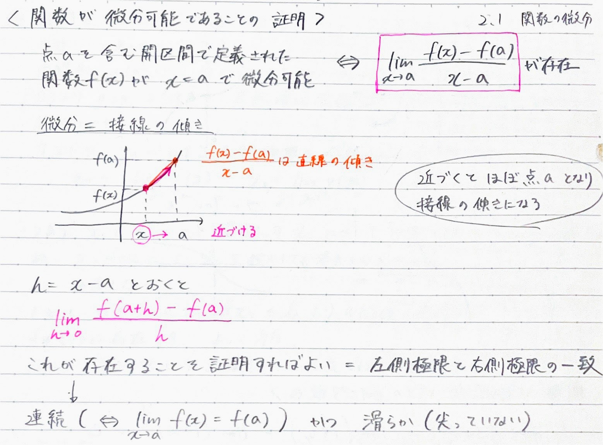
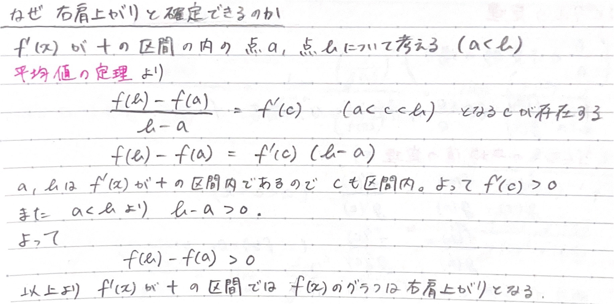
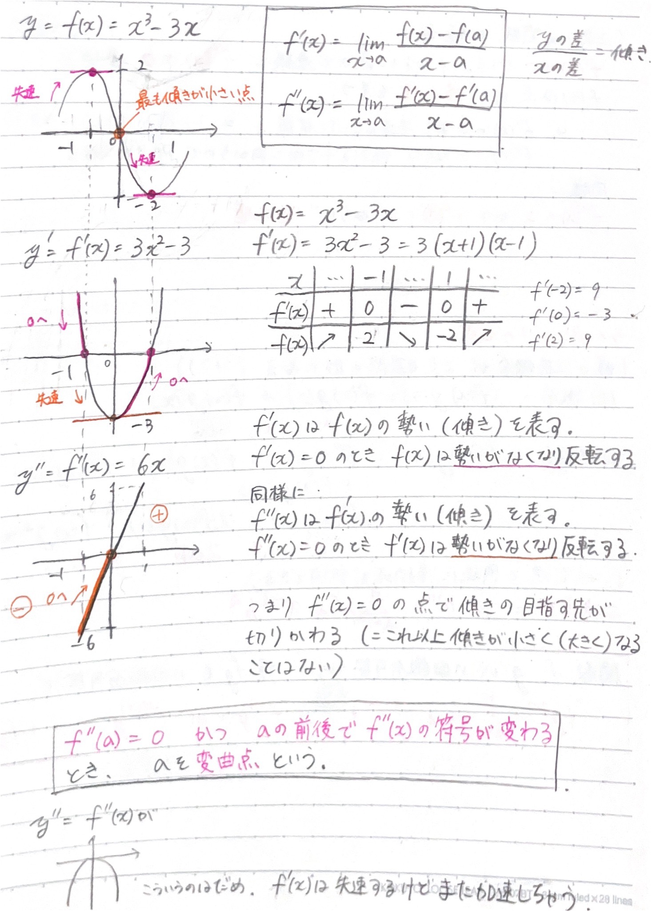
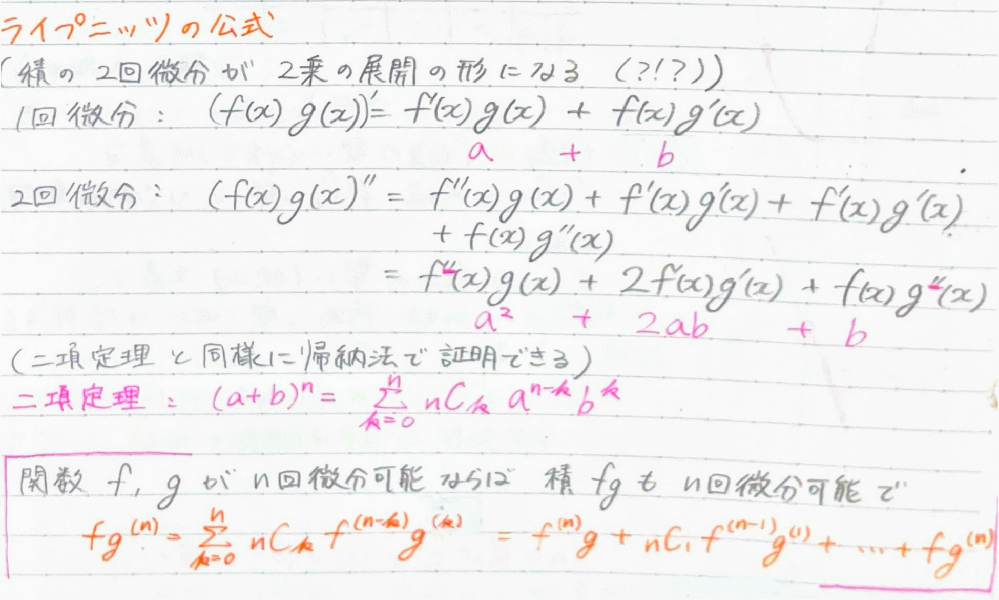
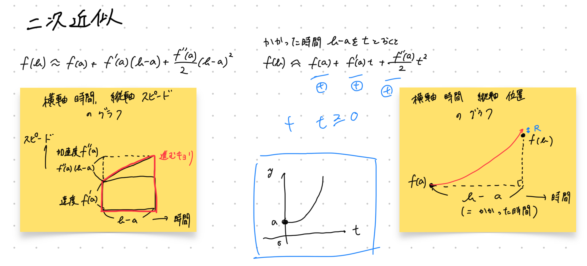

# 関数が微分可能であることの証明

# 商の微分
$$
\left(\frac{f(x)}{g(x)}\right)' = \frac{f'(x)g(x)-f(x)g'(x)}{g(x)^2}
$$

# 逆関数の微分
$f(x)$ が微分可能な**単調**関数ならば $f'(x) \neq 0$ のとき **逆関数 $x = f^{-1}(y)$ も微分可能**である。
傾き 0 の部分を $y = x$ でひっくり返すと垂直になってしまうので微分できない。  

# 基本的な関数の導関数
$$

\begin{aligned}

\frac{d}{dx}a^x &= (\log a)a^x, & \frac{d}{dx}\log|x| &= \frac{1}{x} \\
\frac{d}{dx}\tan x &= \frac{1}{\cos^2x}, & \frac{d}{dx}\sin ^{-1}x &= \frac{1}{\sqrt{1-x^2}} \\

\frac{d}{dx}\cos ^{-1}x &= -\frac{1}{\sqrt{1-x^2}}, & \frac{d}{dx}\tan ^{-1}x &= \frac{1}{1+x^2}

\end{aligned}

$$

# 対数微分法
指数関数の微分に使える。( $x^x$ など)
$y = f(x)$ と置いて両辺の対数を取ってから $x$ で微分する。

# ロルの定理
スタート地点 $f(a)$ とゴール地点 $f(b)$ が同じ値のとき、接線の傾きが 0 になる地点が少なくとも１つ必ず存在する。

# 平均値の定理
ロルの定理の応用。傾けてロルの定理の考え方を使うことでスタート地点とゴール地点の高さが異なる場合にも応用できる。
あんまりすごい定理に見えないけどこの定理のおかげで増減表の考え方は成り立っている。

# ロピタルの定理
不定形 $\dfrac{0}{0}, \dfrac{∞}{∞}, 0×∞$ の場合、
$$
\lim_{ x \to a }\frac{f(x)}{g(x)} = \lim_{ x \to a }\frac{f’(x)}{g’(x)}
$$

# 変曲点
$f’’(a) = 0$ かつ $a$ の前後で $f’’(x)$ の符号が変わる時、$a$ を変曲点と言う。

# ライプニッツの公式

# テーラーの定理（具体例として二次近似の場合を考える）
$$
\boxed{\begin{aligned}
&f(x)\text{ が開区間 }\mathit I\text{ で }n\text{ 回微分可能とする。}\mathit I\text{ の任意の２点 }a ,b\text{ に対し、}\\
&f(b) = f(a) + f'(a)(b-a) + ⋯ + \frac{f^{(n-1)}(a)}{n!}(b-a)^n(n-1) + \frac{f^{(n)}(\boldsymbol c)}{n!}(b-a)^n \\
&\text{をみたす点 }c\text{ が、}a\text{ と }b\text{ の間に存在する。}\\
\end{aligned}}
$$

## 二次近似までの発想
### 1. 平均値の定理を「予測」という視点で見る

まず、平均値の定理の式を少し書き換えてみます。
$f'(c) = \frac{f(b) - f(a)}{b - a}$
これを $f(b) = \cdots$ の形に変形すると、こうなります。

$$f(b) = f(a) + f'(c)(b-a)$$

これは **「現在地 $a$ から、ゴール $b$ の場所を予測する式」** として読むことができます。
* $f(a)$ ：現在地の高さ
* $f'(c)$ ：道中の「平均の傾き（スピード）」
* $(b-a)$ ：ゴールまでの距離

つまり平均値の定理とは、**「スタート地点の高さに、『道中の平均スピード $\times$ 距離』を足せば、ゴールの高さになるよね」** という、小学生の「道のり＝速さ $\times$ 時間」と同じことを言っているだけです。

---

### 2. 「平均スピード」は予測できない
平均値の定理の $c$ は「道中のどこかの点」ですが、それがどこなのかは分かりません。

もし今、スタート地点 $a$ に立っていて、未来のゴール $b$ を予測したいとします。当然、道中の平均スピード $f'(c)$ なんて未来のことなので分かりません。  
分かっているのは、**今現在の自分のスピード $f'(a)$ だけ**です。

じゃあ、今のスピード $f'(a)$ で突き進んだらどうなるか？
$$f(b) \approx f(a) + f'(a)(b-a)$$
（ゴールの予測 ＝ 今の高さ ＋ 今のスピード $\times$ 距離）

グラフで言うと、**「スタート地点に引いた直線の接線」** をどこまでも伸ばしていく感じです。
当然、道がカーブしていれば、ゴールに着く頃には **「本当の場所」と「直線の予測」にズレ（誤差）** が生じます。  

これが **「1次近似（直線のテイラー展開）」と、その「誤差」** です。

---

### 3. 直線がダメなら、カーブさせればいい（テイラー登場）
**「スピードだけじゃなくて、今の『アクセルの踏み込み具合（加速度）』も計算に入れれば、もっと正確に予測できるのでは？」**

これが**2回微分 $f''(a)$** の正体です。
加速度（カーブの曲がり具合）を計算に入れると、予測の線は「直線」から「放物線（パラボラ）」に進化します。

$$f(b) \approx f(a) + f'(a)(b-a) + \frac{f''(a)}{2}(b-a)^2$$
（ゴールの予測 ＝ 今の高さ ＋ 今のスピードの影響 ＋ 今のアクセルの影響）

放物線になるので、元のグラフのカーブにかなりピッタリ張り付いて進みます。ゴールでのズレ（誤差）は、直線のときよりも劇的に小さくなります。

でも、どんなに近い放物線を引いても、やっぱり最後に少し **「誤差 $R$」** が出ます。

$$f(b) = \underbrace{f(a) + f'(a)(b-a) + \frac{f''(a)}{2}(b-a)^2}_{\text{スタート地点での全力の予測}} + \underbrace{\boldsymbol{R}}_{\text{どうしても出た誤差}}$$

テイラーの定理がやっていることは、
**「今のスピード（1回微分）とアクセル（2回微分）を使って、放物線で未来を予測したときの、最後のズレ $R$ を求めたい」** に帰着します。

---

## 誤差 $R$ さえ求まれば $f(b)$ が確定する
### 1. ジレンマ
数学者は予想しました。
「今の加速度（2回微分）まで計算に入れたんだから、このズレ $R$ は、計算に入れなかった **さらに先のアクセル（3回微分）** のせいで起きたに違いない！」

つまり、**ただの値である $R$ を、「微分」を使った式で表したい**と考えたのです。
しかし、ここで絶望的なジレンマに陥ります。

*   $R$ の正体を知るためには、式を**微分**して探りたい。
*   でも $R$ はただの値（定数）なので、**微分したら $0$ になって消滅してしまう**

---

### 2. ロルの定理は「高さ（位置）の話」を「微分の話」に変える
誤差 $R$ は「高さ（値）のズレ」です。一方、使いたいのは「微分（傾き）」です。

普通、「高さ」の話をしているときに「微分」は出てきません。
ロルの定理は、「スタートとゴールの**高さ**が同じ（$F(a)=F(b)$）」という条件さえクリアすれば、「じゃあ、途中で**微分**が $0$ になる場所（$F'(c)=0$）があるよ！」と、**高さを微分に変換してくれるツール**だったのです。

無理やり「高さを揃える（調整して $0$ にする）」ことでロルの定理が使えます。

---

### 3. 禁断の裏技「架空のシミュレーション」
「微分したい。でも定数は微分できない。……そうだ、**定数 $a$ を、動く変数 $x$ にすり替えてしまえ！**」

数学者は、現実のスタート地点 $a$ を離れ、現在地 $x$ をゴール $b$ に向かってスゥーッと動かしていく **「架空のシミュレーション関数 $F(x)$」** をでっち上げました。

$$ E(x) = f(b) - \left\{ f(x) + f'(x)(b-x) + \frac{f''(x)}{2}(b-x)^2 \right\} $$

*   $x=a$（現実のスタート）のとき：$F(x)$ は知りたかった **誤差 $R$**
*   $x=b$（ゴール到着）のとき：$F(x)$ は完全に消えて **$0$**

変数 $x$ を作ったおかげで、これで**合法的に微分する準備**が整いました。

---

### 3. ロルの定理を使うための調整
ロルの定理を使うには「スタートとゴールの高さが同じ」でなければなりません。
今のシミュレーション $E(x)$ は、スタートの誤差が $R$、ゴールが $0$ なので、高さが違います。

「**スタート地点を強引に引きずり下ろして $0$ にする『調整』** をする」ことによって、ロルの定理が使える形にします。  

ここで、 $F(x)$ を作ります。
$$ F(x) = E(x) - A(b-x)^3 $$
※ テーラーの定理の発見当時は積分法で証明がされていたが、ロルの定理の証明の方が綺麗という理由でこちらで説明がなされている。天下り的な考え（答えからの逆算）で、二次近似の場合のテーラーの定理の誤差が３乗のものだと分かっているのでこのような式を立てている。

スタート（$x=a$）でこの関数が $0$ になるように、
$F(a) = R - A(b-a)^3 = 0$
と設定します。つまり、**$R = A(b-a)^3$** です。

これで、
-   $F(a) = 0$
-   $F(b) = 0$

となり、**「ロルの定理より、$F'(c) = 0$ となる $c$ が存在する」** と言えるようになりました。

---

### 4. 微分
ロルの定理が使えるようになったので、 $F(x)$ を微分します。

$$ F(x) = f(b) - \left\{ f(x) + f'(x)(b-x) + \frac{f''(x)}{2}(b-x)^2 \right\} - A(b-x)^3 $$

1. $-f(x)$ を微分 $\to$ $\boldsymbol{-f'(x)}$
2. $-f'(x)(b-x)$ を微分 $\to$ $\boldsymbol{-f''(x)(b-x) + f'(x)}$
3. $-\frac{f''(x)}{2}(b-x)^2$ を微分 $\to$ $\boldsymbol{-\dfrac{f'''(x)}{2}(b-x)^2 + f''(x)(b-x)}$
4. $-A(b-x)^3$ を微分 $\to$ $\boldsymbol{+3A(b-x)^2}$

ドミノ倒し的に消えるので、残るのは以下の２つだけになります。
$$ F'(x) = -\frac{f'''(x)}{2}(b-x)^2 + 3A(b-x)^2 $$

### 5. 誤差 $R$ の計算
ロルの定理より、$F'(c) = 0$ なので $t=c$ を代入します。

$$ 0 = -\frac{f'''(c)}{2}(b-c)^2 + 3A(b-c)^2 $$

両辺を $(b-c)^2$ で割って、係数 $A$ について解きます。
$$ \frac{f'''(c)}{2} = 3A $$
$$ A = \frac{f'''(c)}{6} $$

$R = A(b-a)^3$ より、

$$ \boldsymbol{R = \frac{f'''(c)}{6}(b-a)^3} $$

よって、テイラーの定理（2次近似の誤差）が証明できました。
$R$ の式に $c$ が入っているため値は確定しません。しかし、$a<b<c$ であることは分かっているので、**誤差の範囲が見積もれます**。

### まとめ
$$
\boxed{\begin{aligned}
&f(x)\text{ が開区間 }\mathit I\text{ で }n\text{ 回微分可能とする。}\mathit I\text{ の任意の２点 }a ,b\text{ に対し、}\\
&f(b) = f(a) + f'(a)(b-a) + ⋯ + \frac{f^{(n-1)}(a)}{n!}(b-a)^n(n-1) + \frac{f^{(n)}(\boldsymbol c)}{n!}(b-a)^n \\
&\text{をみたす点 }c\text{ が、}a\text{ と }b\text{ の間に存在する。}\\
\end{aligned}}
$$

# マクローリンの定理
$a = 0$ の場合のテーラーの定理はマクローリン展開と呼ばれます。
$$
\boxed{\begin{aligned}
&f(x)\text{ が開区間 }\mathit I\text{ で }n\text{ 回微分可能とする。}\mathit I\text{ の任意の２点 }0 ,b\text{ に対し、}\\
&f(b) = f(0) + f'(0)b + ⋯ + \frac{f^{(n-1)}(0)}{n!}b^n(n-1) + \frac{f^{(n)}(0)}{n!}b^n \\
&\text{をみたす点 }c\text{ が、}0\text{ と }b\text{ の間に存在する。}\\
\end{aligned}}
$$

# 有限テーラー展開
$c$ の場所を $\theta$ で表して、有限テーラー展開を定義します。
$$
\boxed{\begin{aligned}
&f(x)\text{ が開区間 }\mathit I\text{ で }n\text{ 回微分可能とする。}\mathit I\text{ の点 }a\text{ を固定すると、}\\
&f(x) = \sum_{k=0}^{n} \frac{f^{(k)}(a)}{k!}(x-a)^k + \frac{f^{(n)}(a+\theta(x-a))}{n!}(x-a)^n\\
&\text{をみたす }\theta\text{ }(0<\theta<1)\text{ が存在する。この右辺を }x=a\text{ における有限テーラー展開という。}\\
\end{aligned}}
$$

# $n$ 回微分の計算方法
## 1. よく出る基本パターン4選

テストやテイラー展開で頻出する4つのパターンの「推理過程」と「公式」です。

### パターン①：そのまま（ $e^x$ ）
微分しても形が全く変わらない最強の関数です。

*   **1回微分**：$e^x$
*   **2回微分**：$e^x$
*   **3回微分**：$e^x$

> **【公式】**
> $$ (e^x)^{(n)} = e^x $$

### パターン②：ループ（ $\sin x$ , $\cos x$ ）
微分のたびに「$\sin \to \cos \to -\sin \to -\cos \to \sin$」と、**4回周期でループ**する関数です。

*   **0回（元）**：$\sin x$
*   **1回微分**：$\cos x$
*   **2回微分**：$-\sin x$
*   **3回微分**：$-\cos x$
*   **4回微分**：$\sin x$ （★元に戻った！）

> **【公式】**
> 三角関数は、微分するたびにグラフが左に $90^\circ$（ $\frac{\pi}{2}$ ）ずつズレる性質があるため、カッコよく1つの式にまとめることができます。
> $$ (\sin x)^{(n)} = \sin\left(x + \frac{n\pi}{2}\right) $$
> $$ (\cos x)^{(n)} = \cos\left(x + \frac{n\pi}{2}\right) $$

### パターン③：ドミノ倒し（ $x^k$ ）
指数関数の微分は、肩の数字が前に落ちてきて、掛け算のドミノ（階乗）になります。例として $x^5$ を考えます。

*   **1回微分**：$5 x^4$
*   **2回微分**：$5 \times 4 x^3$
*   **3回微分**：$5 \times 4 \times 3 x^2$

> **【公式】**
> $n$ 回微分すると、$k$ から始まり $n$ 個分の数字が掛け算されます。
> $$ (x^k)^{(n)} = k(k-1)\cdots(k-n+1) x^{k-n} $$
> ※特に、乗数と同じ回数（5乗を5回微分など）微分すると、**$k!$** （階乗）だけが残ります。

### パターン④：プラスマイナスが入れ替わる（ $\log x$ ）
$\log$ は、1回微分すると分数（$x^{-1}$）になり、そこからはマイナスの指数が落ちてくるため、符号がパタパタと入れ替わります。

*   **1回微分**：$x^{-1}$
*   **2回微分**：$-1x^{-2}$
*   **3回微分**：$2x^{-3}$
*   **4回微分**：$-6x^{-4}$

**【推理のポイント】**
1.  **符号**：$+, -, +, -$ と交互に入れ替わる $\to$ $(-1)^{n-1}$
2.  **係数**：$1, 2, 6, 24\dots$ と階乗で増える $\to$ $(n-1)!$
3.  **文字**：分母の $x$ の乗数が増える $\to$ $\frac{1}{x^n}$

> **【公式】**
> $$ (\log x)^{(n)} = (-1)^{n-1} \frac{(n-1)!}{x^n} $$

---

## 2. 関数の掛け算の $n$ 回微分（ライプニッツの公式）

関数単体ではなく、$x^2 \sin x$ のように **「2つの関数の掛け算 $(f \cdot g)$」** を $n$ 回微分したい場合は、積の微分が爆発して計算が大変になります。

そんな時に使う最終兵器が **「ライプニッツの公式」** です。
これは、 **「 $(a+b)^n$ の二項定理（展開公式）」と全く同じルール** で計算できます！

### 【ルールの比較】
| 比較 | 二項定理 $(a+b)^n$ | ライプニッツの公式 $(f \cdot g)^{(n)}$ |
| :--- | :--- | :--- |
| **文字** | 乗数（$a^3$ など） | 微分の回数（$f'''$ など） |
| **係数** | 組み合わせ（$_nC_r$） | 組み合わせ（$_nC_r$） |

### 実際の計算例
$(a+b)^n$ の展開式を思い出しながら、$a$ を「$f$ の微分」、$b$ を「$g$ の微分」に読み替えるだけで完成します。

**【2回微分】**
$(a+b)^2 = 1a^2 + 2ab + 1b^2$ と同じように係数（パスカルの三角形）を割り振ります。
$$ (f \cdot g)'' = \boldsymbol{1}f''g + \boldsymbol{2}f'g' + \boldsymbol{1}fg'' $$
（※微分の回数が $0$ 回のものは、元の関数のまま書きます）

**【3回微分】**
$(a+b)^3 = 1a^3 + 3a^2b + 3ab^2 + 1b^3$ と同じです。
$$ (f \cdot g)''' = \boldsymbol{1}f'''g + \boldsymbol{3}f''g' + \boldsymbol{3}f'g'' + \boldsymbol{1}fg''' $$

> **【ライプニッツの公式（一般項）】**
> $$ (f \cdot g)^{(n)} = \sum_{r=0}^n \left( _nC_r \cdot f^{(n-r)} \cdot g^{(r)} \right) $$

### 💡 なぜライプニッツの公式が便利なのか？
例えば $x^2 \sin x$ の100回微分を計算したいとき。
普通なら100回も積の微分を繰り返さなければなりませんが、$f(x)=x^2$ は**3回微分すると $0$ になって消滅する**という性質があります。
そのため、ライプニッツの公式の「100個の長い足し算」のうち、後ろの97個はすべて $0$ になって消え去り、**最初の3つの項（$f$ の微分が0回、1回、2回のところ）だけを計算すれば答えが出ます**

# 有限マクローリン展開
$a=0$ における有限テーラー展開は特に有限マクローリン展開と呼ばれます。

# ランダウの記号
### ランダウの記号：Big-O と Little-o の比較表

| 項目 | Big-O（ビッグ・オー） | Little-o（リトル・オー） |
| :--- | :--- | :--- |
| **記号** | **$\mathcal{O}(x^3)$** | **$o(x^3)$** |
| **意味** | **せいぜい** $x^3$ と同レベルの誤差 | $x^3$ レベルすら**余裕で下回る**誤差 |
| **誤差のサイズ感** | $x^3$ と**同じスピード**で $0$ に向かって潰れる | $x^3$ よりも**圧倒的に速いスピード**で $0$ に向かって潰れる |
| **具体例** | $5x^3$ , $-100x^3$ , $\frac{1}{6}x^3$ （※係数はどうでもいい） | $x^4$ , $5x^5$ , $x^{100}$ （※ $x^3$ より乗数が大きいもの） |
| **テイラー展開での** **書き方の例** | $\sin x = x - \frac{x^3}{6} + \boldsymbol{\mathcal{O}(x^5)}$ （誤差はせいぜい $x^5$ レベルに収まってる） | $\sin x = x - \frac{x^3}{6} + \boldsymbol{o}(x^3)$ （残った誤差は $x^3$ より格下だから無視していい） |

### 3つのルール
| ルール | 計算の具体例 | 説明|
| :--- | :--- | :--- |
| **① 定数は無視される** | $\mathcal{O}(5x^3) = \boldsymbol{\mathcal{O}(x^3)}$ $o(-100x^4) = \boldsymbol{o}(x^4)$ | 5倍だろうがマイナス100倍だろうが、「スピード（次元）」が変わらないなら、定数はゴミとして吸収される。 |
| **② 足し算は親玉が勝つ** | $\mathcal{O}(x^3) + \mathcal{O}(x^4) = \boldsymbol{\mathcal{O}(x^3)}$ | $x$ が $0$ に近い世界では、$x^3$ の方が $x^4$ より「デカい誤差」。小さい誤差（$x^4$）は親玉（$x^3$）のゴミ箱に吸収されて見えなくなる。 |
| **③ $\mathcal{O}$ は $o$ を飲み込む** | $\mathcal{O}(x^3) + o(x^3) = \boldsymbol{\mathcal{O}(x^3)}$ | 「$x^3$と同レベルの誤差」と「$x^3$よりちっぽけな誤差」を足したら、全体としては「$x^3$と同レベルの誤差」になる。 |

- Little-o（またはスモールオー）を同じ次数の $x$ で割って limit で 0 に近づけたとき、分母よりも速く0に近づくので必ず0に収束する
- 収束するものは全て含まれるので、定数も関係ないし符号も関係ない

# 漸近展開
**有限マクローリン展開** において余剰項の代わりにランダウ記号を用いたものを「**関数の漸近展開**」と呼びます。
$$
\boxed{\begin{aligned}
&f(x)\text{ が }0\text{ を含む開区間において }C^n\text{ 級の関数ならば}\\
&f(x) = f(0) + f'(0)x + \frac{f''(0)}{2!}x^2 + ⋯ + \frac{f^{(n)}(0)}{n!}x^n + o(x^n)\\
&(x \to 0)
\end{aligned}}
$$