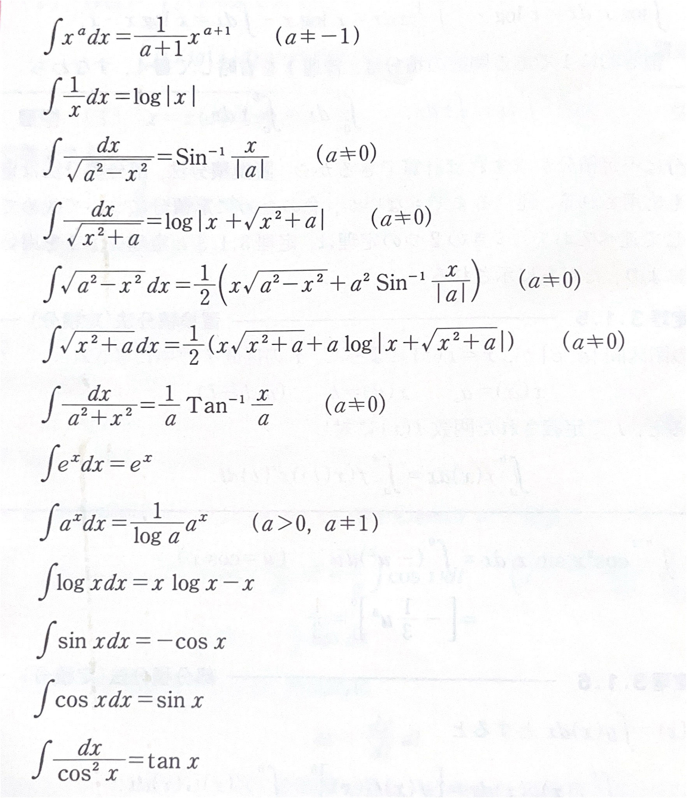
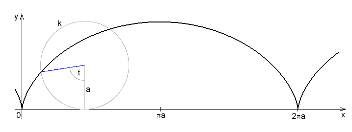
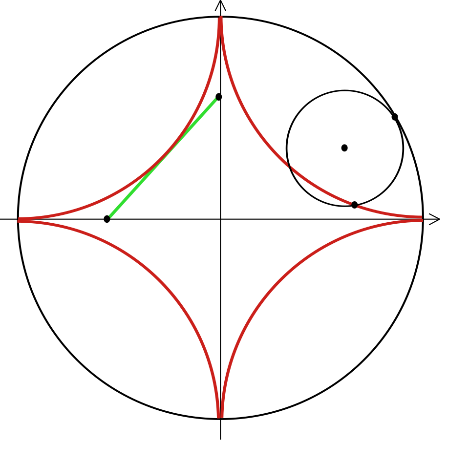
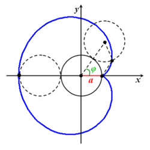

# 置換積分法
$$
\boxed{
\int f(x)dx = \int f(x(t))x'(t)dt, \text{　}x = x(t)
}
$$

### 1. 中身を $t$ と置くパターン（$t = g(x)$）
$$ \int_a^b f(\boldsymbol{g(x)}) \boldsymbol{g'(x)dx} = \int_{g(a)}^{g(b)} f(\boldsymbol{t}) \boldsymbol{dt} $$

*   **① 中身**：$g(x) \to t$
*   **② 横幅**：$g'(x)dx \to dt$
*   **③ 区間**：$x$ の $a \to b$ を、$t$ の $g(a) \to g(b)$ に変更

### 2. $x$ を丸ごと $t$ に変えるパターン（$x = g(t)$）
$$ \int_a^b f(\boldsymbol{x}) \boldsymbol{dx} = \int_{\alpha}^{\beta} f(\boldsymbol{g(t)}) \boldsymbol{g'(t) dt} $$

*   **① 中身**：$x \to g(t)$
*   **② 横幅**：$dx \to g'(t)dt$
*   **③ 区間**：$x$ の $a \to b$ を、$t$ の $\alpha \to \beta$ に変更

---

# 部分積分法
$$
\boxed{
    \int f(x)g(x)dx = F(x)g(x) - \int F(x)g'(x)dx
}
$$
積の微分 $\{f(x)g(x)\}' = f'(x)g(x) + f(x)g'(x)$ より導出できる。
$$
\begin{aligned}
\{f(x)g(x)\}' &= f'(x)g(x) + f(x)g'(x)\\
f'(x)g(x) &= \{f(x)g(x)\}' - f(x)g'(x)
\end{aligned}
$$
両辺に積分すると
$$
\int f'(x)g(x)dx = f(x)g(x) - \int f(x)g'(x)dx
$$
となる。

---

# 基本的な不定積分

# 有理式の積分
# 無理式の積分
# 積分漸化式

# 広義積分
## 1. 導入：定積分の限界
これまで扱ってきた「リーマン積分（通常の定積分）」には、以下の2つの大前提があった。
1. **積分区間が有限であること**： $[a, b]$
2. **被積分関数が有界であること**： 区間内で関数の値が無限大にならない。

しかし、物理学や統計学においては、**「無限の彼方までの面積」**や**「漸近線を持つ関数の面積」**を計算する必要が生じる。これを可能にするのが**広義積分**である。

---

## 2. 広義積分の定義
広義積分は、計算できない点（端点や特異点）を別の文字でおき、**極限（Limit）**をとることで定義される。

### ① 積分区間が無限の場合（第1種広義積分）
関数 $f(x)$ が $[a, \infty)$ で連続であるとき、
$$ \int_{a}^{\infty} f(x) dx = \lim_{R \to \infty} \int_{a}^{R} f(x) dx $$
と定義する。この極限が存在して有限の値になるとき、広義積分は**収束する**といい、そうでないとき**発散する**という。

### ② 関数が無界な場合（第2種広義積分）
関数 $f(x)$ が $(a, b]$ で連続だが、$x \to a+0$ で $f(x) \to \infty$ となる場合、
$$ \int_{a}^{b} f(x) dx = \lim_{\epsilon \to +0} \int_{a+\epsilon}^{b} f(x) dx $$
と定義する。

---

## 3. 具体例と計算

### 例題1：無限区間の積分
次の広義積分の収束・発散を調べよ。
$$ I = \int_{1}^{\infty} \frac{1}{x^2} dx $$

**【解法】**
一旦、上端を $R$ とおいて計算し、極限をとる。
$$ \int_{1}^{R} \frac{1}{x^2} dx = \left[ -\frac{1}{x} \right]_1^R = -\frac{1}{R} - (-1) = 1 - \frac{1}{R} $$
ここで $R \to \infty$ とすると、$\frac{1}{R} \to 0$ なので、
$$ I = \lim_{R \to \infty} (1 - \frac{1}{R}) = 1 $$
**結論：** この積分は **$1$ に収束する**。

### 例題2：特異点を持つ積分
次の広義積分を計算せよ（$x=0$ で不連続）。
$$ J = \int_{0}^{1} \frac{1}{\sqrt{x}} dx $$

**【解法】**
$x=0$ で定義できないため、下端を $\epsilon$ とおいて極限をとる。
$$ \int_{\epsilon}^{1} x^{-1/2} dx = \left[ 2\sqrt{x} \right]_\epsilon^1 = 2\sqrt{1} - 2\sqrt{\epsilon} = 2 - 2\sqrt{\epsilon} $$
ここで $\epsilon \to +0$ とすると、$2\sqrt{\epsilon} \to 0$ なので、
$$ J = \lim_{\epsilon \to +0} (2 - 2\sqrt{\epsilon}) = 2 $$
**結論：** この積分は **$2$ に収束する**。

---

## 4. 重要な判定基準：$p$-積分
広義積分の収束・発散を判断する際、以下の結果は公式としてよく用いられる。

### (1) 無限遠 ($\infty$) での判定
$$ \int_{1}^{\infty} \frac{1}{x^p} dx \quad \Longrightarrow \quad \begin{cases} p > 1 & \text{収束する} \\ p \le 1 & \text{発散する} \end{cases} $$
※ $x$ の次数が十分に大きければ、面積は有限に収まる。

### (2) 原点付近 ($0$) での判定
$$ \int_{0}^{1} \frac{1}{x^p} dx \quad \Longrightarrow \quad \begin{cases} p < 1 & \text{収束する} \\ p \ge 1 & \text{発散する} \end{cases} $$
※ 分母の次数が低ければ、爆発するスピードが遅いため面積は有限になる。

---

## 5. $p$-積分の収束・発散の導出

なぜ $p=1$ を境目にして結果が変わるのか、実際に計算してみると納得がいきます。

### 5-1. 無限区間 $[1, \infty)$ の場合
積分 $I = \int_{1}^{\infty} \frac{1}{x^p} dx$ を考えます。

*   **$p = 1$ のとき（対数になる特別なケース）**
    $$\int_{1}^{R} \frac{1}{x} dx = [\ln x]_1^R = \ln R$$
    $R \to \infty$ とすると $\ln R \to \infty$ となり、**発散**します。
*   **$p \neq 1$ のとき**
    $$\int_{1}^{R} x^{-p} dx = \left[ \frac{x^{-p+1}}{-p+1} \right]_1^R = \frac{1}{1-p} (R^{1-p} - 1)$$
    ここで $R \to \infty$ としたときの挙動は、指数の $1-p$ の符号で決まります。
    *   $1-p < 0$ （つまり **$p > 1$**）のとき： $R^{\text{マイナス乗}} \to 0$ となり、$\frac{1}{p-1}$ に**収束**。
    *   $1-p > 0$ （つまり **$p < 1$**）のとき： $R^{\text{プラス乗}} \to \infty$ となり、**発散**。

---

### 5-2. 特異点（原点） $[0, 1]$ の場合
積分 $J = \int_{0}^{1} \frac{1}{x^p} dx$ を考えます。

*   **$p = 1$ のとき**
    $$\int_{\epsilon}^{1} \frac{1}{x} dx = [\ln x]_\epsilon^1 = 0 - \ln \epsilon$$
    $\epsilon \to +0$ とすると $-\ln \epsilon \to \infty$ となり、**発散**します。
*   **$p \neq 1$ のとき**
    $$\int_{\epsilon}^{1} x^{-p} dx = \frac{1}{1-p} (1 - \epsilon^{1-p})$$
    *   $1-p > 0$ （つまり **$p < 1$**）のとき： $\epsilon^{\text{プラス乗}} \to 0$ となり、$\frac{1}{1-p}$ に**収束**。
    *   $1-p < 0$ （つまり **$p > 1$**）のとき： $\epsilon^{\text{マイナス乗}} = (1/\epsilon)^{\text{プラス乗}} \to \infty$ となり、**発散**。

---

## なぜこれが「ものさし」になるのか？（比較判定法）

$p$-積分の結果を知っていると、次のような**比較判定法（Comparison Test）** が使えるようになります。

> **判定法のイメージ：**
> 知りたい関数 $f(x)$ が、収束することがわかっている $g(x)$ よりも「小さい」なら、$f(x)$ も収束するはずだ！

### 例：$\int_{1}^{\infty} \frac{1}{x^2 + \sin x} dx$ の収束判定
この積分を直接解くのは難しいですが、分母に注目します。
1. $x$ が十分大きいとき、$\sin x$ はせいぜい $\pm 1$ なので、$x^2 + \sin x$ はだいたい $x^2$ と同じ。
2. 実際、$\frac{1}{x^2 + \sin x} \approx \frac{1}{x^2}$ である。
3. $p=2$ の $p$-積分は収束することを知っている。
4. よって、この積分も**収束する**と即答できる。

---

## 直感的な理解（暗記のコツ）

*   **無限遠 ($\infty$) への積分：**
    分母のパワー $p$ が **強ければ（$p>1$）**、関数はソッコーで 0 に近づくので、面積が無限に広がる前に「おしまい（収束）」が来る。
*   **原点 ($0$) への積分：**
    分母のパワー $p$ が **弱ければ（$p<1$）**、関数が上に突き抜ける勢いがマイルドなので、面積は有限で済む。

| 積分範囲              | 収束条件        | イメージ                       |
| :---------------- | :---------- | :------------------------- |
| **$[1, \infty)$** | **$p > 1$** | $x^2$ のように急激に小さくなれば収束      |
| **$(0, 1]$**      | **$p < 1$** | $\sqrt{x}$ のように緩やかに爆発すれば収束 |

# 積分法の応用：区分求積法と曲線の長さ

## 1. 区分求積法

積分の本質は **「無限に細かく分けて、すべて足し合わせる」** ことです。
ぐにゃぐにゃ曲がった図形の面積を求めるために、図形を「極めて細い長方形」に切り分け、その長方形の面積をすべて足すことで真の面積を求める手法を **区分求積法** と呼びます。

この考え方を使うと、**「数列の和の極限」を「定積分」に変換** することができます。入試でも頻出の超重要公式です。

$$
\boxed{
\lim_{n \to \infty} \frac{1}{n} \sum_{k=1}^{n} f\left( \frac{k}{n} \right) = \int_{0}^{1} f(x) \, dx
}
$$

### 公式を使うときのポイント
数列の和の極限を見たら、以下の2つの手順で積分に変形します。
1. 式の中から無理やり $\frac{1}{n}$ をくくり出して外に出す。
2. 残った部分を $\frac{k}{n}$ のカタマリで作る。
3. $\frac{k}{n}$ を $x$ に、$\frac{1}{n}$ を $dx$ に、$\sum$ と $\lim$ のセットを $\int_{0}^{1}$ に置き換える。

---

## 2. 曲線の長さ（関数 $y = f(x)$ の場合）

次に、曲線 $y = f(x)$ の長さを求めてみましょう。
直線の長さなら簡単に計算できますが、曲線はどうすればよいでしょうか？ここでも区分求積法の「細かく分ける」という発想を使います。

曲線を顕微鏡で無限に拡大していくと、**ほんの少しの区間では「直線」とみなす**ことができます。
この微小な直線の長さを $dL$、横のわずかな変化を $dx$、縦のわずかな変化を $dy$ とします。

すると、直角三角形の **三平方の定理（ピタゴラスの定理）** から、次の関係が成り立ちます。
$$ dL = \sqrt{(dx)^2 + (dy)^2} $$

この式を無理やり $dx$ でくくり出すと、次のようになります。
$$ dL = \sqrt{1 + \left(\frac{dy}{dx}\right)^2} \, dx $$

$\frac{dy}{dx}$ はおなじみの導関数 $f'(x)$ ですね。あとはこの微小な長さ $dL$ を、区間 $x = a$ から $x = b$ まで「すべて足し合わせる（＝積分する）」だけです！

$$
\boxed{
L = \int_{a}^{b} \sqrt{1 + \{f'(x)\}^2} \, dx
}
$$

---

## 3. パラメータ表示された曲線の長さ

数学Ⅲでは、$x$ と $y$ が別の変数 $t$ （時間をイメージすると分かりやすいです）を使って、
$x = f(t), \ y = g(t)$ 
と表される「パラメータ表示（媒介変数表示）」の曲線をよく扱います。

この場合の曲線の長さも、先ほどの三平方の定理の式 $dL = \sqrt{(dx)^2 + (dy)^2}$ から簡単に導けます。今度は $dt$ でくくり出してみましょう。

$$ dL = \sqrt{\left(\frac{dx}{dt}\right)^2 + \left(\frac{dy}{dt}\right)^2} \, dt $$

これを $t$ の区間 $\alpha \leqq t \leqq \beta$ で足し合わせれば（積分すれば）、公式の完成です！

$$
\boxed{
L = \int_{\alpha}^{\beta} \sqrt{\left(\frac{dx}{dt}\right)^2 + \left(\frac{dy}{dt}\right)^2} \, dt
}
$$

---

## 4. 代表的な曲線の長さの計算
2つの有名曲線、**サイクロイド**と**アステロイド**の長さを実際に計算してみましょう。

### ① サイクロイド (Cycloid)
自転車のタイヤにガムがくっついているとします。自転車が前に進むとき、そのガムが宙に描く軌跡がサイクロイドです。

**【パラメータ表示】** （$a > 0$）
$$ x = a(\theta - \sin\theta) $$
$$ y = a(1 - \cos\theta) $$
（※ 1回転分の区間は $0 \leqq \theta \leqq 2\pi$）

**【長さ $L$ の計算】**
まずはそれぞれを $\theta$ で微分します。
$$ \frac{dx}{d\theta} = a(1 - \cos\theta) $$
$$ \frac{dy}{d\theta} = a\sin\theta $$

ルートの中身を計算します。
$$ 
\begin{aligned}
\left(\frac{dx}{d\theta}\right)^2 + \left(\frac{dy}{d\theta}\right)^2 &= a^2(1 - 2\cos\theta + \cos^2\theta) + a^2\sin^2\theta \\
&= a^2(1 - 2\cos\theta + 1) \quad (\because \cos^2\theta + \sin^2\theta = 1) \\
&= 2a^2(1 - \cos\theta)
\end{aligned}
$$

ここで**半角の公式** $\sin^2\frac{\theta}{2} = \frac{1 - \cos\theta}{2}$ を使うのが最大のポイントです！
$$ 2a^2(1 - \cos\theta) = 4a^2\sin^2\frac{\theta}{2} $$

よって、曲線の長さ $L$ は、
$$ 
\begin{aligned}
L &= \int_{0}^{2\pi} \sqrt{4a^2\sin^2\frac{\theta}{2}} \, d\theta \\
&= \int_{0}^{2\pi} 2a \left| \sin\frac{\theta}{2} \right| d\theta
\end{aligned}
$$
区間 $0 \leqq \theta \leqq 2\pi$ では $0 \leqq \frac{\theta}{2} \leqq \pi$ なので、$\sin\frac{\theta}{2} \geqq 0$ となり絶対値はそのまま外せます。
$$
\begin{aligned}
L &= 2a \int_{0}^{2\pi} \sin\frac{\theta}{2} \, d\theta \\
&= 2a \left[ -2\cos\frac{\theta}{2} \right]_{0}^{2\pi} \\
&= 2a \left( -2\cos\pi - (-2\cos0) \right) \\
&= 2a (2 + 2) = 8a
\end{aligned}
$$
**答え：$8a$**

---

### ② アステロイド (Astroid / 星芒形)
大きな円の内側を、半径が4分の1の小さな円が転がるときに描かれる、手裏剣や星のような美しい形をした曲線です。  

[画像リンク](https://commons.wikimedia.org/wiki/File:Astroid_2.svg)

**【パラメータ表示】** （$a > 0$）
$$ x = a\cos^3\theta $$
$$ y = a\sin^3\theta $$
（※ 全周の区間は $0 \leqq \theta \leqq 2\pi$）

**【長さ $L$ の計算】**
それぞれを微分します（合成関数の微分に注意）。
$$ \frac{dx}{d\theta} = 3a\cos^2\theta(-\sin\theta) = -3a\cos^2\theta\sin\theta $$
$$ \frac{dy}{d\theta} = 3a\sin^2\theta(\cos\theta) = 3a\sin^2\theta\cos\theta $$

ルートの中身を計算します。
$$
\begin{aligned}
\left(\frac{dx}{d\theta}\right)^2 + \left(\frac{dy}{d\theta}\right)^2 &= 9a^2\cos^4\theta\sin^2\theta + 9a^2\sin^4\theta\cos^2\theta \\
&= 9a^2\cos^2\theta\sin^2\theta(\cos^2\theta + \sin^2\theta) \\
&= 9a^2\cos^2\theta\sin^2\theta
\end{aligned}
$$

これを公式に代入しますが、アステロイドは図形が上下左右対称です。
積分計算で絶対値を外す手間を省くため、**「第1象限 ($0 \leqq \theta \leqq \frac{\pi}{2}$) の長さを求めて 4倍する」** というテクニックを使います。

第1象限では $\cos\theta \geqq 0, \sin\theta \geqq 0$ なので、ルートの絶対値がそのまま外れます。
$$
\begin{aligned}
L &= 4 \times \int_{0}^{\frac{\pi}{2}} \sqrt{9a^2\cos^2\theta\sin^2\theta} \, d\theta \\
&= 4 \int_{0}^{\frac{\pi}{2}} 3a\sin\theta\cos\theta \, d\theta
\end{aligned}
$$

ここで**2倍角の公式** $\sin2\theta = 2\sin\theta\cos\theta$ を使って積分しやすくします。
$$ 3a\sin\theta\cos\theta = \frac{3a}{2}\sin2\theta $$

$$
\begin{aligned}
L &= 4 \int_{0}^{\frac{\pi}{2}} \frac{3a}{2}\sin2\theta \, d\theta \\
&= 6a \int_{0}^{\frac{\pi}{2}} \sin2\theta \, d\theta \\
&= 6a \left[ -\frac{1}{2}\cos2\theta \right]_{0}^{\frac{\pi}{2}} \\
&= 6a \left( -\frac{1}{2}\cos\pi - \left(-\frac{1}{2}\cos0\right) \right) \\
&= 6a \left( \frac{1}{2} + \frac{1}{2} \right) = 6a
\end{aligned}
$$
**答え：$6a$**

---

## まとめ
* 面積や長さを「無限に細かく分けて足す」のが**区分求積法**
* 曲線の長さは「微小な直角三角形の斜辺（三平方の定理）」の積み重ね。
* 計算においては **「半角の公式」「2倍角の公式」「図形の対称性を利用して絶対値を安全に外す」** のが鉄則！

## 5. 極座標とパラメータ表示のつながり

私たちが普段使っている $xy$ 座標（直交座標）は「横に $x$、縦に $y$」という位置の表し方ですが、**極座標 $(r, \theta)$** は「原点からの距離 $r$」と「角度 $\theta$」で位置を表します。

直交座標と極座標の間には、三角比を用いた次の関係式がありましたね。
*   $x = r \cos\theta$
*   $y = r \sin\theta$

もし極座標の方程式が $r = f(\theta)$ と与えられたら、これを上の式に代入してみましょう。
*   $x = f(\theta) \cos\theta$
*   $y = f(\theta) \sin\theta$

ほら！ $x$ と $y$ が「$\theta$ という1つの変数（パラメータ）」で表されました。
つまり、**極座標の方程式は、パラメータ表示の特別なバージョン**として扱うことができるのです。

## 6. 極座標における曲線の長さの公式

極座標がパラメータ表示の仲間だと分かれば、前回の「パラメータ表示された曲線の長さ」の公式がそのまま使えます。

$$ L = \int_{\alpha}^{\beta} \sqrt{\left(\frac{dx}{d\theta}\right)^2 + \left(\frac{dy}{d\theta}\right)^2} \, d\theta $$

このルートの中身がどうなるか、実際に微分して計算してみましょう。（積の微分法を使います）

$$ \frac{dx}{d\theta} = \frac{dr}{d\theta}\cos\theta - r\sin\theta $$
$$ \frac{dy}{d\theta} = \frac{dr}{d\theta}\sin\theta + r\cos\theta $$

これをそれぞれ2乗して足し合わせます。真ん中のややこしい項（$2r\frac{dr}{d\theta}\cos\theta\sin\theta$）がプラスマイナスで綺麗に消え去ります！

$$
\begin{aligned}
\left(\frac{dx}{d\theta}\right)^2 + \left(\frac{dy}{d\theta}\right)^2 
&= \left( \left(\frac{dr}{d\theta}\right)^2\cos^2\theta - 2r\frac{dr}{d\theta}\cos\theta\sin\theta + r^2\sin^2\theta \right) \\
&\quad + \left( \left(\frac{dr}{d\theta}\right)^2\sin^2\theta + 2r\frac{dr}{d\theta}\sin\theta\cos\theta + r^2\cos^2\theta \right) \\
&= \left(\frac{dr}{d\theta}\right)^2 (\cos^2\theta + \sin^2\theta) + r^2 (\sin^2\theta + \cos^2\theta) \\
&= \left(\frac{dr}{d\theta}\right)^2 + r^2
\end{aligned}
$$

なんと、あれだけ複雑だった式が **$r^2 + (r')^2$** という非常にシンプルな形になってしまいました。
これを積分区間 $\alpha \leqq \theta \leqq \beta$ で計算すれば、極座標の長さの公式の完成です！

$$
\boxed{
L = \int_{\alpha}^{\beta} \sqrt{r^2 + \left(\frac{dr}{d\theta}\right)^2} \, d\theta
}
$$
※「距離の2乗 ＋ 微分の2乗」にルートを被せると覚えておきましょう。

---

## 7. 代表的な極座標の曲線の長さ：カージオイド

極座標の曲線の長さとして、入試で最も頻出なのが **カージオイド（Cardioid / 心臓形）** です。

**【極座標の方程式】** （$a > 0$）
$$ r = a(1 + \cos\theta) $$
（※ 1周分の区間は $0 \leqq \theta \leqq 2\pi$）

**【長さ $L$ の計算】**
まず、$\theta$ で微分します。
$$ \frac{dr}{d\theta} = -a\sin\theta $$

ルートの中身を計算します。
$$
\begin{aligned}
r^2 + \left(\frac{dr}{d\theta}\right)^2 &= a^2(1 + \cos\theta)^2 + (-a\sin\theta)^2 \\
&= a^2(1 + 2\cos\theta + \cos^2\theta) + a^2\sin^2\theta \\
&= a^2(1 + 2\cos\theta + 1) \quad (\because \cos^2\theta + \sin^2\theta = 1) \\
&= 2a^2(1 + \cos\theta)
\end{aligned}
$$

ここで、サイクロイドの時と同じように **半角の公式** を使います！
$\cos^2\frac{\theta}{2} = \frac{1 + \cos\theta}{2}$ より、$1 + \cos\theta = 2\cos^2\frac{\theta}{2}$ なので、
$$ 2a^2(1 + \cos\theta) = 4a^2\cos^2\frac{\theta}{2} $$

グラフは $x$ 軸に対して上下対称なので、アステロイドの時と同様に **「上半分の長さ（$0 \leqq \theta \leqq \pi$）を求めて 2倍する」** と絶対値を安全に外せます。（区間内では $\cos\frac{\theta}{2} \geqq 0$ です）

$$
\begin{aligned}
L &= 2 \times \int_{0}^{\pi} \sqrt{4a^2\cos^2\frac{\theta}{2}} \, d\theta \\
&= 2 \int_{0}^{\pi} 2a\cos\frac{\theta}{2} \, d\theta \\
&= 4a \left[ 2\sin\frac{\theta}{2} \right]_{0}^{\pi} \\
&= 4a ( 2\sin\frac{\pi}{2} - 2\sin0 ) \\
&= 4a ( 2 - 0 ) = 8a
\end{aligned}
$$
**答え：$8a$**