* 論文ノート
:PROPERTIES:
:NOTER_DOCUMENT: /home/nomura/MyNotes/Mynotes_project/研究/論文/PDFs/Deep-Bilateral-Learning.pdf
:NOTER_PAGE: 10
:END:
** Deep Bilateral Learning for Real-Time Image Enhancement
:PROPERTIES:
:NOTER_PAGE: 1
:END:
MICHAËL GHARBI, MIT CSAIL JIAWEN CHEN, Google Research JONATHAN T. BARRON, Google Research SAMUEL W. HASINOFF, Google Research FRÉDO DURAND, MIT CSAIL / Inria, Université Côte d’Azur
:PROPERTIES:
:NOTER_PAGE: 1
:END:

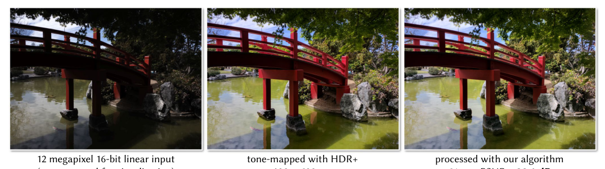
# pdfrect: 1 51.8 354.4 560.2 372.3
# pdfsent: [[[1,51.8,354.4,68.4,362.4]],[[1,68.4,354.4,78.4,362.4]],[[1,78.4,354.4,560.2,362.4],[1,51.8,364.4,104.3,372.3]],[[1,104.3,364.4,556.6,372.3]]]
#+begin_en
Fig. 1. Our novel neural network architecture can reproduce sophisticated image enhancements with inference running in real time at full HD resolution on mobile devices. It can not only be used to dramatically accelerate reference implementations, but can also learn subjective effects from human retouching.
#+end_en

図 1。我々の革新的なニューラルネットワークアーキテクチャは、モバイルデバイス上でフル HD 解像度でリアルタイムに推論を実行することで、高度な画像補正を再現できます。これは、既存の実装を劇的に高速化できるだけでなく、人間のレタッチによる主観的な効果を学習することも可能です。

# pdfrect: 1 51.5 381.6 295.4 578.8
# pdfsent: [[[1,51.8,381.6,259.7,389.5]],[[1,259.7,381.6,295.4,389.5],[1,51.8,391.5,294.2,399.5],[1,51.8,401.4,264.5,409.5]],[[1,264.5,401.4,294.9,409.5],[1,51.5,411.4,294.0,419.4],[1,51.8,421.5,199.2,429.4]],[[1,199.2,421.5,295.4,429.4],[1,51.8,431.4,294.0,439.3],[1,51.8,441.4,178.0,449.3]],[[1,178.0,441.4,294.9,449.3],[1,51.8,451.3,294.0,459.3],[1,51.8,461.3,105.6,469.2]],[[1,105.6,461.3,294.0,469.2],[1,51.6,471.3,295.4,479.2],[1,51.8,481.2,294.0,489.2],[1,51.8,491.2,294.0,499.1],[1,51.8,501.1,153.3,509.1]],[[1,153.3,501.1,295.4,509.1],[1,51.8,511.0,294.0,519.1],[1,51.6,521.1,294.0,529.0],[1,51.8,531.0,211.2,539.0]],[[1,211.2,531.0,294.2,539.0],[1,51.8,541.0,294.0,548.9],[1,51.8,550.9,165.0,558.9]],[[1,165.0,550.9,294.9,558.9],[1,51.8,560.9,294.0,568.8],[1,51.8,570.9,257.0,578.8]]]
# pdfhl: sky blue 2,3
# pdfhl: sky blue 5
# pdfhl: sky blue 6,7,8
#+begin_en
Performance is a critical challenge in mobile image processing. Given a reference imaging pipeline, or even human-adjusted pairs of images, we seek to reproduce the enhancements and enable real-time evaluation. For this, we introduce a new neural network architecture inspired by bilateral grid processing and local affine color transforms. Using pairs of input/output images, we train a convolutional neural network to predict the coefficients of a locally-affine model in bilateral space. Our architecture learns to make local, global, and content-dependent decisions to approximate the desired image transformation. At runtime, the neural network consumes a low-resolution version of the input image, produces a set of affine transformations in bilateral space, upsamples those transformations in an edge-preserving fashion using a new slicing node, and then applies those upsampled transformations to the full-resolution image. Our algorithm processes high-resolution images on a smartphone in milliseconds, provides a real-time viewfinder at 1080p resolution, and matches the quality of state-of-the-art approximation techniques on a large class of image operators. Unlike previous work, our model is trained off-line from data and therefore does not require access to the original operator at runtime. This allows our model to learn complex, scene-dependent transformations for which no reference implementation is available, such as the photographic edits of a human retoucher.
#+end_en
モバイル画像処理において、パフォーマンスは重要な課題です。参照画像処理パイプライン、あるいは人間が調整した画像ペアが与えられた場合、その改善を再現し、リアルタイム評価を可能にすることを目指します。この目的のために、バイラテラルグリッド処理とローカルアフィンカラー変換に着想を得た新しいニューラルネットワークアーキテクチャを導入します。入力/出力画像のペアを使用して、畳み込みニューラルネットワークをトレーニングし、バイラテラル空間におけるローカルアフィンモデルの係数を予測します。このアーキテクチャは、ローカル、グローバル、およびコンテンツ依存の決定を行い、目的の画像変換を近似することを学習します。実行時には、ニューラルネットワークは入力画像の低解像度バージョンを取り込み、バイラテラル空間で一連のアフィン変換を生成し、新しいスライスノードを使用してエッジを保持する方法でこれらの変換をアップサンプリングし、その後、これらのアップサンプリングされた変換をフル解像度の画像に適用します。当社のアルゴリズムは、スマートフォン上で高解像度画像をミリ秒単位で処理し、1080p 解像度のリアルタイムビューファインダーを提供するとともに、幅広い画像演算子において最先端の近似技術と同等の品質を実現します。従来の手法とは異なり、当社のモデルはオフラインでデータから学習されるため、実行時に元の演算子にアクセスする必要はありません。これにより、人間のレタッチャーによる写真編集など、参照実装が存在しない複雑でシーン依存の変換をモデルが学習することが可能になります。

# pdfput: 1 1 6acd817f0164
#+begin_memo
- Bilateral Grid Processing (バイラテラルグリッド処理): 画像の空間座標と輝度（または色）を組み合わせた 3 次元格子構造で、エッジを保護しつつ高速に局所的な変換を適用できる手法
   画像のピクセルを周りの情報と組み合わせて、境界（エッジ）を崩さないように計算を行います。
   この論文での「バイラテラルグリッド」とは一般的な入力画像の空間・色情報が詰まったものではなく、 *色変換のルール（アフィン係数）が立体的に整理された 3D 空間* を指します。
  *グリッドの各セルには、画像の色情報ではなく、3×4 のアフィン色変換行列* を構成する 12 個の係数が格納されています。
低解像度の入力画像からニューラルネットワークでその係数を予測し、エッジを保ったまま高解像度画像へ逆変換（スライシング）して適用します。
   例え：レシピ本は料理ごとに「材料の量」や「調理手順」（＝変換係数）をページに分けて記載しています。実際に料理を作るときは、手元にある材料の量や種類（＝画像の明るさや色）に合わせて適切なページを選び、材料の形や境界（＝食材のエッジ）を壊さないように慎重に混ぜ合わせて仕上げます。バイラテラルグリッドは、 *画像の「場所」と「色」の情報に応じて最適な変換を選び、エッジを保ったまま全体に広げる* 「レシピ本」のような役割を果たします。

- slicing (スライシング): バイラテラルグリッドや類似の高次元空間から特定の平面（スライス）を抽出し、抽出したデータに対して処理を行う操作
#+end_memo

** 1. INTRODUCTION
***** 本文：現状の課題（2017 年当時）
# pdfrect: 1 317.6 499.3 561.7 694.5
# pdfsent: [[[1,317.7,499.3,560.4,508.2],[1,318.0,510.2,560.2,519.2],[1,318.0,521.1,561.7,530.2],[1,318.0,532.1,454.7,541.1]],[[1,454.7,532.1,560.2,541.1],[1,318.0,543.1,560.2,552.1],[1,318.0,554.1,381.5,563.0]],[[1,381.5,554.1,438.1,563.0]],[[1,438.1,554.1,519.3,563.0]],[[1,519.3,554.1,561.7,563.0],[1,318.0,565.0,367.1,574.0]],[[1,367.1,565.0,560.2,574.0],[1,318.0,576.0,560.4,584.9],[1,318.0,586.9,532.2,595.9]],[[1,532.2,586.9,561.7,595.9],[1,318.0,597.9,560.2,606.9],[1,318.0,608.8,561.2,617.8],[1,318.0,619.7,336.9,628.8]],[[1,336.9,619.7,408.8,628.8]],[[1,408.8,619.7,435.3,628.8]],[[1,435.3,619.7,560.2,628.8],[1,318.0,630.8,560.4,639.7],[1,318.0,641.7,561.7,650.7],[1,317.6,652.8,560.2,661.6],[1,318.0,663.6,413.3,672.6]],[[1,413.3,663.6,560.2,672.6],[1,318.0,674.6,538.4,683.6]],[[1,538.4,674.6,560.4,683.6],[1,318.0,685.6,341.1,694.5]],[[1,341.1,685.6,413.9,694.5]],[[1,413.9,685.6,433.8,694.5]]]
# pdfhl: sky blue 9,10
# pdfhl: yellow 1,2,3,4,5,6,7
#+begin_en
The high resolution of images and videos produced by contemporary cameras and mobile devices puts significant performance pressure on image processing algorithms, requiring sophisticated code optimization by skilled programmers. While systems contributions have sought to facilitate the implementation of high-performance executables, e.g. [Hegarty et al. 2014; Mullapudi et al. 2016; Ragan- Kelley et al. 2012], they require programmer expertise, their runtime cost still grows with the complexity of the pipeline, and they are only applicable when source code is available for the filters. Additionally, because image enhancement is subjective, it is often desirable to learn an enhancement model directly from human adjustments, e.g. [Bychkovsky et al. 2011]. To this end, we present a machine learning approach where the effect of a reference filter, pipeline, or even subjective manual photo adjustment is learned by a deep network that can be evaluated quickly and with cost independent of the reference’s complexity. We focus on photographic enhancements that do not spatially warp the image or add new edges, e.g. [Aubry et al. 2014; Hasinoff et al. 2016].
#+end_en
現代のカメラやモバイルデバイスで生成される高解像度の画像や動画は、画像処理アルゴリズムに大きなパフォーマンス負荷をかけ、熟練したプログラマによる高度なコード最適化を必要とします。システムへの貢献は、例えば [Hegarty et al. 2014; Mullapudi et al. 2016; Ragan-Kelley et al. 2012] のように、高性能実行可能ファイルの実装を容易にしようとしてきましたが、プログラマの専門知識が必要であり、実行コストはパイプラインの複雑さとともに増加し、フィルタのソースコードが利用可能な場合にのみ適用可能です。さらに、画像強調は主観的なものであるため、例えば [Bychkovsky et al. 2011] のように、人間の調整から直接強調モデルを学習することが望ましい場合がよくあります。この目的のために、参照フィルタ、パイプライン、あるいは主観的な手動写真調整の効果を、参照の複雑さに依存しないコストで迅速に評価できる深層ネットワークによって学習する機械学習アプローチを提案します。私たちは、画像を空間的に歪ませたり、新しいエッジを追加したりしない写真補正に焦点を当てています。例：[Aubry et al. 2014; Hasinoff et al. 2016]。

# pdfrect: 2 50.8 81.9 294.0 101.9
# pdfrect: 2 51.8 103.8 295.6 211.5
# pdfsent: [[[2,60.8,81.9,294.0,90.9],[2,50.8,92.9,294.0,101.9],[2,51.8,103.8,98.8,112.9]],[[2,98.8,103.8,153.0,112.9]],[[2,153.0,103.8,294.0,112.9],[2,51.8,114.8,294.0,123.8],[2,51.8,125.8,197.0,134.7]],[[2,197.0,125.8,222.4,134.7]],[[2,222.4,125.8,295.0,134.7],[2,51.8,136.7,294.0,145.7],[2,51.8,147.7,294.0,156.7],[2,51.8,158.6,294.0,167.6],[2,51.8,169.5,156.2,178.6]],[[2,156.2,169.5,294.0,178.6],[2,51.8,180.6,295.6,189.5],[2,51.8,191.6,294.0,200.5],[2,51.8,202.5,231.0,211.5]]]
#+begin_en
We share the motivation of prior work that seeks to accelerate “black box” image processing operations, either by using a remote server, e.g. [Gharbi et al. 2015] or by processing a low-resolution image and then using the low-resolution output to approximate a high-resolution equivalent [Chen et al. 2016]. For some operations, these approaches can achieve large speedups but they suffer from significant limitations: the underlying image processing operation must be somewhat scale-invariant (Figure 9), and must be fast to evaluate at low resolution. In addition, these techniques rely on the availability of an explicit reference implementation, and therefore cannot be used to learn an implicitly-defined operation from a database of human annotated input/output pairs.
#+end_en
私たちは、例えばリモートサーバーを使用する[Gharbi et al. 2015]、あるいは低解像度画像を処理し、その低解像度出力を使用して高解像度相当の画像を近似する[Chen et al. 2016]など、「ブラックボックス」画像処理操作を高速化しようとする先行研究の動機を共有しています。これらのアプローチは、一部の操作では大幅な高速化を実現できますが、重大な制約があります。基となる画像処理操作は、ある程度スケール不変である必要があり（図 9）、低解像度での評価が高速でなければなりません。さらに、これらの手法は明示的な参照実装の利用可能性に依存しているため、人間が注釈を付けた入出力ペアのデータベースから暗黙的に定義された操作を学習するために使用することはできません。

# pdfput: 1 2 6acd858478aa
#+begin_memo
- Scale-invariant (スケール不変): 画像のサイズが変化しても、処理結果や特徴が同様に保たれる性質。 (一般知識で説明)

   1. 「スケール不変である必要がある」とは
      従来手法は計算を軽くするため、入力画像を低解像度に縮小してから元の画像処理フィルターを適用し、その結果から変換モデルを作成します。 （この論文は 2017 年発表なので古いです）
      しかし、フィルターの中には、画像の解像度が変わると効果の範囲や見た目が変わってしまう（＝スケール不変ではない）ものがあります。従来手法では縮小した状態でフィルター処理を行うため、フル解像度で本来の処理を行った結果とは異なる見た目になってしまう（図 9 の矢印部分のような違いが出る）という弱点です。

   2. 「低解像度での評価が高速でなければならない」とは
      従来手法は、画像を処理する実行時に、その場で実際に元の画像処理アルゴリズムを動かす必要があります。
      いくら画像を縮小して計算量を減らしたとしても、元のアルゴリズム自体が非常に重い計算を要する場合、モバイル端末上でのリアルタイム処理（数十ミリ秒でのビューファインダー表示など）が追いつかなくなるという制約です。

   3. 「明示的な参照実装に依存している」とは
       従来手法は、「手元に動かせる画像処理プログラム（ソースコードやアルゴリズム）」が明示的に存在していないと機能しません。そのため、「プログラム」としては存在せず、「プロの写真家が手作業で色調補正をした Before/After の画像データペア」のみが与えられた場合、その人間の主観的な編集の癖（暗黙的に定義された操作）を真似ることができないという問題がありました。（当時）
#+end_memo

# pdfrect: 2 51.5 213.4 295.6 375.8
# pdfsent: [[[2,60.8,213.4,295.6,222.4],[2,51.8,224.4,150.1,233.4]],[[2,150.1,224.4,199.3,233.4]],[[2,199.3,224.4,258.9,233.4]],[[2,258.9,224.4,294.0,233.4],[2,51.8,235.3,77.5,244.4]],[[2,77.5,235.3,136.3,244.4]],[[2,136.3,235.3,198.7,244.4]],[[2,198.7,235.3,224.4,244.4]],[[2,224.4,235.3,294.2,244.4],[2,51.5,246.3,294.0,255.3],[2,51.8,257.3,294.0,266.2],[2,51.8,268.3,294.0,277.2],[2,51.8,279.1,113.3,288.2]],[[2,113.3,279.1,294.0,288.2],[2,51.8,290.2,294.0,299.1],[2,51.8,301.2,295.0,310.1],[2,51.8,312.1,294.0,321.0],[2,51.8,322.4,294.0,332.0],[2,51.8,334.1,73.5,342.9]],[[2,73.5,334.1,294.0,342.9],[2,51.8,344.9,294.2,353.9],[2,51.8,355.9,212.2,364.9]],[[2,212.2,355.9,294.3,364.9],[2,51.8,366.9,171.5,375.8]]]
# pdfhl: yellow 7,8
#+begin_en
Many deep learning architectures have been used for image-toimage transformations, e.g. [Isola et al. 2016; Liu et al. 2016; Long et al. 2015; Xu et al. 2015; Yan et al. 2016]. However, most prior work incur a heavy computational cost that scales linearly with the size of the input image, usually because of the large number of stacked convolutions and non-linearities that must be evaluated at full resolution. This general form allows for flexible models to be learned, but this expressivity comes at a price: such architectures are orders of magnitude too slow for real-time viewfinder applications, requiring seconds to process a 1 megapixel image on the best desktop GPUs—more than 1000× slower than our proposed model (2 ms on GPU). Our speedup is enabled by specifically targeting photographic transformations, which are often well-approximated with linear operations in bilateral space [Chen et al. 2016], and accordingly learning our model in this space.
#+end_en
画像から画像への変換には、多くの深層学習アーキテクチャが使用されてきました。例えば、[Isola et al. 2016; Liu et al. 2016; Long et al. 2015; Xu et al. 2015; Yan et al. 2016]。しかし、これまでの研究のほとんどは、入力画像のサイズに比例して計算コストが高くなります。これは通常、フル解像度で評価する必要のある多数の畳み込みと非線形性によるものです。この一般的な形式により、柔軟なモデルを学習できますが、この表現力には代償が伴います。このようなアーキテクチャは、リアルタイムのビューファインダーアプリケーションには桁違いに遅く、最高のデスクトップ GPU で 1 メガピクセルの画像を処理するのに数秒かかります。これは、提案モデル（GPU で 2 ミリ秒）よりも 1000 倍以上遅いです。私たちの高速化は、特に写真変換をターゲットにすることで実現されています。写真変換は、多くの場合、双方向空間での線形演算でよく近似されます[Chen et al. 2016]、そしてそれに応じてこの分野で私たちのモデルを学習しました。

***** 本文：課題に対する提案
# pdfrect: 2 51.5 377.8 295.6 616.9
# pdfsent: [[[2,60.8,377.8,295.6,386.8],[2,51.8,388.7,294.0,397.8],[2,51.8,399.7,236.4,408.7]],[[2,236.4,399.7,294.0,408.7],[2,51.8,410.7,294.0,419.7],[2,51.8,421.7,205.0,430.6]],[[2,205.0,421.7,294.0,430.6],[2,51.5,432.2,294.0,441.6],[2,51.8,443.7,159.2,452.5]],[[2,159.2,443.7,294.2,452.5],[2,51.8,454.6,249.3,463.5]],[[2,249.3,454.6,294.0,463.5],[2,51.8,465.6,294.0,474.5],[2,51.8,476.4,294.0,485.5],[2,51.8,487.0,252.8,496.4]],[[2,252.8,487.0,294.4,496.4],[2,51.8,498.3,295.6,507.4],[2,51.8,509.4,294.0,518.3],[2,51.8,520.2,188.7,529.3]],[[2,188.7,520.2,258.9,529.3]],[[2,258.9,520.2,294.0,529.3],[2,51.8,531.2,77.1,540.2]],[[2,77.1,531.2,102.4,540.2]],[[2,102.4,531.2,294.0,540.2],[2,51.8,542.2,294.0,551.2],[2,51.8,553.2,295.4,562.1]],[[2,51.8,564.1,294.4,573.1],[2,51.8,575.0,294.0,584.1],[2,51.8,586.1,294.0,595.0],[2,51.8,597.0,294.0,606.0],[2,51.8,608.0,79.4,616.9]]]
# pdfhl: sky blue 1,2,3,4,5,6,7,8,9,10
#+begin_en
We present a new network architecture that is capable of learning a rich variety of photographic image enhancements and can be rapidly evaluated on high-resolution inputs. We achieve this through three key strategies: 1) We perform most predictions in a low-resolution bilateral grid [Chen et al. 2007], where each pixel’s x,y coordinates are augmented with a third dimension which is a function of the pixel’s color. To do this, we introduce a new node for deep learning that performs a data-dependent lookup. This enables the so-called slicing operation, which reconstructs an output image at full image resolution from the 3D bilateral grid by considering each pixel’s input color in addition to its x,y location. 2) We follow previous work which has observed that it is often simpler to predict the transformation from input to output rather than predicting the output directly e.g., [Chen et al. 2016; Gharbi et al. 2015; Shih et al. 2013]. This is why our architecture is designed to learn, as an intermediate representation, a local affine color transformation that will be applied to the input through a new multiplicative node. 3) While most of our learning and inference is performed at low resolution, the loss function used during training is evaluated at full resolution, which causes the low-resolution transformations we learn to be directly optimized for their impact on high-resolution images.
#+end_en
私たちは、写真画像のさまざまな強調方法を学習でき、高解像度の入力に対して迅速に評価できる新しいネットワークアーキテクチャを提案します。私たちは、次の 3 つの主要な戦略によってこれを実現します。1) 各ピクセルの x、y 座標に、ピクセルの色の関数である 3 番目の次元を追加する低解像度のバイラテラルグリッド [Chen et al. 2007] でほとんどの予測を実行します。これを行うために、データ依存ルックアップを実行するディープラーニング用の新しいノードを導入します。これにより、各ピクセルの入力色を x、y 位置に加えて考慮して、3D バイラテラルグリッドからフル画像解像度の出力画像を再構築する、いわゆるスライス操作が可能になります。2) 出力を直接予測するよりも、入力から出力への変換を予測する方が簡単な場合が多いことを観察した以前の研究に従います (例: [Chen et al. 2016; Gharbi et al. 2015; Shih et al. 2013])。そのため、私たちのアーキテクチャは、中間表現として、新しい乗算ノードを介して入力に適用されるローカルアフィンカラー変換を学習するように設計されています。3) 学習と推論の大部分は低解像度で実行されますが、トレーニング中に使用される損失関数はフル解像度で評価されるため、学習した低解像度変換は高解像度画像への影響に合わせて直接最適化されます。
#+begin_ai
【用語解説】
- multiplicative node (乗算ノード): ニューラルネットワークにおいて、入力信号同士を要素ごとに掛け合わせて出力するノード。学習した係数で入力画像に対し局所的なアフィン変換を適用する際に用いられる（資料に記載されていない一般知識）。
#+end_ai

# pdfrect: 2 51.8 618.9 295.6 671.7
# pdfsent: [[[2,60.8,618.9,295.6,627.9],[2,51.8,629.9,294.2,638.9],[2,51.8,640.9,294.0,649.8],[2,51.8,651.7,294.0,660.8],[2,51.8,662.8,84.6,671.7]]]
#+begin_en
Taken together, these three strategies (slicing, affine color transform, and full-resolution loss) allow us to perform the bulk of our processing at a low resolution (thereby saving substantial compute cost) yet reproduce the high-frequency behavior of the reference operator.
#+end_en
これら 3 つの戦略（スライス、アフィン色変換、フル解像度損失）を組み合わせることで、処理の大部分を低解像度で実行し（これにより計算コストを大幅に削減）、参照演算子の高周波特性を再現することが可能になります。

# pdfrect: 2 51.8 673.7 295.6 693.7
# pdfsent: [[[2,60.8,673.7,295.6,682.7],[2,51.8,684.6,294.0,693.7]]]
#+begin_en
We demonstrate the expressiveness of our model on a benchmark of 7 applications including: approximating published image
#+end_en
公開画像の近似を含む 7 つのアプリケーションのベンチマークで、本モデルの表現力を実証します。

# pdfrect: 2 317.6 81.9 561.7 200.5
# pdfsent: [[[2,318.0,81.9,394.1,90.9]],[[2,394.1,81.9,470.2,90.9]],[[2,470.2,81.9,560.2,90.9],[2,318.0,92.9,560.2,101.9],[2,318.0,103.9,441.7,112.8]],[[2,441.7,103.9,561.7,112.8],[2,318.0,114.8,394.9,123.8]],[[2,394.9,114.8,560.4,123.8],[2,318.0,125.7,560.2,134.8],[2,317.6,136.8,560.2,145.7],[2,318.0,147.8,561.7,156.6],[2,318.0,158.6,560.2,167.6],[2,318.0,169.6,383.3,178.6]],[[2,383.3,169.6,560.2,178.6],[2,318.0,179.9,560.2,189.5],[2,318.0,191.5,542.9,200.5]]]
# pdfhl: light green 0,1,2,3
# pdfhl: sky blue 4,5
#+begin_en
filters [Aubry et al. 2014; Hasinoff et al. 2016], reverse-engineering black-box Photoshop actions, and learning the retouching style of photographers [Bychkovsky et al. 2011] from a set of manually corrected photographs. Our technique produces output whose quality is comparable to or better than previous work, while being more widely applicable by not requiring some reference implementation of the image operation being approximated, being end-to-end learnable from input/output image pairs, and running in real-time on mobile hardware. The forward pass of our network takes 14 ms to process a full screen resolution 1920 × 1080 image on a Google Pixel phone, thereby enabling real-time viewfinder effects at 50 Hz.
#+end_en
フィルター [Aubry et al. 2014; Hasinoff et al. 2016]、ブラックボックス Photoshop アクションのリバースエンジニアリング、手動で修正された写真のセットから写真家のレタッチ スタイルを学習する [Bychkovsky et al. 2011] など。私たちの手法は、近似する画像​​操作の参照実装を必要とせず、入力/出力画像のペアからエンドツーエンドで学習でき、モバイル ハードウェアでリアルタイムに実行できるため、より幅広い適用性を持ちながら、従来の手法と同等またはそれ以上の品質の出力を生成します。私たちのネットワークの順伝播は、Google Pixel スマートフォンでフルスクリーン解像度 1920 × 1080 の画像を処理するのに 14 ms かかり、50 Hz でリアルタイムのビューファインダー効果を実現します。

** 2. RELATED WORK
# pdfrect: 2 317.7 226.0 561.7 344.6
# pdfsent: [[[2,317.7,226.0,560.2,235.0],[2,318.0,237.1,561.7,246.0],[2,318.0,248.0,560.2,256.9],[2,317.7,259.0,534.9,267.9]],[[2,534.9,259.0,560.2,267.9],[2,318.0,269.9,560.2,278.8],[2,318.0,280.8,494.2,289.8]],[[2,494.2,280.8,561.7,289.8],[2,318.0,291.7,360.3,300.8]],[[2,360.3,291.7,560.2,300.8],[2,318.0,302.8,451.4,311.7]],[[2,451.4,302.8,560.2,311.7],[2,318.0,313.8,560.2,322.7],[2,318.0,324.7,474.9,333.7]],[[2,474.9,324.7,542.1,333.7]],[[2,542.1,324.7,560.8,333.7],[2,318.0,335.6,510.6,344.6]]]
# pdfhl: yellow 2,3
#+begin_en
Though image enhancement algorithms have been the focus of a great deal of research, most sophisticated algorithms are too expensive to be evaluated quickly on mobile devices, which is where the vast majority of digital images are captured and processed. Because of this, previous work has identified specific critical operations and developed novel algorithms to accelerate them. For instance, Farbman et al. [2011] introduced convolution pyramids to accelerate linear translation-invariant filters. Similarly, many approaches have been proposed to accelerate bilateral filtering, due to the ubiquity of edge-aware image processing [Adams et al. 2010; Chen et al. 2007; Paris and Durand 2006; Tomasi and Manduchi 1998].
#+end_en
画像強調アルゴリズムは多くの研究の対象となってきましたが、高度なアルゴリズムのほとんどは、デジタル画像の大部分が撮影・処理されるモバイルデバイス上で迅速に評価するにはコストが高すぎます。そのため、これまでの研究では、特定の重要な操作を特定し、それらを高速化する新しいアルゴリズムを開発してきました。例えば、Farbman ら [2011] は、線形並進不変フィルタを高速化するために畳み込みピラミッドを導入しました。同様に、エッジ認識画像処理の普及に伴い、バイラテラルフィルタリングを高速化するための多くの手法が提案されています [Adams ら 2010; Chen ら 2007; Paris と Durand 2006; Tomasi と Manduchi 1998]。

# pdfrect: 2 318.0 346.7 561.7 465.2
# pdfsent: [[[2,326.9,346.7,561.7,355.5],[2,318.0,357.6,439.2,366.5]],[[2,439.2,357.6,560.4,366.5],[2,318.0,368.5,560.2,377.5],[2,318.0,379.4,560.2,388.5],[2,318.0,390.5,486.4,399.4]],[[2,486.4,390.5,561.7,399.4],[2,318.0,401.3,386.6,410.4]],[[2,386.6,401.3,560.2,410.4],[2,318.0,412.4,561.7,421.3],[2,318.0,423.3,383.2,432.3]],[[2,383.2,423.3,542.7,432.3]],[[2,542.7,423.3,560.8,432.3],[2,318.0,434.3,560.2,443.2],[2,318.0,445.2,560.2,454.2],[2,318.0,456.2,453.0,465.2]]]
# pdfhl: yellow 2,3,4,5
#+begin_en
One way to accelerate an operator is to simply apply it at low resolution and upsample the result. A naïve upsampling will generally lead to an unacceptably blurry output, but this issue can often be ameliorated by using a more sophisticated upsampling technique that respects the edges of the original image. Joint bilateral upsampling [Kopf et al. 2007] does this by using a bilateral filter on a high-resolution guidance map to produce a piecewise-smooth edgeaware upsampling. Bilateral space optimization [Barron et al. 2015; Barron and Poole 2016] builds upon this idea by solving a compact optimization problem inside a bilateral grid, producing upsampled results which are maximally smooth.
#+end_en
演算子を高速化する一つの方法は、単純に低解像度で適用して結果をアップサンプリングすることです。単純なアップサンプリングでは、一般的に許容できないほどぼやけた出力になりますが、この問題は、元の画像のエッジを尊重するより高度なアップサンプリング技術を使用することで改善できる場合が多くあります。ジョイントバイラテラルアップサンプリング[Kopf et al. 2007]は、高解像度のガイダンスマップにバイラテラルフィルタを使用して、区分的に滑らかなエッジ認識アップサンプリングを生成することでこれを実現します。バイラテラル空間最適化[Barron et al. 2015; Barron and Poole 2016]は、このアイデアに基づいて、バイラテラルグリッド内でコンパクトな最適化問題を解くことで、最大限に滑らかなアップサンプリング結果を生成します。

# pdfrect: 2 318.0 467.1 561.6 695.3
# pdfsent: [[[2,326.9,467.1,379.6,476.1]],[[2,379.6,467.1,560.2,476.1],[2,318.0,478.0,492.1,487.1]],[[2,492.1,478.0,560.2,487.1],[2,318.0,489.1,560.2,498.0],[2,318.0,500.1,560.2,509.0],[2,318.0,510.9,388.8,520.0]],[[2,388.8,510.9,560.2,520.0],[2,318.0,521.9,560.2,530.9],[2,318.0,532.8,523.8,541.9]],[[2,523.8,532.8,561.2,541.9],[2,318.0,543.9,360.1,552.8]],[[2,360.1,543.9,560.2,552.8],[2,318.0,554.9,560.2,563.8],[2,318.0,565.8,561.6,574.7]],[[2,318.0,576.7,344.0,585.7]],[[2,344.0,576.7,560.2,585.7],[2,318.0,587.6,552.6,596.7]],[[2,552.6,587.6,560.2,596.7],[2,318.0,598.7,560.2,607.6],[2,318.0,609.7,560.2,618.6],[2,318.0,620.6,560.4,629.5],[2,318.0,631.5,446.6,640.5]],[[2,446.6,631.5,560.2,640.5],[2,318.0,642.5,560.2,651.4],[2,318.0,653.4,560.2,662.4],[2,318.0,664.4,367.1,673.4]],[[2,367.1,664.4,560.2,673.4],[2,318.0,675.4,560.2,684.3],[2,318.0,686.3,465.9,695.3]]]
#+begin_en
Gharbi et al. [2015] focus on learning the transformation from input to output instead of the output itself. They approximate a large class of complex, spatially-varying operators with a collection of simple local models—a transform recipe—that is tailored to a given input/output pair. The task of computing the operator and fitting the recipe is offloaded to the cloud while the mobile device need only apply the recipe, thereby saving time and energy. Similarly, Chen et al. [2016] approximate an image operator with a grid of local affine models in bilateral space, the parameters of which are fit to an input/output pair in a manner resembling the guided filter [He et al. 2013]. By performing this model-fitting on a low-resolution image pair, this technique enables real-time on-device computation. We build upon this bilateral space representation, but rather than fitting a model to approximate a single instance of an operator from a pair of images, we construct a rich CNN-like model that is trained to apply the operator to any unseen input. This bypasses the need for the original operator at runtime and opens up the opportunity to learn non-algorithmic transformations (i.e., hand-adjusted input/output image pairs). This also allows us to optimize the affine coefficients to model the operator running at full resolution, which is important for filters that vary with scale (Figure 9).
#+end_en
Gharbi ら [2015] は、出力そのものではなく、入力から出力への変換の学習に焦点を当てています。彼らは、複雑な空間的に変化する演算子の大きなクラスを、特定の入力/出力ペアに合わせて調整された単純なローカルモデルの集合 (変換レシピ) で近似します。演算子の計算とレシピの適合のタスクはクラウドにオフロードされ、モバイル デバイスはレシピを適用するだけで済むため、時間とエネルギーを節約できます。同様に、Chen ら [2016] は、バイラテラル空間のローカル アフィン モデルのグリッドで画像演算子を近似し、そのパラメータは、ガイド付きフィルタ [He ら 2013] に似た方法で入力/出力ペアに適合されます。このモデル適合を低解像度の画像ペアで実行することで、この技術はデバイス上でのリアルタイム計算を可能にします。この双方向空間表現を基盤としていますが、一対の画像から演算子の単一インスタンスを近似するモデルを適合させるのではなく、未知の入力に対して演算子を適用するように訓練された、リッチな CNN ライクなモデルを構築します。これにより、実行時に元の演算子を使用する必要がなくなり、非アルゴリズム的な変換（つまり、手動で調整された入力/出力画像ペア）を学習する機会が生まれます。また、これにより、アフィン係数を最適化して、フル解像度で実行される演算子をモデル化することが可能になり、スケールによって変化するフィルタにとって重要になります（図 9）。
#+begin_ai
【用語解説】
- offload (オフロード): 計算や処理をローカルデバイスからクラウドなど別のシステムに委譲し、デバイス側の時間やエネルギー消費を削減する手法です。(資料に書かれていない一般知識で説明)
#+end_ai

# pdfrect: 3 51.4 81.9 295.6 321.0
# pdfsent: [[[3,60.8,81.9,209.5,90.9]],[[3,209.5,81.9,295.6,90.9],[3,51.8,92.8,294.0,101.9],[3,51.6,103.9,294.0,112.8],[3,51.8,114.8,76.7,123.8]],[[3,76.7,114.8,190.7,123.8]],[[3,190.7,114.8,294.0,123.8],[3,51.8,125.8,77.1,134.7]],[[3,77.1,125.8,254.3,134.7]],[[3,254.3,125.8,294.0,134.7],[3,51.8,136.7,76.7,145.7]],[[3,76.7,136.7,197.9,145.7]],[[3,197.9,136.7,294.0,145.7],[3,51.8,147.6,77.1,156.7]],[[3,77.1,147.6,294.0,156.7],[3,51.8,158.7,77.5,167.6]],[[3,77.5,158.7,103.2,167.6]],[[3,103.2,158.7,294.0,167.6],[3,51.5,169.6,196.3,178.6]],[[3,196.3,169.6,294.0,178.6],[3,51.8,180.6,295.0,189.5],[3,51.8,191.5,295.4,200.5]],[[3,51.8,202.4,294.0,211.5],[3,51.8,213.4,125.3,222.4]],[[3,125.3,213.4,162.0,222.4]],[[3,162.0,213.4,294.3,222.4],[3,51.8,224.4,295.4,233.4]],[[3,51.8,235.3,91.0,244.4]],[[3,91.0,235.3,294.0,244.4],[3,51.8,246.4,295.4,255.3]],[[3,51.5,257.2,295.6,266.3],[3,51.8,268.3,295.4,277.2]],[[3,51.4,279.1,294.0,288.2],[3,51.8,290.2,295.6,299.1],[3,51.8,301.1,294.0,310.1],[3,51.8,312.1,76.9,321.0]]]
# pdfhl: yellow 13,14,15,16
#+begin_en
Neural networks for image processing. Recently, deep convolutional networks have achieved significant progress on low-level vision and image processing tasks such as depth estimation [Eigen et al. 2014], optical flow [Ilg et al. 2016], super-resolution [Dong et al. 2014], demosaicking and denoising [Gharbi et al. 2016; Zhang et al. 2016], image matting [Shen et al. 2016], colorization [Iizuka et al. 2016], and general image-to-image “translation” tasks [Isola et al. 2016]. Recent work has even explored learning deep networks within a bilateral grid [Jampani et al. 2016] though this work does not address our task of learning image transformations in that space, and instead focuses on classification and semantic segmentation. Some architectures have been trained to approximate a general class of operators. Xu et al. [2015] develop a three-layer network in the gradient domain to accelerate edge-aware smoothing filters. Liu et al. [2016] propose an architecture to learn recursive filters for denoising, image-smoothing, inpainting and color interpolation. They jointly train a collection of recursive networks and a convolutional network to predict image-dependent propagation weights. While some of this work can process low-resolution images on a desktop GPU at interactive rates, they remain too slow for our application: real-time processing of high-resolution images on a mobile device.
#+end_en
画像処理のためのニューラルネットワーク。近年、深層畳み込みネットワークは、深度推定 [Eigen et al. 2014]、オプティカルフロー [Ilg et al. 2016]、超解像 [Dong et al. 2014]、デモザイキングとノイズ除去 [Gharbi et al. 2016; Zhang et al. 2016]、画像マッティング [Shen et al. 2016]、カラー化 [Iizuka et al. 2016]、一般的な画像間「変換」タスク [Isola et al. 2016] などの低レベルのビジョンおよび画像処理タスクで大きな進歩を遂げています。最近の研究では、バイラテラルグリッド内で深層ネットワークを学習することも検討されています [Jampani et al. 2016]。ただし、この研究は、その空間での画像変換の学習という私たちのタスクには対応しておらず、分類と意味的セグメンテーションに焦点を当てています。いくつかのアーキテクチャは、一般的なクラスの演算子を近似するように訓練されています。Xu ら [2015] は、エッジ認識平滑化フィルタを高速化するために、勾配領域で 3 層ネットワークを開発しました。Liu ら [2016] は、ノイズ除去、画像平滑化、インペインティング、および色補間用の再帰フィルタを学習するアーキテクチャを提案しています。彼らは、画像に依存する伝播重みを予測するために、再帰ネットワークのコレクションと畳み込みネットワークを共同で訓練します。これらの研究の一部は、デスクトップ GPU で低解像度の画像をインタラクティブな速度で処理できますが、モバイル デバイスで高解像度の画像をリアルタイムで処理するという私たちのアプリケーションには遅すぎます。

# pdfrect: 3 51.5 330.9 298.1 537.2
# pdfsent: [[[3,60.8,330.9,157.0,340.0]],[[3,157.0,330.9,295.6,340.0],[3,51.8,341.9,294.0,350.9],[3,51.8,353.0,129.2,361.8]],[[3,129.2,353.0,298.1,361.8]],[[3,51.8,363.8,294.0,372.8],[3,51.8,374.7,279.1,383.8]],[[3,279.1,374.7,294.3,383.8],[3,51.8,385.8,294.0,394.7],[3,51.8,396.8,294.0,405.7],[3,51.8,407.7,126.3,416.6]],[[3,126.3,407.7,174.8,416.6]],[[3,174.8,407.7,294.0,416.6],[3,51.8,418.7,294.0,427.6],[3,51.8,429.0,176.5,438.5]],[[3,176.5,429.0,229.9,438.5]],[[3,229.9,429.0,294.0,438.5],[3,51.8,440.5,295.0,449.5],[3,51.8,451.6,294.2,460.5],[3,51.8,462.5,100.6,471.4]],[[3,100.6,462.5,198.1,471.4]],[[3,198.1,462.5,295.6,471.4],[3,51.5,473.5,223.1,482.4]],[[3,223.1,473.5,294.0,482.4],[3,51.6,483.9,294.2,493.4],[3,51.8,495.4,294.0,504.3],[3,51.8,506.4,141.4,515.3]],[[3,141.4,506.4,295.6,515.3],[3,51.8,517.3,294.2,526.2],[3,51.8,528.2,270.7,537.2]]]
#+begin_en
Automatic photo editing. Our model can be trained to automatically correct photographs from input/output image pairs provided by a human retoucher. This is the task introduced by Bychkovsky et al. [2011], who estimate global brightness/contrast adjustments that characterize the personal style of 5 trained photographers. They train a regression model with handcrafted features that capture both low-level information and semantic content (e.g., faces) on a dataset of 5000 raw images. Hwang et al. [2012] approach the problem with a coarse-to-fine search for the best-matching scenes that takes more than a minute for a 500×333 image. Kaufman et al. [2012] learn local color and contrast manipulations from hard-coded features (faces, blue skies, clouds, underexposed areas), running over 2 minutes for a VGA image. More recently, Yan et al. [2016] use a compact pixelwise neural network and handcrafted features. Their network takes 1.5 s to process a 1 megapixel image (on top of the time needed for object detection, dense image segmentation, and scene recognition used in their features). Our model can learn similar global tonal adjustments and generalizes to more complex effects, including color corrections and local edits, in addition to being much faster.
#+end_en
自動写真編集。当社のモデルは、人間のレタッチャーが提供する入力/出力画像ペアから写真を自動的に修正するようにトレーニングできます。これは、Bychkovsky ら [2011] が導入したタスクで、5 人の訓練された写真家の個人的なスタイルを特徴付ける全体的な明るさ/コントラスト調整を推定します。彼らは、5000 枚の生画像のデータセットで、低レベルの情報と意味内容 (顔など) の両方を捉える手作りの特徴を使用して回帰モデルをトレーニングします。Hwang ら [2012] は、500×333 の画像で 1 分以上かかる、最適な一致シーンを粗から細かく検索することでこの問題に取り組みます。Kaufman ら [2012] は、ハードコードされた特徴 (顔、青空、雲、露出不足領域) から局所的な色とコントラストの操作を学習し、VGA 画像で 2 分以上かかります。さらに最近では、Yan ら[2016]は、コンパクトなピクセル単位のニューラルネットワークと手作業で作成した特徴量を使用しています。彼らのネットワークは、1メガピクセルの画像を処理するのに 1.5 秒かかります（これは、特徴量で使用される物体検出、高密度画像セグメンテーション、シーン認識に必要な時間とは別です）。私たちのモデルは、同様の全体的なトーン調整を学習でき、色補正や局所的な編集など、より複雑な効果にも一般化できます。さらに、はるかに高速です。

** 3. OUR ARCHITECTURE
*** 導入
# pdfrect: 3 51.4 564.5 294.0 617.4
# pdfsent: [[[3,51.4,564.5,294.0,573.5],[3,51.8,575.5,259.4,584.5]],[[3,259.4,575.5,294.0,584.5],[3,51.8,586.4,294.0,595.5],[3,51.8,597.4,165.8,606.4]],[[3,165.8,597.4,294.0,606.4],[3,51.8,608.4,242.3,617.4]]]
#+begin_en
We propose a new convolutional network architecture that can be trained to perform fast image enhancement (Figure 2). Our model is designed to be expressive, preserve edges, and require limited computation at full resolution. It is fully end-to-end trainable and runs in real-time at 1080p on a modern smartphone.
#+end_en
本稿では、高速な画像強調処理を実行できる新しい畳み込みニューラルネットワークアーキテクチャを提案する（図 2）。本モデルは、表現力が高く、エッジを保持し、フル解像度でも計算量を最小限に抑えるように設計されている。エンドツーエンドで完全に学習可能であり、最新のスマートフォンで 1080p のリアルタイム処理が可能である。

# pdfrect: 3 51.8 617.6 294.0 694.4
# pdfsent: [[[3,60.8,617.6,294.0,628.6],[3,51.8,630.6,176.4,639.6]],[[3,176.4,630.6,294.0,639.6],[3,51.8,641.5,294.0,650.6],[3,51.8,652.5,115.9,661.5]],[[3,115.9,652.5,140.9,661.5]],[[3,140.9,652.5,294.0,661.5],[3,51.8,663.4,294.0,672.5],[3,51.8,674.5,294.0,683.4],[3,51.8,685.4,86.9,694.4]],[[3,86.9,685.4,294.0,694.4]]]
# pdfhl: sky blue 0,1,2,3,4
#+begin_en
We perform most of the inference on a low-resolution copy ˜I of the input I in the low-res stream (Fig. 2, top), which ultimately predicts local affine transforms in a representation similar to the bilateral grid [Chen et al. 2016]. In our experience, image enhancements often depend not only on local image features but also on global image characteristics such as histograms, average intensity, or even scene category. Therefore, our low-res stream is further split into a local
#+end_en
我々は、低解像度ストリーム（図 2、上）の入力 I の低解像度コピー˜I に対して推論の大部分を実行し、最終的にバイラテラルグリッド[Chen et al. 2016]に類似した表現で局所アフィン変換を予測します。我々の経験では、画像強調は局所的な画像特徴だけでなく、ヒストグラム、平均強度、さらにはシーンカテゴリなどのグローバルな画像特性にも依存することが多いです。そのため、我々の低解像度ストリームはさらに局所的に（パスとグローバルパスに）分割されます。

# pdfrect: 3 302.8 54.3 560.2 63.3
# pdfrect: 3 318.0 82.0 560.2 101.9
# pdfsent: [[[3,302.8,54.3,520.5,63.3],[3,529.4,54.3,532.6,63.3],[3,541.5,54.3,560.2,63.3],[3,318.0,82.0,404.7,90.9]],[[3,404.7,82.0,560.2,90.9],[3,318.0,92.9,550.6,101.9]]]
# pdfhl: sky blue 0,1
#+begin_en
path and a global path. Our architecture then fuses these two paths to yield the final coefficients representing the affine transforms.
#+end_en
パスとグローバルパス。次に、この 2 つのパスを融合して、アフィン変換を表す最終係数を生成します。

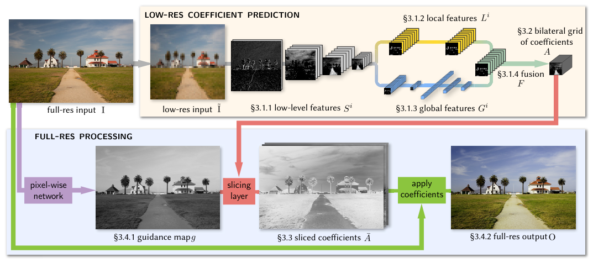
# pdfrect: 4 51.8 314.3 560.2 382.2
# pdfsent: [[[4,51.8,314.3,67.8,322.3]],[[4,67.8,314.3,77.4,322.3]],[[4,77.4,314.3,560.2,322.3],[4,51.8,324.3,111.6,332.7]],[[4,111.6,324.3,350.9,332.7]],[[4,350.9,324.3,560.2,332.7],[4,51.8,333.0,415.8,342.4]],[[4,415.8,333.0,560.2,342.4],[4,51.8,342.9,454.6,352.3]],[[4,454.6,342.9,560.2,352.3],[4,51.8,352.9,181.4,362.7]],[[4,181.4,352.9,560.2,362.7],[4,51.8,362.9,420.4,372.7]],[[4,420.4,362.9,560.2,372.7],[4,51.8,374.2,302.4,382.2]]]
# pdfhl: sky blue 4
#+begin_en
Fig. 2. Our new network architecture seeks to perform as much computation as possible at a low resolution, while still capturing high-frequency effects at full image resolution. It consists of two distinct streams operating at different resolutions. The low-resolution stream (top) processes a downsampled version ˜I of the input I through several convolutional layers so as to estimate a bilateral grid of affine coefficients A. This low-resolution stream is further split in two paths to learn both local features Li and global features Gi, which are fused (F) before making the final prediction. The global and local paths share a common set of low-level features Si. In turn, the high-resolution stream (bottom) performs a minimal yet critical amount of work: it learns a grayscale guidance map д used by our new slicing node to upsample the grid of affine coefficients back to full-resolution ¯A. These per-pixel local affine transformations are then applied to the full-resolution input, which yields the final output O.
#+end_en
図 2. 新しいネットワーク アーキテクチャは、高解像度で高周波効果を捉えつつ、可能な限り多くの計算を低解像度で実行することを目指しています。これは、異なる解像度で動作する 2 つの独立したストリームで構成されています。低解像度ストリーム (上) は、入力 I のダウンサンプリング バージョン ˜I を複数の畳み込み層を通して処理し、アフィン係数 A のバイラテラル グリッドを推定します。この低解像度ストリームはさらに 2 つのパスに分割され、ローカル特徴 Li とグローバル特徴 Gi の両方を学習し、最終的な予測を行う前にこれらを融合 (F) します。グローバル パスとローカル パスは、共通の低レベル特徴 Si のセットを共有します。一方、高解像度ストリーム (下) は、最小限ながらも重要な量の処理を実行します。新しいスライシング ノードがアフィン係数のグリッドをフル解像度 ¯A にアップサンプリングするために使用するグレースケール ガイダンス マップ д を学習します。これらのピクセルごとのローカル アフィン変換は、フル解像度の入力に適用され、最終出力 O が得られます。

# pdfrect: 3 318.0 103.9 561.7 255.3
# pdfsent: [[[3,326.9,103.9,420.2,112.8]],[[3,420.2,103.9,560.2,112.8],[3,318.0,114.8,561.7,123.8],[3,318.0,125.8,549.0,134.7]],[[3,549.0,125.8,560.4,134.7],[3,318.0,136.7,560.2,145.7],[3,318.0,147.7,405.3,156.7]],[[3,405.3,147.7,514.4,156.7]],[[3,514.4,147.7,561.7,156.7],[3,318.0,158.6,560.2,167.6],[3,318.0,169.7,484.3,178.6]],[[3,484.3,169.7,560.2,178.6],[3,318.0,180.5,561.7,189.6],[3,318.0,191.5,560.2,200.5],[3,318.0,202.5,453.8,211.5]],[[3,453.8,202.5,560.2,211.5],[3,318.0,213.4,459.6,222.5]],[[3,459.6,213.4,560.2,222.5],[3,318.0,224.5,560.2,233.4],[3,318.0,235.3,560.2,244.4],[3,318.0,246.3,401.9,255.3]]]
# pdfhl: light green 2,3,4
# pdfhl: sky blue 6,7
#+begin_en
The high-res stream (Fig. 2, bottom) works at full resolution and performs minimal computation but has the critical role of capturing high-frequency effects and preserving edges when needed. For this purpose, we introduce a slicing node inspired by bilateral grid processing [Chen et al. 2007; Paris and Durand 2006]. This node performs data-dependent lookups in the low-resolution grid of affine coefficients based on a learned guidance map. Given high-resolution affine coefficients obtained by slicing into the grid with the fullresolution guidance map, we apply local color transforms to each pixel to produce the final output O. At training time, we minimize our loss function at full resolution. This means that the low-res stream, which only processes heavily downsampled data, still learns intermediate features and affine coefficients that can reproduce high-frequency effects.
#+end_en
高解像度ストリーム（図 2、下）はフル解像度で動作し、最小限の計算を実行しますが、高周波効果を捉え、必要に応じてエッジを保持するという重要な役割を果たします。この目的のために、バイラテラルグリッド処理[Chen et al. 2007; Paris and Durand 2006]にヒントを得たスライスノードを導入します。このノードは、学習済みのガイダンスマップに基づいて、アフィン係数の低解像度グリッドでデータ依存のルックアップを実行します。フル解像度ガイダンスマップを使用してグリッドをスライスして得られた高解像度アフィン係数に基づいて、各ピクセルにローカルカラー変換を適用して最終出力 O を生成します。トレーニング時には、フル解像度で損失関数を最小化します。これは、大幅にダウンサンプリングされたデータのみを処理する低解像度ストリームでも、高周波効果を再現できる中間特徴とアフィン係数を学習できることを意味します。

#+begin_ai
【用語解説】
- Local color transform (ローカルカラー変換): 画像の各ピクセルに対して、局所的（ピクセル周辺の領域）に色空間の変換を適用し、色調やコントラストを調整する手法。資料には具体的な実装や数式は記載されていないため、説明は一般的な知識に基づく。(推測)
#+end_ai

# pdfrect: 3 318.0 257.2 561.7 397.8
# pdfsent: [[[3,326.9,257.2,561.7,266.3],[3,318.0,268.2,560.2,277.2],[3,318.0,279.2,450.1,288.2]],[[3,450.1,279.2,560.2,288.2],[3,318.0,290.1,560.2,299.2],[3,318.0,301.1,463.3,310.1]],[[3,463.3,301.1,560.2,310.1],[3,318.0,312.1,442.7,321.0]],[[3,442.7,312.1,560.2,321.0],[3,318.0,323.1,412.7,332.0]],[[3,412.7,323.1,560.2,332.0],[3,318.0,334.0,435.5,343.0]],[[3,435.5,334.0,560.2,343.0],[3,318.0,344.9,561.7,353.9],[3,318.0,355.9,560.2,364.9],[3,318.0,366.8,499.6,375.9]],[[3,499.6,366.8,560.2,375.9],[3,318.0,377.8,560.4,386.8],[3,318.0,388.8,401.6,397.8]]]
#+begin_en
As a first approximation, one can think of our work as alleviating the need for the reference filter at runtime in Chen et al.’s Bilateral Guided Upsampling [2016]. In a sense, we seek to predict the affine color transform coefficients in the bilateral grid given a low-resolution version of the image. However, there are several key elements that go beyond this. First, the downsampling into the bilateral grid is learned. Second, the guidance image is also learned and not restricted to luminance. Finally, we apply the loss function not on the affine coefficients, but on the final image at full resolution, which allows us to capture high-frequency effects and handle operators that are not scale-invariant (Figure 9). We illustrate the role of each component of our architecture with an ablation study in Figures 3, 4, 5 and 7.
#+end_en
第一近似として、私たちの研究は、Chen らによる Bilateral Guided Upsampling [2016] の実行時における参照フィルタの必要性を軽減するものと考えることができます。ある意味では、低解像度の画像が与えられた場合に、バイラテラルグリッド内のアフィンカラー変換係数を予測することを目指しています。しかし、これにはいくつかの重要な要素があります。まず、バイラテラルグリッドへのダウンサンプリングが学習されます。次に、ガイダンス画像も学習され、輝度に限定されません。最後に、損失関数をアフィン係数ではなく、フル解像度の最終画像に適用することで、高周波効果を捉え、スケール不変でない演算子を処理できるようになります (図 9)。図 3、4、5、7 では、アブレーション スタディを用いて、私たちのアーキテクチャの各コンポーネントの役割を説明します。

*** 3.1 Low-resolution prediction of bilateral coefficients
3.1 低解像度での両側係数の予測
# pdfrect: 3 317.6 421.9 561.7 619.6
# pdfsent: [[[3,317.7,421.9,560.2,432.9],[3,318.0,434.8,335.5,443.9]],[[3,335.5,434.8,560.2,443.9],[3,318.4,443.5,561.7,456.1],[3,318.0,456.9,345.0,465.8]],[[3,345.0,456.9,494.0,465.8]],[[3,494.0,456.9,561.7,465.8],[3,318.0,467.9,560.2,476.7],[3,318.4,476.4,490.6,489.0]],[[3,490.6,476.4,560.2,489.0],[3,318.0,489.8,560.2,498.6],[3,318.0,498.3,395.5,510.9]],[[3,395.5,498.3,561.7,510.9],[3,317.7,511.6,560.4,520.6],[3,318.0,522.5,408.7,531.6]],[[3,408.7,522.5,561.2,531.6],[3,318.0,533.5,340.1,542.5]],[[3,340.1,533.5,561.7,542.5],[3,318.0,542.5,347.8,553.8]],[[3,347.8,542.5,560.2,553.8],[3,318.0,555.3,437.3,564.7]],[[3,437.3,555.3,560.2,564.7],[3,318.0,566.3,457.4,575.7]],[[3,457.4,566.3,560.2,575.7],[3,318.0,577.7,498.8,586.6]],[[3,498.8,577.7,560.2,586.6],[3,318.0,588.6,561.2,597.6],[3,317.6,599.6,560.2,608.6],[3,318.0,610.6,351.1,619.6]]]
# pdfhl: sky blue 0
#+begin_en
The input ˜I to the low-res stream has a fixed resolution 256 × 256. It is first processed by a stack of strided convolutional layers (Si )i=1,...,nS to extract low-level features and reduce the spatial resolution. Then, in a design inspired by Iizuka et al. [2016], the last lowlevel features are processed by two asymmetric paths: the first path (Li )i=1,...,nL is fully convolutional [Long et al. 2015] and specializes in learning local features that propagate image data while retaining spatial information. The second path (Gi )i=1,...,nG uses both convolutional and fully-connected layers to learn a fixed-size vector of global features (e.g. high-level scene category, indoor/outdoor, etc.) with a receptive field covering the entire low-resolution image ˜I. The outputs of the two paths, GnG and LnL, are then fused into a common set of features F. A pointwise linear layer outputs a final array A from the fused streams. We interpret this array as a bilateral grid of affine coefficients (Section 3.2). Since we produce a 3D bilateral grid from a 2D image in a content-dependent fashion, we can view the low-res stream as implementing a form of learned splatting.
#+end_en
低解像度ストリームへの入力˜I は、256×256 の固定解像度を持ちます。まず、ストライド付き畳み込み層(Si )i=1,...,nS のスタックによって処理され、低レベルの特徴が抽出され、空間解像度が低下します。次に、Iizuka ら[2016]に触発された設計で、最後の低レベルの特徴は 2 つの非対称パスによって処理されます。最初のパス(Li )i=1,...,nL は完全に畳み込み[Long ら 2015]であり、空間情報を保持しながら画像データを伝播するローカル特徴の学習に特化しています。2番目のパス(Gi )i=1,...,nG は、畳み込み層と全結合層の両方を使用して、低解像度画像˜I 全体をカバーする受容野を持つ固定サイズのベクトルのグローバル特徴(高レベルのシーンカテゴリ、屋内/屋外など)を学習します。 2 つのパス GnG と LnL の出力は、共通の特徴セット F に融合されます。点ごとの線形レイヤーは、融合されたストリームから最終的な配列 A を出力します。この配列は、アフィン係数のバイラテラルグリッドとして解釈されます（セクション 3.2）。2D 画像からコンテンツ依存的に 3D バイラテラルグリッドを生成するため、低解像度ストリームは学習型スプラッティングの一種を実装していると考えることができます。

***** 3.1.1 Low-level features.
# pdfrect: 3 317.6 627.7 560.2 659.0
# pdfsent: [[[3,327.9,627.7,344.1,636.8],[3,353.1,627.7,428.4,636.8]],[[3,428.4,627.7,560.2,636.8],[3,318.0,637.0,560.2,648.0],[3,317.6,649.6,417.2,659.0]]]
# pdfhl: sky blue 0
#+begin_en
We first process the low-resolution image S0 := ˜I with a stack of standard strided convolutional layers with stride s = 2 (Figure 2):
#+end_en
3.1.1 低レベル特徴。まず、低解像度画像 S0 := ˜I を、ストライド s = 2 の標準的なストライド付き畳み込み層のスタックで処理します (図 2)。

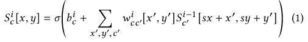

\[
S_{c}^{i}[x,y]=\sigma\Biggl{(}b_{c}^{i}+\sum_{x^{\prime},y^{\prime},c^{\prime}}w _{cc^{\prime}}^{i}[x^{\prime},y^{\prime}]S_{c^{\prime}}^{i-1}[sx+x^{\prime},sy+y^ {\prime}]\Biggr{)} \tag{1}
\]
#+begin_explain
（自動解説・要確認）
要約: ストライド 2 の畳み込み層で、前層の特徴マップを重みとバイアスで線形結合し、活性化σで非線形化する。
かみ砕くと: 入力チャネル c'の周辺ピクセル S_{c'}^{i-1}[2x+x',2y+y']に重み w_{cc'}^i[x',y']を掛けて足し、バイアス b_c^i を加えてσを通し、出力 S_c^i[x,y]を得る。
記号:
- S_c^i[x,y]: 層 i の出力特徴
- b_c^i: バイアス
- w_{cc'}^i[x',y']: 畳み込みカーネル
- σ: 活性化関数
- s: ストライド(2)
#+end_explain
# pdfput: 1 3 6acd956d8b06
#+begin_memo
- $S^{i-1}$（スキャンされる元の画像） :: 1 つ前のステップで作られた画像（または最初の入力画像）

- $w$（特徴を見つける虫眼鏡） :: ）$3 \times 3$ピクセルの範囲を覗き込むフィルター
   「縦線に反応する」「赤い色に反応する」といった役割を持っています。

- $\sum$（全部まとめる） :: 虫眼鏡で覗いた範囲のピクセルデータと、虫眼鏡の性質（重み）を掛け合わせて、1つの数値にギュッとまとめます。

- $sx, sy$ :: 2 マスずつスキップ
   「$s$（ストライド）」は 2 に設定されています。虫眼鏡を 1 マスずつではなく 2 マスずつ飛ばしながらスキャンするため、出来上がる新しい画像は縦横のサイズが半分に縮小されます。

- $b$（微調整） :: 仕上げに足し算する「下駄（バイアス）」

- $\sigma$（マイナスは切り捨てる） :: 計算結果がマイナスになったら、強制的に「0」にするフィルター（ReLU）

- $S^i$（出来上がった新しい画像） :: スキャンの結果として作られた、次へ渡される新しい画像
#+end_memo

# pdfrect: 4 51.4 399.3 295.0 465.6
# pdfsent: [[[4,51.4,399.3,104.3,411.6]],[[4,104.3,399.3,111.4,411.6]],[[4,111.4,399.3,118.5,411.6]],[[4,118.5,399.3,295.0,411.6],[4,51.8,410.4,294.0,421.7],[4,51.6,421.2,295.0,432.7],[4,51.8,434.0,239.8,443.6]],[[4,239.8,434.0,294.0,443.6],[4,51.8,445.0,294.0,454.6],[4,51.8,456.6,196.5,465.6]]]
# pdfhl: sky blue 0,1,2,3,4
#+begin_en
Where i = 1, . . . ,nS indexes the layers, c and c′ index the layers’ channels, wi is an array of weights for the convolutions, bi is a vector of biases, and the summation is over −1 ≤ x ′,y′ ≤ 1 (i.e., the convolution kernels have 3 × 3 spatial extent). We use the ReLU activation function σ (·) = max(·, 0) and use zero-padding as the boundary condition in all convolutions.
#+end_en
ここで、i = 1, ...,nS はレイヤーのインデックス、c と c′ はレイヤーのチャネルのインデックス、wi は畳み込みの重みの配列、bi はバイアスのベクトル、総和は −1 ≤ x′,y′ ≤ 1 (つまり、畳み込みカーネルは 3 × 3 の空間範囲を持つ) で行われます。ReLU 活性化関数 σ (·) = max(·, 0) を使用し、すべての畳み込みの境界条件としてゼロパディングを使用します。

# pdfrect: 4 51.8 467.5 295.6 608.3
# pdfsent: [[[4,60.8,467.5,295.6,476.5],[4,51.8,476.2,159.8,488.3]],[[4,159.8,476.2,294.0,488.3],[4,51.8,487.7,294.0,498.7],[4,51.8,500.3,294.0,510.5],[4,51.8,511.2,294.2,521.4],[4,51.8,522.6,295.6,531.6],[4,51.8,533.5,294.0,542.6],[4,51.8,544.6,167.3,553.5]],[[4,167.3,544.6,294.0,553.5],[4,51.8,555.5,295.6,564.5],[4,51.8,566.5,255.5,575.4]],[[4,255.5,566.5,281.0,575.4]],[[4,281.0,566.5,295.6,575.4],[4,51.8,577.3,295.4,586.4]],[[4,51.8,587.9,228.0,598.1]],[[4,228.0,587.9,294.0,598.1],[4,51.8,599.3,158.0,608.3]]]
#+begin_en
These low-level layers progressively reduce the spatial dimensions by a total factor of 2nS . Thus nS has two effects: 1) it drives the spatial downsampling between the low-resolution input ˜I and the final grid of affine coefficients—the higher nS, the coarser the final grid, and 2) nS controls the complexity of the prediction: deeper layers have an exponentially larger spatial support and more complex non-linearities (by composition); thus, they can extract more complex patterns in the input. Figure 3 shows a comparison with a network in which the low-level layers have been removed, and replaced by a hard-coded splatting operation [Chen et al. 2007]. Without these layers, the network loses much of its expressive power. Our architecture, uses nS = 4 low-level layers. Table 1 summarizes the dimensions of each layer.
#+end_en
これらの低レベル層は、空間次元を合計で 2nS 倍に徐々に縮小します。したがって、nS には 2 つの効果があります。1) 低解像度の入力 ˜I と最終的なアフィン係数のグリッド間の空間ダウンサンプリングを駆動します。nS が大きいほど、最終的なグリッドは粗くなります。2) nS は予測の複雑さを制御します。より深い層は指数関数的に大きな空間サポートとより複雑な非線形性 (構成による) を持ち、入力からより複雑なパターンを抽出できます。図 3 は、低レベル層が削除され、ハードコードされたスプラッティング操作に置き換えられたネットワークとの比較を示しています [Chen et al. 2007]。これらの層がないと、ネットワークはその表現力の多くを失います。私たちのアーキテクチャでは、nS = 4 の低レベル層を使用します。表 1 は、各層の次元をまとめたものです。

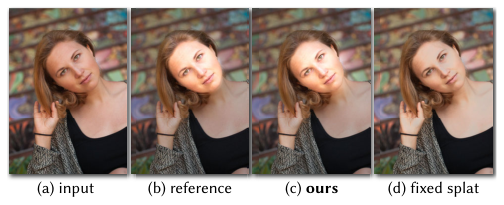

# pdfrect: 4 317.7 594.3 561.5 692.0
# pdfsent: [[[4,318.0,594.3,333.9,602.7]],[[4,333.9,594.3,343.5,602.7]],[[4,343.5,594.3,560.2,602.7],[4,318.0,604.3,392.0,612.3]],[[4,392.0,604.3,560.2,612.3],[4,318.0,614.2,560.2,622.2],[4,318.0,624.2,340.9,632.6]],[[4,340.9,624.2,560.4,632.6],[4,317.7,634.2,560.2,642.1],[4,318.0,644.1,411.1,652.1]],[[4,411.1,644.1,560.2,652.1],[4,318.0,654.1,404.9,662.1]],[[4,404.9,654.1,561.5,662.1],[4,317.8,664.1,560.4,672.0],[4,317.7,674.0,560.2,682.0],[4,318.0,684.0,349.8,692.0]]]
#+begin_en
Fig. 3. Our low-level convolutional layers are fully learned and can extract semantic information. Replacing these layers with the standard bilateral grid splatting operation causes the network to lose much of its expressive power. In this example of our Face brightening operator (a-b), the network with hardcoded splatting (d) cannot detect the face properly because the grid’s resolution is too low. Instead, it slightly brightens all skintones, as is visible on the hands. Our progressive downsampling with strided convolutions learns the semantic features required to solve this task properly (c), brightening only the face while darkening the background like in the reference.
#+end_en

図 3。低レベルの畳み込み層は完全に学習されており、意味情報を抽出できます。これらの層を標準的なバイラテラルグリッドスプラッティング操作に置き換えると、ネットワークの表現力が大幅に低下します。顔の明るさ調整演算子 (a-b) の例では、ハードコードされたスプラッティング (d) を使用したネットワークは、グリッドの解像度が低すぎるため、顔を適切に検出できません。その代わりに、手の部分で確認できるように、すべての肌の色調がわずかに明るくなります。ストライド畳み込みを使用した段階的なダウンサンプリングにより、このタスクを適切に解決するために必要な意味的特徴が学習され (c)、参照のように背景を暗くしながら顔だけを明るくします。

# pdfrect: 5 51.6 602.5 295.4 620.4
# pdfsent: [[[5,51.6,602.5,80.1,610.9]],[[5,80.1,602.5,197.2,610.9]],[[5,197.2,602.5,295.4,610.9],[5,51.8,612.5,282.1,620.4]]]
#+begin_en
Table 1. Details of the network architecture. c, fc, f and l refer to convolutional, fully-connected, fusion and pointwise linear layers respectively.
#+end_en

表 1. ネットワークアーキテクチャの詳細。c、fc、f、l はそれぞれ畳み込み層、全結合層、融合層、点ごとの線形層を表します。

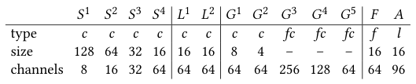

***** 3.1.2 Local features path
# pdfrect: 4 51.4 616.8 295.4 694.7
# pdfsent: [[[4,61.8,619.2,77.7,628.2],[4,86.7,616.8,161.2,628.2]],[[4,161.2,616.8,292.4,628.2],[4,51.8,627.8,294.0,639.9],[4,51.8,641.2,174.7,650.0]],[[4,174.7,641.2,294.0,650.0],[4,51.8,649.7,295.4,661.0]],[[4,51.4,663.1,294.0,672.0],[4,51.8,674.0,116.6,682.9]],[[4,116.6,674.0,294.0,682.9],[4,51.8,684.5,245.6,694.7]],[[4,245.6,684.5,294.0,694.7]]]
# pdfhl: sky blue 1
#+begin_en
The last low-level features layer SnS is then processed by a stack of nL = 2 convolutional layers Li in the local path (Figure 2, yellow). These layers take the same form as Equation (1), identifying L0 := SnS , but this time with stride s = 1. We keep both the spatial resolution and number of features constant in the local path. Because the resolution is held constant, the spatial support of the filters only grows linearly with nL. A deep enough
#+end_en

3.1.2 ローカル特徴パス。最後の低レベル特徴層 SnS は、ローカルパス (図 2、黄色) の nL = 2 個の畳み込み層 Li のスタックによって処理されます。これらの層は、式 (1) と同じ形式をとり、L0 := SnS を識別しますが、今回はストライド s = 1 です。ローカルパスでは、空間解像度と特徴の数の両方を一定に保ちます。解像度が一定に保たれているため、フィルタの空間サポートは nL に対して線形にのみ増加します。十分に深い

#+DOWNLOADED: /mnt/c/Users/light/OneDrive/Pictures/Screenshots/スクリーンショット 2026-10-13 113648.png @ 2026-10-13 11:37:26
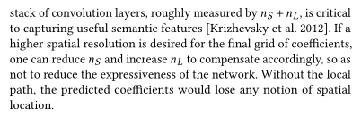

畳み込み層のスタック（おおよそ nS + nL で表される）は、有用な意味的特徴を捉える上で非常に重要です [Krizhevsky et al. 2012]。最終的な係数グリッドの空間解像度を高くしたい場合は、ネットワークの表現力を低下させないように、nS を減らし、nL を増やすことで適切に補正できます。ローカルパスがないと、予測された係数は空間的な位置の概念を失ってしまいます。

***** 3.1.3 Global features path
# pdfrect: 5 51.5 277.7 295.6 385.7
# pdfsent: [[[5,61.8,277.7,78.0,286.8],[5,86.9,277.7,167.5,286.8]],[[5,167.5,277.7,295.6,286.8],[5,51.8,286.4,250.7,297.7]],[[5,250.7,286.4,294.0,297.7],[5,51.8,299.2,294.0,308.6],[5,51.8,310.2,294.0,320.4],[5,51.5,321.7,115.7,330.5]],[[5,115.7,321.7,294.0,330.5],[5,51.8,330.8,294.0,341.8],[5,51.8,341.8,294.0,352.8],[5,51.8,354.9,88.5,363.7]],[[5,88.5,354.9,295.0,363.7],[5,51.5,365.8,294.0,374.7],[5,51.8,376.7,149.2,385.7]]]
# pdfhl: sky blue 2,3
#+begin_en
Like the local path, the global features path branches out from SnS , that is G0 := SnS . It comprises two strided convolutional layers (Equation (1), with s = 2) followed by three fully-connected layers, for a total of nG = 5 global layers (Figure 2, blue). One consequence of using fully-connected layers is that the resolution of the input ˜I needs to be fixed, since it dictates the dimensions of G2 and the number of network parameters that act on it. As we will see in Section 3.3, thanks to our slicing operator, we can still process images of any resolution, despite the size of the low-res stream being fixed.
#+end_en
3.1.3 グローバル特徴パス。ローカルパスと同様に、グローバル特徴パスは SnS から分岐します。つまり、G0 := SnS です。これは、2 つのストライド付き畳み込み層 (式 (1)、s = 2) とそれに続く 3 つの全結合層で構成され、合計 nG = 5 つのグローバル層になります (図 2、青)。全結合層を使用することによる結果の 1 つは、入力 ˜I の解像度を固定する必要があることです。これは、G2 の次元と、それに作用するネットワーク パラメータの数を決定するためです。セクション 3.3 で説明するように、スライス演算子のおかげで、低解像度ストリームのサイズが固定されているにもかかわらず、任意の解像度の画像を処理できます。
# pdfput: 1 5 6acdafe1a49d
#+begin_memo
低解像度ストリームの処理サイズが固定されていても、最終的にそこから作られるのは「色変換のルールが詰まった固定サイズの 3D グリッド」です。
フル解像度の元画像は、自身のサイズに関わらず、各ピクセルがこのグリッドへ座標ベースでアクセスして係数を引っ張ってくる（スライスする）だけなので、結果的にユーザーが入力する元の高解像度画像自体は、どんな解像度（サイズ）であっても問題なく処理できます。
#+end_memo

# pdfrect: 5 51.5 387.6 295.6 451.4
# pdfsent: [[[5,60.8,387.6,295.6,396.6],[5,51.8,398.6,295.6,407.6],[5,51.8,409.5,242.7,418.6]],[[5,242.7,409.5,294.0,418.6],[5,51.8,420.5,295.6,429.5],[5,51.5,431.4,294.0,440.5],[5,51.8,442.5,281.5,451.4]]]
# pdfhl: sky blue 0
#+begin_en
The global path produces a 64-dimensional vector that summarizes global information about the input and acts as a prior to regularize the local decisions made by the local path. Without global features to encode this high-level description of the input, the network can make erroneous local decisions that lead to artifacts as exemplified by the large-scale variations in the sky in Figure 4.
#+end_en
グローバルパスは、入力に関するグローバル情報を要約した 64 次元ベクトルを生成し、ローカルパスによるローカルな決定を正則化するための事前情報として機能します。入力のこの高レベルな記述をエンコードするグローバル特徴がない場合、ネットワークは誤ったローカルな決定を下す可能性があり、図 4 の空の大規模な変動に代表されるようなアーティファクトが発生します。

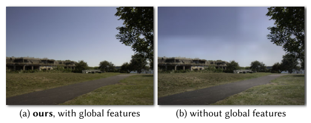
# pdfrect: 5 51.8 186.6 295.4 254.4
# pdfsent: [[[5,51.8,186.6,68.6,194.6]],[[5,68.6,186.6,78.7,194.6]],[[5,78.7,186.6,294.0,194.6],[5,51.8,196.6,294.0,204.5],[5,51.8,206.5,295.4,214.5],[5,51.8,216.5,143.1,224.5]],[[5,143.1,216.5,294.0,224.5],[5,51.8,226.5,214.3,234.4]],[[5,214.3,226.5,294.0,234.4],[5,51.8,236.4,294.2,244.4],[5,51.8,246.4,293.7,254.4]]]
#+begin_en
Fig. 4. The global features path in our architecture allows our model to reason about the full image, e.g., for subjective tasks such as reproducing subjective human adjustments that may be informed by intensity distribution or scene type (a). Without the global path, the model can make local decisions that are spatially inconsistent (b). Here, the network fails to recognize that the blue area in the top-left corner also belongs to the sky and should therefore receive the same correction as the area just below it.
#+end_en
図 4。本アーキテクチャのグローバル特徴パスにより、モデルは画像全体について推論できます。たとえば、輝度分布やシーンの種類によって影響を受ける可能性のある主観的な人間の調整を再現するなどの主観的なタスクが可能です（a）。グローバルパスがない場合、モデルは空間的に矛盾する局所的な決定を下す可能性があります（b）。ここでは、ネットワークは左上隅の青い領域も空に属しており、そのすぐ下の領域と同じ補正を受けるべきであることを認識できません。

***** 3.1.4 Fusion and linear prediction
# pdfrect: 5 51.8 459.9 294.0 490.7
# pdfsent: [[[5,61.8,459.9,77.5,468.8],[5,86.5,459.9,193.8,468.8]],[[5,193.8,459.9,294.0,468.8],[5,51.8,470.8,294.0,479.8],[5,51.8,481.8,130.1,490.7]]]
#+begin_en
 We fuse the contributions of the local and global paths with a pointwise affine mixing followed by a ReLU activation:
#+end_en
3.1.4 融合と線形予測。局所パスと大域パスの寄与を点ごとのアフィン混合とそれに続く ReLU 活性化によって融合します。
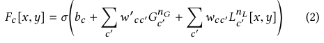
\[
F_{c}[x,y]=\sigma\Biggl{(}b_{c}+\sum_{c^{\prime}}w^{\prime}{}_{cc^{\prime}}G_{c^{ \prime}}^{n_{G}}+\sum_{c^{\prime}}w_{cc^{\prime}}L_{c^{\prime}}^{n_{L}}[x,y] \Biggr{)} \tag{2}
\]
#+begin_explain
（自動解説・要確認）
要約: ローカル特徴 L とグローバル特徴 G をチャネルごとに重み付けし、バイアスとσで融合した特徴 F を得る。
かみ砕くと: 各出力チャネル c で、G_{c'}^{n_G}に w'_{cc'}、L_{c'}^{n_L}[x,y]に w_{cc'}を掛けた総和にバイアス b_c を足し、σで非線形化して F_c[x,y]を算出する。
記号:
- G_{c'}^{n_G}: グローバル特徴ベクトル
- L_{c'}^{n_L}[x,y]: ローカル特徴マップ
- w'_{cc'}, w_{cc'}: 融合重み
- b_c: バイアス
- σ: 活性化関数
#+end_explain

# pdfrect: 5 51.5 529.5 294.0 550.1
# pdfsent: [[[5,51.5,529.5,294.0,539.2],[5,51.8,540.5,294.0,550.1]]]
# pdfhl: sky blue 0
#+begin_en
This yields a 16 × 16 × 64 array of features from which, we make our final 1 × 1 linear prediction to produce a 16 × 16 map with 96
#+end_en
これにより、16 × 16 × 64 の特徴配列が得られ、そこから最終的な 1 × 1 線形予測を行い、96 の 16 × 16 マップを生成します。
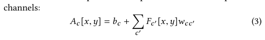
\[
A_{c}[x,y]=b_{c}+\sum_{c^{\prime}}F_{c^{\prime}}[x,y]w_{c}{c^{\prime}} \tag{3}
\]
#+begin_explain
（自動解説・要確認）
要約: 融合特徴 F を 1×1 の線形変換で重み付けし、バイアスを足して最終出力 A を得る。
かみ砕くと: 各位置(x,y)で、全チャネル c'の F_{c'}[x,y]に重み w_c{c'}を掛けて足し合わせ、バイアス b_c を加えるだけの線形結合で A_c[x,y]を計算する。
記号:
- F_{c'}[x,y]: 融合特徴
- w_c{c'}: 1×1 畳み込み重み
- b_c: バイアス
- A_c[x,y]: 出力特徴
#+end_explain
# pdfput: 1 5 6acdafe10261
#+begin_memo
*線形予測* *$1 \times 1$ 畳み込み* 64 個の特徴すべてに専用の重みを掛け合わせて足し算（ブレンド）し、1つの数字を作ります。これを 96 回繰り返すことで、96 個の数字をひねり出します。

16✕16✕64 が 16✕16✕96 になります。バイラテラルグリッドの深さ（空間情報を第 1, 2 次元とすると深さは第 3 次元）は 8 で設定されるので 96/8 =12 で各セル 3×4 のアフィン色変換行列を格納します。
#+end_memo

# pdfrect: 5 302.8 54.3 560.2 63.3
# pdfsent: [[[5,302.8,54.3,520.5,63.3],[5,529.4,54.3,532.6,63.3],[5,541.5,54.3,560.2,63.3]]]
# pdfrect: 5 318.0 80.7 473.7 90.7
# pdfsent: [[[5,318.0,80.7,329.4,90.7],[5,339.4,80.7,473.7,90.7]]]

*** 3.2 Image features as a bilateral grid
3.2 双方向グリッドとしての画像特徴

# pdfrect: 5 318.0 95.6 560.5 148.4
# pdfsent: [[[5,318.0,95.6,537.1,104.6]],[[5,537.1,95.6,560.5,104.6],[5,318.0,106.7,482.7,115.5]],[[5,482.7,106.7,560.2,115.5],[5,318.0,117.6,560.2,126.5],[5,318.0,128.1,560.2,137.5],[5,318.0,139.5,370.5,148.4]]]
# pdfhl: sky blue 1,2
#+begin_en
So far we have described our model as a neural network. We now shift our perspective to that of a bilateral grid. To facilitate this, in a slight abuse of notation, we will occasionally treat the final feature map A as a multi-channel bilateral grid whose third dimension has been unrolled:
#+end_en
これまで、私たちのモデルをニューラルネットワークとして説明してきました。ここで視点をバイラテラルグリッドに移します。これを容易にするために、表記法を少し乱用することになりますが、最終的な特徴マップ A を、3次元目が展開されたマルチチャネルバイラテラルグリッドとして扱うことがあります。

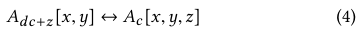
\[
A_{dc+z}[x,y]\leftrightarrow A_{c}[x,y,z] \tag{4}
\]
#+begin_explain
（自動解説・要確認）
要約: 最終特徴マップ A のフラットなチャネルインデックス dc+z を、3次元インデックス(c,z)に対応付ける変換式。
かみ砕くと: d は深さ(8)で、インデックス dc+z を A_c[x,y,z]という 16×16×8 の双方向グリッド表現の同じ要素にマッピングし、Aを多チャネルグリッドとして解釈できるようにする。
記号:
- d: グリッド深さ(8)
- c: チャネルインデックス
- z: 第 3 次元インデックス
- A_{dc+z}[x,y]: フラット表現
- A_c[x,y,z]: 3 次元表現
#+end_explain
# pdfput: 1 5 6acdb2b7f95c
#+begin_memo
- 左辺 $A_{d c+z}[x,y]$（平たい状態） :: ネットワークがそのまま出力した、96 チャネルの 2D マップ
   ここでの $d c + z$ は、0から 95 までの通し番号（インデックス）を表します。

- 右辺 $A_{c}[x,y,z]$（立体的な状態） :: これをバイラテラルグリッドとして見たときの表現
   $c$ は「12 個のアフィン係数のうち何番目か」、$z$ は「深さ 8 つのうち何段目か」を表します。
#+end_memo

# pdfrect: 5 317.6 170.1 561.7 343.9
# pdfsent: [[[5,317.6,170.1,457.4,179.5]],[[5,457.4,170.1,560.3,179.5],[5,318.0,180.9,560.2,190.5],[5,318.0,191.8,560.4,201.4],[5,318.0,203.5,401.1,212.4]],[[5,401.1,203.5,560.2,212.4],[5,318.0,214.4,560.2,223.4],[5,318.0,224.9,561.7,234.3],[5,318.0,235.9,499.6,245.3]],[[5,499.6,235.9,560.2,245.3],[5,318.0,247.2,560.2,256.3],[5,318.0,257.8,561.7,267.2],[5,318.0,269.1,360.1,278.2]],[[5,360.1,269.1,384.7,278.2]],[[5,384.7,269.1,560.2,278.2],[5,318.0,280.1,560.2,289.1],[5,318.0,291.1,442.7,300.1]],[[5,442.7,291.1,560.4,300.1],[5,318.0,302.0,444.7,311.0]],[[5,444.7,302.0,560.2,311.0],[5,318.0,313.0,560.2,322.0],[5,318.0,324.0,560.2,333.0],[5,318.0,334.9,406.7,343.9]]]
# pdfhl: sky blue 0,1,2,3,4,5,6
#+begin_en
where d = 8 is the depth of the grid. Under this interpretation, A can be viewed as a 16 × 16 × 8 bilateral grid, where each grid cell contains 12 numbers, one for each coefficient of a 3 × 4 affine color transformation matrix. This reshaping lets us interpret the strided convolutions in Equation (1) as acting in the bilateral domain, where they correspond to a convolution in the (x,y) dimensions and express full connectivity in the z and c dimensions. This operation is therefore more expressive than simply applying 3D convolutions in the grid, which would only induce local connectivity on z [Jampani et al. 2016]. It is also more expressive than standard bilateral grid splatting which discretizes I into several intensity bins then box filters the result [Chen et al. 2007]; an operation that is easily expressed with a 2-layer network. In a sense, by maintaining a 2D convolution formulation throughout and only interpreting the last layer as a bilateral grid, we let the network decide when the 2D to 3D transition is optimal.
#+end_en
ここで、d = 8 はグリッドの深さです。この解釈では、A は 16 × 16 × 8 のバイラテラル グリッドと見なすことができ、各グリッド セルには 3 × 4 アフィン カラー変換行列の各係数に対応する 12 個の数値が含まれます。このリシェイプにより、式 (1) のストライド付き畳み込みをバイラテラル ドメインで動作していると解釈できます。バイラテラル ドメインでは、(x,y) 次元の畳み込みに対応し、z 次元と c 次元で完全な接続性を表現します。したがって、この操作は、グリッドで 3D 畳み込みを単純に適用するよりも表現力が高く、z での局所的な接続性しか誘発しません [Jampani et al. 2016]。また、I をいくつかの強度ビンに離散化してから結果をボックス フィルタする標準的なバイラテラル グリッド スプラッティングよりも表現力が高く、2 層ネットワークで簡単に表現できます。ある意味では、全体を通して 2D 畳み込みの定式化を維持し、最後の層だけをバイラテラルグリッドとして解釈することで、2D から 3D への遷移が最適となるタイミングをネットワーク自身に判断させるようにしている。

# pdfput: 1 5 6acdb4215e11
#+begin_memo
【身近な例え】
- 16 × 16 × 8 のバイラテラルグリッドを、**本棚の 3 段構造**に例えることができます。
  - 横方向 (x) と縦方向 (y) が本棚の「列」と「段」になり、そこに 16 × 16 の格子が並びます。
  - その各格子の中に、奥行き方向 (z) の 8 層があり、これは本棚の「奥行き」や「高さ」に相当します。
  - さらに各セルは 12 個の数値（3 × 4 のアフィン変換行列の係数）を持ち、これはその場所に置かれた本の「タイトル・著者・出版年」など、複数の情報が一緒に格納されていると考えられます。

- ストライド付き畳み込みは、**本棚の上から一定幅で本を取り出す手作業**に似ています。
  - 手は (x, y) の平面上をスライドしながら本を選びますが、取り出すときは奥行き (z) と色チャネル (c) の情報すべてにアクセスできるので、1 つの本だけでなく、同じ位置にある別の層や色の情報も同時に取得できます。
  - これにより、単に 3D の本棚全体に対して局所的に本を取り出す（普通の 3D 畳み込み）よりも、より多様な組み合わせを自由に作り出すことが可能になります。

- 従来のバイラテラルグリッドの「スプラッティング」は、**本をいくつかのジャンル別に分けてから箱でまとめて整理する**イメージです。
  - まず本を強度ビン（ジャンル）に分け、箱でまとめてしまうので、細かな情報の組み合わせは失われがちです。
  - ここで提案された手法は、2 層のシンプルなネットワークで同じことを実現でき、しかも情報を細かく保持したまま処理できます。

- 全体としては、**2D の平面上で本を並べる（2D 畳み込み）という基本的な作業はそのまま保ちつつ、最後の段階だけで奥行きや色の情報を活かす（バイラテラルグリッドとして解釈）**ことで、ネットワーク自身が「2D から 3D へ」変換すべき最適なタイミングを判断できるようにしています。

※例えは概念を分かりやすくするためのもので、実際の数値や演算の詳細と完全に一致しているわけではありません。

【やさしく言い換え】
ここで d = 8 はグリッドの奥行きを表しています。この考え方では、A は 16 × 16 × 8 のバイラテラルグリッドとみなすことができ、各グリッドセルには 3 × 4 のアフィンカラー変換行列の係数が 12 個入っています。この形に変えることで、式 (1) のストライド付き畳み込みをバイラテラル領域で行うものと解釈できます。バイラテラル領域では、(x, y) の平面上での畳み込みに相当し、z 軸と c 軸（色チャネル）ではすべての要素がつながっていることを表します。したがって、単にグリッド上で 3 次元畳み込みを行うだけの場合よりも表現力が高く、z 軸方向では局所的なつながりしか作りません [Jampani et al. 2016]。また、従来のバイラテラルグリッドへのスプラッティングは、画像 I をいくつかの強度ビンに分けてから箱型フィルタで平滑化しますが、これよりも表現力が高く、2 層のネットワークだけで簡単に実現できます。要するに、途中までは 2 次元畳み込みの形を保ち、最後の層だけをバイラテラルグリッドとして解釈することで、2 次元から 3 次元への変換が最も適切になるタイミングをネットワーク自身に選ばせているのです。

【用語解説】
- intensity bins (強度ビン): 画像の輝度 \(I\) をいくつかの離散的なビンに分割し、各ビンごとに処理（例: ボックスフィルタ）を行う手法。資料に基づく説明。

- bilateral domain（バイラテラル ドメイン）: 画像の (x, y) 空間上での畳み込みに加えて、z（深さ）と c（色）次元での全結合を持つ領域。資料では、ストライド付き畳み込みがこの領域で動作すると記述されている。

- bilateral grid splatting（バイラテラル グリッド スプラッティング）: 入力画像 I をいくつかの強度ビンに離散化し、各ビンを箱型フィルタで平滑化して格子に配置する手法。資料では「intensity bins に離散化し box filters で処理する」と説明されている。
#+end_memo

*** 3.3 Upsampling with a trainable slicing layer
3.3 学習可能なスライス層を用いたアップサンプリング
# pdfrect: 5 317.7 370.6 560.4 489.6
# pdfsent: [[[5,318.0,370.6,560.2,379.7],[5,318.0,379.9,560.2,391.0],[5,318.0,392.9,406.4,401.9]],[[5,406.4,392.9,560.2,401.9],[5,318.0,403.9,560.2,412.9],[5,318.0,414.8,406.0,423.8]],[[5,406.0,414.8,560.2,423.8],[5,318.0,425.7,498.9,434.8]],[[5,498.9,425.7,524.2,434.8]],[[5,524.2,425.7,560.4,434.8],[5,318.0,436.3,560.2,445.7],[5,317.7,447.3,560.2,456.7],[5,318.0,458.2,346.5,467.6]],[[5,346.5,458.2,560.2,467.6],[5,317.7,469.2,328.2,478.6]],[[5,328.2,469.2,546.1,478.6]],[[5,546.1,469.2,560.2,478.6],[5,318.0,480.6,506.0,489.6]]]
# pdfhl: sky blue 2,3,4,5,6,7
#+begin_en
So far we have described how we learn to predict a bilateral grid of coefficients A from a low-resolution image ˜I using the low-res stream of our network. We now need to transfer this information back to the high-resolution space of the original input I to produce our final output image. To this end, we introduce a layer based on the bilateral grid slicing operation [Chen et al. 2007]. This layer takes as input a single-channel guidance map д and a feature map A (viewed as a bilateral grid) with a much lower spatial resolution than д. It performs a data-dependent lookup in the final feature map A. The layer is sub-differentiable with respect to both A and д. This allows us to backpropagate through it at train time.
#+end_en
これまで、ネットワークの低解像度ストリームを使用して、低解像度画像 ˜I から係数 A のバイラテラルグリッドを予測する方法を学習しました。次に、この情報を元の入力 I の高解像度空間に転送して、最終的な出力画像を生成する必要があります。この目的のために、バイラテラルグリッドスライス操作に基づくレイヤーを導入します [Chen et al. 2007]。このレイヤーは、単一チャネルのガイダンスマップ д と、д よりもはるかに低い空間解像度を持つ特徴マップ A (バイラテラルグリッドとして見た場合) を入力として受け取ります。最終的な特徴マップ A でデータ依存ルックアップを実行します。このレイヤーは、A と д の両方に関して劣微分可能です。これにより、トレーニング時にこのレイヤーを介して逆伝播することができます。
# pdfput: 1 5 6acdb5feb6ac
#+begin_memo
【身近な例え】
- 例えるなら、低解像度で作られた「色見本表」（バイラテラルグリッド A）と、高解像度の写真に貼る「指示シール」（単一チャネルのガイダンスマップ д）を使って、写真の各ピクセルがどの色見本に対応すべきかを決め、対応する色を見本表から取り出して写真に塗り込む作業に似ています。スライシング層はこの「シールの位置に合わせて色見本を引き出す」操作を行い、低解像度で学習した係数を高解像度画像に転送します。また、 *見本表とシールの両方が学習中に微調整（逆伝播）できるように微分可能* になっています。
※例えは、ガイダンスマップが連続的かつデータ依存的に補間される点を単なる「シール」扱いにしているため、正確には不完全です。

【やさしく言い換え】
これまで、低解像度の画像 ˜I から、ネットワークの低解像度側の流れを使って係数 A のバイラテラルグリッドを予測する方法を学んできました。次は、この情報を元の高解像度画像 I の空間に戻して、最終的な出力画像を作る必要があります。そのために、バイラテラルグリッドの「スライス」操作に基づく層を導入します（Chen ら 2007）。この層は、次の二つを入力として受け取ります。

- 1 チャンネルだけのガイダンスマップ д
- 空間解像度が д よりはるかに低い特徴マップ A（バイラテラルグリッドとして扱う）

層は、A の中から д に合わせてデータに依存した検索（ルックアップ）を行います。また、この層は A と д の両方に対して微分可能（劣微分可能）なので、学習時に逆伝播させることができます。

【身近な例え】
- 「バイラテラルグリッドとして扱う」というのは、画像のピクセル位置とその色（輝度）を合わせた 2 次元＋1 次元（色軸）の「立体的な表」だと考えることです。たとえば、 *色ごとに分けた本棚* を想像してください。横方向に本棚の列（画像の横位置）、縦方向に行（画像の縦位置）があり、さらに「色の棚」‑ 赤、緑、青といった色ごとの層が重なっています。あるピクセルの位置と色に対応する本（係数）は、まさにこの 3 次元の本棚の中の特定の場所に置かれています。

※例えは離散的な棚に置き換えているため、実際のバイラテラルグリッドが連続的に補間される点を正確に表しきれていません。
#+end_memo

# pdfrect: 5 318.0 489.6 560.2 522.4
# pdfsent: [[[5,326.9,489.6,560.2,500.5],[5,318.0,502.1,560.2,511.5],[5,318.0,513.0,484.1,522.4]]]
# pdfhl: sky blue 0
#+begin_en
The result of the slicing operator is a new feature map ¯A with the same spatial resolution as д, obtained by tri-linearly interpolating the coefficients of A at locations defined by д:
#+end_en
スライス演算子の結果は、дと同じ空間解像度を持つ新しい特徴マップ¯A であり、дで定義される位置における A の係数を三線形補間することによって得られます。
# pdfput: 1 5 6acdc853c553
#+begin_memo
【身近な例え】 *$A$ から３次元線形補間を行い、ガイダンスマップ $д$ と同じサイズの新しいマップ  $\bar{A}\$ を計算します*
- 例えば、手のひらに貼った格子状のシート（\(A\)）があり、その上に別の透明な格子（\(д\)）を重ねたとします。
  透明な格子の各交点の位置で、手のひらのシート上の値を直接読むことはできませんが、近くにある 4 つ（実際は 8 つ）のシート上の点の値を使って「平均的に」推測できます。
  これが三線形補間（tri‑linear interpolation）です。
  こうして透明な格子の交点すべてで推測した値を集めたものが、新しい特徴マップ \(\bar{A}\) で、ガイダンスマップ \(д\) と同じ解像度を持ちます。

※三線形補間は 3 次元空間での補間であり、2 次元の画像の拡大に使う「双線形補間」とは異なる点があります。
#+end_memo
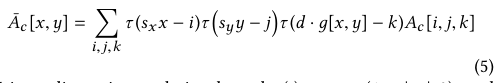

\[
\bar{A}_{c}[x,y]=\sum_{i,j,k}\tau(s_{x}x-i)\tau\Big{(}s_{y}y-j\Big{)}\tau(d\cdot g [x,y]-k)A_{c}[i,j,k] \tag{5}
\]
#+begin_explain
（自動解説・要確認）
要約: \(\bar{A}_{c}[x,y]\) は、元の 3 次元特徴マップ \(A_{c}[i,j,k]\) を、空間座標 \((x,y)\) と深度 \(g[x,y]\) に基づき、三次元線形補間カーネル \(\tau\) で補間した結果である。
かみ砕くと: 位置 \(x,y\) を格子幅比 \(s_x,s_y\) でスケールし、深さは \(d\cdot g[x,y]\) に変換して、各格子点 \((i,j,k)\) の重み \(\tau(s_x x-i)\tau(s_y y-j)\tau(d g[x,y]-k)\) を掛け合わせて総和を取る。
記号:
- \(\tau(\cdot)=\max(1-|\cdot|,0)\) : 線形補間カーネル
- \(s_x,s_y\) : 画像サイズに対する格子の幅・高さ比
- \(d\) : 格子の深さ（固定 8）
#+end_explain

# pdfrect: 5 317.6 564.5 561.7 661.8
# pdfsent: [[[5,318.0,564.5,560.2,574.1],[5,317.6,575.7,561.7,585.6],[5,318.0,587.1,375.2,596.0]],[[5,375.2,587.1,518.3,596.0]],[[5,518.3,587.1,561.2,596.0],[5,318.0,598.1,560.2,607.0],[5,318.0,608.5,560.2,618.0],[5,317.7,619.5,379.3,629.5]],[[5,379.3,619.5,455.3,629.5]],[[5,455.3,619.5,560.4,629.5],[5,318.0,630.9,416.2,639.9]],[[5,416.2,630.9,561.7,639.9],[5,318.0,641.9,458.4,650.8]],[[5,458.4,641.9,560.2,650.8],[5,318.0,652.2,479.5,661.8]]]
# pdfhl: sky blue 0,1,2
#+begin_en
Using a linear interpolation kernel τ (·) = max(1 −| · |, 0), and where sx and sy are the width and height ratios of the grid’s dimensions w.r.t. the full-resolution image’s dimensions. Essentially, each pixel is assigned the vector of coefficients whose depth in the grid is given by the gray scale value д[x,y], i.e., loosely speaking Ac[i, j,д[x,y]]. Flownet2 [Ilg et al. 2016] and Spatial Transformer Networks [Jaderberg et al. 2015] have used similar interpolation operators for in-network spatial warping. We fix the spatial resolution of the grid to 16 × 16, and its depth to d = 8.
#+end_en
線形補間カーネル τ (·) = max(1 −| · |, 0) を使用し、sx と sy は、グリッドの寸法とフル解像度画像の寸法との幅と高さの比率です。基本的に、各ピクセルには、グリッド内の深さがグレースケール値 д[x,y] で与えられる係数のベクトルが割り当てられます。つまり、大まかに言うと Ac[i, j,д[x,y]] です。Flownet2 [Ilg et al. 2016] と Spatial Transformer Networks [Jaderberg et al. 2015] は、ネットワーク内空間ワープに同様の補間演算子を使用しています。グリッドの空間解像度を 16 × 16 に固定し、その深さを d = 8 に固定します。
# pdfput: 1 5 6acdcaab3173
#+begin_memo
【身近な例え】
- 線形補間カーネル \(\tau(\cdot)=\max(1-|\,\cdot\,|,0)\) は、隣り合う点の間を滑らかにつなぐ「ブレンド」機能です。
- \(s_x\) と \(s_y\) は、全解像度画像に対して 16 × 16 の小さなグリッドがどれだけ拡大・縮小されるかを示す比率です。
- 各ピクセルは、グレースケール値 \(\text{д}[x,y]\) に対応する深さ（＝層）から係数ベクトルを取得します。

 1. ピクセルの位置（x, y）と明るさ（z）の周辺にある、
    最も近い 8 つの箱（空間的に上下左右、かつ深さ方向に前後）から係数を取り出します。

 2. *自分の本当の座標からの「距離（ズレ）」に応じて、
   それらの係数を按分（ブレンド）* して混ぜ合わせます。
   これが $\max(1 - \vert{} \cdot \vert{}, 0)$ という補間の式の意味です。距離が近い箱の係数ほど強く、遠い箱の係数ほど弱く影響するように混ぜます。

例え
想像してください：手のひらサイズの 16 × 16 のレゴ板があり、各マスには高さ 8 段のブロックが積み重ねられています（深さ \(d=8\)）。高解像度画像の各ピクセルは、明るさ（グレースケール）に応じて「どの段のブロック」を取るか決めます。そのとき、隣り合うマスや段のブロックと線形補間でブレンドし、滑らかな表面・最適な係数を作ります。

※例えではブロックの段を離散的に捉えていますが、実際の深さは補間により連続的に扱われます。
#+end_memo

# pdfrect: 5 318.0 663.8 560.2 694.7
# pdfsent: [[[5,326.9,663.8,560.2,672.7],[5,318.0,674.7,488.3,683.7]],[[5,488.3,674.7,514.8,683.7]],[[5,514.8,674.7,560.2,683.7],[5,318.0,685.6,560.2,694.7]]]
# pdfhl: yellow 0,1,2
#+begin_en
The slicing operation is parameter-free and can be implemented efficiently in an OpenGL shader [Chen et al. 2007]. It acts as a bottleneck layer that constrains the representation of the neural
#+end_en
スライス操作はパラメータフリーであり、OpenGL シェーダーで効率的に実装できます[Chen et al. 2007]。これは、ニューラルネットワークの表現を制約するボトルネック層として機能します。
# pdfput: 1 5 6acdcb5c8d09
#+begin_memo
【身近な例え】
- スライス操作は、パラメータ（重みやバイアス）を持たない「形だけの」処理です。たとえば、キッチンのざるを思い浮かべてください。ざる自体には調整できる部品はなく、ただその形状だけで液体と固形物を分けます。
- このざるは、GPU 上で動く OpenGL シェーダーに例えることができ、計算資源をほとんど使わずに高速に「こし」や「切り取る」処理を行います。
- さらに、ざるは通過できるものを制限するため、ネットワーク全体の情報の流れを「絞り込む」役割を果たします。これが論文で言う「ボトルネック層」と同じ意味です。

※例えは完全に同等ではなく、計算上の性質を完全に再現しているわけではありません。
#+end_memo

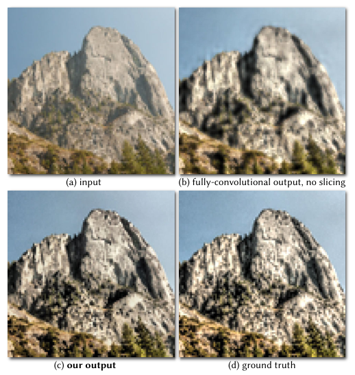

# pdfrect: 6 51.6 348.0 295.4 425.7
# pdfsent: [[[6,51.8,348.0,67.6,355.9]],[[6,67.6,348.0,77.1,355.9]],[[6,77.1,348.0,295.4,355.9],[6,51.8,357.9,211.2,365.9]],[[6,211.2,357.9,294.0,365.9],[6,51.8,367.9,294.5,375.9],[6,51.8,377.9,274.9,385.8]],[[6,274.9,377.9,294.0,385.8],[6,51.8,387.8,294.0,395.8],[6,51.8,397.8,294.0,405.8],[6,51.8,407.7,294.0,415.7],[6,51.6,417.7,175.1,425.7]]]
#+begin_en
Fig. 5. Our new slicing node is central to the expressiveness of our architecture and its handling of high-resolution effects. Replacing this node with a standard bank of learnable deconvolution filters reduces expressiveness (b) because no full-resolution data is used to predict the output pixels. Thanks to its learned full-resolution guidance map, our slicing layer approximates the desired enhancement with much higher fidelity (c), thereby preserving the edges of the input (a) and capturing the high-frequency transformations visible in the ground-truth output (d).
#+end_en
図 5。新しいスライスノードは、アーキテクチャの表現力と高解像度効果の処理において中心的な役割を果たします。このノードを標準的な学習可能な逆畳み込みフィルタのバンクに置き換えると、出力ピクセルの予測にフル解像度データが使用されないため、表現力が低下します（b）。学習済みのフル解像度ガイダンスマップのおかげで、スライス層は目的の強調をはるかに高い忠実度で近似し（c）、入力のエッジを保持し（a）、グラウンドトゥルース出力で確認できる高周波変換を捉えます（d）。

# pdfrect: 6 51.4 452.6 295.6 560.2
# pdfsent: [[[6,51.8,452.6,184.8,461.5]],[[6,184.8,452.6,295.6,461.5],[6,51.8,463.5,276.3,472.5]],[[6,276.3,463.5,294.7,472.5],[6,51.8,474.4,142.6,483.5]],[[6,142.6,474.4,294.0,483.5],[6,51.8,485.4,294.0,494.4],[6,51.4,496.0,295.6,505.4],[6,51.8,507.3,294.0,516.4],[6,51.8,518.3,189.2,527.3]],[[6,189.2,518.3,294.0,527.3],[6,51.8,529.3,294.0,538.3],[6,51.8,540.2,294.4,549.2],[6,51.8,550.8,167.2,560.2]]]
# pdfhl: sky blue 2,3
#+begin_en
network to a low-dimensional space. This both simplifies the learning problem and speeds up the processing time [Barron et al. 2015; Barron and Poole 2016]. Crucially, performing inference within a bilateral grid forces our model’s predictions to follow the edges in д, thereby regularizing our predictions towards edge-aware solutions (unlike standard networks based on transpose-convolutions or “deconvolution layers”, Figure 5). This design decision tends to benefit photographic manipulation tasks such as ours and enables our significant speedup over more general models due to the low dimensionality of A (Figure 10).
#+end_en
ネットワークを低次元空間に拡張します。これにより、学習問題が単純化され、処理時間が短縮されます [Barron et al. 2015; Barron and Poole 2016]。重要なのは、バイラテラルグリッド内で推論を実行することで、モデルの予測がдのエッジに沿うようになり、エッジ認識ソリューションに向けて予測が正則化されることです (転置畳み込みまたは「逆畳み込み層」に基づく標準的なネットワークとは異なります、図 5)。この設計上の決定は、我々のような写真操作タスクに有利であり、Aの低次元性により、より一般的なモデルよりも大幅に高速化されます (図 10)。
# pdfput: 1 6 6acdcc7c7b6f
#+begin_memo
【身近な例え】
- 画像編集を「大きな絵を小さなスケッチブックに写す」作業に例えると、ネットワークはまず元の高解像度画像を低次元（小さな）空間に圧縮します。これにより、全体像を把握しやすくなり、計算も速くなります。次に、スケッチブックの「格子（バイラテラルグリッド）」上で処理を行うと、格子の線が画像の輪郭（エッジ）に沿うように自動的に調整されます。つまり、格子が「輪郭に沿って色を塗る」ガイド役になるため、結果がエッジを意識した自然なものになります。従来の転置畳み込み（逆畳み込み）方式は、格子のガイドなしに直接大きなキャンバスに色を塗るようなもので、エッジ情報が失われやすいです。この格子を利用した手法は、写真の加工といったタスクで特に有利で、低次元の格子（A）のおかげで処理が大幅に高速化されます。

※例えでは格子の線が完全にエッジを再現できると示していますが、実際のバイラテラルグリッドは数値的に連続した処理であり、紙の線だけでは正確に表現しきれない点があります。
#+end_memo
# pdfrect: 6 51.8 562.2 294.0 604.0
# pdfsent: [[[6,60.8,562.2,294.0,571.1],[6,51.8,573.1,90.4,582.1]],[[6,90.4,573.1,294.0,582.1],[6,51.8,584.0,294.0,593.1],[6,51.8,595.0,161.2,604.0]]]
#+begin_en
This data-dependent lookup is critical to the expressive power of our model. As we will see in Section 3.4.2, it allows us to predict a complex operation on the full-resolution image using a collection of much simpler local models.
#+end_en
このデータ依存型ルックアップは、モデルの表現力にとって非常に重要です。3.4.2 節で説明するように、これにより、より単純なローカルモデルの集合を用いて、高解像度画像に対する複雑な演算を予測することが可能になります。

*** 3.4 Assembling the full-resolution output
3.4 高解像度出力の組み立て

# pdfrect: 6 51.6 630.8 295.1 694.7
# pdfsent: [[[6,51.8,630.8,294.0,639.7],[6,51.8,641.7,150.7,650.7]],[[6,150.7,641.7,294.0,650.7],[6,51.8,652.7,93.3,661.6]],[[6,93.3,652.7,294.0,661.6],[6,51.8,663.6,159.9,672.6]],[[6,159.9,663.6,294.0,672.6],[6,51.8,674.1,295.1,684.7],[6,51.6,685.3,294.0,694.7]]]
# pdfhl: sky blue 2,3
#+begin_en
So far, we have described how to obtain and upsample the bilateral grid of affine coefficients. The rest of the processing is done at full resolution. It should therefore be simple and easily-parallelizable to minimize computational cost. From the full-resolution input I, we extract a set of nϕ full-resolution features ϕ that fulfill two roles: 1) they are combined to predict the guidance map д used in the
#+end_en
ここまで、アフィン係数のバイラテラルグリッドを取得してアップサンプリングする方法について説明しました。残りの処理はフル解像度で行われます。したがって、計算コストを最小限に抑えるために、処理はシンプルで並列化しやすいものでなければなりません。フル解像度の入力 I から、2 つの役割を果たす nϕ 個のフル解像度特徴 ϕ を抽出します。1) これらは、で使用されるガイダンス マップ д を予測するために組み合わせられます。
# pdfrect: 6 318.0 81.9 560.2 101.9
# pdfsent: [[[6,318.0,81.9,560.2,90.9],[6,318.0,92.9,388.1,101.9]]]
# pdfhl: sky blue 0
#+begin_en
slicing node, and 2) they are used as regression variables for the local affine models.
#+end_en
1) スライスノードとして使用され、2) ローカルアフィンモデルの回帰変数として使用されます。

# pdfrect: 6 318.0 103.8 560.2 145.7
# pdfsent: [[[6,326.9,103.8,560.2,112.9],[6,318.0,114.4,560.2,125.0],[6,318.0,125.8,459.8,134.7]],[[6,459.8,125.8,560.2,134.7],[6,318.0,136.7,363.5,145.7]]]
# pdfhl: sky blue 0,1
#+begin_en
The most cost-efficient approach is to use the channels of the input image as features, that is ϕ = I (with nϕ = 3) and the local affine models are color transformations. All our results use this fast formulation.
#+end_en
最もコスト効率の良い方法は、入力画像のチャネルを特徴量として使用することです。つまり、ϕ = I (nϕ = 3) とし、局所アフィンモデルは色変換となります。本研究の結果はすべて、この高速な定式化に基づいています。
# pdfput: 1 6 6acdd5cdd1f2
#+begin_memo
フル解像度の画像に対する処理はできるだけ軽くしたいので、入力画像のチャネルをそのまま特徴量とする
#+end_memo

***** 3.4.1 Guidance map auxiliary network
# pdfrect: 6 318.0 154.6 560.5 175.0
# pdfsent: [[[6,327.9,155.1,343.8,164.0],[6,352.8,154.6,473.5,164.0]],[[6,473.5,154.6,560.2,164.0],[6,318.0,166.0,560.5,175.0]]]
#+begin_en
We define д as a simple pointwise nonlinear transformation of the full-resolution features:
#+end_en
3.4.1 ガイダンスマップ補助ネットワーク。дを、高解像度特徴の単純な点ごとの非線形変換として定義します。

# pdfput: 1 6 6acde8df1163
#+begin_memo
- ガイダンスマップ（$g$）の役割 :: フル解像度の全ピクセルが、荒い 3D グリッド（16×16×8 段のレゴ）から「自分専用の色変換ルール」を取り出すための「透明な鍵付きフィルム」
   マップの値が箱の「段数（深さ）」を決めます。

- 単純な「明るさ」を鍵にしない理由（配分の最適化） :: 逆光写真などで、暗い顔の補正に箱の 1〜2 段目しか使えず、真っ白な空に 4 段分も消費してしまうような無駄を防ぐ
   トーンカーブで空間を歪め、重要な部分に段数を贅沢に割り当てます。

- 単純な「明るさ」を鍵にしない理由（対象の分離） :: 「赤いリンゴ」と「緑の葉っぱ」が同じ明るさだった場合、同じルールの段を参照してしまうのを防ぐ
   AI は色ごとに参照する段をズラして分離させます。

- AI が専用マップを作るステップ 1（カラーフィルター $M_c$） :: 元のフル解像度写真の「赤・緑・青（RGB）」を特定の割合でブレンド（行列の掛け算）し、タスクにとって都合の良い色の見え方（フィルター）を自作する

- AI が専用マップを作るステップ 2（トーンカーブ $\rho_c$） :: ステップ 1 で作った数値に対し、16 本の短い直線を繋ぎ合わせた折れ線グラフ（16 個の ReLU 関数）を使って明るさの微調整を行い、箱の段数をピッタリ割り当てる
   トーンカーブで空間を歪め、重要な部分に段数を贅沢に割り当てます。

- 初期設定で起きるバグ（退化と勾配消失） :: 最初から AI に自由にマップを作らせると、全ピクセルが「箱の 1 段目しか見に行かない（サボり）」状態になったり、計算結果がすべて 0 になって学習の仕方を忘れフリーズ（Dying ReLU）したりする危険があります。

- 安全な学習のスタート方法（恒等写像） :: 勾配消失を防ぐため、最初は「元の写真の明るさをそのままスルーする（まっすぐな斜め線のグラフ）」という素直で安全な設定からスタートさせ、そこから少しずつ学習を進めさせます。
#+end_memo

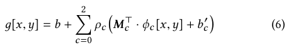
\[
g[x,y]=b+\sum_{c=0}^{2}\rho_{c}\big{(}M_{c}^{\rm T}\cdot\phi_{c}[x,y]+b_{c}^{ \prime}\big{)} \tag{6}
\]
#+begin_explain
（自動解説・要確認）
要約: ガイダンスマップ \(g[x,y]\) は、全解像度特徴 \(\phi_c[x,y]\) を 3×3 カラーマトリックス \(M_c\) で変換し、バイアス \(b'_c\) を加えて非線形関数 \(\rho_c\) を通し、最後に全体バイアス \(b\) を足したもの。
かみ砕くと: 各チャネル \(c=0,1,2\) について、\(M_c^{\top}\phi_c + b'_c\) を計算し、\(\rho_c\)（後述の分段線形関数）で調整し、すべてを足し合わせて \(b\) を加える。
記号:
- \(M_c^{\top}\) : カラーマトリックスの行ベクトル
- \(b,b'_c\) : スカラー バイアス
- \(\rho_c\) : 後の式で定義される非線形関数
#+end_explain
# pdfrect: 6 317.5 217.6 560.2 262.5
# pdfsent: [[[6,317.5,217.6,560.2,230.5],[6,317.5,228.6,560.2,241.5],[6,318.0,242.1,560.2,251.0],[6,317.6,252.5,388.6,262.5]]]
#+begin_en
Where M⊤c are the rows of a 3×3 color transformation matrix, b and b′c are scalar biases, and ρc are piecewise linear transfer functions parametrized as a sum of 16 scaled ReLU functions with thresholds tc,i and slopes ac,i:
#+end_en
ここで、M⊤c は 3×3 色変換行列の行、b および b′c はスカラーバイアス、ρc は閾値 tc,i および傾き ac,i を持つ 16 個のスケーリングされた ReLU 関数の和としてパラメータ化された区分的線形伝達関数です。
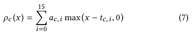

\[
\rho_{c}(x)=\sum_{i=0}^{15}a_{c,i}\max(x-t_{c,i},0) \tag{7}
\]
#+begin_explain
（自動解説・要確認）
要約: \(\rho_c(x)\) は 16 個のスケール付き ReLU の和で表される分段線形関数で、各 ReLU のしきい値 \(t_{c,i}\) とスロープ \(a_{c,i}\) によって形が決まる。
かみ砕くと: 入力 \(x\) がしきい値 \(t_{c,i}\) を超えると、\(a_{c,i}(x-t_{c,i})\) が加算され、これを 0 から 15 のインデックスで総和する。
記号:
- \(a_{c,i}\) : スロープ（スケーリング係数）
- \(t_{c,i}\) : ReLU の閾値
#+end_explain
# pdfrect: 6 317.5 304.3 561.2 381.5
# pdfsent: [[[6,317.7,304.3,560.4,315.7],[6,318.0,317.3,388.2,326.7]],[[6,388.2,317.3,560.2,326.7],[6,317.5,328.2,561.2,338.2],[6,317.6,339.2,509.5,348.6]],[[6,509.5,339.2,560.2,348.6],[6,318.0,350.7,560.2,359.5],[6,318.0,361.6,560.2,370.5],[6,318.0,372.5,416.8,381.5]]]
# pdfhl: sky blue 1
#+begin_en
The parameters M, a, t, b, b′ are learned jointly with the other network parameters. M is initialized to the identity and a, t, b, and b’ are initialized such each ρc is an identity mapping over [0, 1], which is necessary to avoid learning a degenerate д. Figure 7 shows the impact of using this learned guide and Figure 6 shows an example of the color transformation matrix and tone curve that are learned for the corresponding task.
#+end_en
パラメータ M、a、t、b、b′ は、他のネットワークパラメータと共同で学習されます。M は恒等写像に初期化され、a、t、b、b′ は、各 ρc が [0, 1] 上の恒等写像となるように初期化されます。これは、退化した д を学習しないようにするために必要です。図 7 は、この学習済みガイドを使用した場合の影響を示し、図 6 は、対応するタスクで学習された色変換行列とトーン カーブの例を示しています。
# pdfput: 1 6 6acdd70afd29
#+begin_memo
16 個の ReLU がすべて「0」を出力した場合、勾配消失してしまうので、初期値は恒等写像に設定する。
#+end_memo
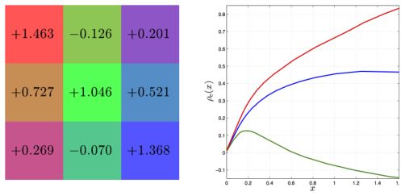
# pdfrect: 6 318.0 663.1 560.7 691.0
# pdfsent: [[[6,318.0,663.1,333.7,671.1]],[[6,333.7,663.1,343.2,671.1]],[[6,343.2,663.1,560.7,671.1],[6,318.0,673.1,560.3,681.1],[6,318.0,683.1,340.0,691.0]]]
#+begin_en
Fig. 6. The color transform matrix (left) and per-channel tone curves (right) used to produce the guidance map д, as learned by one instance of our model.
#+end_en
図 6. ガイダンスマップдを生成するために使用されたカラー変換行列（左）とチャネルごとのトーンカーブ（右）。これは、我々のモデルの 1 つのインスタンスによって学習されたものです。

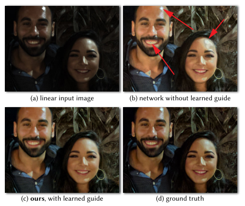
# pdfrect: 7 51.5 291.2 295.3 329.1
# pdfsent: [[[7,51.8,291.2,68.6,299.2]],[[7,68.6,291.2,78.7,299.2]],[[7,78.7,291.2,233.5,299.2]],[[7,233.5,291.2,294.0,299.2],[7,51.8,301.2,294.2,309.2],[7,51.5,311.2,295.3,319.1]],[[7,51.8,321.1,294.0,329.1]]]
#+begin_en
Fig. 7. Our slicing node uses a learned guidance map. Using luminance as guide causes artifacts with the HDR+ pipeline reproduction, in particular with posterization artifacts in the highlights on the forehead and cheeks (b). In contrast, our learned guide (c) correctly reproduces the ground truth (d).
#+end_en
図 7。当社のスライスノードは、学習済みのガイダンスマップを使用します。輝度をガイドとして使用すると、HDR+パイプラインの再現でアーティファクトが発生し、特に額と頬のハイライト部分にポスタリゼーションアーティファクトが発生します（b）。これに対し、学習済みのガイド（c）は、グラウンドトゥルース（d）を正しく再現します。

***** 3.4.2 Assembling the final output
# pdfrect: 6 317.6 390.7 560.2 476.5
# pdfsent: [[[6,327.9,390.8,344.1,399.8],[6,353.1,390.7,466.4,399.8]],[[6,466.4,390.7,560.2,399.8],[6,318.0,401.8,560.2,410.7],[6,317.6,412.8,560.2,421.7],[6,318.0,423.6,560.2,432.7],[6,318.0,434.6,426.0,443.6]],[[6,426.0,434.6,500.6,443.6]],[[6,500.6,434.6,560.2,443.6],[6,318.0,445.6,343.3,455.1]],[[6,343.3,445.6,560.2,455.1],[6,318.0,456.6,560.2,465.5],[6,318.0,465.5,507.2,476.5]]]
# pdfhl: yellow 0,1
# pdfhl: yellow 2
# pdfhl: sky blue 3
#+begin_en
Although image operators may be complex when viewed at the scale of an entire image, recent work has observed that even complicated image processing pipelines can often be accurately modeled as a collection of simple local transformations [Chen et al. 2016; Gharbi et al. 2015; He and Sun 2015]. We therefore model each channel of our final output Oc as an affine combination of the full-resolution features, with coefficients defined by the channels of the sliced feature map ¯A:
#+end_en
3.4.2 最終出力の組み立て。画像演算子は画像全体のスケールで見ると複雑になる場合がありますが、最近の研究では、複雑な画像処理パイプラインでも、単純な局所変換の集合として正確にモデル化できることが多いことが観察されています [Chen et al. 2016; Gharbi et al. 2015; He and Sun 2015]。したがって、最終出力 Oc の各チャネルを、スライスされた特徴マップ ¯A のチャネルによって定義される係数を持つ、フル解像度特徴のアフィン結合としてモデル化します。
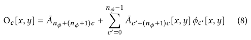
\[
O_{c}[x,y]=\bar{A}_{n_{\phi}+(n_{\phi}+1)c}+\sum_{c^{\prime}=0}^{n_{\phi}-1} \bar{A}_{c^{\prime}+(n_{\phi}+1)c}[x,y]\,\phi_{c^{\prime}}[x,y] \tag{8}
\]
# pdfrect: 7 51.8 348.8 295.6 533.0
# pdfsent: [[[7,60.8,348.8,294.0,357.6],[7,51.8,359.6,193.7,368.6]],[[7,193.7,359.6,295.6,368.6],[7,51.8,370.6,143.6,379.6]],[[7,143.6,370.6,295.4,379.6]],[[7,51.8,381.5,77.9,390.5]],[[7,77.9,381.5,294.0,390.5],[7,51.8,392.5,286.9,401.5]],[[7,286.9,392.5,294.0,401.5],[7,51.8,403.5,294.0,412.4],[7,51.8,414.5,295.0,423.4],[7,51.8,424.8,144.4,434.4]],[[7,144.4,424.8,294.0,434.4],[7,51.8,436.4,249.3,445.3]],[[7,249.3,436.4,294.0,445.3],[7,51.8,447.4,294.0,456.3],[7,51.8,458.2,294.0,467.3],[7,51.8,469.2,294.2,478.2],[7,51.8,480.1,255.0,489.2]],[[7,255.0,480.1,282.3,489.2]],[[7,282.3,480.1,294.0,489.2],[7,51.8,491.1,295.6,500.1],[7,51.8,501.7,272.4,511.1]],[[7,272.4,501.7,294.0,511.1],[7,51.8,513.1,294.0,522.0],[7,51.8,524.0,93.0,533.0]]]
# pdfhl: yellow 0,1,2,3,4,5,6
#+begin_en
Interpolated affine transformations similar to this have been used successfully for matting [Levin et al. 2008], intrinsic image decomposition [Bousseau et al. 2009] and time of day transfer [Shih et al. 2013]. For such models, the size of the patch in which the affine model is fit drives the trade-off between efficiency and quality. At the extreme, it is always possible to achieve a perfect reconstruction of any operator by fitting an independent model at every pixel (i.e., the patch size is 1 × 1). For small patches (e.g., 3 × 3), an affine model can faithfully reproduce many image operators. As the patch grows larger, the affine relationship no longer holds for all but trivial operators, though others have shown that this limitation can be mitigated using piecewise linear functions [Yuan and Sun 2011] or non-linear and edge-aware components [Gharbi et al. 2015]. See Figure 8 for a visualization of the 3D bilateral grid of affine coefficients A corresponding to the input/output pair in Figure 2. One of the 12 channels of the 2D coefficients after slicing can also be seen in Figure 2.
#+end_en
このような補間アフィン変換は、マッティング [Levin et al. 2008]、固有画像分解 [Bousseau et al. 2009]、および時刻転送 [Shih et al. 2013] に成功裏に使用されています。このようなモデルでは、アフィンモデルが適合するパッチのサイズが、効率と品質のトレードオフを決定します。極端な場合、すべてのピクセルで独立したモデルを適合することで、任意の演算子を完全に再構成することが常に可能です (つまり、パッチサイズは 1 × 1 です)。小さなパッチ (たとえば 3 × 3) の場合、アフィンモデルは多くの画像演算子を忠実に再現できます。パッチが大きくなるにつれて、アフィン関係は自明な演算子以外ではもはや成り立たなくなりますが、区分的線形関数 [Yuan and Sun 2011] または非線形およびエッジ認識コンポーネント [Gharbi et al. 2015]。図 2 の入力/出力ペアに対応するアフィン係数 A の 3D バイラテラルグリッドの可視化については、図 8 を参照してください。スライス後の 2D 係数の 12 チャネルのうちの 1 つも図 2 に示されています。

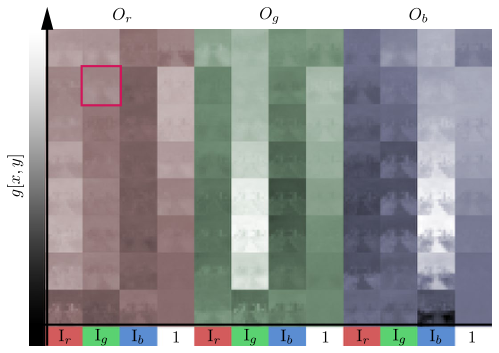
#+begin_en
Fig. 8. Coefficient maps for the affine color transform. The vertical axis corresponds to the learned guidance channel, while the horizontal axis unrolls the 3x4 sets of coefficients. Each thumbnail, one example of which is highlighted, shows a 16x16 low-resolution map.
#+end_en
図 8．アフィン色変換の係数マップ。縦軸は学習されたガイダンスチャネルに対応し、横軸は 3×4 の係数セットを展開した値を示す。各サムネイル（1つの例が強調表示されている）は、16×16 の低解像度マップを示している。

*** 3.5 Training procedure
# pdfrect: 7 51.4 557.3 294.0 589.7
# pdfsent: [[[7,51.4,557.3,294.0,568.2],[7,51.8,568.8,207.0,577.9]],[[7,207.0,568.8,294.0,577.9],[7,51.8,579.4,259.6,589.7]]]
# pdfhl: sky blue 0,1
#+begin_en
We train our network on a dataset D = {(Ii, Oi )}i of full-resolution input/output pairs for a given operator. We optimize the weights and biases by minimizing the L2 loss on this training set:
#+end_en
我々は、特定の演算子に対する高解像度の入出力ペアのデータセット D = {(Ii, Oi )}i を使用してネットワークを訓練します。この訓練セットにおける L2 損失を最小化することにより、重みとバイアスを最適化します。

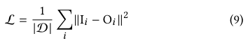

# pdfrect: 7 51.4 620.4 295.4 695.6
# pdfsent: [[[7,51.4,620.4,294.3,630.8],[7,51.8,629.4,87.0,640.8]],[[7,87.0,629.4,294.0,640.8],[7,51.8,642.8,212.2,651.8]],[[7,212.2,642.8,294.0,651.8],[7,51.8,653.8,115.0,662.7]],[[7,115.0,653.8,294.0,662.7],[7,51.8,664.8,294.0,673.7],[7,51.8,675.7,295.4,684.6]],[[7,51.4,686.6,294.6,695.6]]]
# pdfhl: sky blue 0,1,2,3
#+begin_en
We additionally regularize the weights with an L2 weight decay of 10−8. The weights for the convolutional and fully-connected layers are initialized according to [He et al. 2015] and the biases are initialized to 0. We use batch normalization [Ioffe and Szegedy 2015] between each pair of intermediate feature maps, and we optimize the network parameters with the ADAM solver [Kingma and Ba 2015]. We train with a batch size of 4 to 16 (depending on the resolution)
#+end_en
さらに、重みを 10⁻⁸の L2 重み減衰で正則化します。畳み込み層と全結合層の重みは[He et al. 2015]に従って初期化され、バイアスは 0 に初期化されます。中間特徴マップの各ペア間でバッチ正規化[Ioffe and Szegedy 2015]を使用し、ADAM ソルバー[Kingma and Ba 2015]でネットワークパラメータを最適化します。バッチサイズは 4～16（解像度に応じて）で学習します。

# pdfrect: 7 318.0 316.7 561.7 383.0
# pdfsent: [[[7,318.0,316.7,433.1,328.2]],[[7,433.1,316.7,560.2,328.2],[7,318.0,330.1,514.1,339.1]],[[7,514.1,330.1,560.2,339.1],[7,318.0,341.1,470.3,350.1]],[[7,470.3,341.1,561.7,350.1],[7,318.0,352.0,369.3,361.1]],[[7,369.3,352.0,395.0,361.1]],[[7,395.0,352.0,560.2,361.1],[7,318.0,363.1,560.2,372.0],[7,318.0,374.0,336.7,383.0]]]
# pdfhl: sky blue 0,1,2,3,4,5
#+begin_en
and a learning rate of 10−4. The remaining parameters in ADAM are kept to the values recommended by the authors. Our model is implemented in Tensorflow [Abadi et al. 2015] and Halide [Ragan- Kelley et al. 2012]. For all experiments, models are trained on an NVIDIA Titan X (Maxwell) for 30 epochs, which typically takes 2–3 days.
#+end_en
学習率は 10⁻⁴ です。ADAM の残りのパラメータは、著者らが推奨する値のままです。私たちのモデルは Tensorflow [Abadi et al. 2015] と Halide [Ragan-Kelley et al. 2012] で実装されています。すべての実験において、モデルは NVIDIA Titan X (Maxwell) 上で 30 エポックにわたってトレーニングされ、通常 2～3 日かかります。

** 4. RESULTS
# pdfrect: 7 317.5 408.5 561.7 461.2
# pdfsent: [[[7,317.5,408.5,560.2,417.4],[7,318.0,419.4,561.6,428.3]],[[7,318.0,430.3,561.7,439.3],[7,318.0,441.3,560.2,450.2],[7,318.0,452.2,417.2,461.2]]]
#+begin_en
We evaluate our model’s ability to reproduce both algorithmic image operators (Section 4.1) and human-annotated retouches (Section 4.2). Our model is faster than both standard neural networks and stateof-the-art filter approximation techniques and runs in real-time on mobile device (Section 4.3).
#+end_en
本稿では、アルゴリズムによる画像処理（4.1 節）と人間によるレタッチ（4.2 節）の両方を再現する本モデルの能力を評価する。本モデルは、標準的なニューラルネットワークと最先端のフィルタ近似技術の両方よりも高速であり、モバイルデバイス上でリアルタイムに動作する（4.3 節）。

# pdfrect: 7 318.0 463.1 561.7 581.8
# pdfsent: [[[7,326.9,463.1,561.7,472.2],[7,318.0,474.1,347.3,483.2]],[[7,347.3,474.1,560.2,483.2],[7,318.0,485.1,484.2,494.1]],[[7,484.2,485.1,561.7,494.1],[7,318.0,496.0,560.2,505.1],[7,318.0,507.0,463.5,516.0]],[[7,463.5,507.0,561.7,516.0],[7,318.0,518.0,560.2,527.0],[7,318.0,528.9,437.3,537.9]],[[7,437.3,528.9,560.4,537.9],[7,318.0,540.0,366.0,548.9]],[[7,366.0,540.0,561.7,548.9],[7,318.0,550.8,560.2,559.9],[7,318.0,561.8,560.2,570.8],[7,318.0,572.8,466.1,581.8]]]
# pdfhl: sky blue 4,5
#+begin_en
A selection of our results on different tasks can be seen in Figure 14. Our output is generally accurate and, even when it differs from the ground-truth, it remains plausible. Despite the heavy spatial and bilateral downsampling inherent to our approach, image artifacts are rare and unobjectionable. This is because of the edgeaware nature of the bilateral grid and our model’s capacity to learn smooth output transformations. Our outputs are usually slightly softer (e.g. on the HDR+ example of Figure 14) because the highestfrequency transformations like sharpening and the correction of chroma aberrations can introduce new edges not present in the input, which our model does not handle.
#+end_en
図 14 には、さまざまなタスクにおける結果の一部が示されています。出力は概ね正確であり、正解と異なる場合でも妥当性を保っています。本手法に固有の空間的およびバイラテラルなダウンサンプリングがかなり大きいにもかかわらず、画像アーティファクトはまれで、問題になりません。これは、バイラテラルグリッドのエッジ認識特性と、滑らかな出力変換を学習するモデルの能力によるものです。出力は通常、わずかにソフトになります（図 14 の HDR+の例など）。これは、シャープ化や色収差補正などの最高周波数変換によって、入力には存在しない新しいエッジが導入される可能性があり、本モデルではこれを処理できないためです。

# pdfrect: 7 318.0 592.3 460.3 602.2
# pdfsent: [[[7,318.0,592.3,329.4,602.2],[7,339.4,592.3,460.3,602.2]]]
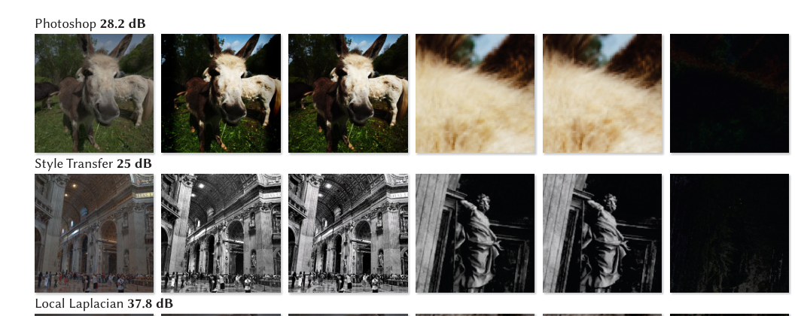
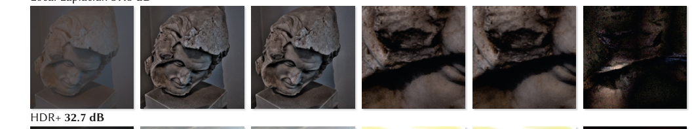
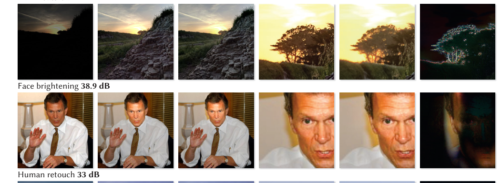
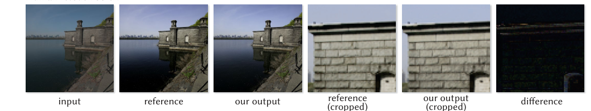
#+begin_en
Fig. 14. Our method can learn accurate and fast approximations of a wide variety of image operators, by training on input/output pairs processed by that operator. These operators can be complicated “black box” image processing pipelines where only a binary is available, such as HDR+ or Photoshop filters/actions. Some operators, such as face-brightening, requires semantic understanding. Our model is even capable of learning from highly subjective human-annotated input/output pairs, using the MIT-Adobe FiveK dataset. The difference is rescaled to use the full [0, 1] range.
#+end_en
図 14。私たちの手法は、その演算子によって処理された入力/出力ペアを学習することで、さまざまな画像演算子の正確かつ高速な近似を学習できます。これらの演算子は、HDR+や Photoshop のフィルター/アクションのように、バイナリしか利用できない複雑な「ブラックボックス」画像処理パイプラインである場合があります。顔の明るさ調整などの一部の演算子は、意味的な理解を必要とします。私たちのモデルは、MIT-Adobe FiveK データセットを使用して、非常に主観的な人間が注釈を付けた入力/出力ペアから学習することもできます。差分は、[0, 1]の全範囲を使用するように再スケーリングされます。

*** 4.1 Reproducing image operators
4.1 再生画像演算子
# pdfrect: 7 317.5 607.2 561.7 640.6
# pdfrect: 7 318.0 642.5 561.2 673.4
# pdfrect: 7 324.9 675.4 561.7 695.3
# pdfsent: [[[7,317.5,607.2,560.2,616.2],[7,318.0,618.2,486.3,627.1],[7,318.0,631.5,325.8,640.6]],[[7,325.8,631.5,412.3,640.6]],[[7,412.3,631.5,561.7,640.6],[7,324.9,642.5,561.2,651.5],[7,324.9,653.5,431.4,662.5]],[[7,318.0,664.5,324.9,673.4]],[[7,324.9,664.5,467.4,673.4]],[[7,467.4,664.5,561.2,673.4],[7,324.9,675.4,561.7,684.4],[7,324.9,686.4,534.8,695.3]]]
#+begin_en
We evaluate the accuracy of our model on several tasks composed of programmatically-defined image operators: . HDR+ [Hasinoff et al. 2016] – a complex hand-engineered photographic pipeline that includes color correction, auto-exposure, dehazing, and tone-mapping. . the Local Laplacian filter [Paris et al. 2011] – an edge-preserving, multi-scale (yet non-scale-invariant) operator used for detail enhancement (we use two different strengths for the effect),
#+end_en
プログラムの定義した画像演算子で構成されるいくつかのタスクでモデルの精度を評価します。 . HDR+ [Hasinoff et al. 2016] – 色補正、自動露出、かすみ除去、トーンマッピングを含む複雑な手作業で設計された写真パイプライン。 . ローカルラプラシアンフィルタ [Paris et al. 2011] – エッジ保存、マルチスケール (ただしスケール不変ではない) 演算子で、ディテール強調に使用されます (効果には 2 つの異なる強度を使用します)。

# pdfrect: 8 51.8 81.9 294.0 90.9
# pdfrect: 8 51.8 92.9 294.0 112.9
# pdfsent: [[[8,51.8,81.9,59.1,90.9]],[[8,59.1,81.9,209.6,90.9]],[[8,209.6,81.9,294.0,90.9],[8,58.8,92.9,179.6,101.9],[8,51.8,103.8,58.9,112.9]],[[8,58.9,103.8,294.0,112.9]]]
# pdfhl: light green 0,1,2,3
#+begin_en
. the Style Transfer task of [Aubry et al. 2014] (which happens to be based on the Local Laplacian), . a Face brightening task using a dataset of labeled faces [Jain and
#+end_en
. [Aubry et al. 2014] のスタイル転送タスク (ローカルラプラシアンに基づいている)、 . ラベル付き顔データセットを使用した顔の明るさ調整タスク [Jain and
# pdfrect: 8 51.8 114.8 295.6 134.8
# pdfrect: 8 58.8 134.8 126.3 145.7
# pdfsent: [[[8,58.8,114.8,137.5,123.8],[8,51.8,125.8,59.0,134.8]],[[8,59.0,125.8,295.6,134.8],[8,58.8,134.8,126.3,145.7]]]
# pdfhl: light green 0,1
#+begin_en
Learned-Miller 2010], . several different black-box Adobe Photoshop (PS) filters and usercreated “actions”1.
#+end_en
Learned-Miller 2010]、いくつかの異なるブラックボックスの Adobe Photoshop（PS）フィルターとユーザーが作成した「アクション」1。
# pdfrect: 8 51.8 150.1 294.0 170.0
# pdfsent: [[[8,51.8,150.1,294.0,159.0],[8,51.8,161.0,124.0,170.0]]]
# pdfhl: light green 0
#+begin_en
PSNRs for these tasks using our model and baseline approaches can be found in Table 2.
#+end_en
これらのタスクにおける、我々のモデルとベースライン手法を用いた場合の PSNR 値は表 2 に示されている。

# pdfrect: 8 51.5 171.9 295.6 279.6
# pdfsent: [[[8,60.8,171.9,234.2,181.0]],[[8,234.2,171.9,295.6,181.0],[8,51.8,182.9,294.0,191.9],[8,51.8,193.5,134.1,202.9]],[[8,134.1,193.5,294.9,202.9],[8,51.8,204.8,294.0,213.9],[8,51.5,215.8,294.0,224.8],[8,51.8,226.7,294.0,235.8],[8,51.8,237.7,145.8,246.7]],[[8,145.8,237.7,178.3,246.7]],[[8,178.3,237.7,294.0,246.7],[8,51.8,248.8,294.0,257.6],[8,51.8,259.7,294.3,268.6],[8,51.8,270.6,195.2,279.6]]]
#+begin_en
We use two variants of the style transfer task. In the first variant (Style Transfer), we learn to transform any new input towards a unique fixed style. In the second, more challenging variant (n- Styles Transfer) we adapt our network to take two input images (concatenated along their channel axis) and predict the results of transferring the style of one image to the other (again using the algorithm of Aubry et al. [2014]). In this variant the network does not learn to predict a single consistent output; but rather, it learns to extract the desired transformation from the target image and apply that transformation to the input image.
#+end_en
スタイル転送タスクには 2 つのバリアントがあります。最初のバリアント (スタイル転送) では、新しい入力を一意の固定スタイルに変換することを学習します。2 番目の、より難易度の高いバリアント (n スタイル転送) では、ネットワークを適応させて、2 つの入力画像 (チャネル軸に沿って連結) を受け取り、一方の画像のスタイルをもう一方の画像に転送した結果を予測します (ここでも Aubry ら [2014] のアルゴリズムを使用)。このバリアントでは、ネットワークは単一の一貫した出力を予測することを学習するのではなく、ターゲット画像から目的の変換を抽出し、その変換を入力画像に適用することを学習します。
# pdfput: 1 8 6acdfcaba72a
#+begin_memo
【身近な例え】
- スタイル転送は、料理で例えると「決まったレシピの料理を作る」ことに似ています。新しい食材（入力画像）を渡すと、シェフはいつも同じレシピ（固定スタイル）に従って料理を作ります。
- n‑スタイル転送は、二つの料理を組み合わせて新しい味を作る「フュージョン料理」のようなものです。二枚の画像を横に並べて（チャネル軸に連結）渡すと、シェフは片方の料理（ターゲット画像）から味付けや調理法（変換）を取り出し、もう片方の料理（入力画像）にその味付けを適用して新しい料理を作ります。

※料理の例えは、画像のスタイル変換と完全に同一ではない点があります。

【やさしく言い換え】
- スタイル転送には、2つのやり方があります。
- 1 つ目は「スタイル転送」と呼ばれ、決まった 1 つのスタイルに合わせて、どんな新しい画像でも変える方法を学びます。
- 2 つ目は「n スタイル転送」と呼ばれ、もっと難しいですが、2枚の画像を一緒に入力し、片方の画像のスタイルをもう片方に移す結果を予測します。このとき、2枚の画像はチャンネル方向にくっつけてネットワークに入れます。
- この場合、ネットワークは決まった 1 つの出力を作るのではなく、対象画像から「どんな変換が必要か」を取り出し、その変換を入力画像に適用することを学びます。
#+end_memo

# pdfput: 1 8 6acdfcab5fda
#+begin_memo
高度な写真補正・画質改善タスク
  - HDR+ :: Google Pixel 等のカメラに搭載されている非常に複雑な処理。暗部の持ち上げ、白飛び抑制、ノイズ除去などを同時に行い、自然に仕上げるタスク
  - Local Laplacian / Local Laplacian (strong) :: エッジ（輪郭）を保ったまま、細部のディテール強調やコントラスト調整を行う重い処理。「strong」はその効果をさらに強力にかけたもの
  - Face brightening :: 画像から人間の顔を認識し、その顔の部分だけを局所的に明るく補正します。「画面のどこを処理すべきか」という空間的な理解力が試されます。

画風・スタイルの転送タスク
  - Style Transfer :: どんな写真を入力しても、あらかじめ学習しておいた「特定の決まった画風・色調（単一のスタイル）」に変換します。
  - n-Styles Transfer :: 「元画像」と「お手本画像」の 2 枚を入力し、その場でお手本の色調を読み取って元画像に適用させる、柔軟性と高い難易度が求められるタスクです。

写真加工（Photoshop）フィルタータスク
  - PS early bird, instagram, lomo-fi, eboye :: レトロ風、トイカメラ風、ヴィンテージ風など、複雑な色調変化と周辺減光を伴う SNS 向けのフィルター群です。
  - PS infrared :: 葉っぱが白く写るような、非現実的な「赤外線写真風」の色合いに変換します。
  - PS false colors :: 意図的に色を反転させたり、サーモグラフィのようなサイケデリックな配色（疑似カラー）に変換します。
#+end_memo
#+begin_en
Table 2. We compare accuracy to Bilateral Guided Upsampling (BGU) and Transform Recipes (TR). Note that BGU and TR are “oracle” techniques, as they run the code used to evaluate each image operator at a reduced or full resolution, and so can be thought of as providing an upper-bound on performance. Despite its disadvantage, our model sometimes performs better than these oracle baselines due its expressive power and ability to model non-scale-invariant operators.
#+end_en
表 2。精度をバイラテラルガイドアップサンプリング（BGU）と変換レシピ（TR）と比較します。BGU と TR は、各画像演算子を評価するために使用されるコードを縮小解像度またはフル解像度で実行するため、「オラクル」手法であり、パフォーマンスの上限を提供するものと考えることができます。欠点はあるものの、表現力とスケール不変でない演算子をモデル化できる能力により、私たちのモデルはこれらのオラクルベースラインよりも優れたパフォーマンスを発揮することがあります。
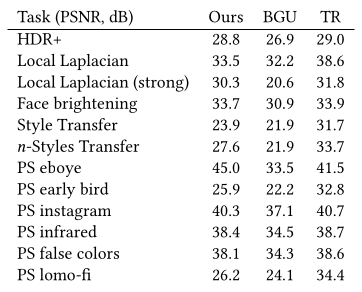

***** 4.1.1 Datasets
# pdfrect: 8 50.8 287.5 295.6 362.2
# pdfsent: [[[8,61.8,287.6,77.5,296.5],[8,86.5,287.5,123.7,296.5]],[[8,123.7,287.5,295.0,296.5],[8,51.8,298.5,295.1,307.4],[8,51.8,309.4,154.6,318.4]],[[8,154.6,309.4,181.3,318.4]],[[8,181.3,309.4,295.6,318.4],[8,51.8,320.3,255.6,329.4]],[[8,255.6,320.3,294.0,329.4],[8,51.8,331.3,234.4,340.3]],[[8,234.4,331.3,294.0,340.3],[8,51.8,341.9,294.3,351.3],[8,50.8,353.3,258.6,362.2]]]
# pdfhl: yellow 0,1,2
#+begin_en
Besides HDR+ and the face brightening dataset, all the effects were applied to the unprocessed set of the MIT “FiveK” dataset [Bychkovsky et al. 2011]. We reserve 500 images for validation and testing, and train on the remaining 4500. We augment the data with random crops, flips and rotations. We generated the dataset for n-Styles Transfer by mapping each image in the MIT “FiveK” dataset to 100 distinct images (the style targets) .
#+end_en
4.1.1 データセット。HDR+ および顔の明るさ調整データセットに加えて、すべての効果は MIT “FiveK” データセット [Bychkovsky et al. 2011] の未処理セットに適用されました。検証とテスト用に 500 枚の画像を確保し、残りの 4500 枚でトレーニングを行います。ランダムな切り抜き、反転、回転でデータを拡張します。MIT “FiveK” データセットの各画像を 100 種類の異なる画像 (スタイルターゲット) にマッピングすることで、n-Styles Transfer 用のデータセットを生成しました。

***** 4.1.2 Baseline
# pdfrect: 8 51.8 370.2 295.6 433.9
# pdfsent: [[[8,61.8,370.2,77.6,379.2],[8,86.6,370.2,122.4,379.2]],[[8,122.4,370.2,294.0,379.2],[8,51.8,381.1,240.2,390.1]],[[8,240.2,381.1,295.6,390.1],[8,51.8,392.0,180.8,401.1]],[[8,180.8,392.0,294.2,401.1],[8,51.8,403.0,87.5,412.0]],[[8,87.5,403.0,294.0,412.0],[8,51.8,414.1,294.2,423.0],[8,51.8,425.0,294.0,433.9]]]
# pdfhl: light green 1,2,3
#+begin_en
4.1.2 Baseline. The previous work closest in spirit to our goals are Bilateral Guided Upsampling (BGU) [Chen et al. 2016] and Transform Recipes (TR) [Gharbi et al. 2015] to which we compare our outputs. However, whereas our technique learns a photographic operator offline from a dataset of images, BGU and TR use no prior training and instead fit specially-tailored models to an input/output
#+end_en

4.1.2 ベースライン。私たちの目標に最も近い先行研究は、Bilateral Guided Upsampling (BGU) [Chen et al. 2016] と Transform Recipes (TR) [Gharbi et al. 2015] であり、これらと私たちの出力を比較します。しかし、私たちの手法は画像データセットからオフラインで写真演算子を学習するのに対し、BGU と TR は事前学習を使用せず、代わりに入力/出力に特化して調整されたモデルを適合させます。
# pdfrect: 8 51.7 442.6 242.4 451.1
# pdfsent: [[[8,51.7,442.6,242.4,451.1]]]
#+begin_en
1http://designbump.com/photoshop-actions-for-instagram-effects/
#+end_en

# pdfrect: 8 318.0 323.5 561.7 420.2
# pdfsent: [[[8,318.0,323.5,419.2,332.5]],[[8,419.2,323.5,561.7,332.5],[8,318.0,334.5,560.2,343.5],[8,318.0,345.4,561.7,354.5],[8,318.0,356.4,463.3,365.4]],[[8,463.3,356.4,560.2,365.4],[8,318.0,367.4,560.2,376.4],[8,318.0,378.4,561.7,387.3],[8,318.0,389.4,560.2,398.3],[8,318.0,400.2,414.9,409.3]],[[8,414.9,400.2,560.2,409.3],[8,318.0,411.2,466.5,420.2]]]
# pdfhl: yellow 0,1
#+begin_en
pair in an online fashion. BGU and TR therefore require direct access to the image operator, as they require the ability to run that image operator on images (either downsampled on-device or fullresolution on a server, respectively). This makes our comparisons against these baselines somewhat biased against our technique, as these baselines make more limiting assumptions about what is available, and also cannot learn to approximate a general instance of an image operator from data. Regardless, we report metrics for these techniques as a kind of “oracle” baseline.
#+end_en
オンライン方式でペアリングを行うため、BGU と TR は画像演算子への直接アクセスを必要とします。これは、それぞれ画像に対してその画像演算子を実行する機能（デバイス上でダウンサンプリングされた画像、またはサーバー上でフル解像度の画像）を必要とするためです。これらのベースラインは利用可能なものについてより限定的な仮定を置いており、またデータから画像演算子の一般的なインスタンスを近似することを学習できないため、これらのベースラインとの比較は、我々の手法に対してやや不利なものとなります。とはいえ、我々はこれらの手法の指標を一種の「オラクル」ベースラインとして報告します。

# pdfput: 1 8 6ace03de0758
#+begin_memo
【用語解説】
- image operator (画像演算子): 画像に対して特定の変換や処理（例: フィルタリング、リサイズ、エッジ検出など）を実行するアルゴリズムや関数

【身近な例え】
- 例えるなら、BGU と TR は「特定の料理本（画像演算子）を手元に置いて、必ずその本通りに料理を作らなければならないシェフ」のようなものです。シェフは、料理本が手元にあるときだけ、レシピ通りに料理を作ることができ、レシピがないと同じ料理は作れません。
- それに対し、我々の手法は「たくさんの完成した料理を味見しながら、レシピなしで似たような味を再現できる料理人」のようです。料理本（画像演算子）への直接アクセスがなくても、データから味のパターンを学んで近似できます。
- したがって、レシピ本が必須という前提で比較すると、レシピ本が必要なシェフ（BGU ・ TR）の方が不利に見えるのは、比較条件が限定的だからです。
- それでも、レシピ本が完全に正しいと仮定した「理想的なシェフ」の結果（オラクルベースライン）として、指標は報告されています。
#+end_memo

# pdfrect: 8 318.0 422.1 561.7 529.8
# pdfsent: [[[8,326.9,422.1,560.2,431.2],[8,318.0,433.1,560.4,442.1],[8,318.0,444.1,561.7,453.1],[8,318.0,455.0,513.3,464.1]],[[8,513.3,455.0,560.2,464.1],[8,318.0,466.1,560.2,475.0],[8,318.0,476.9,561.7,486.0],[8,318.0,487.9,560.4,496.9],[8,318.0,498.8,527.4,507.9]],[[8,527.4,498.8,561.7,507.9],[8,318.0,509.9,560.2,518.8],[8,318.0,520.8,356.5,529.8]]]
# pdfhl: yellow 0,1
#+begin_en
Transform Recipes assumes that a mobile device would send a highly compressed (and therefore degraded) image to a server for processing, and would recieve an inexpensive “recipe” for approximating an image transformation from that server. Because TR’s client-server setup is not relevant to the scope of this paper, we run the model (using the authors’ recommended settings) on uncompressed, full-resolution images, thereby improving output quality and making our TR baseline as competitive as possible. In the intended use case of the method, the image quality typically decreases by 3–5 dB.
#+end_en
Transform Recipes は、モバイルデバイスが高度に圧縮された（したがって劣化した）画像を処理のためにサーバーに送信し、そのサーバーから画像変換を近似するための安価な「レシピ」を受け取ることを想定しています。TR のクライアント/サーバー構成はこの論文の範囲には関係がないため、非圧縮のフル解像度画像でモデルを実行し（著者らが推奨する設定を使用）、出力品質を向上させ、TR のベースラインを可能な限り競争力のあるものにしました。この手法の想定される使用例では、画像品質は通常 3～5 dB 低下します。

# pdfrect: 8 317.7 531.9 561.7 628.4
# pdfsent: [[[8,326.9,531.9,560.2,540.7],[8,317.7,542.7,561.7,551.7],[8,318.0,553.8,378.8,562.6]],[[8,378.8,553.8,561.2,562.6],[8,318.0,564.6,561.7,573.6],[8,318.0,575.7,482.3,584.6]],[[8,482.3,575.7,560.5,584.6],[8,318.0,586.6,560.2,595.5],[8,318.0,597.5,560.4,606.5],[8,318.0,608.6,384.7,617.4]],[[8,384.7,608.6,560.2,617.4],[8,318.0,619.5,478.7,628.4]]]
# pdfhl: yellow 0
#+begin_en
BGU assumes that the image operator be run on a low-resolution version of the input before fitting the model to the low-res input/output pair. We could not run the HDR+ filter at low resolution, so we used full-resolution input/output pairs and created the lowresolution inputs to BGU by downsampling. We do however follow the correct procedure for the Local Laplacian and Style Transfer tasks for which we have an implementation and directly apply the filter at low resolution. For these non scale-invariant tasks, the advantage of our technique becomes clearer (Figure 9).
#+end_en
BGU は、モデルを低解像度の入出力ペアに適合させる前に、入力の低解像度バージョンで画像演算子を実行することを前提としています。私たちは低解像度で HDR+フィルタを実行できなかったため、フル解像度の入出力ペアを使用し、ダウンサンプリングによって BGU への低解像度入力を作成しました。ただし、実装済みのローカルラプラシアンとスタイル転送タスクについては正しい手順に従い、フィルタを低解像度で直接適用しています。これらのスケール不変でないタスクでは、私たちの手法の利点がより明確になります（図 9）。

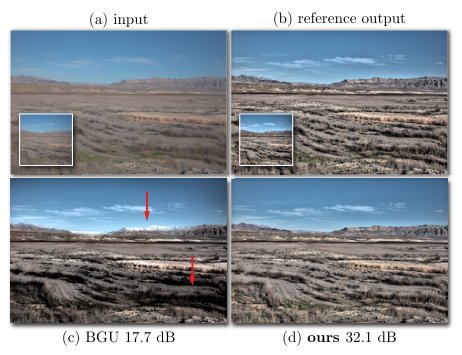
#+begin_en
Fig. 9. Our method (d) can learn to replicate the correct effect (b) for operations that are not scale invariant, such as the Local Laplacian filter shown here (a–b). Methods like Bilateral Guided Upsampling that only apply the operation at low-resolution (insets (a–b)) produce a different-looking output (c). The difference is most noticeable in the areas pointed by the arrows.
#+end_en
図 9。我々の手法（d）は、ここに示したローカルラプラシアンフィルタ（a-b）のようにスケール不変ではない演算に対して、正しい効果（b）を再現するように学習できる。低解像度でのみ演算を適用するバイラテラルガイドアップサンプリングなどの手法（挿入図（a-b））では、見た目の異なる出力（c）が生成される。その違いは、矢印で示された領域で最も顕著である。

*** 4.2 Learning from human annotations
4.2 人間の注釈からの学習
# pdfrect: 8 317.5 653.7 561.6 695.5
# pdfsent: [[[8,317.5,653.7,560.2,662.6],[8,318.0,664.5,506.5,673.6]],[[8,506.5,664.5,560.4,673.6],[8,318.0,675.5,561.6,684.5]],[[8,317.7,686.5,560.2,695.5]]]
#+begin_en
We also evaluate accuracy with regards to human annotations using the MIT-Adobe “FiveK” dataset [Bychkovsky et al. 2011], and our performance compared to previous work is presented in Table 3. This task measures our model’s ability to learn a highly subjective
#+end_en
また、MIT-Adobe「FiveK」データセット[Bychkovsky et al. 2011]を使用して人間の注釈に関する精度を評価し、以前の研究と比較したパフォーマンスを表 3 に示します。このタスクは、非常に主観的な学習能力を測定するものです。

# pdfrect: 9 51.5 79.3 295.4 167.0
# pdfsent: [[[9,51.6,79.3,82.9,88.4]],[[9,82.9,79.3,295.4,88.4],[9,51.8,89.3,242.4,97.2]],[[9,242.4,89.3,294.0,97.2],[9,51.8,99.2,294.0,107.2],[9,51.5,109.2,199.7,117.2]],[[9,199.7,109.2,294.0,117.2],[9,51.8,119.2,294.2,127.1],[9,51.8,129.1,204.8,137.1]],[[9,204.8,129.1,294.0,137.1],[9,51.8,139.1,269.8,147.0]],[[9,269.8,139.1,294.0,147.0],[9,51.8,149.0,181.2,157.0]],[[9,181.2,149.0,237.6,157.0]],[[9,237.6,149.0,294.0,157.0],[9,51.8,157.5,67.2,167.0]]]
#+begin_en
Table 3. Mean L2 error in L*a*b* space for retouches from the 5 photographers in the MIT5k dataset (A,B,C,D,E); lower is better. Our algorithm is capable of learning a photographer’s retouching style better than previous work, yet runs orders of magnitudes faster. The comparisons in the first two groups are evaluated on the dataset from photographer C favored by previous techniques; see main text for details. In the third group we report our results on the remaining 4 photographers for completeness. Metrics taken from previous work [Hwang et al. 2012; Yan et al. 2016] are denoted by †.
#+end_en
表 3. MIT5k データセット (A、B、C、D、E) の 5 人の写真家によるレタッチの L*a*b* 空間における平均 L2 エラー。値が低いほど良い。我々のアルゴリズムは、従来の手法よりも写真家のレタッチ スタイルをより良く学習できるだけでなく、桁違いに高速に動作します。最初の 2 つのグループの比較は、従来の手法で好まれていた写真家 C のデータセットで評価されています。詳細は本文を参照してください。3 番目のグループでは、完全性のために残りの 4 人の写真家に関する結果を報告します。以前の研究 [Hwang et al. 2012; Yan et al. 2016] から取得した指標は † で示されます。
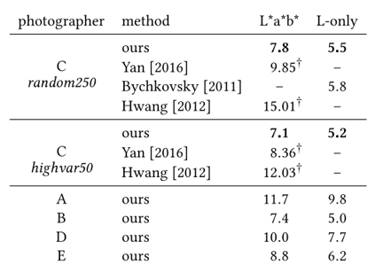

# pdfrect: 9 96.3 284.3 264.8 326.6
# pdfrect: 9 51.8 346.0 294.2 431.6
# pdfsent: [[[9,96.3,284.7,102.5,293.7],[9,134.4,284.7,150.5,293.7],[9,216.3,284.3,231.3,293.7],[9,254.0,284.3,264.8,293.7],[9,96.8,295.7,102.1,304.6],[9,134.4,295.7,150.5,304.6],[9,220.4,295.2,231.3,304.6],[9,254.0,295.2,264.8,304.6],[9,96.3,306.6,102.6,315.6],[9,134.4,306.6,150.5,315.6],[9,216.3,306.2,231.3,315.6],[9,254.0,306.2,264.8,315.6],[9,96.9,317.6,101.9,326.6],[9,134.4,317.6,150.5,326.6],[9,220.4,317.1,231.3,326.6],[9,254.0,317.1,264.8,326.6],[9,51.8,346.0,294.0,354.8],[9,51.8,356.4,125.3,367.1]],[[9,125.3,356.4,294.2,367.1],[9,51.8,367.7,294.0,376.8],[9,51.8,378.7,294.0,387.8],[9,51.8,389.7,176.8,398.7]],[[9,176.8,389.7,243.3,398.7]],[[9,243.3,389.7,270.6,398.7]],[[9,270.6,389.7,294.0,398.7],[9,51.8,400.7,294.0,409.7],[9,51.8,411.6,119.3,420.6]],[[9,119.3,411.6,294.0,420.6],[9,51.8,422.6,233.2,431.6]]]
#+begin_en
image operator which requires a significant amount of learning and semantic reasoning. We report mean L2 error in L*a*b* space (lower is better) for retouches by the 5 photographers (A,B,C,D,E) in the MIT “FiveK” dataset, though previous work only presents results on photographer C [Hwang et al. 2012; Yan et al. 2016]. We use the “Random 250” and “High Variance 50” dataset splits presented in [Hwang et al. 2012], which have 250 randomly-chosen and 50 user-weighted images in the test set, respectively.
#+end_en
画像演算子は、かなりの量の学習と意味的推論を必要とします。 MIT “FiveK” データセットの 5 人の写真家 (A、B、C、D、E) によるレタッチの平均 L2 エラー (低いほど良い) を L*a*b* 空間で報告しますが、以前の研究では写真家 C の結果のみが示されています [Hwang et al. 2012; Yan et al. 2016]。 テスト セットには、それぞれ 250 枚のランダムに選択された画像と 50 枚のユーザー重み付け画像が含まれています [Hwang et al. 2012] で提示された「Random 250」と「High Variance 50」データセット分割を使用します。

# pdfrect: 9 51.5 433.5 295.6 508.3
# pdfsent: [[[9,60.8,433.5,294.0,442.5],[9,51.8,444.5,294.0,453.5],[9,51.8,455.5,77.1,464.4]],[[9,77.1,455.5,102.4,464.4]],[[9,102.4,455.5,294.0,464.4],[9,51.5,466.4,295.4,475.4]],[[9,51.8,477.4,295.6,486.4],[9,51.8,488.4,294.0,497.3],[9,51.8,499.3,106.6,508.3]]]
#+begin_en
This is a much more difficult task, and inconsistencies in the retouches of photographers has been pointed out previously [Yan et al. 2016]. For example we found that retoucher B in this dataset was more self-consistent, and was easier for our network to learn. Nonetheless, our model, trained separately on each artist’s corrections, consistently predicts reasonable adjustments and outperforms previous work.
#+end_en
これははるかに難しい作業であり、写真家によるレタッチの不整合は以前にも指摘されている[Yan et al. 2016]。例えば、このデータセットではレタッチャー B の方が自己一貫性が高く、ネットワークが学習しやすいことがわかった。それでも、各アーティストの修正に基づいて個別に学習させた我々のモデルは、一貫して妥当な調整を予測し、これまでの研究を凌駕する性能を発揮する。

*** 4.3 Performance
# pdfrect: 9 51.4 533.1 295.6 695.6
# pdfsent: [[[9,51.4,533.1,294.0,542.2],[9,51.5,544.2,107.5,553.1]],[[9,107.5,544.2,294.0,553.1],[9,51.6,554.5,207.4,564.1]],[[9,207.4,554.5,294.4,564.1],[9,51.8,566.0,244.8,575.1]],[[9,244.8,566.0,294.0,575.1],[9,51.8,576.4,295.0,586.0],[9,51.8,588.1,149.4,596.9]],[[9,149.4,588.1,294.0,596.9],[9,51.8,599.0,294.0,607.9],[9,51.8,609.9,294.0,618.9],[9,51.8,620.8,295.4,629.9]],[[9,51.8,631.8,294.0,640.8],[9,51.5,642.7,294.0,651.8],[9,51.8,653.8,122.6,662.7]],[[9,122.6,653.8,294.0,662.7],[9,51.8,664.6,188.1,673.7]],[[9,188.1,664.6,294.0,673.7],[9,51.8,675.7,127.1,684.6]],[[9,127.1,675.7,284.8,684.6]],[[9,284.8,675.7,295.6,684.6],[9,51.8,686.0,294.0,695.6]]]
# pdfhl: sky blue 0,1,2
# pdfhl: sky blue 5,6,7,8,9
#+begin_en
We implemented our technique on a Google Pixel phone running Android 7.1.1. Our implementation processes viewfinder-resolution 1920×1080 images in realtime, at 40–50 Hz. We extract 8-bit preview frames in YUV420 format using the Camera2 API. These images are downsampled to 256 × 256, converted to floating point RGB, then fed into our network. After the network produces its output (a bilateral grid of affine coefficients), we transfer them to the GPU as a set of three 3D RGBA textures, where they are sliced and applied to the full-resolution input to render the final processed preview. Overall throughput is under 20 ms, with 14 ms spent on inference (CPU), overlapped with 1 ms to upload coefficients and 18 ms to render on the GPU. As a point of comparison, running an optimized implementation [Ragan-Kelley et al. 2012] of the Local Laplacian filter [Paris et al. 2011] on the same device takes over 200 ms. Running the same filter at the reduced 256×256 resolution and applying
#+end_en
我々は、Android 7.1.1 を実行している Google Pixel スマートフォンでこの手法を実装しました。この実装では、ビューファインダー解像度 1920×1080 の画像をリアルタイムで 40～50 Hz で処理します。Camera2 API を使用して、YUV420 フォーマットの 8 ビットプレビュー フレームを抽出します。これらの画像は 256×256 にダウンサンプリングされ、浮動小数点 RGB に変換されてから、ネットワークに入力されます。ネットワークが出力 (アフィン係数のバイラテラル グリッド) を生成した後、3 つの 3D RGBA テクスチャのセットとして GPU に転送し、そこでスライスしてフル解像度の入力に適用して、最終的な処理済みプレビューをレンダリングします。全体のスループットは 20 ms 未満で、推論 (CPU) に 14 ms、係数のアップロードに 1 ms、GPU でのレンダリングに 18 ms がオーバーラップしています。比較のために、最適化された実装 [Ragan-Kelley et al.同じデバイス上でローカル ラプラシアン フィルター [Paris et al. 2011] を実行すると、200 ms 以上かかります。

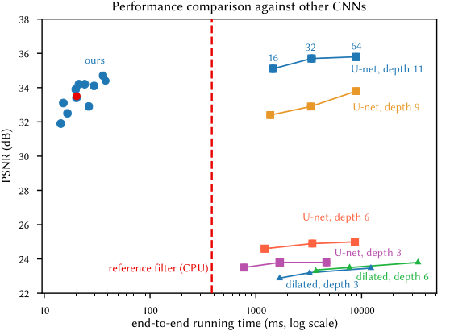
# pdfrect: 9 317.7 264.2 560.3 371.8
# pdfsent: [[[9,318.0,264.2,335.3,272.2]],[[9,335.3,264.2,349.1,272.2]],[[9,349.1,264.2,560.2,272.2],[9,318.0,274.1,527.5,282.5]],[[9,527.5,274.1,560.2,282.5],[9,318.0,284.1,458.8,292.5]],[[9,458.8,284.1,560.3,292.5],[9,318.0,294.1,533.3,302.0]],[[9,533.3,294.1,560.2,302.0],[9,318.0,304.0,453.2,312.4]],[[9,453.2,304.0,560.2,312.4],[9,318.0,314.0,560.2,322.0],[9,318.0,324.0,449.0,331.9]],[[9,449.0,324.0,560.3,331.9],[9,317.8,333.9,550.2,341.9]],[[9,550.2,333.9,560.3,341.9],[9,318.0,343.9,522.7,351.9]],[[9,522.7,343.9,560.2,351.9],[9,317.7,353.9,505.3,361.8]],[[9,505.3,353.9,560.3,361.8],[9,318.0,363.8,485.3,371.8]]]
#+begin_en
Fig. 10. We compare the speed and quality of our algorithm against two modern network architectures: U-Net (adapted from [Isola et al. 2016]) and dilated convolutions [Yu and Koltun 2015]. The runtimes were averaged over 20 iterations, processing a 4 megapixel image on a desktop CPU. The PSNR numbers refer to the Local Laplacian task. Given an insufficient depth, U-Net and dilated convolutions fail to capture the large scale effects of the Local Laplacian filter, leading to low PSNRs. Competitive architectures run over 100 times slower than ours, and use orders of magnitude more memory. Our model’s performance is displayed for a range of parameters. The version we used to produce all the results is highlighted in red. See Figure 11 for details on the speed/quality trade-off of our model.
#+end_en
図 10。本アルゴリズムの速度と品質を、2 つの最新ネットワーク アーキテクチャ、U-Net ([Isola et al. 2016] を改変) および拡張畳み込み [Yu and Koltun 2015] と比較します。実行時間は、デスクトップ CPU 上で 4 メガピクセルの画像を処理し、20 回の反復処理で平均化しました。PSNR の値は、ローカル ラプラシアン タスクに関するものです。U-Net と拡張畳み込みは、深度が不十分なため、ローカル ラプラシアン フィルタの大規模な効果を捉えることができず、PSNR が低くなります。競合するアーキテクチャは、本モデルよりも 100 倍以上遅く、使用するメモリも桁違いに多くなります。本モデルのパフォーマンスは、さまざまなパラメータについて表示されています。すべての結果を生成するために使用したバージョンは、赤色で強調表示されています。本モデルの速度と品質のトレードオフの詳細については、図 11 を参照してください。

# pdfrect: 9 318.0 642.5 561.7 695.3
# pdfsent: [[[9,318.0,642.5,470.7,651.5]],[[9,470.7,642.5,560.2,651.5],[9,318.0,653.5,560.2,662.4],[9,318.0,664.4,466.2,673.4]],[[9,466.2,664.4,560.2,673.4],[9,318.0,675.4,561.7,684.4],[9,318.0,686.4,335.8,695.3]],[[9,335.8,686.4,560.2,695.3]]]
#+begin_en
Bilateral Guided Upsampling [Chen et al. 2016] with the same grid dimensions takes 17 ms (compared to our 14 ms) but loses some of the filter’s intended effect (Figure 9). Our processing time scales linearly with input size, taking 61 ms to process a 12-megapixel image. While it usually has higher fidelity, Transform Recipes [Gharbi
#+end_en
同じグリッド寸法のバイラテラルガイドアップサンプリング[Chen et al. 2016]では 17ms かかります（私たちの 14ms と比較）が、フィルタの意図した効果の一部が失われます（図 9）。私たちの処理時間は入力サイズに比例して変化し、12 メガピクセルの画像を処理するのに 61ms かかります。通常は忠実度が高いものの、Transform Recipes[Gharbi

# pdfrect: 10 51.6 54.3 427.2 63.3
# pdfrect: 10 51.8 81.5 295.6 134.7
# pdfsent: [[[10,51.6,54.3,74.4,63.3],[10,83.4,54.3,86.5,63.3],[10,95.5,54.3,255.5,63.3]],[[10,255.5,54.3,325.7,63.3]],[[10,325.7,54.3,427.2,63.3],[10,51.8,81.5,77.5,90.9]],[[10,77.5,81.5,294.0,90.9],[10,51.8,93.0,241.8,101.8]],[[10,241.8,93.0,295.0,101.8],[10,51.8,103.9,295.6,112.8],[10,51.8,114.9,294.0,123.8],[10,51.8,125.8,180.6,134.7]]]
#+begin_en
118:10 • Michaël Gharbi, Jiawen Chen, Jonathan T. Barron, Samuel W. Hasinoff, and Frédo Durand et al. 2015] requires 2.95 seconds per image, nearly two orders of magnitude below real-time viewfinder performance. Mosty notably, neither Transform Recipes nor Bilateral Guided Upsampling can apply effects learned from human retouches, or “black box” operators such as Photoshop filters or HDR+.
#+end_en

118:10 • Michaël Gharbi、Jiawen Chen、Jonathan T. Barron、Samuel W. Hasinoff、Frédo Durand 他 2015] は、画像 1 つあたり 2.95 秒を要し、リアルタイムのビューファインダーのパフォーマンスよりほぼ 2 桁低い。特に注目すべきは、Transform Recipes も Bilateral Guided Upsampling も、人間のレタッチや Photoshop フィルターや HDR+ などの「ブラックボックス」オペレーターから学習した効果を適用できないことである。

# pdfrect: 10 51.6 136.7 295.6 375.8
# pdfsent: [[[10,60.8,136.7,294.0,145.7],[10,51.8,147.7,237.0,156.7]],[[10,237.0,147.7,294.0,156.7],[10,51.8,158.7,294.2,167.6],[10,51.8,169.5,77.1,178.6]],[[10,77.1,169.5,192.9,178.6]],[[10,192.9,169.5,294.3,178.6],[10,51.8,180.5,255.0,189.6]],[[10,255.0,180.5,294.0,189.6],[10,51.8,191.5,294.0,200.5],[10,51.8,202.4,294.0,211.5],[10,51.8,213.4,192.8,222.4]],[[10,192.8,213.4,294.0,222.4],[10,51.8,224.4,295.6,233.4],[10,51.8,235.3,294.0,244.4],[10,51.8,246.3,172.9,255.3]],[[10,172.9,246.3,220.0,255.3]],[[10,220.0,246.3,287.3,255.3]],[[10,287.3,246.3,294.0,255.3],[10,51.8,257.2,294.0,266.3],[10,51.8,268.2,294.0,277.2],[10,51.8,279.3,78.5,288.1]],[[10,78.5,279.3,295.6,288.1],[10,51.8,290.2,253.1,299.1]],[[10,253.1,290.2,294.0,299.1],[10,51.8,301.2,294.0,310.1],[10,51.8,312.1,295.4,321.0]],[[10,51.8,323.0,295.4,332.0]],[[10,51.8,334.0,294.3,343.0],[10,51.8,344.9,295.4,353.9]],[[10,51.8,356.0,294.0,364.9],[10,51.6,366.9,189.5,375.8]]]
#+begin_en
Other recent neural-network based architectures that could be used for such learning are also far from real-time. In Figure 10, we compare our technique against a U-Net architecture [Ronneberger et al. 2015] adapted from Isola et al. [2016], and a linear network based on dilated convolutions [Yu and Koltun 2015]. We explore several settings for the depth (number of layers, 3 to 11) and the width (number of filters, 16 to 64) in these architectures, covering a variety of speed and quality levels. For U-Net, “depth” refers to the number of downsampling steps and “width” refers to the channels in the first convolutional layers (these are doubled at each downsampling step, see Isola et al. [Isola et al. 2016] for details). In the dilated convolution network, “depth” is the number of dilated convolution layers, and “width”, the number of channels in each layer. Our hybrid CPU/OpenGL technique is over 2 orders of magnitude faster than both architectures on a desktop CPU. On GPU (not shown), the performance gap is identical for the forward pass of the network, but data transfer becomes the bottleneck for our method. End-to-end, our runtime is still over an order of magnitude faster. Moreover, both U-Net and dilated convolution require significantly more memory, which makes them ill-suited for mobile processing. For this benchmark we used an Intel Core i7-5930K at 3.5GHz with 4 cores and a Titan X (Maxwell) GPU.
#+end_en
このような学習に使用できる他の最近のニューラルネットワークベースのアーキテクチャも、リアルタイムには程遠い。図 10 では、Isola et al. [2016] から改変した U-Net アーキテクチャ [Ronneberger et al. 2015] と、拡張畳み込みに基づく線形ネットワーク [Yu and Koltun 2015] と、我々の手法を比較している。これらのアーキテクチャでは、深さ (層の数、3 ～ 11) と幅 (フィルタの数、16 ～ 64) について、さまざまな速度と品質レベルをカバーする複数の設定を検討している。U-Net の場合、「深さ」はダウンサンプリング ステップの数を指し、「幅」は最初の畳み込み層のチャネル数を指す (これらは各ダウンサンプリング ステップで 2 倍になる。詳細は Isola et al. [Isola et al. 2016] を参照)。拡張畳み込みネットワークでは、「depth」は拡張畳み込み層の数、「width」は各層のチャネル数です。当社のハイブリッド CPU/OpenGL 技術は、デスクトップ CPU 上で両方のアーキテクチャよりも 2 桁以上高速です。GPU（図示せず）では、ネットワークの順伝播におけるパフォーマンスの差は同じですが、データ転送が当社の手法のボトルネックになります。エンドツーエンドでは、当社の実行時間は依然として 1 桁以上高速です。さらに、U-Net と拡張畳み込みはどちらもかなり多くのメモリを必要とするため、モバイル処理には適していません。このベンチマークでは、4コアの 3.5GHz Intel Core i7-5930K と Titan X（Maxwell）GPU を使用しました。

# pdfrect: 10 51.8 377.8 294.2 441.6
# pdfsent: [[[10,60.8,377.8,294.2,386.8],[10,51.8,388.8,294.0,397.8],[10,51.8,399.3,294.0,408.7],[10,51.8,410.1,294.0,419.7],[10,51.8,421.7,191.8,430.6]],[[10,191.8,421.7,294.0,430.6],[10,51.8,432.6,87.7,441.6]]]
# pdfhl: sky blue 0,1
#+begin_en
We explored the speed/quality trade-offs of our architecture for the Local Laplacian task varying several parameters: changing the depth of the grid d from 4 to 16, the grid’s spatial dimensions from 8 × 8 to 32 × 32 and doubling the number of channels (compared to the numbers reported in Table 1). The summary can be found in Figure 11.
#+end_en
我々は、ローカルラプラシアンタスクにおける我々のアーキテクチャの速度と品質のトレードオフを、いくつかのパラメータを変更して検証した。具体的には、グリッドの深さ d を 4 から 16 に変更し、グリッドの空間寸法を 8×8 から 32×32 に変更し、チャネル数を 2 倍にした（表 1 に示されている数値と比較）。その結果の概要を図 11 に示す。

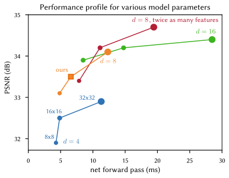
#+begin_en
Fig. 11. We show PSNRs for the Local Laplacian task and the computation time required to predict the bilateral coefficients with several settings of our model’s parameters. Each curve represent a grid depth d. For each curve the grid’s spatial resolution varies in {8, 16, 32}. The reference model we used to produced all the results is highlighted with a square marker. Unsurprisingly, models with larger grid depth perform better (green). Doubling the number of intermediate features also provides a 0.5 dB improvement (red curve). Runtimes were measured on an Intel Core i7-5930K.
#+end_en
図 11。ローカルラプラシアンタスクの PSNR と、モデルのパラメータをいくつかの設定でバイラテラル係数を予測するために必要な計算時間を示します。各曲線はグリッド深度 d を表します。各曲線において、グリッドの空間解像度は{8, 16, 32}で変化します。すべての結果を生成するために使用した参照モデルは、四角形のマーカーで強調表示されています。当然のことながら、グリッド深度が大きいモデルの方がパフォーマンスが優れています（緑色）。中間特徴の数を 2 倍にすると、0.5 dB の改善も得られます（赤色の曲線）。実行時間は Intel Core i7-5930K で測定しました。

*** 4.4 Discussion and limitations
4.4 考察と限界
***** フル解像度の画像から取得する特徴量をそのまま→ガウスピラミッドに変更
# pdfrect: 10 51.5 488.6 295.6 607.6
# pdfsent: [[[10,51.5,488.6,295.0,498.1],[10,51.8,499.6,294.2,509.0],[10,51.8,510.9,210.6,520.0]],[[10,210.6,510.9,295.6,520.0],[10,51.8,522.0,294.0,530.9],[10,51.8,532.9,204.6,541.9]],[[10,204.6,532.9,294.0,541.9],[10,51.8,543.4,227.0,552.8]],[[10,227.0,543.4,294.0,552.8],[10,51.8,554.2,295.4,563.8]],[[10,51.5,565.7,294.0,574.8],[10,51.8,576.7,223.7,585.7]],[[10,223.7,576.7,294.0,585.7],[10,51.8,587.6,294.0,596.7],[10,51.8,598.7,210.6,607.6]]]
# pdfhl: sky blue 0,1
#+begin_en
All our results use the simplest full-resolution features ϕ = I; i.e., both the guide д and the affine regression targets are the color channels of the input image (Section 3.4). If one relaxes the realtime rendering constraint, one can extend our model by extracting features from the high-resolution image. In Figure 13, we show an example where ϕ is a 3-level Gaussian pyramid. The bilateral grid then contains 3 × 12 = 36 affine parameters (12 for each scale). Accordingly we triple the number of intermediate features in the network compared to the numbers in Table 1. This roughly slows down the network by a factor 3-4, but provides a 2 dB boost in quality on the Local Laplacian (strong) task.
#+end_en
すべての結果では、最も単純なフル解像度特徴 ϕ = I を使用しています。つまり、ガイド д とアフィン回帰ターゲットの両方が入力画像のカラーチャネルです (セクション 3.4)。リアルタイムレンダリングの制約を緩和すれば、高解像度画像から特徴を抽出することでモデルを拡張できます。図 13 では、ϕ が 3 レベルのガウスピラミッドである例を示します。この場合、バイラテラルグリッドには 3 × 12 = 36 個のアフィンパラメータ (各スケールにつき 12 個) が含まれます。したがって、表 1 の数と比較して、ネットワーク内の中間特徴の数を 3 倍にします。これにより、ネットワークの速度はおよそ 3 ～ 4 倍低下しますが、ローカル ラプラシアン (強力) タスクの品質が 2 dB 向上します。

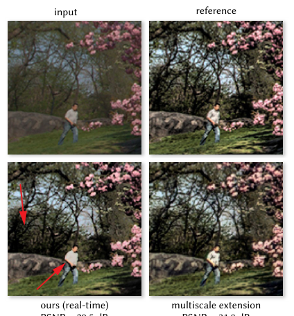
#+begin_en
Fig. 13. At the expense of extra computation at full-resolution, our model can be extended with richer affine regression features. Here, by using a 3-level Gaussian pyramid as features ϕ, we can better capture the highfrequency details in the the Local Laplacian (strong) task.
#+end_en
図 13。フル解像度での追加計算を犠牲にすることで、より豊富なアフィン回帰特徴量を用いてモデルを拡張できます。ここでは、特徴量ϕとして 3 レベルのガウスピラミッドを使用することで、ローカルラプラシアン（強力）タスクにおける高周波の詳細をより適切に捉えることができます。

***** 画像強調以外のタスク
# pdfrect: 10 51.8 609.7 295.6 684.3
# pdfsent: [[[10,60.8,609.7,295.6,618.6],[10,51.8,620.6,295.6,629.5],[10,51.8,631.6,131.3,640.5]],[[10,131.3,631.6,294.0,640.5],[10,51.8,642.6,295.6,651.4],[10,51.8,653.5,294.0,662.4],[10,51.8,664.5,294.0,673.4],[10,51.8,675.4,139.1,684.3]]]
#+begin_en
We also explored using our architecture to learn tasks beyond image enhancement, like matting, colorization, dehazing, and monocular depth prediction. These experiments had limited success, as the strong modeling assumptions required for fast photographic correction make our model poorly suited to different tasks whose output cannot be easily expressed as local pointwise transformations of the input image (Figure 12).
#+end_en
また、画像強調以外のタスク、例えばマット処理、カラー化、霞除去、単眼深度予測などを学習するために、私たちのアーキテクチャを使用することも検討しました。しかし、高速な写真補正に必要な強力なモデリング仮定のため、私たちのモデルは、入力画像の局所的な点ごとの変換として簡単に表現できないさまざまなタスクには適していないため、これらの実験は限定的な成功にとどまりました（図 12）。

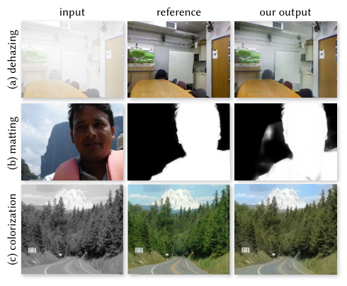
# pdfrect: 10 318.0 278.0 560.7 415.5
# pdfsent: [[[10,318.0,278.0,335.3,286.0]],[[10,335.3,278.0,349.1,286.0]],[[10,349.1,278.0,560.2,286.0],[10,318.0,288.0,406.7,295.9]],[[10,406.7,288.0,560.2,295.9],[10,318.0,297.9,440.8,305.9]],[[10,440.8,297.9,560.2,305.9],[10,318.0,307.9,550.6,315.9]],[[10,550.6,307.9,560.7,315.9],[10,318.0,317.7,560.2,326.2],[10,318.0,327.8,408.4,335.8]],[[10,408.4,327.8,431.0,335.8]],[[10,431.0,327.8,560.2,335.8],[10,318.0,337.8,560.2,345.7],[10,318.0,347.7,513.6,355.7]],[[10,513.6,347.7,560.2,355.7],[10,318.0,357.7,426.3,365.7]],[[10,426.3,357.7,560.2,365.7],[10,318.0,367.7,529.1,375.6]],[[10,529.1,367.7,560.2,375.6],[10,318.0,377.6,560.2,385.6],[10,318.0,387.6,472.7,395.6]],[[10,472.7,387.6,560.2,395.6],[10,318.0,397.6,560.2,406.7],[10,318.0,407.5,424.9,415.5]]]
#+begin_en
Fig. 12. Our algorithm fails when the image operator strongly violates our modeling assumptions. (a) Haze reduces local contrast, which limits the usefulness of our guidance map. It also destroys image details that cannot be recovered with our affine model (e.g., on the whiteboard). (b) Matting has successfully been modeled by locally affine models on 3 × 3 neighborhoods [Levin et al. 2008]. However, this affine relationship breaks down at larger scales (like a grid cell in our model) where the matte no longer follows tonal or color variations and is mostly binary. This limits the usefulness of our bilateral grid. (c) For colorization, the learned guidance map is at best a nonlinear remapping of the grayscale input. Our model can thus only learn a local color per discrete intensity level, at a spatial resolution dictated by the grid’s resolution. Our output is plagued with coarse variations of colors that are muted due to our L2 loss (see the road line, and the tree/sky boundary).
#+end_en
図 12. 画像演算子がモデリングの仮定を大きく破ると、アルゴリズムが失敗します。(a) 霞は局所的なコントラストを低下させ、ガイダンス マップの有用性を制限します。また、アフィン モデルでは復元できない画像の詳細 (ホワイト ボード上など) も破壊します。(b) マッティングは、3 × 3 近傍の局所アフィン モデルによってうまくモデル化されています [Levin et al. 2008]。しかし、このアフィン関係は、より大きなスケール (モデルのグリッド セルなど) では破綻し、マットはもはやトーンや色の変化に従わず、ほとんどがバイナリになります。これは、バイラテラル グリッドの有用性を制限します。(c) カラー化の場合、学習されたガイダンス マップは、せいぜいグレースケール入力の非線形再マッピングです。したがって、モデルは、グリッドの解像度によって決まる空間解像度で、離散的な強度レベルごとに局所的な色しか学習できません。私たちの出力は、L2 損失のために色がくすんで見える粗い色のばらつきに悩まされています（道路の線や木と空の境界線を参照）。

** 5. CONCLUSION
# pdfrect: 10 317.5 453.6 561.7 638.0
# pdfsent: [[[10,317.5,453.6,560.2,462.7],[10,318.0,464.7,560.2,473.6],[10,317.6,475.5,486.7,484.6]],[[10,486.7,475.5,560.2,484.6],[10,318.0,486.5,561.7,495.5],[10,318.0,497.4,561.7,506.5],[10,318.0,508.4,344.9,517.5]],[[10,344.9,508.4,560.2,517.5],[10,318.0,519.4,560.2,528.4],[10,318.0,530.3,561.6,539.4]],[[10,317.7,541.3,561.7,550.3],[10,318.0,552.2,560.2,561.3],[10,318.0,563.2,519.2,572.3]],[[10,519.2,563.2,560.2,572.3],[10,318.0,574.2,560.2,583.2],[10,318.0,585.2,560.2,594.1],[10,318.0,596.1,560.2,605.1],[10,318.0,607.0,429.5,616.1]],[[10,429.5,607.0,560.2,616.1],[10,318.0,618.0,561.2,627.0],[10,318.0,629.0,471.6,638.0]]]
# pdfhl: sky blue 1,2,3
#+begin_en
We have introduced a new neural network architecture that can perform image enhancement in real-time on full-resolution images while still capturing high-frequency effects. Our model is trained using pairs of input/output images, allowing it to learn from a reference implementation of some algorithm or from human adjustments. By performing most of its computation within a bilateral grid and by predicting local affine color transforms, our model is able to strike the right balance between expressivity and speed. To build this model we have introduced two new layers: a datadependent lookup that enables slicing into the bilateral grid, and a multiplicative operation for affine transformation. By training in an end-to-end fashion and optimizing our loss function at full resolution (despite most of our network being at a heavily reduced resolution), our model is capable of learning full-resolution and non-scale-invariant effects. The accuracy of our model has been demonstrated on a variety of different image operators, pipelines, and subjective human-annotated datasets.
#+end_en
高解像度画像に対してリアルタイムで画像強調処理を行いながら、高周波効果も捉えることができる新しいニューラルネットワークアーキテクチャを開発しました。このモデルは、入力画像と出力画像のペアを使用して学習され、何らかのアルゴリズムのリファレンス実装や人間の調整から学習することができます。計算の大部分をバイラテラルグリッド内で実行し、局所的なアフィンカラー変換を予測することで、表現力と速度の適切なバランスを実現しています。このモデルを構築するために、2つの新しいレイヤーを導入しました。1つはバイラテラルグリッドへのスライスを可能にするデータ依存ルックアップ、もう 1 つはアフィン変換のための乗算演算です。エンドツーエンド方式で学習を行い、損失関数を高解像度で最適化することで（ネットワークの大部分は大幅に解像度を下げていますが）、高解像度かつスケール不変ではない効果を学習することができます。このモデルの精度は、さまざまな画像演算子、パイプライン、および主観的な人間によるアノテーション付きデータセットで実証されています。
