* 論文ノート
:PROPERTIES:
:NOTER_DOCUMENT: /home/nomura/MyNotes/Mynotes_project/研究/論文/PDFs/Image-Adaptive-3DLUT.pdf
:NOTER_PAGE: 16
:END:

** Front matter
:PROPERTIES:
:NOTER_PAGE: 1
:END:
***** 本文

# pdfrect: 1 68.1 182.2 543.9 324.8
# pdfsent: [[[1,68.1,182.2,543.6,190.3]],[[1,68.1,192.6,529.3,200.6],[1,68.1,202.9,502.2,210.9]],[[1,502.2,202.9,526.7,210.9],[1,68.1,213.3,494.9,221.3]],[[1,494.9,213.3,535.7,221.3],[1,68.1,223.6,527.7,231.6],[1,68.1,234.0,141.8,242.0]],[[1,141.8,234.0,520.9,242.0],[1,68.1,244.3,136.6,252.3]],[[1,136.6,244.3,450.0,252.3]],[[1,450.0,244.3,543.7,252.3],[1,68.1,254.7,412.0,262.7]],[[1,412.0,254.7,509.2,262.7],[1,68.1,265.0,497.2,273.0],[1,68.1,275.4,425.8,283.4]],[[1,425.8,275.4,543.9,283.4],[1,68.1,285.7,421.4,293.7]],[[1,421.4,285.7,540.4,293.7],[1,68.1,296.1,519.7,304.1],[1,68.1,306.4,300.6,314.4]],[[1,300.6,306.4,385.1,314.4],[1,68.1,316.8,252.7,324.8]]]
# pdfhl: sky blue 4,5
#+begin_en
Abstract—Recent years have witnessed the increasing popularity of learning based methods to enhance the color and tone of photos. However, many existing photo enhancement methods either deliver unsatisfactory results or consume too much computational and memory resources, hindering their application to high-resolution images (usually with more than 12 megapixels) in practice. In this paper, we learn image-adaptive 3-dimensional lookup tables (3D LUTs) to achieve fast and robust photo enhancement. 3D LUTs are widely used for manipulating color and tone of photos, but they are usually manually tuned and fixed in camera imaging pipeline or photo editing tools. We, for the first time to our best knowledge, propose to learn 3D LUTs from annotated data using pairwise or unpaired learning. More importantly, our learned 3D LUT is image-adaptive for flexible photo enhancement. We learn multiple basis 3D LUTs and a small convolutional neural network (CNN) simultaneously in an end-to-end manner. The small CNN works on the down-sampled version of the input image to predict content-dependent weights to fuse the multiple basis 3D LUTs into an image-adaptive one, which is employed to transform the color and tone of source images efficiently. Our model contains less than 600K parameters and takes less than 2 ms to process an image of 4K resolution using one Titan RTX GPU. While being highly efficient, our model also outperforms the state-of-the-art photo enhancement methods by a large margin in terms of PSNR, SSIM and a color difference metric on two publically available benchmark datasets. Code will be released at https://github.com/HuiZeng/Image-Adaptive-3DLUT.
#+end_en
:PROPERTIES:
:NOTER_DOCUMENT: ../PDFs/Image-Adaptive-3DLUT.pdf
:NOTER_PAGE: 1
:END:
概要—近年、写真の色調やトーンを向上させるための学習ベースの手法の人気が高まっています。しかし、既存の写真補正手法の多くは、満足のいく結果が得られないか、計算リソースやメモリリソースを過剰に消費するため、高解像度画像（通常 12 メガピクセル以上）への適用が困難です。本論文では、高速かつ堅牢な写真補正を実現するために、画像適応型の 3 次元ルックアップテーブル（3D LUT）を学習します。3D LUT は写真の色調やトーンを操作するために広く使用されていますが、通常はカメラ画像処理パイプラインや写真編集ツールで手動で調整され、固定されています。我々の知る限り、初めて、アノテーション付きデータからペアワイズ学習または非ペア学習を使用して 3D LUT を学習することを提案します。さらに重要なことに、我々が学習した 3D LUT は、柔軟な写真補正のために画像適応型です。複数の基底 3D LUT と小さな畳み込みニューラルネットワーク（CNN）をエンドツーエンド方式で同時に学習します。この小型 CNN は、入力画像のダウンサンプリング版に対して、コンテンツ依存の重みを予測し、複数の基底 3D LUT を画像適応型 LUT に融合します。この LUT は、ソース画像の色とトーンを効率的に変換するために使用されます。当モデルは 60 万未満のパラメータで構成され、Titan RTX GPU 1 台を使用して 4K 解像度の画像を処理するのに 2 ミリ秒未満しかかかりません。当モデルは非常に効率的であるだけでなく、公開されている 2 つのベンチマークデータセットにおいて、PSNR、SSIM、および色差指標の点で、最先端の画像強調手法を大幅に上回っています。コードはhttps://github.com/HuiZeng/Image-Adaptive-3DLUTで公開されます。

***** 付箋
# pdfput: 1 1 6acb600ce30e
#+begin_memo
- ルックアップテーブル :: 画像の色をきれいに変換するための「色専用の変換辞書」
   - 光の三原色である「赤(R)、緑(G)、青(B)」の 3 つの組み合わせで色を作るため、辞書は 3 次元
   - 入力された色が辞書になくても、周りの似た色から計算して（三線形補間）、新しい色を作り出す

 - ペアワイズ学習 :: 元データと正解データをぴったり 1 対 1 のペアにして学習させる
 - 非ペア学習 :: 元データのグループと無関係の正解グループによる学習
     GAN（敵対的生成ネットワーク）で進める。正解グループの雰囲気に近づける AI vs 生成かプロによる正解かを見分ける AI

画像適用型＝画像ごとに CNN によって 3DLUT を学習し、最適化（思想似てる）

- エンドツーエンド方式 :: 全体の流れを切り離すことなく一貫して処理する方式
   エラーが蓄積しにくい
 - 分割統治方式 :: 役割ごとに分割して学習する方式
   動作が安定する
#+end_memo

** 1 INTRODUCTION
:PROPERTIES:
:NOTER_PAGE: 1
:END:
***** 本文
# pdfrect: 1 48.0 402.3 300.0 584.9
# pdfsent: [[[1,62.3,402.3,300.0,411.8],[1,48.0,413.9,300.0,423.4],[1,48.0,425.4,300.0,434.9],[1,48.0,436.9,300.0,446.4],[1,48.0,448.5,245.4,458.0]],[[1,245.4,448.5,300.0,458.0],[1,48.0,460.0,300.0,469.5],[1,48.0,471.6,300.0,481.1],[1,48.0,483.1,96.0,492.6]],[[1,96.0,483.1,300.0,492.6],[1,48.0,494.6,300.0,504.1]],[[1,48.0,506.2,300.0,515.7],[1,48.0,517.7,300.0,527.2],[1,48.0,529.3,300.0,538.8],[1,48.0,540.8,93.4,550.3]],[[1,93.4,540.8,300.0,550.3],[1,48.0,552.3,300.0,561.8],[1,48.0,563.9,300.0,573.4],[1,48.0,575.4,61.5,584.9]]]
# pdfhl: yellow 3,4
#+begin_en
In the digital camera imaging process, it is an indispensable step to enhance the perceptual quality of output photos by using several cascaded modules such as exposure compensation, hue/saturation adjustment, color space conversion and manipulation, tone mapping and gamma correction [1]. These modules are often manually tuned by experienced engineers, which is very cumbersome since the results need to be evaluated in many different scenes. The images output by digital cameras may still need post-processing/retouching to further enhance their visual quality. Unfortunately, photo retouching is also a demanding and tedious task, which requires expertise in photograph and has complicated procedures when using professional image editing tools such as PhotoShop. It is highly desirable to learn an automatic photo enhancement model, which can robustly and efficiently enhance the perceptual quality of images captured under various scenes [2].
#+end_en

***** 和訳
デジタルカメラの画像処理プロセスでは、露出補正、色相/彩度調整、カラースペース変換と操作、トーンマッピング、ガンマ補正などの複数のモジュールをカスケード接続して出力写真の知覚品質を向上させることは不可欠なステップです[1]。これらのモジュールは、多くの場合、経験豊富なエンジニアによって手動で調整されますが、さまざまなシーンで結果を評価する必要があるため、非常に面倒です。デジタルカメラで出力された画像は、視覚品質をさらに向上させるために、後処理/レタッチが必要になる場合があります。残念ながら、写真のレタッチは、写真に関する専門知識が必要であり、Photoshop などのプロの画像編集ツールを使用する場合には複雑な手順が必要となるため、要求が厳しく面倒な作業でもあります。さまざまなシーンで撮影された画像の知覚品質を堅牢かつ効率的に向上させることができる自動写真補正モデルを習得することが非常に望ましいです[2]。

***** 付箋
# pdfput: 1 1 6acb62aa628f
#+begin_memo
- カスケード接続 :: 複数の処理機能を順番につなぐ方式
- パラレル接続 :: 並列処理
#+end_memo

***** 本文
# pdfrect: 1 48.0 588.3 300.0 667.0
# pdfsent: [[[1,62.3,588.3,300.0,597.8],[1,48.0,599.6,164.0,609.3]],[[1,164.0,599.6,236.0,609.3]],[[1,236.0,599.6,300.0,609.3],[1,48.0,611.3,300.0,620.8],[1,48.0,622.9,300.0,632.4]],[[1,48.0,634.4,300.0,643.9],[1,48.0,646.0,300.0,655.5],[1,48.0,657.3,193.5,667.0]],[[1,193.5,657.3,232.6,667.0]],[[1,232.6,657.3,300.0,667.0]]]
# pdfhl: yellow 1,2
#+begin_en
The above practical demands have motivated the research of automatic photo enhancement. Bychkovsky et al. [3] made the pioneering attempt by collecting the MIT-Adobe FiveK dataset, which contains 5,000 image pairs with human-retouched groundtruth. Given the input/output image pairs, they extracted a set of handcrafted features from them, and trained a regression model to predict the user’s adjustments [3], [4]. Yan et al. [4] further learned
#+end_en
上記の実際的な要求が、自動写真補正の研究を促しました。Bychkovsky ら[3]は、人間がレタッチした正解画像を含む 5,000 組の画像ペアからなる MIT-Adobe FiveK データセットを収集することで、先駆的な試みを行いました。入力/出力画像ペアから手作業で作成した特徴量を抽出し、ユーザーの調整を予測する回帰モデルを訓練しました[3]、[4]。Yan ら[4]はさらに、

# pdfrect: 1 61.4 688.5 300.0 696.5
# pdfsent: [[[1,61.4,688.5,71.4,696.5]],[[1,71.4,688.5,101.2,696.5]],[[1,101.2,688.5,124.4,696.5]],[[1,124.4,688.5,157.5,696.5]],[[1,157.5,688.5,300.0,696.5]]]# pdfrect: 1 312.0 402.3 564.0 458.0
# pdfsent: [[[1,312.0,402.3,564.0,411.8],[1,312.0,413.9,455.4,423.4]],[[1,455.4,413.9,564.0,423.4],[1,312.0,425.4,461.6,434.9]],[[1,461.6,425.4,564.0,434.9],[1,312.0,436.9,564.0,446.4],[1,312.0,448.5,492.4,458.0]]]
# pdfhl: yellow 2
#+begin_en
a ranking model which divides the color enhancement process into a set of sequential operations. However, photo retouching is a complex and content-dependent task. Due to the limited feature representation capability, the models learned by these methods are hard to achieve appealing enhancement results.
#+end_en
色補正処理を一連の連続した操作に分割するランキングモデル。しかし、写真のレタッチは複雑で、コンテンツに依存する作業です。特徴表現能力が限られているため、これらの手法で学習したモデルでは、魅力的な補正結果を得ることが困難です。

# pdfrect: 1 312.0 460.0 564.0 642.6
# pdfsent: [[[1,326.2,460.0,564.0,469.5],[1,312.0,471.6,564.0,481.1],[1,312.0,483.1,564.0,492.6],[1,312.0,494.6,423.5,504.1]],[[1,423.5,494.6,564.0,504.1],[1,312.0,506.2,477.2,515.7]],[[1,477.2,506.2,564.0,515.7],[1,312.0,517.7,564.0,527.2],[1,312.0,529.3,564.0,538.8],[1,312.0,540.8,464.7,550.3]],[[1,464.7,540.8,564.0,550.3],[1,312.0,552.3,564.0,561.8],[1,312.0,563.9,564.0,573.4],[1,312.0,575.4,335.6,584.9]],[[1,335.6,575.4,564.0,584.9],[1,312.0,587.0,564.0,596.5],[1,312.0,598.5,564.0,608.0],[1,312.0,610.0,390.5,619.5]],[[1,390.5,610.0,564.0,619.5],[1,312.0,621.6,564.0,631.1],[1,312.0,633.1,538.7,642.6]]]
# pdfhl: yellow 2,3
#+begin_en
Recently, benefiting from the fast development of deep learning techniques [5], training deep neural networks for effective photo enhancement has becoming increasingly popular [2], [6], [7], [8], [9], [10], [11]. These deep enhancement methods can be further divided into two categories. The first category of methods learn a dense pixel-to-pixel mapping between the input and output image pairs [7], or predict pixel-wise transformations to enhance the input image [2], [6], [10]. However, the computational and memory costs of those methods are too heavy for practical applications, especially when the resolution of input images is high. For example, for an image taken by a mobile phone equipped with the Sony IMX586 CMOS sensor with 48 megapixels, 0.54 GB memory is needed to store one single input RGB image in float32 data type. It will cost hundreds of billions of FLOPs (floating point operations) and more than 20 GB memory for these pixel-wise methods to process an image of such resolution.
#+end_en
近年、ディープラーニング技術の急速な発展[5]の恩恵を受けて、効果的な写真補正のためのディープニューラルネットワークのトレーニングがますます人気を集めている[2]、[6]、[7]、[8]、[9]、[10]、[11]。これらのディープ補正方法はさらに 2 つのカテゴリに分類できる。最初のカテゴリの方法は、入力画像と出力画像のペア間の密なピクセル対ピクセルのマッピングを学習するか[7]、入力画像を強調するためのピクセル単位の変換を予測する[2]、[6]、[10]。しかし、これらの方法の計算コストとメモリコストは、特に入力画像の解像度が高い場合、実用的なアプリケーションには大きすぎる。たとえば、48 メガピクセルの Sony IMX586 CMOS センサーを搭載した携帯電話で撮影した画像の場合、1つの入力 RGB 画像を float32 データ型で保存するには 0.54 GB のメモリが必要となる。このような解像度の画像を処理するために、ピクセル単位の手法を用いると、数千億回の浮動小数点演算（FLOPs）と 20GB 以上のメモリが必要になる。

***** 本文
# pdfrect: 1 312.0 644.7 564.0 746.5
# pdfsent: [[[1,326.2,644.7,564.0,654.2],[1,312.0,656.2,564.0,665.7],[1,312.0,667.7,564.0,677.2],[1,312.0,679.3,564.0,688.8],[1,312.0,690.8,444.0,700.3]],[[1,444.0,690.8,564.0,700.3],[1,312.0,702.4,564.0,711.9],[1,312.0,713.9,564.0,723.4],[1,312.0,725.4,531.5,734.9]],[[1,531.5,725.4,564.0,734.9],[1,312.0,737.0,564.0,746.5]]]
#+begin_en
Another category of deep enhancement methods train a deep neural network to predict probabilities of a set of pre-defined enhancement operators and/or parameters of a mapping curve to enhance the input image [8], [9], [11], following the strategy of the earlier methods [3], [4]. The networks take down-sampled low-resolution (LR) images as input to predict which ones of the pre-defined operators and/or mapping curves should be used to enhance the given high-resolution (HR) source images. Compared with the first category, this category of methods have potentials to
#+end_en

***** 和訳
深層強調手法の別のカテゴリでは、以前の手法 [3]、[4] の戦略に従い、入力画像を強調するために、事前に定義された強調演算子および/またはマッピング曲線のパラメータのセットの確率を予測するように深層ニューラルネットワークをトレーニングします [8]、[9]、[11]。ネットワークは、ダウンサンプリングされた低解像度 (LR) 画像を入力として受け取り、与えられた高解像度 (HR) ソース画像を強調するために、事前に定義された演算子および/またはマッピング曲線のどれを使用すべきかを予測します。最初のカテゴリと比較して、このカテゴリの手法には、

***** 付箋
# pdfput: 1 1 6acb68ba545f
#+begin_memo
- 強調演算子 :: 写真（画像）を補正するためのフィルタの調整レバー（単機能）
- マッピング曲線 :: 変換の度合いをグラフで表したもの
   （1D LUT ; 1 次元のルックアップテーブル）とみなせる
#+end_memo

***** Fig. 1
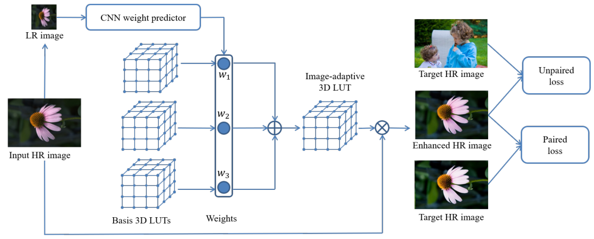

***** Fig. 1 説明
# pdfrect: 2 48.0 261.2 564.0 296.2
# pdfsent: [[[2,48.0,261.2,66.7,269.2]],[[2,66.7,261.2,77.9,269.2]],[[2,77.9,261.2,328.4,269.2]],[[2,328.4,261.2,564.0,269.2],[2,48.0,270.2,88.8,278.2]],[[2,88.8,270.2,471.2,278.2]],[[2,471.2,270.2,564.0,278.2],[2,48.0,279.2,449.7,287.2]],[[2,449.7,279.2,564.0,287.2],[2,48.0,288.2,244.6,296.2]]]
# pdfhl: sky blue 3,4,5,6
#+begin_en
Fig. 1. Framework of the proposed image-adaptive photo enhancement method. Our method learns multiple basis 3D LUTs and a small CNN weight predictor. The CNN model works on a down-sampled version of the input image to predict content-dependent weights. The predicted weights are used to fuse the basis 3D LUTs into an image-adaptive LUT, which is then used to transform the source image. Our method can be trained using either paired or unpaired data in an end-to-end manner.
#+end_en
図 1. 提案する画像適応型写真強調手法のフレームワーク。本手法では、複数の基底 3D LUT と小型の CNN 重み予測器を学習します。CNN モデルは、入力画像のダウンサンプリング版に対して、コンテンツ依存の重みを予測します。予測された重みは、基​​底 3D LUT を画像適応型 LUT に融合するために使用され、その後、ソース画像の変換に使用されます。本手法は、ペアデータまたは非ペアデータのいずれを使用しても、エンドツーエンドで学習できます。

***** 本文
# pdfrect: 2 48.0 318.3 300.0 408.5
# pdfsent: [[[2,48.0,318.3,300.0,327.8],[2,48.0,329.8,300.0,339.3],[2,48.0,341.3,210.3,350.8]],[[2,210.3,341.3,300.0,350.8],[2,48.0,352.9,300.0,362.4],[2,48.0,364.4,300.0,373.9],[2,48.0,376.0,71.6,385.5]],[[2,71.6,376.0,300.0,385.5],[2,48.0,387.5,300.0,397.0],[2,48.0,399.0,207.8,408.5]]]
#+begin_en
achieve higher efficiency and lower memory consumption since the network only needs to process an LR image and the predefined operators are usually simple. However, the employed simple operators are not able to provide adequate enhancement capability, and they are hard to be directly learned from training data. These methods [8], [9], [11] thus employ the reinforcement learning strategy to iteratively enhance the input image, which however severely sacrifices the efficiency.
#+end_en
ネットワークは LR 画像のみを処理する必要があり、事前定義された演算子は通常単純であるため、より高い効率と低いメモリ消費を実現できます。しかし、採用されている単純な演算子では十分な強調機能を提供できず、トレーニングデータから直接学習することも困難です。そのため、これらの手法[8]、[9]、[11]では、強化学習戦略を採用して入力画像を反復的に強調しますが、効率が大幅に犠牲になります。

# pdfrect: 2 48.0 412.2 300.0 594.8
# pdfsent: [[[2,62.2,412.2,300.0,421.7],[2,48.0,423.8,300.0,433.3],[2,48.0,435.3,300.0,444.8],[2,48.0,446.8,105.8,456.3]],[[2,105.8,446.8,300.0,456.3],[2,48.0,458.4,300.0,467.9],[2,48.0,469.9,300.0,479.4],[2,48.0,481.5,231.3,491.0]],[[2,231.3,481.5,300.0,491.0],[2,48.0,493.0,300.0,502.5],[2,48.0,504.5,300.0,514.0],[2,48.0,516.1,98.4,525.6]],[[2,98.4,516.1,300.0,525.6],[2,48.0,527.6,300.0,537.1]],[[2,48.0,539.2,300.0,548.7],[2,48.0,550.7,162.5,560.2]],[[2,162.5,550.7,300.0,560.2],[2,48.0,562.2,300.0,571.7],[2,48.0,573.8,300.0,583.3],[2,48.0,585.3,161.1,594.8]]]
#+begin_en
To address the limitations of existing methods on both enhancement quality and efficiency, we propose a new method which has advantages of high-efficiency, low memory-consumption and high-quality. Our method is partially motivated by the camera imaging pipeline [1] and professional image editing tools where the 1D and 3D lookup tables (LUTs) are used to adjust the hue, saturation, exposure, color and tone of photos. As one of the most classical yet widely used photo adjustment techniques, 3D LUT can achieve stable photo enhancement performance at very high efficiency. However, those 3D LUTs are mostly manually tuned by experienced experts in a very cumbersome and costly process. Furthermore, once manually tuned, the LUTs are fixed but not adaptive to different scenes. As a result, many different modes in digital cameras and dozens of LUTs in image editing tools are preset for user’s selection to fit for different scenes, which brings inconvenient user experience.
#+end_en
既存の手法の強調品質と効率の両面における限界に対処するため、高効率、低メモリ消費、高品質という利点を持つ新しい手法を提案します。この手法は、1D および 3D ルックアップ テーブル (LUT) を使用して写真の色相、彩度、露出、色、トーンを調整するカメラ画像処理パイプライン [1] およびプロフェッショナルな画像編集ツールに部分的に着想を得ています。最も古典的でありながら広く使用されている写真調整技術の 1 つですが、3D LUT は非常に高い効率で安定した写真強調性能を実現できます。しかし、これらの 3D LUT は、ほとんどの場合、経験豊富な専門家によって非常に面倒でコストのかかるプロセスで手動で調整されます。さらに、一度手動で調整すると、LUT は固定され、さまざまなシーンに適応しません。その結果、さまざまなシーンに合うように、デジタル カメラのさまざまなモードと画像編集ツールの数十の LUT がユーザーの選択用にプリセットされており、不便なユーザー エクスペリエンスをもたらします。

# pdfrect: 2 48.0 598.5 300.0 746.5
# pdfrect: 2 312.0 318.3 564.0 397.0
# pdfsent: [[[2,62.2,598.5,300.0,608.0],[2,48.0,610.0,300.0,619.5],[2,48.0,621.6,300.0,631.1],[2,48.0,633.1,300.0,642.6],[2,48.0,644.7,155.4,654.2]],[[2,155.4,644.7,176.1,654.2]],[[2,176.1,644.7,300.0,654.2],[2,48.0,656.2,300.0,665.7],[2,48.0,667.7,223.5,677.2]],[[2,223.5,667.7,300.0,677.2],[2,48.0,679.3,300.0,688.8],[2,48.0,690.8,300.0,700.3],[2,48.0,702.4,287.4,711.9]],[[2,287.4,702.4,300.0,711.9],[2,48.0,713.9,300.0,723.4],[2,48.0,725.4,300.0,734.9],[2,48.0,737.0,76.0,746.5]],[[2,76.0,737.0,300.0,746.5],[2,312.0,318.3,564.0,327.8],[2,312.0,329.8,564.0,339.3]],[[2,312.0,341.3,564.0,350.8],[2,312.0,352.9,564.0,362.4],[2,312.0,364.4,527.4,373.9]],[[2,527.4,364.4,564.0,373.9],[2,312.0,376.0,564.0,385.5],[2,312.0,387.5,402.3,397.0]]]
# pdfhl: sky blue 1,2,3
# pdfhl: sky blue 7
#+begin_en
To achieve more expressive and intelligent photo enhancement capability while maintaining the advantages of 3D LUT such as high-efficiency and stability, we propose an end-to-end framework to learn image-adaptive 3D LUTs from high-quality images retouched by human experts. Fig. 1 illustrates the framework of the proposed method, which learns several (e.g., 3) basis 3D LUTs and a small CNN weight predictor. The basis 3D LUTs ensure that the color transform space from input to output images can be well covered, while the CNN model predicts contentdependent weights based on the down-sampled input image. The predicted weights are used to fuse the basis 3D LUTs into an image-adaptive one, which is then used to transform the source image. This process is functionally similar to the operation of choosing different modes in digital cameras or choosing different LUTs in image editing tools but it is automatic and more flexible. The proposed adaptive LUT based photo enhancement is very fast because only the trilinear interpolation is involved and this operation can be easily parallelized using GPU [12]. The whole model can be trained using either paired or unpaired data with different loss functions.
#+end_en
3D LUT の効率性と安定性といった利点を維持しながら、より表現力豊かでインテリジェントな写真補正機能を実現するために、人間の専門家がレタッチした高品質の画像から画像適応型 3D LUT を学習するエンドツーエンドのフレームワークを提案します。図 1 は、提案手法のフレームワークを示しています。このフレームワークでは、複数の（例えば 3 つの）​​基本 3D LUT と小さな CNN 重み予測器を学習します。基本 3D LUT は、入力画像から出力画像への色変換空間を十分にカバーできることを保証し、CNN モデルはダウンサンプリングされた入力画像に基づいてコンテンツ依存の重みを予測します。予測された重みは、基​​本 3D LUT を画像適応型 LUT に融合するために使用され、その後、ソース画像の変換に使用されます。このプロセスは、デジタルカメラで異なるモードを選択したり、画像編集ツールで異なる LUT を選択したりする操作と機能的に似ていますが、自動化されており、より柔軟です。提案された適応型 LUT ベースの画像強調処理は、三線形補間のみを使用するため非常に高速であり、この処理は GPU を使用して容易に並列化できます[12]。モデル全体は、異なる損失関数を使用して、ペアデータまたは非ペアデータのどちらでもトレーニングできます。

***** 成果
# pdfrect: 2 326.2 399.2 538.2 408.7
# pdfsent: [[[2,326.2,399.2,538.2,408.7]]]
#+begin_en
The highlights of this work are summarized as follows:
#+end_en

本研究の主な成果は以下のとおりです。

# pdfrect: 2 326.2 413.6 564.0 492.4
# pdfsent: [[[2,326.2,415.3,330.3,422.3],[2,341.7,413.6,564.0,423.1],[2,341.7,425.2,564.0,434.7],[2,341.7,436.7,461.1,446.2]],[[2,461.1,436.7,564.0,446.2],[2,341.7,448.2,564.0,457.7],[2,341.7,459.8,564.0,469.3],[2,341.7,471.3,564.0,480.8],[2,341.7,482.9,392.7,492.4]]]
#+begin_en
• To the best of our knowledge, we are the first to learn 3D LUTs using either paired or unpaired datasets for automatic photo enhancement. More importantly, our proposed learning architecture can learn image-adaptive 3D LUTs to achieve intelligent and high performance photo enhancement, which cannot be achieved by the current 3D LUT models.
#+end_en

・我々の知る限り、ペアデータセットまたは非ペアデータセットのいずれかを使用して 3D LUT を学習し、自動写真補正を実現したのは我々が初めてです。さらに重要なことに、我々が提案する学習アーキテクチャは、画像適応型の 3D LUT を学習することで、インテリジェントで高性能な写真補正を実現できます。これは、既存の 3D LUT モデルでは実現できないことです。

# pdfrect: 2 326.2 494.4 564.0 538.5
# pdfsent: [[[2,326.2,496.1,330.3,503.0],[2,341.7,494.4,564.0,503.9],[2,341.7,505.9,564.0,515.4],[2,341.7,517.5,564.0,527.0],[2,341.7,529.0,530.2,538.5]]]
#+begin_en
• Our proposed model contains less than 600K parameters and takes less than 2 ms to process an image of 4K resolution using one Titan RTX GPU, which is highly efficient for deployment in practical applications.
#+end_en

・我々が提案するモデルは、60 万個未満のパラメータで構成されており、1つの Titan RTX GPU を使用して 4K 解像度の画像を処理するのに 2 ミリ秒未満しかかかりません。これは、実用的なアプリケーションへの展開において非常に効率的です。

# pdfrect: 2 326.2 540.6 564.0 596.2
# pdfsent: [[[2,326.2,542.2,330.3,549.2],[2,341.7,540.6,564.0,550.1],[2,341.7,552.1,564.0,561.6],[2,341.7,563.6,564.0,573.1],[2,341.7,575.2,564.0,584.7],[2,341.7,586.7,407.0,596.2]]]
# pdfhl: sky blue 0
#+begin_en
• Our extensive experiments on two publically available benchmark datasets validate that under either paired or unpaired settings, our model significantly outperforms stateof-the-art photo enhancement methods both quantitatively and qualitatively.
#+end_en

・公開されている 2 つのベンチマークデータセットを用いた広範な実験により、
ペアリング設定でも非ペアリング設定でも、当社のモデルは最先端の画像強調手法を定量的にも定性的にも大幅に上回ることが実証されました。

** 2 RELATED WORK
:PROPERTIES:
:NOTER_PAGE: 2
:END:
***** 導入
# pdfrect: 2 312.0 632.9 564.0 677.0
# pdfsent: [[[2,312.0,632.9,564.0,642.4],[2,312.0,644.5,511.2,654.0]],[[2,511.2,644.5,564.0,654.0],[2,312.0,656.0,564.0,665.5],[2,312.0,667.5,473.6,677.0]]]
#+begin_en
Photo enhancement is a long-standing topic with wide applications in camera imaging pipeline and photo retouching. We briefly review the related work towards these applications and the employed photo enhancement techniques as follows.
#+end_en

写真の補正は、カメラ画像処理パイプラインや写真レタッチなど幅広い分野で応用されている、長年の研究テーマです。以下では、これらの応用に関する関連研究と、用いられている写真補正技術について簡単に概説します。

# pdfrect: 2 312.0 679.2 564.0 746.5
# pdfsent: [[[2,326.2,679.2,502.4,688.8]],[[2,502.4,679.2,564.0,688.8],[2,312.0,690.8,564.0,700.3],[2,312.0,702.4,468.0,711.9]],[[2,468.0,702.4,564.0,711.9],[2,312.0,713.9,564.0,723.4]],[[2,312.0,725.4,564.0,734.9],[2,312.0,737.0,564.0,746.5]]]
#+begin_en
Enhancement in camera imaging pipeline. Camera imaging pipeline is a complex process which converts the sensor raw data to perceptually friendly color images. Under the divide and conquer principle, this process consists of a set of cascaded modules. For the enhancement part, those modules include exposure correction [13], [14], color constancy [15], [16], contrast enhancement
#+end_en

カメラ画像処理パイプラインの強化。カメラ画像処理パイプラインは、センサーの生データを知覚的に分かりやすいカラー画像に変換する複雑なプロセスです。分割統治の原則に基づき、このプロセスは一連のカスケード接続されたモジュールで構成されています。強化部分では、これらのモジュールには露出補正[13]、[14]、色恒常性[15]、[16]、コントラスト強調などが含まれます。

# pdfrect: 3 48.0 44.6 300.0 134.9
# pdfsent: [[[3,48.0,44.6,300.0,54.1],[3,48.0,56.1,265.6,65.6]],[[3,265.6,56.1,300.0,65.6],[3,48.0,67.7,300.0,77.2],[3,48.0,79.2,207.6,88.7]],[[3,207.6,79.2,300.0,88.7],[3,48.0,90.7,300.0,100.2],[3,48.0,102.3,222.5,111.8]],[[3,222.5,102.3,300.0,111.8],[3,48.0,113.8,300.0,123.3],[3,48.0,125.4,268.3,134.9]]]
#+begin_en
[17], [18], color manipulation [19], [20] and tone mapping [21], [22], each of which has been widely studied in the past. According to [1], most of these modules in practical systems employ a common technique, i.e., 1D or 3D LUT. These LUTs are usually manually tuned and fixed in the imaging pipeline, which are however not flexible and intelligent enough. This motivates us to learn image-adaptive 3D LUTs to improve both the expressiveness and flexibility of photo enhancement in imaging pipeline.
#+end_en

[17]、[18]、色操作[19]、[20]、トーンマッピング[21]、[22]は、それぞれ過去に広く研究されてきた。 [1]によると、実際のシステムではこれらのモジュールのほとんどが、1D または 3D LUT という共通の手法を採用している。これらの LUT は通常、画像処理パイプラインで手動で調整され固定されるが、柔軟性とインテリジェンスが十分ではない。このため、画像処理パイプラインでの写真強調の表現力と柔軟性の両方を向上させるために、画像適応型 3D LUT を学習する必要がある。

# pdfrect: 3 48.0 136.9 300.0 261.8
# pdfsent: [[[3,62.2,136.9,300.0,146.4],[3,48.0,148.4,300.0,157.9],[3,48.0,160.0,300.0,169.5],[3,48.0,171.5,177.9,181.0]],[[3,177.9,171.5,300.0,181.0],[3,48.0,183.1,300.0,192.6],[3,48.0,194.6,133.4,204.1]],[[3,133.4,194.6,300.0,204.1],[3,48.0,206.1,300.0,215.6],[3,48.0,217.7,300.0,227.2],[3,48.0,229.2,201.8,238.7]],[[3,201.8,229.2,300.0,238.7],[3,48.0,240.8,300.0,250.3],[3,48.0,252.3,279.9,261.8]]]
#+begin_en
Considering that the use of cascaded modules in existing imaging pipeline may result in accumulated errors, several attempts have been made to learn the entire pipeline using a deep neural network [23], [24], [25]. However, the robustness of such methods is hard to ensure and the computational cost is too heavy for camera devices. Different from these methods, we aim to improve the enhancement modules of the imaging pipeline, such as exposure correction, color manipulation and tone mapping, by learning image-adaptive 3D LUTs. Our method improves the flexibility and expressiveness of traditional imaging pipeline while maintaining their advantages such as stability and efficiency.
#+end_en

既存の画像処理パイプラインでカスケード接続されたモジュールを使用すると、エラーが蓄積される可能性があることを考慮して、ディープニューラルネットワークを使用してパイプライン全体を学習する試みがいくつか行われてきました[23]、[24]、[25]。しかし、このような方法の堅牢性を確保するのは難しく、カメラデバイスにとって計算コストが大きすぎます。これらの方法とは異なり、画像適応型 3D LUT を学習することで、露出補正、色操作、トーンマッピングなどの画像処理パイプラインの強化モジュールを改善することを目指します。私たちの方法は、安定性や効率性などの利点を維持しながら、従来の画像処理パイプラインの柔軟性と表現力を向上させます。

# pdfrect: 3 48.0 263.7 300.0 423.4
# pdfsent: [[[3,62.2,263.7,213.1,273.3]],[[3,213.1,263.7,300.0,273.3],[3,48.0,275.4,300.0,284.9],[3,48.0,286.9,162.2,296.4]],[[3,162.2,286.9,300.0,296.4],[3,48.0,298.5,300.0,308.0],[3,48.0,310.0,300.0,319.5],[3,48.0,321.5,83.4,331.0]],[[3,83.4,321.5,300.0,331.0],[3,48.0,333.1,300.0,342.6],[3,48.0,344.6,291.9,354.1]],[[3,291.9,344.6,300.0,354.1],[3,48.0,356.2,300.0,365.7],[3,48.0,367.7,166.1,377.2]],[[3,166.1,367.7,300.0,377.2],[3,48.0,379.2,189.7,388.7]],[[3,189.7,379.2,300.0,388.7],[3,48.0,390.8,287.2,400.3]],[[3,287.2,390.8,300.0,400.3],[3,48.0,402.3,300.0,411.8],[3,48.0,413.9,251.0,423.4]]]
#+begin_en
Enhancement in photo retouching. Photo retouching is widely used to further improve the perceptual quality of photos captured by digital cameras. Many professional software products (e.g., PhotoShop, Lightroom, 3D LUT Creator) and mobile applications (e.g., Snapseed, VSCO, Pollar) are designed for this purpose. However, using these tools to effectively render a highquality photo requires much domain knowledge in photography and a lot of practices to get familiar with the operations. To alleviate the cost, many preset LUTs are provided in the tools or available on the internet. However, a preset LUT usually only fits for a specific type of scenes. It is still tedious and timeconsuming to handle many photos with different content. Our proposed method could learn image-adaptive 3D LUTs which can automatically enhance photos based on their content.
#+end_en

写真レタッチの強化。写真レタッチは、デジタルカメラで撮影した写真の知覚品質をさらに向上させるために広く使用されています。多くのプロフェッショナルソフトウェア製品（例：Photoshop、Lightroom、3D LUT Creator）やモバイルアプリケーション（例：Snapseed、VSCO、Pollar）がこの目的のために設計されています。しかし、これらのツールを使用して高品質の写真を効果的にレンダリングするには、写真に関する多くの専門知識と、操作に慣れるための多くの練習が必要です。コストを軽減するために、多くのプリセット LUT がツールに用意されているか、インターネットで入手できます。しかし、プリセット LUT は通常、特定の種類のシーンにしか適合しません。内容が異なる多くの写真を処理するのは、依然として面倒で時間がかかります。提案する手法は、写真の内容に基づいて写真を自動的に強化できる画像適応型 3D LUT を学習できます。

# pdfrect: 3 48.0 425.2 300.0 561.8
# pdfsent: [[[3,62.2,425.2,250.7,434.9]],[[3,250.7,425.2,300.0,434.9],[3,48.0,436.8,300.0,446.4],[3,48.0,448.5,243.1,458.0]],[[3,243.1,448.5,300.0,458.0],[3,48.0,460.0,300.0,469.5],[3,48.0,471.6,300.0,481.1],[3,48.0,483.1,218.6,492.6]],[[3,218.6,483.1,300.0,492.6],[3,48.0,494.6,300.0,504.1],[3,48.0,506.2,300.0,515.7],[3,48.0,517.7,170.3,527.2]],[[3,170.3,517.7,300.0,527.2],[3,48.0,529.3,259.4,538.8]],[[3,259.4,529.3,300.0,538.8],[3,48.0,540.8,300.0,550.3],[3,48.0,552.3,146.5,561.8]]]
#+begin_en
Example-based photo transfer/enhancement. The examplebased methods [26], [27], [28], [29], [30] transfer the color and style of a reference image to the target image. Traditionally, handcrafted features are designed to characterize the context and attribute of an example image, and manually designed operators are employed to perform the transformation. Recently, deep neural networks have been employed to extract more representative features and achieve more powerful and flexible (sometimes artistic) style transfer [31], [32], [33]. However, it is inconvenient to find a proper reference image in practical applications. Our method differs from this type of research in that it is totally automatic after the model is trained.
#+end_en

例に基づく写真転送/強調。例に基づく手法 [26]、[27]、[28]、[29]、[30] は、参照画像の色とスタイルをターゲット画像に転送します。従来は、手作業で設計された特徴が例画像のコンテキストと属性を特徴付け、手動で設計された演算子を使用して変換を実行します。最近では、より代表的な特徴を抽出し、より強力で柔軟な (時には芸術的な) スタイル転送を実現するために、深層ニューラルネットワークが使用されています [31]、[32]、[33]。しかし、実際のアプリケーションでは適切な参照画像を見つけるのが不便です。私たちの方法は、モデルのトレーニング後に完全に自動化されるという点で、この種の研究とは異なります。

***** 本文
# pdfrect: 3 48.0 563.8 300.0 711.9
# pdfsent: [[[3,62.3,563.8,217.7,573.4]],[[3,217.7,563.8,300.0,573.4],[3,48.0,575.4,300.0,584.9],[3,48.0,587.0,111.0,596.5]],[[3,111.0,587.0,300.0,596.5],[3,48.0,598.5,83.4,608.0]],[[3,83.4,598.5,300.0,608.0],[3,48.0,610.0,271.1,619.5]],[[3,271.1,610.0,300.0,619.5],[3,48.0,621.6,300.0,631.1],[3,48.0,632.9,78.4,642.6]],[[3,78.4,632.9,300.0,642.6],[3,48.0,644.7,272.4,654.2]],[[3,272.4,644.7,300.0,654.2],[3,48.0,656.2,300.0,665.7],[3,48.0,667.7,300.0,677.2],[3,48.0,679.3,102.6,688.8]],[[3,102.6,679.3,300.0,688.8],[3,48.0,690.8,300.0,700.3],[3,48.0,702.4,143.7,711.9]]]
# pdfhl: sky blue 1,2,3
#+begin_en
Learning-based photo enhancement. The learning-based methods aim to learn an enhancement model from input and target image datasets. The target images are usually retouched by human experts. It is expected that the trained model can automatically enhance an input image without additional operations. The pioneering work along this line is reported in [3], where Bychkovsky et al. developed the MIT-Adobe FiveK dataset and learned a mapping curve to approximate photographers’ adjustments. In [4], a dataset is collected to record the manual enhancement process of each image and a ranking model is learned based on the ordered image pairs. However, both these two methods learn a shallow model with a set of handcrafted features, which have limited representation capability.
#+end_en
***** 和訳
学習ベースの画像補正。学習ベースの手法は、入力画像データセットとターゲット画像データセットから補正モデルを学習することを目的としています。ターゲット画像は通常、人間の専門家によってレタッチされています。訓練されたモデルは、追加の操作なしに入力画像を自動的に補正できることが期待されます。この方向での先駆的な研究は[3]で報告されており、Bychkovsky らは MIT-Adobe FiveK データセットを開発し、写真家の調整を近似するマッピング曲線を学習しました。[4]では、各画像の手動補正プロセスを記録するためのデータセットが収集され、順序付けられた画像ペアに基づいてランキングモデルが学習されます。しかし、これら 2 つの手法はいずれも、表現能力が限られている一連の手作業で作成された特徴量を持つ浅いモデルを学習します。

***** 本文
# pdfrect: 3 48.0 713.9 300.0 746.5
# pdfrect: 3 312.0 44.4 564.0 192.6
# pdfsent: [[[3,62.3,713.9,300.0,723.4],[3,48.0,725.3,184.7,734.9]],[[3,184.7,725.3,231.7,734.9]],[[3,231.7,725.3,300.0,734.9],[3,48.0,737.0,300.0,746.5],[3,312.0,44.4,446.1,54.1]],[[3,446.1,44.4,503.0,54.1]],[[3,503.0,44.4,564.0,54.1],[3,312.0,56.1,564.0,65.6],[3,312.0,67.5,378.9,77.2]],[[3,378.9,67.5,426.2,77.2]],[[3,426.2,67.5,564.0,77.2],[3,312.0,79.2,564.0,88.7],[3,312.0,90.7,564.0,100.2]],[[3,312.0,102.3,564.0,111.8],[3,312.0,113.8,564.0,123.3]],[[3,312.0,125.2,523.2,134.9]],[[3,523.2,125.2,564.0,134.9],[3,312.0,136.9,564.0,146.4],[3,312.0,148.3,466.4,157.9]],[[3,466.4,148.3,515.2,157.9]],[[3,515.2,148.3,564.0,157.9],[3,312.0,160.0,564.0,169.5],[3,312.0,171.3,469.0,181.0]],[[3,469.0,171.3,564.0,181.0],[3,312.0,183.1,529.2,192.6]]]
# pdfhl: yellow 1,2,3,4,5,6,7,8,9,10,11,12
#+begin_en
Recently, significant progress has been made by training neural networks for photo enhancement. Yan et al. [6] fed a set of image descriptors into a multi-layer perceptron to predict pixelwise quadratic color transforms. Gharbi et al. [2] proposed to learn the transformation coefficients in the bilateral space with high efficiency. Park et al. [8] introduced a deep reinforcement learning strategy for step-wise image enhancement by learning to predict the discrete probabilities of a set of predefined operators. Satoshi and Toshihiko [11] employed a similar reinforcement learning strategy to learn an unpaired photo enhancement model. In addition to employing predefined operators, Hu et al. [9] trained a neural network to fit a mapping curve, which can be viewed as a 1D LUT, to conduct photo enhancement. Chen et al. [7] employed a U-Net model to learn pixel-to-pixel mapping between input and output image pairs, while Wang et al. [10] trained a model to estimate the pixel-wise illumination map of input image.
#+end_en

最近、写真強調のためのニューラルネットワークのトレーニングにより、大きな進歩が見られました。 Yan ら [6] は、一連の画像記述子を多層パーセプトロンに入力して、ピクセルごとの二次色変換を予測しました。 Gharbi ら [2] は、双方向空間で変換係数を高効率で学習することを提案しました。 Park ら [8] は、定義済みの演算子のセットの離散確率を予測することを学習することで、段階的な画像強調のための深層強化学習戦略を導入しました。 Satoshi と Toshihiko [11] は、同様の強化学習戦略を使用して、ペアになっていない写真強調モデルを学習しました。 Hu ら [9] は、定義済みの演算子を使用することに加えて、1D LUT と見なせるマッピング曲線に適合するニューラルネットワークをトレーニングして、写真強調を実行しました。 Chen ら [7] は、入力画像と出力画像のペア間のピクセル間のマッピングを学習するために U-Net モデルを使用しました。 [10]は入力画像のピクセル単位の照明マップを推定するモデルを訓練した。
***** 付箋
# pdfput: 1 3 6acc1ccec46d
#+begin_memo
【用語解説】
- Quadratic color transform (二次色変換): ピクセルごとに二次関数を用いて色を変換する手法。資料では「pixelwise quadratic color transforms」として言及されているが、具体的な数式は示されていない。

- Multi-layer perceptron (多層パーセプトロン): 入力層・隠れ層・出力層からなる人工ニューラルネットワーク。資料では「fed a set of image descriptors into a multi-layer perceptron」と記述されているが、構造の詳細は資料に記載なし。（一般知識に基づく説明です）

- Bilateral space (双側空間): 画像の空間座標と色空間を組み合わせた高次元空間で、近傍情報を効率的に扱える。資料では「learn the transformation coefficients in the bilateral space」とあるが、具体的な定義は資料に記載なし。（一般知識に基づく説明です）

- Deep reinforcement learning (深層強化学習): エージェントが環境と相互作用しながら報酬を最大化する方策を、深層ニューラルネットワークで近似する学習手法。資料では「deep reinforcement learning strategy」として言及されているが、手法の詳細は資料に記載なし。（一般知識に基づく説明です）

- U‑Net (U‑Net): エンコーダとデコーダからなる対称構造の畳み込みネットワークで、画像のピクセル単位のマッピングに適する。資料では「employed a U‑Net model to learn pixel-to-pixel mapping」とあるが、構造の説明は資料に記載なし。（一般知識に基づく説明です）

- Pixel‑wise illumination map (ピクセル単位照明マップ): 画像の各ピクセルに対して推定された照明強度のマップ。資料では「estimate the pixel-wise illumination map of input image」と記述されているが、具体的な算出方法は資料に記載なし。（一般知識に基づく説明です）

- image descriptor (画像記述子): 画像の特徴を数値ベクトルで表現し、検索や分類などのタスクに利用される。(資料に記載されていない一般知識です)
#+end_memo

***** 本文
# pdfrect: 3 312.0 194.9 564.0 331.4
# pdfsent: [[[3,326.2,194.9,564.0,204.4],[3,312.0,206.5,339.5,216.0]],[[3,339.5,206.5,564.0,216.0],[3,312.0,218.0,491.0,227.5]],[[3,491.0,218.0,564.0,227.5],[3,312.0,229.6,564.0,239.1],[3,312.0,241.1,535.1,250.6]],[[3,535.1,241.1,564.0,250.6],[3,312.0,252.6,564.0,262.1],[3,312.0,264.2,564.0,273.7],[3,312.0,275.7,564.0,285.2],[3,312.0,287.3,408.6,296.8]],[[3,408.6,287.3,564.0,296.8],[3,312.0,298.8,462.4,308.3]],[[3,462.4,298.8,564.0,308.3],[3,312.0,310.3,564.0,319.8],[3,312.0,321.9,549.6,331.4]]]
# pdfhl: sky blue 3,4,5
#+begin_en
Like [8], [9], [11], our method involves both basic operators (e.g. 3D LUTs) and CNN model for image enhancement; however, there are several significant differences. First, the operators employed in [8], [9], [11] are pre-defined and fixed, while the 3D LUTs in our method are learned from training data. Second, the pre-defined operators in previous methods, such as global exposure adjustment, contrast and saturation adjustment using one single parameter, are relatively simple and have limited expressive capability. The image-adaptive 3D LUTs learned in our method are much more expressive. Third, our method outputs the enhancement result using one single forward process, which is several orders faster than the iterative process in [8], [9], [11].
#+end_en

[8]、[9]、[11]と同様に、我々の手法も画像強調のために基本演算子（例えば 3D LUT）と CNN モデルの両方を使用しますが、いくつかの重要な違いがあります。まず、[8]、[9]、[11]で使用される演算子は事前に定義され固定されていますが、我々の手法の 3D LUT はトレーニングデータから学習されます。次に、グローバル露出調整、コントラストおよび彩度調整など、1つのパラメータを使用した従来の手法の事前定義された演算子は比較的単純で表現力が限られています。我々の手法で学習される画像適応型 3D LUT ははるかに表現力に優れています。第三に、我々の手法は 1 つの順方向処理を使用して強調結果を出力しますが、これは[8]、[9]、[11]の反復処理よりも数桁高速です。

# pdfrect: 3 312.0 333.8 564.0 401.0
# pdfsent: [[[3,326.2,333.8,564.0,343.3],[3,312.0,345.3,552.9,354.8]],[[3,552.9,345.3,564.0,354.8],[3,312.0,356.9,564.0,366.4],[3,312.0,368.4,564.0,377.9],[3,312.0,379.9,485.2,389.4]],[[3,485.2,379.9,564.0,389.4],[3,312.0,391.5,425.1,401.0]]]
# pdfhl: sky blue 1
#+begin_en
Unsupervised learning of photo enhancement models using unpaired data has recently been studied in [7], [9], [11], [34]. Our model can also be trained on unpaired data using an adversarial loss, and it demonstrates significant advantages over previous methods in both performance and efficiency. Details can be found in the section of experiments.
#+end_en

非ペアデータを用いた写真強調モデルの教師なし学習は、最近[7]、[9]、[11]、[34]で研究されている。我々のモデルも、敵対的損失を用いて非ペアデータで学習させることができ、性能と効率の両面で従来の手法よりも大きな利点を示している。詳細は実験の項を参照のこと。

** 3 METHODOLOGY
:PROPERTIES:
:NOTER_PAGE: 3
:END:
*** *3.1 3D LUT と三線形補間*
***** 本文
# pdfrect: 3 312.0 440.3 564.0 461.3
# pdfsent: [[[3,312.0,440.3,564.0,449.8],[3,312.0,451.8,524.2,461.3]]]
#+begin_en
In this section, we present in detail our framework to learn imageadaptive 3D LUTs using either paired or unpaired data.
#+end_en
このセクションでは、ペアデータまたは非ペアデータのいずれかを使用して画像適応型 3D LUT を学習するためのフレームワークを詳細に説明します。
# pdfrect: 3 312.0 481.1 485.1 490.6
# pdfsent: [[[3,312.0,481.1,325.2,490.6],[3,334.7,481.1,485.1,490.6]]]
# pdfhl: sky blue 0
#+begin_en
3.1 3D LUT and trilinear interpolation
#+end_en
# pdfrect: 3 312.0 496.9 564.0 518.0
# pdfsent: [[[3,312.0,496.9,564.0,506.4],[3,312.0,508.5,457.9,518.0]],[[3,457.9,508.5,533.0,518.0]],[[3,533.0,508.5,564.0,518.0]]]
# pdfhl: sky blue 0,1,2
#+begin_en
3D LUT is a classical yet very effective and widely used technique for photo enhancement. As shown in Fig. 2(a), a
#+end_en

3D LUT は、写真補正のための古典的でありながら非常に効果的で広く使用されている技術です。図 2(a) に示すように、

***** 付箋
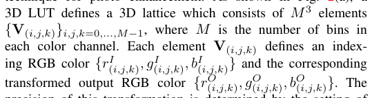
# pdfput: 1 3 6acc69f2c586
#+begin_memo
 3D LUT の定義

 - 全体の意味

 3D LUT は、色を変換するための「格子（ラティス）」です。
 RGB 空間を \(M\) 個ずつに区切った立方体の格子で、各格子点に「入力色」と「出力色」の組を持ちます。
 入力色を格子で検索し、出力色を補間で求めることで、色の変換を行います。

 - 格子の要素

 格子の各要素を \(\mathbf{V}_{(i,j,k)}\) と書きます。ここで \(i, j, k \in \{0, \dots, M-1\}\) は、それぞれ R, G, B 方向の格子番号です。

 各要素は、次の 2 種類の色を持ちます。

 - 入力色（格子の位置そのものに対応する色）:
   \[
   \{ r^I_{(i,j,k)},\; g^I_{(i,j,k)},\; b^I_{(i,j,k)} \}
   \]
  - 出力色（その位置に対応して変換後に出す色）:
   \[
   \{ r^O_{(i,j,k)},\; g^O_{(i,j,k)},\; b^O_{(i,j,k)} \}
   \]

  - 学習されるもの

 入力色は、RGB 空間を一様に区切った固定の値です。
 学習で変わるのは、出力色 \(\{ r^O, g^O, b^O \}\) の方です。
 この出力色が、3D LUT の学習パラメータになります。

- 補足（記号の読み方）
   - \(M\): 各色チャンネルの分割数（ビン数）
   - \(M^3\): 格子点の総数（\(M=33\) なら約 3.6 万個）
   - 添字 \((i,j,k)\): 格子の位置。R, G, B の順

3D LUT は「色の対応表」を立体の格子で持つもので、格子点の出力色だけが学習で決まる、というのがこの段落の要点です。
#+end_memo

***** 本文：3DLUT とは
# pdfrect: 3 312.0 579.8 564.0 589.3
# pdfsent: [[[3,312.0,579.8,564.0,589.3]]]
#+begin_en
precision of this transformation is determined by the setting of
#+end_en

この変換の精度は、

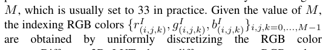

\[
\(M\), which is usually set to 33 in practice. Given the value of \(M\), the indexing RGB colors \(\{r^{I}_{(i,j,k)},g^{I}_{(i,j,k)},b^{I}_{(i,j,k)}\}_{i,j,k=0,...,M-1}\) are obtained by uniformly discretizing the RGB color.
\]

#+begin_explain
（自動解説・要確認）
要約: M は RGB を均等に分割する格子サイズで、実務では 33 が使われる。
かみ砕くと: M を決めると、\(i,j,k=0\ldots M-1\) のインデックスで各色成分 \(r^{I}_{(i,j,k)},g^{I}_{(i,j,k)},b^{I}_{(i,j,k)}\) が取得でき、RGB 空間を均一に離散化できる。
記号:
- \(M\): 分割数 (既定 33)
- \(r^{I}_{(i,j,k)}\) など: インデックス色
#+end_explain

# pdfrect: 3 312.0 626.0 564.0 635.5
# pdfsent: [[[3,312.0,626.0,342.9,635.5]],[[3,342.9,626.0,564.0,635.5]]]
#+begin_en
space. Different 3D LUTs have different output RGB colors
#+end_en

空間。異なる 3D LUT は異なる出力 RGB 色を持つ。

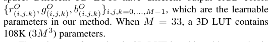

\[
**Remark 1.** The new new method for the new method. When \(M=33\), a 3D LUT contains 108K (\(3M^{3}\)) parameters.
\]

#+begin_explain
（自動解説・要確認）
要約: M=33 のとき 3D LUT は 108,000 個のパラメータを持つ。
かみ砕くと: パラメータ数は \(3M^{3}\) で計算され、M=33 を代入すると約 108k になる。
記号:
- \(M\): 前式と同じ分割数
#+end_explain

***** 本文：3DLUT における色変換
# pdfrect: 3 312.0 672.6 564.0 693.7
# pdfsent: [[[3,326.2,672.6,564.0,682.1],[3,312.0,684.2,495.3,693.7]],[[3,495.3,684.2,564.0,693.7]]]
# pdfhl: sky blue 0,1
#+begin_en
The color transformation in 3D LUT is achieved by two basic operations: lookup and trilinear interpolation. Given an input RGB
#+end_en

3D LUT における色変換は、ルックアップと三線形補間という 2 つの基本的な操作によって実現されます。入力 RGB が与えられた場合

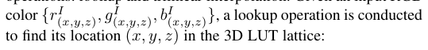
\[
color \(\{r^{I}_{(x,y,z)},g^{I}_{(x,y,z)},b^{I}_{(x,y,z)}\}\), a lookup operation is conducted to find its location \((x,y,z)\) in the 3D LUT lattice:
\]

***** 付箋
# pdfput: 1 3 6acc7204869a
#+begin_memo
（自動解説・要確認）
要約: 入力 RGB 色 \(\{r^{I}_{(x,y,z)}, g^{I}_{(x,y,z)}, b^{I}_{(x,y,z)}\}\) を 3D LUT の格子上の座標 \((x,y,z)\) に対応させるためにルックアップを行うことを示す式。
かみ砕くと: 入力色は赤・緑・青の 3 成分で表され、各成分は格子点 \((x,y,z)\) に結びつく。ルックアップでその座標を探し、次の三次元線形補間へ渡す。
記号:
- \(r^{I}_{(x,y,z)}, g^{I}_{(x,y,z)}, b^{I}_{(x,y,z)}\): 入力画像の RGB 値（位置 \((x,y,z)\) に対応）。
- \((x,y,z)\): 3D LUT の格子座標。

【用語解説】
- trilinear interpolation (三線形補間): 3 次元格子上の 8 つの隣接点の値を各軸方向に線形補間（3 つの方向すべてで直線的に補間）して求める手法です。
#+end_memo

***** 本文：3DLUT における色変換
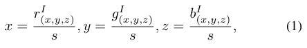
\[
x=\frac{r^{I}_{(x,y,z)}}{s},y=\frac{g^{I}_{(x,y,z)}}{s},z=\frac{b^{I}_{(x,y,z)}}{s}, \tag{1}
\]
#+begin_explain
（自動解説・要確認）
入力 RGB 成分をスケール \(s\) で正規化して \((x,y,z)\) 座標に変換する式である
#+end_explain

***** Fig.2
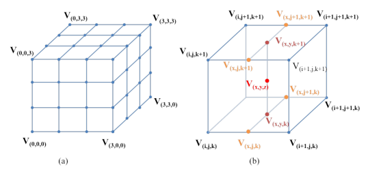

# pdfrect: 4 48.0 173.5 300.0 191.8
# pdfsent: [[[4,48.0,173.5,65.7,182.8]],[[4,65.7,173.5,76.4,182.8]],[[4,76.4,173.5,300.0,182.8],[4,48.0,183.8,166.6,191.8]]]
# pdfhl: sky blue 0,1,2
#+begin_en
Fig. 2. Illustration of (a) a 3D LUT containing 43 elements and (b) the trilinear interpolation of one input.
#+end_en
図 2. (a) 43 個の要素を含む 3D LUT と(b) 1 つの入力の三線形補間の図解。
***** 付箋
# pdfput: 1 4 6acc7b75ccc3
#+begin_memo
浮いている点(x, y, z)の図示方法

- 各次元 0~1 として割合を計算
- ｘ軸に平行な４つの軸（手前の上下と奥の上下）について、
   ｘの割合に対応する新しい点を作る（オレンジ色の V がこの点）
 - オレンジの V 同士を結び y 軸（または z 軸）に平行な線を引く。４点あるので２本の線が引ける

 - その２本の線について、yの割合に対応する新しい点を作る（えんじ色の V がこの点）
 - この２点を結んだ線分について、zの割合に対応する点をおくと、
   浮いている点が図示できる
#+end_memo

***** 本文：三次元線形補間の計算
# pdfrect: 4 48.0 213.8 300.0 258.5
# pdfsent: [[[4,110.3,219.5,117.9,226.5],[4,131.2,213.8,300.0,224.6]],[[4,48.0,225.9,300.0,235.4],[4,48.0,237.4,300.0,246.9],[4,48.0,249.0,300.0,258.5]]]
# pdfhl: sky blue 0,1
#+begin_en
M and Cmax is the maximum color value. After the location of the input RGB color is computed, its nearest 8 surrounding elements can be used to interpolate the output RGB via trilinear interpolation, which is illustrated in
#+end_en
M と Cmax は最大色値です。入力 RGB 色の位置が計算された後、その最も近い 8 つの周囲の要素を使用して、三線形補間によって出力 RGB を補間できます。これは図に示されています。

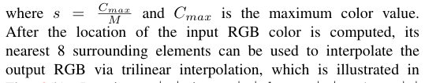

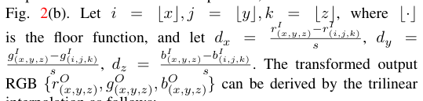

******* 原文の和訳
ここで、$s = \frac{C_{max}}{M}$ であり、$C_{max}$ は色の最大値である。
入力 RGB カラーの位置が計算された後、Fig. 2(b) に図示されているように、その最も近い周囲の 8 つの要素を用いて、三線形補間により出力 RGB を補間することができる。
$i = \lfloor x \rfloor, j = \lfloor y \rfloor, k = \lfloor z \rfloor$ とする。ここで $\lfloor \cdot \rfloor$ は床関数（切り捨て関数）である。そして以下のように定義する。
$d_x = \frac{r_{(x,y,z)}^I - r_{(i,j,k)}^I}{s}, \quad d_y = \frac{g_{(x,y,z)}^I - g_{(i,j,k)}^I}{s}, \quad d_z = \frac{b_{(x,y,z)}^I - b_{(i,j,k)}^I}{s}$
変換後の出力 RGB $\{r_{(x,y,z)}^O, g_{(x,y,z)}^O, b_{(x,y,z)}^O\}$ は、三線形（補間によって導出できる…）

# pdfput: 1 4 6acca1d73606
#+begin_memo
******* 1. 1 マスの幅（サイズ）を決める
  \begin{equation}
  s = \frac{C_{max}}{M}
  \end{equation}
  - $C_{max}$ は色の最大値（通常の写真なら 255）
  - $M$ は分割数
  - $s$ は「マス目 1 個分の幅（間隔）」

******* 2. 基準となる「角」を見つける
  \begin{equation}
  i = \lfloor x \rfloor, j = \lfloor y \rfloor, k = \lfloor z \rfloor
  \end{equation}
  - $\lfloor \cdot \rfloor$（床関数）は、小数点以下を切り捨てる（小さい方の整数にする）記号
  - 空間内に浮かんでいるターゲットの色が、どのマス目（$i, j, k$ 番目のブロック）に入っているかを見つけ、そのブロックの「一番基準となる角（インデックス）」の座標を求める

******* 3. 基準の角からの「割合（距離）」を計算する
  \begin{equation}
  d_x = \frac{r_{(x,y,z)}^I - r_{(i,j,k)}^I}{s}
  \end{equation}
  （※ $y$ と $z$ についても同様）
  - 上に付いている $I$ は「Input（入力された元の色）」を意味します。
  - 分子の $r_{(x,y,z)}^I - r_{(i,j,k)}^I$ は、「探したい中途半端な色」と「基準の角の色」が、赤色（$r$）の方向に『実際の数値でどれくらい離れているか』を引き算で出す
  - それを分母の $s$（1マスの幅）で割ることで、「1マスの幅を $1$ としたときに、どれくらいの割合（$0 \sim 1$ の間）進んだ場所にいるか」という割合 $d_x, d_y, d_z$ を算出
#+end_memo

# pdfrect: 4 199.1 291.9 300.0 301.4
# pdfrect: 4 48.0 315.3 140.7 324.8
# pdfsent: [[[4,199.1,291.9,207.5,301.4]],[[4,207.5,291.9,300.0,301.4],[4,48.0,315.3,140.7,324.8]]]
# pdfhl: sky blue 1
#+begin_en
. The transformed output interpolation as follows:
#+end_en

変換後の出力補間は以下のとおりです。

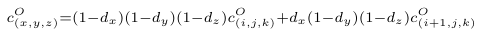
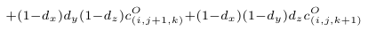
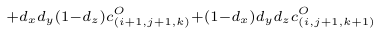
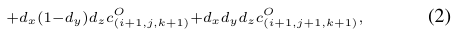
\[
\(c^{O}_{(x,y,z)}\)=\((1-d_{x})(1-d_{y})(1-d_{z})c^{O}_{(i,j,k)}+d_{x}(1-d_{y})(1-d_{z})c^{O}_{(i+1,j,k)}\)
+(1-d_{x})d_{y}(1-d_{z})c^{O}_{(i,j+1,k)}+(1-d_{x})(1-d_{y})d_{z}c^{O}_{(i,j,k +1)}\)
+d_{x}d_{y}(1-d_{x})c^{O}_{(i+1,j+1,k)}+(1-d_{x})d_{y}d_{z}c^{O}_{(i,j+1,k+1)}
+d_{x}(1-d_{y})d_{z}c^{O}_{(i+1,j,k+1)}+d_{x}d_{y}d_{z}c^{O}_{(i+1,j+1,k+1)}, \tag{2}
\]

# pdfput: 1 4 6acc95cd656f
#+begin_memo
（自動解説・要確認）
要約: 位置 (x,y,z) の出力 c^{O} を、格子点 (i,j,k) と (i+1,j,k) の値で x 方向に線形補間した式。
y と z の隣接格子点を含む、3 つ目と 4 つ目の補間項
y と z の両方で隣接した格子点を加える項
x, y, z のすべてで隣接した格子点 (i+1,j+1,k+1) を含む残りの二項

かみ砕くと: d_{x} が大きいほど (i+1,…) の寄与が増え、(1-d_{x}) が大きいほど (i,…) の寄与が増える。y と z の距離は (1-d_{y})(1-d_{z}) で重み付けされる

(1-d_{x})d_{y}(1-d_{z}) が (i,j+1,k) の重み、(1-d_{x})(1-d_{y})d_{z} が (i,j,k+1) の重みになる。d が大きいほどその方向の隣接点の寄与が大きくなる

d_{x}d_{y}(1-d_{z}) が (i+1,j+1,k) の重み、(1-d_{x})d_{y}d_{z} が (i,j+1,k+1) の重みになる。二つの軸で距離が大きいほどその格子点の影響が強くなる

d_{x}(1-d_{y})d_{z} が (i+1,j,k+1) の重み、d_{x}d_{y}d_{z} が (i+1,j+1,k+1) の重みになる。全ての d が 1 に近いほどこの最遠点の寄与が最大になる

記号:
- d_{x}, d_{y}, d_{z}: 各軸方向の小数部（0〜1）
- c^{O}_{(i,j,k)}: 格子点 (i,j,k) の出力値

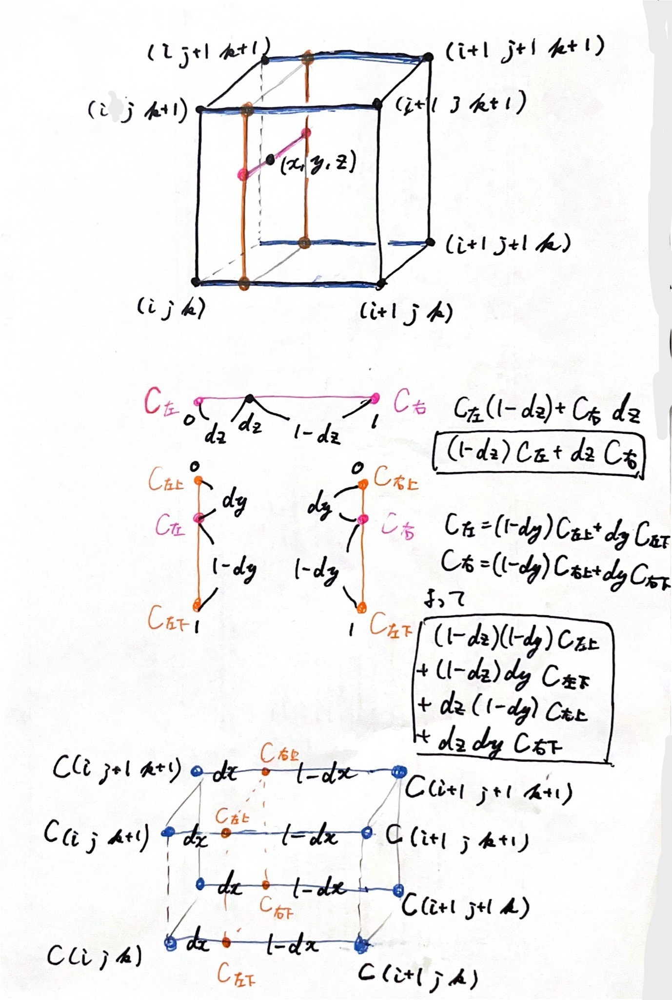
#+end_memo

***** 本文：三次元線形補間の微分
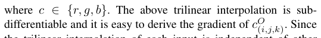
\[
where \(c\in\{r,g,b\}\). The above trilinear interpolation is subdifferentiable and it is easy to derive the gradient of \(c_{(i,j,k)}^{O}\). Since \(c_{(i,j,k)}^{O}\) is the \(c_{(i,j,k)}^{O}\).
\]
# pdfput: 1 4 6acc9725ccce
#+begin_memo
C は RGB のいずれか。
上記の三次元線形補間は床関数（ガウス記号）を用いているので通常の微分はできないが、劣微分は可能なので逆伝播できる。
#+end_memo
# pdfrect: 4 48.0 419.8 300.0 440.8
# pdfsent: [[[4,48.0,419.8,300.0,429.3],[4,48.0,431.3,294.5,440.8]]]
#+begin_en
the trilinear interpolation of each input is independent of other pixels, this transformation can be easily parallelized using GPU.
#+end_en
各入力の三線形補間は他のピクセルとは独立しているため、この変換は GPU を使用して容易に並列化できます。

*** 3.2 Learning image-adaptive 3D LUTs
:PROPERTIES:
:NOTER_PAGE: 4
:END:
***** 導入
# pdfrect: 4 48.0 474.5 300.0 564.8
# pdfsent: [[[4,48.0,474.5,300.0,484.0],[4,48.0,486.0,143.0,495.5]],[[4,143.0,486.0,300.0,495.5],[4,48.0,497.6,224.4,507.1]],[[4,224.4,497.6,300.0,507.1],[4,48.0,509.1,300.0,518.6],[4,48.0,520.7,117.8,530.2]],[[4,117.8,520.7,300.0,530.2],[4,48.0,532.2,300.0,541.7],[4,48.0,543.7,300.0,553.2],[4,48.0,555.3,184.4,564.8]]]
#+begin_en
The traditional 3D LUT based image enhancement methods have two major limitations. First, the 3D LUTs are mostly manually designed, which is cumbersome and costly. Second, one 3D LUT can only provide a fixed transformation, which is hard to adapt to different scenes. Though existing camera devices or image editing tools provide a set of preset LUTs which can be manually selected to achieve different enhancement effects, this solution is however not flexible and convenient enough.
#+end_en
従来の 3D LUT ベースの画像補正手法には、2つの大きな制約があります。1つ目は、3D LUT の設計がほとんど手作業で行われるため、手間とコストがかかることです。2つ目は、1つの 3D LUT では固定の変換しか提供できないため、さまざまなシーンへの対応が難しいことです。既存のカメラ機器や画像編集ツールには、さまざまな補正効果を実現するために手動で選択できるプリセット LUT が用意されていますが、この方法は柔軟性と利便性に欠けます。

***** 現状の課題：ハード投票方式の弱点
# pdfrect: 4 48.0 567.0 300.0 726.5
# pdfsent: [[[4,62.2,567.0,300.0,576.5],[4,48.0,578.5,120.6,588.0]],[[4,120.6,578.5,300.0,588.0],[4,48.0,590.1,300.0,599.6],[4,48.0,601.6,204.0,611.1]],[[4,204.0,601.6,300.0,611.1],[4,48.0,613.2,261.2,622.7]],[[4,261.2,613.2,300.0,622.7],[4,48.0,624.7,300.0,634.2],[4,48.0,636.2,300.0,645.7],[4,48.0,647.8,146.6,657.3]],[[4,146.6,647.8,300.0,657.3],[4,48.0,659.3,300.0,668.8],[4,48.0,670.9,167.8,680.4]],[[4,167.8,670.9,300.0,680.4],[4,48.0,681.8,208.0,691.9]],[[4,208.0,681.8,300.0,691.9],[4,48.0,693.2,203.3,704.2]],[[4,203.3,693.2,298.9,704.2],[4,48.0,704.8,257.4,715.7]],[[4,257.4,704.8,300.0,715.7],[4,48.0,717.0,223.6,726.5]]]
# pdfhl: yellow 0,1,2,3,4,5,6,7,8
#+begin_en
To address the first limitation, we choose to adopt the datadriven approach. For example, with a dataset which contains source and target images, we can learn one or multiple LUTs by optimizing some objective function. Once learned, those LUTs can be used to automatically enhance the given images. To address the second limitation, the model should be content-aware and adaptive to the input, and we propose to learn image-adaptive 3D LUTs to achieve this goal. An intuitive idea is to learn a classifier to perform scene classification, and then use different 3D LUTs to enhance different images. This strategy is adopted by many camera devices and image editing tools. Suppose that N 3D LUTs, denoted by {φn}n=1,...,N, are learned. The classifier outputs N probabilities {pn}n=1,...,N for scene classification. This 3D LUT selection process can be described as follows:
#+end_en
最初の制限に対処するため、データ駆動型アプローチを採用します。たとえば、ソース画像とターゲット画像を含むデータセットがあれば、何らかの目的関数を最適化することで、1つまたは複数の LUT を学習できます。学習された LUT は、与えられた画像を自動的に強調するために使用できます。2番目の制限に対処するため、モデルはコンテンツ認識型で入力に適応型である必要があり、この目標を達成するために画像適応型 3D LUT を学習することを提案します。直感的なアイデアは、シーン分類を実行する分類器を学習し、異なる 3D LUT を使用して異なる画像を強調することです。この戦略は、多くのカメラデバイスや画像編集ツールで採用されています。N個の 3D LUT（{φn}n=1,...,N で表される）が学習されたとします。分類器は、シーン分類のために N 個の確率{pn}n=1,...,N を出力します。この 3D LUT 選択プロセスは次のように説明できます。

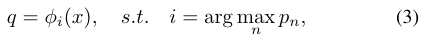
\[
\(q=\phi_{i}(x),\;\;s.t.\;\;i=\arg\max_{n}p_{n},\)
\]
# pdfput: 1 4 6acc9e09fb48
#+begin_memo
入力画像 x に対し、分類器が最も高い確率 p_i を出す LUT φ_i を選び、q=φ_i(x) とする。かみ砕くと: i は確率が最大のインデックスで、選ばれた LUT が画像を変換する。記号:
- \(q\): 変換後の画像
- \(\phi_i\): i 番目の 3D LUT
- \(x\): 入力画像
- \(p_n\): 各 LUT の確率
#+end_memo

# pdfrect: 4 312.0 156.6 564.0 270.6
# pdfsent: [[[4,312.0,156.6,551.4,166.7]],[[4,551.4,156.6,564.0,166.7],[4,312.0,168.8,502.9,178.3]],[[4,502.9,168.8,564.0,178.3],[4,312.0,180.3,564.0,189.8],[4,312.0,191.8,564.0,201.3],[4,312.0,203.4,332.0,212.9]],[[4,332.0,203.4,564.0,212.9],[4,312.0,214.9,564.0,224.4],[4,312.0,226.5,361.6,236.0]],[[4,361.6,226.5,564.0,236.0],[4,312.0,238.0,564.0,247.5]],[[4,312.0,249.5,564.0,259.0],[4,312.0,261.1,403.5,270.6]]]
# pdfhl: light green 1,2,3,4,5
#+begin_en
where x denotes an input image and q denotes the output. The above hard-voting strategy has several drawbacks. First of all, it is not easy to categorize the many possible scenes into a set of well-defined classes so that each class of images share the same LUT. Second, it requires a lot of 3D LUTs to cover a variety of scenes since each 3D LUT is independently used to enhance the input image. Third, the classifier is trained independently of the 3D LUTs so that the collaboration between them is not optimal. If the scene classification is incorrect, the selected 3D LUT may lead to very bad results.
#+end_en
ここで、x は入力画像、q は出力を表します。上記のハード投票戦略にはいくつかの欠点があります。まず、多数のシーンを、各クラスの画像が同じ LUT を共有するように明確に定義されたクラスのセットに分類するのは容易ではありません。次に、各 3D LUT は入力画像を強調するために独立して使用されるため、さまざまなシーンをカバーするには多数の 3D LUT が必要です。第三に、分類器は 3D LUT とは独立してトレーニングされるため、両者の連携は最適ではありません。シーンの分類が間違っている場合、選択された 3D LUT は非常に悪い結果につながる可能性があります。

***** 本文：基底 3DLUT（Basis 3D LUTs）の導入
# pdfrect: 4 312.0 272.6 564.0 328.3
# pdfsent: [[[4,326.3,272.6,564.0,282.1],[4,312.0,284.2,477.4,293.7]],[[4,477.4,284.2,564.0,293.7],[4,312.0,295.0,564.0,305.9],[4,312.0,306.7,517.5,316.8]],[[4,517.5,306.7,564.0,316.8],[4,312.0,318.2,517.1,328.3]]]
# pdfhl: sky blue 1
#+begin_en
In this work, we achieve image-adaptive 3D LUTs learning using a more effective and efficient way. We jointly learn a few basis 3D LUTs {φn}n=1,...,N together with a small CNN model f which predicts weights for the output of each LUT. For an input image x, the final enhancement output is obtained as:
#+end_en
本研究では、より効果的かつ効率的な方法を用いて、画像適応型 3D LUT 学習を実現します。少数の基底 3D LUT {φn}n=1,...,N を、各 LUT の出力の重みを予測する小型 CNN モデル f と共に学習します。入力画像 x に対して、最終的な強調出力は次のように得られます。
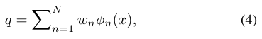

# pdfrect: 4 312.0 359.3 564.0 438.7
# pdfsent: [[[4,312.0,359.3,564.0,370.2],[4,312.0,371.5,415.3,381.0]],[[4,415.3,371.5,564.0,381.0],[4,312.0,382.5,564.0,392.6],[4,312.0,394.6,564.0,404.1],[4,312.0,406.1,356.0,415.6]],[[4,356.0,406.1,564.0,415.6],[4,312.0,417.7,564.0,427.2],[4,312.0,429.2,363.9,438.7]],[[4,363.9,429.2,449.1,438.7]]]
# pdfhl: sky blue 1,2,3
#+begin_en
where {wn}n=1,...,N = f(x) are the content-dependent weights output by the CNN model. Our design only needs several (e.g., N = 3) basis 3D LUTs to transform the input image and employs a soft-weighting strategy to achieve image content adaptive transformation. Furthermore, considering that pixels are transformed independently using trilinear interpolation in 3D LUTs, the operations in Eq. 4 can be simplified as:
#+end_en
ここで、{wn}n=1,...,N = f(x) は、CNN モデルによって出力されるコンテンツ依存の重みです。私たちの設計では、入力画像を変換するためにいくつかの (例えば、N = 3) 基底 3D LUT のみが必要であり、ソフト重み付け戦略を採用して画像コンテンツ適応変換を実現します。さらに、3D LUT では三線形補間を使用してピクセルが独立して変換されることを考慮すると、式 4 の操作は次のように簡略化できます。
# pdfput: 1 4 6accaacbc1e7
#+begin_memo
【用語解説】
- soft-weighting strategy（ソフト重み付け戦略）: 複数の基底 3DLUT に対して、CNN が出力した重み \({w_n}\) を用いて連続的に混合し、画像内容に応じた変換を実現する手法
   データを厳密に白黒つける（0か 1 か）のではなく、確率や連続的な数値（0〜1 の間）を用いて柔軟に影響度をコントロールするアプローチ

- content-dependent weights（コンテント依存重み）: 入力画像の内容に基づいて CNN が推定し、各基底 3DLUT に割り当てる重み \({w_n}\)

- image content adaptive transformation（画像コンテンツ適応変換）: 画像のシーンや色分布に応じて、重み付けされた基底 3DLUT を適用し、最適な色補正やトーンマッピングを行う変換プロセス
#+end_memo

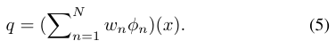
\[
q=(\sum_{n=1}^{N}w_{n}\phi_{n})(x). \tag{5}
\]
# pdfput: 1 4 6accab8f0adb
#+begin_memo
（自動解説・要確認）
要約: 複数の LUT を重み w_n で線形結合し、結合した関数を x に適用して q を得る。かみ砕くと: CNN が出す重みで各 LUT の寄与を調整し、一度の補間で変換できる。記号:
- \(q\): 出力画像
- \(w_n\): 内容依存重み
- \(\phi_n\): 基底 LUT
- \(x\): 入力画像
#+end_memo

# pdfrect: 4 312.0 469.4 564.0 525.1
# pdfsent: [[[4,312.0,469.4,564.0,478.9],[4,312.0,480.9,564.0,490.4],[4,312.0,492.5,373.0,502.0]],[[4,373.0,492.5,564.0,502.0],[4,312.0,504.0,477.4,513.5]],[[4,477.4,504.0,564.0,513.5],[4,312.0,515.6,501.4,525.1]]]
# pdfhl: sky blue 0
#+begin_en
That is, we can first fuse the multiple 3D LUTs into an imageadaptive 3D LUT, and then perform only one single trilinear interpolation. Such a design further improves the speed of our method to process high-resolution images. The objective function of our learning scheme can be written as follows:
#+end_en

つまり、複数の 3D LUT をまず画像適応型 3D LUT に融合し、その後、単一の三線形補間のみを実行すればよい。このような設計により、高解像度画像の処理速度がさらに向上する。学習スキームの目的関数は次のように表される。

***** 本文：損失関数
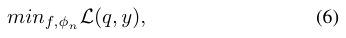
# pdfrect: 4 312.0 551.7 564.0 596.4
# pdfsent: [[[4,312.0,551.7,564.0,562.5],[4,312.0,563.1,564.0,573.3],[4,312.0,574.8,564.0,584.9],[4,312.0,586.9,424.8,596.4]]]
# pdfhl: sky blue 0
#+begin_en
where f and φn are the CNN model and basis 3D LUTs to be learned, L(q, y) denotes some loss functions (defined between the transformation output q and target y) and regularization terms which will be discussed later.
#+end_en
ここで、fとφn は学習する CNN モデルと基底 3D LUT であり、L(q, y)は（変換出力 q とターゲット y の間で定義される）損失関数と正則化項を表し、これについては後ほど説明します。

***** 本文：CNN
# pdfrect: 4 312.0 598.5 564.0 746.5
# pdfrect: 5 48.0 44.6 300.0 54.1
# pdfsent: [[[4,326.2,598.5,564.0,608.0],[4,312.0,610.0,564.0,619.5],[4,312.0,621.6,421.7,631.1]],[[4,421.7,621.6,564.0,631.1],[4,312.0,633.1,564.0,642.6],[4,312.0,644.7,393.3,654.2]],[[4,393.3,644.7,564.0,654.2],[4,312.0,655.5,564.0,665.7],[4,312.0,667.7,442.1,677.2]],[[4,442.1,667.7,564.0,677.2],[4,312.0,679.3,564.0,688.8],[4,312.0,690.8,564.0,700.3],[4,312.0,702.4,340.5,711.9]],[[4,340.5,702.4,564.0,711.9],[4,312.0,713.9,360.8,723.4]],[[4,360.8,713.9,564.0,723.4],[4,312.0,725.4,464.9,734.9]],[[4,464.9,725.4,564.0,734.9],[4,312.0,737.0,564.0,746.5],[5,48.0,44.6,155.4,54.1]],[[5,155.4,44.6,287.6,54.1]],[[5,287.6,44.6,300.0,54.1]]]
# pdfhl: sky blue 2
# pdfhl: sky blue 5,6,7
#+begin_en
The CNN weight predictor aims to understand the global context such as brightness, color and tones of the image to output content-dependent weights. Therefore, it only needs to work on the down-sampled version of the input image to largely save computational cost. Given an input image of any resolution, we simply use bilinear interpolation to downsample it to 256 × 256 resolution for high efficiency. We have evaluated more complex downsampling strategies such as bicubic downsampling and box filter downsampling but found little difference on the final performance. The detailed architecture of the CNN model is described in Table 1. It consists of 5 convolutional blocks, one dropout layer and one fully-connected layer. Each convolutional block contains a convolutional layer, a leaky ReLU [35] and an instance normalization [36] layer. The dropout rate is set to 0.5. The
#+end_en
CNN 重み予測器は、画像の明るさ、色、トーンなどのグローバルなコンテキストを理解して、コンテンツ依存の重みを出力することを目的としています。そのため、入力画像のダウンサンプリングされたバージョンのみを処理すればよく、計算コストを大幅に削減できます。任意の解像度の入力画像が与えられた場合、効率を高めるために、単純に双線形補間を使用して 256×256 の解像度にダウンサンプリングします。双三次ダウンサンプリングやボックスフィルタダウンサンプリングなどのより複雑なダウンサンプリング戦略を評価しましたが、最終的なパフォーマンスにはほとんど違いが見られませんでした。CNN モデルの詳細なアーキテクチャは表 1 に示されています。5つの畳み込みブロック、1つのドロップアウト層、および 1 つの全結合層で構成されています。各畳み込みブロックには、畳み込み層、リーキー ReLU [35]、およびインスタンス正規化 [36] 層が含まれています。ドロップアウト率は 0.5 に設定されています。

#+DOWNLOADED: /mnt/c/Users/light/OneDrive/Pictures/Screenshots/スクリーンショット 2026-10-12 185326.png @ 2026-10-12 18:54:09
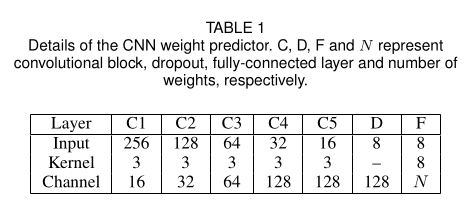
TABLE 1
# pdfput: 1 4 6accaf9c9e88
#+begin_memo
- C (Convolutional block - 畳み込み層) :: 特徴を抽出するフィルター（C1 から C5 まで 5 段階）
- D (Dropout - ドロップアウト) :: AI が丸暗記（過学習）してしまうのを防ぐために、一部の情報をわざとランダムに無視する層
- F (Fully-connected layer - 全結合層) :: 抽出した特徴をすべてまとめて、最終的な結論（重みの数値）を出す層
- $N$ (Number of weights - 重みの数) :: 最終的に出力される数字の数
   基底 LUT を 3 つブレンドするシステムなら、$N=3$ となり、3つの割合（例：0.7, 0.2, 0.1）が出力される
#+end_memo
| Layer   |  C1 |  C2 | C3 |  C4 |  C5 |   D | F |
|---------+-----+-----+----+-----+-----+-----+---|
| Input   | 256 | 128 | 64 |  32 |  16 |   8 | 8 |
| Kernel  |   3 |   3 |  3 |   3 |   3 |  – | 8 |
| Channel |  16 |  32 | 64 | 128 | 128 | 128 | N |

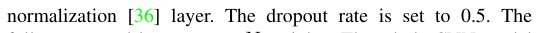

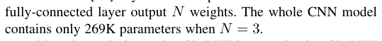
\[
fully-connected layer output \(N\) weights. The whole CNN model contains only 269K parameters when \(N=3\).
\]
#+begin_explain
（自動解説・要確認）
要約: 全結合層が N 個の重みを出力し、N=3 のときモデル全体は 269K パラメータしか持たない。かみ砕くと: 重みは LUT の組み合わせに使われ、モデルは軽量である。記号:
- \(N\): LUT の数
- 重み: 全結合層の出力
#+end_explain
# pdfrect: 5 48.0 79.3 300.0 123.4
# pdfsent: [[[5,62.2,79.3,300.0,88.8],[5,48.0,90.8,300.0,100.3],[5,48.0,102.4,300.0,111.9],[5,48.0,113.9,254.2,123.4]]]
#+begin_en
Although our design makes 3D LUT image-adaptive, 3D LUT itself cannot adapt to different local areas within an image, which may result in less satisfied local enhancement quality in some challenging cases, as will be discussed in Section 4.7.
#+end_en
私たちの設計では 3D LUT は画像適応型ですが、3D LUT 自体は画像内の異なる局所領域に適応できないため、セクション 4.7 で説明するように、一部の困難なケースでは局所的な強調品質が満足のいくものでなくなる可能性があります。

*** 3.3 Learning criteria
:PROPERTIES:
:NOTER_PAGE: 5
:END:
# pdfrect: 5 48.0 156.0 300.0 177.0
# pdfsent: [[[5,48.0,156.0,300.0,165.5],[5,48.0,167.5,221.0,177.0]],[[5,221.0,167.5,300.0,177.0]]]
#+begin_en
According to the given training data (e.g., paired or unpaired data), we can employ different loss functions in Eq. 6 to train our model.
#+end_en
与えられた訓練データ（例えば、ペアデータまたは非ペアデータ）に応じて、式 6 の異なる損失関数を使用してモデルを訓練することができます。

***** 本文：ペアワイズ学習では MSE 損失を使用
# pdfrect: 5 48.0 179.0 300.0 246.3
# pdfsent: [[[5,62.2,179.0,138.8,188.6]],[[5,138.8,179.0,300.0,188.6],[5,48.0,190.7,300.0,200.2],[5,48.0,202.2,300.0,211.7],[5,48.0,213.2,122.8,223.2]],[[5,122.8,213.2,300.0,223.2],[5,48.0,224.6,300.0,236.3],[5,48.0,236.8,126.5,246.3]],[[5,126.5,236.8,300.0,246.3]]]
#+begin_en
Pairwise learning. When a set of input images and their corresponding (human annotated) groundtruth images are available, one can simply use supervised learning methods to learn the photo enhancement model. Suppose that there are a number of T training pairs {xt, yt}t=1,2,...,T , where xt and yt denote a pair of input and target images. We simply employ the MSE loss to train the
#+end_en
ペアワイズ学習。入力画像とその対応する（人間が注釈を付けた）正解画像のセットが利用可能な場合、教師あり学習法を使用して写真強調モデルを学習できます。入力画像とターゲット画像のペアを xt と yt とすると、T 個のトレーニングペア {xt, yt}t=1,2,...,T があるとします。MSE 損失を使用して、

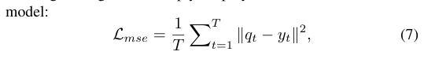

\[
{\cal L}_{mse}=\frac{1}{T}\sum^{T}_{t=1}\|q_{t}-y_{t}\|^{2}, \tag{7}
\]
#+begin_explain
（自動解説・要確認）
要約: 入力 x_t から得た出力 q_t と正解 y_t の二乗誤差を T 件で平均した MSE 損失。
かみ砕くと: 各画像ペアのピクセル差を二乗し、全体の平均を取るだけ。値が小さいほどモデルは正解に近い。
記号:
- T: 訓練ペア数
- q_t: モデル出力
- y_t: 正解画像
- \|·\|: L2 ノルム
#+end_explain

# pdfrect: 5 48.0 281.8 300.0 315.0
# pdfsent: [[[5,48.0,281.8,164.3,292.6]],[[5,164.3,281.8,241.8,292.6]],[[5,241.8,281.8,300.0,292.6],[5,48.0,293.4,300.0,304.2],[5,48.0,305.5,116.8,315.0]],[[5,116.8,305.5,281.2,315.0]]]
# pdfhl: sky blue 2,3
#+begin_en
where qt is the output of Eq. 5 with xt as input. Note that other pairwise loss functions such as the L1 loss or color difference loss can also be used. We choose MSE loss just for its simplicity.
#+end_en

ここで、qt は式 5 の出力であり、入力は xt です。L1 損失や色差損失など、他のペアワイズ損失関数も使用できることに注意してください。ここでは、その簡便さから MSE 損失を選択しました。

***** 本文：非ペア学習では GAN 損失を使用
# pdfrect: 5 48.0 317.0 300.0 488.2
# pdfsent: [[[5,62.2,317.0,145.9,326.6]],[[5,145.9,317.0,300.0,326.6],[5,48.0,328.7,300.0,338.2],[5,48.0,340.2,300.0,349.7]],[[5,48.0,351.7,300.0,361.2],[5,48.0,363.3,300.0,372.8],[5,48.0,374.8,291.5,384.3]],[[5,291.5,374.8,300.0,384.3],[5,48.0,386.4,300.0,395.9],[5,48.0,397.9,164.0,407.4]],[[5,164.0,397.9,300.0,407.4],[5,48.0,409.4,300.0,418.9],[5,48.0,420.4,156.6,430.5]],[[5,156.6,420.4,300.0,430.5],[5,48.0,431.9,165.9,442.0]],[[5,165.9,431.9,300.0,442.0],[5,48.0,444.1,300.0,453.6],[5,48.0,455.6,300.0,465.1],[5,48.0,467.1,300.0,476.6],[5,48.0,478.7,109.0,488.2]]]
# pdfhl: yellow 2
# pdfhl: gray 4,5,6
#+begin_en
Unpaired learning. Though pairwise learning is easy to implement and tends to generate good enhancement results, the collection of pairwise data may be expensive or very difficult. Unsupervised learning of deep models using unpaired data has become increasingly popular recently, owing to the rapid development of Generative Adversarial Networks (GAN) [37]. By using the GAN loss, we can also learn photo enhancement models with unpaired training data. In such case, the multiple 3D LUTs together with the CNN weight predictor can be viewed as the Generator, denoted by G. One more CNN is introduced as the discriminator, denoted by D. In our experiment, D has the same architecture as the CNN weight predictor (refer to Section 3.2) with only two minor changes: the instance normalization and dropout layers are removed and the output dimension of the FC layer is set to 1.
#+end_en

ペア学習ではない学習。ペア学習は実装が容易で、良好な強調結果を生み出す傾向がありますが、ペアデータの収集は高価であったり、非常に困難であったりする場合があります。近年、生成敵対ネットワーク（GAN）[37]の急速な発展により、ペアデータではないデータを使用した深層モデルの教師なし学習がますます人気を集めています。GAN 損失を使用することで、ペアではないトレーニングデータを使用して写真強調モデルを学習することもできます。この場合、複数の 3D LUT と CNN 重み予測器をジェネレーターと見なすことができ、Gと表記します。もう 1 つの CNN を識別器として導入し、Dと表記します。私たちの実験では、Dは CNN 重み予測器と同じアーキテクチャ（セクション 3.2 を参照）を持ち、インスタンス正規化層とドロップアウト層を削除し、FC 層（全結合層）の出力次元を 1 に設定するという 2 つの小さな変更のみがあります。
#+begin_ai
【身近な例え】
- 例え: 写真強調モデルの学習を、料理を作るシェフと料理を評価する審査員に例えることができる。シェフは「複数の 3D LUT と CNN 重み予測器」からなるジェネレーター \(G\) として、材料（LUT）を組み合わせ味付け（CNN 重み予測）を調整し、見た目や味が良い料理（強調された写真）を作り出す。審査員は識別器 \(D\) として、シェフが作った料理が本物か人工的に作られたものかを判定し、出力は「1 次元のスコア（ただの数値のみ）」だけになるように設計されている。
#+end_ai

******* G(Generator)の損失関数
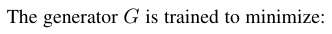
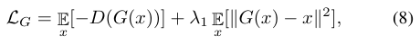

\[
\mathcal{L}_{G}=\mathbb{E}[-D(G(x))]+\lambda_{1}\,\mathbb{E}[\|G(x)-x\|^{2}], \tag{8}
\]
# pdfput: 1 5 6accbc0fca50
#+begin_memo
生成器 G の損失は敵対的項と再構成項の和で構成される。

かみ砕くと: -D(G(x)) は G が判別器 D を騙す度合い、
\|G(x)-x\|^2 は出力と入力の内容一致度を測り、λ1 で重み付けする。

「騙して、でも元画像から離れすぎないで」という命令と捉えられる。
#+end_memo

# pdfrect: 5 48.0 530.2 300.0 586.6
# pdfsent: [[[5,48.0,530.2,300.0,540.4],[5,48.0,540.6,300.0,552.0],[5,48.0,553.4,270.6,564.2]],[[5,270.6,553.4,300.0,564.2],[5,48.0,565.5,228.0,575.0]],[[5,228.0,565.5,300.0,575.0],[5,48.0,577.1,153.1,586.6]]]
# pdfhl: gray 2
#+begin_en
where the term −D(G(x)) enforces the generator G to fool the discriminator D, and the term ∥G(x)−x∥2 ensures that the output image preserves the same content as the input image. λ1 is a constant parameter to balance the two terms. We set it as 1,000 following the setting in [7].
#+end_en
ここで、項 −D(G(x)) は生成器 G が識別器 D を欺くように強制し、項 ∥G(x)−x∥2 は出力画像が入力画像と同じ内容を保持することを保証します。λ1 は、2 つの項のバランスをとるための定数パラメータです。[7] の設定に従って、λ1 を 1,000 に設定します。

******* D(判別器)の損失関数
# pdfrect: 5 62.2 588.7 219.6 598.2
# pdfsent: [[[5,62.2,588.7,219.6,598.2]]]
#+begin_en
The discriminator is trained to minimize:
#+end_en
判別器は以下を最小限に抑えるように訓練されています。
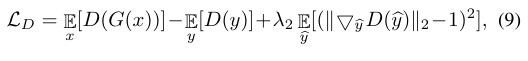
\[
\mathcal{L}_{D}=\underset{x}{\mathbb{E}}[D(G(x))]-\underset{y}{\mathbb{E}}[D(y)]+ \lambda_{2}\underset{\widehat{y}}{\mathbb{E}}[(\|\bigtriangledown_{\widehat{y}}D( \widehat{y})\|_{2}-1)^{2}], \tag{9}
\]
#+begin_explain
（自動解説・要確認）
要約: 判別器 D の損失は標準 GAN 損失に勾配ペナルティを加えたもの。
かみ砕くと: D は生成画像を低く、実画像を高く評価し、\|∇_{\hat y}D(\hat y)\| を 1 に保つ罰則で学習を安定させる。λ2=10 が重み。
#+end_explain
# pdfrect: 5 48.0 630.5 300.0 697.7
# pdfsent: [[[5,48.0,630.5,300.0,640.0],[5,48.0,642.0,300.0,651.5],[5,48.0,653.0,300.0,669.7],[5,48.0,665.1,300.0,674.6]],[[5,48.0,676.1,300.0,686.9],[5,48.0,688.2,126.1,697.7]],[[5,126.1,688.2,207.8,697.7]]]
#+begin_en
where the first two terms are the standard discriminator losses, the third term is the gradient penalty proposed in [38] to stabilize the training process, and by is an example linearly interpolated by a pair of points from the generator distribution and target distribution. Parameter λ2 is fixed as 10 throughout our experiments following the setting in [38]. The final GAN loss is:
#+end_en
ここで、最初の 2 つの項は標準的な識別器の損失であり、3 番目の項はトレーニング プロセスを安定させるために [38] で提案された勾配ペナルティであり、 は生成器分布とターゲット分布からの点のペアによって線形補間された例です。パラメータ λ2 は [38] の設定に従って、実験全体を通して 10 に固定されています。最終的な GAN 損失は次のとおりです。

#+begin_ai
【やさしく言い換え】
- 最初の 2 つの項は、普通に使われる判別器（ディスクリミネータ）の損失です。
- 3 つ目の項は、[38] で提案された「勾配ペナルティ」で、学習が安定するように働きます。
- 「by」は、生成器が作り出す分布と目標とする分布からそれぞれ 1 点ずつ取り、直線でつないで作った中間の例です。
- パラメータ λ₂ は、[38] の設定に合わせて実験全体で 10 に固定しています。
- これらを合わせたものが最終的な GAN の損失式です。

【身近な例え】
- 判別器の損失は、まず「普通のテストの点数付け（標準的な識別器損失）」が 2 つあり、これは生成された画像と本物の画像をそれぞれ正しく判別できているかを測るものです。
- そこに「急に点数が変わりすぎないようにする罰則（勾配ペナルティ）」が加わります。これは、判別器が入力に対して極端に急な変化を示さないようにし、学習を安定させる役割です。
- 罰則を計算するときに使う「y」は、生成器が作った画像と本物の画像という 2 点を直線で結んで途中の点を取ったものです。つまり、2つの画像を「ちょうど中間の色」に混ぜ合わせたような位置をサンプリングしています。
- この罰則の重み λ₂ は実験全体で一定に保たれ、値は 10 に固定されています。

※例えで「色を混ぜる」ことは高次元のデータ空間での線形補間を完全に表しているわけではありません。
#+end_ai

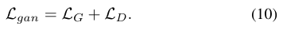
# pdfrect: 5 48.0 725.4 300.0 746.5
# pdfsent: [[[5,48.0,725.4,300.0,734.9],[5,48.0,737.0,142.1,746.5]]]
#+begin_en
The generator and discriminator are iteratively optimized at equal pace in our experiments.
#+end_en
我々の実験では、ジェネレーターとディスクリミネーターは同じペースで反復的に最適化される。

*** 3.4 Regularization
:PROPERTIES:
:NOTER_PAGE: 5
:END:
***** 本文：平滑化正規化
# pdfrect: 5 312.0 58.8 564.0 184.4
# pdfsent: [[[5,312.0,58.8,564.0,69.7],[5,312.0,71.0,564.0,80.5],[5,312.0,82.5,510.9,92.0]],[[5,510.9,82.5,564.0,92.0],[5,312.0,94.1,564.0,103.6],[5,312.0,105.6,332.0,115.1]],[[5,332.0,105.6,552.0,115.1]],[[5,552.0,105.6,564.0,115.1],[5,312.0,117.2,564.0,126.7],[5,312.0,128.7,564.0,138.2],[5,312.0,140.2,564.0,149.7],[5,312.0,151.8,418.9,161.3]],[[5,418.9,151.8,502.9,161.3]],[[5,502.9,151.8,564.0,161.3],[5,312.0,163.3,564.0,172.8],[5,312.0,174.9,496.9,184.4]]]
# pdfhl: sky blue 1,2,3,4,5
#+begin_en
Using the Lmse loss or the Lgan loss, we can train the 3D LUTs and CNN weight predictor using gradient descent algorithms such as SGD with momentum [39] or Adam [40]. However, the optimized 3D LUTs may have unsmooth surfaces (please refer to Fig. 4(a) for some visualized examples of learned 3D LUTs). The abrupt color changes in neighboring lattices of the 3D LUT may amplify the color difference after color transformation, causing some banding artifacts [41] in smooth areas of the enhanced image (please refer to Fig. 5(a) for an example). In order to make the learned 3D LUTs more stable and robust, we introduce two regularization terms to the optimization process.
#+end_en
Lmse 損失または Lgan 損失を使用すると、モーメンタム付き SGD [39] や Adam [40] などの勾配降下アルゴリズムを使用して 3D LUT と CNN 重み予測器をトレーニングできます。ただし、最適化された 3D LUT は滑らかでない表面を持つ可能性があります (学習された 3D LUT の視覚化された例については、図 4(a) を参照してください)。3D LUT の隣接する格子の急激な色の変化は、色変換後に色差を増幅し、強調された画像の滑らかな領域にバンディング アーティファクト [41] を引き起こす可能性があります (例については、図 5(a) を参照してください)。学習された 3D LUT xx をより安定して堅牢にするために、最適化プロセスに 2 つの正則化項を導入します。
#+begin_ai
【用語解説】
- SGD x(確率的勾配降下法): 目的関数の勾配をミニバッチ単位で計算し、パラメータを逐次更新する基本的な最適化手法です。（資料に記載なし、一般知識）
- Momentum (モーメンタム): 前回の更新方向を加味して現在のパラメータ更新に加えることで、振動を抑えつつ収束速度を向上させる手法です。（資料に記載なし、一般知識）
#+end_ai

Fig. 4(a)
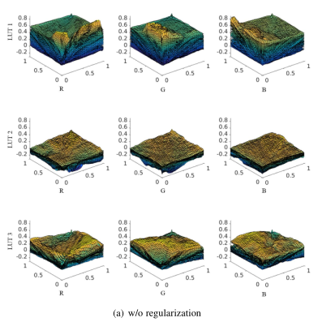

# pdfrect: 5 312.0 186.4 564.0 265.2
# pdfsent: [[[5,326.3,186.4,418.9,196.0]],[[5,418.9,186.4,564.0,196.0],[5,312.0,198.0,564.0,207.5],[5,312.0,209.6,564.0,219.1],[5,312.0,221.1,372.2,230.6]],[[5,372.2,221.1,564.0,230.6],[5,312.0,232.7,495.3,242.2]],[[5,495.3,232.7,564.0,242.2],[5,312.0,244.2,564.0,253.7],[5,312.0,255.7,378.3,265.2]]]
# pdfhl: sky blue 2,3
#+begin_en
Smooth regularization. In order to stably convert the input RGB values into the desired color space without generating much artifacts, the output RGB values of the 3D LUTs should be locally smooth. The total variation (TV) [42] is a classical smooth regularization technique for image restoration. Inspired by TV, we propose a 3D smooth regularization term on the learning of 3D LUTs as follows:
#+end_en

平滑化正則化。入力 RGB 値をアーティファクトをほとんど発生させずに目的の色空間に安定的に変換するには、3D LUT の出力 RGB 値は局所的に平滑である必要があります。全変動（TV）[42]は、画像復元のための古典的な平滑化正則化手法です。TV に触発され、3D LUT の学習における 3D 平滑化正則化項を以下のように提案します。
# pdfput: 1 5 6accc244f259
#+begin_memo
【用語解説】
- Total Variation (全変動): 画像復元などで用いられる平滑化正則化手法で、隣接画素間の差分の絶対値総和を最小化し、ノイズ除去やアーティファクト抑制を行う。
#+end_memo

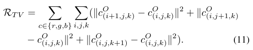
\[
\begin{aligned}
\mathcal{R}_{TV} =\sum_{c\in\{r,g,b\}}\sum_{i,j,k}(\left\|c^{O}_{(i+1,j,k)}-c^{O}_{(i,j,k)}\right\|^{2}+\left\|c^{O}_{(i,j+1,k)}\right. \\
-\left.c^{O}_{(i,j,k)}\right\|^{2}+\left\|c^{O}_{(i,j,k+1)}-c^{O}_ {(i,j,k)}\right\|^{2}). \tag{11}
\end{aligned}
\]
# pdfput: 1 5 6accc2df6b9c
#+begin_memo
要約: 3D LUT の出力 RGB を隣接点との差の二乗和で平滑化する総変動 (TV) 正則化項。
かみ砕くと: 各色チャネル r,g,b について、格子点 (i,j,k) の隣接する 3 方向 (i+1, j, k)、(i, j+1, k)、(i, j, k+1) の出力値差を二乗し、全点で合計することで急激な変化を抑える。
記号:
- \(c^{O}_{(i,j,k)}\): 3D LUT の出力 RGB の成分 c（r,g,b）
- \(\mathcal{R}_{TV}\): TV 正則化項
#+end_memo

# pdfrect: 5 312.0 318.9 564.0 340.6
# pdfsent: [[[5,312.0,318.9,564.0,330.5],[5,312.0,331.1,466.4,340.6]]]
# pdfhl: sky blue 0
#+begin_en
We choose the L2 distance rather than the L1 distance in the above term to achieve smoother regularization.
#+end_en

より滑らかな正則化を実現するために、上記の項では L1 距離ではなく L2 距離を選択します。

# pdfrect: 5 312.0 342.7 564.0 409.9
# pdfsent: [[[5,326.3,342.7,564.0,352.2],[5,312.0,353.7,564.0,365.2],[5,312.0,365.2,440.1,376.0]],[[5,440.1,365.2,564.0,376.0],[5,312.0,377.3,564.0,386.8],[5,312.0,388.9,456.6,398.4]],[[5,456.6,388.9,564.0,398.4],[5,312.0,400.4,411.1,409.9]]]
# pdfhl: sky blue 0
#+begin_en
In addition to the 3D LUTs themselves, the content-dependent weights wn predicted by the CNN are also important to our imageadaptive LUT learning scheme. We thus introduce the L2-norm regularization on the predicted weights to improve the smoothness of the adaptively weighted 3D LUT. The overall smooth regularization term is as follows:
#+end_en

3D LUT 自体に加えて、CNN によって予測されるコンテンツ依存の重み wn も、画像適応型 LUT 学習スキームにとって重要です。そこで、予測された重みに L2 ノルム正則化を導入し、適応的に重み付けされた 3D LUT の滑らかさを向上させます。全体的な平滑化正則化項は次のとおりです。

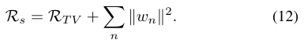
\[
\mathcal{R}_{s}=\mathcal{R}_{TV}+\sum_{n}\|w_{n}\|^{2}. \tag{12}
\]
#+begin_explain
（自動解説・要確認）
要約: TV 正則化に加えて、CNN が予測する重み \(w_n\) の L2 ノルムを罰則として加えた総平滑正則化項。
かみ砕くと: 3D LUT の滑らかさを保つ TV 項に、各重みベクトルの大きさの二乗和 \(\sum_n\|w_n\|^2\) を足すことで、重みが極端に大きくなるのを防ぎ、全体の平滑性を高める。
記号:
- \(w_n\): CNN が予測するコンテンツ依存重み
- \(\mathcal{R}_{s}\): 平滑正則化全体
#+end_explain

***** 本文：単調性正規化
# pdfrect: 5 312.0 444.6 564.0 558.0
# pdfsent: [[[5,326.3,444.6,449.4,454.2]],[[5,449.4,444.6,564.0,454.2],[5,312.0,456.2,564.0,465.7],[5,312.0,467.7,335.3,477.2]],[[5,335.3,467.7,564.0,477.2],[5,312.0,479.3,564.0,488.8],[5,312.0,490.8,390.7,500.3]],[[5,390.7,490.8,564.0,500.3],[5,312.0,502.4,485.0,511.9]],[[5,485.0,502.4,564.0,511.9],[5,312.0,513.9,564.0,523.4],[5,312.0,525.4,564.0,534.9],[5,312.0,537.0,416.3,546.5]],[[5,416.3,537.0,564.0,546.5],[5,312.0,548.5,490.1,558.0]]]
# pdfhl: sky blue 0,1,2
#+begin_en
Monotonicity regularization. Apart from smoothness, monotonicity is another property 3D LUTs should possess for two reasons. First, a monotonic transformation can preserve the relative brightness and saturation of input RGB values, ensuring natural enhancement result. Second, in practice the training data may be insufficient to cover the entire color space. Ensuring monotonicity can help to update the parameters that may not be activated by input RGB values, improving the generalization capability of the learned 3D LUTs. We therefore design a monotonicity regularization on 3D LUT learning as follows:
#+end_en

単調性正則化。滑らかさに加えて、単調性は 3D LUT が備えるべきもう 1 つの特性です。理由は 2 つあります。1つ目は、単調変換によって入力 RGB 値の相対的な明るさと彩度が維持され、自然な強調結果が得られるからです。2つ目は、実際にはトレーニングデータがカラースペース全体をカバーするのに不十分な場合があるからです。単調性を確保することで、入力 RGB 値によって活性化されない可能性のあるパラメータを更新でき、学習された 3D LUT の汎化能力を向上させることができます。そこで、3D LUT 学習における単調性正則化を以下のように設計します。

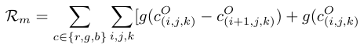
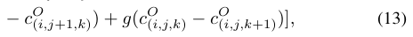
\[
\(\mathcal{R}_{m}=\sum_{c\in\{r,g,b\}}\sum_{i,j,k}[g(c^{O}_{(i,j,k)}-c^{O}_{(i+1,j,k)}) +g(c^{O}_{(i,j,k)})
-C_{(i,j+1,k)}^{O})+g(c_{(i,j,k)}^{O}-c_{(i,j,k+1)}^{O})],\) (13)
\]
#+begin_explain
（自動解説・要確認）
モノトニック性を促す正則化項で、隣接格子点間の出力差に関数 \(g\) を適用して合計する式。
かみ砕くと: 各色チャネルについて、格子点 (i,j,k) とその隣接点 (i+1,j,k) の出力差に関数 \(g\) を適用した項を足し合わせた完全なモノトニック正則化式 (13)。

かみ砕くと: 各格子点の差に対して \(g\) を適用し、合計することで、3D LUT の出力が各軸方向に単調になるよう罰則を課す。

記号:
- \(g(\cdot)\): 差分に対して単調性を評価する関数（文脈からは具体的内容不明）
 - \(\mathcal{R}_{m}\): モノトニック正則化項

- \(C_{(i,j+1,k)}^{O}\): 出力 RGB の成分（文脈からは c と同等と推測）
- \(g\): 単調性を測る関数（詳細不明）
#+end_explain

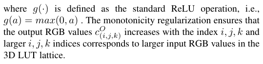
\[
where \(g(\cdot)\) is defined as the standard ReLU operation, i.e., \(g(a)=max(0,a)\). The monotonicity regularization ensures that the output RGB values \(c_{(i,j,k)}^{O}\) increases with the index \(i,j,k\) and larger \(i,j,k\) indices corresponds to larger input RGB values in the 3D LUT lattice.
\]
#+begin_explain
（自動解説・要確認）
要約: ReLU 関数 g を用いた単調性正則化は、3D LUT の格子インデックス (i,j,k) が大きくなるほど出力 RGB \(c_{(i,j,k)}^{O}\) が増加するように制約する。
かみ砕くと: g(a)=max(0,a) により負の変化を遮断し、インデックスが上がると明るさが上がることを保証する。

値がマイナス（基準ー大きい方がマイナスで正常）のときは０、値がプラス（基準ー大きい方がプラスで異常）のときはその差を出力する。
記号:
- \(g(\cdot)\): 標準 ReLU, \(g(a)=\max(0,a)\)
- \(c_{(i,j,k)}^{O}\): 出力 RGB 値、インデックス (i,j,k) に対応
#+end_explain

*** 3.5 Final training losses and implementation
:PROPERTIES:
:NOTER_PAGE: 5
:END:
***** 本文：損失関数の式（決定）
# pdfrect: 5 312.0 701.9 564.0 722.9
# pdfsent: [[[5,312.0,701.9,564.0,711.4],[5,312.0,713.4,564.0,722.9]]]
#+begin_en
By incorporating the two regularization terms, the final loss functions used in paired learning and unpaired learning are as
#+end_en
2 つの正則化項を組み込むことで、
ペア学習と非ペア学習で使用される最終的な損失関数は次のようになります。
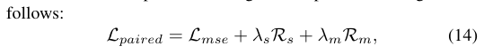

\[
{\cal L}_{paired}={\cal L}_{mse}+\lambda_{s}{\cal R}_{s}+\lambda_{m}{\cal R}_{m}, \tag{14}
\]
#+begin_explain
（自動解説・要確認）
要約: ペア学習の総損失は、MSE 損失に滑らかさ正則化 \({\cal R}_{s}\) と単調性正則化 \({\cal R}_{m}\) をそれぞれ重み \(\lambda_{s},\lambda_{m}\) で加えたもの。
かみ砕くと: 基本の誤差測定に加えて、色変換が滑らかで単調になるように罰則を入れ、λ がその影響度を調整する。
記号:
- \({\cal L}_{paired}\): ペア学習の総損失
- \({\cal L}_{mse}\): 平均二乗誤差
- \({\cal R}_{s}\): 滑らかさ正則化項
- \({\cal R}_{m}\): 単調性正則化項
- \(\lambda_{s},\lambda_{m}\): 重み係数
#+end_explain
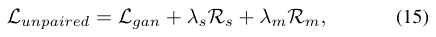
\[
\mathcal{L}_{gap}=\mathcal{L}_{gap}+\lambda_{s}\mathcal{R}_{s}+\lambda_{m} \mathcal{R}_{m},
\]
#+begin_explain
（自動解説・要確認）
要約: ギャップ損失 \(\mathcal{L}_{gap}\) も同様に、滑らかさと単調性の正則化項を重み付けして加える形で定義されている。
かみ砕くと: 基本のギャップ損失に対し、\(\lambda_{s}{\cal R}_{s}\) と \(\lambda_{m}{\cal R}_{m}\) を足すことで、学習が滑らかで単調になるように誘導する。
記号:
- \(\mathcal{L}_{gap}\): ギャップ損失
- \({\cal R}_{s},{\cal R}_{m},\lambda_{s},\lambda_{m}\): 前式と同義
#+end_explain

***** 本文：正規化項の重み
# pdfrect: 6 48.0 64.9 300.0 109.6
# pdfsent: [[[6,48.0,64.9,300.0,75.7],[6,48.0,77.1,300.0,86.6],[6,48.0,88.0,106.8,98.8]],[[6,106.8,88.0,300.0,98.8],[6,48.0,100.1,115.2,109.6]]]
# pdfhl: sky blue 0,1
#+begin_en
where the two constant parameters λs and λm are used to control the effects of the smooth and monotonicity regularization terms, respectively. We emperically set λs = 0.0001 and λm = 10 via an ablation study.
#+end_en
ここで、2つの定数パラメータλs とλm は、それぞれ平滑化項と単調性正則化項の効果を制御するために使用されます。アブレーションスタディを通して、λs = 0.0001、λm = 10 と経験的に設定しました。

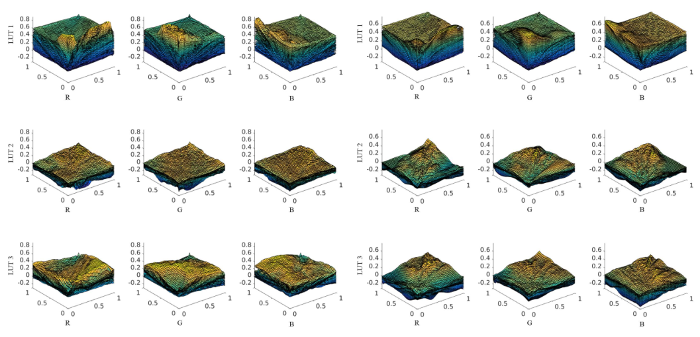

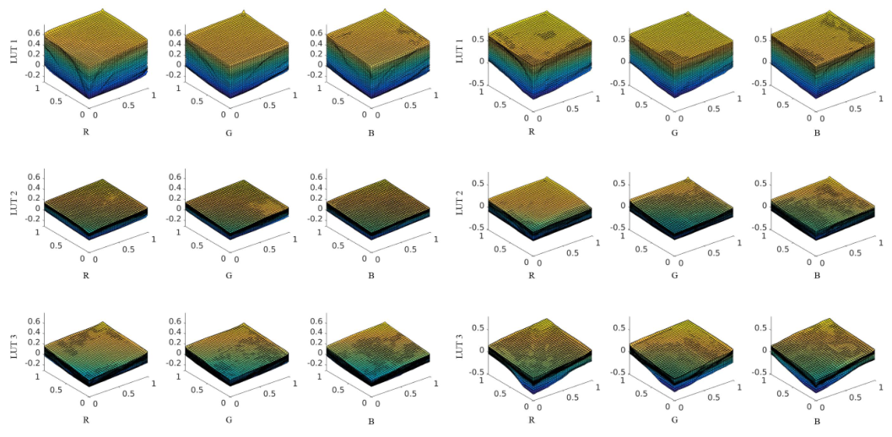
#+begin_en
Fig. 4. Visualization of each of the R, G, B channels of the three basis 3D LUTs learned (a) without regularization, (b) with only smooth regularization, (c) with only monotonicity regularization and (d) with both smooth and monotonicity regularization.
#+end_en
図 4. 学習した 3 つの基本 3D LUT の R、G、B チャネルそれぞれの可視化。(a) 正則化なし、(b) 平滑化正則化のみ、(c) 単調性正則化のみ、(d) 平滑化と単調性正則化の両方。

***** 本文：学習時の設定
# pdfrect: 6 48.0 112.3 300.0 294.9
# pdfsent: [[[6,62.2,112.3,258.3,121.8]],[[6,258.3,112.3,300.0,121.8],[6,48.0,123.8,300.0,133.3],[6,48.0,135.4,114.1,144.9]],[[6,114.1,135.4,300.0,144.9],[6,48.0,146.9,228.6,156.4]],[[6,228.6,146.9,300.0,156.4],[6,48.0,157.7,300.0,167.9],[6,48.0,170.0,236.0,179.5]],[[6,236.0,170.0,300.0,179.5],[6,48.0,181.5,300.0,191.0],[6,48.0,193.1,300.0,202.6],[6,48.0,204.0,253.7,214.1]],[[6,253.7,204.0,298.9,214.1],[6,48.0,216.1,300.0,225.6],[6,48.0,227.7,242.7,237.2]],[[6,242.7,227.7,300.0,237.2],[6,48.0,239.2,300.0,248.7],[6,48.0,250.8,102.8,260.3]],[[6,102.8,250.8,300.0,260.3],[6,48.0,262.3,300.0,271.8],[6,48.0,273.8,111.0,283.3]],[[6,111.0,273.8,300.0,283.3],[6,48.0,285.4,180.8,294.9]]]
# pdfhl: sky blue 2,3,4,5,6
#+begin_en
We implement our method based on PyTorch [43]. The trilinear interpolation of 3D LUT is parallelized via a CUDA parallel implementation. The standard Adam [40] optimizer with default parameters is employed to train our model. The batch size is set to 1 and the learning rate is fixed at 1e−4 and 2e−4 for paired and unpaired experiments, respectively. We randomly crop image patches with scale in the range [0.6,1.0], horizontally flip input/target image pairs, slightly adjust the brightness and saturation of input images for data augmentation. Among the N 3D LUTs to be learned, the first one is initialized as an identity map while the others are initialized as zero maps. The bias of the FC layer is set to 1 which makes the initially predicted weight approach to 1. Such an initialization ensures that the initial output of our model is not far away from the input and thus increases the training speed. The other parameters of the CNN weight predictor are randomly initialized as in [44].
#+end_en

我々は、PyTorch [43] に基づいて手法を実装します。3D LUT の三線形補間は、CUDA 並列実装によって並列化されます。モデルのトレーニングには、デフォルト パラメータの標準 Adam [40] オプティマイザを使用します。バッチ サイズは 1 に設定され、学習率はペア実験と非ペア実験でそれぞれ 1e−4 と 2e−4 に固定されます。我々は、スケールが [0.6,1.0] の範囲で画像パッチをランダムに切り抜き、入力/ターゲット画像ペアを水平に反転し、データ拡張のために入力画像の明るさと彩度をわずかに調整します。学習する N 個の 3D LUT のうち、最初の LUT は恒等マップとして初期化され、残りはゼロ マップとして初期化されます。FC 層のバイアスは 1 に設定され、初期予測重みが 1 に近づきます。このような初期化により、モデルの初期出力が入力から大きく離れることがなくなり、トレーニング速度が向上します。 CNN 重み予測器の他のパラメータは、[44]と同様にランダムに初期化されます。

** 4 EXPERIMENTS
:PROPERTIES:
:NOTER_PAGE: 6
:END:
*** 4.1 Experimental setup
:PROPERTIES:
:NOTER_PAGE: 6
:END:
***** 本文：データセット
# pdfrect: 6 48.0 354.8 300.0 549.1
# pdfsent: [[[6,48.0,354.8,90.7,364.4]],[[6,90.7,354.8,300.0,364.4],[6,48.0,366.5,160.5,376.0]],[[6,160.5,366.5,300.0,376.0],[6,48.0,378.0,300.0,387.5],[6,48.0,389.6,143.0,399.1]],[[6,143.0,389.6,300.0,399.1],[6,48.0,401.1,262.2,410.6]],[[6,262.2,401.1,300.0,410.6],[6,48.0,412.6,300.0,422.1],[6,48.0,424.2,287.4,433.7]],[[6,287.4,424.2,300.0,433.7],[6,48.0,435.7,300.0,445.2],[6,48.0,447.3,300.0,456.8],[6,48.0,458.8,212.0,468.3]],[[6,212.0,458.8,300.0,468.3],[6,48.0,470.3,291.9,479.8]],[[6,291.9,470.3,300.0,479.8],[6,48.0,481.9,300.0,491.4],[6,48.0,493.4,183.7,502.9]],[[6,183.7,493.4,300.0,502.9],[6,48.0,505.0,300.0,514.5],[6,48.0,516.5,300.0,526.0],[6,48.0,528.0,300.0,537.5],[6,48.0,539.6,221.5,549.1]]]
# pdfhl: sky blue 1,2
# pdfhl: sky blue 5
#+begin_en
Datasets. We conduct experiments on two datasets: MIT-Adobe FiveK [3] and HDR+ [45]. The MIT-Adobe FiveK dataset [3] is currently the largest photo enhancement dataset with human retouched groundtruth. The dataset contains 5,000 raw photos, each of which was retouched by five human experts. Following the common practice [2], [7], [8], [10], the images retouched by expert C are used as the groundtruth in our experiments. The HDR+ dataset [45] is a burst photography dataset collected by Google camera group for research of high dynamic range (HDR) and low-light imaging on mobile cameras. It consists of a total of 3,640 scenes, each of which contains 2 to 10 raw photos. We train our model on this dataset to learn the HDR enhancement module of camera imaging pipeline. Specifically, the intermediate result of the aligned and merged frames (in DNG format) are transformed into TIF images with 16-bit dynamic range as the input, and the JPG images generated by manually fine-tuned HDR imaging pipeline are used as the groundtruth.
#+end_en

データセット。 MIT-Adobe FiveK [3] と HDR+ [45] の 2 つのデータセットで実験を行います。 MIT-Adobe FiveK データセット [3] は、現在、人間がレタッチしたグラウンドトゥルースを持つ最大の画像補正データセットです。 このデータセットには 5,000 枚の RAW 写真が含まれており、それぞれが 5 人の専門家によってレタッチされています。 一般的な慣例 [2]、[7]、[8]、[10] に従い、専門家 C によってレタッチされた画像が実験のグラウンドトゥルースとして使用されます。 HDR+ データセット [45] は、モバイル カメラでの高ダイナミック レンジ (HDR) および低照度イメージングの研究のために Google カメラ グループによって収集されたバースト写真データセットです。 合計 3,640 シーンで構成され、各シーンには 2 ～ 10 枚の RAW 写真が含まれています。 このデータセットでモデルをトレーニングして、カメラ イメージング パイプラインの HDR 補正モジュールを学習します。具体的には、位置合わせとマージを行ったフレームの中間結果（DNG 形式）を 16 ビットのダイナミックレンジを持つ TIF 画像に変換し、入力として手動で微調整した HDR 画像処理パイプラインによって生成された JPG 画像をグラウンドトゥルースとして使用します。

***** 本文：データ前処理
# pdfrect: 6 48.0 551.7 300.0 607.4
# pdfsent: [[[6,62.2,551.7,300.0,561.2],[6,48.0,563.3,300.0,572.8]],[[6,48.0,574.8,269.5,584.3]],[[6,269.5,574.8,300.0,584.3],[6,48.0,586.3,300.0,595.8],[6,48.0,597.9,251.3,607.4]]]
# pdfhl: sky blue 0,1,2
#+begin_en
We conduct experiments on two different resolutions: 480p and the image original resolution (generally 12-13 megapixels). The aspect ratios of source images are mostly 4:3 or 3:4. To avoid unnatural deformation, we resize the short side of source images to 480 pixels for experiments on the 480p resolution.
#+end_en

実験は、480p と画像のオリジナル解像度（通常 12～13 メガピクセル）の 2 種類の解像度で行います。ソース画像の縦横比は、ほとんどが 4:3 または 3:4 です。不自然な変形を避けるため、480p 解像度での実験では、ソース画像の短辺を 480 ピクセルにリサイズします。

# pdfrect: 6 48.0 609.9 300.0 746.5
# pdfsent: [[[6,62.2,609.9,157.3,619.5]],[[6,157.3,609.9,300.0,619.5],[6,48.0,621.6,300.0,631.1],[6,48.0,633.1,300.0,642.6],[6,48.0,644.7,86.8,654.2]],[[6,86.8,644.7,300.0,654.2],[6,48.0,656.2,300.0,665.7],[6,48.0,667.7,94.5,677.2]],[[6,94.5,667.7,300.0,677.2],[6,48.0,679.3,300.0,688.8],[6,48.0,690.8,300.0,700.3],[6,48.0,702.4,300.0,711.9],[6,48.0,713.9,133.4,723.4]],[[6,133.4,713.9,300.0,723.4],[6,48.0,725.4,300.0,734.9],[6,48.0,737.0,288.4,746.5]]]
# pdfhl: sky blue 2
#+begin_en
Application settings. With the FiveK and HDR+ datasets, we perform experiments on two typical application scenarios: photo retouching and color/tone enhancement in camera imaging pipeline. In both applications, the target images are in the sRGB color space, have 8-bit dynamic range, and are compressed in JPG format. In the photo retouching application, the input images have the same format as the target images, while for color/tone enhancement in camera imaging pipeline, the input images are in the CIE XYZ color space [46] and have 16-bit dynamic range without compression. It should be noted that we only learn the color/tone enhancement part of the imaging pipeline rather than learning the entire pipeline from raw data to final RGB output.
#+end_en
アプリケーション設定。FiveK および HDR+ データセットを使用して、写真レタッチとカメラ画像処理パイプラインにおける色調補正という 2 つの典型的なアプリケーション シナリオで実験を行います。どちらのアプリケーションでも、ターゲット画像は sRGB 色空間で、8 ビットのダイナミック レンジを持ち、JPG 形式で圧縮されています。写真レタッチ アプリケーションでは、入力画像はターゲット画像と同じ形式ですが、カメラ画像処理パイプラインにおける色調補正の場合、入力画像は CIE XYZ 色空間 [46] で、圧縮なしで 16 ビットのダイナミック レンジを持ちます。生データから最終的な RGB 出力までのパイプライン全体を学習するのではなく、画像処理パイプラインの色調補正部分のみを学習することに注意してください。

***** 本文：評価指標
# pdfrect: 6 312.0 500.6 564.0 567.9
# pdfsent: [[[6,326.2,500.6,416.0,510.2]],[[6,416.0,500.6,564.0,510.2],[6,312.0,510.3,564.0,521.7],[6,312.0,523.8,332.0,533.3]],[[6,332.0,523.8,564.0,533.3],[6,312.0,535.3,564.0,544.8]],[[6,312.0,544.9,564.0,556.3],[6,312.0,558.4,362.4,567.9]]]
# pdfhl: sky blue 1,2,3
#+begin_en
Evaluation metrics. We employ three metrics including PSNR, SSIM [47] and delta E (△E∗) to evaluate different methods. Delta E is a color difference metric defined in the CIELAB color space which is proven consistent to human perception [48]. Contrary to PNSR and SSIM, a smaller △E∗ means better performance.
#+end_en
評価指標。さまざまな手法を評価するために、PSNR、SSIM [47]、デルタ E（△E∗）の 3 つの指標を使用します。デルタ E は、人間の知覚と一致することが証明されている CIELAB 色空間で定義された色差指標です[48]。PSNR や SSIM とは異なり、△E∗が小さいほどパフォーマンスが優れていることを意味します。

*** 4.2 Ablation study
:PROPERTIES:
:NOTER_PAGE: 6
:END:
***** 本文：3D LUT の数 (N) について
# pdfrect: 6 312.0 598.5 564.0 688.8
# pdfsent: [[[6,312.0,598.5,564.0,608.0],[6,312.0,609.5,564.0,619.6],[6,312.0,621.6,564.0,631.1],[6,312.0,633.2,467.4,642.7]],[[6,467.4,633.2,564.0,642.7],[6,312.0,644.7,564.0,654.2],[6,312.0,656.2,564.0,665.7]],[[6,312.0,667.8,564.0,677.3],[6,312.0,679.3,468.1,688.8]]]
#+begin_en
We conduct ablation studies in this section to investigate the selection of the number (N) of 3D LUTs, analyze the roles of CNN weight predictor and regularization terms, and demonstrate the image adaptiveness of our model. We perform the ablation study experiments on the photo retouching task using paired data from the FiveK dataset, and the image resolution is set to 480p. During the ablation studies, 4,500 image pairs are used for training and 500 image pairs are used for testing.
#+end_en
本節では、3D LUT の数 (N) の選択を調査し、CNN 重み予測器と正則化項の役割を分析し、本モデルの画像適応性を実証するために、アブレーション スタディを実施します。アブレーション スタディ実験は、FiveK データセットのペアデータを使用して写真レタッチタスクで実行し、画像解像度は 480p に設定しました。アブレーション スタディでは、4,500 組の画像ペアをトレーニングに、500 組の画像ペアをテストに使用しました。

# pdfrect: 6 312.0 690.2 564.0 746.5
# pdfsent: [[[6,326.2,690.2,438.4,700.3]],[[6,438.4,690.2,564.0,700.3],[6,312.0,702.4,564.0,711.9],[6,312.0,713.3,564.0,723.4],[6,312.0,724.7,564.0,734.9],[6,312.0,735.0,385.2,746.5]],[[6,385.2,735.0,564.0,746.5]]]
#+begin_en
The number N of 3D LUTs. To determine the number N of 3D LUTs and demonstrate the role of CNN weight predictor, we evaluate the performance of our model by setting N = 1 without CNN weight predictor, and setting N = {1, 2, 3, 4, 5} with CNN weight predictor. The PSNR, SSIM and △E∗ of different settings
#+end_en
3D LUT の数 N。3D LUT の数 N を決定し、CNN 重み予測器の役割を示すために、CNN 重み予測器なしで N = 1 に設定した場合と、CNN 重み予測器を使用して N = {1, 2, 3, 4, 5} に設定した場合のモデルのパフォーマンスを評価します。異なる設定での PSNR、SSIM、および △E∗
# pdfrect: 7 48.0 608.8 300.0 745.3
# pdfrect: 7 312.0 608.3 564.0 676.0
# pdfsent: [[[7,48.0,608.8,148.0,618.3]],[[7,148.0,608.8,300.0,618.3],[7,48.0,620.4,300.0,629.9],[7,48.0,630.0,300.0,641.4],[7,48.0,643.5,300.0,653.0]],[[7,48.0,655.0,300.0,664.5],[7,48.0,666.5,300.0,676.0],[7,48.0,676.1,300.0,687.6],[7,48.0,689.6,163.3,699.1]],[[7,163.3,689.6,300.0,699.1],[7,48.0,701.2,300.0,710.7],[7,48.0,710.8,300.0,722.2],[7,48.0,724.2,271.1,733.7]],[[7,271.1,724.2,300.0,733.7],[7,48.0,735.2,270.1,745.3]],[[7,270.1,735.2,300.0,745.3],[7,312.0,608.3,564.0,618.3],[7,312.0,620.4,516.2,629.9]],[[7,516.2,620.4,564.0,629.9],[7,312.0,631.9,564.0,641.4],[7,312.0,641.5,564.0,653.0],[7,312.0,655.0,564.0,664.5],[7,312.0,666.5,445.4,676.0]]]
#+begin_en
are reported in Table 2. One can see that, learning a single 3D LUT without the CNN weight predictor has poor performance (PSNR: 20.37, SSIM: 0.852 and △E∗: 13.47) because the 3D LUT itself can only perform fixed transformation for all images. Combining a single 3D LUT with a CNN weight predictor significantly improves the performance (PSNR: 23.15, SSIM: 0.884 and △E∗: 9.83) by making the transformation (mainly in brightness) adaptive to image content. Increasing the number of 3D LUTs from 1 to 3 noticeably boosts the performance (PSNR: 25.21, SSIM: 0.922 and △E∗: 7.61) because using multiple 3D LUTs improves much the expressiveness of color transforms. Further increasing N from 3 to 5 brings minor improvements. We thus set N = 3 in all our following experiments for a good tradeoff between performance and model compactness. Compared to using one single 3D LUT, our final model with three 3D LUTs improves the PSNR, SSIM and △E∗ by 4.84 dB, 0.07 and 5.86, respectively, which validates the effectiveness of our design on learning image-adaptive 3D LUTs.
#+end_en
表 2 に結果を示します。CNN 重み予測器を使用せずに単一の 3D LUT を学習した場合、3D LUT 自体がすべての画像に対して固定変換しか実行できないため、パフォーマンスが低いことがわかります（PSNR：20.37、SSIM：0.852、△E∗：13.47）。単一の 3D LUT と CNN 重み予測器を組み合わせると、変換（主に明るさ）が画像の内容に適応するため、パフォーマンスが大幅に向上します（PSNR：23.15、SSIM：0.884、△E∗：9.83）。3D LUT の数を 1 から 3 に増やすと、複数の 3D LUT を使用することで色変換の表現力が大幅に向上するため、パフォーマンスが著しく向上します（PSNR：25.21、SSIM：0.922、△E∗：7.61）。Nを 3 から 5 にさらに増やすと、わずかな改善が見られます。そこで、性能とモデルのコンパクトさのバランスを考慮して、以降のすべての実験では N=3 に設定しました。単一の 3D LUT を使用した場合と比較して、3つの 3D LUT を使用した最終モデルでは、PSNR、SSIM、および△E*がそれぞれ 4.84 dB、0.07、および 5.86 向上し、画像適応型 3D LUT の学習に関する本設計の有効性が実証されました。

#+begin_en
TABLE 2 Ablation studies on the number (N) of LUTs and the effect of CNN weight predictor.
#+end_en
表 2 LUT の数（N）と CNN 重み予測器の影響に関するアブレーション研究。

| N    | 1 (w/o CNN) |     1 |     2 |     3 |     4 |     5 |
|------+-------------+-------+-------+-------+-------+-------|
| PSNR |       20.37 | 23.15 | 24.86 | 25.21 | 25.26 | 25.29 |
| SSIM |       0.852 | 0.884 | 0.917 | 0.922 | 0.924 | 0.926 |
| △E∗ |       13.47 |  9.83 |  8.07 |  7.61 |  7.58 |  7.54 |

***** 本文：正規化項の重みの検討
# pdfrect: 7 312.0 679.2 564.0 746.5
# pdfsent: [[[7,326.2,679.2,493.1,688.8]],[[7,493.1,679.2,564.0,688.8],[7,312.0,690.8,446.4,700.3]],[[7,446.4,690.8,564.0,700.3],[7,312.0,701.8,564.0,713.3],[7,312.0,713.2,535.1,724.1]],[[7,535.1,713.2,564.0,724.1],[7,312.0,725.4,564.0,734.9],[7,312.0,737.0,349.2,746.5]],[[7,349.2,737.0,564.0,746.5]]]
#+begin_en
Selection of regularization parameters. In the paired and unpaired loss functions in Eqs. 14 and 15, we introduced two constant parameters λs and λm to control the effects of the smooth regularization Rs and monotonicity regularization Rm. Here we conduct a set of experiments to determine the suitable choices of them. Generally, the smooth regularization should be small
#+end_en
正則化パラメータの選択。式 14 および 15 のペアード損失関数とアンペアード損失関数において、平滑化正則化 Rs と単調性正則化 Rm の効果を制御するために、2つの定数パラメータλs とλm を導入しました。ここでは、これらの適切な選択を決定するために一連の実験を行います。一般に、平滑化正則化は小さくする必要があります。
# pdfrect: 8 48.0 527.0 300.0 663.5
# pdfsent: [[[8,48.0,527.0,300.0,536.5],[8,48.0,538.6,300.0,548.1],[8,48.0,550.1,220.0,559.6]],[[8,220.0,550.1,300.0,559.6],[8,48.0,560.9,300.0,571.9],[8,48.0,572.5,240.0,582.7]],[[8,240.0,572.5,300.0,582.7],[8,48.0,584.1,300.0,595.0],[8,48.0,595.7,79.5,606.5]],[[8,79.5,595.7,111.0,606.5]],[[8,111.0,595.7,244.9,606.5]],[[8,244.9,595.7,276.4,606.5]],[[8,276.4,595.7,300.0,606.5],[8,48.0,607.2,272.4,618.0]],[[8,272.4,607.2,300.0,618.0],[8,48.0,619.3,300.0,628.8],[8,48.0,630.9,217.3,640.4]],[[8,217.3,630.9,300.0,640.4],[8,48.0,641.8,300.0,652.7],[8,48.0,654.0,132.6,663.5]]]
#+begin_en
since a heavy smoothness penalty will result in flat 3D LUTs with limited transformation flexibility, while the monotonicity regularization can be relatively stronger. We thus evaluate and select λs and λm from {0, 0.00001, 0.0001, 0.001, 0.01, 0.1} and {0.1, 0, 1.0, 10, 100, 1000}, respectively. When evaluating λs, λm is fixed at 10, and when evaluating λm, λs is fixed at 0.0001. In Fig. 3, we plot the PNSR curves w.r.t. λs, λm. We can see that a large λs (e.g., >0.0001) leads to worse PSNR. This is easy to understand because the smooth regularization constrains the transformation flexibility of 3D LUTs. In contrast, the PSNR is insensitive to the choice of λm since monotonicity is a natural constraint to 3D LUT.
#+end_en
平滑化ペナルティが大きいと変換の柔軟性が制限された平坦な 3D LUT になるのに対し、単調性正則化は比較的強くできるため、λs と λm をそれぞれ {0, 0.00001, 0.0001, 0.001, 0.01, 0.1} と {0.1, 0, 1.0, 10, 100, 1000} から評価して選択します。λs を評価するときは λm を 10 に固定し、λm を評価するときは λs を 0.0001 に固定します。図 3 では、λs、λm に関する PNSR 曲線をプロットしています。λs が大きい (たとえば >0.0001) と PSNR が悪化することがわかります。これは、平滑化正則化が 3D LUT の変換の柔軟性を制限するため、容易に理解できます。対照的に、PSNR はλm の選択に影響されない。なぜなら、単調性は 3D LUT に対する自然な制約だからである。

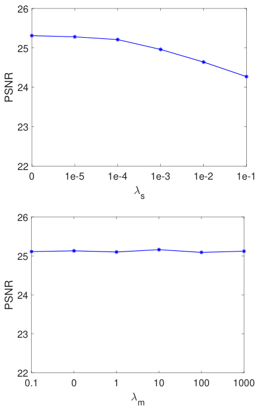

#+begin_en
Fig. 3. Effects of different choices of parameters λs and λm.
#+end_en
図 3．パラメータλs とλm の異なる選択による影響。

# pdfrect: 8 48.0 667.7 300.0 747.2
# pdfrect: 8 312.0 527.0 564.0 686.5
# pdfsent: [[[8,62.2,667.7,300.0,677.2],[8,48.0,679.3,300.0,688.8],[8,48.0,690.8,133.4,700.3]],[[8,133.4,690.8,165.9,700.3]],[[8,165.9,690.8,300.0,700.3],[8,48.0,702.4,300.0,711.9],[8,48.0,713.3,300.0,724.1],[8,48.0,724.8,300.0,735.7],[8,48.0,736.4,132.0,747.2]],[[8,132.0,736.4,300.0,747.2],[8,312.0,527.0,527.4,536.5]],[[8,527.4,527.0,539.6,536.5]],[[8,539.6,527.0,564.0,536.5],[8,312.0,538.6,544.0,548.1]],[[8,544.0,538.6,564.0,548.1],[8,312.0,550.1,564.0,559.6],[8,312.0,561.6,548.2,571.1]],[[8,548.2,561.6,564.0,571.1],[8,312.0,573.2,564.0,582.7],[8,312.0,584.7,360.9,594.2]],[[8,360.9,584.7,383.5,594.2]],[[8,383.5,584.7,564.0,594.2],[8,312.0,596.3,564.0,605.8],[8,312.0,607.8,564.0,617.3]],[[8,312.0,619.3,564.0,628.8],[8,312.0,630.9,564.0,640.4],[8,312.0,642.4,521.3,651.9]],[[8,521.3,642.4,564.0,651.9],[8,312.0,654.0,564.0,663.5],[8,312.0,665.5,564.0,675.0],[8,312.0,677.0,365.9,686.5]],[[8,365.9,677.0,385.2,686.5]]]
#+begin_en
In addition to the PSNR curves, we also visualize the effect of the two regularization terms on the learned 3D LUTs and the photo enhancement results. In Fig. 4, we visualize the three 3D LUTs learned without regularization, with only smooth regularization (λs=0.0001, λm=0), with only monotonicity regularization (λs=0, λm=10) and with both smooth and monotonicity regularization (λs=0.0001, λm=10). The corresponding enhancement results by those 3D LUTs on one typical scene are shown in Fig. 5. As can be seen, the 3D LUTs learned without regularization (Fig. 4(a)) have very irregular surface, which means that the output colors of these 3D LUTs may significantly change in some local areas. As a result, some visible banding artifacts appear in the transitional sky area in Fig. 5(a). Employing only the smooth regularization results in locally smoother, however still irregular, 3D LUTs because some parts of the color space are not activated by the training data. Employing only the monotonicity regularization leads to globally more regular 3D LUTs and alleviates much the banding artifacts; however, some local areas are not smooth enough. Using both the regularization terms lead to smoother and much more regular 3D LUTs, which effectively suppresses the banding artifacts, as shown in Fig. 5(d).
#+end_en
PSNR 曲線に加えて、学習した 3D LUT と写真強調結果に対する 2 つの正則化項の影響も可視化します。図 4 では、正則化なし、平滑化のみ（λs=0.0001、λm=0）、単調性正則化のみ（λs=0、λm=10）、平滑化と単調性の両方正則化（λs=0.0001、λm=10）で学習した 3 つの 3D LUT を可視化しています。これらの 3D LUT による典型的なシーンでの対応する強調結果を図 5 に示します。図 4(a)からわかるように、正則化なしで学習した 3D LUT は非常に不規則な表面を持ち、これはこれらの 3D LUT の出力色が局所的な領域で大きく変化する可能性があることを意味します。その結果、図 5(a)の遷移空の領域に目に見えるバンディングアーティファクトが現れます。平滑化正則化のみを用いると、カラー空間の一部がトレーニングデータによって活性化されないため、局所的に滑らかではあるものの、依然として不規則な 3D LUT が得られます。単調性正則化のみを用いると、全体的に規則的な 3D LUT が得られ、バンディングアーティファクトが大幅に軽減されますが、局所的に滑らかさが不十分な領域が残ります。両方の正則化項を用いると、図 5(d)に示すように、より滑らかで規則的な 3D LUT が得られ、バンディングアーティファクトが効果的に抑制されます。

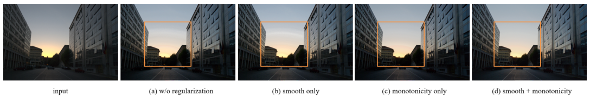
# pdfrect: 8 48.0 134.9 564.0 151.9
# pdfsent: [[[8,48.0,134.9,65.2,142.9]],[[8,65.2,134.9,75.5,142.9]],[[8,75.5,134.9,564.0,142.9],[8,48.0,143.9,224.5,151.9]],[[8,224.5,143.9,298.7,151.9]]]
#+begin_en
Fig. 5. Enhancement results of a typical input image (a) without regularization, (b) with only smooth or (c) only monotonicity regularization, and (d) with both smooth and monotonicity regularization. Best viewed in color.
#+end_en
図 5．典型的な入力画像の強調結果。（a）正則化なし、（b）平滑化のみの正則化、（c）単調性のみの正則化、（d）平滑化と単調性の両方の正則化。カラーでご覧いただくのが最適です。

# pdfrect: 8 312.0 689.7 564.0 733.8
# pdfsent: [[[8,326.2,689.7,564.0,699.2],[8,312.0,700.7,564.0,711.5],[8,312.0,712.8,564.0,722.3],[8,312.0,724.3,387.2,733.8]]]
# pdfhl: sky blue 0
#+begin_en
Based on the above quantitative and qualitative results, we choose λs=0.0001 and λm=10 in our following experiments, which deliver a good trade-off between enhancement performance and model stability.
#+end_en
上記の定量的および定性的な結果に基づき、以降の実験ではλs=0.0001、λm=10 を選択します。これは、性能向上とモデルの安定性の間で良好なトレードオフを実現します。

***** 本文：画像適応特性について
# pdfrect: 8 326.2 736.9 564.0 746.5
# pdfrect: 9 48.0 44.6 300.0 227.2
# pdfsent: [[[8,326.2,736.9,432.4,746.5]],[[8,432.4,736.9,564.0,746.5],[9,48.0,44.6,300.0,54.1],[9,48.0,56.1,300.0,65.6],[9,48.0,67.7,160.0,77.2]],[[9,160.0,67.7,300.0,77.2],[9,48.0,79.2,168.0,88.7]],[[9,168.0,79.2,300.0,88.7],[9,48.0,90.7,300.0,100.2],[9,48.0,102.3,136.2,111.8]],[[9,136.2,102.3,300.0,111.8],[9,48.0,113.8,300.0,123.3],[9,48.0,124.6,292.1,134.9]],[[9,292.1,124.6,300.0,134.9],[9,48.0,136.9,300.0,146.4],[9,48.0,148.4,300.0,157.9],[9,48.0,160.0,155.4,169.5]],[[9,155.4,160.0,300.0,169.5],[9,48.0,171.5,300.0,181.0],[9,48.0,183.1,154.9,192.6]],[[9,154.9,183.1,300.0,192.6],[9,48.0,194.6,300.0,204.1],[9,48.0,206.1,300.0,215.6],[9,48.0,217.7,87.8,227.2]]]
# pdfhl: sky blue 6,7
#+begin_en
Image-adaptive property. As we described in Section 3.2, our method is able to generate an adaptive 3D LUT (by fusing adaptively the three basis LUTs) to the input image, and uses it to enhance the given image. To better study this image-adaptive enhancement property, in Fig. 6 we visualize the image-adaptive 3D LUTs for three different images and show their corresponding enhancement results. In order to more clearly see the difference on the adaptive LUTs, we only visualize five slices (i.e., {1, 9, 17, 25, 33}) of the whole 3D LUT (33 slices in total). As a reference, we also show the enhancement results obtained by learning one fixed 3D LUT (without CNN) using the same training data on the right column. As can be seen, the adaptive 3D LUT varies with the different image content to better enhance their brightness, color and tone. In contrast, the fixed 3D LUT enhances different images in the same manner without considering their different content, resulting in less satisfactory brightness, hue and saturation.
#+end_en
画像適応特性。セクション 3.2 で説明したように、本手法は入力画像に対して適応型 3D LUT (3 つの基本 LUT を適応的に融合することによって) を生成し、それを使用して与えられた画像を強調することができます。この画像適応型強調特性をより詳しく調べるために、図 6 では、3 種類の異なる画像に対する画像適応型 3D LUT を可視化し、対応する強調結果を示します。適応型 LUT の違いをより明確に確認するために、3D LUT 全体 (合計 33 スライス) のうち 5 スライス (つまり、{1、9、17、25、33}) のみを可視化します。参考として、同じトレーニング データを使用して固定 3D LUT (CNN なし) を学習して得られた強調結果も右側の列に示します。ご覧のとおり、適応型 3D LUT は画像のコンテンツに応じて変化し、明るさ、色、トーンをより良く強調します。対照的に、固定 3D LUT は、異なるコンテンツを考慮することなく、異なる画像を同じ方法で強調するため、明るさ、色相、彩度が満足のいくものにならない。

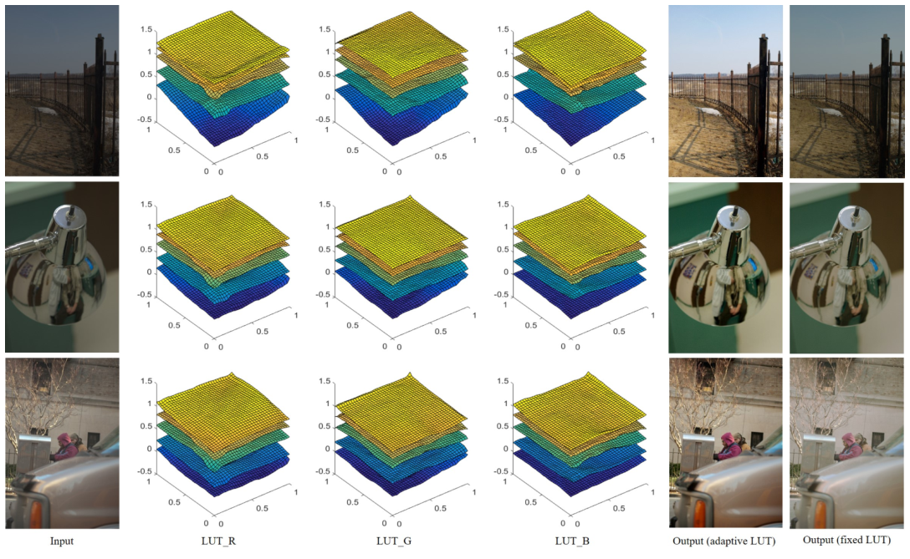
# pdfrect: 8 48.0 489.5 564.0 506.5
# pdfsent: [[[8,48.0,489.5,66.2,497.5]],[[8,66.2,489.5,77.1,497.5]],[[8,77.1,489.5,564.0,497.5],[8,48.0,498.5,124.4,506.5]]]
#+begin_en
Fig. 6. Visualization of the image-adaptive LUTs (after combination) generated by our model for three different images and their corresponding enhancement results.
#+end_en
図 6. 3 つの異なる画像に対して、我々のモデルによって生成された画像適応型 LUT（組み合わせ後）と、それに対応する強調結果の可視化。

*** 4.3 Experiment on photo retouching
:PROPERTIES:
:NOTER_PAGE: 9
:END:
***** 本文：他手法との比較（レタッチ）
# pdfrect: 9 48.0 253.0 300.0 424.0
# pdfsent: [[[9,48.0,253.0,300.0,262.5],[9,48.0,264.5,291.3,274.0]],[[9,291.3,264.5,300.0,274.0],[9,48.0,276.1,300.0,285.6],[9,48.0,287.6,129.2,297.1]],[[9,129.2,287.6,300.0,297.1],[9,48.0,299.1,253.8,308.6]],[[9,253.8,299.1,300.0,308.6],[9,48.0,310.7,300.0,320.2]],[[9,48.0,322.2,300.0,331.7],[9,48.0,333.8,300.0,343.3],[9,48.0,345.3,300.0,354.8],[9,48.0,356.8,300.0,366.3],[9,48.0,368.4,202.4,377.9]],[[9,202.4,368.4,300.0,377.9],[9,48.0,379.9,140.4,389.4]],[[9,140.4,379.9,300.0,389.4],[9,48.0,391.5,300.0,401.0],[9,48.0,403.0,195.3,412.5]],[[9,195.3,403.0,300.0,412.5],[9,48.0,414.5,281.1,424.0]]]
# pdfhl: light green 0,1,2,3
#+begin_en
This section compares our method with the latest deep enhancement methods for photo retouching on the FiveK dataset. We present the results under the pairwise learning and unpaired learning settings. Among previous methods, only the work in [7] considers both paired and unpaired learning. We thus use the same split as in [7] in our experiments for fair comparison. Specifically, in pairwise learning, 4,500 image pairs are used for training and the remaining 500 image pairs are used for testing; in unpaired learning, 2,250 images are used as the source data and 2,250 retouched images (from other source images with different content) are used as the target data. The remaining 500 images are used for testing. For all competing methods, we used the source code released by the authors and retrained their models using the same data split and format. We trained each model until it is converged and report their best results on the testing set.
#+end_en
このセクションでは、FiveK データセットにおける写真レタッチのための最新の深層強調手法と、我々の手法を比較します。ペアワイズ学習とアンペアズ学習の設定で結果を示します。これまでの手法の中で、ペアワイズ学習とアンペアズ学習の両方を考慮しているのは[7]の研究のみです。そのため、公平な比較のために、我々の実験では[7]と同じ分割を使用します。具体的には、ペアワイズ学習では、4,500 組の画像ペアをトレーニングに使用し、残りの 500 組の画像ペアをテストに使用します。アンペアズ学習では、2,250 枚の画像をソースデータとして使用し、2,250 枚のレタッチ画像（異なる内容の他のソース画像から）をターゲットデータとして使用します。残りの 500 枚の画像をテストに使用します。競合するすべての手法について、著者が公開したソースコードを使用し、同じデータ分割とフォーマットを使用してモデルを再トレーニングしました。各モデルが収束するまでトレーニングし、テストセットでの最良の結果を報告します。

***** 本文：他手法との比較（レタッチ, ペアワイズ学習）
# pdfrect: 9 48.0 425.7 300.0 527.6
# pdfsent: [[[9,62.2,425.7,181.1,435.2]],[[9,181.1,425.7,300.0,435.2],[9,48.0,437.3,300.0,446.8],[9,48.0,448.8,300.0,458.3],[9,48.0,460.4,218.8,469.9]],[[9,218.8,460.4,300.0,469.9],[9,48.0,471.9,300.0,481.4],[9,48.0,483.4,300.0,492.9],[9,48.0,495.0,300.0,504.5],[9,48.0,506.5,300.0,516.0],[9,48.0,518.1,123.2,527.6]]]
# pdfhl: light green 0,1
#+begin_en
Learning with paired data. Under the pairwise learning setting, we compare our method with the latest pairwise photo enhancement methods whose source codes are available: HDRNet [2], DPE [7], Dis-Rec [8] and UPE [10]. HDRNet learns pixelwise transformation coefficients in the bilateral space, DPE learns pixel-to-pixel mapping using a U-Net architecture, Dis-Rec employs the reinforcement learning to perform iterative enhancement and UPE estimates pixel-wise illumination using the same architecture of HDRNet.
#+end_en
ペアデータを用いた学習。ペアワイズ学習設定において、ソースコードが公開されている最新のペアワイズ写真強調手法である HDRNet [2]、DPE [7]、Dis-Rec [8]、UPE [10]と比較します。HDRNet はバイラテラル空間でピクセル単位の変換係数を学習し、DPE は U-Net アーキテクチャを使用してピクセル間のマッピングを学習し、Dis-Rec は強化学習を用いて反復的な強調処理を行い、UPE は HDRNet と同じアーキテクチャを使用してピクセル単位の照明を推定します。

# pdfrect: 9 48.0 529.3 300.0 584.9
# pdfrect: 9 48.0 587.0 300.0 746.5
# pdfsent: [[[9,62.2,529.3,300.0,538.8],[9,48.0,540.8,300.0,550.3],[9,48.0,551.6,167.6,561.8]],[[9,167.6,551.6,300.0,561.8],[9,48.0,563.2,300.0,573.4],[9,48.0,573.5,195.1,584.9]],[[9,195.1,573.5,299.5,584.9],[9,48.0,587.0,180.0,596.5]],[[9,180.0,587.0,300.0,596.5],[9,48.0,598.5,300.0,608.0],[9,48.0,610.0,300.0,619.5],[9,48.0,621.6,159.5,631.1]],[[9,159.5,621.6,300.0,631.1],[9,48.0,633.1,300.0,642.6],[9,48.0,644.7,237.9,654.2]],[[9,237.9,644.7,300.0,654.2],[9,48.0,655.5,300.0,665.7],[9,48.0,667.7,182.4,677.2]],[[9,182.4,667.7,300.0,677.2],[9,48.0,679.3,300.0,688.8],[9,48.0,690.8,300.0,700.3],[9,48.0,702.4,83.4,711.9]],[[9,83.4,702.4,300.0,711.9],[9,48.0,713.9,116.0,723.4]],[[9,116.0,713.9,300.0,723.4],[9,48.0,725.4,300.0,734.9],[9,48.0,737.0,122.8,746.5]],[[9,122.8,737.0,300.0,746.5]]]
# pdfhl: light green 3
# pdfhl: sky blue 4,5,6
#+begin_en
As mentioned in Section 4.1, we train and evaluate each method on two resolutions: 480p and the image original resolution (with about 12 megapixels). We randomly cropped 256×256 and 1024×1024 patches on 480p and original resolution, respectively, to train the competing models. The PSNR, SSIM and △E∗ indexes are reported in Table 3. The results of DPE on original resolution are unavailable because the DPE method is too memory demanding to implement using our Titan RTX GPU with 24 GB memory on this resolution. As can been seen from Table 3, our method significantly outperforms all the competing methods on both resolutions in terms of all the three metrics. Specifically, our method has an advantage of ≥0.9 dB in PSNR than the second best method HDRNet [2] on 480p. The advantage becomes higher (1.1dB) when working on the original image resolution, indicating the robustness of using 3D LUT to process high-resolution photos. DPE can also obtain reasonable performance on the 480p resolution. However, the heavy computational cost of U-Net architecture severely constrains its application on processing highresolution images. Both Dis-Rec and UPE obtain less satisfactory
#+end_en
セクション 4.1 で述べたように、各手法を 480p と画像のオリジナル解像度 (約 12 メガピクセル) の 2 つの解像度でトレーニングおよび評価します。競合モデルをトレーニングするために、480p とオリジナル解像度でそれぞれ 256×256 と 1024×1024 のパッチをランダムに切り抜きました。PSNR、SSIM、および △E* インデックスは表 3 に示されています。DPE 法はメモリを大量に消費するため、この解像度で 24 GB のメモリを搭載した Titan RTX GPU を使用して実装するにはメモリが不足しているため、オリジナル解像度での DPE の結果は利用できません。表 3 からわかるように、当社の手法は、3 つの指標すべてにおいて、両方の解像度で競合するすべての手法を大幅に上回っています。具体的には、当社の手法は、480p で、2 番目に優れた手法である HDRNet [2] よりも PSNR で ≥0.9 dB の優位性があります。元の画像解像度で作業すると、利点はさらに大きくなります (1.1dB)。これは、高解像度写真の処理に 3D LUT を使用することの堅牢性を示しています。DPE は 480p 解像度でも妥当なパフォーマンスを得ることができます。ただし、U-Net アーキテクチャの計算コストが高いため、高解像度画像の処理への適用が著しく制限されます。Dis-Rec と UPE はどちらも満足のいく結果が得られません。

# pdfrect: 9 312.9 45.6 563.1 62.6
# pdfrect: 9 319.6 63.6 556.4 71.6
# pdfrect: 9 421.4 72.6 454.6 80.6
# pdfsent: [[[9,422.5,45.6,453.5,53.6],[9,312.9,54.6,563.1,62.6],[9,319.6,63.6,438.0,71.6]],[[9,438.0,63.6,556.4,71.6],[9,421.4,72.6,454.6,80.6]]]
#+begin_en
TABLE 3 Quantitative comparison of photo retouching results under the pairwise training setting on FiveK dataset. “N.A.” means that the result is not available.
#+end_en
表 3 FiveK データセットにおけるペアワイズ学習設定での写真レタッチ結果の定量的比較。「N.A.」は結果が利用できないことを意味します。

| Method      | FiveK (480p)      | FiveK (original)  |
|-------------+-------------------+-------------------|
|             | PSNR SSIM △E∗    | PSNR SSIM △E∗    |
| UPE [10]    | 21.88 0.853 10.80 | 21.65 0.859 11.09 |
| Dis-Rec [8] | 21.98 0.856 10.42 | 21.81 0.862 10.60 |
| DPE [7]     | 23.75 0.908 9.34  | N.A. N.A. N.A.    |
| HDRNet [2]  | 24.32 0.912 8.49  | 24.03 0.919 8.68  |
| Ours        | 25.21 0.922 7.61  | 25.10 0.930 7.72  |
# pdfrect: 9 312.0 330.9 564.0 351.9
# pdfsent: [[[9,312.0,330.9,564.0,340.4],[9,312.0,342.4,544.9,351.9]]]
#+begin_en
performance, probably because of the unstability of reinforcement learning and inaccurate illumination estimation, respectively.
#+end_en
パフォーマンスの低下は、それぞれ強化学習の不安定性と照明推定の不正確さに起因すると考えられる。

# pdfrect: 9 312.0 354.7 564.0 571.9
# pdfsent: [[[9,326.2,354.7,346.4,364.2]],[[9,346.4,354.7,564.0,364.2],[9,312.0,366.2,385.2,375.7]],[[9,385.2,366.2,551.8,375.7]],[[9,551.8,366.2,564.0,375.7],[9,312.0,377.8,564.0,387.3],[9,312.0,389.3,471.4,398.8]],[[9,471.4,389.3,564.0,398.8],[9,312.0,400.9,564.0,410.4],[9,312.0,412.4,412.0,421.9]],[[9,412.0,412.4,564.0,421.9],[9,312.0,423.9,398.6,433.4]],[[9,398.6,423.9,564.0,433.4],[9,312.0,435.5,505.8,445.0]],[[9,505.8,435.5,564.0,445.0],[9,312.0,447.0,564.0,456.5],[9,312.0,458.6,370.8,468.1]],[[9,370.8,458.6,383.4,468.1]],[[9,383.4,458.6,564.0,468.1],[9,312.0,470.1,440.0,479.6]],[[9,440.0,470.1,564.0,479.6],[9,312.0,481.6,564.0,491.1],[9,312.0,493.2,411.1,502.7]],[[9,411.1,493.2,564.0,502.7],[9,312.0,504.7,564.0,514.2],[9,312.0,516.3,564.0,525.8],[9,312.0,527.8,368.4,537.3]],[[9,368.4,527.8,564.0,537.3],[9,312.0,539.3,548.2,548.8]],[[9,548.2,539.3,564.0,548.8],[9,312.0,550.9,564.0,560.4],[9,312.0,562.4,539.7,571.9]]]
# pdfhl: sky blue 6,7
#+begin_en
Fig. 7 presents qualitative comparisons of different paired learning methods. One can have the following observations. UPE [7] only moderately enhances the input image, generating outputs with insufficient saturation and contrast. Dis-Rec [8] is not robust enough to handle different scenes, resulting in over-exposed areas or unnatural color cast. DPE [7] may generate halo artifacts or unnatural color cast. Both HDRNet [2] and our method are able to more robustly enhance images in different scenes. A more detailed comparison between HDRNet and our method on an image is shown in Fig. 8. It can be seen that some sky areas enhanced by HDRNet are biased to purple. One possible reason is that the HDRNet model overfits the training data where most sky content are either blue or red. As a consequence, the HDRNet enhances more on the R and B channels than the G channel in the sky area, resulting in purple (R and B are significantly larger than G) color cast. In contrast, our model does not overfit the training data, having better generalization performance than HDRNet. This owes to the compact model design of our method as well as the smooth and monotonicity regularizations in model training.
#+end_en

図 7 は、異なるペア学習方法の定性的な比較を示しています。次のような観察結果が得られます。UPE [7] は入力画像を適度に強調するだけで、出力の彩度とコントラストが不十分です。Dis-Rec [8] はさまざまなシーンを処理するのに十分な堅牢性がなく、露出過多の領域や不自然な色かぶりが発生します。DPE [7] はハローアーティファクトや不自然な色かぶりを生成する可能性があります。HDRNet [2] と私たちの方法はどちらも、さまざまなシーンで画像をより堅牢に強調できます。HDRNet と私たちの方法のより詳細な比較を画像上で図 8 に示します。HDRNet によって強調された空の領域の一部が紫色に偏っていることがわかります。考えられる理由の 1 つは、HDRNet モデルが、空のコンテンツのほとんどが青または赤であるトレーニング データに過剰適合していることです。その結果、HDRNet は空の領域で G チャネルよりも R チャネルと B チャネルを強調し、紫色 (R と B が G よりかなり大きい) の色かぶりが発生します。対照的に、我々のモデルは訓練データに過学習せず、HDRNet よりも優れた汎化性能を示します。これは、我々の手法のコンパクトなモデル設計と、モデル訓練における滑らかさと単調性に関する正則化によるものです。
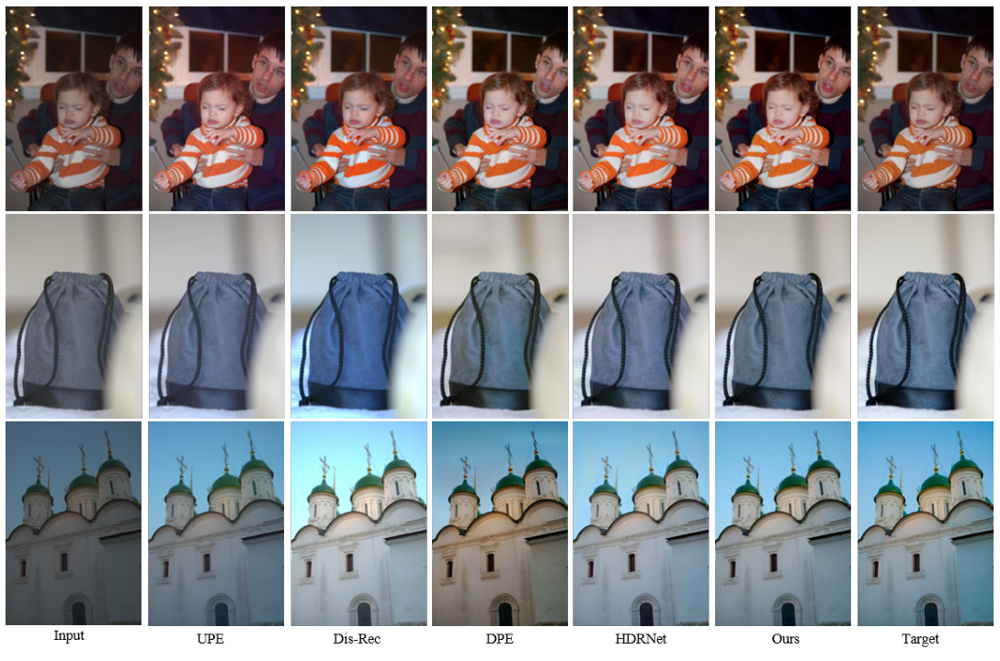
# pdfrect: 10 48.0 392.4 432.5 400.4
# pdfsent: [[[10,48.0,392.4,65.5,400.4]],[[10,65.5,392.4,76.0,400.4]],[[10,76.0,392.4,432.5,400.4]]]
#+begin_en
Fig. 7. Qualitative comparison of different paired learning methods for photo retouching on the FiveK dataset.
#+end_en
図 7. FiveK データセットにおける写真レタッチのための様々なペア学習手法の定性的な比較。

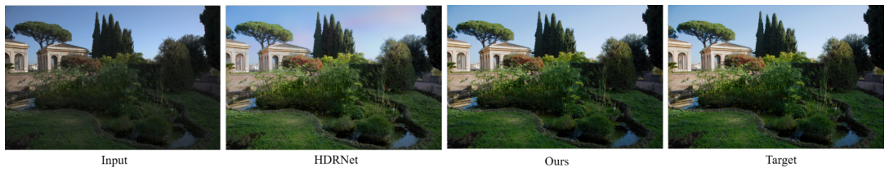

# pdfrect: 10 48.0 523.5 564.0 540.5
# pdfsent: [[[10,48.0,523.5,66.8,531.5]],[[10,66.8,523.5,78.1,531.5]],[[10,78.1,523.5,439.7,531.5]],[[10,439.7,523.5,564.0,531.5],[10,48.0,532.5,163.6,540.5]]]
#+begin_en
Fig. 8. Qualitative comparison between HDRNet and our method for photo retouching on the FiveK dataset. Note that some sky areas enhanced by HDRNet are biased to purple.
#+end_en
図 8．FiveK データセットにおける HDRNet と我々の手法による写真レタッチの定性的な比較。HDRNet によって強調された空の領域の一部は紫色に偏っていることに注意してください。

***** 本文：他手法との比較（レタッチ, 非ペア学習）
# pdfrect: 9 312.0 574.6 564.0 722.7
# pdfsent: [[[9,326.2,574.6,449.4,584.2]],[[9,449.4,574.6,564.0,584.2],[9,312.0,586.2,564.0,595.7],[9,312.0,597.8,489.6,607.3]],[[9,489.6,597.8,564.0,607.3],[9,312.0,609.3,564.0,618.8],[9,312.0,620.8,564.0,630.3],[9,312.0,632.4,564.0,641.9],[9,312.0,643.9,564.0,653.4],[9,312.0,655.5,396.0,665.0]],[[9,396.0,655.5,564.0,665.0],[9,312.0,667.0,564.0,676.5]],[[9,312.0,678.5,564.0,688.0],[9,312.0,690.1,394.6,699.6]],[[9,394.6,690.1,564.0,699.6],[9,312.0,701.6,564.0,711.1],[9,312.0,713.2,382.0,722.7]]]
#+begin_en
Learning with unpaired data. Under the unpaired learning setting, we compare our method with Pix2Pix [49], CycleGAN [50], DPE [7], White-Box [9] and UIE [11]. Pix2Pix and Cycle- GAN are two representative image-to-image translation methods, DPE learns pixel-to-pixel transformation with a U-Net architecture carefully tuned for photo enhancement, both White-Box and UIE learn to enhance input images using a set of basic operations in an iterative manner. We also report the results obtained by the automatic adjustment of Camera Raw in Photoshop as a reference. All models are retrained and evaluated using the same training and testing splits. All parameters (e.g., CNN model, 3D LUTs, regularization terms) of our method were kept the same as those in paired learning.
#+end_en

ペアになっていないデータで学習します。ペアになっていない学習設定では、私たちの手法を Pix2Pix [49]、CycleGAN [50]、DPE [7]、White-Box [9]、UIE [11] と比較します。Pix2Pix と Cycle-GAN は代表的な画像間変換手法であり、DPE は写真強調用に慎重に調整された U-Net アーキテクチャを使用してピクセル間変換を学習し、White-Box と UIE はどちらも一連の基本操作を使用して入力画像を強調するように反復的に学習します。また、参考として Photoshop の Camera Raw の自動調整によって得られた結果も報告します。すべてのモデルは、同じトレーニングおよびテスト分割を使用して再トレーニングおよび評価されます。私たちの手法のすべてのパラメータ (CNN モデル、3D LUT、正則化項など) は、ペア学習の場合と同じに保たれています。

# pdfrect: 9 312.0 725.4 564.0 746.5
# pdfsent: [[[9,326.2,725.4,564.0,734.9],[9,312.0,737.0,364.1,746.5]],[[9,364.1,737.0,564.0,746.5]]]
#+begin_en
The quantitative results of all competing methods are reported in Table 4. Note that the results of Pix2Pix, CycleGAN and
#+end_en
すべての競合手法の定量的結果を表 4 に示します。Pix2Pix、CycleGAN、および
# pdfrect: 10 48.0 562.6 300.0 745.2
# pdfsent: [[[10,48.0,562.6,300.0,572.1],[10,48.0,574.1,143.0,583.6]],[[10,143.0,574.1,300.0,583.6],[10,48.0,583.7,300.0,595.2],[10,48.0,597.2,83.4,606.7]],[[10,83.4,597.2,300.0,606.7],[10,48.0,606.8,300.0,618.3],[10,48.0,620.3,100.7,629.8]],[[10,100.7,620.3,300.0,629.8],[10,48.0,631.8,300.0,641.3],[10,48.0,643.4,300.0,652.9],[10,48.0,654.9,300.0,664.4],[10,48.0,666.5,84.6,676.0]],[[10,84.6,666.5,300.0,676.0],[10,48.0,678.0,285.0,687.5]],[[10,285.0,678.0,300.0,687.5]],[[10,48.0,689.5,300.0,699.0],[10,48.0,701.1,112.0,710.6]],[[10,112.0,701.1,300.0,710.6],[10,48.0,712.6,159.0,722.1]],[[10,159.0,712.6,300.0,722.1],[10,48.0,724.2,283.7,733.7]],[[10,283.7,724.2,300.0,733.7],[10,48.0,735.7,300.0,745.2]]]
# pdfhl: light green 3
#+begin_en
DPE on the original resolution are unavailable because of the out of memory problem. Again, our method achieves much better PSNR, SSIM and △E∗ indices on both resolutions than the other methods. Specifically, our model outperforms the second best one UIE by 0.75 dB, 0.016 and 1.04 on PSNR, SSIM and △E∗, respectively. An interesting observation is that on these objective metrics, most of the unpaired enhancement methods, except ours, do not have obvious advantage over the automatic adjustment of Camera Raw which does not leverage any training data of FiveK dataset. The main reason is that most unpaired methods are not stable enough, resulting in low indices on some failure cases. Fig. 9 presents the visual comparisons of competing methods on two typical scenes. One can see that the Pix2Pix [49] only slightly enhances the input image. The CycleGAN [50], White-Box [9], DPE [10] and UIE [11] are not stable in different scenes. They may result in over- or under-enhanced images, produce unnatural
#+end_en

メモリ不足の問題により、元の解像度での DPE は利用できません。繰り返しになりますが、私たちの手法は、他の手法よりも両方の解像度で PSNR、SSIM、および △E∗ の指標がはるかに優れています。具体的には、私たちのモデルは、PSNR、SSIM、および △E∗ で、2 番目に優れた UIE をそれぞれ 0.75 dB、0.016、および 1.04 上回っています。興味深い観察は、これらの客観的な指標において、私たちの手法を除くほとんどのペアになっていない強調手法は、FiveK データセットのトレーニング データを活用しない Camera Raw の自動調整よりも明らかな利点がないということです。主な理由は、ほとんどのペアになっていない手法が十分に安定しておらず、いくつかの失敗ケースで低い指標になっていることです。図 9 は、2 つの典型的なシーンでの競合手法の視覚的な比較を示しています。Pix2Pix [49] は入力画像をわずかに強調するだけであることがわかります。CycleGAN [50]、White-Box [9]、DPE [10]、および UIE [11] は、さまざまなシーンで安定していません。過剰または不足した画像、不自然な画像を生成する可能性があります
#+begin_en
TABLE 4 Quantitative comparison of photo retouching results under the unpaired training setting on the FiveK dataset. “N.A.” means that the result is not available.
#+end_en
表 4 FiveK データセットにおける、ペアになっていないトレーニング設定での写真レタッチ結果の定量的比較。「N.A.」は、結果が利用できないことを意味します。

| Method        | FiveK (480p)      | FiveK (original)  |
|---------------+-------------------+-------------------|
|               | PSNR SSIM △E∗    | PSNR SSIM △E∗    |
| Camera Raw    | 21.61 0.854 11.83 | 21.55 0.861 11.98 |
| Pix2Pix [49]  | 19.21 0.814 14.76 | N.A. N.A. N.A.    |
| CycGAN [50]   | 20.98 0.831 13.28 | N.A. N.A. N.A.    |
| White-Box [9] | 21.32 0.864 12.65 | 21.17 0.875 12.81 |
| DPE [7]       | 21.99 0.875 11.40 | N.A. N.A. N.A.    |
| UIE [11]      | 22.11 0.879 11.21 | 22.03 0.882 11.46 |
| Ours          | 22.86 0.887 10.28 | 22.78 0.898 10.42 |

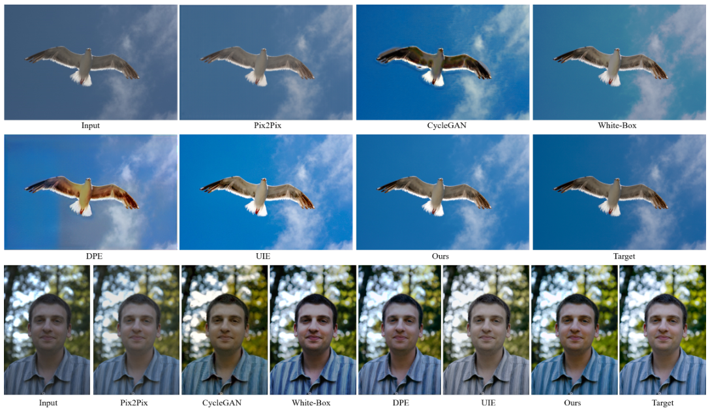
#+begin_en
Fig. 9. Qualitative comparison of different unpaired learning methods for photo retouching on the FiveK dataset.
#+end_en

図 9. FiveK データセットにおける写真レタッチのための異なる非ペア学習手法の定性的な比較。

*** 4.4 Experiment on imaging pipeline enhancement
:PROPERTIES:
:NOTER_PAGE: 11
:END:
***** 本文：他手法との比較（現像）
# pdfrect: 11 48.0 551.9 300.0 676.8
# pdfsent: [[[11,48.0,551.9,300.0,561.4],[11,48.0,563.5,300.0,573.0],[11,48.0,575.0,121.2,584.5]],[[11,121.2,575.0,300.0,584.5],[11,48.0,586.6,247.9,596.1]],[[11,247.9,586.6,300.0,596.1],[11,48.0,598.1,300.0,607.6],[11,48.0,609.0,118.2,619.9]],[[11,118.2,609.0,295.9,619.9]],[[11,295.9,609.0,300.0,619.9],[11,48.0,621.2,300.0,630.7],[11,48.0,632.7,300.0,642.2],[11,48.0,644.3,300.0,653.8],[11,48.0,655.8,300.0,665.3]],[[11,48.0,667.3,98.6,676.8]],[[11,98.6,667.3,285.6,676.8]]]
# pdfhl: sky blue 1
# pdfhl: sky blue 2,3,4,5,6
#+begin_en
In this section we compare our method with the latest deep enhancement methods for color/tone enhancement in camera imaging pipeline. In this case, the input images are 16-bit uncompressed images in the CIE XYZ color space. For pairwise learning, all the settings are the same as those used in the photo retouching task. For unpaired learning, we change λ1 in Eq. 8 to 10 for all competing methods (using a GAN loss) to relax the content preservation constraint since the input images are very different from the target images in this set of experiments (e.g., different dynamic range, different color space, uncompressed vs. compressed). All competing models are retrained on this task.
#+end_en
このセクションでは、カメラ画像処理パイプラインにおける色調強調のための最新の深層強調手法と、我々の手法を比較します。この場合、入力画像は CIE XYZ 色空間の 16 ビット非圧縮画像です。ペアワイズ学習では、すべての設定は写真レタッチタスクで使用したものと同じです。ペアなし学習では、入力画像がこの実験セットのターゲット画像と大きく異なるため（例えば、ダイナミックレンジ、色空間、非圧縮と圧縮など）、コンテンツ保存制約を緩和するために、すべての競合手法（GAN 損失を使用）で式 8 のλ1 を 10 に変更します。すべての競合モデルはこのタスクで再学習されます。

# pdfrect: 11 48.0 679.3 300.0 746.5
# pdfrect: 11 312.0 388.0 564.0 455.2
# pdfsent: [[[11,62.2,679.3,300.0,688.8]],[[11,48.0,690.8,300.0,700.3],[11,48.0,702.4,138.6,711.9]],[[11,138.6,702.4,300.0,711.9],[11,48.0,713.9,300.0,723.4],[11,48.0,725.4,300.0,734.9],[11,48.0,737.0,300.0,746.5],[11,312.0,388.0,459.3,397.5]],[[11,459.3,388.0,564.0,397.5],[11,312.0,399.6,564.0,409.1],[11,312.0,411.1,454.3,420.6]],[[11,454.3,411.1,564.0,420.6],[11,312.0,422.7,564.0,432.2],[11,312.0,434.2,421.2,443.7]],[[11,421.2,434.2,564.0,443.7],[11,312.0,445.7,493.7,455.2]]]
#+begin_en
We conduct experiments on the FiveK and HDR+ datasets. On the FiveK dataset, data splits are kept the same as those in photo retorching task. Since most scenes in the HDR+ dataset are not aligned between the intermediate frame and the groundtruth, we conduct experiments using the well aligned Nexus 6p subset, among which 675 scenes are used for training and 250 scenes are used for testing in pairwise setting. In the unpaired setting, we randomly divide the 675 scenes into a source domain and a target domain without overlapped content. Intermediate frame from the source domain and groundtruth from the target domain are used to train unpaired models. To compare with as many methods as possible, images are resized to 480p resolution.
#+end_en
FiveK および HDR+ データセットで実験を実施します。FiveK データセットでは、データの分割は写真レトーチングタスクと同じままです。HDR+ データセットのほとんどのシーンは中間フレームとグラウンドトゥルースの間で位置合わせされていないため、位置合わせが良好な Nexus 6p サブセットを使用して実験を実施します。このサブセットのうち、675 シーンはトレーニングに使用され、250 シーンはペアワイズ設定でのテストに使用されます。ペアなし設定では、675 シーンを重複するコンテンツなしでソース ドメインとターゲット ドメインにランダムに分割します。ソース ドメインの中間フレームとターゲット ドメインのグラウンドトゥルースは、ペアなしモデルのトレーニングに使用されます。できるだけ多くの方法と比較するために、画像は 480p 解像度にリサイズされます。

***** 本文：他手法との比較（現像, ペアワイズ学習）
# pdfrect: 11 312.0 458.1 564.0 640.8
# pdfsent: [[[11,326.2,458.1,449.7,467.7]],[[11,449.7,458.1,564.0,467.7],[11,312.0,469.7,564.0,479.2],[11,312.0,481.3,346.9,490.8]],[[11,346.9,481.3,564.0,490.8],[11,312.0,492.8,564.0,502.3],[11,312.0,504.4,444.4,513.9]],[[11,444.4,504.4,564.0,513.9],[11,312.0,515.9,465.6,525.4]],[[11,465.6,515.9,564.0,525.4],[11,312.0,527.4,564.0,536.9],[11,312.0,539.0,564.0,548.5],[11,312.0,550.5,400.2,560.0]],[[11,400.2,550.5,564.0,560.0],[11,312.0,562.1,535.5,571.6]],[[11,535.5,562.1,564.0,571.6],[11,312.0,573.6,564.0,583.1],[11,312.0,585.1,539.2,594.6]],[[11,539.2,585.1,564.0,594.6],[11,312.0,596.7,564.0,606.2],[11,312.0,608.2,348.6,617.7]],[[11,348.6,608.2,564.0,617.7],[11,312.0,619.8,564.0,629.3],[11,312.0,631.3,467.7,640.8]]]
# pdfhl: sky blue 3,4,5
#+begin_en
Learning with paired data. We compare our model with HDRNet [2], DPE [7], and UPE [10] under the pairwise learning setting. The Dis-Rec [8] is not included in this comparison since it is difficult to modify its source code to process 16-bit input images in CIE XYZ color space. The results on the FiveK and HDR+ datasets are reported in Table 5. On the FiveK dataset, the performance on all the three metrics decreases slightly compared to the photo retouching task since imaging pipeline enhancement is more challenging. Nonetheless, our method again has clear advantage over all competing methods on both datasets. For all methods, the performance on the HDR+ dataset is much lower than on the FiveK dataset owning to two major reasons. First, the number of training image pairs is much less on the HDR+ dataset. Second, some images captured by mobile cameras in lowlight environment contain heavy noise while all the enhancement methods do not have denoising function.
#+end_en
ペアデータによる学習。ペアワイズ学習設定で、モデルを HDRNet [2]、DPE [7]、および UPE [10] と比較します。Dis-Rec [8] は、CIE XYZ 色空間で 16 ビット入力画像を処理するためにソースコードを変更するのが難しいため、この比較には含まれていません。FiveK および HDR+ データセットでの結果を表 5 に示します。FiveK データセットでは、画像パイプラインの強化がより困難であるため、3 つの指標すべてでパフォーマンスが写真レタッチタスクと比較してわずかに低下します。それでも、私たちの方法は、両方のデータセットで競合するすべての方法に対して明確な優位性を持っています。すべての方法で、HDR+ データセットでのパフォーマンスは FiveK データセットよりもはるかに低くなっています。主な理由は 2 つあります。まず、HDR+ データセットではトレーニング画像ペアの数がはるかに少ないことです。次に、モバイルカメラで低照度環境で撮影された画像には大きなノイズが含まれていますが、すべての強化方法にはノイズ除去機能がありません。

#+begin_en
TABLE 5 Quantitative comparison of different pairwise learning methods for imaging pipeline enhancement on the FiveK and HDR+ datasets.
#+end_en
表 5 FiveK および HDR+データセットにおけるイメージングパイプライン強化のための異なるペアワイズ学習方法の定量的比較。

| Method     | FiveK (480p)      | HDR+ (480p)       |
|------------+-------------------+-------------------|
|            | PSNR SSIM △E∗    | PSNR SSIM △E∗    |
| UPE [10]   | 21.56 0.837 12.29 | 21.21 0.816 13.05 |
| DPE [7]    | 22.93 0.894 11.09 | 22.56 0.872 10.45 |
| HDRNet [2] | 24.14 0.913 8.65  | 23.04 0.879 8.97  |
| Ours       | 25.06 0.920 7.63  | 23.54 0.885 7.93  |

# pdfrect: 10 312.0 725.4 564.0 746.5
# pdfsent: [[[10,312.0,725.4,438.0,734.9]],[[10,438.0,725.4,564.0,734.9],[10,312.0,737.0,513.2,746.5]]]
#+begin_en
color or distorted image content. In contrast, our method can stably and properly enhance images under different scenes.
#+end_en
色調や画像内容の歪みなどが生じる場合があるのに対し、本手法は様々なシーンにおいて画像を安定かつ適切に強調することができます。

# pdfrect: 11 312.0 643.7 564.0 734.0
# pdfsent: [[[11,326.2,643.7,357.9,653.2]],[[11,357.9,643.7,564.0,653.2],[11,312.0,655.3,408.6,664.8]],[[11,408.6,655.3,564.0,664.8],[11,312.0,666.8,564.0,676.3],[11,312.0,678.4,564.0,687.9],[11,312.0,689.9,564.0,699.4],[11,312.0,701.4,346.9,710.9]],[[11,346.9,701.4,564.0,710.9],[11,312.0,713.0,398.5,722.5]],[[11,398.5,713.0,564.0,722.5],[11,312.0,724.5,462.8,734.0]]]
# pdfhl: sky blue 0,1
#+begin_en
In Fig. 10, we show the visual results obtained by different methods on two scenes. Similar conclusion can be drawn as in the photo retouching task: both our method and the HDRNet can stably enhance different inputs while the HDRNet may result in over-saturated color cast (see the greensward) because of its overfitting. The enhancement results of our model are more nature and closer to the targets. In contrast, both UPE and DPE are not stable and may dramatically change the color.
#+end_en
図 10 では、2つのシーンで異なる手法を用いて得られた視覚的な結果を示します。写真レタッチタスクと同様の結論が得られます。すなわち、我々の手法と HDRNet はどちらも様々な入力画像を安定して強調できますが、HDRNet は過学習のために過飽和な色かぶり（緑の芝生を参照）が生じる可能性があります。我々のモデルによる強調結果はより自然で、ターゲット画像に近いものとなっています。一方、UPE と DPE はどちらも安定しておらず、色が大きく変化する可能性があります。

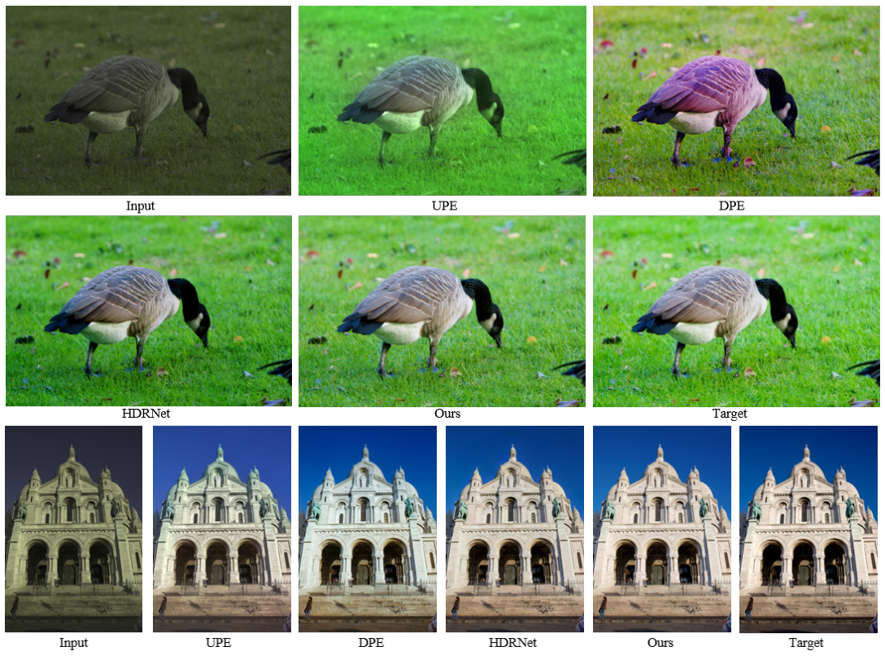
# pdfrect: 12 48.0 443.1 529.5 451.1
# pdfsent: [[[12,48.0,443.1,66.1,451.1]],[[12,66.1,443.1,80.6,451.1]],[[12,80.6,443.1,529.5,451.1]]]
#+begin_en
Fig. 10. Qualitative comparison of different paired learning methods for imaging pipeline enhancement on the FiveK and HDR+ datasets.
#+end_en
図 10. FiveK および HDR+データセットにおける、画像処理パイプライン強化のための異なるペア学習手法の定性的な比較。

***** 本文：他手法との比較（現像, 非ペア学習）
# pdfrect: 12 48.0 473.3 300.0 713.6
# pdfsent: [[[12,48.0,473.3,300.0,482.8],[12,48.0,484.8,97.6,494.3]],[[12,97.6,484.8,300.0,494.3],[12,48.0,496.3,300.0,505.8],[12,48.0,507.9,300.0,517.4],[12,48.0,519.4,190.3,528.9]],[[12,190.3,519.4,300.0,528.9],[12,48.0,531.0,300.0,540.5],[12,48.0,542.5,300.0,552.0],[12,48.0,554.0,143.0,563.5]],[[12,143.0,554.0,300.0,563.5],[12,48.0,565.6,163.3,575.1]],[[12,163.3,565.6,300.0,575.1]],[[12,48.0,577.1,300.0,586.6],[12,48.0,588.7,300.0,598.2],[12,48.0,600.2,73.2,609.7]],[[12,73.2,600.2,300.0,609.7],[12,48.0,611.7,300.0,621.2],[12,48.0,623.3,234.1,632.8]],[[12,234.1,623.3,300.0,632.8],[12,48.0,634.8,300.0,644.3],[12,48.0,646.4,300.0,655.9],[12,48.0,657.9,300.0,667.4],[12,48.0,668.9,251.2,678.9]],[[12,251.2,668.9,300.0,678.9],[12,48.0,681.0,300.0,690.5]],[[12,48.0,692.5,300.0,702.0],[12,48.0,704.1,201.2,713.6]]]
# pdfhl: sky blue 1,2,3
#+begin_en
unpaired data on the FiveK and HDR+ datasets are reported in Table 6. One can see that all the competing methods obtain worse performance than the results obtained by the automatic mode of Camera Raw in this set of experiments, which may be caused by the following reason. This unpaired learning task of imaging pipeline enhancement is too challenging due to the significant differences in dynamic range and color space between input and target data. The content preservation constraint in the GAN loss (refer to Eq. 8) can hardly hold in such case. However, relaxing the content preservation constraint will enlarge much the transformation space and hurt the stability of the GAN loss. Consequently, most of the competing methods using very deep neural networks and/or complicated reinforcement learning strategy fail to learn a stable transformation. In contrast, with effective regularization terms, our model learns compact 3D LUTs and a small CNN, which still achieves reasonable performance on the FiveK dataset (almost the same as camera raw), outperforming the competing methods by a large margin (> 4 dB). This further validates the stability and generalization capability of our method. The performance of all methods drops much on the HDR+ dataset because of the insufficient training data.
#+end_en
FiveK および HDR+ データセットのペアになっていないデータは表 6 に示されています。この一連の実験では、競合するすべての手法が Camera Raw の自動モードで得られた結果よりもパフォーマンスが劣っていることがわかります。これは次の理由による可能性があります。イメージング パイプラインの強化というこのペアになっていない学習タスクは、入力データとターゲット データ間のダイナミック レンジとカラー スペースの大きな違いにより、非常に困難です。GAN 損失におけるコンテンツ保存制約 (式 8 を参照) は、このような場合にはほとんど維持できません。しかし、コンテンツ保存制約を緩和すると、変換空間が大幅に拡大し、GAN 損失の安定性が損なわれます。その結果、非常に深いニューラル ネットワークや複雑な強化学習戦略を使用する競合手法のほとんどは、安定した変換を学習できません。これに対し、効果的な正則化項により、私たちのモデルはコンパクトな 3D LUT と小さな CNN を学習し、FiveK データセットで妥当なパフォーマンス (camera raw とほぼ同じ) を達成し、競合手法を大きく上回ります (> 4 dB)。これは、本手法の安定性と汎化能力をさらに裏付けるものです。HDR+データセットでは、訓練データが不足しているため、すべての手法の性能が大幅に低下します。

#+begin_en
TABLE 6 Quantitative comparison of different unpaired learning methods for imaging pipeline enhancement on the FiveK and HDR+ datasets.
#+end_en
表 6 FiveK および HDR+データセットにおける画像処理パイプライン強化のための異なる非ペア学習手法の定量的比較。

| Method        | FiveK (480p)      | HDR+ (480p)       |
|---------------+-------------------+-------------------|
|               | PSNR SSIM △E∗    | PSNR SSIM △E∗    |
| Camera Raw    | 21.61 0.854 11.83 | 19.86 0.791 14.98 |
| Pix2Pix [49]  | 14.91 0.678 27.26 | 13.77 0.593 30.94 |
| CycGAN [50]   | 17.01 0.729 23.64 | 15.61 0.647 28.15 |
| White-Box [9] | 17.62 0.752 20.47 | 16.47 0.689 26.12 |
| DPE [7]       | 17.68 0.764 20.13 | 16.56 0.698 25.56 |
| UIE [11]      | 17.83 0.772 19.74 | 16.72 0.706 25.02 |
| Ours          | 21.60 0.852 11.95 | 18.98 0.767 16.21 |

*** 4.5 User study
:PROPERTIES:
:NOTER_PAGE: 12
:END:
# pdfrect: 12 312.0 493.1 564.0 687.2
# pdfsent: [[[12,312.0,493.1,564.0,502.6],[12,312.0,504.6,564.0,514.1],[12,312.0,516.2,564.0,525.7],[12,312.0,527.7,385.2,537.2]],[[12,385.2,527.7,564.0,537.2],[12,312.0,539.2,512.0,548.7]],[[12,512.0,539.2,564.0,548.7],[12,312.0,550.8,564.0,560.3],[12,312.0,562.3,518.6,571.8]],[[12,518.6,562.3,564.0,571.8],[12,312.0,573.9,564.0,583.4],[12,312.0,585.4,564.0,594.9],[12,312.0,596.9,564.0,606.4],[12,312.0,608.5,384.5,618.0]],[[12,384.5,608.5,564.0,618.0],[12,312.0,620.0,564.0,629.5],[12,312.0,631.6,564.0,641.1],[12,312.0,643.1,472.0,652.6]],[[12,472.0,643.1,564.0,652.6],[12,312.0,654.6,564.0,664.1],[12,312.0,666.2,508.0,675.7]],[[12,508.0,666.2,564.0,675.7],[12,312.0,677.7,359.3,687.2]]]
#+begin_en
We also conduct two sets of user studies to evaluate more comprehensively the subjective perception of enhancement results obtained by different models on the paired and unpaired photo retouching tasks. To enable these studies, we developed a user study tool whose interface is shown in Fig.11(a). This tool supports comparison of at most 9 images (i.e., a testing image and the output images of at most 8 methods) at each time. We randomly selected 100 images from the 500 testing images of FiveK dataset and invited 20 human subjects (including postgraduate students and undergraduate students, 11 males and 9 females) to participate in our user study. For each testing image, the enhancement results obtained by different models are presented in random order and the participants are asked to select the best (visually appealing and natural) one among all competitors. We summarize the voting results of all participants and plot the normalized voting ratios on paired and unpaired photo retouching in Figs. 11(b) and (c), respectively.
#+end_en

また、ペアおよびペアでない写真レタッチタスクにおいて、異なるモデルによって得られた強調結果に対する主観的な認識をより包括的に評価するために、2つのユーザー調査を実施しました。これらの調査を可能にするために、図 11(a)に示すインターフェースを持つユーザー調査ツールを開発しました。このツールは、一度に最大 9 枚の画像（つまり、テスト画像と最大 8 つの方法の出力画像）の比較をサポートします。FiveK データセットの 500 枚のテスト画像から 100 枚の画像をランダムに選択し、20 人の被験者（大学院生と学部生、男性 11 人、女性 9 人）にユーザー調査への参加を依頼しました。各テスト画像について、異なるモデルによって得られた強調結果がランダムな順序で表示され、参加者はすべての競合の中から最も優れた（視覚的に魅力的で自然な）ものを選択するように求められます。すべての参加者の投票結果をまとめ、ペアおよびペアでない写真レタッチにおける正規化された投票比率をそれぞれ図 11(b)および(c)にプロットしました。

# pdfrect: 12 312.0 690.8 564.0 746.5
# pdfsent: [[[12,326.2,690.8,564.0,700.3],[12,312.0,702.4,371.3,711.9]],[[12,371.3,702.4,564.0,711.9],[12,312.0,713.3,388.4,723.4]],[[12,388.4,713.3,564.0,723.4],[12,312.0,724.8,549.7,734.9]],[[12,549.7,724.8,564.0,734.9],[12,312.0,736.4,564.0,746.5]]]
#+begin_en
Under the pairwise setting, one can see that the subjective results in Fig. 11(b) are basically consistent with the quantitative results in Table 3. Our method obtains the highest ratio of 30.5%, followed by HDRNet with 26.6% and DPE with 22.1%. UPE and Dis-Rec receive relatively lower voting ratio (about 10%).
#+end_en
ペアワイズ設定では、図 11(b)の主観的結果が表 3 の定量的結果とほぼ一致していることがわかります。私たちの手法は 30.5%という最高の比率を獲得し、次いで HDRNet が 26.6%、DPE が 22.1%となっています。UPE と Dis-Rec は比較的低い投票率（約 10%）となっています。
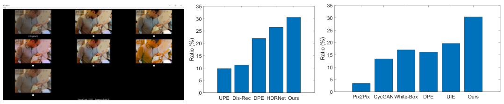
# pdfrect: 13 48.0 175.3 557.6 183.3
# pdfsent: [[[13,48.0,175.3,64.8,183.3]],[[13,64.8,175.3,78.2,183.3]],[[13,78.2,175.3,557.6,183.3]]]
#+begin_en
Fig. 11. (a) Interface of the user study tool; (b) voting statistics of paired learning methods; and (c) voting statistics of unpaired learning methods.
#+end_en
図 11. (a) ユーザー調査ツールのインターフェース、(b) ペア学習方法の投票統計、(c) 非ペア学習方法の投票統計。

# pdfrect: 13 48.0 538.6 300.0 663.5
# pdfsent: [[[13,48.0,538.6,300.0,548.1],[13,48.0,550.1,300.0,559.6],[13,48.0,561.7,300.0,571.2],[13,48.0,572.6,300.0,582.7]],[[13,48.0,584.8,300.0,594.3],[13,48.0,596.3,276.4,605.8]],[[13,276.4,596.3,300.0,605.8]],[[13,48.0,607.3,300.0,617.3],[13,48.0,618.8,300.0,628.9],[13,48.0,630.9,68.0,640.4]],[[13,68.0,630.9,300.0,640.4],[13,48.0,642.5,300.0,652.0],[13,48.0,654.0,281.0,663.5]]]
#+begin_en
Considering that the human’s preference on the color and tone of photos are highly subjective and models trained with paired datasets are relatively stable in most cases, an advantage of about 4% is a noticeable improvement under the paired learning setting. Our model has more significant advantage over the competing methods in the unpaired learning setting as shown in Fig. 11(c). Specifically, our model receives 30.4% votes which is much higher than the 19.6% votes obtained by the second best method UIE. Such an advantage mainly owns to the high stability of our model under the unpaired learning setting while most of the other methods generate noticeable artifacts or unnatural color cast.
#+end_en
写真の色やトーンに対する人間の好みは非常に主観的であり、ペアデータセットでトレーニングされたモデルはほとんどの場合比較的安定していることを考慮すると、ペア学習設定で約 4% の優位性は顕著な改善です。図 11(c) に示すように、ペアなし学習設定では、私たちのモデルは競合手法よりもさらに大きな優位性を持っています。具体的には、私たちのモデルは 30.4% の票を獲得しており、2 番目に優れた手法である UIE が獲得した 19.6% の票よりもはるかに高くなっています。このような優位性は主に、他のほとんどの手法が目立つアーティファクトや不自然な色かぶりを生成するのに対し、ペアなし学習設定では私たちのモデルが非常に安定していることに起因しています。

*** 4.6 Running speed
:PROPERTIES:
:NOTER_PAGE: 13
:END:
# pdfrect: 13 48.0 690.8 300.0 746.5
# pdfsent: [[[13,48.0,690.8,300.0,700.3],[13,48.0,702.4,300.0,711.9],[13,48.0,713.9,192.0,723.4]],[[13,192.0,713.9,300.0,723.4],[13,48.0,725.4,218.8,734.9]],[[13,218.8,725.4,300.0,734.9],[13,48.0,736.3,300.0,746.5]]]
#+begin_en
Apart from the superior enhancement quality to state-of-the-art photo enhancement models, another important advantage of our method lies in its high efficiency. In this section we evaluate the running speed of competing methods. The test images are resized to three standard resolutions: 1920×1080, 3840×2160 and
#+end_en
最先端の画像強調モデルよりも優れた強調品質に加えて、私たちの方法のもう 1 つの重要な利点は、その高い効率性にあります。このセクションでは、競合する方法の実行速度を評価します。テスト画像は、1920×1080、3840×2160、および
# pdfrect: 13 312.0 537.9 564.0 663.5
# pdfsent: [[[13,312.0,537.9,356.7,548.1]],[[13,356.7,537.9,564.0,548.1],[13,312.0,550.1,517.8,559.6]],[[13,517.8,550.1,564.0,559.6],[13,312.0,561.7,564.0,571.2],[13,312.0,573.2,396.0,582.7]],[[13,396.0,573.2,564.0,582.7],[13,312.0,584.8,564.0,594.3],[13,312.0,596.3,564.0,605.8],[13,312.0,607.8,556.1,617.3]],[[13,556.1,607.8,564.0,617.3],[13,312.0,619.4,564.0,628.9],[13,312.0,630.9,564.0,640.4],[13,312.0,642.5,405.0,652.0]],[[13,405.0,642.5,564.0,652.0],[13,312.0,654.0,539.3,663.5]]]
# pdfhl: sky blue 3,4,5
#+begin_en
6000×4000. All models are tested on the same image set for 100 times using one Titan RTX GPU with 24 GB memory. The average running time of all methods measured by milliseconds (ms) are reported in Table 7. As can be seen, the speed of our method is at least two-orders faster than all competing methods when testing on the same GPU device and the speed advantage of our method consistently increases with the increase of image resolution. In particular, our model spends less than 2 ms in processing an image with 4K resolution, which satisfies the real-time requirement of practical applications. It is worth mentioning that HDRNet can be significantly accelerated with customized OpenGL shaders.
#+end_en
6000×4000。すべてのモデルは、24 GB メモリを搭載した Titan RTX GPU 1 台を使用して、同じ画像セットで 100 回テストされました。すべての方法の平均実行時間は、ミリ秒 (ms) で測定され、表 7 に示されています。ご覧のとおり、同じ GPU デバイスでテストした場合、当社の方法の速度は競合するすべての方法よりも少なくとも 2 桁速く、画像解像度の増加に伴って当社の方法の速度上の優位性は一貫して増加します。特に、当社のモデルは 4K 解像度の画像の処理に 2 ms 未満しか費やさず、実用アプリケーションのリアルタイム要件を満たしています。HDRNet は、カスタマイズされた OpenGL シェーダーを使用して大幅に高速化できることは特筆に値します。

#+begin_en
TABLE 7 Running time (in milliseconds) comparison between our model and state-of-the-art deep enhancement models at different resolutions. All models are tested using one Titan RTX GPU. “N.A.” means that the result is not available.
#+end_en
表 7 異なる解像度における、本モデルと最先端の深層画像強調モデルの実行時間（ミリ秒）の比較。すべてのモデルは 1 つの Titan RTX GPU を使用してテストされています。「N.A.」は結果が利用できないことを意味します。

| Resolution    | 1920×1080 | 3840×2160 | 6000×4000 |
|---------------+------------+------------+------------|
| Pix2Pix [49]  |      1.2e2 |       N.A. |       N.A. |
| CycGAN [50]   |      5.6e2 |       N.A. |       N.A. |
| DPE [7]       |      8.6e1 |       N.A. |       N.A. |
| White-Box [9] |      5.0e3 |      9.1e3 |      2.0e4 |
| Dis-Rec [8]   |      2.5e4 |      1.1e5 |      3.3e5 |
| UIE [11]      |      1.0e4 |      2.0e4 |      3.3e4 |
| HDRNet [2]    |      4.5e1 |      2.1e2 |      5.9e2 |
| UPE [10]      |      4.5e1 |      2.1e2 |      5.9e2 |
| Ours          |       0.64 |       1.66 |       3.76 |

# pdfrect: 13 312.0 667.7 564.0 746.5
# pdfsent: [[[13,326.2,667.7,564.0,677.2],[13,312.0,679.3,564.0,688.8],[13,312.0,690.8,564.0,700.3],[13,312.0,702.4,350.4,711.9]],[[13,350.4,702.4,564.0,711.9],[13,312.0,713.9,564.0,723.4],[13,312.0,725.4,564.0,734.9],[13,312.0,737.0,564.0,746.5]]]
# pdfhl: sky blue 0
#+begin_en
The high efficiency of our method mainly comes from the facts that the computational cost of the CNN weight predictor is fixed in our model and its memory cost is much lower than all competing methods. Although the CNN models in HDRNet, White-Box, Dis- Rec and UIE also have fixed input size, the HDRNet consumes intermediate computation and memory cost to calculate pixel-wise transformation coefficients on the high-resolution input image, and
#+end_en
私たちの手法の高い効率性は、主に、私たちのモデルでは CNN 重み予測器の計算コストが固定されており、メモリ コストが競合するすべての手法よりもはるかに低いという事実から生じています。HDRNet、White-Box、Dis-Rec、UIE の CNN モデルも入力サイズが固定されていますが、HDRNet は高解像度入力画像上のピクセル単位の変換係数を計算するために中間計算とメモリ コストを消費し、
# pdfrect: 14 48.0 213.7 300.0 257.8
# pdfsent: [[[14,48.0,213.7,300.0,223.2],[14,48.0,225.2,113.0,234.7]],[[14,113.0,225.2,300.0,234.7],[14,48.0,236.7,300.0,246.2],[14,48.0,248.3,290.1,257.8]]]
# pdfhl: sky blue 1
#+begin_en
White-Box, Dis-Rec and UIE need many iterations to generate the enhanced image. In contrast, our model directly maps input RGB values to output RGB values in one single forward step, and the transformation via 3D LUTs can be highly parallel using GPU.
#+end_en
White-Box、Dis-Rec、UIE では、高画質画像を生成するために多くの反復処理が必要です。一方、私たちのモデルは、入力 RGB 値を出力 RGB 値に 1 回の順方向処理で直接マッピングし、3D LUT による変換は GPU を使用して高度に並列化できます。

*** 4.7 Limitation and discussion
:PROPERTIES:
:NOTER_PAGE: 14
:END:
***** 今後の課題
# pdfrect: 14 48.0 284.2 300.0 409.1
# pdfsent: [[[14,48.0,284.2,300.0,293.7],[14,48.0,295.8,300.0,305.3],[14,48.0,307.3,140.0,316.8]],[[14,140.0,307.3,300.0,316.8],[14,48.0,318.9,300.0,328.4],[14,48.0,330.4,300.0,339.9],[14,48.0,341.9,147.1,351.4]],[[14,147.1,341.9,300.0,351.4],[14,48.0,353.5,300.0,363.0]],[[14,48.0,365.0,68.7,374.5]],[[14,68.7,365.0,300.0,374.5],[14,48.0,376.6,164.0,386.1]],[[14,164.0,376.6,300.0,386.1],[14,48.0,388.1,300.0,397.6],[14,48.0,399.6,297.6,409.1]]]
# pdfhl: cyan 0,1,2
#+begin_en
Although our model can achieve stable and efficient photo enhancement across a variety of scenes, it has two limitations inherited from 3D LUT. First, our 3D LUT can adapt to different images based on their content; however, once the 3D LUT is determined for an input image, it is the same for different local areas within the image. Consequently, 3D LUT may produce less satisfactory results in some areas requiring local enhancement. Fig. 12 shows such an example, where the scene of input image has very high dynamic range. As can be seen, although our model properly enhances the global color and tone of the input image, the local contrast in the shadow area is not sufficiently enhanced.
#+end_en

私たちのモデルは、さまざまなシーンで安定した効率的な画像補正を実現できますが、3D LUT から受け継いだ 2 つの制限があります。まず、私たちの 3D LUT は、画像の内容に基づいてさまざまな画像に適応できますが、入力画像に対して 3D LUT が決定されると、画像内のさまざまな局所領域で同じになります。その結果、局所的な補正が必要な領域では、3D LUT は満足のいく結果が得られない場合があります。図 12 は、入力画像のシーンのダイナミックレンジが非常に高い例を示しています。ご覧のとおり、私たちのモデルは入力画像の全体的な色とトーンを適切に補正しますが、影の部分の局所的なコントラストは十分に補正されていません。

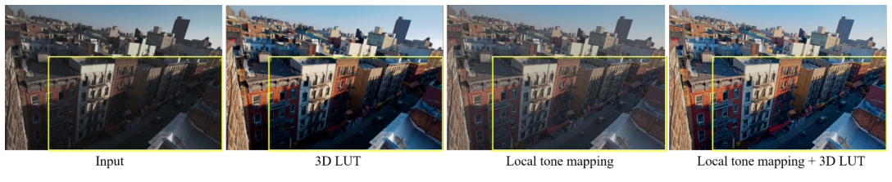
# pdfrect: 13 48.0 306.8 564.0 323.8
# pdfsent: [[[13,48.0,306.8,66.3,314.8]],[[13,66.3,306.8,80.9,314.8]],[[13,80.9,306.8,329.8,314.8]],[[13,329.8,306.8,564.0,314.8],[13,48.0,315.8,514.0,323.8]]]
#+begin_en
Fig. 12. Enhancement results on an input scene with very high dynamic range. Our 3D LUT model effectively enhances the global color and tone, while the local contrast in the shadow area can be further improved by combining some local tone mapping operator with our model.
#+end_en
図 12．非常に広いダイナミックレンジを持つ入力シーンにおける強調結果。当社の 3D LUT モデルは、全体的な色とトーンを効果的に強調しますが、シャドウ領域の局所的なコントラストは、局所的なトーンマッピング演算子を当社のモデルと組み合わせることでさらに改善できます。

# pdfrect: 14 48.0 410.9 300.0 558.8
# pdfsent: [[[14,62.2,410.9,300.0,420.4],[14,48.0,422.4,300.0,431.9],[14,48.0,433.9,229.3,443.4]],[[14,229.3,433.9,300.0,443.4],[14,48.0,445.5,300.0,455.0],[14,48.0,457.0,300.0,466.5]],[[14,48.0,468.6,300.0,478.1],[14,48.0,480.1,290.8,489.6]],[[14,290.8,480.1,300.0,489.6],[14,48.0,491.6,142.0,501.1]],[[14,142.0,491.6,300.0,501.1],[14,48.0,503.2,300.0,512.7],[14,48.0,514.7,218.6,524.2]],[[14,218.6,514.7,300.0,524.2],[14,48.0,526.3,300.0,535.8],[14,48.0,537.8,300.0,547.3],[14,48.0,549.3,287.4,558.8]]]
# pdfhl: cyan 0
#+begin_en
One possible solution to address this limitation is to combine some local contrast enhancement method, such as the local tone mapping algorithm [51], with our 3D LUT. Here we give one example by replacing the bilateral filter used in [51] with the guided filter in [52] for its better performance on edge preserving. We first apply local tone mapping to the input image and then apply the proposed 3D LUT to the tone mapped output. As can be seen from Fig. 12, combining local tone mapping with our 3D LUT achieves good visual quality on both global and local enhancement in this challenging case. However, it should be noted that the local tone mapping method is still time consuming for high resolution images, and how to efficiently embed local enhancement operations into 3D LUT will be our future work.
#+end_en

この制限に対処する一つの解決策として、局所トーンマッピングアルゴリズム[51]などの局所コントラスト強調手法を、我々の 3D LUT と組み合わせることが考えられます。ここでは、[51]で使用されているバイラテラルフィルタを、エッジ保持性能が優れている[52]のガイド付きフィルタに置き換えた例を示します。まず入力画像に局所トーンマッピングを適用し、次にトーンマッピングされた出力に提案する 3D LUT を適用します。図 12 からわかるように、局所トーンマッピングと我々の 3D LUT を組み合わせることで、この困難なケースにおいて、全体的および局所的な強調の両方で良好な視覚品質を実現できます。ただし、高解像度画像の場合、局所トーンマッピング手法は依然として時間がかかるため、局所強調処理を 3D LUT に効率的に組み込む方法は今後の課題となります。

# pdfrect: 14 48.0 560.6 300.0 697.0
# pdfsent: [[[14,62.2,560.6,300.0,570.1],[14,48.0,572.1,300.0,581.6],[14,48.0,583.7,228.0,593.2]],[[14,228.0,583.7,300.0,593.2],[14,48.0,595.2,143.0,604.7]],[[14,143.0,595.2,300.0,604.7],[14,48.0,606.7,160.0,616.2]],[[14,160.0,606.7,300.0,616.2],[14,48.0,618.3,300.0,627.8],[14,48.0,629.8,300.0,639.3],[14,48.0,641.4,255.5,650.9]],[[14,255.5,641.4,300.0,650.9],[14,48.0,652.9,300.0,662.4],[14,48.0,664.4,300.0,673.9],[14,48.0,676.0,214.7,685.5]],[[14,214.7,676.0,300.0,685.5],[14,48.0,687.5,110.5,697.0]]]
# pdfhl: cyan 0
# pdfhl: cyan 3,4,5
#+begin_en
Second, as a compact and highly efficient operator, 3D LUT transforms each input RGB value independently, which however limits its capability on detail enhancement. One challenging example is shown in Fig. 13, where the input image was taken at nighttime with heavy noise. Compared to the result generated by Google’s image processing pipeline [45], where there are some denoising operations, our 3D LUT model effectively enhances the dark areas but also amplifies the noise in these areas. In practice, one possible solution to address this limitation is to combine 3D LUT transformation with some denoising module as commonly done in camera imaging pipeline [1], [45]. We also leave this for our future work.
#+end_en

第二に、コンパクトで非常に効率的な演算子である 3D LUT は、各入力 RGB 値を個別に変換しますが、そのためディテール強調の能力が制限されます。図 13 に、入力画像が夜間に撮影され、ノイズが多いという難しい例を示します。ノイズ除去処理が行われている Google の画像処理パイプライン[45]で生成された結果と比較すると、私たちの 3D LUT モデルは暗い領域を効果的に強調しますが、これらの領域のノイズも増幅します。実際には、この制限に対処する 1 つの解決策は、カメラ画像処理パイプライン[1]、[45]で一般的に行われているように、3D LUT 変換をノイズ除去モジュールと組み合わせることです。これも今後の課題とします。

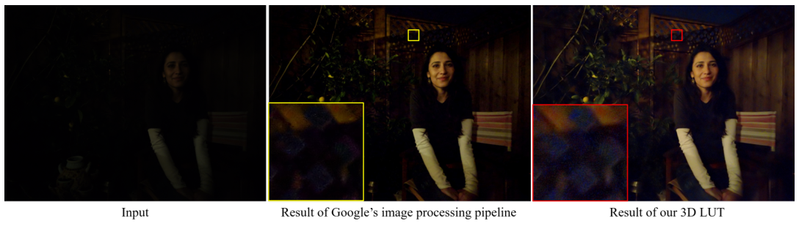

#+begin_en
Fig. 13. Enhancement results generated by our 3D LUT model and Google’s image processing pipeline on a noisy input (with 16-bit dynamic range) from the HDR+ dataset. Although our model properly enhances the dark area, the noise is also amplified after the enhancement. Please zoom in to see the details.
#+end_en
図 13．HDR+データセットのノイズの多い入力画像（ダイナミックレンジ 16 ビット）に対し、当社の 3D LUT モデルと Google の画像処理パイプラインを用いて生成した強調処理結果。当社のモデルは暗い領域を適切に強調していますが、強調処理後にはノイズも増幅されています。詳細を確認するには、画像を拡大してください。

** 5 CONCLUSION
:PROPERTIES:
:NOTER_PAGE: 14
:END:
# pdfrect: 14 48.0 725.4 300.0 746.5
# pdfrect: 14 312.0 44.6 564.0 215.6
# pdfsent: [[[14,48.0,725.4,300.0,734.9],[14,48.0,737.0,161.8,746.5]],[[14,161.8,737.0,300.0,746.5],[14,312.0,44.6,564.0,54.1],[14,312.0,56.1,564.0,65.6],[14,312.0,67.7,522.0,77.2]],[[14,522.0,67.7,564.0,77.2],[14,312.0,79.2,564.0,88.7],[14,312.0,90.7,564.0,100.2]],[[14,312.0,102.3,564.0,111.8],[14,312.0,113.8,564.0,123.3],[14,312.0,125.4,564.0,134.9]],[[14,312.0,136.9,564.0,146.4],[14,312.0,148.4,564.0,157.9],[14,312.0,160.0,474.8,169.5]],[[14,474.8,160.0,564.0,169.5],[14,312.0,171.5,564.0,181.0],[14,312.0,183.1,564.0,192.6],[14,312.0,194.6,343.0,204.1]],[[14,343.0,194.6,564.0,204.1],[14,312.0,206.1,500.5,215.6]]]
# pdfhl: sky blue 1
# pdfhl: sky blue 2,3
# pdfhl: sky blue 5
#+begin_en
We proposed an effective and efficient learning method for imageadaptive photo enhancement. Several basis 3D LUTs were learned in couple with a lightweight CNN weight predictor so that for each input image, an adaptive 3D LUT could be generated by fusing the basis 3D LUTs according to the image content. Smooth and monotonicity regularization terms were introduced into the learning process to make our model stable and robust to various scenes. We evaluated the proposed method on two photo enhancement applications, photo retouching and imaging pipeline enhancement, under both the pairwise learning and unpaired learning settings. The results demonstrated that our model consistently outperforms state-of-the-art deep image enhancement methods in terms of both quantitative and qualitative comparisons. Particularly, our model is more than 100 times faster than previous ones on processing images with 4K or higher resolutions, and it consumes much lower memory. It provides a promising solution to practical, especially high-resolution, photo enhancement applications.
#+end_en

画像適応型写真強調のための効果的かつ効率的な学習手法を提案しました。複数の基本 3D LUT を軽量 CNN 重み予測器と組み合わせて学習することで、各入力画像に対して、画像の内容に応じて基本 3D LUT を融合し、適応型 3D LUT を生成できるようにしました。学習プロセスには、平滑化および単調性正則化項を導入し、モデルを様々なシーンに対して安定かつ堅牢にしました。提案手法を、写真レタッチとイメージングパイプライン強化という 2 つの写真強調アプリケーションで、ペアワイズ学習と非ペア学習の両方の設定で評価しました。その結果、提案モデルは定量的および定性的な比較において、最先端の深層画像強調手法を常に上回る性能を示しました。特に、4K 以上の解像度の画像処理において、従来手法よりも 100 倍以上高速で、メモリ使用量も大幅に削減されています。この手法は、特に高解像度の写真強調アプリケーションにおいて、有望なソリューションとなるでしょう。

