* 論文ノート
:PROPERTIES:
:NOTER_DOCUMENT: ../PDFs/Learning-to-Maximize-Mutual-Information.pdf
:NOTER_PAGE: 1
:END:
** Abstract
:PROPERTIES:
:NOTER_PAGE: 1
:END:
# pdfrect: 1 75.0 193.9 271.2 407.2
# pdfsent: [[[1,75.4,193.9,269.5,204.0],[1,75.4,206.0,269.5,215.9],[1,75.4,217.9,222.2,227.9]],[[1,222.2,217.9,271.2,227.9],[1,75.4,229.6,271.2,239.8],[1,75.4,241.8,269.5,251.8],[1,75.4,253.8,257.6,263.7]],[[1,257.6,253.8,269.5,263.7],[1,75.4,265.6,270.8,275.7],[1,75.4,277.6,269.9,287.7],[1,75.4,289.6,271.2,299.6],[1,75.4,301.5,151.5,311.6]],[[1,151.5,301.5,269.9,311.6],[1,75.4,313.5,269.5,323.5],[1,75.4,325.4,269.5,335.5],[1,75.4,337.4,217.7,347.4]],[[1,217.7,337.4,269.5,347.4],[1,75.4,349.3,269.9,359.4],[1,75.0,361.3,269.5,371.4],[1,75.4,373.2,269.5,383.3],[1,75.4,385.4,269.5,395.2],[1,75.4,397.2,219.3,407.2]]]
#+begin_en
Feature selection helps reduce data acquisition costs in ML, but the standard approach is to train models with static feature subsets. Here, we consider the dynamic feature selection (DFS) problem where a model sequentially queries features based on the presently available information. DFS is often addressed with reinforcement learning, but we explore a simpler approach of greedily selecting features based on their conditional mutual information. This method is theoretically appealing but requires oracle access to the data distribution, so we develop a learning approach based on amortized optimization. The proposed method is shown to recover the greedy policy when trained to optimality, and it outperforms numerous existing feature selection methods in our experiments, thus validating it as a simple but powerful approach for this problem.
#+end_en

** 1. Introduction
:PROPERTIES:
:NOTER_PAGE: 1
:END:
# pdfrect: 1 55.1 460.8 291.1 578.4
# pdfsent: [[[1,55.1,460.8,290.7,470.8],[1,55.4,472.9,289.4,482.7],[1,55.4,484.8,83.4,494.7]],[[1,83.4,484.8,291.1,494.7],[1,55.4,496.7,289.4,506.6],[1,55.4,508.6,289.4,518.6],[1,55.4,520.3,133.4,530.6]],[[1,133.4,520.3,289.4,530.6],[1,55.4,531.2,289.8,542.5],[1,55.4,544.4,290.7,554.5],[1,55.4,556.4,289.8,566.4],[1,55.4,568.4,264.9,578.4]]]
#+begin_en
A machine learning model’s inputs can be costly to obtain, and feature selection is often used to reduce data acquisition costs. In applications where information is gathered sequentially, a natural option is to select features adaptively based on the currently available information, rather than using a fixed feature set. This setup is known as dynamic feature selection (DFS),1 and the problem has been considered by several works in the last decade (Saar-Tsechansky et al., 2009; Dulac-Arnold et al., 2011; Chen et al., 2015b; Early et al., 2016a; He et al., 2016a; Kachuee et al., 2018).
#+end_en

# pdfrect: 1 55.4 586.1 289.6 608.3
# pdfsent: [[[1,55.4,586.1,289.4,596.3],[1,55.4,598.2,289.6,608.3]]]
#+begin_en
Compared to static feature selection with a fixed feature set (Li et al., 2017; Cai et al., 2018), DFS can offer better
#+end_en

# pdfrect: 1 55.4 616.1 290.6 646.6
# pdfsent: [[[1,67.7,616.1,103.5,626.7]],[[1,103.5,616.1,290.6,626.7],[1,55.4,626.1,290.6,636.6],[1,55.4,637.5,156.6,646.6]]]
#+begin_en
1Paul G. Allen School of Computer Science & Engineering, University of Washington 2Department of Emergency Medicine, University of Washington.
#+end_en

# pdfrect: 1 55.4 637.5 289.4 656.5
# pdfsent: [[[1,248.4,637.5,289.4,646.6],[1,55.4,647.4,140.2,656.5]]]
#+begin_en
Ian Covert <icovert@cs.uw.edu>.
#+end_en

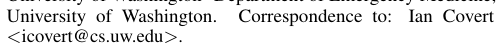

# pdfrect: 1 55.2 665.8 289.4 696.4
# pdfsent: [[[1,55.2,665.8,289.4,676.3],[1,55.2,677.3,188.5,686.4]],[[1,188.5,677.3,253.1,686.4]],[[1,253.1,677.3,289.4,686.4],[1,55.4,687.4,134.6,696.4]]]
#+begin_en
Proceedings of the 40 th International Conference on Machine Learning, Honolulu, Hawaii, USA. PMLR 202, 2023. Copyright 2023 by the author(s).
#+end_en

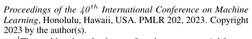

# pdfrect: 1 55.4 696.8 289.4 717.2
# pdfsent: [[[1,68.1,696.8,289.4,707.3],[1,55.4,708.1,274.4,717.2]]]
#+begin_en
1The problem has also been referred to as sequential feature selection, active feature acquisition, and information pursuit.
#+end_en

# pdfrect: 1 296.0 732.4 300.9 742.4
# pdfrect: 1 307.1 177.6 543.2 271.3
# pdfsent: [[[1,296.0,732.4,300.9,742.4],[1,307.4,177.6,448.0,187.7]],[[1,448.0,177.6,543.1,187.7],[1,307.4,189.6,541.4,199.6],[1,307.4,201.7,541.4,211.5],[1,307.1,213.6,543.2,223.5]],[[1,307.1,225.5,541.4,235.5],[1,307.4,237.5,541.4,247.4],[1,307.4,249.3,541.4,259.4],[1,307.1,261.4,528.3,271.3]]]
#+begin_en
1 performance given a fixed budget. This is easy to see, because selecting the same features for all instances (e.g., all patients visiting a hospital’s emergency room) is suboptimal when the most informative features vary across individuals. Although it should in theory offer better performance, DFS also presents a more challenging learning problem, because it requires learning both (i) a feature selection policy and (ii) how to make predictions given variable feature sets.
#+end_en

# pdfrect: 1 307.4 279.3 543.1 396.9
# pdfsent: [[[1,307.4,279.3,543.1,289.3],[1,307.4,291.3,542.7,301.2],[1,307.4,303.3,542.7,313.2],[1,307.4,315.1,412.6,325.2]],[[1,412.6,315.1,543.1,325.2],[1,307.4,327.2,541.4,337.1],[1,307.4,339.0,543.1,349.1],[1,307.4,351.1,542.7,361.0],[1,307.4,362.9,338.0,373.0]],[[1,338.0,362.9,542.8,373.0],[1,307.4,375.0,541.4,384.9],[1,307.4,386.9,491.5,396.9]]]
#+begin_en
Prior work has approached DFS in several ways, though often using reinforcement learning (RL) (Dulac-Arnold et al., 2011; Shim et al., 2018; Kachuee et al., 2018; Janisch et al., 2019; Li & Oliva, 2021). RL is a natural approach for sequential decision-making problems, but current methods are difficult to train and do not reliably outperform static feature selection methods (Henderson et al., 2018; Erion et al., 2021). Our work therefore explores a simpler approach: greedily selecting features based on their conditional mutual information (CMI) with the response variable.
#+end_en

# pdfrect: 1 307.1 404.9 543.1 582.2
# pdfsent: [[[1,307.1,404.9,542.7,414.8],[1,307.4,416.8,541.4,426.8],[1,307.4,428.7,541.4,438.7],[1,307.4,440.6,489.4,450.7]],[[1,489.4,440.6,541.4,450.7],[1,307.4,452.6,511.7,462.6]],[[1,511.7,452.6,541.4,462.6],[1,307.4,464.7,543.1,474.5],[1,307.4,476.6,541.4,486.5],[1,307.1,488.6,543.1,498.5],[1,307.4,500.5,541.4,510.4],[1,307.4,512.5,351.1,522.4]],[[1,351.1,512.5,541.4,522.4],[1,307.4,524.3,541.4,534.4],[1,307.4,536.1,541.4,546.3],[1,307.4,548.3,459.5,558.2]],[[1,459.5,548.3,541.4,558.2],[1,307.4,560.2,541.8,570.2],[1,307.4,572.2,459.1,582.2]]]
#+begin_en
The greedy approach is known from prior work (Chen et al., 2015b; Ma et al., 2019), but it is difficult to use in practice because calculating the CMI requires oracle access to the data distribution (Cover & Thomas, 2012). Our focus is therefore developing a practical approximation. Whereas previous work makes strong assumptions about the data (Geman & Jedynak, 1996) or approximates the data distribution with generative models (Ma et al., 2019), we develop a flexible approach that directly predicts the optimal selection at each step. Our method is based on a variational perspective on the greedy CMI policy, and it uses a technique known as amortized optimization (Amos, 2022) to enable training using only a standard labeled dataset. Notably, the model is trained with an objective function that recovers the greedy policy when it is trained to optimality.
#+end_en

# pdfrect: 1 307.4 590.1 500.9 600.1
# pdfsent: [[[1,307.4,590.1,500.9,600.1]]]
#+begin_en
Our contributions in this work are the following:
#+end_en

# pdfrect: 1 309.2 616.2 543.1 662.0
# pdfsent: [[[1,309.2,616.2,321.5,626.2]],[[1,321.5,616.2,543.1,626.2],[1,321.6,628.1,541.4,638.2],[1,321.6,640.1,541.4,650.1],[1,321.6,652.1,446.0,662.0]]]
#+begin_en
1. We derive a variational, or optimization-based perspective on the greedy CMI policy, which shows it to be equivalent to minimizing the one-step-ahead prediction loss given an optimal classifier.
#+end_en

# pdfrect: 1 309.2 671.6 543.1 717.4
# pdfsent: [[[1,309.2,671.6,321.9,681.6]],[[1,321.9,671.6,543.1,681.6],[1,321.6,683.6,541.8,693.5],[1,321.6,695.6,489.6,705.5]],[[1,489.6,695.6,543.1,705.5],[1,321.6,707.6,541.6,717.4]]]
#+begin_en
2. We develop a learning approach based on amortized optimization, where a policy network is trained to directly predict the optimal selection at each step. Rather than requiring a dataset that indicates the correct selections, our
#+end_en

# pdfrect: 2 157.0 47.2 439.9 56.2
# pdfrect: 2 69.6 69.5 289.4 103.3
# pdfsent: [[[2,157.0,47.2,439.9,56.2],[2,69.6,69.5,289.4,79.4],[2,69.6,81.4,289.4,91.4],[2,69.6,93.4,147.1,103.3]]]
#+begin_en
Learning to Maximize Mutual Information for Dynamic Feature Selection training approach is based on a standard labeled dataset and an objective function whose global optimizer is the greedy CMI policy.
#+end_en

# pdfrect: 2 57.2 111.8 289.8 145.8
# pdfsent: [[[2,57.2,111.8,69.6,121.9]],[[2,69.6,111.8,289.8,121.9],[2,69.6,123.8,289.4,133.8],[2,69.6,135.8,269.7,145.8]]]
#+begin_en
3. We propose a continuous relaxation for the inherently discrete learning objective, which enables efficient and architecture-agnostic gradient-based optimization.
#+end_en

# pdfrect: 2 55.4 159.5 291.1 217.3
# pdfsent: [[[2,55.4,159.5,291.1,169.5],[2,55.4,171.5,289.8,181.5],[2,55.4,183.4,274.6,193.4]],[[2,274.6,183.4,291.1,193.4],[2,55.4,195.4,289.8,205.4],[2,55.4,207.4,278.1,217.3]]]
#+begin_en
Our experiments evaluate the proposed method on numerous datasets, and the results show that it outperforms many recent dynamic and static feature selection methods. Overall, our work shows that when learned properly, the greedy CMI policy is a simple and powerful approach for DFS.
#+end_en

** 2. Problem formulation
:PROPERTIES:
:NOTER_PAGE: 2
:END:
# pdfrect: 2 55.4 255.3 289.4 277.2
# pdfsent: [[[2,55.4,255.3,289.4,265.3],[2,55.4,267.3,196.3,277.2]]]
#+begin_en
In this section, we describe the DFS problem and introduce notation used throughout the paper.
#+end_en

*** 2.1. Notation
:PROPERTIES:
:NOTER_PAGE: 2
:END:
# pdfrect: 2 55.2 310.8 289.4 333.0
# pdfsent: [[[2,55.4,310.8,289.4,321.0],[2,55.2,322.9,218.0,333.0]],[[2,218.0,322.9,289.4,333.0]]]
#+begin_en
Let x denote a vector of input features and y a response variable for a supervised learning task. The input consists
#+end_en

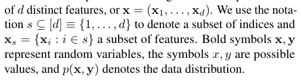

# pdfrect: 2 55.4 400.6 291.1 566.1
# pdfsent: [[[2,55.4,400.6,289.4,410.7],[2,55.4,412.6,277.5,422.6]],[[2,277.5,412.6,289.4,422.6],[2,55.4,424.3,290.7,435.2],[2,55.4,436.5,289.4,446.6],[2,55.4,448.5,237.0,458.5]],[[2,237.0,448.5,289.4,458.5],[2,55.4,460.3,291.1,471.1],[2,55.4,472.2,289.7,482.4],[2,55.4,484.3,290.7,494.4],[2,55.4,494.7,190.4,507.4]],[[2,190.4,494.7,290.6,507.4],[2,55.4,508.3,281.2,518.3]],[[2,281.2,508.3,289.4,518.3],[2,55.4,520.3,289.4,530.2],[2,55.4,532.2,291.1,542.2],[2,55.4,542.7,289.4,554.1],[2,55.4,555.8,128.8,566.1]]]
#+begin_en
Our goal is to design a policy that controls which features are selected given the currently available information. The selection policy can be viewed as a function π(xs) ∈ [d], meaning that it receives a subset of features as its input and outputs the next feature index to query. The policy is accompanied by a predictor f(xs) that can make predictions given the set of available features; for example, if y is discrete then predictions lie in the probability simplex, or f(xs) ∈ ∆K−1 for K classes. The notation f(xs ∪ xi) represents the prediction given the combined features. We initially consider policy and predictor functions that operate on feature subsets, and Section 4 proposes an implementation using a mask variable m ∈ [0, 1]d where the functions operate on x ⊙ m.
#+end_en

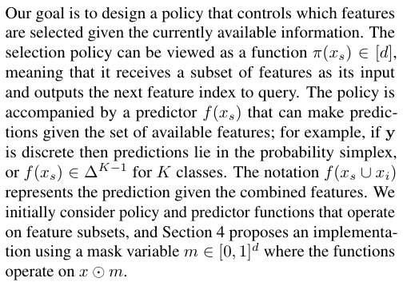

*** 2.2. Dynamic feature selection
:PROPERTIES:
:NOTER_PAGE: 2
:END:
# pdfrect: 2 55.1 599.8 291.1 717.5
# pdfsent: [[[2,55.1,599.8,289.4,609.9],[2,55.4,611.8,234.1,621.8]],[[2,234.1,611.8,289.4,621.8],[2,55.4,623.7,289.4,633.8],[2,55.4,635.7,291.1,645.8],[2,55.4,647.7,84.8,657.7]],[[2,84.8,647.7,290.7,657.7],[2,55.4,659.6,291.1,669.7],[2,55.4,671.6,289.4,681.6],[2,55.1,683.5,289.4,693.6],[2,55.4,695.6,82.3,705.5]],[[2,82.3,695.6,289.8,705.5],[2,55.4,707.5,289.4,717.5]]]
#+begin_en
The goal of DFS is to select features with minimal budget that achieve maximum predictive accuracy. Having access to more features generally makes prediction easier, so the challenge is selecting a small number of informative features. There are multiple formulations for this problem, including versions with non-uniform feature costs and different budgets for each sample (Kachuee et al., 2018), but we focus on the setting with a fixed budget and uniform costs. Our goal is to handle predictions at inference time by beginning with no features, sequentially selecting features
#+end_en

# pdfrect: 2 296.0 732.4 300.9 742.4
# pdfrect: 2 307.4 69.1 541.8 91.4
# pdfsent: [[[2,296.0,732.4,300.9,742.4],[2,307.4,69.1,541.8,80.0],[2,307.4,81.2,530.4,91.4]]]
#+begin_en
2 xs such that |s| = k for a fixed budget k < d, and finally making accurate predictions for the response variable y.
#+end_en

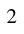

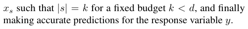

# pdfrect: 2 307.4 99.4 541.4 157.1
# pdfsent: [[[2,307.4,99.4,541.4,109.3],[2,307.4,111.1,541.4,121.3],[2,307.4,123.0,486.8,133.2]],[[2,486.8,123.0,541.4,133.2],[2,307.4,135.0,541.4,145.2],[2,307.4,146.9,454.6,157.1]]]
#+begin_en
Given a loss function that measures the discrepancy between predictions and labels ℓ(ˆy, y), a natural scoring criterion is the expected loss after selecting k features. The scoring is applied to a policy-predictor pair (π, f), and we define the score for a fixed budget k as follows,
#+end_en

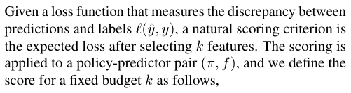

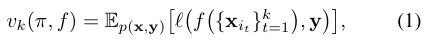

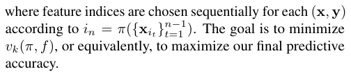

# pdfrect: 2 307.1 247.0 543.1 340.6
# pdfsent: [[[2,307.4,247.0,541.4,256.9],[2,307.1,258.9,541.4,268.9],[2,307.4,270.7,541.4,280.9],[2,307.4,282.8,324.3,292.8]],[[2,324.3,282.8,345.3,292.8]],[[2,345.3,282.8,543.1,292.8],[2,307.4,294.9,542.7,304.7],[2,307.4,306.7,415.8,316.7]],[[2,415.8,306.7,541.4,316.7],[2,307.4,318.8,541.8,328.7],[2,307.4,330.7,527.1,340.6]]]
#+begin_en
One approach is to frame this as a Markov decision process (MDP) and solve it using standard RL techniques, so that π and f are trained to optimize a reward function based on eq. (1). Several recent works have designed such formulations (Shim et al., 2018; Kachuee et al., 2018; Janisch et al., 2019; Li & Oliva, 2021). However, these approaches are difficult to train effectively, so our work focuses on a greedy approach that is easier to learn and simpler to interpret.
#+end_en

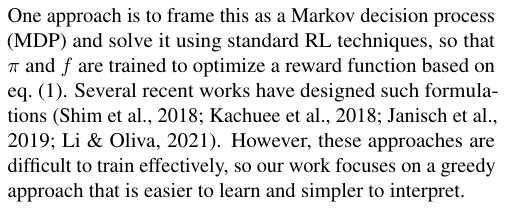

** 3. Greedy information maximization
:PROPERTIES:
:NOTER_PAGE: 2
:END:
# pdfrect: 2 307.1 378.5 541.4 412.5
# pdfsent: [[[2,307.1,378.5,541.4,388.6],[2,307.4,390.5,541.4,400.5],[2,307.4,402.5,382.3,412.5]]]
#+begin_en
This section first defines the greedy CMI policy, and then describes an existing approximation strategy that relies on generative models.
#+end_en

*** 3.1. The greedy selection policy
:PROPERTIES:
:NOTER_PAGE: 2
:END:
# pdfrect: 2 307.1 446.2 543.1 563.9
# pdfsent: [[[2,307.1,446.2,541.4,456.3],[2,307.4,458.3,541.4,468.2],[2,307.4,470.3,350.3,480.2]],[[2,350.3,470.3,541.4,480.2],[2,307.1,482.1,541.4,492.2],[2,307.4,494.0,541.4,504.1],[2,307.2,506.0,455.9,516.1]],[[2,455.9,506.0,541.4,516.1],[2,307.4,517.7,541.4,528.6],[2,307.4,529.8,541.4,541.5],[2,307.4,541.7,543.1,552.5],[2,307.4,553.9,515.8,563.9]]]
#+begin_en
As an idealized approach to DFS, we are interested in the greedy algorithm that selects the most informative feature at each step. This feature can be defined in multiple ways, but we focus on the information-theoretic perspective that the most useful feature has maximum CMI with the response variable (Cover & Thomas, 2012). The CMI, denoted as I(xi; y | xs), quantifies how much information an unknown feature xi provides about the response y when accounting for the current features xs, and it is defined as the KL divergence between the joint and factorized distributions:
#+end_en

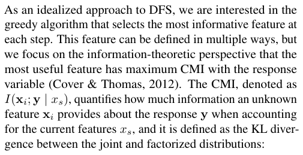

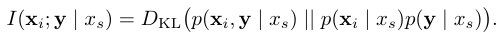

# pdfrect: 2 307.1 598.3 543.2 718.1
# pdfsent: [[[2,307.4,598.3,541.4,610.5],[2,307.4,611.5,543.1,624.0],[2,307.4,623.9,543.1,633.8],[2,307.4,635.9,331.4,645.7]],[[2,331.4,635.9,543.1,645.7],[2,307.4,647.8,543.1,657.7],[2,307.4,659.5,541.6,669.7],[2,307.4,670.0,543.2,683.8]],[[2,307.4,683.6,542.7,693.6],[2,307.1,695.5,541.4,705.5],[2,307.4,705.9,495.6,718.1]]]
#+begin_en
Based on this, we define the greedy CMI policy as π∗(xs) ≡ arg maxi I(xi; y | xs), so that features are sequentially selected to maximize our information about the response variable. We can alternatively understand the policy as performing greedy uncertainty minimization, because this is equivalent to minimizing y’s conditional entropy at each step, or π∗(xs) = arg mini H(y | xi, xs) (Cover & Thomas, 2012). For a complete characterization of this idealized approach, we also consider that the policy is paired with the Bayes classifier as a predictor, or f ∗(xs) = p(y | xs).
#+end_en

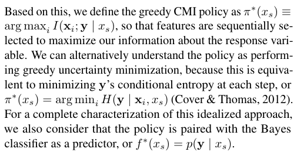

# pdfrect: 3 157.0 47.2 439.9 56.2
# pdfsent: [[[3,157.0,47.2,439.9,56.2]]]
#+begin_en
Learning to Maximize Mutual Information for Dynamic Feature Selection
#+end_en

# pdfrect: 3 55.1 69.2 291.1 258.8
# pdfsent: [[[3,55.4,69.2,289.4,79.4],[3,55.4,81.4,230.9,91.4]],[[3,230.9,81.4,289.4,91.4],[3,55.4,93.3,289.4,103.4],[3,55.4,105.4,122.3,115.3]],[[3,122.3,105.4,192.9,115.3]],[[3,192.9,105.4,289.4,115.3],[3,55.4,117.2,289.4,127.3],[3,55.4,129.2,289.4,139.2],[3,55.4,141.1,291.1,151.2],[3,55.4,153.1,289.4,163.1],[3,55.1,165.0,238.3,175.1]],[[3,238.3,165.0,289.4,175.1],[3,55.4,177.0,289.4,187.1],[3,55.4,189.1,289.4,199.0],[3,55.4,201.0,291.1,210.9],[3,55.4,212.9,167.0,222.9]],[[3,167.0,212.9,267.0,222.9]],[[3,267.0,212.9,290.1,222.9],[3,55.4,224.9,156.3,234.9]],[[3,156.3,224.9,289.4,234.9],[3,55.4,236.9,289.4,246.8],[3,55.4,248.8,74.9,258.8]]]
#+begin_en
Maximizing the information about y at each step is intuitive and should be effective in many problems. Prior work has considered the same idea, but from two perspectives that differ from ours. First, Chen et al. (2015b) take a theoretical perspective and prove that the greedy algorithm achieves performance within a multiplicative factor of the optimal policy; the proof requires specific distributional assumptions, but we find that the greedy algorithm performs well with many real-world datasets (Section 6). Second, from an implementation perspective, two works aim to provide practical approximations; however, these suffer from several limitations, so our work aims to develop a simple and flexible alternative (Section 4). In these works, Ma et al. (2019) and Chattopadhyay et al. (2022) both require a conditional generative model of the data distribution, which we discuss next.
#+end_en

*** 3.2. Estimating conditional mutual information
:PROPERTIES:
:NOTER_PAGE: 3
:END:
# pdfrect: 3 55.1 292.6 290.7 374.3
# pdfsent: [[[3,55.1,292.6,289.8,302.5],[3,55.4,304.6,261.3,314.5]],[[3,261.3,304.6,290.7,314.5],[3,55.4,316.6,172.4,326.4]],[[3,172.4,316.6,289.4,326.4],[3,55.4,328.5,289.4,338.4],[3,55.4,340.0,290.6,351.0],[3,55.4,352.0,289.6,362.9],[3,55.4,364.0,144.8,374.3]]]
#+begin_en
The greedy policy is trivial to implement if we can directly calculate CMI, but this is rarely the case in practice. Instead, one option is to estimate it. We now describe a procedure to do so iteratively for each feature, assuming for now that we have oracle access to the response distributions p(y | xs) for all s ⊆ [d] and the feature distributions p(xi | xs) for all s ⊆ [d] and i ∈ [d].
#+end_en

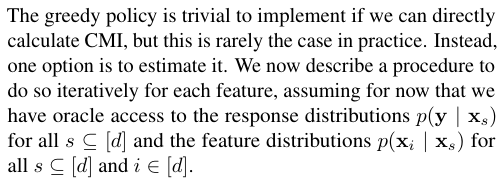

# pdfrect: 3 55.1 382.2 289.4 392.2
# pdfsent: [[[3,55.1,382.2,289.4,392.2]]]
#+begin_en
At any point in the selection procedure, given the current
#+end_en

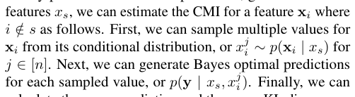

# pdfrect: 3 55.4 454.0 289.4 487.8
# pdfsent: [[[3,55.4,454.0,289.4,463.9],[3,55.4,465.9,289.4,475.9],[3,55.4,477.9,95.3,487.8]]]
#+begin_en
calculate the mean prediction and the mean KL divergence relative to this prediction, which yields the following CMI estimator:
#+end_en

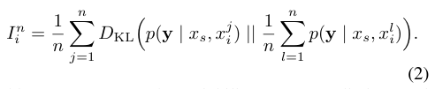

# pdfrect: 3 55.1 539.9 289.4 573.8
# pdfsent: [[[3,55.1,539.9,289.4,549.9],[3,55.4,551.7,289.4,562.5],[3,55.4,563.9,155.2,573.8]],[[3,155.2,563.9,289.4,573.8]]]
#+begin_en
This score measures the variability among predictions and captures whether different xi values significantly affect y’s conditional distribution. The estimator can be used to select
#+end_en

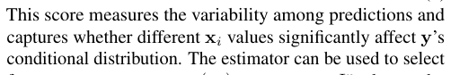

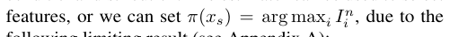

# pdfrect: 3 55.4 587.8 228.7 597.7
# pdfsent: [[[3,55.4,587.8,228.7,597.7]]]
#+begin_en
following limiting result (see Appendix A):
#+end_en

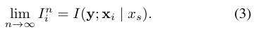

# pdfrect: 3 55.1 635.7 291.1 717.5
# pdfsent: [[[3,55.1,635.7,289.4,645.8],[3,55.4,647.7,229.9,657.7]],[[3,229.9,647.7,289.4,657.7],[3,55.4,659.6,291.1,669.7],[3,55.4,671.6,290.7,681.6],[3,55.4,683.7,289.4,693.5],[3,55.4,695.6,291.1,705.5],[3,55.4,707.4,141.7,717.5]],[[3,141.7,707.4,170.5,717.5]],[[3,170.5,707.4,289.6,717.5]]]
#+begin_en
This procedure thus provides a way to identify the correct greedy selections by estimating the CMI. Prior work has explored similar ideas for scoring features based on sampled predictions (Saar-Tsechansky et al., 2009; Chen et al., 2015a; Early et al., 2016a;b), but the implementation choices in these works prevent them from performing greedy information maximization. In eq. (2), is it important that our
#+end_en

# pdfrect: 3 295.9 732.4 300.9 742.4
# pdfrect: 3 307.4 69.5 543.2 127.9
# pdfsent: [[[3,295.9,732.4,300.9,742.4],[3,307.4,69.5,541.4,79.4],[3,307.4,81.1,541.4,92.0],[3,307.4,93.5,543.2,103.3]],[[3,307.4,105.4,541.8,115.3],[3,307.4,116.9,485.1,127.9]]]
#+begin_en
3 estimator uses the Bayes classifier, that we sample features from the conditional distribution p(xi | xs), and that we use the KL divergence as a measure of prediction variability. However, this estimator is impractical because we typically lack access to both p(y | xs) and p(xi | xs).
#+end_en

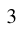

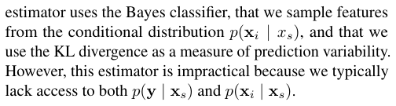

# pdfrect: 3 307.4 135.1 543.1 300.6
# pdfsent: [[[3,307.4,135.1,541.4,145.2],[3,307.4,147.1,402.5,157.2]],[[3,402.5,147.1,543.1,157.2],[3,307.4,158.8,541.4,169.7],[3,307.4,170.7,525.3,181.7]],[[3,525.3,170.7,543.1,181.7],[3,307.4,182.8,373.7,193.0]],[[3,373.7,182.8,541.4,193.0],[3,307.4,194.9,541.4,205.0],[3,307.4,206.9,472.1,216.9]],[[3,472.1,206.9,541.4,216.9],[3,307.4,218.8,541.4,228.9],[3,307.4,230.8,541.4,240.8],[3,307.4,242.7,543.1,252.8],[3,307.4,254.7,541.4,264.8],[3,307.4,266.7,433.1,276.7]],[[3,433.1,266.7,541.4,276.7],[3,307.4,278.6,541.8,288.7],[3,307.4,290.6,503.3,300.6]]]
#+begin_en
In practice, we would instead require learned substitutes for each distribution. For example, we can use a a classifier that approximates f(xs) ≈ p(y | xs) and a generative model that approximates samples from p(xi | xs). Similarly, Ma et al. (2019) propose jointly modeling (x, y) with a conditional generative model, which is implemented via a modified VAE (Kingma et al., 2015). This approach is limited for several reasons, including (i) the difficulty of training an accurate conditional generative model, (ii) the challenge of modeling mixed continuous/categorical features (Ma et al., 2020; Nazabal et al., 2020), and (iii) the slow CMI estimation process. In our approach, which we discuss next, we bypass all three of these challenges by directly predicting the best selection at each step.
#+end_en

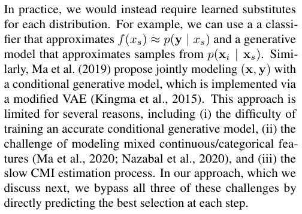

** 4. Proposed method
:PROPERTIES:
:NOTER_PAGE: 3
:END:
# pdfrect: 3 307.0 338.6 543.2 408.3
# pdfsent: [[[3,307.0,338.6,541.4,348.5],[3,307.4,350.5,543.2,360.5]],[[3,307.4,362.6,541.4,372.4],[3,307.4,374.5,543.1,384.4],[3,307.4,386.4,541.8,396.4],[3,307.4,398.4,530.6,408.3]]]
#+begin_en
We now introduce our approach, a practical approximation of the greedy policy trained using amortized optimization. Unlike prior work that estimates the CMI as an intermediate step, we develop a variational perspective on the greedy policy, which we then leverage to train a network that directly predicts the optimal selection given the current features.
#+end_en

*** 4.1. A variational perspective on CMI
:PROPERTIES:
:NOTER_PAGE: 3
:END:
# pdfrect: 3 307.4 442.1 541.8 548.4
# pdfsent: [[[3,307.4,442.1,541.8,452.1],[3,307.4,454.0,541.4,464.1],[3,307.4,466.0,345.0,476.0]],[[3,345.0,466.0,541.4,476.0],[3,307.4,478.1,541.4,487.9],[3,307.4,490.0,443.0,499.9]],[[3,443.0,490.0,541.6,499.9],[3,307.4,501.7,541.4,511.9],[3,307.4,513.6,541.4,523.8],[3,307.4,525.6,356.7,536.4]],[[3,356.7,525.6,541.4,536.4],[3,307.4,537.5,495.5,548.4]]]
#+begin_en
For our purpose, it is helpful to recognize that the greedy policy can be viewed as the solution to an optimization problem. Section 3 provides a conventional definition of CMI as a KL divergence, but this is difficult to integrate into an end-to-end learning approach. Instead, we now consider the one-step-ahead prediction achieved by a policy π and predictor f, and we determine the behavior that minimizes their loss. Given the current features xs and a selection i = π(xs), the expected one-step-ahead loss is:
#+end_en

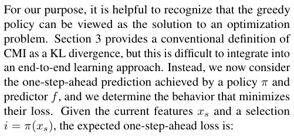

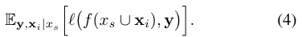

# pdfrect: 3 307.1 591.3 543.1 673.1
# pdfsent: [[[3,307.1,591.3,541.4,601.4],[3,307.4,603.3,503.8,613.3]],[[3,503.8,603.3,541.4,613.3],[3,307.4,615.2,543.1,625.3],[3,307.4,627.2,541.4,637.3],[3,307.4,639.0,346.5,649.2]],[[3,346.5,639.0,541.6,649.2],[3,307.4,651.2,541.4,661.1],[3,307.4,663.1,494.9,673.1]]]
#+begin_en
The variational perspective we develop here consists of two main results regarding this expected loss. The first result relates to the predictor, and we show that the lossminimizing predictor can be defined independently of the policy π. We formalize this in the following proposition for classification tasks, and our results can also be generalized to regression tasks (see proofs in Appendix A).
#+end_en

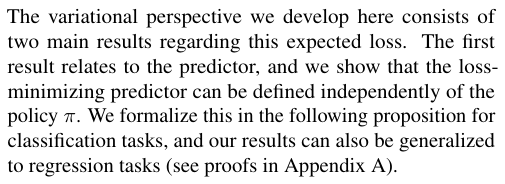

# pdfrect: 3 307.4 683.3 541.4 718.1
# pdfsent: [[[3,307.4,683.3,370.1,693.5]],[[3,370.1,683.3,541.4,693.5],[3,307.4,695.3,349.2,705.5]],[[3,349.2,695.3,541.4,705.5],[3,307.4,705.9,439.9,718.1]]]
#+begin_en
Proposition 1. When y is discrete and ℓ is cross-entropy loss, eq. (4) is minimized for any policy π by the Bayes classifier, or f ∗(xs) = p(y | xs).
#+end_en

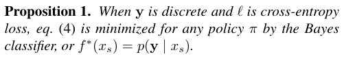

# pdfrect: 4 157.0 47.2 439.9 56.2
# pdfsent: [[[4,157.0,47.2,439.9,56.2]]]
#+begin_en
Learning to Maximize Mutual Information for Dynamic Feature Selection
#+end_en

# pdfrect: 4 55.1 69.4 291.1 175.1
# pdfsent: [[[4,55.1,69.4,289.4,79.5],[4,55.4,81.3,291.1,91.4],[4,55.4,93.5,291.1,103.3],[4,55.4,105.3,289.4,115.3],[4,55.4,117.2,275.0,127.3]],[[4,275.0,117.2,290.7,127.3],[4,55.4,127.6,290.7,139.2],[4,55.4,141.3,250.1,151.1]],[[4,250.1,141.3,289.8,151.1],[4,55.4,153.1,289.4,163.1],[4,55.4,165.1,156.2,175.1]]]
#+begin_en
This property requires that features are selected without knowledge of the remaining features or the response variable, which is a valid assumption for DFS, but not in scenarios where selections are based on the full feature set (Chen et al., 2018; Yoon et al., 2018; Jethani et al., 2021). Now, assuming that we use the Bayes classifier f ∗ as a predictor, our second result concerns the selection policy. As we show next, the loss-minimizing policy is equivalent to making selections based on CMI.
#+end_en

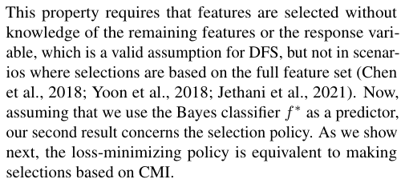

# pdfrect: 4 55.4 185.3 290.1 232.9
# pdfsent: [[[4,55.4,185.3,121.7,195.5]],[[4,121.7,185.3,289.4,195.5],[4,55.4,195.9,278.2,207.5]],[[4,278.2,195.9,290.1,207.5],[4,55.4,207.9,289.4,220.1],[4,55.4,221.1,151.0,232.9]]]
#+begin_en
Proposition 2. When y is discrete, ℓ is cross-entropy loss and the predictor is the Bayes classifier f ∗, eq. (4) is minimized by the greedy CMI policy, or π∗(xs) = arg maxi I(y; xi | xs).
#+end_en

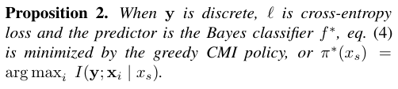

# pdfrect: 4 55.0 242.9 291.1 300.7
# pdfsent: [[[4,55.0,242.9,289.4,252.9],[4,55.4,255.0,289.4,264.9],[4,55.4,266.8,124.5,276.9]],[[4,124.5,266.8,291.1,276.9],[4,55.4,278.8,289.4,288.8],[4,55.4,290.8,128.9,300.7]]]
#+begin_en
With this, we can see that the greedy CMI policy defined in Section 3 is equivalent to minimizing the one-step-ahead prediction loss. Next, we exploit this variational perspective to develop a joint learning procedure for a policy and predictor network.
#+end_en

*** 4.2. An amortized optimization approach
:PROPERTIES:
:NOTER_PAGE: 4
:END:
# pdfrect: 4 55.4 334.6 291.1 452.1
# pdfsent: [[[4,55.4,334.6,289.4,344.5],[4,55.4,346.6,289.4,356.5],[4,55.4,358.5,182.2,368.4]],[[4,182.2,358.5,289.8,368.4],[4,55.4,370.5,290.7,380.4],[4,55.4,382.2,291.1,394.6],[4,55.4,394.4,289.4,404.3],[4,55.4,406.2,116.1,416.3]],[[4,116.1,406.2,289.4,416.3],[4,55.4,418.2,291.1,428.2],[4,55.4,430.2,289.4,440.2],[4,55.4,442.2,249.0,452.1]]]
#+begin_en
Instead of estimating each feature’s CMI to identify the next selection, we now develop an approach that directly predicts the best selection at each step. The greedy policy implicitly requires solving an optimization problem for each selection, or arg maxi I(y, xi; xs), but since we lack access to this objective, we now formulate an approach that directly predicts the solution. Following a technique known as amortized optimization (Amos, 2022), we do so by casting our variational perspective on CMI from Section 4.1 as an objective function to be optimized by a learnable network.
#+end_en

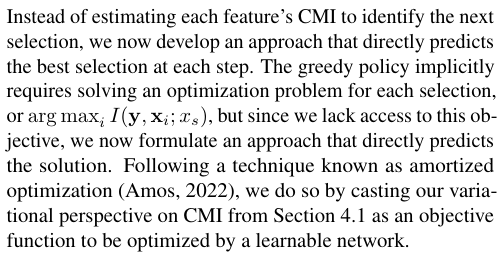

# pdfrect: 4 55.2 460.1 291.1 541.8
# pdfsent: [[[4,55.4,460.1,289.4,470.1],[4,55.4,471.9,291.1,482.0],[4,55.4,484.0,108.3,494.0]],[[4,108.3,484.0,289.4,494.0],[4,55.4,494.4,289.4,506.5],[4,55.4,507.6,204.7,518.5]],[[4,204.7,507.6,289.4,518.5],[4,55.2,519.8,289.4,529.9],[4,55.4,531.8,134.1,541.8]]]
#+begin_en
First, because it facilitates gradient-based optimization, we now consider that the policy outputs a distribution over feature indices. With slight abuse of notation, this section lets the policy be a function π(xs) ∈ ∆d−1, which generalizes the previous definition π(xs) ∈ [d]. Using this stochastic version of the policy, we can now formulate our objective function as follows.
#+end_en

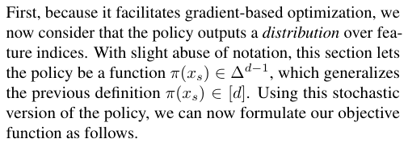

# pdfrect: 4 55.4 549.7 289.7 607.5
# pdfsent: [[[4,55.4,549.7,289.4,559.7],[4,55.4,561.5,289.7,572.3],[4,55.4,573.4,93.8,584.2]],[[4,93.8,573.4,289.6,584.2],[4,55.4,585.3,216.6,595.6]],[[4,216.6,585.3,289.4,595.6],[4,55.4,597.2,172.8,607.5]]]
#+begin_en
Let the selection policy be parameterized by a neural network π(xs; ϕ) and the predictor by a neural network f(xs; θ). Let p(s) represent a distribution with support over all subsets, or p(s) > 0 for all |s| < d. Then, our objective function L(θ, ϕ) is defined as
#+end_en

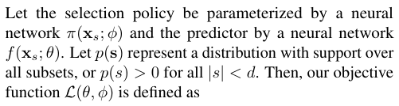

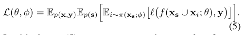

# pdfrect: 4 55.4 647.7 291.2 717.5
# pdfsent: [[[4,55.4,647.7,122.9,657.7]],[[4,122.9,647.7,289.4,657.7],[4,55.4,659.3,290.7,670.3],[4,55.4,671.3,291.2,682.7]],[[4,55.4,683.5,289.4,693.6],[4,55.4,695.5,289.4,705.5],[4,55.4,707.5,161.1,717.5]],[[4,161.1,707.5,291.1,717.5]]]
#+begin_en
Intuitively, eq. (5) represents generating a random feature set xs, sampling a feature index according to i ∼ π(xs; ϕ), and then measuring the loss of the prediction f(xs ∪ xi; θ). Our objective thus optimizes for individual selections and predictions rather than the entire trajectory, which lets us build on Proposition 1-2. We describe this as an implemen-
#+end_en

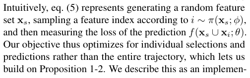

# pdfrect: 4 295.8 732.4 300.8 742.4
# pdfrect: 4 307.4 69.5 543.1 115.3
# pdfsent: [[[4,295.8,732.4,300.8,742.4],[4,307.4,69.5,541.8,79.4],[4,307.4,81.4,499.9,91.4]],[[4,499.9,81.4,543.1,91.4],[4,307.4,93.3,541.4,103.4],[4,307.4,105.3,511.7,115.3]]]
#+begin_en
4 tation of the greedy approach because it recovers the greedy CMI selections when it is trained to optimality. In the classification case, we show the following result under a mild assumption that there is a unique optimal selection.
#+end_en

# pdfrect: 4 307.1 125.6 543.2 173.8
# pdfsent: [[[4,307.1,125.6,351.9,135.7]],[[4,351.9,125.6,543.2,135.7],[4,307.4,137.5,410.6,147.7]],[[4,410.6,137.5,541.4,147.7],[4,307.4,148.1,541.4,160.3],[4,307.4,160.1,502.8,173.8]]]
#+begin_en
Theorem 1. When y is discrete and ℓ is cross-entropy loss, the global optimum of eq. (5) is a predictor that satisfies f(xs; θ∗) = p(y | xs) and a policy π(xs; ϕ∗) that puts all probability mass on i∗ = arg maxi I(y; xi | xs).
#+end_en

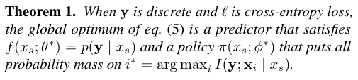

# pdfrect: 4 307.4 187.2 543.1 245.0
# pdfsent: [[[4,307.4,187.2,542.7,197.3],[4,307.4,197.6,541.4,209.8],[4,307.4,211.1,408.4,221.2]],[[4,408.4,211.1,543.1,221.2],[4,307.4,223.1,541.4,233.1],[4,307.4,235.1,493.7,245.0]]]
#+begin_en
If we relax the assumption of a unique optimal selection, the optimal policy π(xs; ϕ∗) simply splits probability mass among the best indices. A similar result holds in the regression case, where we can interpret the greedy policy as performing conditional variance minimization.
#+end_en

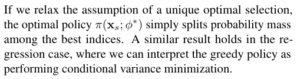

# pdfrect: 4 307.1 255.3 542.5 302.9
# pdfsent: [[[4,307.1,255.3,354.8,265.4]],[[4,354.8,255.3,541.4,265.4],[4,307.4,267.4,422.6,277.4]],[[4,422.6,267.4,541.4,277.4],[4,307.4,277.0,541.4,290.0],[4,307.4,289.0,542.5,302.9]]]
#+begin_en
Theorem 2. When y is continuous and ℓ is squared error loss, the global optimum of eq. (5) is a predictor that satisfies f(xs; θ∗) = E[y | xs] and a policy π(xs; ϕ∗) that puts all probability mass on i∗ = arg mini Exi|xs[Var(y | xi, xs)].
#+end_en

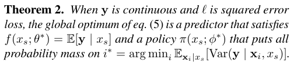

# pdfrect: 4 307.4 317.1 541.6 362.8
# pdfsent: [[[4,307.4,317.1,479.0,327.0]],[[4,479.0,317.1,541.4,327.0],[4,307.4,329.0,541.4,338.9],[4,307.4,341.0,541.6,350.9],[4,307.4,352.7,460.1,362.8]]]
#+begin_en
Proofs for these results are in Appendix A. We note that the function class for each model must be expressive enough to contain their respective optima, and that the result holds for any p(s) with support over all subsets.
#+end_en

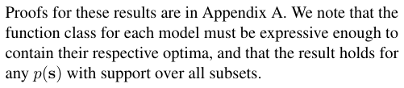

# pdfrect: 4 307.1 370.9 543.2 489.0
# pdfsent: [[[4,307.1,370.9,543.1,380.8],[4,307.4,382.7,442.9,392.7]],[[4,442.9,382.7,541.4,392.7],[4,307.4,394.4,543.2,405.3]],[[4,307.4,406.7,542.7,416.6],[4,307.4,418.7,541.4,428.6],[4,307.4,430.7,334.7,440.5]],[[4,334.7,430.7,541.4,440.5],[4,307.4,442.3,541.4,452.5],[4,307.4,454.1,431.7,464.5]],[[4,431.7,454.1,543.1,464.5],[4,307.4,466.2,541.4,476.4],[4,307.4,478.2,454.8,489.0]]]
#+begin_en
This approach has two key advantages over the CMI estimation procedure from Section 3.2. First, we avoid modeling the feature conditional distributions p(xi | xs) for all (s, i). Modeling these distributions is a difficult intermediate step, and our approach instead aims to directly output the optimal index. Second, our approach is faster because each selection is made in a single forward pass: selecting k features using the procedure from Ma et al. (2019) requires O(dk) scoring steps, but our approach requires only k forward passes through the policy network π(xs; ϕ).
#+end_en

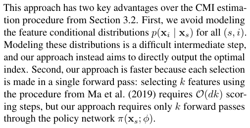

# pdfrect: 4 307.1 496.3 543.1 637.8
# pdfsent: [[[4,307.4,496.3,541.4,506.3],[4,307.4,508.2,464.5,518.3]],[[4,464.5,508.2,543.1,518.3],[4,307.4,520.2,541.4,530.2],[4,307.4,532.2,541.4,542.2],[4,307.4,544.1,541.4,554.2],[4,307.4,556.0,505.9,566.1]],[[4,505.9,556.0,543.1,566.1],[4,307.4,567.8,541.4,578.1],[4,307.4,580.0,541.7,590.0],[4,307.1,591.9,346.2,602.0]],[[4,346.2,591.9,372.2,602.0]],[[4,372.2,591.9,541.4,602.0],[4,307.4,603.9,541.8,613.9],[4,307.4,616.0,541.8,625.8],[4,307.4,627.9,417.8,637.8]]]
#+begin_en
Furthermore, compared to a policy trained by RL, the greedy approach is easier to learn. Our training procedure can be viewed as a form of reward shaping (Sutton et al., 1998; Randløv & Alstrøm, 1998), where the reward accounts for the loss after each step and provides a strong signal about whether each selection is helpful. In comparison, observing the reward only after selecting k features provides a comparably weak signal to the policy network (see eq. (1)). RL methods generally face a challenging exploration-exploitation trade-off, but learning the greedy policy is simpler because it only requires finding the locally optimal choice at each step.
#+end_en

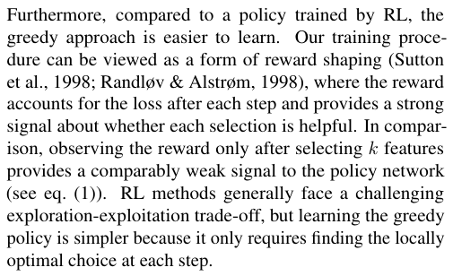

*** 4.3. Training with a continuous relaxation
:PROPERTIES:
:NOTER_PAGE: 4
:END:
# pdfrect: 4 307.1 671.6 543.1 717.5
# pdfsent: [[[4,307.4,671.6,393.8,681.6]],[[4,393.8,671.6,541.8,681.6],[4,307.1,683.2,541.4,693.6],[4,307.4,695.6,421.5,705.5]],[[4,421.5,695.6,543.1,705.5],[4,307.4,707.5,543.1,717.5]]]
#+begin_en
Our objective in eq. (5) yields the correct greedy policy when it is perfectly optimized, but L(θ, ϕ) is difficult to optimize by gradient descent. In particular, gradients are difficult to propagate through the policy network given a sam-
#+end_en

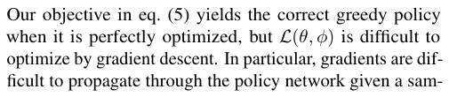

# pdfrect: 5 157.0 47.2 439.9 56.2
# pdfsent: [[[5,157.0,47.2,439.9,56.2]]]
#+begin_en
Learning to Maximize Mutual Information for Dynamic Feature Selection
#+end_en

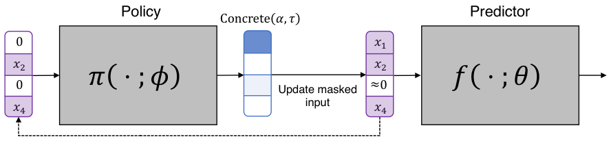

# pdfrect: 5 172.6 168.7 270.4 178.0
# pdfsent: [[[5,172.6,168.7,270.4,178.0]]]
#+begin_en
Repeat for 𝑘 selection steps
#+end_en

# pdfrect: 5 54.9 188.2 541.4 197.3
# pdfrect: 5 55.4 199.2 541.4 219.2
# pdfsent: [[[5,54.9,188.2,92.1,197.3]],[[5,92.1,188.2,218.3,197.3]],[[5,218.3,188.2,541.4,197.3],[5,55.4,199.2,84.5,208.2]],[[5,84.5,199.2,367.3,208.2]],[[5,367.3,199.2,541.4,208.2],[5,55.4,210.2,158.8,219.2]]]
#+begin_en
Figure 1. Diagram of our training approach. Left: features are selected by making repeated calls to the policy network using masked inputs. Right: predictions are made after each selection using the predictor network. Only solid lines are backpropagated through when performing gradient descent.
#+end_en

# pdfrect: 5 54.7 240.9 291.2 323.0
# pdfsent: [[[5,55.4,240.9,162.4,251.8]],[[5,162.4,240.9,290.7,251.8],[5,54.7,253.2,291.1,263.2],[5,55.4,265.1,291.2,275.2]],[[5,55.1,277.1,289.4,287.1],[5,55.4,289.1,290.7,299.1],[5,55.4,301.0,289.4,311.0],[5,55.4,313.0,199.4,323.0]]]
#+begin_en
pled index i ∼ π(xs; ϕ). The REINFORCE trick (Williams, 1992) is one way to get stochastic gradients, but high gradient variance can make it ineffective in many problems. There is a robust literature on reducing gradient variance in this setting (Tucker et al., 2017; Grathwohl et al., 2018), but we propose using a simple alternative: the Concrete distribution (Maddison et al., 2016).
#+end_en

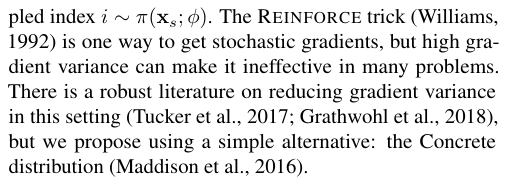

# pdfrect: 5 55.1 330.6 291.1 472.4
# pdfsent: [[[5,55.1,330.6,291.1,341.5],[5,55.4,341.4,289.4,352.9],[5,55.4,354.9,289.4,364.8],[5,55.4,366.6,289.8,376.8],[5,55.4,377.2,147.4,388.7]],[[5,147.4,377.2,289.4,388.7],[5,55.4,390.8,291.1,400.7],[5,55.4,402.6,214.1,412.7]],[[5,214.1,402.6,289.4,412.7],[5,55.4,414.3,289.4,424.6],[5,55.4,426.5,289.4,436.6],[5,55.4,438.2,280.9,448.5]],[[5,280.9,438.2,289.4,448.5],[5,55.4,450.5,290.7,460.4],[5,55.1,462.4,230.0,472.4]]]
#+begin_en
An index sampled according to i ∼ π(xs; ϕ) can be represented by a one-hot vector m ∈{0, 1}d indicating the chosen index, and with the Concrete distribution we instead sample an approximately one-hot vector in the probability simplex, or m ∈ ∆d−1. This continuous relaxation lets us calculate gradients using the reparameterization trick (Maddison et al., 2016; Jang et al., 2016). Relaxing the subset s ⊆ [d] to a continuous vector also requires relaxing the policy and predictor functions, so we let these operate on a masked input x, or the element-wise product x ⊙ m. To avoid ambiguity about whether features are zero or masked, we can also pass the mask as a model input.
#+end_en

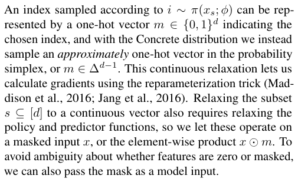

# pdfrect: 5 55.1 480.4 291.1 597.9
# pdfsent: [[[5,55.1,480.4,289.4,490.3],[5,55.4,492.1,289.4,502.3],[5,55.4,504.2,108.8,514.3]],[[5,108.8,504.2,289.4,514.3],[5,55.4,516.3,291.1,526.2],[5,55.4,528.2,289.4,538.2],[5,55.4,539.9,289.4,550.1],[5,55.4,552.1,223.8,562.1]],[[5,223.8,552.1,289.4,562.1],[5,55.4,564.0,291.1,574.0],[5,55.4,576.0,129.3,586.0]],[[5,129.3,576.0,289.4,586.0],[5,55.4,588.0,232.5,597.9]]]
#+begin_en
Training with the Concrete distribution requires specifying a temperature parameter τ > 0 to control how discrete the samples are. Previous works have typically trained with a fixed temperature or annealed it over a pre-determined number of epochs (Chang et al., 2017; Chen et al., 2018; Balın et al., 2019), but we instead train with a sequence of τ values and perform early stopping at each step. This removes the temperature and number of epochs as important hyperparameters to tune. Our training procedure is summarized in Figure 1, and in more detail by Algorithm 1.
#+end_en

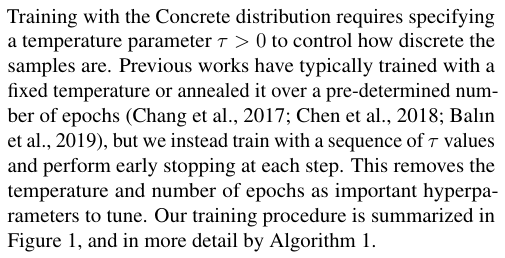

# pdfrect: 5 55.1 605.8 289.4 627.8
# pdfsent: [[[5,55.1,605.8,289.4,615.9],[5,55.4,617.9,144.0,627.8]]]
#+begin_en
There are also several optional steps that we found can improve optimization:
#+end_en

# pdfrect: 5 61.1 641.3 291.1 651.3
# pdfrect: 5 69.6 665.2 291.1 699.1
# pdfsent: [[[5,61.1,641.3,291.1,651.3],[5,69.6,665.2,291.1,675.2],[5,69.6,677.1,289.4,687.1],[5,69.6,689.1,256.4,699.1]]]
#+begin_en
• Parameters can be shared between the predictor and poltheir joint optimization, and learning a shared representation in the early layers can in some cases help the networks optimize faster (e.g., for image data).
#+end_en

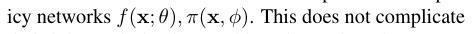

# pdfrect: 5 61.1 707.4 289.4 717.5
# pdfsent: [[[5,61.1,707.4,289.4,717.5]]]
#+begin_en
• Rather than training with a random subset distribution
#+end_en

# pdfrect: 5 296.0 732.4 300.9 742.4
# pdfrect: 5 321.6 265.3 542.8 334.9
# pdfsent: [[[5,296.0,732.4,300.9,742.4],[5,321.6,265.3,541.4,275.1],[5,321.6,277.1,542.8,287.1],[5,321.6,289.2,541.4,299.0],[5,321.6,301.0,338.2,311.0]],[[5,338.2,301.0,541.4,311.0],[5,321.6,312.9,541.4,323.0],[5,321.6,325.0,465.0,334.9]]]
#+begin_en
5 on subsets likely to be encountered at inference time, and it does not affect the globally optimal policy/predictor: gradients are not propagated between selections, so both eq. (5) and this sampling approach treat each feature set as an independent optimization problem, only with different weights (see Appendix D).
#+end_en

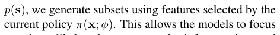

# pdfrect: 5 321.6 356.0 541.4 366.1
# pdfsent: [[[5,321.6,356.0,525.4,366.1]],[[5,525.4,356.0,541.4,366.1]]]
#+begin_en
before jointly training the policy-predictor pair. This
#+end_en

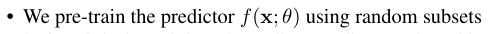

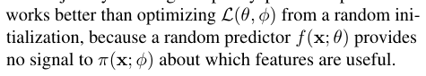

** 5. Related work
:PROPERTIES:
:NOTER_PAGE: 5
:END:
# pdfrect: 5 307.1 438.4 543.2 580.0
# pdfsent: [[[5,307.4,438.4,528.4,448.5]],[[5,528.4,438.4,541.6,448.5],[5,307.4,450.4,429.0,460.5]],[[5,429.0,450.4,512.9,460.5]],[[5,512.9,450.4,542.3,460.5],[5,307.3,462.4,367.8,472.4]],[[5,367.8,462.4,541.4,472.4],[5,307.4,474.3,543.2,484.4]],[[5,307.1,486.4,543.2,496.3]],[[5,307.4,498.2,541.4,508.3],[5,307.4,510.2,542.8,520.2],[5,307.4,522.2,542.7,532.2],[5,307.4,534.2,542.7,544.1],[5,307.4,546.1,336.4,556.1]],[[5,336.4,546.1,543.1,556.1],[5,307.4,558.1,519.4,568.0]],[[5,519.4,558.1,542.1,568.0],[5,307.4,570.0,444.3,580.0]]]
#+begin_en
Prior work has frequently addressed DFS using RL. For example, Dulac-Arnold et al. (2011); Shim et al. (2018); Janisch et al. (2019); Li & Oliva (2021) optimize a reward based on the final prediction accuracy, and Kachuee et al. (2018) use a reward that accounts for prediction uncertainty. RL is a natural approach for sequential decision-making problems, but it can be difficult to optimize in practice: RL requires complex training routines, is slow to converge, and is highly sensitive to its initialization (Henderson et al., 2018). As a result, RL-based DFS does not reliably outperform static feature selection, as shown by Erion et al. (2021) and confirmed in our experiments.
#+end_en

# pdfrect: 5 307.1 587.9 543.1 717.5
# pdfsent: [[[5,307.4,587.9,541.4,597.9],[5,307.4,599.8,541.4,609.9],[5,307.1,611.8,541.4,621.9],[5,307.4,623.9,452.3,633.8]],[[5,452.3,623.9,541.4,633.8],[5,307.4,635.7,543.1,645.8],[5,307.4,647.8,490.7,657.7]],[[5,490.7,647.8,541.4,657.7],[5,307.4,659.6,542.7,669.7],[5,307.4,671.7,543.1,681.6],[5,307.4,683.7,416.4,693.5]],[[5,416.4,683.7,541.4,693.5],[5,307.4,695.5,541.6,705.5],[5,307.4,707.5,518.2,717.5]],[[5,518.2,707.5,542.1,717.5]]]
#+begin_en
Several other approaches include imitation learning (He et al., 2012; 2016a) and iterative feature scoring methods (Melville et al., 2004; Saar-Tsechansky et al., 2009; Chen et al., 2015a; Early et al., 2016b;a). Imitation learning casts DFS as supervised classification, whereas our training approach bypasses the need for an oracle policy. Most existing feature scoring techniques are greedy methods, like ours, but they use scoring heuristics that are unrelated to maximizing CMI (see Section 3.2). Two feature scoring methods are specifically designed to calculate the CMI, but they suffer from important practical limitations: both Ma et al. (2019)
#+end_en

# pdfrect: 6 157.0 47.2 439.9 56.2
# pdfsent: [[[6,157.0,47.2,439.9,56.2]]]
#+begin_en
Learning to Maximize Mutual Information for Dynamic Feature Selection
#+end_en

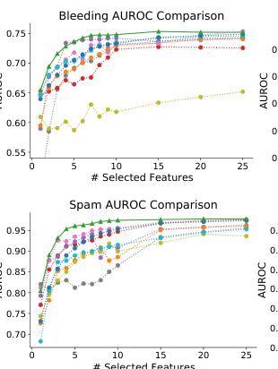

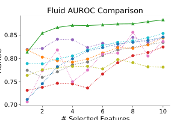

# pdfrect: 6 353.1 268.0 392.4 285.1
# pdfsent: [[[6,353.1,268.0,392.4,277.2],[6,353.1,275.9,383.1,285.1]]]
#+begin_en
CMI (Marginal) CMI (PVAE)
#+end_en

# pdfrect: 6 54.9 298.5 505.8 307.4
# pdfsent: [[[6,54.9,298.5,90.4,307.4]],[[6,90.4,298.5,289.3,307.4]],[[6,289.3,298.5,505.8,307.4]]]
#+begin_en
Figure 2. Evaluating the greedy approach on six tabular datasets. The results for each method are the average across five runs.
#+end_en

# pdfrect: 6 55.1 329.5 291.1 387.3
# pdfsent: [[[6,55.4,329.5,156.3,339.5]],[[6,156.3,329.5,289.4,339.5],[6,55.4,341.4,291.1,351.5],[6,55.4,353.4,87.9,363.4]],[[6,87.9,353.4,290.7,363.4],[6,55.4,365.4,291.1,375.4],[6,55.1,376.0,260.8,387.3]]]
#+begin_en
and Chattopadhyay et al. (2022) rely on difficult-to-train generative models, which can lead to inaccurate CMI estimation. Our approach is simpler, faster and more flexible, because the selection logic is contained within a policy network that avoids the need for generative modeling.2
#+end_en

# pdfrect: 6 55.1 395.3 291.2 572.6
# pdfsent: [[[6,55.4,395.3,289.4,405.3],[6,55.1,407.3,202.1,417.2]],[[6,202.1,407.3,291.1,417.2],[6,55.4,419.2,291.1,429.1],[6,55.4,431.1,290.3,441.1],[6,55.4,443.0,289.4,453.1],[6,55.4,455.1,112.1,465.0]],[[6,112.1,455.1,289.4,465.0],[6,55.4,467.0,289.4,477.0],[6,55.4,479.0,238.7,488.9]],[[6,238.7,479.0,289.4,488.9],[6,55.4,491.0,81.9,500.9]],[[6,81.9,491.0,164.9,500.9]],[[6,164.9,491.0,236.6,500.9]],[[6,236.6,491.0,289.4,500.9],[6,55.4,502.9,81.6,512.8]],[[6,81.6,502.9,291.2,512.8]],[[6,55.1,514.8,146.5,524.8]],[[6,146.5,514.8,289.4,524.8],[6,55.4,526.7,229.9,536.8]],[[6,229.9,526.7,289.4,536.8],[6,55.4,538.7,289.4,548.7],[6,55.4,550.6,289.8,560.7],[6,55.4,562.7,191.0,572.6]]]
#+begin_en
Static feature selection is a long-standing problem (Guyon & Elisseeff, 2003; Cai et al., 2018). There are no default approaches for neural networks, but one option is ranking features by local or global importance scores (Breiman, 2001; Shrikumar et al., 2017; Sundararajan et al., 2017; Covert et al., 2020). In addition, several prior works have leveraged continuous relaxations to learn feature selection strategies by gradient descent: for example, Chang et al. (2017); Balın et al. (2019); Yamada et al. (2020); Lee et al. (2021); Covert et al. (2022) perform static feature selection, and Chen et al. (2018); Jethani et al. (2021) perform instance-wise feature selection given access to all the features. Our work uses a similar continuous relaxation for optimization, but in the DFS context, where our method learns a selection policy rather than a static selection layer.
#+end_en

# pdfrect: 6 55.1 580.6 291.2 686.2
# pdfsent: [[[6,55.4,580.6,291.1,590.6],[6,55.4,592.6,243.6,602.5]],[[6,243.6,592.6,290.7,602.5],[6,55.4,604.6,203.4,614.4]],[[6,203.4,604.6,289.7,614.4],[6,55.4,616.4,289.4,626.4],[6,55.4,628.3,134.0,638.4]],[[6,134.0,628.3,291.2,638.4]],[[6,55.1,640.3,291.1,650.4],[6,55.4,652.2,289.4,662.3],[6,55.4,664.4,289.4,674.2],[6,55.4,676.2,220.7,686.2]]]
#+begin_en
Finally, several works have examined greedy feature selection algorithms from a theoretical perspective. For example, Das & Kempe (2011); Elenberg et al. (2018) show that weak submodularity implies near-optimal performance for static feature selection. More relevant to our work, Chen et al. (2015b) find that the related notion of adaptive submodularity (Golovin & Krause, 2011) does not not hold in the DFS setting, but the authors provide performance guarantees under specific distributional assumptions.
#+end_en

# pdfrect: 6 55.4 694.5 289.6 714.9
# pdfsent: [[[6,68.1,694.5,198.8,705.0]],[[6,198.8,694.5,289.6,705.0],[6,55.4,706.0,247.9,714.9]]]
#+begin_en
2Concurrently, Chattopadhyay et al. (2023) proposed a similar approach to predict the optimal selection at each step.
#+end_en

** 6. Experiments
:PROPERTIES:
:NOTER_PAGE: 6
:END:
# pdfrect: 6 307.0 348.8 543.1 454.5
# pdfsent: [[[6,307.0,348.8,541.4,358.9],[6,307.4,360.8,379.3,370.8]],[[6,379.3,360.8,543.1,370.8],[6,307.4,372.7,541.4,382.8],[6,307.4,384.7,512.2,394.8]],[[6,512.2,384.7,541.4,394.8],[6,307.4,396.6,543.1,406.7],[6,307.4,408.6,541.4,418.7],[6,307.4,420.6,382.5,430.6]],[[6,382.5,420.6,541.4,430.6],[6,307.4,432.5,542.5,442.6],[6,307.4,444.5,401.9,454.5]]]
#+begin_en
We now demonstrate the use of our greedy approach on several datasets. We first explore tabular datasets of various sizes, including four medical diagnosis tasks, and we then consider two image classification datasets. Several of the tasks are natural candidates for DFS, and the remaining ones serve as useful tasks to test the effectiveness of our approach. Code for reproducing our experiments is available online: https://github.com/iancovert/ dynamic-selection.
#+end_en

# pdfrect: 6 307.0 462.4 543.2 699.6
# pdfsent: [[[6,307.0,462.4,541.4,472.5],[6,307.4,474.4,467.3,484.4]],[[6,467.3,474.4,543.1,484.4],[6,307.4,486.3,541.4,496.4],[6,307.4,498.3,378.5,508.3]],[[6,378.5,498.3,541.4,508.3],[6,307.4,510.2,541.4,520.3],[6,307.4,522.2,542.7,532.2],[6,307.4,534.2,542.1,544.2],[6,307.4,546.1,541.4,556.2],[6,307.4,558.1,386.8,568.1]],[[6,386.8,558.1,541.4,568.1],[6,307.4,570.1,472.8,580.0]],[[6,472.8,570.1,543.1,580.0],[6,307.4,582.0,480.0,592.0]],[[6,480.0,582.0,543.1,592.0],[6,307.4,594.0,541.4,603.9],[6,307.4,606.0,410.6,615.9]],[[6,410.6,606.0,541.4,615.9],[6,307.4,617.8,397.3,627.9]],[[6,397.3,617.8,542.7,627.9],[6,307.4,629.9,541.6,639.8],[6,307.4,641.7,541.6,651.8],[6,307.4,653.7,543.2,663.7]],[[6,307.4,665.6,541.4,675.7],[6,307.1,677.7,463.3,687.6]],[[6,463.3,677.7,541.4,687.6],[6,307.4,689.6,490.6,699.6]]]
#+begin_en
We evaluate our method by comparing to both dynamic and static feature selection methods. We also ensure consistent comparisons by only using methods applicable to neural networks. As static baselines, we use permutation tests (Breiman, 2001) and SAGE (Covert et al., 2020) to rank features by their importance to the model’s accuracy, as well as per-prediction DeepLift (Shrikumar et al., 2017) and IntGrad (Sundararajan et al., 2017) scores aggregated across the dataset. We then use a supervised version of the Concrete Autoencoder (CAE, Balın et al. 2019), a state-ofthe-art static feature selection method. As dynamic baselines, we use two versions of the CMI estimation procedure described in Section 3.2. First, we use the PVAE generative model from Ma et al. (2019) to sample unknown features, and second, we instead sample unknown features from their marginal distribution; in both cases, we use a classifier trained with random feature subsets to make predictions. Finally, we also use the RL-based Opportunistic Learning (OL) approach (Kachuee et al., 2018). Appendix C provides more information about the baseline methods.
#+end_en

# pdfrect: 7 157.0 47.2 439.9 56.2
# pdfsent: [[[7,157.0,47.2,439.9,56.2]]]
#+begin_en
Learning to Maximize Mutual Information for Dynamic Feature Selection
#+end_en

# pdfrect: 7 133.8 76.3 463.1 85.3
# pdfsent: [[[7,133.8,76.3,167.5,85.3]],[[7,167.5,76.3,463.1,85.3]]]
#+begin_en
Table 1. AUROC averaged across budgets of 1-10 features (with 95% confidence intervals).
#+end_en

|  | Spam | Mi | niBooNE | D | iabetes | Bleeding | Respiratory | Fluid |
|---+---+---+---+---+---+---+---+---|
| IntGrad | 82.84 ± 0.68 | 89. | 10 ± 0.33 | 88. | 91 ± 0.24 | 66.70 ± 0. | 27 81.10 ± 0.04 | 79.94 ± 0.94 |
| DeepLift | 90.16 ± 1.24 | 88. | 62 ± 0.30 | 95. | 42 ± 0.13 | 67.75 ± 0. | 49 76.05 ± 0.35 | 76.96 ± 0.56 |
| SAGE | 89.70 ± 1.10 | 92. | 64 ± 0.03 | 95. | 43 ± 0.01 | 71.34 ± 0. | 19 82.92 ± 0.26 | 83.27 ± 0.53 |
| Perm Test | 85.64 ± 3.58 | 92. | 19 ± 0.15 | 95. | 46 ± 0.02 | 68.89 ± 1. | 06 81.56 ± 0.28 | 81.35 ± 1.04 |
| CAE | 92.28 ± 0.27 | 92. | 76 ± 0.41 | 95. | 91 ± 0.07 | 70.69 ± 0. | 57 83.10 ± 0.45 | 79.40 ± 0.86 |
| Opportunistic (O | L) 85.94 ± 0.20 | 69. | 23 ± 0.64 | 83. | 07 ± 0.82 | 60.63 ± 0. | 55 74.44 ± 0.42 | 78.13 ± 0.31 |
| CMI (Marginal) | 86.57 ± 1.54 | 92. | 21 ± 0.40 | 95. | 48 ± 0.05 | 70.57 ± 0. | 46 79.62 ± 0.62 | 81.97 ± 0.93 |
| CMI (PVAE) | 89.01 ± 1.40 | 88. | 94 ± 1.25 | 90. | 50 ± 5.16 | 70.17 ± 0. | 74 74.12 ± 3.50 | 80.27 ± 1.02 |
| Greedy (Ours) | 93.91 ± 0.17 | 94. | 46 ± 0.12 | 96. | 03 ± 0.02 | 72.64 ± 0. | 31 84.48 ± 0.08 | 86.59 ± 0.25 |

*** 6.1. Tabular datasets
:PROPERTIES:
:NOTER_PAGE: 7
:END:
# pdfrect: 7 55.0 230.8 291.1 348.2
# pdfsent: [[[7,55.0,230.8,289.4,240.6],[7,55.4,242.6,249.7,252.6]],[[7,249.7,242.6,289.4,252.6],[7,55.4,254.7,291.1,264.5],[7,55.4,266.5,289.4,276.5],[7,55.4,278.6,290.7,288.4],[7,55.4,290.4,291.1,300.4],[7,55.4,302.3,132.0,312.4]],[[7,132.0,302.3,289.4,312.4],[7,55.4,314.4,109.1,324.3]],[[7,109.1,314.4,289.4,324.3],[7,55.4,326.2,289.4,336.3],[7,55.4,338.3,247.5,348.2]]]
#+begin_en
We first applied our method to three medical diagnosis tasks derived from an emergency medicine setting. The tasks involve predicting a patient’s bleeding risk via a low fibrinogen concentration (bleeding), whether the patient requires endotracheal intubation for respiratory support (respiratory), and whether the patient will be responsive to fluid resuscitation (fluid). See Appendix B for more details about the datasets. In each scenario, gathering all possible inputs at inference time is challenging due to time and resource constraints, thus making DFS a natural solution.
#+end_en

# pdfrect: 7 55.0 356.1 291.2 497.7
# pdfsent: [[[7,55.0,356.1,289.4,366.2],[7,55.4,368.1,291.2,378.2]],[[7,55.4,380.0,289.4,390.1],[7,55.1,392.1,172.3,402.0]],[[7,172.3,392.1,289.4,402.0],[7,55.4,404.1,289.4,414.0],[7,55.4,416.0,291.2,426.0]],[[7,55.1,428.0,289.4,437.9],[7,55.4,439.9,289.4,449.9],[7,55.1,451.8,133.2,461.8]],[[7,133.2,451.8,289.4,461.8],[7,55.1,463.9,109.8,473.7]],[[7,109.8,463.9,289.4,473.7],[7,55.1,475.7,289.8,485.7],[7,55.4,487.7,242.0,497.7]]]
#+begin_en
We use fully connected networks for all methods, and we use dropout to reduce overfitting (Srivastava et al., 2014). Figure 2 (top) shows the results of applying each method with various feature budgets. The classification accuracy is measured via AUROC, and the greedy method achieves the best results for nearly all feature budgets on all three tasks. Among the baselines, several static methods are sometimes close, but the CMI estimation method is rarely competitive (Ma et al., 2019). Additionally, OL provides unstable and weak results. The greedy method’s advantage is often largest when selecting a small number of features, and it usually becomes narrower once the accuracy saturates.
#+end_en

# pdfrect: 7 55.1 505.7 291.2 683.0
# pdfsent: [[[7,55.4,505.7,291.1,515.6],[7,55.4,517.5,290.7,527.6],[7,55.4,529.5,290.7,539.5],[7,55.4,541.5,240.2,551.5]],[[7,240.2,541.5,289.4,551.5],[7,55.4,553.4,289.6,563.4],[7,55.1,565.4,177.3,575.4]],[[7,177.3,565.4,291.1,575.4],[7,55.4,577.3,289.4,587.4],[7,55.1,589.4,182.7,599.3]],[[7,182.7,589.4,289.8,599.3],[7,55.4,601.3,289.4,611.3],[7,55.4,613.2,109.8,623.2]],[[7,109.8,613.2,289.4,623.2],[7,55.1,625.0,141.0,635.1]],[[7,141.0,625.0,148.8,635.1]],[[7,148.8,625.0,156.6,635.1]],[[7,156.6,625.0,289.4,635.1],[7,55.4,637.1,291.2,647.1]],[[7,55.1,649.0,289.4,659.1],[7,55.1,661.0,289.4,671.0],[7,55.2,673.0,229.8,683.0]]]
#+begin_en
Next, we conducted experiments using three publicly available tabular datasets: spam classification (Dua & Graff, 2017), particle identification (MiniBooNE) (Roe et al., 2005) and diabetes diagnosis (Miller, 1973). The diabetes task is a natural application for DFS and was used in prior work (Kachuee et al., 2018). We again tested various numbers of features, and Figure 2 (bottom) shows plots of the AUROC for each feature budget. On these tasks, the greedy method is once again most accurate for nearly all numbers of features. Table 1 summarizes the results via the mean AUROC across k = 1, . . . , 10 features, further emphasizing the benefits of the greedy method across all six datasets. Appendix E shows larger versions of the AUROC curves (Figure 4 and Figure 5), as well as plots demonstrating the variability of selections within each dataset.
#+end_en

# pdfrect: 7 55.1 690.9 291.1 712.9
# pdfsent: [[[7,55.1,690.9,291.1,700.9],[7,55.4,702.9,289.4,712.9]]]
#+begin_en
The results with these datasets reveal that, perhaps surprisingly, dynamic methods can be outperformed by static
#+end_en

# pdfrect: 7 295.8 732.4 300.8 742.4
# pdfrect: 7 307.1 212.0 543.1 341.5
# pdfsent: [[[7,295.8,732.4,300.8,742.4],[7,307.4,212.0,344.4,222.0]],[[7,344.4,212.0,541.4,222.0],[7,307.4,223.9,541.4,234.0],[7,307.1,235.9,493.9,245.9]],[[7,493.9,235.9,542.7,245.9],[7,307.4,247.8,543.1,257.9],[7,307.4,259.8,541.8,269.8],[7,307.4,271.9,410.1,281.7]],[[7,410.1,271.9,541.4,281.7],[7,307.4,283.7,541.4,293.7],[7,307.4,295.6,541.4,305.7],[7,307.4,307.6,541.6,317.7],[7,307.4,319.6,397.1,329.6]],[[7,397.1,319.6,541.4,329.6],[7,307.4,331.6,504.9,341.5]]]
#+begin_en
7 methods. Interestingly, this point was not highlighted in prior works where strong static baselines were not tested (Kachuee et al., 2018; Janisch et al., 2019). For example, OL is not competitive on these datasets, and the two versions of the CMI estimation approach are not consistently among the top baselines. Dynamic methods are in principle capable of performing better, so the sub-par results from these methods underscore the difficulty of learning both a selection policy and a prediction function that works for multiple feature sets. In these experiments, our approach is the only dynamic method to do both successfully.
#+end_en

*** 6.2. Image classification datasets
:PROPERTIES:
:NOTER_PAGE: 7
:END:
# pdfrect: 7 307.1 375.3 542.7 492.9
# pdfsent: [[[7,307.4,375.3,541.4,385.4],[7,307.4,387.2,541.4,397.3],[7,307.1,399.3,412.7,409.2]],[[7,412.7,399.3,541.7,409.2],[7,307.4,411.2,541.4,421.2],[7,307.4,423.1,541.4,433.2],[7,307.4,435.1,354.3,445.1]],[[7,354.3,435.1,541.6,445.1],[7,307.4,447.0,542.7,457.1],[7,307.4,459.0,541.4,469.0],[7,307.1,471.1,542.3,481.0],[7,307.3,483.0,389.2,492.9]]]
#+begin_en
Next, we considered two standard image classification datasets: MNIST (LeCun et al., 1998) and CIFAR-10 (Krizhevsky et al., 2009). Our goal is to begin with a blank image, sequentially reveal multiple pixels or patches, and ultimately make a classification using a small portion of the image. Although this is not an obvious use case for DFS, it represents a challenging problem for our method, and similar tasks were considered in several earlier works (Karayev et al., 2012; Mnih et al., 2014; Early et al., 2016a; Janisch et al., 2019).
#+end_en

# pdfrect: 7 307.4 500.8 541.4 606.5
# pdfsent: [[[7,307.4,500.8,541.4,510.9],[7,307.4,512.8,541.4,522.8],[7,307.4,524.6,470.8,534.8]],[[7,470.8,524.6,541.4,534.8],[7,307.4,536.7,541.4,546.7],[7,307.4,548.6,541.4,558.7],[7,307.4,560.3,381.1,570.7]],[[7,381.1,560.3,541.4,570.7],[7,307.4,572.3,541.4,582.6],[7,307.4,584.5,541.4,594.6],[7,307.4,596.5,456.6,606.5]]]
#+begin_en
For MNIST, we use fully connected architectures for both the policy and predictor, and we treat pixels as individual features; we therefore have d = 784. For CIFAR-10, we use a shared ResNet backbone (He et al., 2016b) for the policy and predictor networks, and each network uses its own output head. The 32 × 32 images are coarsened into d = 64 patches of size 4 × 4, so the selector head generates logits corresponding to each patch, and the predictor head generates probabilities for each class.
#+end_en

# pdfrect: 7 307.1 614.5 543.1 708.1
# pdfsent: [[[7,307.4,614.5,541.4,624.4],[7,307.4,626.4,345.3,636.4]],[[7,345.3,626.4,543.1,636.4],[7,307.4,638.4,541.4,648.3],[7,307.4,650.3,541.4,660.3],[7,307.4,662.4,346.7,672.2]],[[7,346.7,662.4,543.1,672.2],[7,307.4,674.3,501.4,684.2]],[[7,501.4,674.3,541.8,684.2],[7,307.4,686.1,542.7,696.2],[7,307.1,698.2,543.1,708.1]]]
#+begin_en
Figure 3 shows our method’s accuracy for different feature budgets. For MNIST, we use the previous baselines but exclude the CMI estimation method due to its computational cost: it becomes slow when evaluating many candidate features. We observe a large benefit for our method, particularly when making a small number of selections. Our greedy method reaches nearly 90% accuracy with just 10 pixels, which is roughly 10% higher than the best baseline and con-
#+end_en

# pdfrect: 8 157.0 47.2 439.9 56.2
# pdfsent: [[[8,157.0,47.2,439.9,56.2]]]
#+begin_en
Learning to Maximize Mutual Information for Dynamic Feature Selection
#+end_en

# pdfrect: 8 54.9 317.8 541.4 326.9
# pdfrect: 8 55.4 328.8 541.4 348.8
# pdfsent: [[[8,54.9,317.8,91.5,326.9]],[[8,91.5,317.8,278.1,326.9]],[[8,278.1,317.8,541.4,326.9],[8,55.4,328.8,77.9,337.8]],[[8,77.9,328.8,354.5,337.8]],[[8,354.5,328.8,541.4,337.8],[8,55.4,339.8,284.6,348.8]]]
#+begin_en
Figure 3. Greedy feature selection for image classification. Top left: accuracy comparison on MNIST with results averaged across five runs. Top right: accuracy comparison on CIFAR-10 with 95% confidence intervals. Bottom: example selections and predictions for the greedy method with 10 out of 64 patches for CIFAR-10 images.
#+end_en

# pdfrect: 8 55.4 371.0 290.7 404.7
# pdfsent: [[[8,55.4,371.0,289.4,380.8],[8,55.4,382.9,187.8,392.8]],[[8,187.8,382.9,290.7,392.8],[8,55.4,394.8,284.7,404.7]]]
#+begin_en
siderably higher than prior work (Balın et al., 2019; Yamada et al., 2020; Covert et al., 2020). OL yields the worst results, and it also trains slowly due to the large number of states.
#+end_en

# pdfrect: 8 55.4 412.7 291.2 554.2
# pdfsent: [[[8,55.4,412.7,289.4,422.7],[8,55.4,424.6,183.5,434.7]],[[8,183.5,424.6,289.4,434.7],[8,55.4,436.6,289.4,446.6],[8,55.4,448.6,291.2,458.6]],[[8,55.4,460.5,289.4,470.5],[8,55.4,472.5,212.8,482.5]],[[8,212.8,472.5,289.4,482.5],[8,55.4,484.5,290.7,494.4],[8,55.4,496.5,289.4,506.3],[8,55.4,508.3,91.7,518.3]],[[8,91.7,508.3,289.4,518.3],[8,55.4,520.4,289.4,530.3],[8,55.4,532.2,289.4,542.3],[8,55.4,544.2,171.9,554.2]]]
#+begin_en
For CIFAR-10, we omit several baseline comparisons due to their computational cost. We use the CAE, which is our most competitive static baseline, as well as two simple baselines: center crops and random masks of various sizes. For each method, we plot the mean and 95% confidence intervals determined from five trials. Our greedy approach is slightly less accurate with a very small number of patches, but it reaches significantly higher accuracy when using 6-20 patches. Finally, Figure 3 (bottom) also shows qualitative examples of our method’s predictions after selecting 10 out of 64 patches, and Appendix E shows similar plots with different numbers of patches.
#+end_en

** 7. Conclusion
:PROPERTIES:
:NOTER_PAGE: 8
:END:
# pdfrect: 8 55.4 592.1 291.1 709.7
# pdfsent: [[[8,55.4,592.1,289.4,602.1],[8,55.4,604.1,289.6,614.1],[8,55.4,616.1,191.6,626.0]],[[8,191.6,616.1,289.4,626.0],[8,55.4,628.1,289.4,638.0],[8,55.4,639.9,289.4,650.0],[8,55.4,651.9,289.4,661.9],[8,55.4,663.9,291.1,673.9],[8,55.4,675.8,83.7,685.8]],[[8,83.7,675.8,289.4,685.8],[8,55.4,687.8,289.4,697.8],[8,55.4,699.8,290.7,709.7]]]
#+begin_en
In this work, we explored a greedy algorithm for dynamic feature selection (DFS) that selects features based on their CMI with the response variable. We proposed an approach to approximate this policy by directly predicting the optimal selection at each step, and we conducted experiments that show our method outperforms a variety of existing feature selection methods, including both dynamic and static baselines. Future work on this topic may include incorporating non-uniform features costs or determining the ideal feature budget on a per-sample basis; from a theoretical perspective,
#+end_en

# pdfrect: 8 296.0 732.4 300.9 742.4
# pdfrect: 8 307.4 370.9 543.1 428.7
# pdfsent: [[[8,296.0,732.4,300.9,742.4],[8,307.4,370.9,541.4,380.8],[8,307.4,382.8,543.1,392.8],[8,307.4,394.7,441.4,404.8]],[[8,441.4,394.7,541.8,404.8],[8,307.4,406.8,541.4,416.7],[8,307.4,418.7,536.7,428.7]]]
#+begin_en
8 characterizing the greedy algorithm’s performance outside of our fixed-budget case is another interesting topic for future work (Chen et al., 2015b). Finally, future work may also explore architectures that are well-suited to processing partial inputs, particularly for structured data like images.
#+end_en

** Acknowledgements
:PROPERTIES:
:NOTER_PAGE: 8
:END:
# pdfrect: 8 307.0 466.6 542.7 512.5
# pdfsent: [[[8,307.0,466.6,541.4,476.6],[8,307.4,478.5,524.4,488.6]],[[8,524.4,478.5,541.4,488.6],[8,307.1,490.6,542.7,500.5],[8,307.4,502.5,506.8,512.5]]]
#+begin_en
We thank Samuel Ainsworth, Kevin Jamieson, Mukund Sudarshan and the Lee Lab for helpful discussions. This work was funded by NSF DBI-1552309 and DBI-1759487, NIH R35-GM-128638 and R01-NIA-AG-061132.
#+end_en

** References
:PROPERTIES:
:NOTER_PAGE: 8
:END:
** A. Proofs
:PROPERTIES:
:NOTER_PAGE: 12
:END:

# pdfrect: 12 55.4 88.8 541.4 98.8
# pdfsent: [[[12,55.4,88.8,334.9,98.8]],[[12,334.9,88.8,541.4,98.8]]]
#+begin_en
In this section, we re-state and prove our main theoretical results. We begin with our proposition regarding the optimal
#+end_en

# pdfrect: 12 55.4 121.0 543.2 143.8
# pdfsent: [[[12,55.4,121.0,114.0,131.2]],[[12,114.0,121.0,316.9,131.2]],[[12,316.9,121.0,543.2,131.2],[12,55.4,131.6,148.0,143.8]]]
#+begin_en
Proposition 1. When y is discrete and ℓ is cross-entropy loss, eq. (4) is minimized for any policy π by the Bayes classifier, or f ∗(xs) = p(y | xs).
#+end_en

# pdfrect: 12 55.4 158.2 541.4 204.3
# pdfsent: [[[12,55.4,158.2,84.0,169.0]],[[12,84.0,158.2,512.9,169.0]],[[12,512.9,158.2,541.4,169.0],[12,55.4,170.2,541.4,180.4],[12,55.4,182.3,516.5,192.3]],[[12,516.5,182.3,541.4,192.3],[12,55.4,192.7,428.1,204.3]]]
#+begin_en
Proof. Given the predictor inputs xs, our goal is to determine the prediction that minimizes the expected loss. Because features are selected sequentially by π with no knowledge of the non-selected values, there is no other information to condition on; for the predictor, we do not even need to distinguish the order in which features were selected. We can therefore derive the optimal prediction ˆy ∈ ∆K−1 for a discrete response y ∈ [K] as follows:
#+end_en

# pdfrect: 12 324.3 233.1 328.4 243.1
# pdfrect: 12 296.5 234.0 324.3 244.0
# pdfrect: 12 285.6 259.1 363.5 270.1
# pdfsent: [[[12,324.3,233.1,328.4,243.1],[12,296.5,234.0,324.3,244.0],[12,285.6,259.1,363.5,270.1]]]
#+begin_en
 ℓ(ˆy, y) p(y = i | xs) log ˆyi
#+end_en

# pdfrect: 12 55.4 334.3 541.4 358.6
# pdfsent: [[[12,55.4,334.3,541.4,346.7],[12,55.4,348.6,151.3,358.6]]]
#+begin_en
In the case of a continuous response y ∈ R with squared error loss, we have a similar result involving the response’s conditional expectation:
#+end_en

# pdfrect: 12 55.4 474.8 541.4 499.9
# pdfsent: [[[12,55.4,474.8,113.3,486.4]],[[12,113.3,474.8,479.7,486.4]],[[12,479.7,474.8,541.4,486.4],[12,55.4,486.7,309.3,499.9]]]
#+begin_en
Proposition 2. When y is discrete, ℓ is cross-entropy loss and the predictor is the Bayes classifier f ∗, eq. (4) is minimized by the greedy CMI policy, or π∗(xs) = arg maxi I(y; xi | xs).
#+end_en

# pdfrect: 12 55.4 513.4 541.4 536.1
# pdfsent: [[[12,55.4,513.4,83.6,524.2]],[[12,83.6,513.4,139.8,524.2]],[[12,139.8,513.4,541.4,524.2],[12,55.4,525.2,157.5,536.1]]]
#+begin_en
Proof. Following eq. (4), the policy network’s selection i = π(xs) incurs the following expected loss with respect to the distribution p(y, xi | xs):
#+end_en

# pdfrect: 12 277.2 618.0 395.1 629.0
# pdfsent: [[[12,277.2,618.0,395.1,629.0]]]
#+begin_en
= H(y | xs) − I(y; xi | xs).
#+end_en

# pdfrect: 12 55.1 646.0 542.7 668.3
# pdfsent: [[[12,55.4,646.0,301.1,657.0]],[[12,301.1,646.0,542.7,657.0],[12,55.1,658.3,209.1,668.3]]]
#+begin_en
Note that H(y | xs) is a constant that does not depend on i. When identifying the index that minimizes the expected loss, we therefore have the following result:
#+end_en

# pdfrect: 13 157.0 47.2 439.9 56.2
# pdfsent: [[[13,157.0,47.2,439.9,56.2]]]
#+begin_en
Learning to Maximize Mutual Information for Dynamic Feature Selection
#+end_en

# pdfrect: 13 55.4 67.1 541.4 91.4
# pdfsent: [[[13,55.4,67.1,541.4,80.0],[13,55.4,81.4,117.4,91.4]]]
#+begin_en
In the case of a continuous response with squared error loss and an optimal predictor given by f ∗(xs) = E[y | xs], we have a similar result:
#+end_en

# pdfrect: 13 277.5 156.2 383.6 170.0
# pdfsent: [[[13,277.5,156.2,383.6,170.0]]]
#+begin_en
= Exi|xs[Var(y | xi, xs)].
#+end_en

# pdfrect: 13 55.0 185.9 541.4 207.8
# pdfsent: [[[13,55.0,185.9,541.4,195.8],[13,55.2,197.8,91.5,207.8]]]
#+begin_en
When we aim to minimize the expected loss, our selection is therefore the index that yields the lowest expected conditional variance:
#+end_en

# pdfrect: 13 55.4 286.8 371.4 298.3
# pdfsent: [[[13,55.4,286.8,275.1,298.3]],[[13,275.1,286.8,371.4,298.3]]]
#+begin_en
Next, we also prove the limiting result presented in eq. (3), which states that In
#+end_en

# pdfrect: 13 55.4 312.8 470.6 323.7
# pdfsent: [[[13,55.4,312.8,84.2,323.7]],[[13,84.2,312.8,470.6,323.7]]]
#+begin_en
Proof. The conditional mutual information I(y; xi | xs) is defined as follows (Cover & Thomas, 2012):
#+end_en

# pdfrect: 13 55.4 406.5 399.7 417.3
# pdfsent: [[[13,55.4,406.5,399.7,417.3]]]
#+begin_en
Rearranging terms, we can write this as an expected KL divergence with respect to xi:
#+end_en

# pdfrect: 13 184.0 446.8 306.3 460.7
# pdfsent: [[[13,184.0,446.8,306.3,460.7]]]
#+begin_en
I(y; xi | xs) = Exi|xsEy|xs,xi
#+end_en

# pdfrect: 13 410.4 351.3 415.0 361.2
# pdfrect: 13 270.7 352.1 410.4 363.0
# pdfrect: 13 285.8 367.1 379.1 391.6
# pdfrect: 13 380.3 370.1 385.0 380.0
# pdfsent: [[[13,410.4,351.3,415.0,361.2],[13,270.7,352.1,410.4,363.0],[13,285.8,374.0,298.5,383.9],[13,314.8,367.1,365.8,378.0],[13,301.5,380.7,379.1,391.6],[13,380.3,370.1,385.0,380.0]]]
#+begin_en
 p(xi, y | xs) || p(xi | xs)p(y | xs) log p(y, xi | xs) p(xi | xs)p(y | xs) i
#+end_en

# pdfrect: 13 313.6 442.1 407.0 466.6
# pdfrect: 13 307.3 445.1 312.0 455.1
# pdfrect: 13 408.2 445.1 412.9 455.1
# pdfrect: 13 313.6 469.6 380.4 486.5
# pdfrect: 13 381.6 472.6 386.3 482.6
# pdfrect: 13 307.3 472.6 312.0 482.6
# pdfrect: 13 336.3 483.2 373.5 494.2
# pdfsent: [[[13,313.6,449.0,326.4,459.0],[13,342.7,442.1,393.7,453.1],[13,329.4,455.7,407.0,466.6],[13,307.3,445.1,312.0,455.1],[13,408.2,445.1,412.9,455.1],[13,313.6,469.6,380.4,486.5],[13,381.6,472.6,386.3,482.6],[13,307.3,472.6,312.0,482.6],[13,336.3,483.2,373.5,494.2]]]
#+begin_en
log p(y, xi | xs) p(xi | xs)p(y | xs) h i log p(y | xi, xs) i h p(y | xs)
#+end_en

# pdfrect: 13 402.6 497.4 411.9 510.3
# pdfrect: 13 303.3 501.2 402.6 512.1
# pdfrect: 13 251.2 532.1 541.4 544.1
# pdfsent: [[[13,402.6,497.4,411.9,510.3],[13,303.3,501.2,402.6,512.1],[13,251.2,532.1,541.4,544.1]]]
#+begin_en
i p(y | xi, xs) || p(y | xs) i ∼ p(xi | xs) and make predictions using the Bayes classifier, we have
#+end_en

# pdfrect: 13 55.4 613.3 438.1 623.3
# pdfsent: [[[13,55.4,613.3,438.1,623.3]]]
#+begin_en
Calculating the mean KL divergence relative to this prediction, we arrive at the following result:
#+end_en

# pdfrect: 13 361.8 648.5 371.1 661.4
# pdfrect: 13 262.5 652.2 361.8 663.2
# pdfsent: [[[13,361.8,648.5,371.1,661.4],[13,262.5,652.2,361.8,663.2]]]
#+begin_en
i p(y | xi, xs) || p(y | xs)
#+end_en

# pdfrect: 13 55.1 695.3 541.4 719.7
# pdfsent: [[[13,55.1,695.3,100.4,705.5]],[[13,100.4,695.3,405.4,705.5]],[[13,405.4,695.3,541.4,705.5],[13,55.4,705.9,484.4,719.7]]]
#+begin_en
Theorem 1. When y is discrete and ℓ is cross-entropy loss, the global optimum of eq. (5) is a predictor that satisfies f(xs; θ∗) = p(y | xs) and a policy π(xs; ϕ∗) that puts all probability mass on i∗ = arg maxi I(y; xi | xs).
#+end_en

# pdfrect: 14 157.0 47.2 439.9 56.2
# pdfsent: [[[14,157.0,47.2,439.9,56.2]]]
#+begin_en
Learning to Maximize Mutual Information for Dynamic Feature Selection
#+end_en

# pdfrect: 14 55.4 69.2 543.2 127.9
# pdfsent: [[[14,55.4,69.2,83.6,80.0]],[[14,83.6,69.2,284.4,80.0]],[[14,284.4,69.2,541.4,80.0],[14,55.4,81.1,543.2,92.3]],[[14,55.4,93.1,541.4,104.3],[14,55.4,103.7,350.2,115.9]],[[14,350.2,103.7,541.4,115.9],[14,55.4,117.1,445.7,127.9]]]
#+begin_en
Proof. We first consider the predictor network f(xs; θ). When the predictor is given the feature values xs, it means that one index i ∈ s was chosen by the policy according to π(xs\i; ϕ) and the remaining indices s \ i were sampled from p(s). Because s is sampled independently from (x, y), and because π(xs\i; ϕ) is not given access to (x[d]\s, xi, y), the predictor’s expected loss must be considered with respect to the distribution y | xs. The globally optimal predictor f(xs; θ∗) is thus defined as follows, regardless of the selection policy π(xs; ϕ) and which index i was selected last:
#+end_en

# pdfrect: 14 286.2 151.2 307.9 165.1
# pdfrect: 14 198.6 151.5 281.8 164.2
# pdfsent: [[[14,286.2,151.2,307.9,165.1],[14,198.6,151.5,281.8,164.2]]]
#+begin_en
Ey|xs f(xs; θ∗) = arg min
#+end_en

# pdfrect: 14 55.1 183.7 541.4 219.8
# pdfsent: [[[14,55.1,183.7,294.2,195.9]],[[14,294.2,183.7,541.4,195.9],[14,55.4,197.1,366.2,207.9]],[[14,366.2,197.1,541.4,207.9],[14,55.4,207.7,398.3,219.8]]]
#+begin_en
The above result follows from our proof for Proposition 1. Now, given the optimal predictor f(xs; θ∗), we can define the globally optimal policy by minimizing the expected loss for a fixed input xs. Denoting the probability mass placed on each index i ∈ [d] as πi(xs; ϕ), where π(xs; ϕ) ∈ ∆d−1, the expected loss is the following:
#+end_en

# pdfrect: 14 299.2 272.6 313.6 282.6
# pdfrect: 14 316.5 272.8 442.7 286.6
# pdfsent: [[[14,299.2,272.6,313.6,282.6],[14,316.5,272.8,442.7,286.6]]]
#+begin_en
X πi(xs; ϕ)Exi|xs[H(y | xi, xs)].
#+end_en

# pdfrect: 14 55.1 309.6 541.4 333.1
# pdfsent: [[[14,55.1,309.6,292.3,321.2]],[[14,292.3,309.6,541.4,321.2],[14,55.4,323.1,183.5,333.1]]]
#+begin_en
The above result follows from our proof for Proposition 2. If there exists a single index i∗ ∈ [d] that yields the lowest expected conditional entropy, or
#+end_en

# pdfrect: 14 179.7 357.1 417.1 371.3
# pdfrect: 14 55.1 382.3 541.4 406.4
# pdfsent: [[[14,179.7,357.1,374.2,371.3],[14,384.1,357.4,417.1,369.2],[14,55.4,382.3,403.1,394.5]],[[14,403.1,382.3,541.4,394.5],[14,55.1,395.6,354.8,406.4]]]
#+begin_en
Exi∗|xs[H(y | xi∗, xs)] < Exi|xs[H(y | xi, xs)] ∀i̸ = i∗, then the optimal predictor must put all its probability mass on i∗, or πi∗(xs; ϕ∗) = 1. Note that the corresponding feature xi∗ has maximum conditional mutual information with y, because we have
#+end_en

# pdfrect: 14 190.0 431.8 299.9 457.4
# pdfsent: [[[14,190.0,431.8,299.9,442.8],[14,258.6,445.8,263.1,455.8],[14,274.8,445.8,283.8,455.8],[14,295.5,445.8,299.9,455.8],[14,263.5,450.4,295.1,457.4]]]
#+begin_en
I(y; xi∗ | xs) = H(y | xs) | {z } Constant
#+end_en

# pdfrect: 14 301.6 429.8 406.9 444.0
# pdfsent: [[[14,301.6,429.8,406.9,444.0]]]
#+begin_en
−Exi∗|xs[H(y | xi∗, xs)].
#+end_en

# pdfrect: 14 55.1 468.6 542.7 492.7
# pdfsent: [[[14,55.1,468.6,542.7,480.8],[14,55.4,480.5,460.1,492.7]]]
#+begin_en
To summarize, we derived the global optimum to our objective L(θ, ϕ) by first considering the optimal predictor f(xs; θ∗), and then considering the optimal policy π(xs; ϕ∗) when we assume that we use the optimal predictor.
#+end_en

# pdfrect: 14 55.1 500.5 541.4 524.2
# pdfsent: [[[14,55.1,500.5,99.7,510.7]],[[14,99.7,500.5,407.7,510.7]],[[14,407.7,500.5,541.4,510.7],[14,55.4,510.3,523.5,524.2]]]
#+begin_en
Theorem 2. When y is continuous and ℓ is squared error loss, the global optimum of eq. (5) is a predictor that satisfies f(xs; θ∗) = E[y | xs] and a policy π(xs; ϕ∗) that puts all probability mass on i∗ = arg mini Exi|xs[Var(y | xi, xs)].
#+end_en

# pdfrect: 14 55.4 537.0 541.4 559.1
# pdfsent: [[[14,55.4,537.0,83.1,547.2]],[[14,83.1,537.0,324.1,547.2]],[[14,324.1,537.0,541.4,547.2],[14,55.4,549.2,76.7,559.1]]]
#+begin_en
Proof. Our proof follows the same logic as our proof for Theorem 1. For the optimal predictor given an arbitrary policy, we have:
#+end_en

# pdfrect: 14 282.4 583.1 304.2 597.0
# pdfrect: 14 194.9 583.4 278.0 596.1
# pdfsent: [[[14,282.4,583.1,304.2,597.0],[14,194.9,583.4,278.0,596.1]]]
#+begin_en
Ey|xs f(xs; θ∗) = arg min
#+end_en

# pdfrect: 14 55.1 616.6 236.8 626.5
# pdfsent: [[[14,55.1,616.6,236.8,626.5]]]
#+begin_en
Then, for the policy’s expected loss, we have:
#+end_en

# pdfrect: 14 317.8 650.4 332.2 660.3
# pdfrect: 14 335.0 650.5 467.7 664.3
# pdfsent: [[[14,317.8,650.4,332.2,660.3],[14,335.0,650.5,467.7,664.3]]]
#+begin_en
X πi(xs; ϕ)Exi|xs[Var(y | xi, xs)].
#+end_en

# pdfrect: 14 55.4 687.3 541.4 698.9
# pdfsent: [[[14,55.4,687.3,541.4,698.9]]]
#+begin_en
If there exists an index i∗ ∈ [d] that yields the lowest expected conditional variance, then the optimal policy must put all its
#+end_en

# pdfrect: 15 157.0 47.2 439.9 56.2
# pdfsent: [[[15,157.0,47.2,439.9,56.2]]]
#+begin_en
Learning to Maximize Mutual Information for Dynamic Feature Selection
#+end_en

| experiments | are sum | marized in Table 2. | Three of the | tabular datas |
|---+---+---+---+---|
| ilable, and t | he three | emergency medici | ne tasks wer | e privately cur |
| . | Table 2. | Summary of dataset | s used in our | experiments. |
| Dataset | # F | eatures # Featur | e Groups | # Classes # |
| Fluid Respirator Bleeding | y | 224 1 112 3 121 4 | 62 5 4 | 2 2 2 |
| Spam MiniBooN Diabetes | E | 58 51 45 | – – – | 2 2 3 |
| MNIST CIFAR-10 | 1 | 784 ,024 6 | – 4 | 10 10 |

** B. Datasets
:PROPERTIES:
:NOTER_PAGE: 15
:END:
# pdfrect: 15 55.4 315.3 225.9 325.3
# pdfsent: [[[15,55.4,315.3,77.9,325.3]],[[15,77.9,315.3,225.9,325.3]]]
#+begin_en
B.1. MiniBooNE and spam classification
#+end_en

# pdfrect: 15 55.1 334.0 541.4 391.8
# pdfsent: [[[15,55.1,334.0,520.5,344.0]],[[15,520.5,334.0,541.4,344.0],[15,55.4,346.1,541.4,355.9],[15,55.4,357.9,225.5,367.9]],[[15,225.5,357.9,541.4,367.9],[15,55.4,369.9,410.7,379.9]],[[15,410.7,369.9,541.4,379.9],[15,55.4,381.9,217.3,391.8]]]
#+begin_en
The spam dataset includes features extracted from e-mail messages to predict whether or not a message is spam. Three features describes the usage of capital letters in the e-mail, and the remaining 54 features describe the frequency with which certain key words or characters are used. The MiniBooNE particle identification dataset involves distinguishing electron neutrinos from muon neutrinos based on various continuous features (Roe et al., 2005). Both datasets were obtained from the UCI repository (Dua & Graff, 2017).
#+end_en

# pdfrect: 15 55.4 406.9 167.8 416.9
# pdfsent: [[[15,55.4,406.9,75.5,416.9]],[[15,75.5,406.9,167.8,416.9]]]
#+begin_en
B.2. Diabetes classification
#+end_en

# pdfrect: 15 55.1 425.6 542.7 519.3
# pdfsent: [[[15,55.1,425.6,542.7,435.6],[15,55.4,437.6,473.2,447.6]],[[15,473.2,437.6,541.4,447.6],[15,55.4,449.5,235.1,459.5]],[[15,235.1,449.5,504.7,459.5]],[[15,504.7,449.5,541.4,459.5],[15,55.4,461.4,542.7,471.5],[15,55.4,473.5,471.5,483.4]],[[15,471.5,473.5,541.4,483.4],[15,55.4,485.3,541.4,495.4],[15,55.4,497.4,247.5,507.3]],[[15,247.5,497.4,541.4,507.3],[15,55.4,509.3,313.7,519.3]]]
#+begin_en
The diabetes dataset was obtained from from the National Health and Nutrition Examination Survey (NHANES) (NHA, 2018), an ongoing survey designed to assess the well-being of adults and children in the United States. We used a version of the data pre-processed by Kachuee et al. (2018; 2019) that includes data collected from 1999 through 2016. The input features include demographic information (age, gender, ethnicity, etc.), lab results (total cholesterol, triglyceride, etc.), examination data (weight, height, etc.), and questionnaire answers (smoking, alcohol, sleep habits, etc.). An expert was also asked to suggest costs for each feature based on the financial burden, patient privacy, and patient inconvenience, but we assume uniform feature costs in our experiments. Finally, the fasting glucose values were used to define three classes based on standard threshold values: normal, pre-diabetes, and diabetes.
#+end_en

# pdfrect: 15 55.4 534.4 194.6 544.3
# pdfsent: [[[15,55.4,534.4,75.9,544.3]],[[15,75.9,534.4,194.6,544.3]]]
#+begin_en
B.3. Image classification datasets
#+end_en

# pdfrect: 15 55.1 553.1 541.4 575.0
# pdfsent: [[[15,55.1,553.1,411.5,563.1]],[[15,411.5,553.1,541.4,563.1],[15,55.4,565.1,488.9,575.0]]]
#+begin_en
The MNIST and CIFAR-10 datasets were downloaded using PyTorch (Paszke et al., 2017). We used the standard train-test splits, and we split the train set to obtain a validation set with the same size as the test set (10,000 examples).
#+end_en

# pdfrect: 15 55.4 590.1 200.1 600.1
# pdfsent: [[[15,55.4,590.1,78.0,600.1]],[[15,78.0,590.1,200.1,600.1]]]
#+begin_en
B.4. Emergency medicine datasets
#+end_en

# pdfrect: 15 55.1 608.9 541.8 654.7
# pdfsent: [[[15,55.1,608.9,541.4,618.8],[15,55.4,620.8,192.6,630.8]],[[15,192.6,620.8,541.8,630.8],[15,55.4,632.8,204.5,642.7]],[[15,204.5,632.8,541.8,642.7],[15,55.4,644.7,206.8,654.7]],[[15,206.8,644.7,493.9,654.7]]]
#+begin_en
The emergency medicine datasets used in this study were gathered over a 13-year period (2007-2020) and encompass 14,463 emergency department admissions. We excluded patients under the age of 18, and we curated 3 clinical cohorts commonly seen in pre-hospitalization settings. These include 1) pre-hospital fluid resuscitation, 2) emergency department respiratory support, and 3) bleeding after injury. These datasets are not publicly available due to patient privacy concerns.
#+end_en

# pdfrect: 15 55.4 671.5 541.4 717.5
# pdfsent: [[[15,55.4,671.5,189.7,681.5],[15,199.7,671.6,541.4,681.6],[15,55.4,683.5,541.4,693.6],[15,55.4,695.6,262.1,705.5]],[[15,262.1,695.6,541.4,705.5],[15,55.4,707.5,386.1,717.5]]]
#+begin_en
Pre-hospital fluid resuscitation We selected 224 variables that were available in the pre-hospital setting, including dispatch information (injury date, time, cause, and location), demographic information (age, sex), and pre-hospital vital signs (blood pressure, heart rate, respiratory rate). The outcome was each patient’s response to fluid resuscitation, following the Advanced Trauma Life Support (ATLS) definition (Subcommittee et al., 2013).
#+end_en

# pdfrect: 16 157.0 47.2 439.9 56.2
# pdfsent: [[[16,157.0,47.2,439.9,56.2]]]
#+begin_en
Learning to Maximize Mutual Information for Dynamic Feature Selection
#+end_en

# pdfrect: 16 55.4 69.3 541.8 127.3
# pdfsent: [[[16,55.4,69.3,246.4,79.4],[16,256.3,69.4,541.8,79.5],[16,55.4,81.3,257.9,91.4]],[[16,257.9,81.3,541.4,91.4],[16,55.4,93.3,541.4,103.4],[16,55.4,105.3,346.2,115.3]],[[16,346.2,105.3,541.4,115.3],[16,55.4,117.3,466.7,127.3]]]
#+begin_en
Emergency department respiratory support In this cohort, our goal is to predict which patients require respiratory support upon arrival in the emergency department. Similar to the previous dataset, we selected 112 pre-hospital clinical features including dispatch information (injury date, time, cause, and location), demographic information (age, sex), and pre-hospital vital signs (blood pressure, heart rate, respiratory rate). The outcome is defined based on whether a patient received respiratory support, including both invasive (intubation) and non-invasive (BiPap) approaches.
#+end_en

# pdfrect: 16 55.4 149.7 542.7 195.5
# pdfsent: [[[16,55.4,149.7,91.8,159.5],[16,101.8,149.8,541.6,159.6],[16,55.4,161.6,230.0,171.6]],[[16,230.0,161.6,542.7,171.6],[16,55.4,173.6,292.5,183.5]],[[16,292.5,173.6,541.6,183.5],[16,55.4,185.5,475.3,195.5]]]
#+begin_en
Bleeding In this cohort, we only included patients whose fibrinogen levels were measured, as this provides an indicator for bleeding or fibrinolysis (Mosesson, 2005). As with the previous datasets, demographic information, dispatch information, and pre-hospital observations were used as input features. The outcome, based on experts’ opinion, was defined by whether an individual’s fibrinogen level is below 200 mg/dL, which represents higher risk of bleeding after injury.
#+end_en

** C. Baselines
:PROPERTIES:
:NOTER_PAGE: 16
:END:
# pdfrect: 16 55.1 233.5 437.0 243.4
# pdfsent: [[[16,55.1,233.5,437.0,243.4]]]
#+begin_en
This section provides more details on the baseline methods used in our experiments (Section 6).
#+end_en

# pdfrect: 16 55.4 258.5 226.3 268.5
# pdfsent: [[[16,55.4,258.5,77.9,268.5]],[[16,77.9,258.5,226.3,268.5]]]
#+begin_en
C.1. Global feature importance methods
#+end_en

# pdfrect: 16 55.1 277.1 541.7 311.1
# pdfsent: [[[16,55.1,277.1,541.7,287.2],[16,55.4,289.1,384.9,299.2]],[[16,384.9,289.1,541.4,299.2],[16,55.4,300.9,523.4,311.1]]]
#+begin_en
Two of our static feature selection baselines, permutation tests and SAGE, are global feature importance methods that rank features based on their role in improving model accuracy (Covert et al., 2021). In our experiments, we ran each method using a single classifier trained on the entire dataset, and we then selected the top k features depending on the budget.
#+end_en

# pdfrect: 16 55.0 319.2 541.7 364.9
# pdfsent: [[[16,55.0,319.2,541.4,329.1],[16,55.4,331.1,254.8,341.0]],[[16,254.8,331.1,541.4,341.0],[16,55.4,343.1,233.3,353.0]],[[16,233.3,343.1,541.7,353.0],[16,55.4,355.0,406.2,364.9]]]
#+begin_en
When running the permutation test, we calculated the validation AUROC while replacing values in the corresponding feature column with random draws from the training set. When running SAGE, we used the authors’ implementation with automatic convergence detection (Covert et al., 2020). To handle held-out features, we averaged across 128 sampled values for the six tabular datasets, and for MNIST we used a zeros baseline to achieve faster convergence.
#+end_en

# pdfrect: 16 55.4 380.0 221.3 390.0
# pdfsent: [[[16,55.4,380.0,77.9,390.0]],[[16,77.9,380.0,221.3,390.0]]]
#+begin_en
C.2. Local feature importance methods
#+end_en

# pdfrect: 16 55.1 398.6 541.4 456.5
# pdfsent: [[[16,55.1,398.6,541.4,408.7],[16,55.4,410.7,310.4,420.7]],[[16,310.4,410.7,541.4,420.7],[16,55.4,422.4,292.6,432.6]],[[16,292.6,422.4,541.4,432.6],[16,55.4,434.7,103.6,444.6]],[[16,103.6,434.7,541.4,444.6],[16,55.4,446.6,241.7,456.5]]]
#+begin_en
Two of our static feature selection baselines, DeepLift and Integrated Gradients, are local feature importance methods that rank features based on their importance to a single prediction. In our experiments, we generated feature importance scores for the true class using all examples in the validation set. We then selected the top k features based on their mean absolute importance. We used a mean baseline for Integrated Gradients (Sundararajan et al., 2017), and both methods were run using the Captum package (Kokhlikyan et al., 2020).
#+end_en

# pdfrect: 16 55.4 471.6 205.9 481.6
# pdfsent: [[[16,55.4,471.6,75.8,481.6]],[[16,75.8,471.6,205.9,481.6]]]
#+begin_en
C.3. Differentiable feature selection
#+end_en

# pdfrect: 16 55.4 490.3 541.4 560.1
# pdfsent: [[[16,55.4,490.3,450.1,500.4]],[[16,450.1,490.3,483.3,500.4]],[[16,483.3,490.3,541.4,500.4],[16,55.4,502.3,541.4,512.3],[16,55.4,514.3,264.9,524.2]],[[16,264.9,514.3,541.4,524.2],[16,55.4,526.2,541.4,536.2],[16,55.4,538.2,541.4,548.2],[16,55.4,550.1,214.8,560.1]]]
#+begin_en
Our last static feature selection baseline is the Concrete autoencoder (CAE) from Balın et al. (2019). The method was originally proposed to perform unsupervised feature selection by reconstructing the full input vector, but we changed the prediction target to use it in a supervised fashion. The authors propose training with an exponentially decayed temperature over a hand-tuned number of epochs, but we used an approach similar to our own method: we trained with a sequence of temperature values, performing early stopping using the validation loss for each one, and we returned the features chosen after training with the final temperature.
#+end_en

# pdfrect: 16 55.0 568.1 543.2 625.9
# pdfsent: [[[16,55.0,568.1,262.3,578.0]],[[16,262.3,568.1,541.4,578.0],[16,55.4,580.0,519.7,590.0]],[[16,519.7,580.0,541.4,590.0],[16,55.4,592.1,541.4,601.9],[16,55.1,603.9,543.2,613.9]],[[16,55.1,615.9,277.8,625.9]],[[16,277.8,615.9,532.9,625.9]]]
#+begin_en
We tried a similar method proposed by Yamada et al. (2020), but this method requires tuning a penalty parameter to achieve the desired number of features, and we found that it gave similar performance in our experiments on MNIST. Among methods that learn to select features within a neural network, there are several others that do so using group sparse penalties (Feng & Simon, 2017; Tank et al., 2021; Lemhadri et al., 2021); we tested the LassoNet approach from Lemhadri et al. (2021) and found that it was not competitive on MNIST. For simplicity, we present results only for the supervised CAE.
#+end_en

# pdfrect: 16 55.1 659.6 541.4 717.5
# pdfsent: [[[16,55.4,659.6,439.1,669.7]],[[16,439.1,659.6,541.4,669.7],[16,55.4,671.4,202.5,681.6]],[[16,202.5,671.4,541.4,681.6],[16,55.4,683.2,541.4,694.2],[16,55.1,695.2,214.5,706.1]],[[16,214.5,695.2,541.4,706.1],[16,55.4,707.5,468.9,717.5]]]
#+begin_en
Our experiments use two versions of the CMI estimation approach described in Section 3.2. Both are inspired by the EDDI method introduced by Ma et al. (2019), but a key difference is that we do not jointly model (x, y) within the same conditional generative model: we instead separately model the response with a classifier f(xs) ≈ p(y | xs) and the features with a generative model of p(xi | xs). This partially mitigates one challenge with this approach, which is working with mixed continuous/categorical data (i.e., we do not need to jointly model categorical response variables).
#+end_en

# pdfrect: 17 157.0 47.2 439.9 56.2
# pdfsent: [[[17,157.0,47.2,439.9,56.2]]]
#+begin_en
Learning to Maximize Mutual Information for Dynamic Feature Selection
#+end_en

# pdfrect: 17 55.4 69.5 541.4 91.4
# pdfsent: [[[17,55.4,69.5,432.6,79.4]],[[17,432.6,69.5,541.4,79.4],[17,55.4,81.4,541.4,91.4]]]
#+begin_en
For the first version of this approach, we train a PVAE as a generative model (Ma et al., 2019). The encoder and decoder both have two hidden layers, the latent dimension is set to 16, and we use 128 samples from the latent posterior to approximate
#+end_en

# pdfrect: 17 55.4 105.3 541.4 139.2
# pdfsent: [[[17,55.4,105.3,395.6,115.3]],[[17,395.6,105.3,541.4,115.3],[17,55.4,117.2,541.4,127.3],[17,55.4,129.2,236.7,139.2]]]
#+begin_en
samples using the decoder mean, similar to the original approach (Ma et al., 2019). In the second version, we bypass the need for a generative model with a simple approximation: we sample features from their marginal distribution, which is equivalent to assuming feature independence.
#+end_en

# pdfrect: 17 55.4 154.3 172.6 164.2
# pdfsent: [[[17,55.4,154.3,77.1,164.2]],[[17,77.1,154.3,172.6,164.2]]]
#+begin_en
C.5. Opportunistic learning
#+end_en

# pdfrect: 17 55.1 173.0 542.7 218.9
# pdfsent: [[[17,55.4,173.0,120.0,183.0]],[[17,120.0,173.0,464.0,183.0]],[[17,464.0,173.0,541.4,183.0],[17,55.4,184.9,542.7,195.0],[17,55.1,197.0,419.9,206.9]],[[17,419.9,197.0,541.4,206.9],[17,55.4,208.9,446.2,218.9]]]
#+begin_en
Kachuee et al. (2018) proposed Opportunistic Learning (OL), an approach to solve DFS using RL. The model consists of two networks analogous to our policy and predictor: a Q-network that estimates the value associated with each action, where actions correspond to features, and a P-network responsible for making predictions. When using OL, we use the same architectures as our approach, and OL shares network parameters between the P- and Q-networks.
#+end_en

# pdfrect: 17 55.1 226.8 541.4 261.3
# pdfsent: [[[17,55.1,226.8,342.1,236.8]],[[17,342.1,226.8,541.4,236.8],[17,55.4,238.8,335.5,248.7]],[[17,335.5,238.8,541.4,248.7],[17,55.4,250.5,172.9,261.3]]]
#+begin_en
The authors introduce a utility function for their reward, shown in eq. (6), which calculates the difference in prediction uncertainty as approximated by MC dropout (Gal & Ghahramani, 2016). The reward also accounts for feature costs, but we set all feature costs to ci = 1:
#+end_en

# pdfrect: 17 55.1 311.9 543.2 345.9
# pdfrect: 17 55.4 371.7 187.9 381.7
# pdfsent: [[[17,55.1,311.9,543.2,321.9]],[[17,55.1,323.8,541.4,333.9],[17,55.4,335.8,410.5,345.9]],[[17,410.5,335.8,542.7,345.9],[17,55.4,371.7,187.9,381.7]]]
#+begin_en
To provide a fair comparison with the remaining methods, we made several modifications to the authors’ implementation. These include 1) preventing the prediction action until the pre-specified budget is met, 2) setting all feature costs to be identical, and 3) supporting pre-defined feature groups as described in Appendix D.4. When training, we update the P-, eventually reaches a value of 0.1.
#+end_en

# pdfrect: 18 157.0 47.2 439.9 56.2
# pdfsent: [[[18,157.0,47.2,439.9,56.2]]]
#+begin_en
Learning to Maximize Mutual Information for Dynamic Feature Selection
#+end_en

** D. Training approach and hyperparameters
:PROPERTIES:
:NOTER_PAGE: 18
:END:
# pdfrect: 18 55.1 88.8 409.1 98.8
# pdfsent: [[[18,55.1,88.8,409.1,98.8]]]
#+begin_en
This section provides more details on our training approach and hyperparameter choices.
#+end_en

# pdfrect: 18 55.1 132.6 542.1 178.5
# pdfsent: [[[18,55.1,132.6,249.8,142.6]],[[18,249.8,132.6,541.8,142.6],[18,55.4,144.5,541.4,154.6],[18,55.4,156.5,282.6,166.5]],[[18,282.6,156.5,542.1,166.5],[18,55.4,167.1,153.6,178.5]]]
#+begin_en
Algorithm 1 summarizes our training approach. Briefly, we select features by drawing a Concrete sample using policy network’s logits, we calculate the loss based on the subsequent prediction, and we then update the mask for the next step using a discrete sample from the policy’s distribution. We implemented this approach using PyTorch (Paszke et al., 2017) and PyTorch Lightning.3
#+end_en

# pdfrect: 18 55.1 190.2 403.1 250.4
# pdfsent: [[[18,55.1,190.2,196.1,200.2],[18,55.4,204.4,403.1,214.6],[18,55.4,216.4,278.2,226.6],[18,55.4,228.4,156.6,238.5],[18,55.1,240.4,149.4,250.4]]]
#+begin_en
Algorithm 1: Training pseudocode Input: Data distribution p(x, y), budget k > 0, learning rate γ > 0, temperature τ > 0 Output: Predictor model f(x; θ), policy model π(x; ϕ) initialize f(x; θ), π(x; ϕ) while not converged do
#+end_en

# pdfrect: 18 55.4 399.7 541.6 457.8
# pdfsent: [[[18,55.4,399.7,541.6,410.0],[18,55.4,411.8,165.2,422.0]],[[18,165.2,411.8,251.4,422.0]],[[18,251.4,411.8,529.7,422.0]],[[18,529.7,411.8,541.4,422.0],[18,55.4,423.9,541.4,433.9],[18,55.4,435.7,192.6,446.5]],[[18,192.6,435.7,541.4,446.5],[18,55.4,447.9,195.9,457.8]]]
#+begin_en
One notable difference between Algorithm 1 and our objective L(θ, ϕ) in the main text is the use of the policy π(x; ϕ) for generating feature subsets. This differs from eq. (5), which generates feature subsets using a subset distribution p(s). The key shared factor between both approaches is that there are separate optimization problems over each feature set that are effectively treated independently. For each feature set xs, the problem is the one-step-ahead loss, and it incorporates both the policy and predictor as follows:
#+end_en

# pdfrect: 18 55.1 507.0 543.2 553.1
# pdfsent: [[[18,55.1,507.0,541.4,518.7],[18,55.4,519.2,543.2,529.1]],[[18,55.4,530.9,328.0,541.1]],[[18,328.0,530.9,542.2,541.1],[18,55.1,542.9,268.3,553.1]]]
#+begin_en
The problems for each subset do not interact: during optimization, the selection given xs is based only on the immediate change in the loss, and gradients are not propagated through multiple selections as they would be for an RL-based solution. In solving these multiple problems, the difference is simply that eq. (5) weights them according to p(s), whereas Algorithm 1 weights them according to the current policy π(x, ϕ).
#+end_en

# pdfrect: 18 55.0 561.0 542.6 606.9
# pdfsent: [[[18,55.0,561.0,533.3,571.0]],[[18,533.3,561.0,541.4,571.0],[18,55.4,572.7,542.6,583.6],[18,55.4,584.9,541.4,594.9],[18,55.4,596.9,221.8,606.9]]]
#+begin_en
We find that incorporating the current policy when generating feature sets is important to achieve good performance. As an ablation, we tested how much our method’s performance changes when we instead generate training examples (xs, y) at random rather than using the current policy: using the MNIST dataset, we find that using random subsets leads to a significant drop in performance (Table 3).
#+end_en

# pdfrect: 18 55.2 640.6 541.4 698.5
# pdfsent: [[[18,55.4,640.6,541.4,650.7],[18,55.4,652.4,213.5,662.6]],[[18,213.5,652.4,541.4,662.6],[18,55.4,664.7,242.1,674.5]],[[18,242.1,664.7,541.4,674.5],[18,55.4,676.6,541.4,686.5],[18,55.2,688.5,497.5,698.5]]]
#+begin_en
One detail not shown in Algorithm 1 that we alluded to in the main text is our approach for decaying the Concrete distribution’s temperature parameter τ. We train with a sequence of relatively few temperature values, using the validation loss to perform early stopping with each value. To perform model selection, we separately calculate the validation loss using a temperature value of zero, which more accurately represents the model’s usage at inference time; we eventually return the version of the model that performed best on this zero-temperature loss, chosen across all training temperatures.
#+end_en

# pdfrect: 18 68.1 706.7 238.4 716.8
# pdfsent: [[[18,68.1,706.7,238.4,716.8]]]
#+begin_en
3https://www.pytorchlightning.ai
#+end_en

# pdfrect: 19 157.0 47.2 439.9 56.2
# pdfsent: [[[19,157.0,47.2,439.9,56.2]]]
#+begin_en
Learning to Maximize Mutual Information for Dynamic Feature Selection
#+end_en

# pdfrect: 19 219.0 76.3 377.9 85.3
# pdfsent: [[[19,219.0,76.3,253.9,85.3]],[[19,253.9,76.3,377.9,85.3]]]
#+begin_en
Table 3. Ablation experiment using MNIST.
#+end_en

| 5 10 15 | 20 25 | 30 40 | 50 |
|---+---+---+---|
| 95 0.875 0.926 | 0.950 0.9 | 60 0.966 0.97 | 3 0.975 |
| 78 0.757 0.807 | 0.819 0.8 | 38 0.850 0.86 | 9 0.883 |

# pdfrect: 19 55.4 175.8 541.4 245.6
# pdfsent: [[[19,55.4,175.8,541.4,185.9],[19,55.4,187.7,116.2,197.8]],[[19,116.2,187.7,541.4,197.8],[19,55.4,199.7,225.5,209.8]],[[19,225.5,199.7,541.4,209.8],[19,55.4,211.7,115.2,221.7]],[[19,115.2,211.7,541.4,221.7],[19,55.4,223.7,290.3,233.7]],[[19,290.3,223.7,541.4,233.7],[19,55.4,235.6,222.1,245.6]]]
#+begin_en
Our experiments with the six tabular datasets used fully connected architectures with dropout in all layers (Srivastava et al., 2014). The dropout probability is set to 0.3, the networks have two hidden layers of width 128, and we performed early stopping using the validation loss. For our method, the predictor and policy were separate networks with identical architectures. When training models with the features selected by static methods, we reported results using the best model from multiple training runs based on the validation loss. We did not perform any additional hyperparameter tuning due to the large number of models being trained.
#+end_en

# pdfrect: 19 55.1 253.5 543.2 323.3
# pdfsent: [[[19,55.4,253.5,543.2,263.6]],[[19,55.1,265.6,350.2,275.5]],[[19,350.2,265.6,541.4,275.5],[19,55.1,277.5,379.3,287.4]],[[19,379.3,277.5,541.4,287.4],[19,55.4,289.1,542.4,299.4],[19,55.4,301.0,308.8,311.4]],[[19,308.8,301.0,541.4,311.4],[19,55.4,313.3,222.3,323.3]]]
#+begin_en
For MNIST, we used fully connected architectures with two layers of width 512 and the dropout probability set to 0.3. Again, our method used separate networks with identical architectures. For CIFAR-10, we used a shared ResNet backbone (He et al., 2016b) consisting of several residually connected convolutional layers. The classification head consists of global average pooling and a linear layer, and the selection head consisted of a transposed convolution layer followed by a 1 × 1 convolution, which outputs a grid of logits with size 8 × 8. Our CIFAR-10 networks are trained using random crops and random horizontal flips as augmentations.
#+end_en

# pdfrect: 19 55.1 357.1 541.4 391.0
# pdfsent: [[[19,55.1,357.1,541.4,367.1],[19,55.4,369.0,244.0,379.1]],[[19,244.0,369.0,541.4,379.1],[19,55.4,381.0,258.1,391.0]]]
#+begin_en
All of the methods used in our experiments were designed to select individual features, but this is undesirable when using categorical features with one-hot encodings. Each of our three emergency medicine tasks involve such features, so we extended each method to support feature grouping.
#+end_en

# pdfrect: 19 55.1 398.9 541.4 456.8
# pdfsent: [[[19,55.4,398.9,541.4,409.0],[19,55.4,410.9,296.3,420.9]],[[19,296.3,410.9,541.4,420.9],[19,55.4,422.8,403.8,432.9]],[[19,403.8,422.8,541.4,432.9],[19,55.1,434.9,478.2,444.8]],[[19,478.2,434.9,541.4,444.8],[19,55.4,446.8,439.6,456.8]]]
#+begin_en
SAGE and permutation tests are trivial to extend to feature groups: we simply removed groups of features rather than individual features when calculating importance scores. For DeepLift and Integrated Gradients, we used the summed importance within each group, which preserves each method’s additivity property. For the method based on Concrete Autoencoders, we implemented a generalized version of the selection layer that operates on feature groups. We also extended OL to operate on feature groups by having actions map to groups rather than individual features.
#+end_en

** E. Additional results
:PROPERTIES:
:NOTER_PAGE: 19
:END:
# pdfrect: 19 55.1 548.6 541.6 606.3
# pdfsent: [[[19,55.1,548.6,300.2,558.5]],[[19,300.2,548.6,541.4,558.5],[19,55.4,560.4,197.7,570.5]],[[19,197.7,560.4,541.4,570.5],[19,55.4,572.4,245.9,582.4]],[[19,245.9,572.4,541.6,582.4],[19,55.4,584.4,290.6,594.4]],[[19,290.6,584.4,541.4,594.4],[19,55.4,596.4,174.7,606.3]]]
#+begin_en
This section provides several additional experimental results. First, Figure 4 and Figure 5 show the same results as Figure 2 but larger for improved visibility. Next, Figure 6 though Figure 11 display the feature selection frequency for each of the tabular datasets when using the greedy method. The heatmaps in each plot show the portion of the time that a feature (or feature group) is selected under a specific feature budget. These plots reveal that our method is indeed selecting different features for different samples.
#+end_en

# pdfrect: 19 55.4 614.3 543.2 660.1
# pdfsent: [[[19,55.4,614.3,481.2,624.2]],[[19,481.2,614.3,541.4,624.2],[19,55.4,626.2,543.2,636.2]],[[19,55.4,638.3,541.4,648.1],[19,55.4,650.2,325.5,660.1]]]
#+begin_en
Finally, Figure 12 displays examples of CIFAR-10 predictions given different numbers of revealed patches. The predictions generally become relatively accurate after revealing only a small number of patches, reflecting a similar result as Figure 3. Qualitatively, we can see that the policy network learns to select vertical stripes, but the order in which it fills out each stripe depends on where it predicts important information may be located.
#+end_en

# pdfrect: 20 157.0 47.2 439.9 56.2
# pdfsent: [[[20,157.0,47.2,439.9,56.2]]]
#+begin_en
Learning to Maximize Mutual Information for Dynamic Feature Selection
#+end_en

# pdfrect: 20 353.6 602.6 392.9 619.7
# pdfsent: [[[20,353.6,602.6,392.9,611.7],[20,353.6,610.5,383.6,619.7]]]
#+begin_en
CMI (Marginal) CMI (PVAE)
#+end_en

# pdfrect: 20 153.7 636.7 443.2 645.7
# pdfsent: [[[20,153.7,636.7,192.3,645.7]],[[20,192.3,636.7,443.2,645.7]]]
#+begin_en
Figure 4. AUROC comparison on the three emergency medicine diagnosis tasks.
#+end_en

# pdfrect: 21 157.0 47.2 439.9 56.2
# pdfsent: [[[21,157.0,47.2,439.9,56.2]]]
#+begin_en
Learning to Maximize Mutual Information for Dynamic Feature Selection
#+end_en

# pdfrect: 21 352.1 595.5 391.4 612.6
# pdfsent: [[[21,352.1,595.5,391.4,604.7],[21,352.1,603.4,382.1,612.6]]]
#+begin_en
CMI (Marginal) CMI (PVAE)
#+end_en

# pdfrect: 21 178.9 629.7 418.0 638.6
# pdfsent: [[[21,178.9,629.7,216.2,638.6]],[[21,216.2,629.7,418.0,638.6]]]
#+begin_en
Figure 5. AUROC comparison on the three public tabular datasets.
#+end_en

# pdfrect: 22 157.0 47.2 439.9 56.2
# pdfsent: [[[22,157.0,47.2,439.9,56.2]]]
#+begin_en
Learning to Maximize Mutual Information for Dynamic Feature Selection
#+end_en

# pdfrect: 22 143.5 246.0 453.4 254.9
# pdfsent: [[[22,143.5,246.0,179.5,254.9]],[[22,179.5,246.0,453.4,254.9]]]
#+begin_en
Figure 6. Feature selection frequency for our greedy approach on the bleeding dataset.
#+end_en

# pdfrect: 22 139.5 464.6 457.4 473.6
# pdfsent: [[[22,139.5,464.6,175.2,473.6]],[[22,175.2,464.6,457.4,473.6]]]
#+begin_en
Figure 7. Feature selection frequency for our greedy approach on the respiratory dataset.
#+end_en

# pdfrect: 22 150.7 683.3 446.2 692.2
# pdfsent: [[[22,150.7,683.3,186.3,692.2]],[[22,186.3,683.3,446.2,692.2]]]
#+begin_en
Figure 8. Feature selection frequency for our greedy approach on the fluid dataset.
#+end_en

# pdfrect: 23 157.0 47.2 439.9 56.2
# pdfsent: [[[23,157.0,47.2,439.9,56.2]]]
#+begin_en
Learning to Maximize Mutual Information for Dynamic Feature Selection
#+end_en

# pdfrect: 23 149.4 246.0 447.5 254.9
# pdfsent: [[[23,149.4,246.0,185.8,254.9]],[[23,185.8,246.0,447.5,254.9]]]
#+begin_en
Figure 9. Feature selection frequency for our greedy approach on the spam dataset.
#+end_en

# pdfrect: 23 134.5 464.6 462.4 473.6
# pdfsent: [[[23,134.5,464.6,175.5,473.6]],[[23,175.5,464.6,462.4,473.6]]]
#+begin_en
Figure 10. Feature selection frequency for our greedy approach on the MiniBooNE dataset.
#+end_en

# pdfrect: 23 142.0 683.3 454.9 692.2
# pdfsent: [[[23,142.0,683.3,181.5,692.2]],[[23,181.5,683.3,454.9,692.2]]]
#+begin_en
Figure 11. Feature selection frequency for our greedy approach on the diabetes dataset.
#+end_en

# pdfrect: 24 157.0 47.2 439.9 56.2
# pdfsent: [[[24,157.0,47.2,439.9,56.2]]]
#+begin_en
Learning to Maximize Mutual Information for Dynamic Feature Selection
#+end_en

# pdfrect: 24 129.6 692.1 467.3 701.1
# pdfsent: [[[24,129.6,692.1,170.4,701.1]],[[24,170.4,692.1,467.3,701.1]]]
#+begin_en
Figure 12. CIFAR-10 predictions with different numbers of patches revealed by our approach.
#+end_en
