* 論文ノート
:PROPERTIES:
:NOTER_DOCUMENT: ../PDFs/Tutorial-on-amortized-optimization.pdf
:NOTER_PAGE: 3
:END:
** Abstract.
:PROPERTIES:
:NOTER_PAGE: 1
:END:
# pdfrect: 1 108.0 215.4 507.3 362.1
# pdfsent: [[[1,108.0,215.4,503.8,226.4],[1,108.0,229.0,392.2,239.9]],[[1,392.2,229.0,503.9,239.9],[1,108.0,242.5,503.9,253.5],[1,108.0,256.1,388.6,267.0]],[[1,388.6,256.1,503.9,267.0],[1,108.0,269.6,503.9,280.5],[1,108.0,283.2,503.9,294.1],[1,108.0,296.7,289.2,307.6]],[[1,289.2,296.7,503.9,307.6],[1,108.0,310.3,504.1,321.2],[1,108.0,323.8,505.3,334.7],[1,108.0,337.4,503.9,348.3],[1,108.0,350.9,209.0,362.1]],[[1,209.0,350.9,507.3,362.1]]]
#+begin_en
Optimization is a ubiquitous modeling tool and is often deployed in settings which repeatedly solve similar instances of the same problem. Amortized optimization methods use learning to predict the solutions to problems in these settings, exploiting the shared structure between similar problem instances. These methods have been crucial in variational inference and reinforcement learning and are capable of solving optimization problems many orders of magnitude faster than traditional optimization methods that do not use amortization. This tutorial presents an introduction to the amortized optimization foundations behind these advancements and overviews their applications in variational inference, sparse coding, gradient-based meta-learning, control, reinforcement learning, convex optimization, optimal transport, and deep equilibrium networks. The source code for this tutorial is available at https://github.
#+end_en

# pdfrect: 1 10.9 227.7 37.6 564.3
# pdfrect: 1 108.0 364.5 356.8 375.6
# pdfsent: [[[1,10.9,227.7,37.6,564.3],[1,108.0,364.5,356.8,375.6]]]
#+begin_en
arXiv:2202.00665v5 [cs.LG] 5 Oct 2025 com/facebookresearch/amortized-optimization-tutorial.
#+end_en

*** Contents
:PROPERTIES:
:NOTER_PAGE: 2
:END:
** 1 Introduction
:PROPERTIES:
:NOTER_PAGE: 2
:END:
** 2 Amortized optimization foundations
:PROPERTIES:
:NOTER_PAGE: 2
:END:
# pdfrect: 2 149.2 359.1 477.7 370.0
# pdfsent: [[[2,149.2,359.1,205.4,370.0]],[[2,205.4,359.1,214.1,370.0]],[[2,214.1,359.1,222.7,370.0]],[[2,222.7,359.1,231.3,370.0]],[[2,231.3,359.1,240.0,370.0]],[[2,240.0,359.1,248.6,370.0]],[[2,248.6,359.1,257.3,370.0]],[[2,257.3,359.1,265.9,370.0]],[[2,265.9,359.1,274.6,370.0]],[[2,274.6,359.1,283.2,370.0]],[[2,283.2,359.1,291.9,370.0]],[[2,291.9,359.1,300.5,370.0]],[[2,300.5,359.1,309.2,370.0]],[[2,309.2,359.1,317.8,370.0]],[[2,317.8,359.1,326.4,370.0]],[[2,326.4,359.1,335.1,370.0]],[[2,335.1,359.1,343.7,370.0]],[[2,343.7,359.1,352.4,370.0]],[[2,352.4,359.1,361.0,370.0]],[[2,361.0,359.1,369.7,370.0]],[[2,369.7,359.1,378.3,370.0]],[[2,378.3,359.1,387.0,370.0]],[[2,387.0,359.1,395.6,370.0]],[[2,395.6,359.1,404.3,370.0]],[[2,404.3,359.1,412.9,370.0]],[[2,412.9,359.1,421.6,370.0]],[[2,421.6,359.1,430.2,370.0]],[[2,430.2,359.1,438.8,370.0]],[[2,438.8,359.1,447.5,370.0]],[[2,447.5,359.1,456.1,370.0]],[[2,456.1,359.1,464.8,370.0]],[[2,464.8,359.1,473.4,370.0]],[[2,473.4,359.1,477.7,370.0]]]
#+begin_en
Extensions . . . . . . . . . . . . . . . . . . . . . . . . . . . . . . . . .
#+end_en

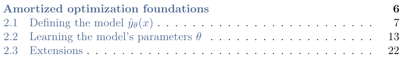

** 3 Applications of amortized optimization
:PROPERTIES:
:NOTER_PAGE: 2
:END:
# pdfrect: 2 124.3 383.7 503.9 407.9
# pdfsent: [[[2,491.5,383.7,503.9,394.6],[2,124.3,397.0,138.1,407.9],[2,148.8,397.0,387.4,407.9],[2,398.6,397.0,406.9,407.9]],[[2,406.9,397.0,415.3,407.9]],[[2,415.3,397.0,423.6,407.9]],[[2,423.6,397.0,431.9,407.9]],[[2,431.9,397.0,440.3,407.9]],[[2,440.3,397.0,448.6,407.9]],[[2,448.6,397.0,456.9,407.9]],[[2,456.9,397.0,465.3,407.9]],[[2,465.3,397.0,473.6,407.9]],[[2,473.6,397.0,477.8,407.9]]]
#+begin_en
32 3.1 Variational inference and variational autoencoders . . . . . . . . . .
#+end_en

# pdfrect: 2 124.3 397.0 503.9 421.5
# pdfsent: [[[2,493.0,397.0,503.9,407.9],[2,124.3,410.6,138.1,421.5],[2,149.2,410.6,219.3,421.5]],[[2,219.3,410.6,228.1,421.5]],[[2,228.1,410.6,236.8,421.5]],[[2,236.8,410.6,245.6,421.5]],[[2,245.6,410.6,254.3,421.5]],[[2,254.3,410.6,263.1,421.5]],[[2,263.1,410.6,271.9,421.5]],[[2,271.9,410.6,280.6,421.5]],[[2,280.6,410.6,289.4,421.5]],[[2,289.4,410.6,298.1,421.5]],[[2,298.1,410.6,306.9,421.5]],[[2,306.9,410.6,315.7,421.5]],[[2,315.7,410.6,324.4,421.5]],[[2,324.4,410.6,333.2,421.5]],[[2,333.2,410.6,342.0,421.5]],[[2,342.0,410.6,350.7,421.5]],[[2,350.7,410.6,359.5,421.5]],[[2,359.5,410.6,368.2,421.5]],[[2,368.2,410.6,377.0,421.5]],[[2,377.0,410.6,385.8,421.5]],[[2,385.8,410.6,394.5,421.5]],[[2,394.5,410.6,403.3,421.5]],[[2,403.3,410.6,412.0,421.5]],[[2,412.0,410.6,420.8,421.5]],[[2,420.8,410.6,429.6,421.5]],[[2,429.6,410.6,438.3,421.5]],[[2,438.3,410.6,447.1,421.5]],[[2,447.1,410.6,455.8,421.5]],[[2,455.8,410.6,464.6,421.5]],[[2,464.6,410.6,473.4,421.5]],[[2,473.4,410.6,477.7,421.5]]]
#+begin_en
32 3.2 Sparse coding . . . . . . . . . . . . . . . . . . . . . . . . . . . . . . .
#+end_en

# pdfrect: 2 124.3 410.6 503.8 435.0
# pdfsent: [[[2,493.0,410.6,503.8,421.5],[2,124.3,424.1,138.1,435.0],[2,149.2,424.1,330.0,435.0],[2,339.3,424.1,347.7,435.0]],[[2,347.7,424.1,356.1,435.0]],[[2,356.1,424.1,364.5,435.0]],[[2,364.5,424.1,372.9,435.0]],[[2,372.9,424.1,381.3,435.0]],[[2,381.3,424.1,389.7,435.0]],[[2,389.7,424.1,398.1,435.0]],[[2,398.1,424.1,406.5,435.0]],[[2,406.5,424.1,414.8,435.0]],[[2,414.8,424.1,423.2,435.0]],[[2,423.2,424.1,431.6,435.0]],[[2,431.6,424.1,440.0,435.0]],[[2,440.0,424.1,448.4,435.0]],[[2,448.4,424.1,456.8,435.0]],[[2,456.8,424.1,465.2,435.0]],[[2,465.2,424.1,473.6,435.0]],[[2,473.6,424.1,477.8,435.0]]]
#+begin_en
34 3.3 Multi-task learning and meta-learning . . . . . . . . . . . . . . . . .
#+end_en

# pdfrect: 2 124.3 424.1 503.9 448.6
# pdfsent: [[[2,493.0,424.1,503.9,435.0],[2,124.3,437.7,138.1,448.6],[2,149.2,437.7,395.6,448.6]],[[2,395.6,437.7,405.3,448.6]],[[2,405.3,437.7,415.0,448.6]],[[2,415.0,437.7,424.6,448.6]],[[2,424.6,437.7,434.3,448.6]],[[2,434.3,437.7,444.0,448.6]],[[2,444.0,437.7,453.6,448.6]],[[2,453.6,437.7,463.3,448.6]],[[2,463.3,437.7,472.9,448.6]],[[2,472.9,437.7,477.8,448.6]]]
#+begin_en
36 3.4 Fixed-point computations and convex optimization . . . . . . . . . .
#+end_en

# pdfrect: 2 124.3 437.7 503.9 462.1
# pdfsent: [[[2,493.0,437.7,503.9,448.6],[2,124.3,451.2,138.1,462.1],[2,149.2,451.2,236.3,462.1],[2,246.2,451.2,254.6,462.1]],[[2,254.6,451.2,263.0,462.1]],[[2,263.0,451.2,271.5,462.1]],[[2,271.5,451.2,279.9,462.1]],[[2,279.9,451.2,288.3,462.1]],[[2,288.3,451.2,296.7,462.1]],[[2,296.7,451.2,305.1,462.1]],[[2,305.1,451.2,313.6,462.1]],[[2,313.6,451.2,322.0,462.1]],[[2,322.0,451.2,330.4,462.1]],[[2,330.4,451.2,338.8,462.1]],[[2,338.8,451.2,347.2,462.1]],[[2,347.2,451.2,355.7,462.1]],[[2,355.7,451.2,364.1,462.1]],[[2,364.1,451.2,372.5,462.1]],[[2,372.5,451.2,380.9,462.1]],[[2,380.9,451.2,389.3,462.1]],[[2,389.3,451.2,397.8,462.1]],[[2,397.8,451.2,406.2,462.1]],[[2,406.2,451.2,414.6,462.1]],[[2,414.6,451.2,423.0,462.1]],[[2,423.0,451.2,431.4,462.1]],[[2,431.4,451.2,439.9,462.1]],[[2,439.9,451.2,448.3,462.1]],[[2,448.3,451.2,456.7,462.1]],[[2,456.7,451.2,465.1,462.1]],[[2,465.1,451.2,473.5,462.1]],[[2,473.5,451.2,477.8,462.1]]]
#+begin_en
40 3.5 Optimal transport . . . . . . . . . . . . . . . . . . . . . . . . . . . .
#+end_en

# pdfrect: 2 124.3 451.2 503.8 475.7
# pdfsent: [[[2,493.0,451.2,503.8,462.1],[2,124.3,464.8,138.1,475.7],[2,149.2,464.8,409.3,475.7]],[[2,409.3,464.8,418.5,475.7]],[[2,418.5,464.8,427.6,475.7]],[[2,427.6,464.8,436.7,475.7]],[[2,436.7,464.8,445.8,475.7]],[[2,445.8,464.8,455.0,475.7]],[[2,455.0,464.8,464.1,475.7]],[[2,464.1,464.8,473.2,475.7]],[[2,473.2,464.8,477.8,475.7]]]
#+begin_en
45 3.6 Policy learning for control and reinforcement learning . . . . . . . . .
#+end_en

** 4 Implementation and software examples
:PROPERTIES:
:NOTER_PAGE: 2
:END:
# pdfrect: 2 124.3 489.4 504.0 513.6
# pdfsent: [[[2,491.5,489.4,504.0,500.3],[2,124.3,502.7,138.1,513.6],[2,148.8,502.7,338.0,513.6],[2,347.8,502.7,356.2,513.6]],[[2,356.2,502.7,364.6,513.6]],[[2,364.6,502.7,372.9,513.6]],[[2,372.9,502.7,381.3,513.6]],[[2,381.3,502.7,389.7,513.6]],[[2,389.7,502.7,398.1,513.6]],[[2,398.1,502.7,406.5,513.6]],[[2,406.5,502.7,414.9,513.6]],[[2,414.9,502.7,423.3,513.6]],[[2,423.3,502.7,431.7,513.6]],[[2,431.7,502.7,440.0,513.6]],[[2,440.0,502.7,448.4,513.6]],[[2,448.4,502.7,456.8,513.6]],[[2,456.8,502.7,465.2,513.6]],[[2,465.2,502.7,473.6,513.6]],[[2,473.6,502.7,477.8,513.6]]]
#+begin_en
60 4.1 Amortization in the wild: a deeper look . . . . . . . . . . . . . . . .
#+end_en

# pdfrect: 2 124.3 502.7 503.9 527.2
# pdfsent: [[[2,493.0,502.7,503.9,513.6],[2,124.3,516.3,138.1,527.2],[2,148.8,516.3,360.3,527.2]],[[2,360.3,516.3,369.7,527.2]],[[2,369.7,516.3,379.1,527.2]],[[2,379.1,516.3,388.5,527.2]],[[2,388.5,516.3,397.9,527.2]],[[2,397.9,516.3,407.3,527.2]],[[2,407.3,516.3,416.7,527.2]],[[2,416.7,516.3,426.1,527.2]],[[2,426.1,516.3,435.5,527.2]],[[2,435.5,516.3,444.9,527.2]],[[2,444.9,516.3,454.3,527.2]],[[2,454.3,516.3,463.7,527.2]],[[2,463.7,516.3,473.1,527.2]],[[2,473.1,516.3,477.8,527.2]]]
#+begin_en
60 4.2 Training an amortization model on a sphere . . . . . . . . . . . . . .
#+end_en

# pdfrect: 2 124.3 516.3 503.8 540.7
# pdfsent: [[[2,493.0,516.3,503.8,527.2],[2,124.3,529.8,138.1,540.7],[2,149.2,529.8,295.2,540.7],[2,305.5,529.8,313.9,540.7]],[[2,313.9,529.8,322.3,540.7]],[[2,322.3,529.8,330.7,540.7]],[[2,330.7,529.8,339.1,540.7]],[[2,339.1,529.8,347.5,540.7]],[[2,347.5,529.8,355.9,540.7]],[[2,355.9,529.8,364.3,540.7]],[[2,364.3,529.8,372.7,540.7]],[[2,372.7,529.8,381.1,540.7]],[[2,381.1,529.8,389.5,540.7]],[[2,389.5,529.8,397.9,540.7]],[[2,397.9,529.8,406.3,540.7]],[[2,406.3,529.8,414.7,540.7]],[[2,414.7,529.8,423.1,540.7]],[[2,423.1,529.8,431.6,540.7]],[[2,431.6,529.8,440.0,540.7]],[[2,440.0,529.8,448.4,540.7]],[[2,448.4,529.8,456.8,540.7]],[[2,456.8,529.8,465.2,540.7]],[[2,465.2,529.8,473.6,540.7]],[[2,473.6,529.8,477.8,540.7]]]
#+begin_en
66 4.3 Other useful software packages . . . . . . . . . . . . . . . . . . . . .
#+end_en

** 5 Discussion
:PROPERTIES:
:NOTER_PAGE: 2
:END:
# pdfrect: 2 124.3 554.4 504.0 578.7
# pdfsent: [[[2,491.5,554.4,504.0,565.3],[2,124.3,567.8,138.1,578.7],[2,149.2,567.8,408.4,578.7]],[[2,408.4,567.8,417.6,578.7]],[[2,417.6,567.8,426.9,578.7]],[[2,426.9,567.8,436.1,578.7]],[[2,436.1,567.8,445.4,578.7]],[[2,445.4,567.8,454.7,578.7]],[[2,454.7,567.8,463.9,578.7]],[[2,463.9,567.8,473.2,578.7]],[[2,473.2,567.8,477.8,578.7]]]
#+begin_en
69 5.1 Surpassing the convergence rates of classical methods . . . . . . . . .
#+end_en

# pdfrect: 2 124.3 567.8 503.9 592.2
# pdfsent: [[[2,493.0,567.8,503.9,578.7],[2,124.3,581.3,138.1,592.2],[2,149.2,581.3,352.8,592.2]],[[2,352.8,581.3,362.1,592.2]],[[2,362.1,581.3,371.3,592.2]],[[2,371.3,581.3,380.6,592.2]],[[2,380.6,581.3,389.9,592.2]],[[2,389.9,581.3,399.1,592.2]],[[2,399.1,581.3,408.4,592.2]],[[2,408.4,581.3,417.6,592.2]],[[2,417.6,581.3,426.9,592.2]],[[2,426.9,581.3,436.1,592.2]],[[2,436.1,581.3,445.4,592.2]],[[2,445.4,581.3,454.7,592.2]],[[2,454.7,581.3,463.9,592.2]],[[2,463.9,581.3,473.2,592.2]],[[2,473.2,581.3,477.8,592.2]]]
#+begin_en
69 5.2 Generalization and convergence guarantees . . . . . . . . . . . . . . .
#+end_en

# pdfrect: 2 124.3 581.3 503.9 605.8
# pdfsent: [[[2,493.0,581.3,503.9,592.2],[2,124.3,594.9,138.1,605.8],[2,149.2,594.9,260.4,605.8],[2,271.6,594.9,280.0,605.8]],[[2,280.0,594.9,288.4,605.8]],[[2,288.4,594.9,296.8,605.8]],[[2,296.8,594.9,305.3,605.8]],[[2,305.3,594.9,313.7,605.8]],[[2,313.7,594.9,322.1,605.8]],[[2,322.1,594.9,330.5,605.8]],[[2,330.5,594.9,338.9,605.8]],[[2,338.9,594.9,347.3,605.8]],[[2,347.3,594.9,355.8,605.8]],[[2,355.8,594.9,364.2,605.8]],[[2,364.2,594.9,372.6,605.8]],[[2,372.6,594.9,381.0,605.8]],[[2,381.0,594.9,389.4,605.8]],[[2,389.4,594.9,397.8,605.8]],[[2,397.8,594.9,406.2,605.8]],[[2,406.2,594.9,414.7,605.8]],[[2,414.7,594.9,423.1,605.8]],[[2,423.1,594.9,431.5,605.8]],[[2,431.5,594.9,439.9,605.8]],[[2,439.9,594.9,448.3,605.8]],[[2,448.3,594.9,456.7,605.8]],[[2,456.7,594.9,465.1,605.8]],[[2,465.1,594.9,473.6,605.8]],[[2,473.6,594.9,477.8,605.8]]]
#+begin_en
69 5.3 Measuring performance . . . . . . . . . . . . . . . . . . . . . . . . .
#+end_en

# pdfrect: 2 124.3 594.9 503.9 619.3
# pdfsent: [[[2,493.0,594.9,503.9,605.8],[2,124.3,608.4,138.1,619.3],[2,149.2,608.4,399.1,619.3]],[[2,399.1,608.4,408.4,619.3]],[[2,408.4,608.4,417.6,619.3]],[[2,417.6,608.4,426.9,619.3]],[[2,426.9,608.4,436.1,619.3]],[[2,436.1,608.4,445.4,619.3]],[[2,445.4,608.4,454.6,619.3]],[[2,454.6,608.4,463.9,619.3]],[[2,463.9,608.4,473.1,619.3]],[[2,473.1,608.4,477.8,619.3]]]
#+begin_en
70 5.4 Successes and limitations of amortized optimization . . . . . . . . . .
#+end_en

# pdfrect: 2 124.3 608.4 503.8 632.9
# pdfsent: [[[2,493.0,608.4,503.8,619.3],[2,124.3,622.0,138.1,632.9],[2,149.2,622.0,395.6,632.9]],[[2,395.6,622.0,405.3,632.9]],[[2,405.3,622.0,415.0,632.9]],[[2,415.0,622.0,424.6,632.9]],[[2,424.6,622.0,434.3,632.9]],[[2,434.3,622.0,444.0,632.9]],[[2,444.0,622.0,453.6,632.9]],[[2,453.6,622.0,463.3,632.9]],[[2,463.3,622.0,472.9,632.9]],[[2,472.9,622.0,477.8,632.9]]]
#+begin_en
70 5.5 Some open problems and under-explored directions . . . . . . . . . .
#+end_en

# pdfrect: 2 124.3 622.0 503.9 646.4
# pdfsent: [[[2,493.0,622.0,503.9,632.9],[2,124.3,635.5,138.1,646.4],[2,149.2,635.5,212.0,646.4],[2,220.8,635.5,229.2,646.4]],[[2,229.2,635.5,237.7,646.4]],[[2,237.7,635.5,246.1,646.4]],[[2,246.1,635.5,254.5,646.4]],[[2,254.5,635.5,262.9,646.4]],[[2,262.9,635.5,271.4,646.4]],[[2,271.4,635.5,279.8,646.4]],[[2,279.8,635.5,288.2,646.4]],[[2,288.2,635.5,296.6,646.4]],[[2,296.6,635.5,305.1,646.4]],[[2,305.1,635.5,313.5,646.4]],[[2,313.5,635.5,321.9,646.4]],[[2,321.9,635.5,330.3,646.4]],[[2,330.3,635.5,338.8,646.4]],[[2,338.8,635.5,347.2,646.4]],[[2,347.2,635.5,355.6,646.4]],[[2,355.6,635.5,364.0,646.4]],[[2,364.0,635.5,372.5,646.4]],[[2,372.5,635.5,380.9,646.4]],[[2,380.9,635.5,389.3,646.4]],[[2,389.3,635.5,397.7,646.4]],[[2,397.7,635.5,406.2,646.4]],[[2,406.2,635.5,414.6,646.4]],[[2,414.6,635.5,423.0,646.4]],[[2,423.0,635.5,431.4,646.4]],[[2,431.4,635.5,439.9,646.4]],[[2,439.9,635.5,448.3,646.4]],[[2,448.3,635.5,456.7,646.4]],[[2,456.7,635.5,465.1,646.4]],[[2,465.1,635.5,473.6,646.4]],[[2,473.6,635.5,477.8,646.4]]]
#+begin_en
72 5.6 Related work . . . . . . . . . . . . . . . . . . . . . . . . . . . . . . .
#+end_en

** Chapter 1
:PROPERTIES:
:NOTER_PAGE: 3
:END:
*** Introduction
:PROPERTIES:
:NOTER_PAGE: 3
:END:
# pdfrect: 3 107.6 305.0 503.9 329.5
# pdfsent: [[[3,107.6,305.0,503.9,315.9],[3,108.0,318.6,325.5,329.5]]]
#+begin_en
This tutorial studies the use of machine learning to improve repeated solves of parametric optimization problems of the form
#+end_en

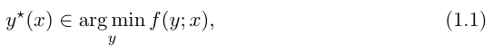

# pdfrect: 3 107.3 417.8 503.8 428.9
# pdfsent: [[[3,107.3,417.8,503.8,428.9]]]
#+begin_en
i.e., the solution continuously changes in a connected way as the context changes, as
#+end_en

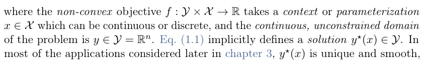

# pdfrect: 3 107.7 444.9 505.4 510.0
# pdfrect: 3 108.0 526.2 503.9 537.4
# pdfrect: 3 106.7 607.5 506.0 659.1
# pdfsent: [[[3,124.9,444.9,338.1,455.8]],[[3,338.1,444.9,503.9,455.8],[3,108.0,458.5,505.4,469.4],[3,107.7,472.0,504.2,482.9],[3,108.0,485.6,154.2,496.5]],[[3,154.2,485.6,297.4,496.5]],[[3,297.4,485.6,505.4,496.5],[3,108.0,499.1,488.8,510.0]],[[3,488.8,499.1,504.0,510.0],[3,108.0,526.2,503.9,537.4],[3,108.0,607.5,168.5,618.4]],[[3,168.5,607.5,503.9,618.4],[3,108.0,621.1,262.1,632.0]],[[3,262.1,621.1,505.7,632.0],[3,107.7,634.6,503.9,645.5],[3,106.7,648.2,506.0,659.1]]]
#+begin_en
Parametric optimization problems such as eq. (1.1) have been studied for decades [Bank et al., 1982, Fiacco and Ishizuka, 1990, Shapiro, 2003, Klatte and Kummer, 2006, Bonnans and Shapiro, 2013, Still, 2018, Fiacco, 2020] with a focus on sensitivity analysis. The general formulation in eq. (1.1) captures many tasks arising in physics, engineering, mathematics, control, inverse modeling, and machine learning. For or states, e.g., angular positions and velocities describing the configuration of the space in eq. (1.1), the formulation can also capture stochastic optimization problems as discussed in section 2.3.1. For example, Section 3.1 optimizes over the (realvalued) parameters of a variational distribution and section 3.6 optimizes over the (real-valued) parameters of a stochastic policy for control and reinforcement learning.
#+end_en

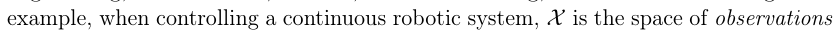

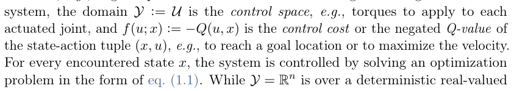

# pdfrect: 3 108.0 661.7 505.7 686.2
# pdfsent: [[[3,124.9,661.7,293.1,672.6]],[[3,293.1,661.7,505.7,672.6],[3,108.0,675.3,281.8,686.2]],[[3,281.8,675.3,503.9,686.2]]]
#+begin_en
Optimization problems such as eq. (1.1) quickly become a computational bottleneck in systems they are a part of. These problems often do not have a closed-form
#+end_en

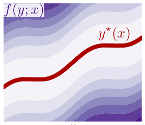

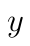

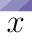

# pdfrect: 4 108.0 242.9 503.9 253.8
# pdfrect: 4 108.0 270.0 503.9 280.9
# pdfrect: 4 108.0 310.7 428.5 321.6
# pdfsent: [[[4,108.0,242.9,450.8,253.8]],[[4,450.8,242.9,484.6,253.8]],[[4,484.6,242.9,503.9,253.8],[4,108.0,270.0,128.0,280.9]],[[4,128.0,270.0,503.9,280.9],[4,108.0,310.7,428.5,321.6]]]
#+begin_en
Figure 1.1: Illustration of the parametric optimization problem in eq. (1.1). Each on. The contours show the values of the objectives where darker colors indicate and this visualization shows a continuum of optimization problems.
#+end_en

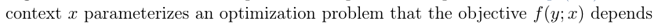

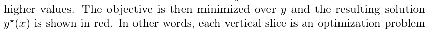

# pdfrect: 4 107.7 345.6 505.7 451.4
# pdfsent: [[[4,108.0,345.6,503.9,356.5],[4,108.0,359.1,293.6,370.1]],[[4,293.6,359.1,504.3,370.1],[4,108.0,372.7,491.8,383.6]],[[4,491.8,372.7,505.7,383.6],[4,108.0,386.2,504.1,397.2],[4,108.0,399.8,505.7,410.7],[4,108.0,413.3,503.9,424.3],[4,108.0,426.9,505.4,437.8],[4,107.7,440.4,417.0,451.4]]]
#+begin_en
analytic solution and are instead solved with approximate numerical methods which iteratively search for the solution. This computational problem has led to many specialized solvers that leverage domain-specific insights to deliver fast solves. Specialized algorithms are especially prevalent in convex optimization methods for linear programming, quadratic programming, cone programming, and control and use theoretical insights of the problem structure to bring empirical gains of computational improvements and improved convergence [Boyd et al., 2004, Nocedal and Wright, 2006, Bertsekas, 2015, Bubeck et al., 2015, Nesterov et al., 2018].
#+end_en

# pdfrect: 4 108.0 454.0 505.7 573.3
# pdfsent: [[[4,124.9,454.0,503.9,464.9],[4,108.0,467.5,505.7,478.5],[4,108.0,481.1,503.8,492.0],[4,108.0,494.6,412.4,505.5]],[[4,412.4,494.6,505.7,505.5],[4,108.0,508.2,434.6,519.3]],[[4,434.6,508.2,503.9,519.3],[4,108.0,521.7,485.2,532.6]],[[4,485.2,521.7,504.3,532.6],[4,108.0,535.3,503.9,546.2],[4,108.0,548.8,504.2,559.7],[4,108.0,562.4,494.5,573.3]]]
#+begin_en
Mostly separate from optimization research and algorithmic advancements, the machine learning community has focused on developing generic function approximation methods for estimating non-trivial high-dimensional mappings from data [Murphy, 2012, Salakhutdinov, 2014, Deisenroth et al., 2020]. While machine learning models are often used to reconstruct mappings from data, e.g. for supervised classification or regression where the targets are given by human annotations. Many computational advancements on the software and hardware have been developed in recent years to make the prediction time fast: the forward pass of a neural network generating a prediction can execute in milliseconds on a graphics processing unit.
#+end_en

# pdfrect: 4 107.1 575.9 504.3 641.3
# pdfrect: 4 108.0 657.2 503.9 681.7
# pdfsent: [[[4,124.9,575.9,174.2,587.1]],[[4,174.2,575.9,504.3,587.1],[4,108.0,589.5,376.6,600.4]],[[4,376.6,589.5,503.9,600.4],[4,108.0,603.0,357.3,614.2]],[[4,357.3,603.0,503.9,614.2],[4,108.0,616.6,503.9,627.5],[4,107.1,630.1,268.9,641.3]],[[4,268.9,630.1,504.2,641.3],[4,108.0,657.2,211.7,668.1]],[[4,211.7,657.2,503.9,668.1],[4,108.0,670.8,503.9,681.7]]]
#+begin_en
Overview. This tutorial studies the use of machine learning models to rapidly predict the solutions to the optimization problem in eq. (1.1), which is referred to as amortized optimization or learning to optimize. Amortized optimization methods are capable of significantly improving the computational time of classical algorithms on a focused subset of problems. This is because the model is able to learn about not assume access to. My goal in writing this is to explore a unified perspective of modeling approaches of amortized optimization in chapter 2 to help draw connections
#+end_en

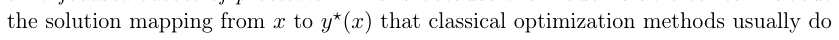

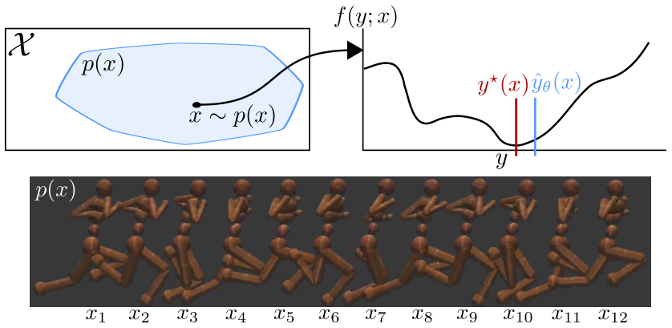

# pdfrect: 5 108.0 376.1 504.1 387.0
# pdfrect: 5 108.0 430.3 480.6 441.2
# pdfsent: [[[5,108.0,376.1,504.1,387.0],[5,108.0,430.3,447.1,441.2]],[[5,447.1,430.3,480.6,441.2]]]
#+begin_en
to apply to each actuated joint, the cost (or negated value) of a state-action pair obtained with the model-based stochastic value gradient in Amos et al. [2021].
#+end_en

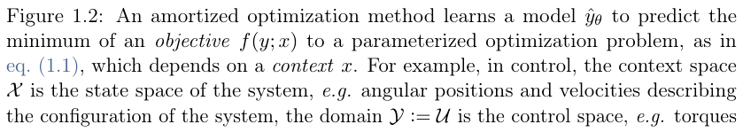

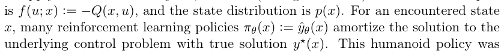

# pdfrect: 5 107.6 465.3 506.0 571.0
# pdfsent: [[[5,108.0,465.3,316.1,476.4]],[[5,316.1,465.3,505.4,476.4],[5,108.0,478.8,503.9,489.7],[5,108.0,492.3,506.0,503.3]],[[5,107.6,505.9,503.8,516.8],[5,108.0,519.4,265.3,530.4]],[[5,265.3,519.4,503.9,530.4],[5,108.0,533.0,503.9,543.9],[5,108.0,546.5,503.8,557.5],[5,108.0,560.1,240.6,571.0]]]
#+begin_en
between the applications in chapter 3, e.g. between amortized variational inference, meta-learning, and policy learning for control and reinforcement learning, sparse coding, convex optimization, optimal transport, and deep equilibrium networks. These topics have historically been studied in isolation without connections between their amortization components. Chapter 4 presents a computational tour through source code for variational inference, policy learning, and a spherical optimization problem and chapter 5 concludes with a discussion of challenges, limitations, open problems, and related work.
#+end_en

# pdfrect: 5 108.0 573.6 505.7 679.4
# pdfsent: [[[5,124.9,573.6,307.1,584.8]],[[5,307.1,573.6,505.7,584.8],[5,108.0,587.2,504.1,598.1],[5,108.0,600.7,156.5,611.7]],[[5,156.5,600.7,505.7,611.7],[5,108.0,614.3,378.4,625.4]],[[5,378.4,614.3,436.3,625.4]],[[5,436.3,614.3,503.9,625.4],[5,108.0,627.8,503.9,638.8],[5,108.0,641.4,150.9,652.3]],[[5,150.9,641.4,503.9,652.3],[5,108.0,654.9,408.3,665.8]],[[5,408.3,654.9,503.9,665.8],[5,108.0,668.5,503.9,679.4]]]
#+begin_en
How much does amortization help? Amortized optimization has been revolutionary to many fields, especially including variational inference and reinforcement learning. Figure 4.1 shows that the amortization component of a variational autoencoder trained on MNIST is 25000 times faster (0.4ms vs. 8 seconds!) than solving a batch of 1024 optimization problems from scratch to obtain a solution of the same quality. These optimization problems are solved in every training iteration and can become a significant bottleneck if they are inefficiently solved. If the model is being trained for millions of iterations, then the difference between solving the optimization
#+end_en

# pdfrect: 5 303.3 702.6 308.7 713.5
# pdfrect: 6 108.0 110.2 503.9 134.7
# pdfsent: [[[5,303.3,702.6,308.7,713.5],[6,108.0,110.2,213.2,121.1]],[[6,213.2,110.2,503.9,121.1],[6,108.0,123.8,315.8,134.7]]]
#+begin_en
4 problem in 0.4ms vs. 8 seconds makes the difference between the entire training process finishing in a few hours or a month.
#+end_en

# pdfrect: 6 107.6 137.3 506.0 405.7
# pdfsent: [[[6,124.9,137.3,484.6,148.4]],[[6,484.6,137.3,505.7,148.4],[6,108.0,150.9,503.9,161.8],[6,108.0,164.4,506.0,175.3]],[[6,108.0,178.0,503.9,188.9],[6,108.0,191.5,504.2,202.4],[6,108.0,205.1,505.4,216.0],[6,108.0,218.6,505.7,229.5],[6,108.0,232.2,411.8,243.1]],[[6,411.8,232.2,503.9,243.1],[6,108.0,245.7,503.9,256.6],[6,108.0,259.3,376.6,270.2]],[[6,376.6,259.3,503.9,270.2],[6,108.0,272.8,503.9,283.7],[6,108.0,286.4,425.7,297.3]],[[6,425.7,286.4,503.8,297.3],[6,108.0,299.9,506.0,310.8]],[[6,107.6,313.5,503.9,324.4],[6,108.0,327.0,505.7,337.9],[6,108.0,340.6,188.2,351.5]],[[6,188.2,340.6,258.3,351.5]],[[6,258.3,340.6,503.9,351.5],[6,108.0,354.1,264.6,365.0]],[[6,264.6,354.1,504.2,365.0],[6,107.6,367.7,503.8,378.6],[6,108.0,381.2,505.4,392.1],[6,108.0,394.8,493.6,405.7]]]
#+begin_en
A historic note: amortization in control and statistical inference. Amortized optimization has arisen in many fields as a result to practical optimization problems being non-convex and not having easily computed, or closed-form solutions. Continuous control problems with linear dynamics and quadratic cost are convex and often easily solved with the linear quadratic regulator (LQR) and many non-convex extensions and iterative applications of LQR have been successful over the decades, but becomes increasingly infeasible on non-trivial systems and in reinforcement learning settings where the policy often needs to be rapidly executed. For this reason, the reinforcement learning community almost exclusively amortizes control optimization problems with a learned policy [Sutton and Barto, 2018]. Related to this throughline in control and reinforcement learning, many statistical optimization problems have closed form solutions for known distributions such as Gaussians. For example, the original Kalman filter is defined with Gaussians and the updates take a closed form. The extended Kalman filter generalizes the distributions to non-Gaussians, but the updates are in general no longer available analytically and need to be computationally estimated. Marino et al. [2018a] shows how amortization helps improve this computationally challenging step. Both of these control and statistical settings start with a simple setting with analytic solutions to optimization problems, generalize to more challenging optimization problems that need to be computationally estimated, and then add back some computational tractability with amortized optimization.
#+end_en

** Chapter 2
:PROPERTIES:
:NOTER_PAGE: 7
:END:
*** Amortized optimization foundations
:PROPERTIES:
:NOTER_PAGE: 7
:END:
# pdfrect: 7 114.2 319.3 493.5 341.6
# pdfsent: [[[7,114.2,325.3,260.1,335.5],[7,289.6,319.3,493.5,328.5],[7,289.6,332.5,487.6,341.6]]]
#+begin_en
Amortization model ˆyθ (section 2.1) Fully-amortized (section 2.1.1): no objective access Semi-amortized (section 2.1.2): accesses objective
#+end_en

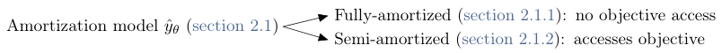

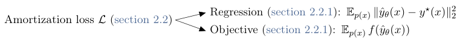

# pdfrect: 7 128.8 411.4 483.1 422.3
# pdfsent: [[[7,128.8,411.4,483.1,422.3]]]
#+begin_en
Figure 2.1: Overview of amortized optimization modeling and loss choices.
#+end_en

# pdfrect: 7 108.0 435.9 503.9 487.5
# pdfrect: 7 108.0 517.2 503.9 541.7
# pdfsent: [[[7,124.9,435.9,503.8,446.8],[7,108.0,449.4,401.4,460.6]],[[7,401.4,449.4,434.1,460.6]],[[7,434.1,449.4,503.9,460.6],[7,108.0,463.0,503.9,474.1],[7,108.0,476.5,503.9,487.5],[7,108.0,517.2,197.5,528.1]],[[7,197.5,517.2,503.9,528.1],[7,108.0,530.7,233.6,541.7]]]
#+begin_en
The machine learning, statistics, and optimization communities are exploring methods of learning to optimize to obtain fast solvers for eq. (1.1). I will refer to these methods as amortized optimization as they amortize the cost of solving the optimization problems across many contexts to approximate the solution mapping a model can learn. This tutorial follows Shu [2017] for defining the core foundation of amortized optimization.
#+end_en

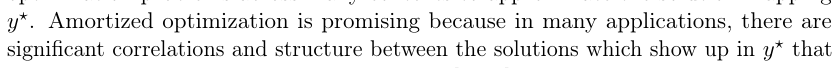

# pdfrect: 7 108.0 553.3 504.0 566.7
# pdfsent: [[[7,108.0,553.3,437.1,566.7]],[[7,437.1,553.3,504.0,566.7]]]
#+begin_en
Definition 1 An amortized optimization method to solve eq. (1.1) can be
#+end_en

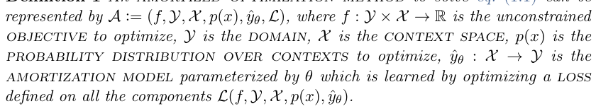

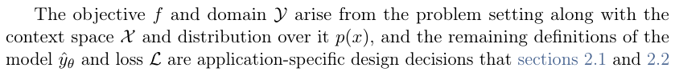

# pdfrect: 7 303.3 702.6 308.7 713.5
# pdfrect: 8 108.0 110.2 503.9 148.2
# pdfsent: [[[7,303.3,702.6,308.7,713.5],[8,108.0,110.2,158.1,121.1]],[[8,158.1,110.2,503.9,121.1],[8,108.0,123.8,503.9,134.7],[8,108.0,137.3,138.5,148.2]],[[8,138.5,137.3,503.9,148.2]]]
#+begin_en
6 opens up. These sections present the modeling and loss foundations for the core problem in definition 1 agnostic of specific downstream applications that will use them. The key choices highlighted in chapter 2 are how much information 1) the
#+end_en

# pdfrect: 8 107.6 218.6 505.4 270.2
# pdfsent: [[[8,107.6,218.6,505.4,229.5],[8,108.0,232.2,503.8,243.1],[8,108.0,245.7,193.2,256.6]],[[8,193.2,245.7,503.9,256.6],[8,108.0,259.3,454.1,270.2]]]
#+begin_en
The best modeling approach is an open research topic as there are many tradeoffs, and many specialized insights from the application domain can significantly improve the performance. The generalization capacity along with the model’s convergence guarantees are challenging topics which section 5.2 covers in more detail.
#+end_en

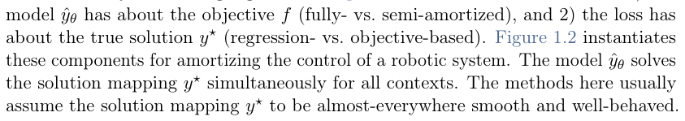

# pdfrect: 8 107.4 272.8 505.7 432.8
# pdfsent: [[[8,124.9,272.8,409.2,283.9]],[[8,409.2,272.8,505.7,283.9],[8,108.0,286.4,504.3,297.3],[8,108.0,299.9,462.7,310.8]],[[8,462.7,299.9,503.9,310.8],[8,108.0,313.5,503.9,324.4],[8,108.0,327.0,503.8,337.9],[8,108.0,340.6,505.4,351.5],[8,107.4,354.1,377.3,365.0]],[[8,377.3,354.1,473.3,365.0]],[[8,473.3,354.1,505.3,365.0],[8,107.6,367.7,164.9,378.6]],[[8,164.9,367.7,203.1,378.6]],[[8,203.1,367.7,284.2,378.6]],[[8,284.2,367.7,503.8,378.6],[8,108.0,381.2,219.7,392.1]],[[8,219.7,381.2,503.9,392.1],[8,108.0,394.8,503.9,405.7],[8,108.0,408.3,505.3,419.2],[8,108.0,421.9,445.3,432.8]]]
#+begin_en
Origins of the term “amortization” for optimization. The word “amortization” generally means to spread out costs and thus “amortized optimization” usually means to spread out computational costs of the optimization process. The term originated in the variational inference community for inference optimization [Kingma and Welling, 2014, Rezende et al., 2014, Stuhlmüller et al., 2013, Gershman and Goodman, 2014, Webb et al., 2018, Ravi and Beatson, 2019, Cremer et al., 2018, Wu et al., 2020], and is used more generally in Xue et al. [2020], Sercu et al. [2021], Xiao et al. [2021]. Marino [2021, p. 28] give further background on the origins and uses of amortization. Concurrent to these developments, other communities have independently developed amortization methods without referring to them by the same terminology and analysis, such as in reinforcement learning, policy optimization, and sparse coding — chapter 3 connects all of these under definition 1.
#+end_en

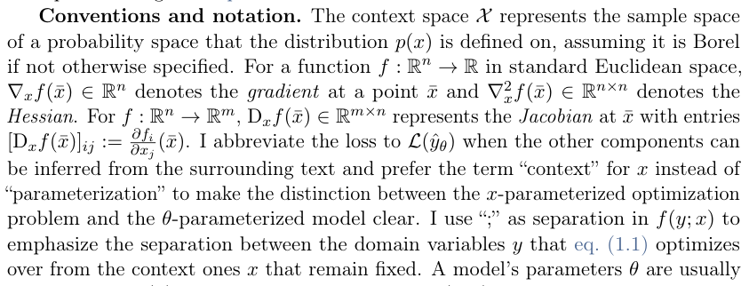

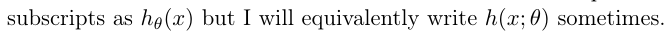

# pdfrect: 8 108.0 617.4 312.6 633.0
# pdfrect: 8 108.0 657.8 504.2 682.3
# pdfsent: [[[8,108.0,617.5,128.2,631.8],[8,144.0,617.4,312.6,633.0],[8,108.0,657.8,504.2,668.7],[8,108.0,671.4,503.9,682.3]]]
#+begin_en
2.1 Defining the model ˆyθ(x) the best model design is an active area of research that is searching for models that are expressive and more computationally efficient than the algorithms classically used
#+end_en

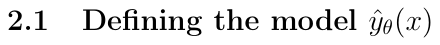

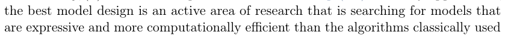

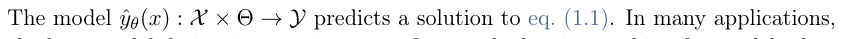

# pdfrect: 8 303.3 702.6 308.7 713.5
# pdfrect: 9 107.6 110.2 503.9 175.6
# pdfsent: [[[8,303.3,702.6,308.7,713.5],[9,108.0,110.2,274.8,121.4]],[[9,274.8,110.2,503.6,121.4],[9,108.0,123.8,503.9,134.7],[9,108.0,137.3,190.1,148.2]],[[9,190.1,137.3,503.9,148.2],[9,108.0,150.9,503.9,161.8],[9,107.6,164.4,244.2,175.6]]]
#+begin_en
7 to solve the optimization problem. Section 2.1.1 starts simple with fully-amortized models that approximate the entire solution to the optimization problem with a single black-box model. Then section 2.1.2 shows how to open up the model to include more information about the optimization problem that can leverage domain knowledge with semi-amortized models.
#+end_en

**** 2.1.1 Fully-amortized models
:PROPERTIES:
:NOTER_PAGE: 9
:END:
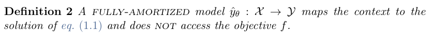

# pdfrect: 9 108.0 250.5 503.9 275.1
# pdfrect: 9 108.0 291.1 503.9 315.6
# pdfrect: 9 107.3 345.3 505.9 370.0
# pdfsent: [[[9,124.9,250.5,503.9,261.4],[9,108.0,264.0,503.9,275.1],[9,108.0,291.1,293.7,302.0]],[[9,293.7,291.1,503.9,302.0],[9,108.0,304.7,503.9,315.6],[9,108.0,345.3,480.9,356.2]],[[9,480.9,345.3,505.1,356.2],[9,107.3,358.9,505.9,370.0]]]
#+begin_en
I use the prefix “fully” to emphasize that the entire computation of the solution to the optimization problem is absorbed into a black-box model that does not access most amortization is fully amortized. These are standard in amortized variational inference (section 3.1) and policy learning (section 3.6), that typically use feedforward successfully able to predict the solution to the optimization problem in eq. (1.1) without ever accessing the objective of the optimization problem after being trained.
#+end_en

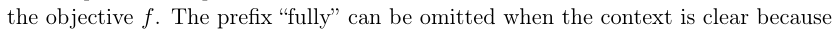

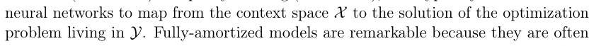

# pdfrect: 9 108.0 372.4 503.9 396.9
# pdfrect: 9 108.0 413.1 503.9 451.1
# pdfsent: [[[9,124.9,372.4,503.9,383.3],[9,108.0,386.0,286.2,396.9]],[[9,286.2,386.0,503.9,396.9],[9,108.0,413.1,483.6,424.0]],[[9,483.6,413.1,503.9,424.0],[9,108.0,426.6,503.9,437.5],[9,108.0,440.2,350.9,451.1]]]
#+begin_en
Fully-amortized models are the most useful for attaining approximate solutions that are computationally efficient. They tend to work the best when the solution or thousands of dimensions, and the context distribution isn’t too large. When fully-amortized models don’t work well, semi-amortized models help open up the black box and use information about the objective.
#+end_en

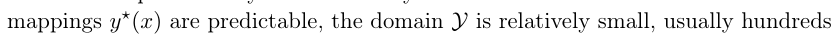

**** 2.1.2 Semi-amortized models
:PROPERTIES:
:NOTER_PAGE: 9
:END:
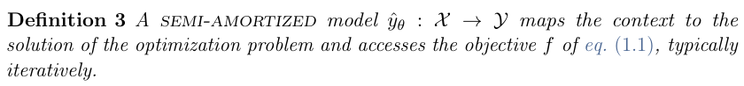

# pdfrect: 9 107.7 539.8 504.1 564.2
# pdfrect: 9 108.0 580.4 503.9 604.9
# pdfsent: [[[9,124.9,539.8,180.5,550.9]],[[9,180.5,539.8,291.8,550.9]],[[9,291.8,539.8,504.1,550.9],[9,107.7,553.3,503.9,564.2],[9,108.0,580.4,489.4,591.3]],[[9,489.4,580.4,503.9,591.3],[9,108.0,594.0,437.9,604.9]],[[9,437.9,594.0,503.9,604.9]]]
#+begin_en
Kim et al. [2018], Marino et al. [2018b] proposed semi-amortized models for variational inference that add back domain knowledge of the optimization problem to integrating the optimization-based domain knowledge into the learning process. The model can now internally integrate solvers to improve the prediction. Semi-amortized
#+end_en

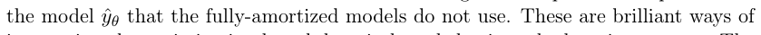

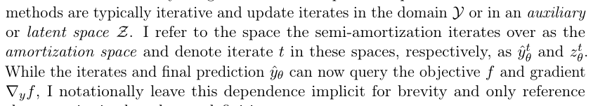

# pdfrect: 9 108.0 675.3 296.5 686.2
# pdfsent: [[[9,108.0,675.3,296.5,686.2]]]
#+begin_en
these queries in the relevant definitions.
#+end_en

# pdfrect: 10 108.0 110.3 339.2 121.4
# pdfsent: [[[10,108.0,110.3,339.2,121.4]]]
#+begin_en
Semi-amortized models over the domain Y
#+end_en

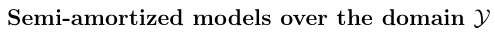

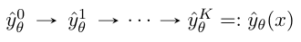

# pdfrect: 10 124.9 163.5 503.9 174.4
# pdfrect: 10 108.0 190.6 472.3 201.5
# pdfsent: [[[10,124.9,163.5,503.9,174.4],[10,108.0,190.6,472.3,201.5]]]
#+begin_en
One of the most common semi-amortized model is to parameterize and integrate descent [Andrychowicz et al., 2016, Finn et al., 2017, Kim et al., 2018].
#+end_en

# pdfrect: 10 108.0 217.7 503.9 242.2
# pdfsent: [[[10,108.0,217.7,503.9,228.8],[10,108.0,231.3,165.5,242.2]]]
#+begin_en
referred to as the inner-level optimization problem in the bi-level setting that arises for learning.
#+end_en

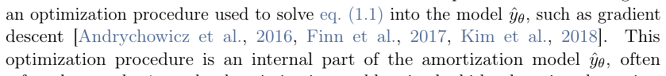

# pdfrect: 10 106.7 244.8 504.3 282.8
# pdfsent: [[[10,124.9,244.8,176.1,256.0]],[[10,176.1,244.8,503.9,256.0],[10,108.0,258.4,503.9,269.3],[10,106.7,271.9,218.9,282.8]],[[10,218.9,271.9,504.3,282.8]]]
#+begin_en
Examples. This section instantiates a canonical semi-amortized model based gradient descent that learns the initialization as in model-agnostic meta-learning (MAML) by Finn et al. [2017], structured prediction energy networks (SPENs) by
#+end_en

# pdfrect: 10 108.0 285.5 504.3 310.1
# pdfrect: 10 108.0 298.8 504.0 323.7
# pdfrect: 10 107.4 312.6 503.9 338.2
# pdfsent: [[[10,108.0,285.5,187.3,296.4]],[[10,187.3,285.5,504.3,296.4],[10,108.0,297.6,158.1,310.1]],[[10,158.1,297.6,194.5,310.1]],[[10,194.5,297.6,299.2,310.1],[10,294.6,298.8,504.0,312.8],[10,108.0,311.1,154.3,323.7]],[[10,154.3,311.1,265.3,323.7],[10,261.8,312.6,503.9,326.4],[10,107.4,323.9,306.2,338.2]]]
#+begin_en
Belanger et al. [2017], and semi-amortized variational auto-encoders (SAVAEs) by Kim et al. [2018]. The initial iterate ˆy0 θ(x) := θ is parameterized by θ ∈X for all contexts. Iteratively updating ˆyt θ for K gradient steps with a learning rate or step size α ∈ R+ on the objective f(y; x) gives
#+end_en

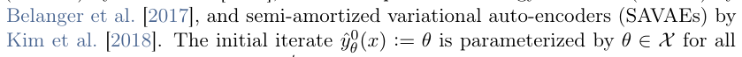

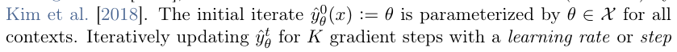

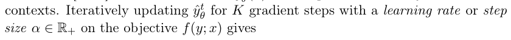

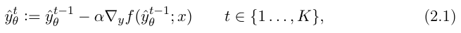

# pdfrect: 10 107.6 373.7 320.2 387.4
# pdfsent: [[[10,107.6,373.7,320.2,387.4]]]
#+begin_en
where model’s output is defined as ˆyθ := ˆyK.
#+end_en

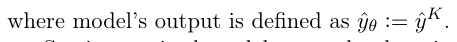

# pdfrect: 10 108.0 388.7 505.7 440.2
# pdfsent: [[[10,124.9,388.7,505.7,399.6],[10,108.0,402.2,503.8,413.1],[10,108.0,415.8,141.8,426.7]],[[10,141.8,415.8,334.9,426.7]],[[10,334.9,415.8,503.9,426.7],[10,108.0,429.3,460.9,440.2]]]
#+begin_en
Semi-amortized models over the domain can go significantly beyond gradientbased models and in theory, any algorithm to solve the original optimization problem in eq. (1.1) can be integrated into the model. Section 2.2.2 further discusses the learning of semi-amortized models by unrolling that are instantiated later:
#+end_en

# pdfrect: 10 124.4 451.8 506.0 476.3
# pdfsent: [[[10,124.4,451.8,503.9,462.7],[10,135.3,465.4,506.0,476.3]]]
#+begin_en
• Section 3.2 discusses how Gregor and LeCun [2010] integrate ISTA iterates [Daubechies et al., 2004, Beck and Teboulle, 2009] into a semi-amortized model.
#+end_en

# pdfrect: 10 124.4 487.9 505.4 553.0
# pdfsent: [[[10,124.4,487.9,503.9,498.8],[10,135.3,501.5,253.0,512.4]],[[10,253.0,501.5,503.9,512.4],[10,135.3,515.0,505.4,525.9],[10,135.0,528.6,233.4,539.5]],[[10,233.4,528.6,505.3,539.5],[10,135.0,542.1,162.7,553.0]]]
#+begin_en
• Section 3.4.1 discusses models that integrate fixed-point computations into semi-amortized models. Venkataraman and Amos [2021] amortize convex cone programs by differentiating through the splitting cone solver [O’donoghue et al., 2016] and Bai et al. [2022] amortize deep equilibrium models [Bai et al., 2019, 2020].
#+end_en

# pdfrect: 10 124.4 564.6 503.9 589.1
# pdfsent: [[[10,124.4,564.6,379.0,575.5]],[[10,379.0,564.6,503.9,575.5],[10,135.3,578.2,427.0,589.1]]]
#+begin_en
• Section 3.4.5 discusses RLQP by Ichnowski et al. [2021] that uses the OSQP solver [Stellato et al., 2018] inside of a semi-amortized model.
#+end_en

# pdfrect: 10 108.0 607.0 353.2 618.1
# pdfsent: [[[10,108.0,607.0,353.2,618.1]]]
#+begin_en
Semi-amortized models over a latent space Z
#+end_en

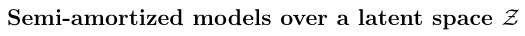

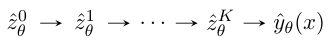

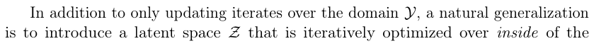

# pdfrect: 10 303.3 702.6 308.7 713.5
# pdfrect: 11 107.1 110.2 503.9 175.6
# pdfsent: [[[10,303.3,702.6,308.7,713.5],[11,108.0,110.2,209.5,121.1]],[[11,209.5,110.2,503.9,121.1],[11,108.0,123.8,503.9,134.7],[11,108.0,137.3,146.2,148.2]],[[11,146.2,137.3,503.9,148.2],[11,108.0,150.9,183.4,161.8]],[[11,183.4,150.9,503.9,161.8],[11,107.1,164.4,456.9,175.6]]]
#+begin_en
9 amortization model. This is usually done to give the semi-amortized model more capacity to learn about the structure of the optimization problems that are being solved. The latent space can also be interpreted as a representation of the optimal solution space. This is useful for learning an optimizer that only searches over the optimal region of the solution space rather than the entire solution space.
#+end_en

# pdfrect: 11 107.6 178.0 505.3 229.5
# pdfrect: 11 108.0 245.7 503.7 256.6
# pdfsent: [[[11,124.9,178.0,176.1,189.1]],[[11,176.1,178.0,370.8,189.1]],[[11,370.8,178.0,503.9,189.1],[11,108.0,191.5,505.3,202.4],[11,107.6,205.1,207.9,216.0]],[[11,207.9,205.1,358.4,216.0]],[[11,358.4,205.1,503.9,216.0],[11,108.0,218.6,503.9,229.5],[11,108.0,245.7,503.7,256.6]]]
#+begin_en
Examples. The iterative gradient updates in eq. (2.1) can be replaced with a learned update function as in Ravi and Larochelle [2017], Li and Malik [2017a], Andrychowicz et al. [2016], Li and Malik [2017b]. These model the past sequence of iterates and learn how to best-predict the next iterate, pushing them towards and Schmidhuber, 1997] or GRU [Cho et al., 2014] and leads to updates of the form
#+end_en

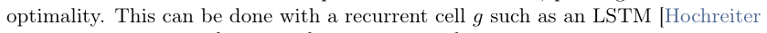

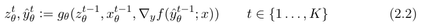

# pdfrect: 11 107.6 321.4 504.1 345.9
# pdfsent: [[[11,108.0,321.4,503.9,332.4],[11,107.6,335.0,232.1,345.9]],[[11,232.1,335.0,504.1,345.9]]]
#+begin_en
updates leveraging the problem structure that a traditional optimization method would not be able to make. In theory, traditional update rules can also be fallen back
#+end_en

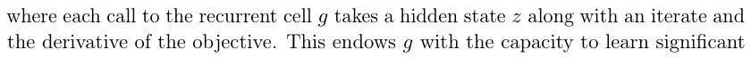

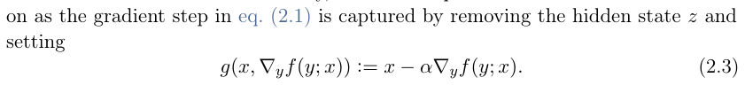

# pdfrect: 11 108.0 395.6 504.3 447.1
# pdfrect: 11 108.0 463.3 504.2 542.2
# pdfrect: 11 108.0 558.2 503.9 596.2
# pdfsent: [[[11,124.9,395.6,504.3,406.5],[11,108.0,409.1,503.9,420.0],[11,108.0,422.7,142.6,433.8]],[[11,142.6,422.7,197.1,433.8]],[[11,197.1,422.7,503.9,433.8],[11,108.0,436.2,503.9,447.1],[11,108.0,463.3,504.2,474.2],[11,108.0,476.9,503.9,487.8],[11,108.0,490.4,357.2,501.3]],[[11,357.2,490.4,415.9,501.3]],[[11,415.9,490.4,503.9,501.3],[11,108.0,504.0,503.9,514.9],[11,108.0,517.5,293.4,528.4]],[[11,293.4,517.5,503.9,528.4],[11,108.0,531.1,503.9,542.2],[11,108.0,558.2,260.6,569.1]],[[11,260.6,558.2,503.9,569.1],[11,108.0,571.7,503.9,582.6],[11,108.0,585.3,454.0,596.2]],[[11,454.0,585.3,486.3,596.2]]]
#+begin_en
Latent semi-amortized models are a budding topic and can excitingly learn many other latent representations that go beyond iterative gradient updates in the original space. Luo et al. [2018], Amos and Yarats [2020] learn a latent domain connected to the original domain where the latent domain captures hidden structures and consider gradient updates in the latent domain and Amos and Yarats [2020] show that the cross-entropy method [De Boer et al., 2005] can be made differentiable and learned as an alternative to gradient updates. Amos et al. [2017] unrolls and differentiates through the bundle method [Smola et al., 2007] in a convex setting as an alternative to gradient steps. The latent optimization could also be done over a learned parameter space as in POPLIN [Wang and Ba, 2020], which lifts the fully-amortized neural network. This leverages the insight that the parameter space of over-parameterized neural networks can induce easier non-convex optimization problems than in the original space, which is also studied in Hoyer et al. [2019].
#+end_en

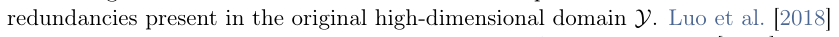

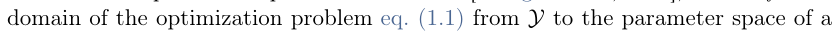

# pdfrect: 11 108.0 614.2 406.7 625.2
# pdfsent: [[[11,108.0,614.2,406.7,625.2]]]
#+begin_en
Comparing semi-amortized models with warm-starting
#+end_en

# pdfrect: 11 108.0 634.6 503.9 686.2
# pdfsent: [[[11,108.0,634.6,503.9,645.5],[11,108.0,648.2,489.4,659.1]],[[11,489.4,648.2,503.9,659.1],[11,108.0,661.7,503.9,672.6],[11,108.0,675.3,503.9,686.2]]]
#+begin_en
Semi-amortized models are conceptually similar to learning a fully-amortized model to warm-start an existing optimization procedure that fine-tunes the solution. The crucial difference is that semi-amortized learning often end-to-end learns through the final prediction while warm-starting and fine-tuning only learns the initial prediction
#+end_en

# pdfrect: 11 300.6 702.6 311.4 713.5
# pdfrect: 12 106.7 110.2 505.3 202.4
# pdfsent: [[[11,300.6,702.6,311.4,713.5],[12,108.0,110.2,503.9,121.1],[12,108.0,123.8,159.2,134.7]],[[12,159.2,123.8,503.9,134.7],[12,107.6,137.3,503.9,148.2],[12,108.0,150.9,465.6,161.8]],[[12,465.6,150.9,505.3,161.8],[12,108.0,164.4,230.5,175.3]],[[12,230.5,164.4,272.9,175.3]],[[12,272.9,164.4,447.3,175.3]],[[12,447.3,164.4,503.9,175.3],[12,107.7,178.0,503.9,188.9],[12,106.7,191.5,484.8,202.4]]]
#+begin_en
10 and does not integrate the knowledge of the fine-tuning procedure into the learning procedure. Choosing between these is an active research topic and while this tutorial will mostly focus on semi-amortized models, learning a fully-amortized warm-starting model brings promising results to some fields too, such as Zhang et al. [2019b], Baker [2019], Chen et al. [2022b]. In variational inference, Kim et al. [2018, Table 2] compare semi-amortized models (SA-VAE) to warm-starting and fine-tuning (VAE+SVI) and demonstrate that the end-to-end learning signal is helpful.
#+end_en

# pdfrect: 12 108.0 191.5 503.9 270.2
# pdfsent: [[[12,493.7,191.5,503.9,202.4],[12,108.0,205.1,503.9,216.0],[12,108.0,218.6,177.3,229.5]],[[12,177.3,218.6,503.9,229.5],[12,108.0,232.2,503.9,243.1],[12,108.0,245.7,503.9,256.6],[12,108.0,259.3,349.5,270.2]]]
#+begin_en
In other words, amortization finds an initialization that is helpful for gradient-based optimization. Arbel and Mairal [2022] further study fully-amortized warm-started solvers that arise in bi-level optimization problems for hyper-parameter optimization and use the theoretical framework from singularly perturbed systems [Habets, 2010] to analyze properties of the approximate solutions.
#+end_en

# pdfrect: 12 108.0 288.3 349.4 299.2
# pdfsent: [[[12,108.0,288.3,349.4,299.2]]]
#+begin_en
On second-order derivatives of the objective
#+end_en

# pdfrect: 12 107.6 308.7 505.4 387.3
# pdfsent: [[[12,107.6,308.7,503.8,319.6],[12,108.0,322.2,268.2,333.1]],[[12,268.2,322.2,503.9,333.1],[12,108.0,335.8,504.2,346.7],[12,107.6,349.3,283.4,360.2]],[[12,283.4,349.3,477.6,360.2]],[[12,477.6,349.3,505.4,360.2],[12,108.0,362.9,503.9,373.8],[12,108.0,376.4,269.3,387.3]]]
#+begin_en
Training a semi-amortized model is usually more computationally challenging than training a fully-amortized model. This section looks at how second-order derivatives of the objective may come up when unrolling and create a computational bottleneck when learning a semi-amortized model. The next derivation follows Nichol et al. [2018, §5] and Weng [2018] and shows the model derivatives that arise when composing a semi-amortized model with a loss.
#+end_en

# pdfrect: 12 124.9 390.0 503.9 401.1
# pdfsent: [[[12,124.9,390.0,304.2,401.1]],[[12,304.2,390.0,503.9,401.1]]]
#+begin_en
Starting with a single-step model. This section instantiates a single-step
#+end_en

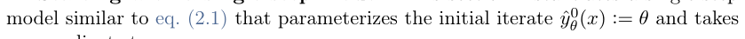

# pdfrect: 12 108.0 464.2 505.1 488.7
# pdfsent: [[[12,108.0,464.2,437.1,475.3]],[[12,437.1,464.2,503.9,475.3],[12,108.0,477.7,480.6,488.7]],[[12,480.6,477.7,505.1,488.7]]]
#+begin_en
because it makes the optimization step internally part of the model. Gradient-based optimization of losses with respect to the model’s parameters, such as eqs. (2.9)
#+end_en

# pdfrect: 12 108.0 518.4 503.9 542.8
# pdfsent: [[[12,108.0,518.4,503.9,529.3],[12,108.0,531.9,141.5,542.8]],[[12,141.5,531.9,174.9,542.8]]]
#+begin_en
derivative of the model requires differentiating through the optimization step, which for eq. (2.4) is
#+end_en

# pdfrect: 12 108.0 579.1 505.7 684.8
# pdfsent: [[[12,108.0,579.1,371.4,590.0]],[[12,371.4,579.1,505.7,590.0],[12,108.0,592.6,313.1,603.5]],[[12,313.1,592.6,465.7,603.5]],[[12,465.7,592.6,503.9,603.5],[12,108.0,606.2,504.1,617.1],[12,108.0,619.7,156.9,630.6]],[[12,156.9,619.7,504.2,630.6],[12,108.0,633.3,503.9,644.2],[12,108.0,646.8,504.3,657.7],[12,108.0,660.4,291.5,671.3]],[[12,291.5,660.4,503.9,671.3],[12,108.0,673.9,478.8,684.8]],[[12,478.8,673.9,503.9,684.8]]]
#+begin_en
of the model’s parameters on the training loss (!) and is compute- and memoryexpensive to instantiate for large models. In practice, the Hessian in eq. (2.5) is often never explicitly instantiated as optimizing the loss only requires Hessian-vector products. The Hessian-vector product can be computed exactly or estimated without fully instantiating the Hessian, similar to how computing the derivative of a neural network with backprop does not instantiate the intermediate Jacobians and only computes the Jacobian-vector product. More information about efficiently computing Hessian-vector products is available in Pearlmutter [1994], Domke [2012]. Jax’s
#+end_en

# pdfrect: 12 300.6 702.6 311.4 713.5
# pdfrect: 13 108.0 110.2 504.1 134.7
# pdfsent: [[[12,300.6,702.6,311.4,713.5],[13,108.0,110.2,504.1,121.1],[13,108.0,123.8,153.0,134.7]],[[13,153.0,123.8,503.9,134.7]]]
#+begin_en
11 autodiff cookbook [Bradbury et al., 2020] further describes efficient Hessian-vector products. Before discussing alternatives, the next portion derives similar results for a
#+end_en

# pdfrect: 13 124.9 150.9 484.0 162.0
# pdfrect: 13 217.0 169.8 282.1 185.2
# pdfrect: 13 263.2 169.8 366.8 186.0
# pdfsent: [[[13,124.9,150.9,221.0,162.0]],[[13,221.0,150.9,241.3,162.0]],[[13,241.3,150.9,484.0,162.0],[13,217.0,169.8,282.1,185.2],[13,263.2,178.0,267.2,186.0],[13,282.6,169.8,366.8,184.1]]]
#+begin_en
Multi-step models. Eq. (2.4) can be extended to the K-step setting with θ (x) := ˆyK−1 θ (x) − α∇yf(ˆyK−1
#+end_en

# pdfrect: 13 188.6 192.9 503.9 206.9
# pdfsent: [[[13,188.6,192.9,284.5,206.9]],[[13,284.5,192.9,353.1,206.9]],[[13,353.1,192.9,503.9,206.9]]]
#+begin_en
θ(x) := θ as before. Similar to eq. (2.5), the derivative of a single
#+end_en

# pdfrect: 13 108.0 242.8 307.0 255.3
# pdfrect: 13 302.4 244.2 443.8 258.0
# pdfsent: [[[13,108.0,242.8,307.0,255.3],[13,302.4,244.2,443.8,258.0]]]
#+begin_en
and composing the derivatives down to ˆy0 θ yields the product structure
#+end_en

# pdfrect: 13 399.1 276.3 505.3 287.4
# pdfrect: 13 231.3 276.5 269.2 289.5
# pdfrect: 13 355.2 276.5 390.8 289.5
# pdfrect: 13 273.7 292.1 289.1 300.1
# pdfsent: [[[13,399.1,276.5,402.1,287.4],[13,483.0,276.3,505.3,287.2],[13,231.3,276.5,269.2,289.5],[13,355.2,276.5,390.8,289.5],[13,273.7,292.1,289.1,300.1]]]
#+begin_en
, (2.8) θ (x)] = θ(x); x) k=0
#+end_en

# pdfrect: 13 161.6 308.3 504.0 322.1
# pdfrect: 13 108.0 321.9 505.4 359.9
# pdfsent: [[[13,161.6,308.3,304.7,322.1]],[[13,304.7,308.3,376.2,322.1]],[[13,376.2,308.3,504.0,322.1],[13,301.3,321.9,479.2,335.1]],[[13,479.2,321.9,503.9,335.1],[13,108.0,335.4,505.4,346.4],[13,108.0,349.0,481.9,359.9]]]
#+begin_en
θ(x)] = I at the base case. Computing eq. (2.8) is now K times more yf at every iteration of the model. While using Hessian-vector products can alleviate some computational burden of this term, it often still requires significantly more operations than most other derivatives.
#+end_en

# pdfrect: 13 108.0 362.5 503.9 387.1
# pdfrect: 13 108.0 389.3 404.8 403.0
# pdfsent: [[[13,124.9,362.5,339.9,373.7]],[[13,339.9,362.5,503.9,373.7],[13,108.0,374.6,181.5,387.1]],[[13,181.5,374.6,470.8,387.1],[13,108.0,389.3,376.5,403.0]],[[13,376.5,389.3,404.8,403.0]]]
#+begin_en
Computationally cheaper alternatives. The first-order MAML baseline in Finn et al. [2017] suggests to simply not use the second-order terms ∇2 approximating the model derivative as the identity, i.e. Dθ[ˆyK
#+end_en

# pdfrect: 13 107.7 404.3 506.0 591.3
# pdfsent: [[[13,108.0,404.3,443.0,415.2]],[[13,443.0,404.3,503.9,415.2],[13,108.0,417.8,265.4,428.7]],[[13,265.4,417.8,503.9,428.7],[13,108.0,431.4,412.2,442.5]],[[13,412.2,431.4,503.9,442.5],[13,108.0,444.9,505.4,455.8],[13,107.7,458.5,142.0,469.6]],[[13,142.0,458.5,337.7,469.6]],[[13,337.7,458.5,504.1,469.6],[13,108.0,472.0,504.1,482.9],[13,108.0,485.6,169.3,496.5]],[[13,169.3,485.6,235.4,496.5]],[[13,235.4,485.6,504.2,496.5],[13,108.0,499.1,505.7,510.0],[13,108.0,512.7,204.4,523.6]],[[13,204.4,512.7,503.9,523.6],[13,108.0,526.2,503.9,537.1],[13,108.0,539.8,140.8,550.7]],[[13,140.8,539.8,506.0,550.7]],[[13,108.0,553.3,504.2,564.2],[13,108.0,566.9,415.9,577.8]],[[13,415.9,566.9,505.9,577.8]],[[13,108.0,580.4,470.5,591.3]]]
#+begin_en
on only information from the outer loss to update the parameters. They use the intuition from Goodfellow et al. [2015] that neural networks are locally linear and therefore these second-order terms of f are not too important. They show that this approximation works well in some cases, such as MiniImagenet [Ravi and Larochelle, 2017]. The MAML++ extension by Antoniou et al. [2019] proposes to use first-order MAML during the early phases of training, but to later add back this second-order information. Nichol et al. [2018] further analyze first-order approximations to MAML and propose another approximation called Reptile that also doesn’t use this secondorder information. These higher-order terms also come up when unrolling in the different bi-level optimization setting for hyper-parameter optimization, and Lorraine et al. [2020, Table 1] gives a particularly good overview of approximations to these. Furthermore, memory-efficient methods for training neural networks and recurrent models with backpropagation and unrolling such as Gruslys et al. [2016], Chen et al. [2016] can also help improve the memory utilization in amortization models.
#+end_en

# pdfrect: 13 108.0 594.0 504.3 686.2
# pdfsent: [[[13,124.9,594.0,339.5,605.1]],[[13,339.5,594.0,504.2,605.1],[13,108.0,607.5,503.9,618.6],[13,108.0,621.1,189.1,632.0]],[[13,189.1,621.1,503.9,632.0],[13,108.0,634.6,149.9,645.5]],[[13,149.9,634.6,429.3,645.5]],[[13,429.3,634.6,503.9,645.5],[13,108.0,648.2,320.3,659.3]],[[13,320.3,648.2,504.3,659.3],[13,108.0,661.7,503.9,672.6],[13,108.0,675.3,286.8,686.2]]]
#+begin_en
Parameterizing and learning the objective. While this section has mostly not considered the setting when the objective f is also learned, the second-order derivatives appearing in eq. (2.8) also cause issues in when the objective is parameterized and learned. In addition to learning an initial iterate, Belanger et al. [2017] learn the objective f representing an energy function. They parameterize f as a neural network and use softplus activation functions rather than ReLUs to ensure the objective’s second-order derivatives are non-zero.
#+end_en

**** 2.1.3 Models based on differentiable optimization
:PROPERTIES:
:NOTER_PAGE: 14
:END:
# pdfrect: 14 107.6 130.8 503.9 141.7
# pdfrect: 14 108.0 157.9 503.9 209.5
# pdfrect: 14 107.4 225.7 506.0 263.7
# pdfsent: [[[14,107.6,130.8,503.9,141.7],[14,108.0,157.9,355.4,168.8]],[[14,355.4,157.9,503.9,168.8],[14,108.0,171.5,503.9,182.4],[14,108.0,185.0,503.9,195.9],[14,108.0,198.6,260.3,209.5]],[[14,260.3,198.6,503.9,209.5],[14,108.0,225.7,503.9,236.6],[14,108.0,239.2,506.0,250.1]],[[14,107.4,252.8,504.2,263.7]]]
#+begin_en
As discussed in section 2.2, the model typically needs to be (sub-)differentiable with products with it) necessary to optimize the loss. These derivatives are standard backprop when the model is, for example, a full-amortized neural network, but in the semi-amortized case, the model itself is often an optimization process that needs to be differentiated through. When the model updates are objective-based as in gradient updates in the domain can be attained by seeing the updates as a sequence of computations that are differentiated through, resulting in second-order derivatives. When more general optimization methods are used for the amortization model that
#+end_en

# pdfrect: 14 107.7 266.3 505.4 304.3
# pdfsent: [[[14,108.0,266.3,505.4,277.2],[14,107.7,279.9,503.8,290.8],[14,108.0,293.4,236.9,304.3]]]
#+begin_en
may not have a closed-form solution, the tools of differentiable optimization [Domke, 2012, Gould et al., 2016, Amos and Kolter, 2017, Amos, 2019, Agrawal et al., 2019a] enable end-to-end learning.
#+end_en

**** 2.1.4 Practically choosing a model
:PROPERTIES:
:NOTER_PAGE: 14
:END:
# pdfrect: 14 107.6 343.2 505.1 394.8
# pdfrect: 14 108.0 411.0 503.9 421.9
# pdfsent: [[[14,107.6,343.2,503.9,354.1],[14,108.0,356.8,238.3,367.7]],[[14,238.3,356.8,503.9,367.7],[14,108.0,370.3,503.9,381.2],[14,108.0,383.9,178.4,394.8]],[[14,178.4,383.9,505.1,394.8],[14,108.0,411.0,503.9,421.9]]]
#+begin_en
This section has taxonomized how to instantiate an amortization model in an application-agnostic way. As in most machine learning settings in practice, the modeling choice is often application-specific and needs to take into consideration many factors. This may include 1) the speed and expressibility of the model, 2) dimensional real-valued spaces but a convolutional neural network is likely to perform
#+end_en

# pdfrect: 14 107.3 438.1 505.6 503.4
# pdfsent: [[[14,108.0,438.1,503.8,449.0],[14,108.0,451.6,505.6,462.5],[14,108.0,465.2,504.3,476.1],[14,108.0,478.7,313.1,489.6]],[[14,313.1,478.7,503.9,489.6],[14,107.3,492.3,305.7,503.4]],[[14,305.7,492.3,504.1,503.4]]]
#+begin_en
For example, if the solution space is an image space, then a standard vision model capable of predicting high-dimensional images is reasonable, such as a U-net [Ronneberger et al., 2015], dilated convolutional network [Yu and Koltun, 2016] or fully convolutional network [Long et al., 2015]. 4) the model also may need to adapt to a variable-length context or solution space. This arises in VeLO [Metz et al., 2022] for
#+end_en

# pdfrect: 14 108.0 505.8 504.1 570.9
# pdfsent: [[[14,108.0,505.8,503.9,516.7],[14,108.0,519.4,480.2,530.3]],[[14,480.2,519.4,504.1,530.3],[14,108.0,532.9,503.9,543.8],[14,108.0,546.5,503.9,557.4],[14,108.0,560.0,263.3,570.9]]]
#+begin_en
learning to optimize machine learning models where the model needs to predict the parameters of different models that may have different numbers of parameters. Their solution is to decompose the structure of the parameter space and to formulate the semi-amortized model as a sequence model that predicts smaller MLPs that operate on smaller groups of parameters.
#+end_en

# pdfrect: 14 108.0 645.8 503.9 657.0
# pdfsent: [[[14,108.0,645.8,503.9,657.0]]]
#+begin_en
a bi-level optimization problem where the outer level is the parameter learning
#+end_en

***** Regression-Based
:PROPERTIES:
:NOTER_PAGE: 15
:END:
***** Objective-Based
:PROPERTIES:
:NOTER_PAGE: 15
:END:

# pdfrect: 15 106.7 306.9 503.9 331.3
# pdfrect: 15 107.6 334.0 505.7 372.0
# pdfsent: [[[15,108.0,306.9,503.9,317.8],[15,106.7,320.4,503.9,331.3],[15,108.0,334.0,132.7,344.9]],[[15,132.7,334.0,216.9,344.9]],[[15,216.9,334.0,503.9,344.9],[15,107.6,347.5,505.7,358.4],[15,108.0,361.1,503.8,372.0]]]
#+begin_en
most approaches can be roughly categorized as 1) regressing a ground-truth solution (section 2.2.1), or 2) minimizing the objective (sections 2.2.1 and 2.2.3), which fig. 2.2 illustrates. Optimizing the model parameters here can in theory be done with most parameter learning methods that incorporate zeroth-, first-, and higherorder information about the loss being optimized, and this section mostly focuses on
#+end_en

# pdfrect: 15 107.6 388.2 504.1 439.9
# pdfsent: [[[15,108.0,388.2,209.4,399.1]],[[15,209.4,388.2,426.6,399.1]],[[15,426.6,388.2,503.8,399.1],[15,108.0,401.7,503.8,412.6],[15,107.6,415.3,504.1,426.2],[15,108.0,428.8,434.9,439.9]]]
#+begin_en
[1983], Duchi et al. [2010], Zeiler [2012], Kingma and Ba [2015]. The rest of this section discusses approaches for designing the loss and optimizing the parameters with first-order methods (section 2.2.1) when differentiation is easy or zeroth-order methods (section 2.2.3) otherwise, e.g., in non-differentiable settings.
#+end_en

**** 2.2.1 Choosing the objective for learning
:PROPERTIES:
:NOTER_PAGE: 15
:END:
# pdfrect: 15 108.0 478.8 249.2 489.7
# pdfsent: [[[15,108.0,478.8,249.2,489.7]]]
#+begin_en
Regression-based learning
#+end_en

# pdfrect: 15 108.0 539.8 414.6 550.7
# pdfsent: [[[15,108.0,539.8,414.6,550.7]]]
#+begin_en
Euclidean distance, for example, regression-based learning solves
#+end_en

# pdfrect: 15 108.0 607.5 482.8 618.4
# pdfsent: [[[15,108.0,607.5,482.8,618.4]]]
#+begin_en
is able to directly differentiate the loss with respect to the model’s parameters.
#+end_en

# pdfrect: 15 108.0 621.1 504.2 659.1
# pdfsent: [[[15,124.9,621.1,503.9,632.0],[15,108.0,634.6,504.2,645.5],[15,108.0,648.2,184.2,659.1]]]
#+begin_en
Regression-based learning works the best for distilling known solutions into a faster model that can be deployed at a much lower cost, but can otherwise start failing to work.
#+end_en

# pdfrect: 15 108.0 648.2 503.9 686.2
# pdfsent: [[[15,193.3,648.2,503.9,659.1],[15,108.0,661.7,503.9,672.8],[15,108.0,675.3,325.3,686.2]],[[15,325.3,675.3,503.9,686.2]]]
#+begin_en
In RL and control, regression-based amortization methods are referred to as behavioral cloning and is a widely-used way of recovering a policy using trajectories observed from an expert policy. Using regression is also advantageous
#+end_en

# pdfrect: 15 300.6 702.6 311.4 713.5
# pdfrect: 16 108.0 123.8 505.4 175.6
# pdfrect: 16 108.0 191.5 503.9 216.0
# pdfsent: [[[15,300.6,702.6,311.4,713.5],[16,108.0,123.8,504.1,134.7],[16,108.0,137.3,479.1,148.2]],[[16,479.1,137.3,503.9,148.2],[16,108.0,150.9,505.4,161.8],[16,108.0,164.4,244.7,175.6]],[[16,244.7,164.4,503.9,175.6],[16,108.0,191.5,503.9,202.4],[16,108.0,205.1,214.0,216.0]]]
#+begin_en
14 complex procedure, such as an evaluation of the environment and dynamics in RL, or for computing the base model gradients when learning parameter optimizers. These methods work well when the ground-truth solutions are unique and semi-tractable, but can fail otherwise, i.e. if there are many possible ground-truth solutions for a scratch may be computationally expensive and amortization methods should improve the computation time.
#+end_en

# pdfrect: 16 106.0 230.4 505.6 282.2
# pdfsent: [[[16,108.0,230.4,171.5,241.5]],[[16,171.5,230.4,503.9,241.5],[16,107.2,244.1,503.9,255.1],[16,107.2,257.6,324.4,268.7]],[[16,324.4,257.6,385.8,268.7]],[[16,385.8,257.6,503.9,268.7],[16,106.0,271.4,505.6,282.2]]]
#+begin_en
Remark 1 Eq. (2.9) can be extended to other distances defined on the domain, such as non-Euclidean distances or the likelihood of a probabilistic model that predicts a distribution of possible candidate solutions. Adler et al. [2017] propose to use the Wasserstein distance for learning to predict the solutions to inverse imaging problems.
#+end_en

# pdfrect: 16 108.0 320.4 503.9 331.5
# pdfsent: [[[16,108.0,320.4,503.9,331.5]]]
#+begin_en
Instead of regressing onto the ground-truth solution, objective-based learning methods
#+end_en

# pdfrect: 16 107.6 388.5 503.9 399.4
# pdfrect: 16 108.0 415.6 210.8 426.5
# pdfsent: [[[16,107.6,388.5,503.9,399.4],[16,108.0,415.6,210.8,426.5]]]
#+begin_en
These methods use local information of the objective to provide a descent direction based on the gradient
#+end_en

# pdfrect: 16 107.6 500.9 358.8 511.8
# pdfsent: [[[16,107.6,500.9,358.8,511.8]]]
#+begin_en
where the last step is obtained by the chain rule.
#+end_en

# pdfrect: 16 368.5 500.9 503.9 511.8
# pdfrect: 16 108.0 555.1 504.2 593.1
# pdfsent: [[[16,368.5,500.9,503.9,511.8],[16,108.0,555.1,226.3,566.0]],[[16,226.3,555.1,503.9,566.0],[16,108.0,568.6,504.2,579.6],[16,108.0,582.2,275.2,593.1]]]
#+begin_en
This has the interpretation focuses on optimizing eq. (2.11) with first-order methods that explicitly differentiate the objective, section 2.2.3 discusses alternatives to optimizing it with reinforcement learning and zeroth-order methods.
#+end_en

# pdfrect: 16 108.0 595.7 506.0 633.8
# pdfsent: [[[16,124.9,595.7,503.9,606.7],[16,108.0,609.3,356.0,620.2]],[[16,356.0,609.3,503.9,620.2],[16,108.0,622.8,506.0,633.8]]]
#+begin_en
Objective-based methods thrive when the gradient information is informative and the objective and models are easily differentiable. Amortized variational inference methods and actor-critic methods both make extensive use of objective-based learning.
#+end_en

# pdfrect: 16 108.0 648.2 504.2 659.3
# pdfsent: [[[16,108.0,648.2,367.3,659.3]],[[16,367.3,648.2,504.2,659.3]]]
#+begin_en
Remark 2 A standard gradient-based optimizer for eq. (1.1) (without amortization)
#+end_en

# pdfrect: 17 107.6 260.3 506.0 298.3
# pdfsent: [[[17,108.0,260.3,506.0,271.2]],[[17,107.6,273.8,401.6,285.0]],[[17,401.6,273.8,504.2,285.0],[17,108.0,287.4,293.6,298.3]]]
#+begin_en
the contours of the objective (in purple where darker colors indicate higher values). This shows the inaccuracies of the regression-based loss, e.g. along a level set, may impact the overall objective differently.
#+end_en

# pdfrect: 17 108.0 349.4 503.9 387.4
# pdfrect: 17 108.0 403.6 504.1 468.7
# pdfsent: [[[17,108.0,349.4,283.9,360.3]],[[17,283.9,349.4,425.7,360.3]],[[17,425.7,349.4,503.9,360.3],[17,108.0,363.0,503.9,373.9],[17,108.0,376.5,323.1,387.4]],[[17,323.1,376.5,357.3,387.4]],[[17,357.3,376.5,503.9,387.4],[17,108.0,403.6,433.2,414.5]],[[17,433.2,403.6,503.9,414.5],[17,108.0,417.2,503.9,428.1],[17,108.0,430.7,312.9,441.6]],[[17,312.9,430.7,406.1,441.6]],[[17,406.1,430.7,503.9,441.6],[17,108.0,444.3,504.1,455.2],[17,108.0,457.8,475.3,468.7]]]
#+begin_en
descent is identical to solving eq. (1.1) with gradient descent. Remark 2 shows a connection between a model trained with gradients of an objective-based loss and a non-amortized gradient-based solver for eq. (1.1). The gradient update that would the model’s parameters that are shared across all problem instances. This also leads to a hypothesis that objective-based amortization works best when a gradient-based optimizer is able to successfully solve eq. (1.1) from scratch. However, there may be settings where a gradient-based optimizer performs poorly but an amortized optimizer excels because it is able to use information from the other problem instances.
#+end_en

# pdfrect: 17 107.2 483.5 503.9 508.0
# pdfrect: 17 107.1 510.6 503.7 535.1
# pdfsent: [[[17,108.0,483.5,503.7,494.5],[17,107.2,497.0,503.9,508.0],[17,108.0,510.6,154.3,521.6]],[[17,154.3,510.6,503.7,521.6],[17,107.1,524.2,442.9,535.1]]]
#+begin_en
Remark 3 The objective-based loss in section 2.2.1 provides a starting point for amortizing with other optimality conditions or reformulations of the optimization problem. This is done when amortizing for fixed-point computations and convex optimization in section 3.4, as well as in optimal transport section 3.5.
#+end_en

# pdfrect: 17 108.0 553.0 398.8 563.9
# pdfsent: [[[17,108.0,553.0,398.8,563.9]]]
#+begin_en
Comparing the regression- and objective-based losses
#+end_en

# pdfrect: 17 108.0 573.4 504.3 611.4
# pdfrect: 17 107.7 627.6 505.2 665.6
# pdfsent: [[[17,108.0,573.4,504.3,584.3],[17,108.0,586.9,503.9,597.8],[17,108.0,600.5,203.6,611.4]],[[17,203.6,600.5,253.6,611.4]],[[17,253.6,600.5,503.9,611.4],[17,108.0,627.6,505.2,638.5],[17,108.0,641.1,503.9,652.0],[17,107.7,654.7,140.1,665.6]]]
#+begin_en
Choosing between the regression- and objective-based losses is challenging as they measure the solution quality in different ways and have different convergence and locality properties. Liu et al. [2022] experimentally compare these losses for learning regression loss (the black contours) ignores the objective values (the purple contours) and thus gives the same loss to solutions that result in significantly different objective values.
#+end_en

# pdfrect: 17 108.0 654.7 504.2 679.1
# pdfsent: [[[17,149.0,654.7,503.9,665.6],[17,108.0,668.2,504.2,679.1]]]
#+begin_en
This could be potentially addressed by normalizing or re-weighting the dimensions for regression to be more aware of the curvature of the objective, but
#+end_en

# pdfrect: 18 108.0 110.2 503.9 161.8
# pdfsent: [[[18,108.0,110.2,221.1,121.1]],[[18,221.1,110.2,503.9,121.1],[18,108.0,123.8,147.6,134.7]],[[18,147.6,123.8,503.9,134.7],[18,108.0,137.3,503.9,148.2],[18,108.0,150.9,279.1,161.8]],[[18,279.1,150.9,503.9,161.8]]]
#+begin_en
this is often not done. Another idea is to combine both the objective and regression losses. Combining the losses could work especially well when only a few contexts are labeled, such as the regression and residual terms in the physics-informed neural operator paper [Li et al., 2021b]. The following summarizes some other advantages
#+end_en

# pdfrect: 18 104.9 206.2 303.8 230.8
# pdfrect: 18 104.9 233.3 302.3 298.6
# pdfsent: [[[18,104.9,206.2,295.2,217.3],[18,104.9,219.7,303.8,230.8],[18,118.9,233.3,252.4,244.2],[18,104.9,245.4,284.6,257.9],[18,104.9,258.9,300.2,271.5],[18,104.9,273.9,293.3,286.0],[18,104.9,286.0,302.3,298.6]]]
#+begin_en
− Often does not have access to f(y; x) + If f(y; x) is computationally expensive, does not need to compute it + Uses global information with y⋆(x) − It may be expensive to compute y⋆(x) + Does not need to compute ∇yf(y; x) − May be hard when y⋆(x) is not unique
#+end_en

**** 2.2.2 Learning iterative semi-amortized models
:PROPERTIES:
:NOTER_PAGE: 18
:END:
# pdfrect: 18 316.6 183.7 461.5 195.9
# pdfsent: [[[18,316.6,183.7,461.5,195.9]]]
#+begin_en
Objective-based losses Lobj
#+end_en

# pdfrect: 18 313.5 206.2 516.0 271.5
# pdfsent: [[[18,313.5,206.2,501.6,217.3],[18,313.5,219.7,516.0,230.8],[18,313.5,231.8,468.6,244.4],[18,313.5,246.8,498.2,258.9],[18,313.5,258.9,472.9,271.5]]]
#+begin_en
+ Uses objective information of f(y; x) − Can get stuck in local optima of f(y; x) + Faster, does not require y⋆(x) − Often requires computing ∇yf(y; x) + Easily learns non-unique y⋆(x)
#+end_en

# pdfrect: 18 108.0 341.0 503.9 392.7
# pdfrect: 18 108.0 381.6 503.9 406.3
# pdfrect: 18 108.0 393.7 504.2 419.6
# pdfsent: [[[18,108.0,341.0,503.9,351.9],[18,108.0,354.5,221.1,365.4]],[[18,221.1,354.5,503.9,365.4],[18,108.0,368.1,380.2,379.0]],[[18,380.2,368.1,503.9,379.0],[18,108.0,380.2,279.9,392.7],[18,276.6,381.6,503.9,395.4],[18,108.0,393.7,298.6,406.3]],[[18,298.6,393.7,320.3,406.3],[18,312.7,393.7,504.2,409.0],[18,108.0,408.7,365.9,419.6]]]
#+begin_en
Fully-amortized or semi-amortized models can be learned with the regression- and objective-based losses. This section discusses how the loss can be further opened up and crafted to learn iterative semi-amortized methods. For example, if the model produces intermediate predictions ˆyi θ in every iteration i, then instead of optimizing the loss of just the final prediction, i.e. L(ˆyK θ ), a more general loss LΣ may consider the impact of every iteration of the model’s prediction
#+end_en

# pdfrect: 18 243.4 441.0 344.9 455.2
# pdfrect: 18 206.2 443.2 241.6 454.1
# pdfrect: 18 221.8 455.0 225.7 462.9
# pdfsent: [[[18,243.4,441.0,276.0,455.2],[18,297.7,441.0,344.9,455.2],[18,206.2,443.2,241.6,454.1],[18,221.8,455.0,225.7,462.9]]]
#+begin_en
LΣ(ˆyθ) LΣ(ˆyθ) := arg min θ
#+end_en

# pdfrect: 18 347.9 431.8 363.7 451.6
# pdfrect: 18 365.5 441.0 397.1 455.1
# pdfrect: 18 393.8 443.0 505.3 456.2
# pdfrect: 18 349.0 458.6 362.7 466.5
# pdfrect: 18 107.6 474.4 505.4 515.8
# pdfsent: [[[18,352.0,431.8,359.1,439.8],[18,347.9,440.7,363.7,451.6],[18,365.5,441.0,397.1,455.1],[18,393.8,443.2,405.8,456.2],[18,477.5,443.0,505.3,453.9],[18,349.0,458.6,362.7,466.5],[18,107.6,474.4,504.3,488.7],[18,108.0,490.2,451.2,501.1]],[[18,451.2,490.2,505.4,501.1],[18,108.0,503.7,343.3,515.8]]]
#+begin_en
K X wiL(ˆyi θ), (2.12) i=0 where wi ∈ R+ are weights in every iteration i that give a design choice of how important it is for the earlier iterations to produce reasonable solutions. For example, setting wi = 1 encourages every iterate to be low.
#+end_en

# pdfrect: 18 108.0 517.3 505.1 650.1
# pdfsent: [[[18,124.9,517.3,503.9,528.2],[18,108.0,530.8,288.4,542.0]],[[18,288.4,530.8,478.8,542.0]],[[18,478.8,530.8,503.8,542.0],[18,108.0,544.4,503.9,555.5],[18,108.0,557.9,503.9,568.8],[18,108.0,571.5,503.9,582.4],[18,108.0,585.0,150.9,595.9]],[[18,150.9,585.0,503.9,595.9],[18,108.0,598.6,505.1,609.5],[18,108.0,612.1,503.9,623.0],[18,108.0,625.7,212.9,636.6]],[[18,212.9,625.7,503.9,636.6],[18,108.0,639.2,411.4,650.1]]]
#+begin_en
Learning iterative semi-amortized methods also has (loose) connections to sequence learning models that arise in, e.g. text, audio, and language processing. Given the context x, an iterative semi-amortized model seeks to produce a sequence of predictions that ultimately result in the intermediate and final predictions, which can be analogous to a language model predicting future text given the previous text as context. One difference is that semi-amortized models do not necessarily attempt to model the probabilistic dependencies of a structured output space (such as language) and instead only needs to predict intermediate computation steps for solving an optimization problem. The next section discusses concepts that arise when computing the derivatives of a loss with respect to the model’s parameters.
#+end_en

# pdfrect: 19 108.0 110.4 421.7 121.4
# pdfsent: [[[19,108.0,110.4,421.7,121.4]]]
#+begin_en
Unrolled optimization and backpropagation through time
#+end_en

# pdfrect: 19 107.2 200.8 505.4 225.4
# pdfsent: [[[19,108.0,200.8,503.9,211.9],[19,107.2,214.3,505.4,225.4]]]
#+begin_en
Differentiating through this kind of iterative procedure is referred to as backpropagation through time in sequence models and unrolled optimization [Pearlmutter and Siskind,
#+end_en

# pdfrect: 19 107.6 227.9 505.4 279.4
# pdfrect: 19 108.0 295.6 504.1 374.3
# pdfsent: [[[19,107.7,227.9,505.4,238.8],[19,107.7,241.4,505.4,252.3],[19,108.0,255.0,503.9,265.9],[19,107.6,268.5,373.4,279.4]],[[19,373.4,268.5,503.9,279.4],[19,108.0,295.6,489.7,306.5]],[[19,489.7,295.6,503.9,306.5],[19,108.0,309.2,503.9,320.1],[19,108.0,322.7,504.1,333.9],[19,108.0,336.3,503.8,347.2],[19,108.0,349.8,504.1,360.7],[19,108.0,363.4,353.9,374.3]]]
#+begin_en
2008, Zhang and Lesser, 2010, Maclaurin et al., 2015b, Belanger and McCallum, 2016, Metz et al., 2017, Finn et al., 2017, Han et al., 2017, Belanger et al., 2017, Belanger, 2017, Foerster et al., 2017, Bhardwaj et al., 2020, Monga et al., 2021] when the iterates are solving an optimization problem. The term “unrolling” arises and differentiating the “unrolled” intermediate iterations, as in section 2.1.2. The terminology “unrolling” here emphasizes that the iterative computation produces a compute graph of operations and is likely inspired from loop unrolling in compiler optimization [Aho et al., 1986, Davidson and Jinturkar, 1995] where loop operations are inlined for efficiency and written as a single chain of repeated operations rather than an iterative computation of a single operation.
#+end_en

# pdfrect: 19 107.2 390.4 505.4 455.8
# pdfsent: [[[19,108.0,390.4,505.4,401.4],[19,107.7,404.0,504.3,414.9],[19,108.0,417.5,452.4,428.5]],[[19,452.4,417.5,504.3,428.5],[19,108.0,431.1,503.8,442.0],[19,107.2,444.6,503.9,455.8]]]
#+begin_en
can be unstable because of exploding gradients [Pearlmutter, 1996, Pascanu et al., 2013, Maclaurin, 2016, Parmas et al., 2018] and inefficient for compute and memory resources because every iterate needs to be stored, as in section 2.1.2. This is why most methods using unrolled optimization for learning often only unroll through tens of iterations [Metz et al., 2017, Belanger et al., 2017, Foerster et al., 2017, Finn
#+end_en

# pdfrect: 19 107.6 458.2 506.0 509.8
# pdfsent: [[[19,108.0,458.2,506.0,469.1]],[[19,107.6,471.7,503.9,482.7],[19,108.0,485.3,504.2,496.2],[19,108.0,498.8,350.6,509.8]]]
#+begin_en
et al., 2017] while solving the problems from scratch may require 100k-1M+ iterations. This causes the predictions to be extremely inaccurate solutions to the optimization process and has sparked the research directions that the next section turns to that seek to make unrolled optimization more tractable.
#+end_en

# pdfrect: 19 108.0 527.9 449.6 538.8
# pdfsent: [[[19,108.0,527.9,449.6,538.8]]]
#+begin_en
Truncated backpropagation through time and biased gradients
#+end_en

# pdfrect: 19 107.6 591.9 506.0 657.0
# pdfsent: [[[19,124.9,591.9,503.9,603.0],[19,108.0,605.5,506.0,616.4]],[[19,107.6,619.0,504.2,629.9],[19,108.0,632.6,503.9,643.5],[19,108.0,646.1,367.4,657.0]],[[19,367.4,646.1,503.9,657.0]]]
#+begin_en
Truncated backpropagation through time (TBPTT) [Werbos, 1990, Jaeger, 2002] is a crucial idea that has enabled the training of sequence models over long sequences. TBPTT’s idea is that not every iteration needs to be differentiated through and that the derivative can be computed using smaller subsequences from the full sequence of model predictions by truncating the history of iterates. For example, the derivative of
#+end_en

# pdfrect: 20 108.0 208.2 503.9 219.1
# pdfrect: 20 108.0 248.8 503.9 259.7
# pdfsent: [[[20,108.0,208.2,503.9,219.1],[20,108.0,248.8,503.9,259.7]]]
#+begin_en
Figure 2.4: Illustration of the penalty used in the Implicit MAML by Rajeswaran the quadratic term of the penalization eventually overtakes the original loss and
#+end_en

# pdfrect: 20 108.0 297.3 504.3 416.6
# pdfsent: [[[20,124.9,297.3,504.3,308.2],[20,108.0,310.9,503.9,322.0],[20,108.0,324.4,503.9,335.3],[20,108.0,338.0,270.4,348.9]],[[20,270.4,338.0,503.8,348.9],[20,108.0,351.5,504.3,362.7],[20,108.0,365.1,345.5,376.0]],[[20,345.5,365.1,503.9,376.0],[20,108.0,378.6,138.1,389.5]],[[20,138.1,378.6,224.2,389.5]],[[20,224.2,378.6,318.9,389.5]],[[20,318.9,378.6,409.3,389.5]],[[20,409.3,378.6,504.0,389.5],[20,108.0,392.2,504.1,403.1],[20,108.0,405.7,209.3,416.6]]]
#+begin_en
Truncation significantly helps improve the computational and memory efficiency of unrolled optimization procedure but results in harmful biased gradients as these approximate derivatives do not contain the full amount of information that the model used to compute the prediction. This is especially damaging in approaches such as MAML [Finn et al., 2017] that only parameterize the first iterate and is why MAML-based approaches often don’t use TBPTT. Tallec and Ollivier [2017], Wu et al. [2018], Liao et al. [2018], Shaban et al. [2019], Vicol et al. [2021] seek to further theoretically understand the properties of TBPTT, including the bias of the estimator and how to unbias it.
#+end_en

# pdfrect: 20 108.0 434.7 369.4 445.6
# pdfsent: [[[20,108.0,434.7,369.4,445.6]]]
#+begin_en
Other gradient estimators for sequential models
#+end_en

# pdfrect: 20 107.6 455.1 505.9 628.6
# pdfsent: [[[20,108.0,455.1,503.9,466.0],[20,108.0,468.7,503.9,479.6],[20,108.0,482.2,503.9,493.1],[20,108.0,495.8,505.9,506.7]],[[20,108.0,509.3,503.8,520.2],[20,108.0,522.9,505.4,533.8],[20,107.7,536.4,271.1,547.5]],[[20,271.1,536.4,503.9,547.5],[20,108.0,549.9,503.9,560.9],[20,108.0,563.5,321.8,574.6]],[[20,321.8,563.5,504.3,574.6],[20,107.6,577.0,503.9,588.0],[20,108.0,590.6,406.1,601.5]],[[20,406.1,590.6,474.6,601.5]],[[20,474.6,590.6,503.9,601.5],[20,108.0,604.1,505.4,615.1],[20,107.6,617.7,425.0,628.6]]]
#+begin_en
In addition to truncating the iterations, other approaches attempt to improve the efficiency of learning through unrolled iterations with other approximations that retain the influence of the entire sequence of predictions on the loss [Finn et al., 2017, Nichol et al., 2018, Lorraine et al., 2020] which will be further discussed in section 2.1.2. Some optimization procedures, such as gradient descent with momentum, can also be “reversed” without needing to retain the intermediate states [Maclaurin et al., 2015b, Franceschi et al., 2017]. Real-Time Recurrent Learning (RTRL) by Williams and Zipser [1989] uses forward-mode automatic differentiation to compute unbiased gradient estimates in an online fashion. Unbiased Online Recurrent (UORO) by Tallec and Ollivier [2018] improves upon RTRL with a rank-1 approximation of the gradient of the hidden state with respect to the parameters. Silver et al. [2022] considers the directional derivative of a recurrent model along a candidate direction, which can be efficiently computed to construct a descent direction.
#+end_en

# pdfrect: 21 108.0 110.4 475.1 121.4
# pdfsent: [[[21,108.0,110.4,475.1,121.4]]]
#+begin_en
Semi-amortized learning with shrinkage and implicit differentiation
#+end_en

# pdfrect: 21 107.6 130.8 505.4 223.0
# pdfsent: [[[21,107.6,130.8,503.8,141.7],[21,108.0,144.4,505.4,155.3],[21,107.7,157.9,315.2,168.8]],[[21,315.2,157.9,503.9,168.8],[21,108.0,171.5,505.4,182.4],[21,108.0,185.0,212.6,195.9]],[[21,212.6,185.0,330.9,195.9]],[[21,330.9,185.0,367.3,195.9]],[[21,367.3,185.0,503.8,195.9],[21,108.0,198.6,503.9,209.5],[21,107.6,212.1,441.4,223.0]]]
#+begin_en
A huge issue arising in semi-amortized models is that adapting to long time horizons is computationally and memory inefficient and even if it wasn’t, causes exploding, vanishing, or otherwise unstable gradients. An active direction of research seeks to solve these issues by solving a smaller, local problem with the semi-amortized model, such as in Chen et al. [2020], Rajeswaran et al. [2019]. Implicit differentiation is an alternative to unrolling through the iterations of a semi-amortized model in settings where the model is able to successfully solve an optimization problem.
#+end_en

# pdfrect: 21 108.0 225.7 506.0 277.2
# pdfsent: [[[21,124.9,225.7,506.0,236.8]],[[21,108.0,239.2,373.9,250.1]],[[21,373.9,239.2,504.2,250.1],[21,108.0,252.8,476.0,263.7]],[[21,476.0,252.8,505.4,263.7],[21,108.0,266.3,298.9,277.2]],[[21,298.9,266.3,382.8,277.2]],[[21,382.8,266.3,503.9,277.2]]]
#+begin_en
This section briefly summarizes Implicit MAML (iMAML) by Rajeswaran et al. [2019], which notably brings this insight to MAML. MAML methods usually only take a few gradient steps and are usually not enough to globally solve eq. (1.1), especially at the beginning of training. Rajeswaran et al. [2019] observe that adding
#+end_en

# pdfrect: 21 107.2 293.4 246.5 304.5
# pdfsent: [[[21,107.2,293.4,167.6,304.5]],[[21,167.6,293.4,246.5,304.5]]]
#+begin_en
globally (!) solve the problem
#+end_en

# pdfrect: 21 108.0 394.5 506.0 473.2
# pdfsent: [[[21,108.0,394.5,236.9,405.4]],[[21,236.9,394.5,503.8,405.4],[21,108.0,408.1,503.9,419.2],[21,108.0,421.6,506.0,432.5]],[[21,108.0,435.2,360.4,446.1]],[[21,360.4,435.2,503.9,446.1],[21,108.0,448.7,503.9,459.6],[21,108.0,462.3,371.4,473.2]]]
#+begin_en
around the initial iterate. This global solution can then be implicitly differentiated to obtain a derivative of the loss with respect to the model’s parameters without needing to unroll, as it requires significantly less computational and memory resources. Huszár [2019] further analyzes and discuses iMAML. They compare it to a Bayesian approach and observe that the insights from iMAML can transfer from gradient-based meta-learning to other amortized optimization settings.
#+end_en

# pdfrect: 21 107.6 475.8 506.0 649.3
# pdfsent: [[[21,124.9,475.8,168.1,486.9]],[[21,168.1,475.8,503.9,486.9],[21,108.0,489.4,506.0,500.3]],[[21,107.6,502.9,264.1,513.8]],[[21,264.1,502.9,504.1,513.8],[21,108.0,516.5,241.7,527.4]],[[21,241.7,516.5,456.5,527.4]],[[21,456.5,516.5,504.3,527.4],[21,108.0,530.0,505.4,540.9],[21,108.0,543.6,503.9,554.5],[21,108.0,557.1,225.7,568.0]],[[21,225.7,557.1,503.9,568.0],[21,108.0,570.7,503.9,581.6],[21,108.0,584.2,214.6,595.1]],[[21,214.6,584.2,503.9,595.1],[21,108.0,597.8,335.0,608.7]],[[21,335.0,597.8,503.9,608.7],[21,108.0,611.3,297.5,622.2]],[[21,297.5,611.3,506.0,622.2]],[[21,108.0,624.9,503.9,635.8],[21,108.0,638.4,125.4,649.3]],[[21,125.4,638.4,155.9,649.3]]]
#+begin_en
Warning. Implicit differentiation is only useful when optimization problems are exactly solved and satisfy the conditions of the implicit function theorem in theorem 1. This is why Rajeswaran et al. [2019] needed to add a penalty to MAML’s inner optimization problem in eq. (2.13) to make the problem exactly solvable. While they showed that this works and results in significant improvements for differentiation, it comes at the expense of changing the objective to penalize the distance from the previous iterate. In other words, iMAML modifies MAML’s semi-amortized model and in general is not helpful for estimating the derivative through the original formulation of MAML. Furthermore, computing the implicit derivative by solving the linear system with the Jacobian in eq. (2.30) may be memory and compute expensive to form and estimate exactly. In practice, some methods such as Bai et al. [2019] successfully use indirect and approximation methods to solve for the system in eq. (2.30).
#+end_en

# pdfrect: 22 108.0 222.0 311.7 234.3
# pdfsent: [[[22,108.0,222.0,311.7,234.3]]]
#+begin_en
Figure 2.5: Illustration of perturbing ˆyθ.
#+end_en

# pdfrect: 22 108.0 222.0 504.0 246.5
# pdfsent: [[[22,321.0,222.0,504.0,232.9],[22,108.0,235.6,422.1,246.5]]]
#+begin_en
A zeroth-order optimizers may make perturbations like this to search for an improved parameterization
#+end_en

**** 2.2.3 Learning with zeroth-order methods and RL
:PROPERTIES:
:NOTER_PAGE: 22
:END:
# pdfrect: 22 108.0 304.6 504.2 410.4
# pdfsent: [[[22,108.0,304.6,155.7,315.6]],[[22,155.7,304.6,504.2,315.6],[22,108.0,318.2,504.1,329.1],[22,108.0,331.7,181.7,342.7]],[[22,181.7,331.7,503.9,342.7],[22,108.0,345.3,320.8,356.4]],[[22,320.8,345.3,503.9,356.4],[22,108.0,358.8,503.9,369.7],[22,108.0,372.4,187.2,383.3]],[[22,187.2,372.4,503.9,383.3],[22,108.0,385.9,503.9,396.8],[22,108.0,399.5,257.6,410.4]]]
#+begin_en
unstable. These problems typically arise when learning components of the model that are truly non-differentiable, or when attempting to unroll a semi-amortized model for a lot of steps. In these settings, research has successfully explored other optimizers that do not need the gradient information. These methods often consider settings that improve an objective-based loss with small local perturbations rather than differentiation. Figure 2.5 illustrates that most of these methods can be interpreted as locally perturbing the model’s prediction and updating the parameters to move towards the best perturbations.
#+end_en

# pdfrect: 22 108.0 448.9 503.9 473.4
# pdfsent: [[[22,108.0,448.9,298.9,459.8]],[[22,298.9,448.9,503.9,459.8],[22,108.0,462.4,488.7,473.4]],[[22,488.7,462.4,503.9,473.4]]]
#+begin_en
Li and Malik [2017a,b], Ichnowski et al. [2021] view their semi-amortized models as a Markov decision process (MDP) that they solve with reinforcement learning. The
#+end_en

# pdfrect: 22 107.7 516.6 505.3 581.7
# pdfrect: 22 108.0 597.9 204.3 608.8
# pdfsent: [[[22,108.0,516.6,503.9,527.5],[22,108.0,530.2,337.7,541.1]],[[22,337.7,530.2,503.9,541.1],[22,108.0,543.7,503.9,554.6],[22,108.0,557.3,175.8,568.4]],[[22,175.8,557.3,505.3,568.4],[22,107.7,570.8,241.4,581.7]],[[22,241.4,570.8,444.4,581.7]],[[22,444.4,570.8,503.8,581.7],[22,108.0,597.9,204.3,608.8]]]
#+begin_en
the current iterate, either with a quantity defined by the policy or by running one or more iterations from an existing optimizer. Once this viewpoint is taken, then the optimal amortized model can be found by using standard reinforcement learning methods, e.g. Li and Malik [2017a,b] uses Guided Policy Search [Levine and Koltun, 2013] and Ichnowski et al. [2021] uses TD3 [Fujimoto et al., 2018]. The notation objective-based loss.
#+end_en

# pdfrect: 22 108.0 627.0 439.3 637.9
# pdfsent: [[[22,108.0,627.0,439.3,637.9]]]
#+begin_en
Loss smoothing and optimization with zeroth-order methods
#+end_en

# pdfrect: 22 108.0 647.3 503.9 671.8
# pdfsent: [[[22,108.0,647.3,503.9,658.2],[22,108.0,660.9,152.5,671.8]],[[22,152.5,660.9,211.9,671.8]],[[22,211.9,660.9,503.9,671.8]]]
#+begin_en
Objective-based losses can have a high-frequency structure with many poor local minimum. Metz et al. [2019a] overcome this by smoothing the loss with a Gaussian
#+end_en

# pdfrect: 23 108.0 192.2 504.1 203.1
# pdfrect: 23 108.0 219.3 332.6 230.2
# pdfsent: [[[23,108.0,192.2,348.5,203.1]],[[23,348.5,192.2,386.2,203.1]],[[23,386.2,192.2,504.1,203.1],[23,108.0,219.3,332.6,230.2]]]
#+begin_en
Figure 2.6: Gaussian smoothing of a loss using eq. (2.14). The colors show different smoothing out most of the suboptimal minima.
#+end_en

# pdfrect: 23 108.0 253.8 251.6 265.0
# pdfsent: [[[23,108.0,253.8,251.6,265.0]]]
#+begin_en
over the parameter space, i.e.,
#+end_en

# pdfrect: 23 108.0 322.9 505.1 388.0
# pdfsent: [[[23,108.0,322.9,241.5,333.8]],[[23,241.5,322.9,503.9,333.8],[23,108.0,336.4,336.2,347.3]],[[23,336.2,336.4,410.7,347.3]],[[23,410.7,336.4,503.9,347.3],[23,108.0,350.0,505.1,360.9],[23,108.0,363.5,503.9,374.4],[23,108.0,377.1,197.8,388.0]]]
#+begin_en
smoothed versions in color. They consider learning the loss with reparameterization gradients and zeroth-order evolutionary methods. Merchant et al. [2021] further build upon this for learned optimization in atomic structural optimization and study 1) clipping the values of the gradient estimator, and 2) parameter optimization with genetic algorithms.
#+end_en

# pdfrect: 23 107.2 402.1 505.4 453.8
# pdfsent: [[[23,108.0,402.1,503.9,413.2],[23,107.3,415.7,380.0,426.7]],[[23,380.0,415.7,503.9,426.7],[23,107.2,429.2,475.9,440.3]],[[23,475.9,429.2,505.4,440.3],[23,107.2,442.9,178.0,453.8]]]
#+begin_en
Remark 4 While smoothing can help reduce suboptimal local minima, it may also undesirably change the location of the global minimum. One potential solution to this is to decay the smoothing throughout training, as done in Amos et al. [2021, Appendix A.1].
#+end_en

# pdfrect: 23 124.9 467.6 505.7 478.7
# pdfrect: 23 107.6 508.2 504.3 614.2
# pdfsent: [[[23,124.9,467.6,398.5,478.7]],[[23,398.5,467.6,505.7,478.7],[23,108.0,508.2,178.7,519.2]],[[23,178.7,508.2,404.9,519.2]],[[23,404.9,508.2,503.8,519.2],[23,108.0,521.8,434.6,532.7]],[[23,434.6,521.8,503.9,532.7],[23,108.0,535.3,503.9,546.3],[23,108.0,548.9,503.9,559.8],[23,108.0,562.4,175.7,573.4]],[[23,175.7,562.4,233.6,573.4]],[[23,233.6,562.4,504.3,573.4],[23,108.0,576.0,214.0,586.9]],[[23,214.0,576.0,329.1,586.9]],[[23,329.1,576.0,444.3,586.9]],[[23,444.3,576.0,504.2,586.9],[23,108.0,589.5,503.9,600.5],[23,107.6,601.6,351.3,614.2]]]
#+begin_en
Connection to smoothing in reinforcement learning. The Gaussian smoothhappens in eq. (3.39) and is further discussed in section 3.6. The policy’s variance is typically controlled to match a target entropy Haarnoja et al. [2018] and the learning typically starts with a high variance so the policy has a broad view of the objective landscape and is then able to focus in on a optimal region of the value distribution. Amos et al. [2021] uses a fixed entropy decay schedule to explicitly control this behavior. In contrast, Metz et al. [2019a], Merchant et al. [2021] do not turn the loss into a distribution and more directly smooth the loss with a Gaussian with a fixed variance σ2 that is not optimized over.
#+end_en

*** 2.3 Extensions
:PROPERTIES:
:NOTER_PAGE: 23
:END:
# pdfrect: 23 108.0 661.7 505.4 672.8
# pdfsent: [[[23,108.0,661.7,505.4,672.8]]]
#+begin_en
I have intentionally scoped definition 1 to optimization problems over deterministic,
#+end_en

# pdfrect: 23 300.6 702.6 311.4 713.5
# pdfrect: 24 108.0 123.8 503.9 161.8
# pdfsent: [[[23,300.6,702.6,311.4,713.5],[24,108.0,123.8,503.9,134.7],[24,108.0,137.3,212.9,148.2]],[[24,212.9,137.3,503.9,148.2],[24,108.0,150.9,176.7,161.8]]]
#+begin_en
22 allows us to focus on the core amortization principles that consistently show up between applications. This section cover extensions from this setting that may come up in practice.
#+end_en

# pdfrect: 24 108.0 179.3 311.1 191.4
# pdfsent: [[[24,108.0,179.5,135.6,191.4],[24,149.1,179.3,311.1,191.4]]]
#+begin_en
2.3.1 Extensions of the domain Y
#+end_en

# pdfrect: 24 108.0 200.7 326.9 211.8
# pdfsent: [[[24,108.0,200.7,326.9,211.8]]]
#+begin_en
Deterministic → stochastic optimization
#+end_en

# pdfrect: 24 108.0 248.4 504.1 272.8
# pdfsent: [[[24,108.0,248.4,356.7,259.3]],[[24,356.7,248.4,504.1,259.3],[24,108.0,261.9,208.9,272.8]]]
#+begin_en
from a vector in Euclidean space into a distribution. This comes up in section 3.6 for control, for example..
#+end_en

# pdfrect: 24 108.0 275.6 506.1 300.2
# pdfsent: [[[24,124.9,275.6,506.1,286.6],[24,108.0,289.1,164.5,300.2]]]
#+begin_en
Transforming parameterized stochastic problems back into deterministic ones.
#+end_en

# pdfrect: 24 108.0 289.0 505.7 327.0
# pdfrect: 24 108.0 356.8 503.9 367.7
# pdfsent: [[[24,174.4,289.0,503.9,299.9],[24,108.0,302.6,235.6,313.5]],[[24,235.6,302.6,505.7,313.5],[24,108.0,316.1,396.7,327.0]],[[24,396.7,316.1,503.9,327.0],[24,108.0,356.8,308.5,367.7]],[[24,308.5,356.8,503.9,367.7]]]
#+begin_en
This portion will mostly focus on settings that optimize over the parametric distributions. This may arise in stochastic domains for variational inference in section 3.1 and stochastic control in section 3.6. These settings optimize problems can be transformed back to eq. (1.1) by optimizing over the parameters
#+end_en

# pdfrect: 24 108.0 423.0 504.9 433.9
# pdfsent: [[[24,108.0,423.0,504.9,433.9]]]
#+begin_en
unconstrained real space, the differentiable projections discussed in section 2.3.1
#+end_en

# pdfrect: 24 124.9 450.3 376.6 461.3
# pdfsent: [[[24,124.9,450.3,376.6,461.3]]]
#+begin_en
Optimizing over distributions and densities.
#+end_en

# pdfrect: 24 108.0 450.1 504.0 488.1
# pdfsent: [[[24,386.5,450.1,504.0,461.0],[24,108.0,463.7,503.8,474.6],[24,108.0,477.2,361.1,488.1]]]
#+begin_en
More general stochastic optimization settings involve optimizing over spaces representing distributions, such as the functional space of all continuous densities.
#+end_en

# pdfrect: 24 108.0 477.2 505.3 528.8
# pdfsent: [[[24,371.0,477.2,504.2,488.1],[24,108.0,490.8,503.9,501.7],[24,108.0,504.3,505.3,515.5],[24,108.0,517.9,126.8,528.8]],[[24,126.8,517.9,296.5,528.8]],[[24,296.5,517.9,437.9,528.8]],[[24,437.9,517.9,503.8,528.8]]]
#+begin_en
Many standard probability distributions can be obtained and characterized as the solution to a maximum entropy optimization problem and is explored, e.g., in Cover and Thomas [2006, Ch. 12], Guiasu and Shenitzer [1985, p. 47], and Pennec [2006, §6.2]. For example, a
#+end_en

# pdfrect: 24 107.6 642.9 506.0 680.9
# pdfsent: [[[24,107.6,642.9,503.9,653.8],[24,108.0,656.4,503.9,667.4],[24,108.0,670.0,506.0,680.9]]]
#+begin_en
This Gaussian setting therefore does not need amortization as the closed-form solution is known and easily computed, but more general optimization problems over densities do not necessarily have closed-form solutions and could benefit from amortization.
#+end_en

# pdfrect: 25 108.0 219.8 505.7 352.7
# pdfsent: [[[25,108.0,219.8,503.9,230.7],[25,108.0,233.4,242.2,244.3]],[[25,242.2,233.4,505.7,244.3],[25,108.0,246.9,503.9,257.8],[25,108.0,260.5,363.6,271.4]],[[25,363.6,260.5,503.9,271.4],[25,108.0,274.0,503.9,284.9],[25,108.0,287.6,127.5,298.5]],[[25,127.5,287.6,347.5,298.5]],[[25,347.5,287.6,503.9,298.5],[25,108.0,301.1,350.5,312.0]],[[25,350.5,301.1,503.9,312.0],[25,108.0,314.7,503.9,325.6],[25,108.0,328.2,503.9,339.1],[25,108.0,341.8,158.0,352.7]]]
#+begin_en
Figure 2.7: The Gaussian distribution can be characterized as the result of the optimization problem in eq. (2.16): constrained to the space of continuous distributions with a given mean and variance, the Gaussian distribution has the maximum entropy in comparison to every other distribution. This example parameterizes a non-Gaussian density (shown in grey) and optimizes over it using gradient steps of eq. (2.16), eventually converging to a Gaussian. An animated version is available in the repository associated with this tutorial. While the Gaussian is the known closed-form solution to this optimization problem and analytically known, more general optimization problems over densities without known solutions can also be amortized.
#+end_en

# pdfrect: 25 107.4 376.7 503.9 387.6
# pdfrect: 25 108.0 390.3 504.1 401.2
# pdfsent: [[[25,107.4,376.7,503.9,387.6],[25,108.0,390.3,504.1,401.2]]]
#+begin_en
While this tutorial does not study amortizing these problems, in some cases it may be possible to again transform them back into deterministic optimization problems over
#+end_en

# pdfrect: 25 108.0 446.2 341.5 457.3
# pdfsent: [[[25,108.0,446.2,341.5,457.3]]]
#+begin_en
Unconstrained → constrained optimization
#+end_en

# pdfrect: 25 107.6 466.8 503.9 518.3
# pdfsent: [[[25,107.6,466.8,503.9,477.7],[25,108.0,480.3,503.9,491.2],[25,108.0,493.9,188.2,504.8]],[[25,188.2,493.9,503.9,504.8],[25,108.0,507.4,271.7,518.3]],[[25,271.7,507.4,318.5,518.3]]]
#+begin_en
Amortized constrained optimization problems may naturally arise, for example in the convex optimization settings in section 3.4 and for optimization over the sphere in section 4.2. Constrained optimization problems for amortization can often be represented as an extension of eq. (1.1) with
#+end_en

# pdfrect: 25 107.6 577.0 506.0 682.7
# pdfsent: [[[25,107.6,577.0,212.6,587.9]],[[25,212.6,577.0,503.9,587.9],[25,108.0,590.5,359.5,601.4]],[[25,359.5,590.5,503.9,601.4],[25,108.0,604.1,417.0,615.0]],[[25,417.0,604.1,503.9,615.0],[25,108.0,617.6,142.3,628.5]],[[25,142.3,617.6,358.2,628.5]],[[25,358.2,617.6,471.0,628.5]],[[25,471.0,617.6,505.3,628.5],[25,108.0,631.2,446.3,642.1]],[[25,446.3,631.2,506.0,642.1]],[[25,108.0,644.7,367.2,655.6]],[[25,367.2,644.7,442.6,655.6]],[[25,442.6,644.7,503.9,655.6],[25,108.0,658.3,504.2,669.2],[25,108.0,671.8,276.3,682.7]],[[25,276.3,671.8,335.5,682.7]],[[25,335.5,671.8,503.8,682.7]]]
#+begin_en
way of amortizing eq. (2.17) by amortizing the objective-based loss associated with the optimality conditions of the constrained problem. A budding research area studies how to more generally include constraints into the formulation. Baker [2019], Dong et al. [2020], Zamzam and Baker [2020], Pan et al. [2020], Klamkin et al. [2025], Hentenryck [2025] predict solutions to optimal power flow problems. Misra et al. [2021] learn active sets for constrained optimization. Kriváchy et al. [2020] solves constrained feasibility semi-definite programs with a fully-amortized neural network model using an objective-based loss. Donti et al. [2021] learns a fully-amortized model
#+end_en

# pdfrect: 26 108.0 275.2 503.9 299.6
# pdfsent: [[[26,108.0,275.2,503.9,286.1],[26,108.0,288.7,450.6,299.6]]]
#+begin_en
and optimizes an objective-based loss with additional completion and correction terms to ensure the prediction satisfies the constraints of the original problem.
#+end_en

# pdfrect: 26 108.0 302.3 503.9 340.5
# pdfsent: [[[26,124.9,302.3,270.3,313.4]],[[26,270.3,302.3,503.9,313.4],[26,108.0,315.8,503.9,326.7],[26,108.0,329.4,503.8,340.5]]]
#+begin_en
Differentiable projections. When the constraints are relatively simple, a differentiable projection can transform a constrained optimization problem into an unconstrained one, e.g., in reinforcement learning constrained action spaces can be
#+end_en

# pdfrect: 26 124.9 511.7 505.1 522.8
# pdfsent: [[[26,124.9,511.7,231.4,522.8]],[[26,231.4,511.7,505.1,522.8]]]
#+begin_en
Lack of idempotency. In linear algebra, a projection is defined to be idem-
#+end_en

# pdfrect: 26 108.0 538.8 505.4 549.7
# pdfsent: [[[26,108.0,538.8,505.4,549.7]]]
#+begin_en
Unfortunately, projections as defined in definition 4, such as Bregman projections,
#+end_en

# pdfrect: 26 108.0 579.4 503.9 603.9
# pdfrect: 26 108.0 620.1 505.4 685.2
# pdfsent: [[[26,124.9,579.4,438.0,590.6]],[[26,438.0,579.4,503.9,590.6],[26,108.0,593.0,193.2,603.9]],[[26,193.2,593.0,393.6,603.9]],[[26,393.6,593.0,503.9,603.9],[26,108.0,620.1,503.9,631.0],[26,108.0,633.6,345.4,644.5]],[[26,345.4,633.6,505.4,644.5],[26,108.0,647.2,504.2,658.1],[26,108.0,660.7,296.7,671.6]],[[26,296.7,660.7,333.5,671.6]],[[26,333.5,660.7,503.8,671.6],[26,108.0,674.3,344.7,685.2]]]
#+begin_en
Differentiable projections for constrained amortization. These can be used to cast Eq. (2.17) as the unconstrained problem eq. (1.1) by composing the based learning through the projection and is the most easily attainable when the projection has an explicit closed-form solution. For intuition, the ReLU, sigmoid, and softargmax can be interpreted as differentiable projections that solve convex optimization problems in the form of eq. (2.18). Amos [2019, §2.4.4] further discusses these and proves them using the KKT conditions:
#+end_en

# pdfrect: 27 160.0 214.8 451.9 225.7
# pdfsent: [[[27,160.0,214.8,420.0,225.7]],[[27,420.0,214.8,451.9,225.7]]]
#+begin_en
Figure 2.9: Illustration of the second-order cone in eq. (2.24).
#+end_en

# pdfrect: 27 135.3 342.9 292.5 353.8
# pdfsent: [[[27,135.3,342.9,292.5,353.8]]]
#+begin_en
regularized optimization problem
#+end_en

# pdfrect: 27 135.3 446.9 504.3 457.8
# pdfsent: [[[27,135.3,446.9,286.7,457.8]],[[27,286.7,446.9,305.6,457.8]],[[27,305.6,446.9,504.3,457.8]]]
#+begin_en
is the binary entropy function. Eq. (2.20) has a closed-form solution given by
#+end_en

# pdfrect: 27 135.3 530.5 482.3 541.4
# pdfsent: [[[27,135.3,530.5,482.3,541.4]]]
#+begin_en
can be projected onto with the entropy-regularized optimization problem
#+end_en

# pdfrect: 27 135.3 599.1 348.8 610.2
# pdfsent: [[[27,135.3,599.1,348.8,610.2]]]
#+begin_en
form solution given by the softargmax, i.e.
#+end_en

# pdfrect: 27 135.3 612.6 315.6 623.8
# pdfsent: [[[27,135.3,612.6,315.6,623.8]]]
#+begin_en
historically referred to as the softmax.
#+end_en

# pdfrect: 27 107.6 634.6 506.0 686.2
# pdfsent: [[[27,124.9,634.6,506.0,645.8]],[[27,107.6,648.2,503.9,659.1],[27,107.6,661.7,287.7,672.6]],[[27,287.7,661.7,337.2,672.6]],[[27,337.2,661.7,440.8,672.6]],[[27,440.8,661.7,503.8,672.6],[27,108.0,675.3,449.3,686.2]]]
#+begin_en
This section goes beyond these to differentiable projections onto convex cones. These can also be softened or regularized to help with continuity when composed with learning and amortization methods. Ali et al. [2017], Busseti et al. [2019] discuss differentiating the standard Euclidean projections onto these, including:
#+end_en

# pdfrect: 28 124.4 110.2 401.8 121.4
# pdfsent: [[[28,124.4,110.2,401.8,121.4]]]
#+begin_en
• The second-order, Lorentz, or ice cream cone defined by
#+end_en

# pdfrect: 28 134.9 147.6 503.8 172.0
# pdfsent: [[[28,134.9,147.6,312.5,158.5]],[[28,312.5,147.6,503.8,158.5],[28,135.3,161.1,215.2,172.0]]]
#+begin_en
which is illustrated in section 2.3.1. The standard Euclidean projection is given in closed form as
#+end_en

# pdfrect: 28 135.3 230.6 303.7 241.6
# pdfsent: [[[28,135.3,230.6,303.7,241.6]]]
#+begin_en
and can be explicitly differentiated.
#+end_en

# pdfrect: 28 124.4 249.7 504.0 275.7
# pdfsent: [[[28,124.4,249.7,295.9,262.3],[28,287.6,251.2,504.0,264.4],[28,135.3,264.8,184.4,275.7]],[[28,184.4,264.8,503.9,275.7]]]
#+begin_en
• The positive semidefinite cone Sm + of the space of m × m positive semidefinite matrices. The Euclidean projection is obtained in closed-form by projecting
#+end_en

# pdfrect: 28 135.3 305.4 503.9 329.9
# pdfsent: [[[28,135.3,305.4,503.9,316.3],[28,135.3,319.0,273.3,329.9]]]
#+begin_en
can be computed by differentiating through the eigenvalue decomposition and projection of the eigenvalues.
#+end_en

# pdfrect: 28 124.4 339.5 290.0 350.6
# pdfsent: [[[28,124.4,339.5,290.0,350.6]]]
#+begin_en
• The exponential cone is given by
#+end_en

# pdfrect: 28 134.9 391.5 503.9 443.0
# pdfsent: [[[28,134.9,391.5,503.9,402.6],[28,135.3,405.0,503.8,415.9],[28,135.3,418.6,250.5,429.5]],[[28,250.5,418.6,301.1,429.5]],[[28,301.1,418.6,503.9,429.5],[28,135.3,432.1,368.0,443.0]]]
#+begin_en
The standard Euclidean projection onto this does not have a known closed-form solution but can be computed using a Newton method as discussed in Parikh and Boyd [2014, §6.3.4]. Ali et al. [2017] differentiate through this projection using implicit differentiation of the KKT system.
#+end_en

# pdfrect: 28 108.0 449.8 363.9 460.7
# pdfsent: [[[28,108.0,449.8,363.9,460.7]]]
#+begin_en
Other uses of projections in machine learning include:
#+end_en

# pdfrect: 28 124.4 467.4 505.4 492.1
# pdfsent: [[[28,124.4,467.4,302.4,478.3]],[[28,302.4,467.4,396.1,478.3]],[[28,396.1,467.4,503.9,478.3],[28,134.6,481.0,505.4,492.1]]]
#+begin_en
• Adams and Zemel [2011], Cruz et al. [2017], Mena et al. [2018] project onto the Birkhoffpolytope of doubly stochastic matrices with row and column sums of 1,
#+end_en

# pdfrect: 28 124.4 562.8 505.4 614.3
# pdfsent: [[[28,124.4,562.8,503.9,573.7],[28,135.3,576.3,505.4,587.2],[28,135.3,589.9,504.1,600.8],[28,135.3,603.4,174.2,614.3]]]
#+begin_en
• Blondel [2019] perform structure prediction and learning methods building on Fenchel-Young losses [Blondel et al., 2020] and use projections onto the simplex, unit cube, knapsack polytope, Birkhoff polytope, permutahedron, and order simplex.
#+end_en

# pdfrect: 28 108.0 621.1 503.9 686.2
# pdfsent: [[[28,124.9,621.1,503.9,632.0],[28,108.0,634.6,483.8,645.5]],[[28,483.8,634.6,503.9,645.5],[28,108.0,648.2,503.9,659.1],[28,108.0,661.7,503.9,672.6],[28,108.0,675.3,286.4,686.2]]]
#+begin_en
In many of these, the projections have explicit closed-form solutions that make it easy to compute and differentiate through the projections for learning. When a closed-form solution to the projection is not available to the project, but the projection can be numerically computed, projections can often still be differentiated through using implicit differentiation.
#+end_en

# pdfrect: 29 108.0 110.3 330.3 121.4
# pdfsent: [[[29,108.0,110.3,330.3,121.4]]]
#+begin_en
Euclidean → non-Euclidean optimization
#+end_en

# pdfrect: 29 107.3 130.8 503.9 141.9
# pdfrect: 29 108.0 144.4 504.2 155.3
# pdfrect: 29 108.0 171.5 505.7 277.2
# pdfsent: [[[29,107.3,130.8,503.9,141.9],[29,108.0,144.4,504.2,155.3],[29,108.0,171.5,309.2,182.4]],[[29,309.2,171.5,505.7,182.4],[29,108.0,185.0,503.8,195.9],[29,108.0,198.6,221.6,209.5]],[[29,221.6,198.6,505.6,209.5],[29,108.0,212.1,503.8,223.0],[29,108.0,225.7,483.0,236.6]],[[29,483.0,225.7,503.8,236.6],[29,108.0,239.2,503.9,250.1],[29,108.0,252.8,375.2,263.7]],[[29,375.2,252.8,429.7,263.7]],[[29,429.7,252.8,503.9,263.7],[29,108.0,266.3,298.8,277.2]]]
#+begin_en
Manifold optimization [Absil et al., 2009, Hu et al., 2019] over non-Euclidean spaces is a thriving topic in optimization as these problems arise frequently over complex manifold rather than a real-valued spaced. This area of research has studied acceleration methods, [Duruisseaux and Leok, 2022], but less exploration has been done on amortized optimization. Section 4.2 discusses amortizing a simple constrained spherical optimization problem that can be transformed into an unconstrained Euclidean optimization problem by using projections from ambient Euclidean space. When this is not possible, a budding area of research investigates more directly including the manifold structure into the amortization process. Gao et al. [2020] amortize optimization problems over SPD spaces.
#+end_en

# pdfrect: 29 108.0 294.9 305.3 307.8
# pdfsent: [[[29,108.0,294.9,135.6,306.9],[29,149.1,294.9,305.3,307.8]]]
#+begin_en
2.3.2 Extensions of the model ˆyθ
#+end_en

# pdfrect: 29 108.0 316.1 503.9 354.1
# pdfsent: [[[29,108.0,316.1,503.9,327.0],[29,108.0,329.7,205.8,340.6]],[[29,205.8,329.7,503.9,340.6],[29,108.0,343.2,491.5,354.1]]]
#+begin_en
Finding the best model for an amortized optimization setup is an active research topic in many areas. While the tutorial is mostly scoped to differentiable parametric models that are end-to-end learned, variations and extensions can be considered.
#+end_en

# pdfrect: 29 108.0 372.2 455.2 383.1
# pdfsent: [[[29,108.0,372.2,455.2,383.1]]]
#+begin_en
Symbolic models: uncovering human-interpretable update rules
#+end_en

# pdfrect: 29 107.6 392.6 506.0 593.2
# pdfsent: [[[29,107.6,392.6,505.7,403.5],[29,108.0,406.2,504.1,417.1],[29,108.0,419.7,335.6,430.8]],[[29,335.6,419.7,464.3,430.8]],[[29,464.3,419.7,503.9,430.8],[29,108.0,433.3,503.9,444.2],[29,108.0,446.8,503.9,457.7],[29,108.0,460.4,278.4,471.3]],[[29,278.4,460.4,503.9,471.3],[29,108.0,473.9,139.8,484.8]],[[29,139.8,473.9,312.7,484.8]],[[29,312.7,473.9,371.9,484.8]],[[29,371.9,473.9,503.8,484.8],[29,108.0,487.5,503.9,498.4],[29,107.6,501.0,459.1,511.9]],[[29,459.1,501.0,504.3,511.9],[29,108.0,514.6,503.8,525.5],[29,108.0,528.1,466.2,539.0]],[[29,466.2,528.1,503.9,539.0],[29,108.0,541.7,370.1,552.6]],[[29,370.1,541.7,472.0,552.6]],[[29,472.0,541.7,506.0,552.6]],[[29,108.0,555.2,223.3,566.1]],[[29,223.3,555.2,504.2,566.1],[29,108.0,568.8,505.4,579.7],[29,108.0,582.3,361.5,593.2]]]
#+begin_en
A huge issue of neural-network based amortization models is that they are uninterpretable and it is often impossible for us as humans to learn any new insights about the optimization problems being modeled, e.g. how to better-solve them. Symbolic models are one potential answer to this that attempt to search over a symbolic space that is much closer to the operations that humans would use to implement update rules for an optimization solver. Early studies of these methods include Bengio et al. [1994], Runarsson and Jonsson [2000]. Bello et al. [2017] significantly advances this direction by posing the learned optimizer as a reinforcement learning problem where the actions produce the operations underlying the update rules. They show how existing methods can be symbolically implemented using this formulation, and learn better update rules for classification and machine translation tasks. Symbolic methods are further studied and scaled in Real et al. [2020], Zheng et al. [2022]. Maheswaranathan et al. [2021] reverse engineer learned optimizers and show that they have learned interpretable behavior, including momentum, gradient clipping, learning rate schedules, and learning rate adaptation.
#+end_en

# pdfrect: 29 107.5 595.9 505.7 674.5
# pdfsent: [[[29,124.9,595.9,505.7,606.8],[29,108.0,609.4,355.8,620.3]],[[29,355.8,609.4,505.4,620.3],[29,107.5,623.0,503.9,633.9],[29,108.0,636.5,504.2,647.4],[29,108.0,650.1,149.5,661.0]],[[29,149.5,650.1,504.2,661.0],[29,108.0,663.6,403.7,674.5]],[[29,403.7,663.6,505.3,674.5]]]
#+begin_en
This direction of work challenges the best accelerated and adaptive gradientbased optimizers that are used for machine learning. Nesterov acceleration [Nesterov, 1983] has a provably optimal convergence rate among first-order methods for solving convex optimization problems, but unfortunately breaks down in the non-convex setting. This has led to a stream of variations of acceleration methods for non-convex problems that come up in machine learning, such as Duchi et al. [2010], Zeiler [2012],
#+end_en

# pdfrect: 30 107.7 110.2 504.3 216.0
# pdfsent: [[[30,108.0,110.2,503.9,121.1],[30,108.0,123.8,383.6,134.7]],[[30,383.6,123.8,503.9,134.7],[30,108.0,137.3,504.3,148.2],[30,107.7,150.9,283.2,161.8]],[[30,283.2,150.9,503.8,161.8],[30,108.0,164.4,504.1,175.3],[30,108.0,178.0,503.8,188.9],[30,108.0,191.5,503.9,202.4],[30,108.0,205.1,341.3,216.0]]]
#+begin_en
Kingma and Ba [2015], that typically add components that adapt the update rules to how much the objective is moving in each dimension. None of these algorithms are theoretically or provably the best in non-convex settings, and is often empirically validated depending on the domain. Using amortized optimization with a symbolic model to search the design space of optimizers can result is significantly better optimizers and insights into the optimization problems being solved, especially when this is done on new classes of problems beyond the parameter learning problems typically considered in machine learning settings.
#+end_en

**** 2.3.3 Uncertainty-aware and Bayesian optimization
:PROPERTIES:
:NOTER_PAGE: 30
:END:
# pdfrect: 30 107.6 254.9 505.7 279.3
# pdfsent: [[[30,107.6,254.9,505.7,266.0],[30,108.0,268.4,152.0,279.3]]]
#+begin_en
An active research direction combines uncertainty estimation and amortized optimization:
#+end_en

# pdfrect: 30 107.6 282.0 506.0 401.3
# pdfsent: [[[30,124.9,282.0,324.4,293.1]],[[30,324.4,282.0,384.2,293.1]],[[30,384.2,282.0,503.9,293.1],[30,108.0,295.5,503.9,306.4],[30,108.0,309.1,504.1,320.0],[30,108.0,322.6,230.5,333.5]],[[30,230.5,322.6,503.8,333.5],[30,108.0,336.2,270.2,347.1]],[[30,270.2,336.2,341.7,347.1]],[[30,341.7,336.2,503.9,347.1],[30,108.0,349.7,506.0,360.6]],[[30,108.0,363.3,503.9,374.2],[30,107.6,376.8,503.9,387.7],[30,108.0,390.4,251.8,401.3]]]
#+begin_en
Amortization for Bayesian optimization. Chen et al. [2017] propose to use an RNN-based amortization in Bayesian optimization settings that predict the optimal solution to commonly used acquisition functions such as the expected improvement and observed improvement. This is powerful as optimizing the acquisition function is often a computational bottleneck. Swersky et al. [2020] consider amortized Bayesian optimization in discrete spaces and show applications to protein sequence design. Ravi and Beatson [2019] propose amortized Bayesian meta-learning for meta-learning with uncertainty estimation over the posterior and show applications to contextual bandits and few-shot learning.
#+end_en

# pdfrect: 30 107.3 403.9 504.3 428.6
# pdfrect: 30 108.0 431.0 506.0 442.1
# pdfsent: [[[30,124.9,403.9,304.1,415.0]],[[30,304.1,403.9,360.4,415.0]],[[30,360.4,403.9,503.7,415.0],[30,107.3,417.5,327.3,428.6]],[[30,327.3,417.5,504.3,428.6],[30,108.0,431.0,219.1,442.1]],[[30,219.1,431.0,506.0,442.1]]]
#+begin_en
Bayesian methods for amortization. You et al. [2022] investigate optimizer uncertainty or Bayesian learning to optimize. This setting explores the uncertainty that an optimizer, e.g. the amortization model, is the best optimizer for the problem.
#+end_en

# pdfrect: 30 107.6 480.8 505.1 559.5
# pdfsent: [[[30,107.6,480.8,504.1,491.7],[30,108.0,494.4,353.8,505.3]],[[30,353.8,494.4,505.1,505.3],[30,107.7,507.9,503.9,518.8],[30,108.0,521.5,504.2,532.4],[30,108.0,535.0,503.9,545.9],[30,108.0,548.6,336.2,559.5]]]
#+begin_en
The amortization model is often a component within a larger system with other learnable parameters that are being optimized over. This is done in, for example, 1) variational autoencoders where the ELBO also depends on the decoder’s parameters that are also being optimized over, 2) deep equilibrium models where the fixed point is parameterized and optimized over, and 3) reinforcement learning where the value estimate is also parameterized and learned over.
#+end_en

# pdfrect: 30 124.9 562.1 503.9 573.0
# pdfrect: 30 108.0 602.8 456.8 613.9
# pdfsent: [[[30,124.9,562.1,503.9,573.0],[30,108.0,602.8,230.6,613.9]],[[30,230.6,602.8,456.8,613.9]]]
#+begin_en
These dependencies can be captured by writing an explicit dependence of the defined on the solutions. This could take the form of the bi-level problem
#+end_en

# pdfrect: 31 107.6 123.8 503.9 134.7
# pdfsent: [[[31,107.6,123.8,503.9,134.7]]]
#+begin_en
The next section turns to methods that show how to differentiate through the
#+end_en

# pdfrect: 31 107.7 227.4 503.9 252.1
# pdfrect: 31 107.4 268.0 506.0 306.3
# pdfsent: [[[31,108.0,227.4,126.6,238.3]],[[31,126.6,227.4,163.9,238.3]],[[31,163.9,227.4,503.9,238.3],[31,107.7,240.9,165.0,252.1]],[[31,165.0,240.9,503.9,252.1],[31,108.0,268.0,503.9,279.2],[31,107.6,281.6,506.0,292.5]],[[31,107.4,295.1,504.2,306.3]]]
#+begin_en
eq. (2.28). For example, variational autoencoders differentiate through the objective value, i.e. the best approximation to the ELBO, to optimize the data log-likelihood the optimization community’s studies of envelope theorems, which describe settings where the minimum value can be differentiated by just differentiating the objective. Danskin’s envelope theorem [Danskin, 1966] in convex settings is one of the earliest
#+end_en

# pdfrect: 31 107.6 308.7 506.0 346.7
# pdfsent: [[[31,108.0,308.7,506.0,319.8]],[[31,107.6,322.2,494.0,333.1]],[[31,494.0,322.2,503.8,333.1],[31,108.0,335.8,287.8,346.7]],[[31,287.8,335.8,448.2,346.7]]]
#+begin_en
and has been extended into more general settings, e.g., in [Bertsekas, 1971, Prop. A.22] and Carter [2001], Milgrom and Segal [2002], Bonnans and Shapiro [2013]. In the unconstrained and non-convex eq. (1.1), the envelope theorem gives
#+end_en

# pdfrect: 31 108.0 402.5 503.9 427.1
# pdfsent: [[[31,108.0,402.5,503.9,413.4],[31,108.0,414.6,189.2,427.1]]]
#+begin_en
operation is equivalent to differentiating through just the objective at the optimal solution y⋆(x, φ).
#+end_en

# pdfrect: 31 107.2 492.5 505.3 503.7
# pdfsent: [[[31,107.2,492.5,505.3,503.7]]]
#+begin_en
derivative, and it is often used for end-to-end learning [Domke, 2012, Gould et al.,
#+end_en

# pdfrect: 31 107.7 506.1 505.3 557.6
# pdfsent: [[[31,107.7,506.1,503.9,517.0],[31,108.0,519.6,503.8,530.5],[31,108.0,533.2,505.3,544.1],[31,107.7,546.7,255.2,557.6]]]
#+begin_en
2016, Amos and Kolter, 2017, Barratt, 2018, Amos, 2019, Agrawal et al., 2019a, Bai et al., 2019, 2020] and perturbation and sensitivity analysis [Bank et al., 1982, Fiacco and Ishizuka, 1990, Shapiro, 2003, Klatte and Kummer, 2006, Bonnans and Shapiro, 2013, Still, 2018, Fiacco, 2020].
#+end_en

# pdfrect: 31 108.0 600.9 504.1 625.4
# pdfrect: 31 108.0 641.6 503.9 666.0
# pdfsent: [[[31,108.0,600.9,503.9,611.8],[31,108.0,614.5,489.3,625.4]],[[31,489.3,614.5,504.1,625.4],[31,108.0,641.6,503.9,652.5],[31,108.0,655.1,163.2,666.0]],[[31,163.2,655.1,503.9,666.0]]]
#+begin_en
available in most cases, which means that standard methods for explicitly computing the derivative through this computation may not work well or may break down. For may be unstable and extremely memory- and compute-intensive to track all of the iterations. The adjoint derivative is typically computed with implicit differentiation
#+end_en

# pdfrect: 31 300.6 702.6 311.4 713.5
# pdfrect: 32 107.6 110.2 504.1 134.7
# pdfsent: [[[31,300.6,702.6,311.4,713.5],[32,107.6,110.2,504.1,121.1],[32,108.0,123.8,226.0,134.7]]]
#+begin_en
30 which is originally from Dini [1878], and is presented in Dontchev and Rockafellar [2009, Theorem 1B.1] as:
#+end_en

# pdfrect: 32 108.0 317.3 505.7 341.7
# pdfsent: [[[32,108.0,317.3,238.9,328.4]],[[32,238.9,317.3,505.7,328.4],[32,108.0,330.8,135.9,341.7]],[[32,135.9,330.8,503.9,341.7]]]
#+begin_en
optimization problem, e.g. the KKT system for constrained convex optimization problems. For the unconstrained problem here, the first-order optimality of the objective
#+end_en

** Chapter 3
:PROPERTIES:
:NOTER_PAGE: 33
:END:
*** Applications of amortized optimization
:PROPERTIES:
:NOTER_PAGE: 33
:END:
# pdfrect: 33 107.6 305.0 505.7 383.7
# pdfsent: [[[33,107.6,305.0,505.7,315.9],[33,108.0,318.6,503.9,329.5],[33,108.0,332.1,147.1,343.0]],[[33,147.1,332.1,313.3,343.0]],[[33,313.3,332.1,503.9,343.0],[33,108.0,345.7,415.9,356.6]],[[33,415.9,345.7,503.9,356.6],[33,108.0,359.2,503.9,370.1],[33,108.0,372.8,400.0,383.7]]]
#+begin_en
This section takes a review and tour of many key applications of amortized optimization to show some unifying ideas that can be shared between all of these topics. Table 3.1 summarizes the methods. The subsections in here are meant to be standalone and can be randomly accessed and read in any order. I scope closely to providing the relevant context for just the amortized optimization components and under-emphasize the remaining context of each research area.
#+end_en

# pdfrect: 33 108.0 386.3 504.3 437.9
# pdfsent: [[[33,124.9,386.3,169.2,397.4]],[[33,169.2,386.3,503.9,397.4],[33,108.0,399.9,504.3,410.8],[33,108.0,413.4,365.6,424.3]],[[33,365.6,413.4,503.9,424.3],[33,108.0,427.0,212.8,437.9]]]
#+begin_en
Warning. Even though I try to provide the relevant background and notation to present the amortized optimization components, each section is meant to be a review rather than an introduction to these research topics. I defer further background to the original literature.
#+end_en

*** 3.1 Variational inference and variational autoencoders
:PROPERTIES:
:NOTER_PAGE: 33
:END:
# pdfrect: 33 107.5 485.7 506.0 672.7
# pdfsent: [[[33,108.0,485.7,505.7,496.6],[33,108.0,499.2,506.0,510.1]],[[33,107.6,512.8,505.7,523.7],[33,108.0,526.3,503.9,537.2],[33,108.0,539.9,503.9,550.8],[33,108.0,553.4,505.4,564.3],[33,108.0,567.0,420.3,577.9]],[[33,420.3,567.0,504.2,577.9],[33,108.0,580.5,246.6,591.4]],[[33,246.6,580.5,506.0,591.4]],[[33,108.0,594.1,503.8,605.0],[33,108.0,607.6,301.4,618.5]],[[33,301.4,607.6,504.2,618.5],[33,108.0,621.2,505.4,632.1],[33,107.5,634.7,506.0,645.6]],[[33,108.0,648.3,289.2,659.2]],[[33,289.2,648.3,503.9,659.2],[33,108.0,661.8,418.9,672.7]]]
#+begin_en
Key ideas in amortized optimization originated in the variational inference (VI) community’s interest in approximating intractable densities and integrals via optimization. This section focuses only on the relevant components of amortized variational inference (AVI) used in machine learning for the variational autoencoder (VAE) and related generative models [Kingma and Welling, 2014, Rezende et al., 2014, Mnih and Gregor, 2014, Rezende and Mohamed, 2015, Higgins et al., 2017, Doersch, 2016, Kingma et al., 2019] and refer to references such as Jordan et al. [1999], Wainwright and Jordan [2008], Blei et al. [2017] for a complete background in variational inference. Kim [2020], Marino [2021] provide additional background on the use of amortization and semi-amortization in these settings. Historically, the use of an encoder network for amortized inference is often traced back to the Helmholtz machine [Dayan et al., 1995], which uses a fully-amortized model but without a proper gradient estimator. Sjölund [2023], Zammit-Mangion et al. [2024] provide further background information and tutorials on parametric, variational, and amortized inference.
#+end_en

# pdfrect: 34 137.5 108.8 474.0 119.7
# pdfsent: [[[34,137.5,108.8,474.0,119.7]]]
#+begin_en
Table 3.1: Applications of amortized optimization covered in chapter 3
#+end_en

| 3.1 | SAVA | VAE E/IVAE | −ELBO v \vert{} | ariational posterio \vert{} | r | data \vert{} |  |  | full semi | Lobj \vert{} |
|---+---+---+---+---+---+---+---+---+---+---|
| 3.2 | L | PSD ISTA | reconstruction \vert{} | sparse code \vert{} |  | data \vert{} |  |  | full semi | Lreg \vert{} |
| 3.3 | Hyp M Neur | erNets LM AML al Potts | task loss \vert{} \vert{} pseudo-likelihood | model parameters \vert{} \vert{} \vert{} | pr | tasks \vert{} \vert{} otein sequenc | es |  | full semi \vert{} full | Lobj LRL obj Lobj Lobj |
| 3.4 | Ne Hy Neu Hyp Neu R | uralFP perAA ralSCS erDEQ ralNMF LQP | FP residual \vert{} CP residual DEQ residual NMF residual RRLQP | FP iterates \vert{} CP iterates DEQ iterates factorizations QP iterates | C D i Q | FP contexts \vert{} P parameter EQ paramete nput matrice P parameter | s rs s s |  | semi \vert{} \vert{} \vert{} \vert{} \vert{} | LΣ obj LΣ reg LΣ obj LΣ reg LΣ obj LRL obj |
| 3.5 | Me Co Am A | ta OT ndOT orConj -SW | dual OT cost dual OT cost c-transform obj max-sliced dist | optimal couplings optimal couplings supp(α) slices Θ | i conte | nput measure xtual inform supp(β) mini-batches | s ation |  | full \vert{} \vert{} \vert{} | Lobj Lobj Lobj Lobj |
| 3.6 | B (D)D PI PO D I S S | C/IL PG/TD3 LCO PLIN CEM APO VG AC GPS | −Q-value \vert{} \vert{} \vert{} \vert{} \vert{} DQ or −EQ \vert{} \vert{} | controls \vert{} \vert{} \vert{} \vert{} \vert{} control dists \vert{} \vert{} |  | state space \vert{} \vert{} \vert{} \vert{} \vert{} \vert{} \vert{} \vert{} | fu | ll | full \vert{} \vert{} or semi semi \vert{} full \vert{} \vert{} | Lreg Lobj Lobj Lreg Lreg Lobj Lobj Lobj LKL |

**** 3.1.1 The variational autoencoder (VAE) by Kingma and Welling
:PROPERTIES:
:NOTER_PAGE: 34
:END:

# pdfrect: 34 107.6 550.8 504.2 589.0
# pdfsent: [[[34,107.6,550.8,504.2,561.7],[34,108.0,564.3,143.1,575.2]],[[34,143.1,564.3,503.9,575.2],[34,108.0,577.9,352.9,589.0]]]
#+begin_en
with this latent structure is typically intractable because of the integral over the latent space. Variational methods overcome this by introducing a tractable lower-bound called the evidence lower bound (ELBO) defined by
#+end_en

# pdfrect: 35 108.0 174.1 503.9 212.3
# pdfsent: [[[35,108.0,174.1,412.5,185.0]],[[35,412.5,174.1,448.0,185.0]],[[35,448.0,174.1,503.9,185.0],[35,108.0,187.6,252.8,198.5]],[[35,252.8,187.6,503.9,198.5],[35,108.0,199.7,294.1,212.3]]]
#+begin_en
and Welling [2014], but may cause a loose inequality in eq. (3.2). Rezende and Mohamed [2015], Cremer et al. [2018] explore more expressive distributions to help make ELBO(λ⋆; x, φ) equal to log p(x).
#+end_en

# pdfrect: 35 107.7 214.7 503.9 239.2
# pdfrect: 35 108.0 255.4 501.0 266.5
# pdfsent: [[[35,124.9,214.7,395.6,225.6]],[[35,395.6,214.7,503.9,225.6],[35,107.7,228.3,413.2,239.2]],[[35,413.2,228.3,503.9,239.2],[35,108.0,255.4,501.0,266.5]]]
#+begin_en
Amortized VI (AVI) methods predict the solution to eq. (3.3) while stochastic variational methods [Hoffman et al., 2013] explicitly solve it. AVI methods learn a to predict the maximum value of the ELBO by optimizing the objective-based loss
#+end_en

# pdfrect: 35 107.6 305.3 503.9 329.7
# pdfsent: [[[35,107.6,305.3,503.9,316.2],[35,108.0,318.8,166.5,329.7]]]
#+begin_en
where the expectation is usually approximated with a Monte Carlo estimate from the samples.
#+end_en

# pdfrect: 35 124.9 332.4 503.9 343.5
# pdfsent: [[[35,124.9,332.4,169.2,343.5]],[[35,169.2,332.4,503.9,343.5]]]
#+begin_en
Summary. This standard AVI formulation is therefore an amortized optimization
#+end_en

# pdfrect: 35 107.6 413.7 506.0 533.0
# pdfsent: [[[35,124.9,413.7,188.1,424.8]],[[35,188.1,413.7,503.9,424.8],[35,108.0,427.2,276.4,438.1]],[[35,276.4,427.2,345.8,438.1]],[[35,345.8,427.2,504.3,438.1],[35,108.0,440.8,503.9,451.9],[35,108.0,454.3,223.9,465.5]],[[35,223.9,454.3,503.9,465.5],[35,107.6,467.9,506.0,478.8]],[[35,108.0,481.4,503.9,492.3],[35,108.0,495.0,401.1,505.9]],[[35,401.1,495.0,503.9,505.9],[35,107.6,508.5,249.8,519.4]],[[35,249.8,508.5,295.6,519.4]],[[35,295.6,508.5,503.9,519.4],[35,108.0,522.1,425.4,533.0]]]
#+begin_en
Extensions. Analyzing and extending the amortization components has been a key development in AVI methods. Cremer et al. [2018] investigate suboptimality in these models and categorize it as coming from an amortization gap where the amortized model for eq. (3.4) does not properly solve it, or the approximation gap where the variational posterior is incapable of approximating the true distribution. Semi-amortization plays a crucial role in addressing the amortization gap and is explored in the semi-amortized VAE (SAVAE) by Kim et al. [2018] and iterative VAE (IVAE) by Marino et al. [2018b]. AVI methods are also used in hierarchical [Sønderby et al., 2016] and sequential settings [Chung et al., 2015].
#+end_en

# pdfrect: 35 108.0 562.7 503.9 573.6
# pdfsent: [[[35,108.0,562.7,160.5,573.6]],[[35,160.5,562.7,503.9,573.6]]]
#+begin_en
isolation. For completeness, the final step necessary to train a VAE is to optimize
#+end_en

*** 3.2 Sparse coding
:PROPERTIES:
:NOTER_PAGE: 35
:END:
# pdfrect: 35 107.6 661.7 504.1 686.2
# pdfsent: [[[35,107.6,661.7,503.9,672.6],[35,108.0,675.3,362.3,686.2]],[[35,362.3,675.3,504.1,686.2]]]
#+begin_en
Another early appearance of amortized optimization has been in sparse coding [Kavukcuoglu et al., 2010, Gregor and LeCun, 2010]. The connection to the broader
#+end_en

# pdfrect: 35 300.6 702.6 311.4 713.5
# pdfrect: 36 108.0 110.2 505.4 148.2
# pdfsent: [[[35,300.6,702.6,311.4,713.5],[36,108.0,110.2,505.4,121.4],[36,108.0,123.8,163.9,134.9]],[[36,163.9,123.8,205.8,134.9]],[[36,205.8,123.8,503.9,134.9],[36,108.0,137.3,503.8,148.2]]]
#+begin_en
34 amortized optimization and learning to optimize work has also been made by, e.g., Chen et al. [2021a]. Sparse coding methods seek to reconstruct an input from a sparse linear combination of bases [Olshausen and Field, 1996, Chen et al., 2001, Donoho
#+end_en

# pdfrect: 36 107.6 236.0 504.2 287.6
# pdfsent: [[[36,108.0,236.0,135.9,246.9]],[[36,135.9,236.0,154.6,246.9]],[[36,154.6,236.0,503.9,246.9],[36,107.6,249.6,338.5,260.5]],[[36,338.5,249.6,378.7,260.5]],[[36,378.7,249.6,504.2,260.5],[36,108.0,263.1,487.8,274.0]],[[36,487.8,263.1,503.9,274.0],[36,108.0,276.7,259.3,287.6]]]
#+begin_en
term. Eq. (3.6) is traditionally solved with the Iterative Shrinkage and Thresholding Algorithm (ISTA) such as in Daubechies et al. [2004]. Fast ISTA (FISTA) by Beck and Teboulle [2009] improves ISTA even more by adding a momentum term. The core update of ISTA methods is
#+end_en

# pdfrect: 36 108.0 378.6 503.9 403.1
# pdfsent: [[[36,108.0,378.6,503.9,389.5],[36,108.0,392.2,405.0,403.1]]]
#+begin_en
learning community has explored the use of learning to make ISTA methods even faster that can be seen as instances of amortized optimization.
#+end_en

**** 3.2.1 Predictive Sparse Decomposition (PSD) by Kavukcuoglu et al.
:PROPERTIES:
:NOTER_PAGE: 36
:END:
# pdfrect: 36 108.0 455.8 467.1 466.7
# pdfsent: [[[36,108.0,455.8,467.1,466.7]]]
#+begin_en
PSD predicts the best sparse code using fully-amortized models of the form
#+end_en

# pdfrect: 36 108.0 584.9 320.7 595.8
# pdfsent: [[[36,108.0,584.9,320.7,595.8]]]
#+begin_en
imate it while iteratively learning the model.
#+end_en

# pdfrect: 36 124.9 598.3 336.9 610.7
# pdfsent: [[[36,124.9,598.3,169.3,610.7]],[[36,169.3,598.3,336.9,610.7]]]
#+begin_en
Summary. APSD := (E, Y, X, p(x), ˆyθ, Lreg)
#+end_en

**** 3.2.2 Learned ISTA (LISTA) by Gregor and LeCun [2010]
:PROPERTIES:
:NOTER_PAGE: 36
:END:
# pdfrect: 36 108.0 648.2 504.3 672.6
# pdfsent: [[[36,108.0,648.2,503.9,659.1],[36,108.0,661.7,504.3,672.6]]]
#+begin_en
LISTA further explores the idea of predicting solutions to sparse coding problems by proposing a semi-amortized model that integrates the iterative updates of ISTA
#+end_en

# pdfrect: 37 108.0 150.9 455.0 161.8
# pdfsent: [[[37,108.0,150.9,427.2,161.8]],[[37,427.2,150.9,455.0,161.8]]]
#+begin_en
the regression-based loss to the ground-truth sparse codes as in eq. (3.9).
#+end_en

*** 3.3 Multi-task learning and meta-learning
:PROPERTIES:
:NOTER_PAGE: 37
:END:
# pdfrect: 37 108.0 223.1 503.9 261.2
# pdfsent: [[[37,108.0,223.1,503.9,234.1],[37,108.0,236.7,225.3,247.6]],[[37,225.3,236.7,503.9,247.6],[37,108.0,250.2,365.8,261.2]],[[37,365.8,250.2,398.6,261.2]]]
#+begin_en
Many multi-task learning and meta-learning methods also use amortized optimization for parameter learning. This section takes a glimpse at this viewpoint, which has also been observed before in Shu [2017], Gordon et al. [2019].
#+end_en

# pdfrect: 37 107.3 263.8 505.3 302.0
# pdfsent: [[[37,124.9,263.8,188.1,274.9]],[[37,188.1,263.8,503.9,274.9],[37,108.0,277.3,484.7,288.5]],[[37,484.7,277.3,505.0,288.5],[37,107.3,290.9,505.3,302.0]]]
#+begin_en
Background. Multi-task learning [Caruana, 1997, Ruder, 2017] methods use shared representations and models to learn multiple tasks simultaneously. Metalearning methods [Ward, 1937, Harlow, 1949, Schmidhuber, 1987, Kehoe, 1988,
#+end_en

# pdfrect: 37 107.4 304.4 505.4 342.4
# pdfrect: 37 108.0 345.1 503.8 356.2
# pdfsent: [[[37,108.0,304.4,505.4,315.3],[37,107.6,318.0,505.3,328.9],[37,107.4,331.5,503.9,342.4],[37,108.0,345.1,207.0,356.2]],[[37,207.0,345.1,503.8,356.2]]]
#+begin_en
Schmidhuber, 1995, Thrun and Pratt, 1998, Baxter, 1998, Hochreiter et al., 2001, Vilalta and Drissi, 2002, Lv et al., 2017, Li and Malik, 2017a,b, Lake et al., 2017, Weng, 2018, Hospedales et al., 2020] seek to learn how to learn and are often used in multi-task settings. Multi-task and meta-learning settings typically define learning
#+end_en

# pdfrect: 37 108.0 372.2 504.2 396.6
# pdfrect: 37 108.0 426.4 467.2 437.3
# pdfsent: [[[37,108.0,372.2,503.9,383.1],[37,108.0,385.7,460.7,396.6]],[[37,460.7,385.7,504.2,396.6],[37,108.0,426.4,467.2,437.3]]]
#+begin_en
could be different hyper-parameters of a model, different datasets that the model is trained on, or in some cases different samples from the same dataset. Each task find a model that best-optimizes the expectation over task losses by solving
#+end_en

# pdfrect: 37 107.6 481.2 506.0 519.2
# pdfsent: [[[37,107.6,481.2,504.2,492.1],[37,108.0,494.8,365.6,505.7]],[[37,365.6,494.8,503.9,505.7],[37,108.0,508.3,218.3,519.2]],[[37,218.3,508.3,506.0,519.2]]]
#+begin_en
The motivation here is that there is likely shared structure and information present between the tasks that learning methods can leverage. The next section goes through methods that solve eq. (3.10) using objective-based amortized optimization methods.
#+end_en

**** 3.3.1 Fully-amortized hyper networks (HyperNets)
:PROPERTIES:
:NOTER_PAGE: 37
:END:
# pdfrect: 37 108.0 558.1 505.7 582.6
# pdfrect: 37 108.0 666.5 504.2 677.4
# pdfsent: [[[37,108.0,558.1,503.9,569.0],[37,108.0,571.7,505.7,582.6],[37,108.0,666.5,190.1,677.4]],[[37,190.1,666.5,504.2,677.4]]]
#+begin_en
HyperNEAT [Stanley et al., 2009] and Hypernetworks [Ha et al., 2017] predict the optimal parameters to a network given a data sample and can be seen as fullyeach data point. The amortization model is usually a black-box neural network that
#+end_en

# pdfrect: 37 300.6 702.6 311.4 713.5
# pdfrect: 38 108.0 110.2 504.2 134.7
# pdfsent: [[[37,300.6,702.6,311.4,713.5],[38,108.0,110.2,504.2,121.1],[38,108.0,123.8,226.8,134.7]],[[38,226.8,123.8,469.1,134.7]]]
#+begin_en
36 is fully-amortized and predicts the parameters from only the task’s data without accessing the task loss. The models are learned with an objective-based loss
#+end_en

**** 3.3.2 Learning to optimize (LM) by Li and Malik [2017a]
:PROPERTIES:
:NOTER_PAGE: 38
:END:
# pdfrect: 38 108.0 224.0 504.2 248.5
# pdfsent: [[[38,108.0,224.0,504.2,234.9],[38,108.0,237.5,503.9,248.5]]]
#+begin_en
Li and Malik [2017a] consider three multi-task settings for logistic regression, robust linear regression, and neural network classification where the different tasks are
#+end_en

# pdfrect: 38 108.0 291.7 503.9 329.7
# pdfsent: [[[38,108.0,291.7,236.8,302.7]],[[38,236.8,291.7,503.9,302.7],[38,108.0,305.3,503.9,316.2],[38,108.0,318.8,386.1,329.7]],[[38,386.1,318.8,503.9,329.7]]]
#+begin_en
model fits to the dataset. In contrast to HyperNets, LM consider each task to be an entire dataset rather than just a single data point, and LM considers semi-amortized models that are able to iteratively refine the prediction. They use a semi-amortized
#+end_en

# pdfrect: 38 108.0 391.9 504.3 416.3
# pdfrect: 38 108.0 432.5 504.2 497.6
# pdfsent: [[[38,108.0,391.9,504.3,402.8],[38,108.0,405.4,173.1,416.3]],[[38,173.1,405.4,503.9,416.3],[38,108.0,432.5,321.2,443.4]],[[38,321.2,432.5,503.9,443.4],[38,108.0,446.1,504.2,457.0],[38,108.0,459.6,504.1,470.5],[38,108.0,473.2,218.5,484.1]],[[38,218.5,473.2,503.9,484.1],[38,108.0,486.7,295.1,497.6]]]
#+begin_en
input, along with the objective, gradient, and objective improvement as auxiliary information. This model generalizes methods such as gradient descent that would run the model updates for 100 iterations. They want to learn the model with an objective-based loss here and take the viewpoint that it can be seen as an MDP that can be solved with the guided policy search [Levine and Koltun, 2013] method for reinforcement learning. Li and Malik [2017b] further develops these ideas for learning to optimize neural network parameters.
#+end_en

# pdfrect: 38 124.9 498.8 337.8 513.1
# pdfrect: 38 326.2 500.5 343.0 514.1
# pdfsent: [[[38,124.9,498.8,168.5,513.1]],[[38,168.5,498.8,337.8,513.1],[38,326.2,500.5,343.0,514.1]]]
#+begin_en
Summary. ALM := (LT , Φ, T , p(T ), ˆφθ, LRL obj)
#+end_en

**** 3.3.3 Model-agnostic meta-learning (MAML) by Finn et al. [2017]
:PROPERTIES:
:NOTER_PAGE: 38
:END:
# pdfrect: 38 107.6 549.7 503.8 560.6
# pdfsent: [[[38,107.6,549.7,503.8,560.6]]]
#+begin_en
As discussed in section 2.1.2, MAML can be seen as a semi-amortized optimization
#+end_en

# pdfrect: 38 107.6 603.9 279.9 614.8
# pdfsent: [[[38,107.6,603.9,279.9,614.8]]]
#+begin_en
with gradient-based updates such as
#+end_en

# pdfrect: 38 108.0 661.7 480.6 672.6
# pdfsent: [[[38,108.0,661.7,480.6,672.6]]]
#+begin_en
optimizes this model with an objective-based loss through the final prediction.
#+end_en

**** 3.3.4 Protein MSA modeling with the Neural Potts Model
:PROPERTIES:
:NOTER_PAGE: 39
:END:
# pdfrect: 39 108.0 130.8 504.3 155.3
# pdfrect: 39 107.6 185.0 503.9 209.5
# pdfsent: [[[39,108.0,130.8,171.5,141.7]],[[39,171.5,130.8,503.9,141.7],[39,108.0,144.4,333.7,155.3]],[[39,333.7,144.4,504.3,155.3],[39,108.0,185.0,424.7,195.9]],[[39,424.7,185.0,503.9,195.9],[39,107.6,198.6,244.3,209.5]]]
#+begin_en
Sercu et al. [2021] proposes a fully-amortized solution to fit a Potts model to a protein’s multiple sequence alignment (MSA). Each task consists of a finite MSA attention-based sequence model that takes the MSA as the input. Learning is done with the objective-based loss
#+end_en

# pdfrect: 39 108.0 267.0 504.3 332.1
# pdfsent: [[[39,124.9,267.0,181.6,278.1]],[[39,181.6,267.0,503.9,278.1],[39,108.0,280.5,503.9,291.4],[39,108.0,294.1,131.6,305.2]],[[39,131.6,294.1,504.3,305.2],[39,108.0,307.6,503.9,318.5],[39,108.0,321.2,246.6,332.1]]]
#+begin_en
Sercu et al. [2021] surprisingly observes that amortization results in better solutions than the classical method for the Potts model parameter optimization with a finite MSA. They refer to this as the inductive gain and attribute it to the fact that they only have a finite MSA from each protein and thus amortizing effectively shares information between proteins
#+end_en

**** 3.3.5 Other relevant multi-task and meta-learning work
:PROPERTIES:
:NOTER_PAGE: 39
:END:
# pdfrect: 39 107.6 384.5 504.3 422.5
# pdfsent: [[[39,107.6,384.5,503.9,395.4],[39,108.0,398.1,298.8,409.0]],[[39,298.8,398.1,504.3,409.0],[39,108.0,411.6,203.9,422.5]]]
#+begin_en
The literature of multi-task learning and meta-learning methods is immense and often build on the preceding concepts. The following selectively summarizes a few other relevant ideas:
#+end_en

# pdfrect: 39 121.4 437.1 504.1 475.1
# pdfsent: [[[39,121.4,437.1,136.5,448.0]],[[39,136.5,437.1,503.9,448.0],[39,135.3,450.7,504.1,461.6],[39,135.3,464.2,349.3,475.1]]]
#+begin_en
1. Ravi and Larochelle [2017] also propose optimization-based semi-amortized models that use a recurrent neural network to predict parameter updates for meta-learning in multi-task learning settings.
#+end_en

# pdfrect: 39 121.4 486.7 504.2 524.7
# pdfrect: 39 135.3 540.9 492.3 551.8
# pdfsent: [[[39,121.4,486.7,136.3,497.6]],[[39,136.3,486.7,389.8,497.6]],[[39,389.8,486.7,504.2,497.6],[39,135.3,500.3,317.2,511.2]],[[39,317.2,500.3,503.9,511.2],[39,135.3,513.8,239.3,524.7]],[[39,239.3,513.8,504.1,524.7],[39,135.3,540.9,492.3,551.8]]]
#+begin_en
2. Latent embedding optimization (LEO) by Rusu et al. [2019] and fast context adaptation (CAVIA) by Zintgraf et al. [2019] perform semi-amortization over a learned latent space. This uses the powerful insight that semi-amortizing over easily capture task-specific variations that can be learned in a latent space.
#+end_en

# pdfrect: 39 121.4 563.5 505.4 615.0
# pdfsent: [[[39,121.4,563.5,135.9,574.4]],[[39,135.9,563.5,232.8,574.4]],[[39,232.8,563.5,504.2,574.4],[39,135.3,577.0,505.4,587.9],[39,135.3,590.6,503.9,601.5],[39,135.3,604.1,174.8,615.0]]]
#+begin_en
3. Andrychowicz et al. [2016] consider semi-amortized models based on recurrent neural networks and show applications to amortizing quadratic optimization, neural networks for MNIST and CIFAR-10 classification, and neural style transfer.
#+end_en

# pdfrect: 39 121.4 626.6 504.3 678.2
# pdfsent: [[[39,121.4,626.6,136.9,637.5]],[[39,136.9,626.6,198.9,637.5]],[[39,198.9,626.6,503.9,637.5],[39,134.9,640.2,504.3,651.1],[39,135.3,653.7,503.8,664.6],[39,135.3,667.3,338.6,678.2]]]
#+begin_en
4. Chen et al. [2017] consider RNN-based semi-amortized models in settings where the gradient of the objective is not used as part of the model and show applications in Bayesian optimization, Gaussian process bandits, control, global optimization, and hyper-parameter tuning.
#+end_en

# pdfrect: 40 121.4 110.2 506.0 161.8
# pdfsent: [[[40,121.4,110.2,136.3,121.1]],[[40,136.3,110.2,225.7,121.1]],[[40,225.7,110.2,503.9,121.1],[40,135.3,123.8,227.5,134.7]],[[40,227.5,123.8,504.2,134.7],[40,134.9,137.3,504.2,148.2],[40,135.3,150.9,506.0,161.8]]]
#+begin_en
5. Wichrowska et al. [2017] continue studying RNN-based semi-amortized models for classification. They scale to Inception V3 [Szegedy et al., 2016] and ResNet V2 [He et al., 2016] architectures and scale to classification tasks on ImageNet [Russakovsky et al., 2015], presenting many insightful ablations along the way.
#+end_en

# pdfrect: 40 121.4 173.4 503.9 211.4
# pdfsent: [[[40,121.4,173.4,135.9,184.3]],[[40,135.9,173.4,223.1,184.3]],[[40,223.1,173.4,503.9,184.3],[40,135.3,186.9,503.9,197.9],[40,135.3,200.5,278.8,211.4]]]
#+begin_en
6. Franceschi et al. [2018] further analyze the bilevel optimization aspects of gradient-based meta-learning and present new theoretical convergence results and empirical demonstrations.
#+end_en

# pdfrect: 40 121.4 223.0 504.1 261.0
# pdfsent: [[[40,121.4,223.0,136.3,233.9]],[[40,136.3,223.0,504.1,233.9],[40,135.3,236.6,503.9,247.5],[40,135.3,250.1,494.0,261.0]]]
#+begin_en
7. MetaOptNet [Lee et al., 2019b] and R2D2 [Bertinetto et al., 2019] consider semi-amortized models based on differentiable optimization and propose to use differentiable SVMs and ridge regression as part of the amortization model.
#+end_en

# pdfrect: 40 121.4 272.6 503.9 337.7
# pdfsent: [[[40,121.4,272.6,136.7,283.5]],[[40,136.7,272.6,325.4,283.5]],[[40,325.4,272.6,503.9,283.5],[40,135.3,286.2,503.9,297.1],[40,135.3,299.7,503.9,310.6],[40,135.3,313.3,503.9,324.2],[40,135.3,326.8,166.7,337.7]]]
#+begin_en
8. Almost No Inner Loop by Raghu et al. [2020] study what parameters should be adapted within the amortization model and demonstrate settings where adapting only the final layer performs well, indicating that the shared model between tasks works well because it is learning shared features for all the tasks to use.
#+end_en

# pdfrect: 40 121.4 349.3 503.9 373.8
# pdfsent: [[[40,121.4,349.3,136.3,360.2]],[[40,136.3,349.3,195.9,360.2]],[[40,195.9,349.3,503.9,360.2],[40,135.3,362.9,271.8,373.8]]]
#+begin_en
9. Wang et al. [2021] further connect gradient-based meta learning methods to multi-task learning methods.
#+end_en

# pdfrect: 40 116.0 385.4 505.7 423.4
# pdfsent: [[[40,116.0,385.4,136.1,396.3]],[[40,136.1,385.4,503.9,396.3],[40,135.3,398.9,505.7,409.9],[40,135.3,412.5,157.0,423.4]]]
#+begin_en
10. HyperTransformer [Zhmoginov et al., 2022] study amortized models based on transformers [Vaswani et al., 2017] and show applications to few-shot classification.
#+end_en

# pdfrect: 40 116.0 435.0 505.7 527.2
# pdfsent: [[[40,116.0,435.0,135.2,445.9]],[[40,135.2,435.0,192.9,445.9]],[[40,192.9,435.0,505.7,445.9],[40,135.3,448.6,503.9,459.5],[40,135.3,462.1,304.6,473.0]],[[40,304.6,462.1,503.9,473.0],[40,135.3,475.7,444.3,486.6]],[[40,444.3,475.7,504.3,486.6],[40,135.3,489.2,503.9,500.1],[40,135.3,502.8,503.9,513.7],[40,134.9,516.3,250.9,527.2]]]
#+begin_en
11. Metz et al. [2021] study and emphasize the difficulty of optimizing objectivebased loss with just gradient information due to natural chaotic-based failure models of the amortization model. They focus on iterated dynamical systems and study where chaotic losses arise in physics and meta-learning. They identify the spectrum of the Jacobian as one source of these issues and give suggestions for remedying these undesirable behaviors to have learning systems that are well-behaved and stable.
#+end_en

# pdfrect: 40 116.0 538.8 503.9 576.8
# pdfsent: [[[40,116.0,538.8,134.7,549.7]],[[40,134.7,538.8,190.7,549.7]],[[40,190.7,538.8,461.8,549.7]],[[40,461.8,538.8,503.9,549.7],[40,135.3,552.4,503.9,563.3],[40,135.3,565.9,475.0,576.8]]]
#+begin_en
12. Metz et al. [2019b] learn optimizers for robust classification tasks. They find that optimizers can uncover ways of quickly finding robust parameterizations that generalize to settings beyond the corruptions used during training.
#+end_en

# pdfrect: 40 116.0 588.4 506.0 653.5
# pdfsent: [[[40,116.0,588.4,136.2,599.3]],[[40,136.2,588.4,196.9,599.3]],[[40,196.9,588.4,505.7,599.3],[40,135.3,602.0,503.9,612.9],[40,135.3,615.5,504.3,626.4],[40,135.3,629.1,187.9,640.0]],[[40,187.9,629.1,503.9,640.0],[40,135.3,642.6,167.7,653.5]],[[40,167.7,642.6,506.0,653.5]]]
#+begin_en
13. Metz et al. [2019a] study semi-amortized optimization of convolutional architectures and identify and focus on key issues of 1) biased gradients from truncated BPTT and 2) exploding gradient norms from unrolling for many timesteps. They overcome both of these issues by optimizing the smoothed loss in eq. (2.14) with a variant of the gradient estimator proposed in Parmas et al.
#+end_en

# pdfrect: 40 135.3 656.2 505.4 680.6
# pdfsent: [[[40,135.3,656.2,298.6,667.1]],[[40,298.6,656.2,503.9,667.1],[40,135.3,669.7,505.4,680.6]]]
#+begin_en
[2018] for reinforcement learning. This estimator re-weights reparameterization gradients and likelihood ratio gradients using inverse variance weighting [Fleiss,
#+end_en

# pdfrect: 41 134.7 110.2 503.9 148.2
# pdfsent: [[[41,134.7,110.2,170.6,121.1]],[[41,170.6,110.2,503.9,121.1],[41,135.3,123.8,503.9,134.7],[41,134.9,137.3,469.4,148.2]]]
#+begin_en
1993]. Parmas and Sugiyama [2021] further unify the likelihood ratio and reparameterization gradients by connecting them with the divergence theorem which enables them to create a generalized estimator combining them.
#+end_en

# pdfrect: 41 116.0 159.2 503.9 210.7
# pdfsent: [[[41,116.0,159.2,134.7,170.1]],[[41,134.7,159.2,209.4,170.1]],[[41,209.4,159.2,471.2,170.1]],[[41,471.2,159.2,503.9,170.1],[41,135.3,172.7,503.9,183.6],[41,135.3,186.3,229.9,197.2]],[[41,229.9,186.3,503.9,197.2],[41,135.3,199.8,490.3,210.7]]]
#+begin_en
14. Merchant et al. [2021] further build on the advancements of Metz et al. [2019a] for semi-amortized atomic structural optimization, which is a setting rife with poor local minima. Their models learn to “hop” out of these minima and are able to generalize more efficiently to new elements or atomic compositions.
#+end_en

# pdfrect: 41 116.0 221.6 506.0 246.1
# pdfsent: [[[41,116.0,221.6,134.2,232.5]],[[41,134.2,221.6,193.5,232.5]],[[41,193.5,221.6,303.1,232.5]],[[41,303.1,221.6,503.9,232.5],[41,135.3,235.2,506.0,246.1]]]
#+begin_en
15. Zhang et al. [2019a], Knyazev et al. [2021] explore the fully-amortized HyperNets for architecture search for predicting parameters on CIFAR-10 and ImageNet.
#+end_en

# pdfrect: 41 134.9 248.7 506.0 273.2
# pdfsent: [[[41,134.9,248.7,503.9,259.6],[41,135.3,262.3,506.0,273.2]]]
#+begin_en
These models take a model’s compute graph as the context and use a graph neural network to predict the optimal parameters of that architecture on a task.
#+end_en

# pdfrect: 41 116.0 284.1 504.1 308.6
# pdfrect: 41 135.3 311.2 504.3 362.8
# pdfsent: [[[41,116.0,284.1,136.4,295.0]],[[41,136.4,284.1,202.7,295.0]],[[41,202.7,284.1,503.9,295.0],[41,134.5,297.6,504.1,308.6],[41,135.3,311.2,430.5,322.3]],[[41,430.5,311.2,504.3,322.3],[41,135.3,324.7,503.9,335.7],[41,135.3,338.3,503.9,349.2],[41,135.3,351.8,227.3,362.8]]]
#+begin_en
16. Huang et al. [2022] show how to use information from existing classes of “teacher” optimizers to learn a new “student” one that can result in even better performance, which they refer to as optimizer amalgamation. This is done by optimizing for the objective-based loss with additional regression-based terms that encourage the learned optimizer to match one or more trajectories of the existing optimizers.
#+end_en

# pdfrect: 41 116.0 373.7 503.9 411.7
# pdfsent: [[[41,116.0,373.7,135.4,384.6]],[[41,135.4,373.7,212.9,384.6]],[[41,212.9,373.7,503.9,384.6],[41,135.3,387.2,503.9,398.1],[41,135.3,400.8,340.5,411.7]]]
#+begin_en
17. Harrison et al. [2022] look at the stability of learned optimization methods from a dynamical systems perspective and propose a number of modifications to improve the stability and generalization.
#+end_en

# pdfrect: 41 116.0 422.6 504.2 541.9
# pdfsent: [[[41,116.0,422.6,135.6,433.5]],[[41,135.6,422.6,194.6,433.5]],[[41,194.6,422.6,504.2,433.5],[41,135.3,436.1,503.9,447.0],[41,135.3,449.7,212.1,460.6]],[[41,212.1,449.7,503.9,460.6],[41,135.3,463.2,503.9,474.1],[41,135.3,476.8,253.4,487.7]],[[41,253.4,476.8,503.9,487.7],[41,135.3,490.3,503.9,501.2],[41,135.3,503.9,433.2,514.8]],[[41,433.2,503.9,504.2,514.8],[41,135.3,517.4,503.9,528.3],[41,135.3,531.0,456.2,541.9]]]
#+begin_en
18. Metz et al. [2022] continue scaling a semi-amortized learned optimizer that predicts parameter updates for training machine learning models with millions of parameters. They train the optimizer for four thousand ATP-months and show that it outperforms many standard parameter optimization methods on standard learning tasks. One standout feature is that their amortization model does not assume a fixed-size context or prediction space but instead is able to predict updates for models with varying numbers of parameters. The key insight to supporting a variable number of parameters is to decompose the amortization model across parameter groups using an LSTM and hyper-network.
#+end_en

# pdfrect: 41 116.0 552.8 505.7 590.8
# pdfsent: [[[41,116.0,552.8,136.5,563.7]],[[41,136.5,552.8,505.7,563.7],[41,135.3,566.4,503.9,577.3],[41,135.3,579.9,332.1,590.8]]]
#+begin_en
19. MetaOptimize [Sharifnassab et al., 2024] predicts the solutions to hyperparameter optimization problems for machine learning, showing results on image classification and language models.
#+end_en

*** 3.4 Fixed-point computations and convex optimization
:PROPERTIES:
:NOTER_PAGE: 41
:END:

# pdfrect: 41 108.0 661.7 503.9 686.2
# pdfsent: [[[41,124.9,661.7,471.5,672.6]],[[41,471.5,661.7,503.9,672.6],[41,108.0,675.3,503.8,686.2]]]
#+begin_en
Continuous fixed-point problems as in definition 5 and illustrated in fig. 3.1 are ubiquitous in engineering and science and amortizing their solutions is an activate
#+end_en

# pdfrect: 42 108.0 198.9 503.9 223.6
# pdfsent: [[[42,108.0,198.9,503.9,209.9],[42,108.0,212.5,162.8,223.6]],[[42,162.8,212.5,203.8,223.6]]]
#+begin_en
and the fixed points (red stars) are where the map is equal to the identity (shown in grey), i.e. f(x) = x.
#+end_en

# pdfrect: 42 108.0 259.5 503.9 297.6
# pdfsent: [[[42,234.8,259.5,249.4,272.9]],[[42,249.4,259.5,503.9,272.9],[42,108.0,273.1,503.9,284.0],[42,108.0,286.6,127.0,297.6]],[[42,127.0,286.6,335.6,297.6]]]
#+begin_en
2. Fixed-point computations are connected to continuous unconstrained optimization as any fixed-point problem can be transformed into eq. (1.1) by optimizing the residual norms with:
#+end_en

# pdfrect: 42 108.0 338.2 504.1 349.2
# pdfrect: 42 108.0 365.3 503.9 389.8
# pdfsent: [[[42,108.0,338.2,195.5,349.2]],[[42,195.5,338.2,504.1,349.2],[42,108.0,365.3,204.7,376.3]],[[42,204.7,365.3,503.9,376.3],[42,108.0,378.9,164.6,389.8]]]
#+begin_en
and conversely eq. (1.1) can be transformed into a fixed-point problem via first-order the solutions to eq. (1.1) can help amortize the solutions to fixed-point computations definition 5.
#+end_en

# pdfrect: 42 124.9 392.4 503.9 403.6
# pdfrect: 42 107.3 419.5 299.6 430.7
# pdfsent: [[[42,124.9,392.4,401.1,403.6]],[[42,401.1,392.4,503.9,403.6],[42,107.3,419.5,299.6,430.7]]]
#+begin_en
Solving and accelerating fixed-point computations. Fixed points can be method on the fixed-point residuals with
#+end_en

# pdfrect: 42 107.6 464.2 504.1 502.2
# pdfsent: [[[42,107.6,464.2,503.9,475.3],[42,108.0,477.8,251.2,488.9]],[[42,251.2,477.8,504.1,488.9],[42,108.0,491.3,503.9,502.2]]]
#+begin_en
These methods can also be accelerated by using a sequence of past iterates instead of just the most recent iterate. Anderson acceleration methods [Anderson, 1965, Walker and Ni, 2011, Zhang et al., 2020] are standard and generate updates that combine
#+end_en

# pdfrect: 42 108.0 661.7 503.9 686.2
# pdfsent: [[[42,108.0,661.7,503.9,672.6],[42,108.0,675.3,213.2,686.2]]]
#+begin_en
[Broyden, 1965] can also accelerate fixed-point computations by turning them into root-finding problems.
#+end_en

**** 3.4.1 Neural fixed-point acceleration (NeuralFP) and conic opti-
:PROPERTIES:
:NOTER_PAGE: 43
:END:
# pdfrect: 43 149.1 123.6 455.5 135.5
# pdfsent: [[[43,149.1,123.6,455.5,135.5]]]
#+begin_en
mization with the splitting cone solver (NeuralSCS)
#+end_en

# pdfrect: 43 107.4 144.8 505.7 155.9
# pdfrect: 43 108.0 158.3 506.0 183.0
# pdfsent: [[[43,107.4,144.8,505.7,155.9],[43,108.0,158.3,506.0,169.2]],[[43,108.0,169.2,504.0,183.0]]]
#+begin_en
Neural fixed-point acceleration [Venkataraman and Amos, 2021] proposes a semiamortized method for computing fixed-points and use it for convex cone programming. Representing a latent state at time t with ˆht, they parameterize the initial iterate
#+end_en

# pdfrect: 43 108.0 187.5 504.3 213.8
# pdfsent: [[[43,151.3,187.5,504.3,199.8],[43,108.0,202.9,171.9,213.8]]]
#+begin_en
= initθ(x) with an initialization model initθ and perform the fixed-point computations
#+end_en

# pdfrect: 43 293.1 233.6 382.4 248.5
# pdfrect: 43 107.5 257.5 506.0 336.2
# pdfsent: [[[43,293.1,233.6,382.4,248.5],[43,108.0,257.5,503.9,269.8],[43,108.0,271.1,344.9,282.0]],[[43,344.9,271.1,506.0,282.0]],[[43,107.5,284.6,503.8,295.5],[43,108.0,298.2,385.1,309.1]],[[43,385.1,298.2,503.9,309.1],[43,108.0,311.7,168.6,322.8]],[[43,168.6,311.7,504.0,322.8],[43,108.0,325.2,158.7,336.2]]]
#+begin_en
= accθ(ˆyt, ˜xt+1, ˆht) using an acceleration model accθ that is typically a recurrent model that predicts the next iterate given the past sequence of iterates. Venkataraman and Amos [2021, Prop. 1] discuss how this model captures standard AA as an instance by setting the models equal to the standard update that doesn’t use learning. They learn this model to amortize eq. (3.15) over a distribution of contexts p(x) with an objective-based loss that solves
#+end_en

# pdfrect: 43 324.3 344.4 347.9 357.5
# pdfrect: 43 344.5 346.4 505.3 359.7
# pdfrect: 43 240.8 346.6 276.2 357.5
# pdfrect: 43 256.4 358.4 260.4 366.4
# pdfrect: 43 307.7 361.9 321.6 369.8
# pdfrect: 43 107.6 374.7 504.0 399.3
# pdfsent: [[[43,324.3,344.4,347.9,357.5],[43,344.5,346.6,371.2,359.7],[43,477.6,346.4,505.3,357.3],[43,240.8,346.6,276.2,357.5],[43,256.4,358.4,260.4,366.4],[43,307.7,361.9,321.6,369.8],[43,107.6,374.7,504.0,385.8],[43,108.0,388.2,138.5,399.3]]]
#+begin_en
N(ˆyt θ(x)), (3.20) arg min θ t=0 where the fixed-point residual norm N is scaled by a context-specific normalization factor.
#+end_en

# pdfrect: 43 106.7 401.7 505.7 439.8
# pdfrect: 43 312.6 449.9 387.7 463.0
# pdfrect: 43 195.8 450.6 261.3 463.7
# pdfrect: 43 312.6 467.9 400.7 481.0
# pdfsent: [[[43,124.9,401.7,505.7,412.9],[43,108.0,415.3,504.1,426.4],[43,106.7,428.8,313.7,439.8],[43,312.6,449.9,387.7,463.0],[43,195.8,450.6,261.3,463.7],[43,312.6,467.9,326.5,481.0]],[[43,326.5,467.9,340.4,481.0]],[[43,340.4,467.9,400.7,481.0]]]
#+begin_en
NeuralSCS [Venkataraman and Amos, 2021] applies this neural fixed-point acceleration to solve constrained convex cone programs solved by the splitting cone solver (SCS) [O’donoghue et al., 2016] of the form maximize −bT y minimize cT x s. t. −AT y + r = c
#+end_en

# pdfrect: 43 332.4 484.3 417.5 497.5
# pdfrect: 43 107.1 506.2 506.1 587.2
# pdfrect: 43 108.0 589.6 346.8 600.6
# pdfsent: [[[43,332.4,484.3,417.5,497.5],[43,107.6,506.2,504.0,519.5],[43,108.0,519.7,362.5,533.0]],[[43,362.5,519.7,504.4,533.0],[43,108.0,533.3,281.9,546.6]],[[43,281.9,533.3,504.0,546.6],[43,108.0,546.8,506.1,560.1]],[[43,107.6,560.4,328.8,573.7]],[[43,328.8,560.4,503.6,573.7],[43,107.1,573.9,216.2,587.2]],[[43,216.2,573.9,504.0,587.2],[43,108.0,589.6,346.8,600.6]]]
#+begin_en
(r, y) ∈{0}n × K∗ where x ∈ Rn is the primal variable, s ∈ Rm is the primal slack variable, y ∈ Rm is the dual variable, and r ∈ Rn is the dual residual. The set K ∈ Rm is a non-empty convex cone with dual cone K∗ ∈ Rm. where x ∈ Rn is the primal variable, s ∈ Rm is the primal slack variable, y ∈ Rm is the dual variable, and r ∈ Rn is the dual residual. The set K ∈ Rm is a non-empty convex cone. SCS uses the homogeneous self-dual embedding to view eq. (3.21) as a fixed-point computation over Z = Rn×m×1 with a scalar-valued scaling factor as the last component.
#+end_en

# pdfrect: 43 108.0 603.2 503.9 627.7
# pdfsent: [[[43,124.9,603.2,503.9,614.1],[43,108.0,616.7,341.7,627.7]],[[43,341.7,616.7,379.9,627.7]],[[43,379.9,616.7,503.9,627.7]]]
#+begin_en
NeuralSCS proposes a semi-amortized model to predict the solution to the fixed point of the self-dual embedding that solves eq. (3.21). Their semi-amortized model
#+end_en

# pdfrect: 43 108.0 630.3 503.9 655.0
# pdfsent: [[[43,108.0,630.3,503.9,642.5],[43,108.0,643.8,503.9,655.0]]]
#+begin_en
ˆzθ(ϕ) takes a context ϕ as the input and outputs a solution to the self-dual embedding by composing the SCS iterations f with the learned fixed-point acceleration modules
#+end_en

# pdfrect: 43 258.1 672.2 352.0 685.9
# pdfrect: 43 345.9 679.5 357.9 687.5
# pdfsent: [[[43,258.1,672.2,352.0,685.9],[43,345.9,679.5,357.9,687.5]]]
#+begin_en
N, Z, ϕ, p(ϕ), ˆzθ, LΣ obj
#+end_en

**** 3.4.2 Neural acceleration for matrix factorization (NeuralNMF)
:PROPERTIES:
:NOTER_PAGE: 44
:END:
# pdfrect: 44 108.0 130.8 504.2 155.5
# pdfsent: [[[44,108.0,130.8,504.2,141.7],[44,108.0,144.4,335.3,155.5]]]
#+begin_en
Sjölund and Bånkestad [2022] use semi-amortized neural acceleration to find low-rank factorizations of an input matrix V of the form:
#+end_en

# pdfrect: 44 108.0 220.5 405.1 231.4
# pdfsent: [[[44,108.0,220.5,200.9,231.4]],[[44,200.9,220.5,405.1,231.4]]]
#+begin_en
the residual of eq. (3.22) leads to the optimization formulation
#+end_en

# pdfrect: 44 108.0 308.8 504.1 346.8
# pdfsent: [[[44,108.0,308.8,447.3,319.7]],[[44,447.3,308.8,503.9,319.7],[44,108.0,322.4,386.0,333.3]],[[44,386.0,322.4,503.9,333.3],[44,108.0,335.9,504.1,346.8]]]
#+begin_en
and Bånkestad [2022], augment the ADMM approach from Huang et al. [2016] with transformer-based initialization and acceleration modules. This semi-amortized model is learned with an objective-based loss and unrolls through the ADMM iterations for
#+end_en

**** 3.4.3 HyperAnderson acceleration and deep equilibrium models
:PROPERTIES:
:NOTER_PAGE: 44
:END:
# pdfrect: 44 107.7 431.3 505.7 469.5
# pdfsent: [[[44,108.0,431.3,162.7,442.2]],[[44,162.7,431.3,505.7,442.2],[44,108.0,444.8,505.4,456.0],[44,107.7,458.4,264.2,469.5]],[[44,264.2,458.4,503.9,469.5]]]
#+begin_en
Bai et al. [2022] similarly proposes a semi-amortized method for computing fixedpoints and use it to improve Deep equilibrium (DEQ) models [Bai et al., 2019, 2020, Gurumurthy et al., 2021]. Their learned variant of AA, called HyperAnderson
#+end_en

# pdfrect: 44 108.0 561.6 503.9 586.1
# pdfsent: [[[44,108.0,561.6,503.9,572.5],[44,108.0,575.2,173.1,586.1]]]
#+begin_en
based loss that encourages the fixed-point iterations to converge as fast as possible by optimizing
#+end_en

# pdfrect: 44 108.0 671.4 307.8 682.3
# pdfsent: [[[44,108.0,671.4,307.8,682.3]]]
#+begin_en
iterations for not reaching the fixed point.
#+end_en

# pdfrect: 45 107.3 110.2 504.1 148.4
# pdfsent: [[[45,124.9,110.2,503.9,121.3],[45,108.0,123.8,504.1,134.7],[45,107.3,137.3,342.2,148.4]],[[45,342.2,137.3,504.0,148.4]]]
#+begin_en
Deep equilibrium (DEQ) models [Bai et al., 2019, 2020] investigate implicit layers that parameterize and solve fixed-point computations and have been a flagship for “infinite depth” vision and language models. Given an input x ∈X, such as an
#+end_en

# pdfrect: 45 108.0 149.4 504.0 188.9
# pdfrect: 45 248.7 209.4 322.6 222.5
# pdfrect: 45 302.5 211.5 363.3 230.6
# pdfsent: [[[45,108.0,149.4,504.0,162.0],[45,108.0,164.4,485.0,176.5]],[[45,485.0,164.4,503.9,176.5],[45,108.0,178.0,503.9,188.9],[45,248.7,209.4,322.6,222.5],[45,302.5,222.6,307.3,230.6],[45,324.4,211.5,363.3,222.5]]]
#+begin_en
image or language sequence to process, a DEQ model finds a fixed point y⋆(x) of gφ(y; x) to make a prediction for a task, such as regression or classification. This fixed-point problem can again be interpreted as finding the minimum norm of the y⋆(x) ∈ arg min x N(y; x).
#+end_en

# pdfrect: 45 108.0 236.7 505.4 276.1
# pdfsent: [[[45,108.0,236.7,163.8,247.6]],[[45,163.8,236.7,503.9,247.6],[45,108.0,250.3,505.4,261.2],[45,108.0,263.6,466.0,276.1]]]
#+begin_en
Bai et al. [2022] propose to use the HyperAnderson Acceleration model and loss to semi-amortize DEQs by learning the initial iterate and AA update coefficients, resulting in a setup of the form AHyperDEQ := (N, Y, X, p(x), ˆyθ, LHyperAA).
#+end_en

**** 3.4.4 Comparing NeuralFP and HyperAA
:PROPERTIES:
:NOTER_PAGE: 45
:END:
# pdfrect: 45 107.7 312.9 504.3 391.6
# pdfsent: [[[45,108.0,312.9,503.9,323.8],[45,108.0,326.4,373.9,337.4]],[[45,373.9,326.4,504.3,337.4],[45,108.0,340.0,503.9,350.9],[45,108.0,353.5,503.9,364.5],[45,107.7,367.1,350.1,378.0]],[[45,350.1,367.1,503.9,378.0],[45,108.0,380.6,151.1,391.6]]]
#+begin_en
Neural fixed-point acceleration (NeuralFP) by Venkataraman and Amos [2021] and HyperAnderson Acceleration (HyperAA) by Bai et al. [2022] can both generally be applied to semi-amortize fixed-point computations by parameterizing updates based on Anderson Acceleration, even though they are instantiated and evaluated on very different classes of fixed-point computations. Here is a brief comparison of the methods:
#+end_en

# pdfrect: 45 108.0 417.1 276.6 428.0
# pdfsent: [[[45,108.0,417.1,276.6,428.0]]]
#+begin_en
Neural fixed-point acceleration
#+end_en

# pdfrect: 45 108.0 439.4 248.0 477.4
# pdfsent: [[[45,108.0,439.4,230.5,450.3],[45,108.0,452.9,231.7,463.8],[45,108.0,466.5,248.0,477.4]]]
#+begin_en
• Learn the initial iterate • Learn the entire update • Use an objective-based loss
#+end_en

**** 3.4.5 RLQP by Ichnowski et al. [2021]
:PROPERTIES:
:NOTER_PAGE: 45
:END:
# pdfrect: 45 306.0 417.1 464.3 428.0
# pdfsent: [[[45,306.0,417.1,464.3,428.0]]]
#+begin_en
HyperAnderson Acceleration
#+end_en

# pdfrect: 45 306.0 439.4 450.1 477.4
# pdfsent: [[[45,306.0,439.4,428.5,450.3],[45,306.0,452.9,438.1,464.0],[45,306.0,466.5,450.1,477.4]]]
#+begin_en
• Learn the initial iterate • Learn α, β for the update • Use an regression-based loss
#+end_en

# pdfrect: 45 108.0 513.7 503.9 538.2
# pdfrect: 45 177.4 549.1 252.0 562.2
# pdfrect: 45 231.9 562.3 236.7 570.3
# pdfsent: [[[45,108.0,513.7,503.9,524.6],[45,108.0,527.2,270.7,538.2],[45,177.4,549.1,252.0,562.2],[45,231.9,562.3,236.7,570.3]]]
#+begin_en
RLQP [Ichnowski et al., 2021] amortizes solutions to constrained convex quadratic optimization problems of the form x⋆(ϕ) ∈ arg min x
#+end_en

# pdfrect: 45 255.0 544.0 505.3 569.7
# pdfrect: 45 107.1 574.2 504.1 655.1
# pdfsent: [[[45,255.0,544.0,260.5,554.9],[45,255.0,549.0,434.6,569.7],[45,477.6,551.1,505.3,562.0],[45,107.6,574.2,504.0,587.5],[45,107.1,590.0,504.0,601.1],[45,107.6,603.5,352.8,614.7]],[[45,352.8,603.5,504.1,614.7],[45,108.0,617.1,504.1,628.0],[45,108.0,630.6,161.1,641.5]],[[45,161.1,630.6,503.9,641.5],[45,108.0,644.2,159.0,655.1]]]
#+begin_en
1 2x⊤Px + q⊤x subject to l ≤ Ax ≤ u, (3.27) where x ∈ Rn is the domain of the optimization problem and ϕ = {P, q, l, A, u} is the context or parameterization (from a larger space ϕ ∈ Φ) of the optimization problem with P ≻ 0 (symmetric positive semi-definite). They build on the OSQP solver [Stellato et al., 2018] for these optimization problems, which is based on operator splitting. Without over-relaxation, the core of OSQP uses updates that first solve the system
#+end_en

# pdfrect: 46 219.5 120.9 379.8 134.1
# pdfrect: 46 219.5 138.7 265.2 151.8
# pdfsent: [[[46,219.5,120.9,379.8,134.1],[46,219.5,138.7,265.2,151.8]]]
#+begin_en
˜zt+1 := zt + diag(ρt)−1(vt+1 − yt) zt+1 := Π
#+end_en

# pdfrect: 46 389.6 158.6 392.7 169.5
# pdfrect: 46 107.6 176.9 504.0 201.5
# pdfsent: [[[46,389.6,158.6,392.7,169.5],[46,107.6,176.9,504.0,188.0],[46,108.0,188.2,287.5,201.5]]]
#+begin_en
, where y, v are dual variables, z, ˜z are auxiliary operator splitting variables, σ is a regularization parameter, and ρt ∈ Rm
#+end_en

# pdfrect: 46 107.7 190.4 504.0 215.1
# pdfsent: [[[46,280.0,190.4,410.6,203.6]],[[46,410.6,190.4,503.9,203.6],[46,107.7,203.8,504.0,215.1]]]
#+begin_en
+ is a step-size parameter. Combining all of the variables into a state s := (y, λ, ˜z, z) living in s ∈S, the update can be written as
#+end_en

# pdfrect: 46 108.0 231.1 504.1 323.3
# pdfsent: [[[46,124.9,231.1,503.9,242.0],[46,108.0,243.1,194.5,255.7]],[[46,194.5,243.1,503.9,255.7],[46,108.0,256.7,399.0,270.4]],[[46,399.0,256.7,504.0,270.4],[46,108.0,271.7,504.0,283.9],[46,108.0,285.2,504.1,296.4],[46,108.0,298.8,184.3,309.9]],[[46,184.3,298.8,503.9,309.9],[46,108.0,312.3,221.8,323.3]],[[46,221.8,312.3,459.3,323.3]],[[46,459.3,312.3,503.9,323.3]]]
#+begin_en
RLQP proposes to use these OSQP iterates as a semi-amortized model with the iterates {st, ρt}. They propose to only parameterize and learn to predict the step size ρt+1 := πθ(st), with a neural network amortization model πθ. They model the process of predicting the optimal ρ as an MDP and define a reward RRLQP(s, ρ) that is −1 if the QP is not solved (based on thresholds of the primal and dual residuals) and 0 otherwise, i.e. each episode rolls out the OSQP iterations with a policy predicting the optimal step size. They solve this MDP with TD3 by Fujimoto et al. [2018] to
#+end_en

# pdfrect: 46 124.9 337.3 313.1 351.6
# pdfsent: [[[46,124.9,337.3,177.8,351.6]],[[46,177.8,337.3,313.1,351.6]]]
#+begin_en
Summary. ARLQP := (RRLQP, S × Rm
#+end_en

*** 3.5 Optimal transport
:PROPERTIES:
:NOTER_PAGE: 46
:END:
# pdfrect: 46 108.0 398.0 503.9 463.1
# pdfrect: 46 206.5 478.6 300.4 491.7
# pdfrect: 46 267.8 492.9 304.2 501.0
# pdfsent: [[[46,108.0,398.0,186.1,409.1]],[[46,186.1,398.0,503.9,409.1],[46,108.0,411.5,155.1,422.4]],[[46,155.1,411.5,503.8,422.4],[46,108.0,425.1,203.6,436.0]],[[46,203.6,425.1,462.9,436.0]],[[46,462.9,425.1,503.9,436.0],[46,108.0,438.6,465.3,449.7]],[[46,465.3,438.6,503.9,449.7],[46,108.0,452.2,140.4,463.1]],[[46,140.4,452.2,265.2,463.1],[46,206.5,478.6,300.4,491.7],[46,267.8,492.9,304.2,501.0]]]
#+begin_en
Preliminaries. Optimal transport methods seek to optimally move mass between measures. Standard references and introductions include Villani [2009], Santambrogio [2015], Peyré et al. [2019], and this section concisely reviews key concepts. Given two measures (α, β) supported on spaces (X, Y), the Kantorovich problem (e.g. in Peyré et al. [2019, Remark 2.13]) solves π⋆(α, β, c) ∈ arg inf π∈U(α,β)
#+end_en

# pdfrect: 46 306.0 473.8 312.1 484.7
# pdfrect: 46 334.5 480.6 505.3 491.7
# pdfsent: [[[46,306.0,473.8,312.1,484.7],[46,334.5,480.8,405.6,491.7],[46,477.6,480.6,505.3,491.5]]]
#+begin_en
Z c(x, y)dπ(x, y), (3.30)
#+end_en

# pdfrect: 46 312.1 492.9 331.5 500.8
# pdfrect: 46 107.6 511.9 506.0 549.9
# pdfrect: 46 246.6 560.4 341.5 573.5
# pdfrect: 46 107.6 592.9 285.4 604.0
# pdfsent: [[[46,312.1,492.9,331.5,500.8],[46,107.6,511.9,504.0,523.0],[46,108.0,525.5,302.4,536.6]],[[46,302.4,525.5,376.4,536.6]],[[46,376.4,525.5,436.6,536.6]],[[46,436.6,525.5,506.0,536.6]],[[46,108.0,539.0,159.8,549.9]],[[46,159.8,539.0,291.7,549.9],[46,246.6,560.4,341.5,573.5],[46,107.6,592.9,285.4,604.0]]]
#+begin_en
X×Y where the coupling π is joint distributions over the product of the measures, U is the set of admissible couplings, c is a cost. The dual of eq. (3.30), e.g. in Peyré et al. [2019, Eq. 2.31], can be represented by f⋆(α, β, c) ∈ arg sup where the dual objective is defined by
#+end_en

# pdfrect: 46 259.6 633.0 265.7 640.9
# pdfrect: 46 108.0 647.6 382.3 660.9
# pdfrect: 46 244.9 671.1 299.8 684.2
# pdfsent: [[[46,259.6,633.0,265.7,640.9],[46,108.0,647.6,382.3,660.9],[46,244.9,671.1,299.8,684.2]]]
#+begin_en
X over continuous dual potential functions f : X → R where fc(y) := inf
#+end_en

# pdfrect: 46 337.6 633.0 343.2 640.9
# pdfrect: 46 291.7 673.1 505.3 690.1
# pdfsent: [[[46,337.6,633.0,343.2,640.9],[46,291.7,673.2,367.1,690.1],[46,477.6,673.1,505.3,684.0]]]
#+begin_en
Y x c(x, y) − f(x) (3.33)
#+end_en

# pdfrect: 47 108.0 137.3 504.2 148.2
# pdfrect: 47 108.0 178.0 503.9 202.4
# pdfsent: [[[47,108.0,137.3,141.8,148.2]],[[47,141.8,137.3,504.2,148.2],[47,108.0,178.0,503.9,188.9],[47,108.0,191.5,451.5,202.4]]]
#+begin_en
in eq. (3.33) is the standard Legendre-Fenchel transform, also known as the convex be represented as a finite-dimensional vector and solved with a linear programming formulation or Sinkhorn iterations [Cuturi, 2013] in the entropic setting.
#+end_en

# pdfrect: 47 108.0 205.1 505.7 256.6
# pdfrect: 47 108.0 272.8 503.9 310.8
# pdfsent: [[[47,124.9,205.1,505.7,216.0],[47,108.0,218.6,283.9,229.5]],[[47,283.9,218.6,503.9,229.5],[47,108.0,232.2,503.9,243.1],[47,108.0,245.7,139.9,256.6]],[[47,139.9,245.7,244.5,256.6]],[[47,244.5,245.7,280.9,256.6]],[[47,280.9,245.7,503.9,256.6],[47,108.0,272.8,241.5,283.7]],[[47,241.5,272.8,503.8,283.7],[47,108.0,286.4,503.9,297.3],[47,108.0,299.9,258.7,310.8]]]
#+begin_en
The following sections overview methods that amortize these optimization problems arising for optimal transport. Section 3.5.1 discusses methods that amortize multiple OT problems and map from the measures and cost to the optimal coupling in eq. (3.30) or duals in eq. (3.31). Section 3.5.2 discusses methods that amortize the solving a single OT problem. Section 3.5.3 overviews amortizing a slicing optimization problem that arises when projecting measures down to a single dimension for more computationally efficient solves.
#+end_en

# pdfrect: 47 107.1 325.6 504.1 363.7
# pdfrect: 47 106.7 366.2 505.6 444.9
# pdfsent: [[[47,108.0,325.6,448.3,336.6]],[[47,448.3,325.6,504.0,336.6],[47,107.2,339.1,251.5,350.1]],[[47,251.5,339.1,504.1,350.1],[47,107.1,352.7,503.9,363.7],[47,108.0,366.2,503.9,377.2],[47,107.1,379.8,505.6,390.8]],[[47,106.7,393.3,505.4,404.3],[47,107.1,407.0,503.6,417.8],[47,107.2,420.4,182.5,431.4]],[[47,182.5,420.4,503.9,431.4],[47,107.3,434.0,503.0,444.9]]]
#+begin_en
Remark 5 The Wasserstein GAN (WGAN) by Arjovsky et al. [2017] is not amortized optimization. While the continuous Wasserstein-1 potentials are estimated using samples from the generated and real data distributions, this is not performing amortized optimization because these potentials only optimize a single optimization transport problem between the generated and real data distributions. Changing the generated distribution indeed changes the optimal transport problem, but it’s not important to solve the optimal transport problem between older generated distributions. The WGAN potentials during training can better be interpreted as warm-starting new optimal transport problems given by the generator’s distribution.
#+end_en

**** 3.5.1 Amortizing solutions to optimal transport problems
:PROPERTIES:
:NOTER_PAGE: 47
:END:
# pdfrect: 47 107.4 483.6 506.0 521.6
# pdfrect: 47 108.0 524.3 506.0 589.4
# pdfsent: [[[47,108.0,483.6,503.9,494.5],[47,108.0,497.2,358.6,508.1]],[[47,358.6,497.2,466.7,508.1]],[[47,466.7,497.2,506.0,508.1]],[[47,107.4,510.7,503.8,521.6],[47,108.0,524.3,337.2,535.2]],[[47,337.2,524.3,503.9,535.2],[47,108.0,537.8,406.5,548.7]],[[47,406.5,537.8,506.0,548.7]],[[47,108.0,551.4,406.1,562.3]],[[47,406.1,551.4,503.9,562.3],[47,108.0,564.9,503.9,575.8],[47,108.0,578.5,281.0,589.4]]]
#+begin_en
Many computational OT methods focus on computing the solution mapping from the measures and cost to the optimal coupling (eq. (3.30)) or duals (eq. (3.31)). When repeatedly solving optimal transport problems, this solution mapping is an optimization problem that can be amortized. These methods for predicting the optimal duals of OT problems are also related to Dinitz et al. [2021], Khodak et al. [2022], which predicts the dual solutions to matching problems. They are also related to other heuristic-based initializations for OT problems that do not use amortization such as Thornton and Cuturi [2022].
#+end_en

# pdfrect: 47 108.0 607.5 363.5 618.4
# pdfsent: [[[47,108.0,607.5,328.7,618.4]],[[47,328.7,607.5,363.5,618.4]]]
#+begin_en
Meta Optimal Transport by Amos et al. [2022]
#+end_en

# pdfrect: 47 108.0 627.9 504.1 652.6
# pdfsent: [[[47,108.0,627.9,411.2,638.8]],[[47,411.2,627.9,504.1,638.8],[47,108.0,641.4,503.9,652.6]]]
#+begin_en
Meta OT proposes to use a hypernetwork for this amortization. Here, they consider settings where there is a meta-distribution over the measures to couple and costs
#+end_en

# pdfrect: 47 300.6 702.6 311.4 713.5
# pdfrect: 48 108.0 110.2 503.9 121.1
# pdfsent: [[[47,300.6,702.6,311.4,713.5],[48,108.0,110.2,503.9,121.1]]]
#+begin_en
46 optimal transport between discrete and continuous measures where the prediction
#+end_en

# pdfrect: 48 108.0 220.5 403.0 231.5
# pdfsent: [[[48,108.0,220.5,369.0,231.5]],[[48,369.0,220.5,403.0,231.5]]]
#+begin_en
Conditional Optimal Transport by Bunne et al. [2022]
#+end_en

# pdfrect: 48 107.7 240.9 505.4 400.9
# pdfsent: [[[48,108.0,240.9,503.9,251.8],[48,108.0,254.5,485.4,265.4]],[[48,485.4,254.5,504.3,265.4],[48,108.0,268.0,503.9,278.9],[48,108.0,281.6,306.1,292.5]],[[48,306.1,281.6,504.2,292.5],[48,108.0,295.1,503.9,306.0],[48,108.0,308.7,220.4,319.6]],[[48,220.4,308.7,503.9,319.6],[48,108.0,322.2,504.1,333.1],[48,108.0,335.8,158.1,346.7]],[[48,158.1,335.8,503.8,346.7],[48,108.0,349.3,342.6,360.2]],[[48,342.6,349.3,503.9,360.2],[48,108.0,362.9,505.4,373.8],[48,107.7,376.4,503.8,387.3],[48,108.0,390.0,219.2,400.9]]]
#+begin_en
CondOT parameterizes a partially input-convex neural network (PICNN) [Amos et al., 2017] to condition the amortized OT solution on contextual information. They focus primarily on the application of optimal transport in predicting the effect of drugs on cellular populations for patients. One of their key insights is to observe that OT problems need to be repeatedly solved in this setting for different combinations of drugs and patients. Instead of conditioning the amortization model directly on the input measures, they condition it using auxiliary information about the patient and drug. This enables them to obtain an OT coupling and prediction of the drug effect even without knowing the target measure! Parameterizing their amortization model as a PICNN has connections to conditional neural processes [Garnelo et al., 2018] and is especially useful for conditioning the high-dimensional potentials on the contextual information.
#+end_en

# pdfrect: 48 108.0 480.4 503.9 491.5
# pdfrect: 48 108.0 521.1 503.9 572.6
# pdfsent: [[[48,108.0,480.4,313.1,491.5]],[[48,313.1,480.4,503.9,491.5],[48,108.0,521.1,449.4,532.2]],[[48,449.4,521.1,503.9,532.2],[48,108.0,534.6,258.8,545.5]],[[48,258.8,534.6,503.9,545.5],[48,108.0,548.2,503.8,559.1],[48,108.0,561.7,503.9,572.6]]]
#+begin_en
Most methods for computing the dual in eq. (3.31) between a single pair of measures discrete settings when the measures have a few thousand points, e.g. in Sinkhorn solvers such as [Cuturi, 2013]. Otherwise in some continuous settings, the conjugate operation may be computationally challenging because it is an optimization problem that needs to be repeatedly solved from scratch to obtain a single Monte-Carlo
#+end_en

# pdfrect: 48 124.9 588.8 503.9 599.7
# pdfrect: 48 108.0 629.5 505.7 681.0
# pdfsent: [[[48,124.9,588.8,503.9,599.7],[48,108.0,629.5,159.8,640.4]],[[48,159.8,629.5,503.9,640.4],[48,108.0,643.0,503.8,653.9],[48,108.0,656.6,403.7,667.5]],[[48,403.7,656.6,505.7,667.5],[48,108.0,670.1,503.8,681.0]]]
#+begin_en
Scoping to computing the optimal transport maps between Euclidean measures transform. Taghvaei and Jalali [2019] discusses a lot of the theoretical foundations underpinning Wasserstein-2 optimal transport and experimentally use a numerical method that solves each conjugate operation from scratch. To alleviate the computational bottleneck of this, many methods using similar theoretical foundations
#+end_en

# pdfrect: 48 300.6 702.6 311.4 713.5
# pdfrect: 49 108.0 110.2 503.9 134.7
# pdfrect: 49 108.0 150.9 503.9 188.9
# pdfsent: [[[48,300.6,702.6,311.4,713.5],[49,108.0,110.2,503.9,121.1],[49,108.0,123.8,239.9,134.7]],[[49,239.9,123.8,503.8,134.7],[49,108.0,150.9,158.6,161.8]],[[49,158.6,150.9,503.8,161.8],[49,108.0,164.4,503.9,175.3],[49,108.0,178.0,386.6,188.9]]]
#+begin_en
47 amortize this conjugate operation [Dam et al., 2019, Makkuva et al., 2020, Korotin et al., 2021, Amos, 2023]. The simplest instantiation of this amortization uses a objective. Amos [2023] further discusses the modeling and loss choices in this setting and also discusses the idea of fine-tuning the amortized prediction with a numerical solver to ensure the dual objective is accurately estimated.
#+end_en

# pdfrect: 49 106.7 217.1 505.4 295.9
# pdfsent: [[[49,108.0,217.1,505.4,228.1],[49,106.7,230.8,171.4,241.6]],[[49,171.4,230.8,503.9,241.6],[49,107.2,244.3,317.2,255.2]],[[49,317.2,244.3,443.2,255.2]],[[49,443.2,244.3,503.9,255.2],[49,107.2,257.8,503.9,268.8],[49,107.2,271.5,503.8,282.3],[49,107.2,284.9,319.3,295.9]]]
#+begin_en
Remark 6 Separate from amortizing the convex conjugate for optimal transport, Garcia et al. [2023] proposes to amortize the solution to a convex conjugation problem arising when computing the natural gradient. Also related is Bae et al. [2022], which amortizes the solution to a proximal optimization problem for updating parameters and can also amortize the solution to the natural gradient update (but doesn’t explicitly go through the convex conjugate perspective).
#+end_en

# pdfrect: 49 108.0 348.5 506.0 359.4
# pdfsent: [[[49,108.0,348.5,506.0,359.4]]]
#+begin_en
Computing the Wasserstein distance between measures is computationally challenging.
#+end_en

# pdfrect: 49 108.0 389.1 503.9 427.3
# pdfsent: [[[49,108.0,389.1,503.9,400.0],[49,108.0,402.7,236.9,413.6]],[[49,236.9,402.7,503.9,413.6],[49,108.0,414.7,258.6,427.3]]]
#+begin_en
the measures down into 1-dimensional measures where the 1-Wasserstein distance has a closed-form solution. Max-sliced Wasserstein distances search over slices on the d-dimensional sphere Sd−1 with
#+end_en

*** 3.6 Policy learning for control and reinforcement learning
:PROPERTIES:
:NOTER_PAGE: 49
:END:
# pdfrect: 49 108.0 571.3 503.9 595.7
# pdfsent: [[[49,108.0,571.3,503.9,582.2],[49,108.0,584.8,314.1,595.7]],[[49,314.1,584.8,369.0,595.7]]]
#+begin_en
Many control and reinforcement learning methods amortize the solutions to a control optimization problem as illustrated in figs. 1.2 and 3.2.
#+end_en

# pdfrect: 49 107.1 598.4 503.9 623.0
# pdfrect: 49 108.0 625.5 348.4 636.4
# pdfsent: [[[49,124.9,598.4,190.6,609.5]],[[49,190.6,598.4,503.6,609.5],[49,107.1,611.9,503.9,623.0],[49,108.0,625.5,348.4,636.4]]]
#+begin_en
Distinction. This section is on amortization for reinforcement learning and control and not the opposite direction of using reinforcement learning for amortization that section 2.2.3 discusses for parameter learning.
#+end_en

**** 3.6.1 Background
:PROPERTIES:
:NOTER_PAGE: 49
:END:
# pdfrect: 49 108.0 675.5 345.8 686.4
# pdfsent: [[[49,108.0,675.5,345.8,686.4]]]
#+begin_en
Preliminaries in Markov decision processes.
#+end_en

**** Deterministic Policy
:PROPERTIES:
:NOTER_PAGE: 50
:END:
**** Stochastic Policy
:PROPERTIES:
:NOTER_PAGE: 50
:END:

# pdfrect: 50 108.0 183.5 503.9 194.4
# pdfsent: [[[50,108.0,183.5,503.9,194.4]]]
#+begin_en
Figure 3.2: Many policy learning methods amortize optimization problem over the
#+end_en

# pdfrect: 50 108.0 297.2 503.8 310.6
# pdfsent: [[[50,108.0,297.2,503.8,310.6]]]
#+begin_en
model, or world model), which is a Markov kernel providing the probability
#+end_en

# pdfrect: 50 107.6 348.6 506.0 359.5
# pdfsent: [[[50,107.6,348.6,506.0,359.5]]]
#+begin_en
This section scopes to methods that control a fully-observable and continuous MDP.
#+end_en

# pdfrect: 50 108.0 581.9 316.2 593.0
# pdfsent: [[[50,108.0,581.9,316.2,593.0]]]
#+begin_en
by solving the max-Q optimization problem
#+end_en

# pdfrect: 50 107.6 634.6 504.2 686.2
# pdfsent: [[[50,107.6,634.6,504.2,645.5],[50,108.0,648.2,323.0,659.1]],[[50,323.0,648.2,503.9,659.1],[50,108.0,661.7,126.0,672.6]],[[50,126.0,661.7,296.9,672.6]],[[50,296.9,661.7,382.4,672.6]],[[50,382.4,661.7,503.9,672.6],[50,108.0,675.3,185.4,686.2]]]
#+begin_en
which is the form that can be used to interpret many control and reinforcement learning methods as amortized optimization. Instead of amortizing the solution to eq. (3.37), methods such as Lowrey et al. [2019], Ryu et al. [2020] explicitly solve the max-Q problem.
#+end_en

# pdfrect: 51 107.6 110.2 504.2 162.0
# pdfrect: 51 108.0 178.0 503.9 188.9
# pdfrect: 51 108.0 205.1 503.9 216.2
# pdfsent: [[[51,124.9,110.2,453.8,121.4]],[[51,453.8,110.2,503.9,121.4],[51,108.0,123.8,503.9,134.7],[51,108.0,137.3,504.2,148.5],[51,107.6,150.9,138.1,162.0]],[[51,138.1,150.9,503.9,162.0],[51,108.0,178.0,503.9,188.9],[51,108.0,205.1,503.9,216.2]]]
#+begin_en
Control of deterministic MDPs with deterministic policies. If all of the components of the MDP are known, no learning needs to be done to obtain an optimal policy and standard model predictive control (MPC) methods often work well. In deterministic MDPs, the dynamics are deterministic and can be written expected value and marginal distributions into Dirac delta distributions that can thus be obtained by solving the finite-horizon problem over the (negated) value
#+end_en

# pdfrect: 51 107.6 291.7 505.4 316.1
# pdfsent: [[[51,107.6,291.7,503.9,302.6],[51,108.0,305.2,182.8,316.1]],[[51,182.8,305.2,505.4,316.1]]]
#+begin_en
The field of optimal control studies methods for solving control optimization problems of the form eq. (3.38) and standard references include Bertsekas [2000], Kirk [2004],
#+end_en

# pdfrect: 51 108.0 345.8 503.9 356.8
# pdfsent: [[[51,108.0,345.8,503.9,356.8]]]
#+begin_en
can also give the controller information about how the system will perform beyond the
#+end_en

# pdfrect: 51 124.9 372.9 504.0 384.1
# pdfrect: 51 108.0 400.0 503.9 492.3
# pdfsent: [[[51,124.9,372.9,461.2,384.1]],[[51,461.2,372.9,504.0,384.1],[51,108.0,400.0,503.9,411.0],[51,108.0,413.6,174.0,424.7]],[[51,174.0,413.6,503.9,424.7],[51,108.0,427.1,385.1,438.2]],[[51,385.1,427.1,503.9,438.2],[51,108.0,440.7,503.9,451.6],[51,108.0,454.2,503.9,465.3],[51,108.0,467.8,503.9,478.9],[51,108.0,481.3,160.5,492.3]]]
#+begin_en
Reinforcement learning when the dynamics aren’t known. Optimal an unfortunately strong assumption in many settings where the system can only be sampled from. In these settings reinforcement learning (RL) methods thrive and solve the MDP given access to only samples from the dynamics. While summarizing all of the active RL methods is out-of-scope for this tutorial, the core of these methods is typically on 1) policy evaluation to estimate the value of a policy given only samples from the system, and 2) policy improvement to improve the policy using the value estimation.
#+end_en

# pdfrect: 51 108.0 494.9 503.9 519.3
# pdfsent: [[[51,124.9,494.9,303.9,506.0]],[[51,303.9,494.9,435.5,506.0]],[[51,435.5,494.9,503.9,506.0],[51,108.0,508.4,503.9,519.3]]]
#+begin_en
Extensions in stochastic control. The max-Q problem in eq. (3.37) can be extended to the stochastic optimization settings section 2.3.1 briefly covered when
#+end_en

# pdfrect: 51 300.6 702.6 311.4 713.5
# pdfrect: 52 108.0 123.8 504.2 243.1
# pdfsent: [[[51,300.6,702.6,311.4,713.5],[52,108.0,123.8,503.9,134.7],[52,108.0,137.3,128.1,148.2]],[[52,128.1,137.3,378.8,148.2]],[[52,378.8,137.3,504.2,148.2],[52,108.0,150.9,241.5,161.8]],[[52,241.5,150.9,361.2,161.8]],[[52,361.2,150.9,503.9,161.8],[52,108.0,164.4,219.8,175.3]],[[52,219.8,164.4,410.7,175.3]],[[52,410.7,164.4,503.8,175.3],[52,108.0,178.0,503.9,188.9],[52,108.0,191.5,441.1,202.4]],[[52,441.1,191.5,503.9,202.4],[52,108.0,205.1,353.7,216.0]],[[52,353.7,205.1,503.9,216.0],[52,108.0,218.6,503.9,229.5],[52,108.0,232.2,240.1,243.1]]]
#+begin_en
50 can be turned into unconstrained continuous optimization problems of the form eq. (1.1) by projecting onto the Gaussian parameters. Stochastic value gradient methods such as Heess et al. [2015] often amortize eq. (3.39), while Levine and Koltun [2013], Haarnoja et al. [2018] propose methods that build on eq. (3.40), often adding additional softening and entropic terms to encourage the policy and value estimate to explore more and not converge too rapidly to a suboptimal minima. One last note is that the smoothing that the policy performs in eq. (3.39) is nearly identical to the objective smoothing considered in section 2.2.3, except in that setting the variance of the smoother remains fixed.
#+end_en

# pdfrect: 52 107.6 245.7 506.0 297.3
# pdfrect: 52 108.0 313.5 503.9 324.4
# pdfsent: [[[52,124.9,245.7,441.6,256.8]],[[52,441.6,245.7,503.9,256.8],[52,108.0,259.3,476.8,270.2]],[[52,476.8,259.3,505.1,270.2],[52,108.0,272.8,473.2,283.7]],[[52,473.2,272.8,506.0,283.7]],[[52,107.6,286.4,503.8,297.3],[52,108.0,313.5,503.9,324.4]]]
#+begin_en
Connecting stochastic control back to deterministic control. This portion shows that taking stochastic policies to be Dirac delta distributions in eqs. (3.39) and (3.40) recovers the solutions to the deterministic control problem in eq. (3.37). Taking a larger classes of policy distributions, such as Gaussians, can then be and 2) unstable regions where only a few actions have high value, but the rest have
#+end_en

# pdfrect: 52 107.6 471.8 316.0 482.7
# pdfsent: [[[52,107.6,471.8,316.0,482.7]]]
#+begin_en
The expectation over the Dirac evaluates to
#+end_en

# pdfrect: 52 108.0 560.1 346.1 571.0
# pdfsent: [[[52,108.0,560.1,313.5,571.0]],[[52,313.5,560.1,346.1,571.0]]]
#+begin_en
Similarly for the for the KL problem in eq. (3.40):
#+end_en

# pdfrect: 53 107.6 308.3 313.3 319.4
# pdfsent: [[[53,107.6,308.3,279.8,319.4]],[[53,279.8,308.3,313.3,319.4]]]
#+begin_en
which is the max-Q operation in eq. (3.37).
#+end_en

**** 3.6.2 Behavioral cloning and imitation learning
:PROPERTIES:
:NOTER_PAGE: 53
:END:
# pdfrect: 53 107.6 377.3 503.9 428.8
# pdfrect: 53 108.0 445.0 503.9 455.9
# pdfsent: [[[53,107.6,377.3,503.9,388.2],[53,108.0,390.8,363.9,401.7]],[[53,363.9,390.8,402.5,401.7]],[[53,402.5,390.8,503.9,401.7],[53,108.0,404.4,503.8,415.5],[53,108.0,417.9,215.1,428.8]],[[53,215.1,417.9,434.0,428.8]],[[53,434.0,417.9,503.9,428.8],[53,108.0,445.0,227.2,455.9]],[[53,227.2,445.0,427.6,455.9]],[[53,427.6,445.0,503.9,455.9]]]
#+begin_en
This section starts in the setting where regression-based amortization is done to predict the solution of a controller that solves eq. (3.35). These settings assume access to a controller, or samples from it, that uses traditional methods, and not learning, to solve eq. (3.35) with the true or approximated dynamics. These solutions the max-Q problem in eq. (3.37) for regression-based amortization. In some settings
#+end_en

# pdfrect: 53 108.0 485.7 505.7 510.1
# pdfsent: [[[53,124.9,485.7,505.7,496.6],[53,108.0,499.2,503.9,510.1]]]
#+begin_en
Imitation learning methods such as behavioral cloning can be seen as a regressionbased amortization that seek to distill, or clone, the expert’s behavior into a learned
#+end_en

# pdfrect: 53 108.0 526.3 503.9 537.2
# pdfsent: [[[53,108.0,526.3,166.7,537.2]],[[53,166.7,526.3,503.9,537.2]]]
#+begin_en
Chapter 3]. Deterministic BC methods often regress onto the expert’s state-action
#+end_en

# pdfrect: 53 108.0 648.9 503.9 673.4
# pdfsent: [[[53,108.0,648.9,148.1,659.8]],[[53,148.1,648.9,503.9,659.8],[53,108.0,662.5,199.7,673.4]]]
#+begin_en
and eq. (3.46) turns into an amortized maximum likelihood problem rather than a regression problem.
#+end_en

# pdfrect: 54 108.0 110.2 506.0 188.9
# pdfsent: [[[54,124.9,110.2,168.1,121.3]],[[54,168.1,110.2,504.1,121.3],[54,108.0,123.8,503.8,134.7],[54,108.0,137.3,368.7,148.2]],[[54,368.7,137.3,503.9,148.2],[54,108.0,150.9,506.0,161.8]],[[54,108.0,164.4,504.2,175.3],[54,108.0,178.0,334.4,188.9]]]
#+begin_en
Warning. One crucial difference between behavioral cloning and all of the other applications considered here is that behavioral cloning does not assume knowledge of the original objective or cost used by the expert. This section assumes that an optimal objective exists for the purposes of seeing it as regression-based amortization. Settings such as inverse control and RL explicitly recover the expert’s objective, but are beyond the scope of our amortization focus.
#+end_en

**** 3.6.3 The deterministic policy gradient
:PROPERTIES:
:NOTER_PAGE: 54
:END:
# pdfrect: 54 107.6 227.5 503.9 238.4
# pdfrect: 54 108.0 254.6 506.0 306.2
# pdfsent: [[[54,107.6,227.5,503.9,238.4],[54,108.0,254.6,188.1,265.5]],[[54,188.1,254.6,225.8,265.5]],[[54,225.8,254.6,503.9,265.5],[54,108.0,268.2,506.0,279.1]],[[54,108.0,281.7,430.2,292.6]],[[54,430.2,281.7,503.8,292.6],[54,108.0,295.2,296.7,306.2]],[[54,296.7,295.2,336.4,306.2]],[[54,336.4,295.2,505.2,306.2]]]
#+begin_en
The policy learning of many model-free actor-critic reinforcement learning algorithms operation in eq. (3.37). This includes the policy improvement step for deterministic policies as pioneered by the deterministic policy gradient (DPG) by Silver et al. [2014], deep deterministic policy gradient (DDPG) by Lillicrap et al. [2016], and twin delayed DDPG (TD3) by Fujimoto et al. [2018]. All of these methods interweave 1)
#+end_en

# pdfrect: 54 107.7 322.3 503.9 333.5
# pdfsent: [[[54,107.7,322.3,503.9,333.5]]]
#+begin_en
2) policy improvement to find the policy that best-optimizes the max-Q operation
#+end_en

# pdfrect: 54 108.0 374.4 503.9 399.1
# pdfsent: [[[54,124.9,374.4,173.0,385.6]],[[54,173.0,374.4,503.9,385.6],[54,108.0,388.0,301.6,399.1]]]
#+begin_en
Summary. The DPG family of methods perform objective-based amortization of the max-Q optimization problem with
#+end_en

**** 3.6.4 The stochastic value gradient and soft actor-critic
:PROPERTIES:
:NOTER_PAGE: 54
:END:
# pdfrect: 54 107.6 460.3 505.4 538.9
# pdfrect: 54 108.0 555.1 505.4 566.0
# pdfrect: 54 108.0 582.2 504.3 606.7
# pdfsent: [[[54,107.6,460.3,503.9,471.4],[54,108.0,473.8,503.9,485.0],[54,108.0,487.4,505.4,498.3],[54,108.0,500.9,398.0,511.8]],[[54,398.0,500.9,503.9,511.8],[54,108.0,514.5,138.5,525.4]],[[54,138.5,514.5,225.5,525.4]],[[54,225.5,514.5,503.9,525.4],[54,108.0,528.0,503.9,538.9],[54,108.0,555.1,418.1,566.0]],[[54,418.1,555.1,505.4,566.0],[54,108.0,582.2,306.1,593.1]],[[54,306.1,582.2,504.3,593.1],[54,108.0,595.8,202.2,606.7]]]
#+begin_en
This amortization viewpoint can be extended to stochastic systems and policies that use the stochastic value gradient (SVG) and covers a range of model-free to model-based method depending on how the value is estimated [Byravan et al., 2019, Hafner et al., 2020, Byravan et al., 2022, Amos et al., 2021]. As observed in Haarnoja et al. [2018], Amos et al. [2021], the policy update step in the soft actor-critic can also be seen as a model-free stochastic value gradient with the value estimate regularized the solution to a stochastic optimization problem, such as eqs. (3.39) and (3.40), approximation of it with a replay buffer. Taking the expected value under the policy gives the policy loss
#+end_en

# pdfrect: 54 108.0 647.1 384.9 658.0
# pdfsent: [[[54,108.0,647.1,384.9,658.0]]]
#+begin_en
and taking the minimum KL distance gives the policy loss
#+end_en

# pdfrect: 54 300.6 702.6 311.4 713.5
# pdfrect: 55 107.6 110.2 505.7 148.2
# pdfsent: [[[54,300.6,702.6,311.4,713.5],[55,107.6,110.2,503.9,121.1],[55,108.0,123.8,187.5,134.7]],[[55,187.5,123.8,287.0,134.7]],[[55,287.0,123.8,326.7,134.7]],[[55,326.7,123.8,346.6,134.7]],[[55,346.6,123.8,505.7,134.7],[55,108.0,137.3,335.9,148.2]]]
#+begin_en
53 which softens the policy and value estimates with an entropy regularization as in Haarnoja et al. [2018], Amos et al. [2021]. Eq. (3.50) can be seen as an entropyregularized value estimate by expanding the KL
#+end_en

# pdfrect: 55 107.6 216.3 505.4 254.3
# pdfsent: [[[55,108.0,216.3,179.8,227.2]],[[55,179.8,216.3,419.2,227.2]],[[55,419.2,216.3,505.4,227.2],[55,107.6,229.8,503.8,240.7],[55,108.0,243.4,200.2,254.3]]]
#+begin_en
Mohamed et al. [2020] discusses standard ways of optimizing eqs. (3.49) and (3.50), which could be with a likelihood ratio gradient estimator [Williams, 1992] or via reparameterization.
#+end_en

# pdfrect: 55 108.0 256.9 503.9 281.4
# pdfsent: [[[55,124.9,256.9,173.7,268.0]],[[55,173.7,256.9,503.9,268.0],[55,108.0,270.4,482.6,281.4]]]
#+begin_en
Summary. The policy update of methods based on the SVG and SAC perform objective-based amortization of a stochastic control optimization problem with
#+end_en

# pdfrect: 55 107.7 319.6 506.4 506.5
# pdfsent: [[[55,124.9,319.6,506.4,330.6]],[[55,108.0,333.0,503.9,343.9],[55,108.0,346.6,504.1,357.5],[55,108.0,360.1,219.7,371.3]],[[55,219.7,360.1,478.5,371.3]],[[55,478.5,360.1,503.9,371.3],[55,108.0,373.7,141.4,384.6]],[[55,141.4,373.7,470.5,384.6]],[[55,470.5,373.7,503.9,384.6],[55,108.0,387.2,140.6,398.1]],[[55,140.6,387.2,233.7,398.1]],[[55,233.7,387.2,489.9,398.1]],[[55,489.9,387.2,503.8,398.1],[55,107.7,400.8,233.6,411.9]],[[55,233.6,400.8,503.9,411.9],[55,108.0,414.3,299.3,425.2]],[[55,299.3,414.3,361.5,425.2]],[[55,361.5,414.3,503.9,425.2],[55,108.0,427.9,423.7,438.8]],[[55,423.7,427.9,475.6,438.8]],[[55,475.6,427.9,503.9,438.8],[55,108.0,441.4,504.1,452.3],[55,108.0,455.0,503.9,465.9],[55,108.0,468.5,161.8,479.4]],[[55,161.8,468.5,235.1,479.4]],[[55,235.1,468.5,503.9,479.4],[55,108.0,482.1,505.4,493.0],[55,108.0,495.6,505.8,506.5]]]
#+begin_en
SVG-based amortization for model-free and model-based methods. SVG-based policy optimization provides a spectrum of model-free to model-based algorithms depending on if the value estimate is approximated in a model-free or model-based way, e.g. with rollouts of the true or approximate dynamics. Heess et al. [2015] explored this spectrum and proposed a few key instantiations. Byravan et al. [2019], Amos et al. [2021] use learned models for the value approximation. The variation in Hafner et al. [2020] amortizes a model-based approximation using the sum of the value estimates of a model rollout. Henaff et al. [2019] explore uncertainty-based regularization to amortized policies learned with value gradients. Xie et al. [2021] consider hierarchical amortized optimization that combine a higher-level planner based on CEM with a lower-level fully-amortized policy learned with stochastic value gradients. Byravan et al. [2022] perform a large-scale evaluation of amortization methods for control and study algorithmic variations and generalization capabilities, and consider methods based on the stochastic value gradient and behavioral cloning.
#+end_en

**** 3.6.5 PILCO by Deisenroth and Rasmussen [2011]
:PROPERTIES:
:NOTER_PAGE: 55
:END:
# pdfrect: 55 108.0 545.4 504.3 569.9
# pdfrect: 55 108.0 599.6 503.9 610.5
# pdfsent: [[[55,108.0,545.4,484.7,556.3]],[[55,484.7,545.4,504.3,556.3],[55,108.0,559.0,503.9,569.9],[55,108.0,599.6,503.9,610.5]]]
#+begin_en
PILCO is an early example that uses gradient-based amortization for control. They assume that only samples from the dynamics model are available, fit a Gaussian steps to find the policy resulting in the maximum value over some distribution of
#+end_en

**** 3.6.6 Guided policy search (GPS)
:PROPERTIES:
:NOTER_PAGE: 56
:END:
# pdfrect: 56 107.6 130.8 505.4 182.4
# pdfrect: 56 108.0 198.6 503.8 209.5
# pdfsent: [[[56,107.6,130.8,505.4,141.7],[56,108.0,144.4,503.9,155.3],[56,108.0,157.9,503.9,168.8],[56,108.0,171.5,179.5,182.4]],[[56,179.5,171.5,503.9,182.4],[56,108.0,198.6,503.8,209.5]]]
#+begin_en
The GPS family of methods [Levine and Koltun, 2013, Levine and Abbeel, 2014, Levine et al., 2016, Montgomery and Levine, 2016] fits an approximate dynamics model to data and then amortizes the solutions of a controller that solves the MPC problem in eq. (3.38) within a local region of the data to improve the amortization typically optimize the KL divergence between the controller and these samples with
#+end_en

# pdfrect: 56 108.0 265.5 503.9 303.5
# pdfsent: [[[56,124.9,265.5,503.9,276.4],[56,108.0,279.0,503.9,289.9],[56,108.0,292.6,234.9,303.5]]]
#+begin_en
Related methods such as Sacks and Boots [2022] study learning to optimize for imitating other controllers and are capable of working in cases when derivative information isn’t available.
#+end_en

**** 3.6.7 POPLIN by Wang and Ba [2020]
:PROPERTIES:
:NOTER_PAGE: 56
:END:
# pdfrect: 56 108.0 342.2 503.9 380.2
# pdfsent: [[[56,108.0,342.2,503.9,353.1],[56,108.0,355.7,503.9,366.7],[56,108.0,369.3,376.8,380.2]],[[56,376.8,369.3,503.9,380.2]]]
#+begin_en
POPLIN explores behavioral cloning methods based on regression and generative modeling and observes that the parameter space of the amortized model is a reasonable space to solve new control optimization problems over. The methods discussed here
#+end_en

# pdfrect: 56 108.0 382.8 503.9 407.3
# pdfsent: [[[56,124.9,382.8,283.7,394.0]],[[56,283.7,382.8,503.9,394.0],[56,108.0,396.4,484.3,407.3]],[[56,484.3,396.4,503.9,407.3]]]
#+begin_en
Distillation and amortization. POPLIN first trains a fully-amortized model on a dataset of trajectories with behavioral cloning or generative modeling. This
#+end_en

# pdfrect: 56 108.0 450.6 504.2 461.7
# pdfsent: [[[56,108.0,450.6,367.2,461.7]],[[56,367.2,450.6,406.4,461.7]],[[56,406.4,450.6,504.2,461.7]]]
#+begin_en
model predictive control optimization problem in eq. (3.38). The POPLIN-A variant
#+end_en

# pdfrect: 56 106.7 477.7 504.2 515.9
# pdfrect: 56 108.0 518.3 503.9 542.8
# pdfsent: [[[56,108.0,477.7,503.9,488.6],[56,108.0,491.2,405.2,502.4]],[[56,405.2,491.2,504.2,502.4],[56,106.7,504.8,503.9,515.9],[56,108.0,518.3,503.9,529.2],[56,108.0,531.9,159.2,542.8]],[[56,159.2,531.9,401.4,542.8]],[[56,401.4,531.9,503.9,542.8]]]
#+begin_en
then passed as an input to a controller based on the cross-entropy method over the action space that uses a learned model on the trajectories. The POPLIN-P variant (“P” stands for “parameter”) suggests that the parameter space of the fully-amortized model has learned useful information about the structure of the optimal action sequences. As an alternative to solving the MPC problem in eq. (3.38) over the action
#+end_en

# pdfrect: 56 108.0 638.3 503.9 662.8
# pdfsent: [[[56,124.9,638.3,173.0,649.4]],[[56,173.0,638.3,503.9,649.4],[56,108.0,651.9,275.2,662.8]]]
#+begin_en
Summary. POPLIN is an extension of of behavioral cloning that amortizes control optimization problems with
#+end_en

# pdfrect: 57 107.6 110.2 503.8 121.1
# pdfrect: 57 108.0 150.9 315.3 161.8
# pdfsent: [[[57,107.6,110.2,373.3,121.1]],[[57,373.3,110.2,503.8,121.1],[57,108.0,150.9,315.3,161.8]]]
#+begin_en
The initial phase is fully-amortized behavioral cloning. The second fine-tuning phase model and does not include the adaptation.
#+end_en

**** 3.6.8 The differentiable cross-entropy method by Amos and Yarats
:PROPERTIES:
:NOTER_PAGE: 57
:END:
# pdfrect: 57 106.7 214.6 503.9 266.2
# pdfrect: 57 108.0 268.8 503.9 306.8
# pdfrect: 57 108.0 323.0 503.8 347.5
# pdfsent: [[[57,108.0,214.6,503.9,225.5],[57,108.0,228.2,503.9,239.1],[57,108.0,241.7,322.2,252.6]],[[57,322.2,241.7,503.9,252.6],[57,106.7,255.3,503.9,266.2],[57,108.0,268.8,218.2,279.7]],[[57,218.2,268.8,503.9,279.7],[57,108.0,282.4,503.9,293.5],[57,108.0,295.9,282.4,306.8]],[[57,282.4,295.9,503.9,306.8],[57,108.0,323.0,272.1,333.9]],[[57,272.1,323.0,503.8,333.9],[57,108.0,336.6,133.6,347.5]]]
#+begin_en
Differentiable control [Amos et al., 2018] is a budding area of work with the goal of integrating controllers into end-to-end modeling pipelines to overcome problems such as objective mismatch [Lambert et al., 2020]. The differentiable cross-entropy method (DCEM) was created towards the goal of doing this with controllers based on the cross-entropy method. Otherwise, as in Wang and Ba [2020], CEM needs to be done as a secondary step after learning and the learning process is not aware of the final policy that running CEM will induce. The key step to differentiate through CEM is to operation proposed in Amos et al. [2019] called the limited multi-label projection layer.
#+end_en

# pdfrect: 57 108.0 350.1 503.9 388.4
# pdfrect: 57 108.0 417.9 503.8 428.8
# pdfrect: 57 108.0 445.0 503.9 455.9
# pdfsent: [[[57,124.9,350.1,503.9,361.0],[57,108.0,363.7,503.9,374.6],[57,108.0,377.2,323.1,388.4]],[[57,323.1,377.2,503.9,388.4],[57,108.0,417.9,503.8,428.8],[57,108.0,445.0,503.9,455.9]]]
#+begin_en
Amos and Yarats [2020] considers a semi-amortized learning setting that learns a latent domain for control, which can be seen as a similarly-motivated alternative to the parameter-space control done in POPLIN. The key piece of latent control is to there are many redundancies and possibly bad local minima on the original control latent representation can be obtained by solving the control optimization problem
#+end_en

# pdfrect: 57 300.6 702.6 311.4 713.5
# pdfrect: 58 107.6 110.2 228.9 121.1
# pdfsent: [[[57,300.6,702.6,311.4,713.5],[58,107.6,110.2,228.9,121.1]]]
#+begin_en
56 where the loss is given by
#+end_en

# pdfrect: 58 108.0 165.1 503.9 203.1
# pdfsent: [[[58,108.0,165.1,503.9,176.0],[58,108.0,178.6,503.9,189.5],[58,108.0,192.2,181.3,203.1]]]
#+begin_en
Figure 3.3 visualizes an example on the cartpole task where this is able to learn a latent space that captures the cyclic and smoothness structure of the optimal control sequence space.
#+end_en

# pdfrect: 58 108.0 205.7 503.9 230.2
# pdfsent: [[[58,124.9,205.7,172.9,216.8]],[[58,172.9,205.7,503.9,216.8],[58,108.0,219.3,277.1,230.2]]]
#+begin_en
Overview. Learning a latent domain with the differentiable cross-entropy method is a semi-amortization method with
#+end_en

**** 3.6.9 Iterative amortized policy optimization (IAPO) by Marino
:PROPERTIES:
:NOTER_PAGE: 58
:END:
# pdfrect: 58 107.6 345.6 503.9 383.6
# pdfsent: [[[58,108.0,345.6,503.9,356.5],[58,108.0,359.1,503.9,370.1],[58,107.6,372.7,250.7,383.6]]]
#+begin_en
IAPO takes a probabilistic view and starts with the observation that DPG and SVG methods are amortized optimization problems with fully-amortized models with an objective-based loss.
#+end_en

# pdfrect: 58 260.0 372.7 503.9 383.6
# pdfrect: 58 108.0 399.8 505.7 424.3
# pdfsent: [[[58,260.0,372.7,503.9,383.6],[58,108.0,399.8,505.7,410.7],[58,108.0,413.3,485.0,424.3]],[[58,485.0,413.3,503.9,424.3]]]
#+begin_en
They then suggest to replace the model with an the actions of the underlying control optimization problem, and explore this semiamortized policy in model-free and model-based reinforcement learning settings. Thus
#+end_en

# pdfrect: 58 108.0 454.0 504.3 546.2
# pdfsent: [[[58,124.9,454.0,169.9,465.1]],[[58,169.9,454.0,504.3,465.1],[58,108.0,467.5,271.0,478.5]],[[58,271.0,467.5,503.9,478.5],[58,108.0,481.1,503.9,492.0],[58,108.0,494.6,267.3,505.5]],[[58,267.3,494.6,503.9,505.5],[58,108.0,508.2,484.6,519.1]],[[58,484.6,508.2,503.9,519.1],[58,108.0,521.7,503.9,532.6],[58,108.0,535.3,498.9,546.2]]]
#+begin_en
Warning. There’s an interplay between the accuracy and quality of the policy optimizer and the value estimator. Because the value estimator is used to create it’s own target estimates, a better policy optimizer and controller can exploit optimistic inaccuracies in the value network. In other words, a seemingly better policy optimizing an inaccurate value estimate may result in a worse policy on the real system. This issue also arises when fully-amortized policies over-optimize the value estimate too early on in training, but is exacerbated with semi-amortized and iterative policies.
#+end_en

**** 3.6.10 Learning the value function
:PROPERTIES:
:NOTER_PAGE: 58
:END:
# pdfrect: 58 108.0 612.2 503.9 623.1
# pdfsent: [[[58,108.0,612.2,142.6,623.1]],[[58,142.6,612.2,182.2,623.1]],[[58,182.2,612.2,503.9,623.1]]]
#+begin_en
in eq. (3.37). Actor-critic methods are a common reinforcement learning approach
#+end_en

# pdfrect: 59 107.6 179.3 506.0 217.3
# pdfsent: [[[59,107.6,179.3,506.0,190.4]],[[59,108.0,192.9,126.9,203.8]],[[59,126.9,192.9,503.9,203.8],[59,108.0,206.4,506.0,217.3]]]
#+begin_en
which is referred to as the Bellman equation [Bellman, 1966, Sutton and Barto, 2018]. Eq. (3.61) is an equality that should hold over all states and actions in the system and a value estimate can be parameterized and learned to satisfy the relationship.
#+end_en

# pdfrect: 59 108.0 233.5 505.4 271.5
# pdfsent: [[[59,108.0,233.5,505.4,244.4],[59,108.0,247.0,503.9,258.0],[59,108.0,260.6,180.5,271.5]],[[59,180.5,260.6,230.4,271.5]]]
#+begin_en
Dayan, 1992, Baird, 1995, Ernst et al., 2005, Maillard et al., 2010, Scherrer, 2010, Geist et al., 2017, Le et al., 2019, Fujimoto et al., 2022], a common way is to optimize residual of eq. (3.61) with
#+end_en

# pdfrect: 60 108.0 468.4 505.4 479.3
# pdfrect: 60 108.0 495.5 504.3 574.2
# pdfrect: 60 108.0 590.3 250.7 601.3
# pdfsent: [[[60,108.0,468.4,505.4,479.3],[60,108.0,495.5,229.8,506.4]],[[60,229.8,495.5,503.9,506.4],[60,108.0,509.1,503.9,520.0],[60,108.0,522.6,233.9,533.5]],[[60,233.9,522.6,504.3,533.5],[60,108.0,536.1,503.9,547.1],[60,108.0,549.7,503.9,560.6],[60,108.0,563.2,371.9,574.2]],[[60,371.9,563.2,503.9,574.2],[60,108.0,590.3,250.7,601.3]]]
#+begin_en
Figure 3.3: The differentiable cross-entropy method (DCEM) [Amos and Yarats, over control sequences. This visualization taken from the DCEM paper shows the samples that CEM and DCEM generate to solve the cartpole task starting from the same initial system state. The plots starting at the top-left show that CEM initially starts with no temporal knowledge over the control space whereas the latent space learned through DCEM generates a more feasible distribution over control sequences in each iteration that make them smooth and cyclic. The contours on the bottom show regions with lower costs.
#+end_en

** Chapter 4
:PROPERTIES:
:NOTER_PAGE: 61
:END:
*** Implementation and software examples
:PROPERTIES:
:NOTER_PAGE: 61
:END:
# pdfrect: 61 107.6 305.0 506.0 492.8
# pdfsent: [[[61,107.6,305.0,503.9,315.9],[61,108.0,318.6,254.1,329.5]],[[61,254.1,318.6,503.9,329.5],[61,108.0,332.1,404.3,343.0]],[[61,404.3,332.1,506.0,343.0]],[[61,108.0,345.7,200.9,356.6]],[[61,200.9,345.7,307.0,356.6]],[[61,307.0,345.7,408.7,356.6]],[[61,408.7,345.7,505.9,356.6]],[[61,108.0,359.2,218.5,370.1]],[[61,218.5,359.2,480.9,370.1]],[[61,480.9,359.2,503.9,370.1],[61,108.0,372.8,503.9,383.7],[61,108.0,386.3,449.9,397.2]],[[61,449.9,386.3,503.9,397.2],[61,108.0,399.9,503.9,410.8],[61,108.0,413.4,504.9,424.3],[61,108.0,427.0,503.9,437.9],[61,108.0,440.5,344.6,451.4]],[[61,344.6,440.5,503.9,451.4],[61,108.0,454.1,503.8,465.0],[61,107.6,467.6,285.2,478.5]],[[61,285.2,467.6,503.9,478.5],[61,108.0,481.2,503.2,492.8]]]
#+begin_en
Turning now to the implementation details, this section looks at how to develop and analyze amortization software. The standard and easiest approach in most settings is to use automatic differentiation software such as Maclaurin et al. [2015a], Al-Rfou et al. [2016], Abadi et al. [2016], Bezanson et al. [2017], Agrawal et al. [2019b], Paszke et al. [2019], Bradbury et al. [2020] to parameterize and learn the amortization model. There are many open source implementations and re-implementations of the methods in chapter 3 that provide a concrete starting point to start building on them. This section looks closer at three specific implementations: section 4.1 evaluates the amortization components behind existing implementations of variational autoencoders section 3.1 and control section 3.6 and section 4.2 implements and trains an amortization model to optimize functions defined on a sphere. Table 4.1 summarizes the concrete dimensions of the amortization problems considered here and section 4.3 concludes with other useful software references. The source code behind this section is available at https://github.com/facebookresearch/amortized-optimization-tutorial.
#+end_en

*** 4.1 Amortization in the wild: a deeper look
:PROPERTIES:
:NOTER_PAGE: 61
:END:
# pdfrect: 61 107.6 539.8 505.7 604.9
# pdfrect: 61 108.0 621.1 503.9 686.2
# pdfsent: [[[61,107.6,539.8,505.7,550.7],[61,108.0,553.3,505.1,564.2],[61,108.0,566.9,399.0,577.8]],[[61,399.0,566.9,505.7,577.8],[61,108.0,580.4,503.9,591.3],[61,108.0,594.0,481.2,604.9]],[[61,481.2,594.0,505.2,604.9],[61,108.0,621.1,499.0,632.0]],[[61,499.0,621.1,503.9,632.0],[61,108.0,634.6,503.9,645.5],[61,108.0,648.2,503.9,659.1],[61,108.0,661.7,503.9,672.9],[61,108.0,675.3,254.1,686.2]]]
#+begin_en
This section shows code examples of how existing implementations using amortized optimization define and optimize their models for variational autoencoders (section 4.1.1) and control and policy learning (sections 4.1.2 and 4.1.3). The amortization component in these systems is often a part of a larger system to achieve a larger task: VAEs also reconstruct the source data after amortizing the ELBO computation in eq. (3.5) section scopes to the amortization components to show how they are implemented. I have also added evaluation code to the pre-trained amortization models from existing repositories and show that the amortized approximation often obtains a solution up to 25000 times faster than solving the optimization problems from scratch on an NVIDIA Quadro GP100 GPU.
#+end_en

# pdfrect: 62 153.8 108.8 457.7 119.7
# pdfsent: [[[62,153.8,108.8,457.7,119.7]]]
#+begin_en
Table 4.1: Dimensions for the settings considered in this section
#+end_en

# pdfrect: 62 113.7 159.7 494.9 178.3
# pdfsent: [[[62,113.7,159.7,205.3,167.9],[62,218.5,159.7,294.5,168.1],[62,371.0,159.7,449.0,168.1],[62,113.7,169.9,294.4,178.3],[62,371.0,169.9,494.9,178.3]]]
#+begin_en
Model-free control (4.1.2) 45 (humanoid states) 17 (action dimension) Model-based control (4.1.3) 45 (humanoid states) 51 (=17 · 3, short action sequence)
#+end_en

# pdfrect: 62 108.0 323.8 504.2 348.3
# pdfrect: 62 108.0 364.5 500.8 375.6
# pdfsent: [[[62,108.0,323.8,156.9,334.7]],[[62,156.9,323.8,283.9,334.7]],[[62,283.9,323.8,503.9,334.7],[62,108.0,337.4,325.1,348.3]],[[62,325.1,337.4,504.2,348.3],[62,108.0,364.5,500.8,375.6]]]
#+begin_en
solve eq. (3.3) for a VAE on MNIST. This uses a batch of 1024 samples and was run on an unloaded NVIDIA Quadro GP100 GPU. The values are normalized so that policy is approximately 25000 times faster than solving the problem from scratch.
#+end_en

**** 4.1.1 The variational autoencoder (VAE)
:PROPERTIES:
:NOTER_PAGE: 62
:END:
# pdfrect: 62 107.6 420.0 505.2 539.3
# pdfsent: [[[62,107.6,420.0,503.8,430.9],[62,108.0,433.6,452.6,444.5]],[[62,452.6,433.6,503.9,444.5],[62,108.0,447.1,503.8,458.0],[62,108.0,460.7,504.0,472.3],[62,108.0,474.2,505.2,485.9],[62,108.0,487.8,163.8,499.4]],[[62,163.8,487.8,503.9,499.4],[62,108.0,501.3,503.8,512.2],[62,108.0,514.9,340.6,525.8]],[[62,340.6,514.9,503.9,525.8],[62,108.0,528.4,468.2,539.3]]]
#+begin_en
This section looks at the code behind standard VAE [Kingma and Welling, 2014] that follows the amortized optimization setup described in section 3.1.1. While there are many implementations for training and reproducing a VAE, this section will use the implementation at https://github.com/YannDubs/disentangling-vae, which builds on the code behind Dupont [2018] at https://github.com/Schlumberger/ joint-vae. While the repository is focused on disentangled representations and extensions of the original VAE formulation, this section only highlights the parts corresponding to the original VAE formulation. The code uses standard PyTorch in a minimal way that allow us to easily look at the amortization components.
#+end_en

# pdfrect: 62 108.0 542.0 503.9 566.4
# pdfrect: 62 108.0 582.6 503.9 634.2
# pdfsent: [[[62,124.9,542.0,218.4,553.1]],[[62,218.4,542.0,503.9,553.1],[62,108.0,555.5,349.6,566.4]],[[62,349.6,555.5,503.9,566.4],[62,108.0,582.6,301.2,593.5]],[[62,301.2,582.6,503.8,593.5],[62,108.0,596.2,249.1,607.8]],[[62,249.1,596.2,276.4,607.8]],[[62,276.4,596.2,503.9,607.8],[62,108.0,609.7,291.8,620.6]],[[62,291.8,609.7,503.9,620.6],[62,108.0,623.3,487.5,634.2]]]
#+begin_en
Training the VAE. Figure 4.2 paraphrases the relevant snippets of code to implement the main amortization problem in eq. (3.4) for image data where the solution to the ELBO implemented in fig. 4.2b, which is optimized in a loop over the training data (images) in fig. 4.2c. The README in the repository contains instructions for running the training from scratch. The repository contains the binary of a model trained on the MNIST dataset [LeCun, 1998], which the next portion evaluates.
#+end_en

# pdfrect: 62 108.0 663.9 503.9 675.0
# pdfsent: [[[62,108.0,663.9,365.8,675.0]],[[62,365.8,663.9,384.2,675.0]],[[62,384.2,663.9,503.9,675.0]]]
#+begin_en
referred to the amortization gap [Cremer et al., 2018]. eq. (3.3) can be solved with a
#+end_en

# pdfrect: 63 117.2 288.1 126.4 439.5
# pdfsent: [[[63,121.8,288.1,126.4,297.0],[63,121.8,299.0,126.4,308.0],[63,121.8,310.0,126.4,319.0],[63,121.8,321.0,126.4,329.9],[63,121.8,331.9,126.4,340.9],[63,121.8,342.9,126.4,351.8],[63,121.8,353.8,126.4,362.8],[63,121.8,364.8,126.4,373.8],[63,121.8,375.7,126.4,384.7],[63,117.2,386.7,126.4,395.7],[63,117.2,397.7,126.4,406.6],[63,117.2,408.6,126.4,417.6],[63,117.2,419.6,126.4,428.5],[63,117.2,430.5,126.4,439.5]]]
#+begin_en
1 2 3 4 5 6 7 8 9 10 11 12 13 14
#+end_en

# pdfrect: 63 220.2 453.4 390.6 463.3
# pdfsent: [[[63,220.2,453.4,368.8,463.3]],[[63,368.8,453.4,390.6,463.3]]]
#+begin_en
(b) Definition of the ELBO in eq. (3.1)
#+end_en

# pdfrect: 63 210.1 561.0 400.7 570.9
# pdfsent: [[[63,210.1,561.0,400.7,570.9]]]
#+begin_en
(c) Main VAE training loop for the encoder
#+end_en

# pdfrect: 63 108.0 583.0 503.9 608.2
# pdfsent: [[[63,108.0,583.0,503.9,594.0],[63,108.0,596.6,438.4,608.2]]]
#+begin_en
Figure 4.2: Paraphrased PyTorch code examples of the key amortization components of a VAE from https://github.com/YannDubs/disentangling-vae.
#+end_en

# pdfrect: 64 108.0 290.2 503.9 301.1
# pdfrect: 64 108.0 330.9 230.7 341.8
# pdfsent: [[[64,108.0,290.2,503.9,301.1],[64,108.0,330.9,230.7,341.8]]]
#+begin_en
Figure 4.3: Decoded reconstructions of the variational distribution optimizing for the shown in the bottom row.
#+end_en

# pdfrect: 64 108.0 365.8 504.7 418.1
# pdfsent: [[[64,108.0,365.8,453.4,376.7]],[[64,453.4,365.8,504.2,376.7],[64,108.0,379.4,503.9,390.3],[64,108.0,392.9,504.7,404.6],[64,108.0,406.5,195.6,418.1]]]
#+begin_en
gradient-based optimizer such as SGD or Adam [Kingma and Ba, 2015]. Figure 4.4 shows the key parts of the PyTorch code for making this comparison, which can be run on the pre-trained MNIST VAE with code/evaluate_amortization_speed_ function_vae.py.
#+end_en

# pdfrect: 64 108.0 420.0 503.9 552.9
# pdfsent: [[[64,124.9,420.0,503.9,430.9],[64,108.0,433.6,339.7,444.7]],[[64,339.7,433.6,503.9,444.7],[64,108.0,447.1,236.9,458.2]],[[64,236.9,447.1,503.9,458.2],[64,108.0,460.7,204.7,471.6]],[[64,204.7,460.7,503.9,471.6],[64,108.0,474.2,170.0,485.1]],[[64,170.0,474.2,503.9,485.1],[64,108.0,487.8,503.9,498.7],[64,108.0,501.3,267.3,512.2]],[[64,267.3,501.3,503.9,512.2],[64,108.0,514.9,397.7,525.8]],[[64,397.7,514.9,503.9,525.8],[64,108.0,528.4,305.9,539.3]],[[64,305.9,528.4,503.9,539.3],[64,108.0,542.0,189.9,552.9]]]
#+begin_en
Figure 4.1 shows that the amortized prediction from the VAE’s encoder predicts the solution to the ELBO 25000 times faster (!) than running 2k iterations of Adam on a batch of 1024 samples. This is significant as every training iteration of the VAE requires solving eq. (3.3), and a large model may need millions of training iterations to converge. Amortizing the solution makes the difference between the training code running in a few hours instead of a few months if the problem was solved from scratch to the same level of optimality. Knowing only the ELBO values is not sufficient to gauge the quality of approximate variational distributions. To help understand the quality of the approximate solutions, fig. 4.3 plots out the decoded samples alongside the original data.
#+end_en

**** 4.1.2 Control with a model-free value estimate
:PROPERTIES:
:NOTER_PAGE: 64
:END:
# pdfrect: 64 107.6 591.8 503.9 602.7
# pdfrect: 64 108.0 618.9 503.9 629.8
# pdfrect: 64 108.0 659.5 503.9 670.4
# pdfsent: [[[64,107.6,591.8,503.9,602.7],[64,108.0,618.9,293.7,629.8]],[[64,293.7,618.9,420.8,629.8]],[[64,420.8,618.9,445.2,629.8]],[[64,445.2,618.9,503.9,629.8],[64,108.0,659.5,468.8,670.4]],[[64,468.8,659.5,503.9,670.4]]]
#+begin_en
This section dives into the training and evaluation code for learning a deterministic the humanoid MDP from Brockman et al. [2016] visualized in fig. 1.2. This MDP has the state to the optimal actions that maximize the value on the system. Given a
#+end_en

# pdfrect: 65 117.2 114.7 126.4 342.8
# pdfrect: 65 107.7 387.9 504.2 413.1
# pdfsent: [[[65,121.8,114.7,126.4,123.6],[65,121.8,125.6,126.4,134.6],[65,121.8,136.6,126.4,145.5],[65,121.8,147.5,126.4,156.5],[65,121.8,158.5,126.4,167.5],[65,121.8,169.4,126.4,178.4],[65,121.8,180.4,126.4,189.4],[65,121.8,191.4,126.4,200.3],[65,121.8,202.3,126.4,211.3],[65,117.2,213.3,126.4,222.2],[65,117.2,224.2,126.4,233.2],[65,117.2,235.2,126.4,244.2],[65,117.2,246.2,126.4,255.1],[65,117.2,257.1,126.4,266.1],[65,117.2,268.1,126.4,277.0],[65,117.2,279.0,126.4,288.0],[65,117.2,290.0,126.4,299.0],[65,117.2,301.0,126.4,309.9],[65,117.2,311.9,126.4,320.9],[65,117.2,322.9,126.4,331.8],[65,117.2,333.8,126.4,342.8],[65,107.7,387.9,504.2,398.8],[65,108.0,401.5,359.2,413.1]]]
#+begin_en
1 2 3 4 5 6 7 8 9 10 11 12 13 14 15 16 17 18 19 20 21 version of this code is available in the repository associated with this tutorial at code/evaluate_amortization_speed_function.py.
#+end_en

# pdfrect: 65 108.0 450.0 243.0 460.9
# pdfsent: [[[65,108.0,450.0,211.5,460.9]],[[65,211.5,450.0,243.0,460.9]]]
#+begin_en
policy gradient in eq. (3.47).
#+end_en

# pdfrect: 65 108.0 463.5 521.4 542.2
# pdfsent: [[[65,124.9,463.5,287.6,475.1]],[[65,287.6,463.5,521.4,475.1],[65,108.0,477.1,505.7,488.7],[65,108.0,490.6,397.7,501.5]],[[65,397.7,490.6,503.9,501.5],[65,108.0,504.2,503.9,515.1],[65,108.0,517.7,503.8,528.6],[65,108.0,531.3,451.0,542.2]],[[65,451.0,531.3,469.1,542.2]]]
#+begin_en
The codebase behind Amos et al. [2021] at https://github.com/facebookresearch/ svg contains trained model-free policy and value estimates on the humanoid in addition to model-based components the next section will use. The full training code there involves parameterizing a stochastic policy and estimating many additional model-based components, but the basic training loop for amortizing a deterministic policy from the solution there can be distilled into a form similar to fig. 4.2.
#+end_en

# pdfrect: 65 108.0 544.8 505.7 596.4
# pdfrect: 65 108.0 612.5 504.2 623.5
# pdfrect: 65 108.0 639.6 503.9 650.6
# pdfrect: 65 108.0 666.7 503.9 677.9
# pdfsent: [[[65,124.9,544.8,505.7,555.7],[65,108.0,558.4,475.4,569.3]],[[65,475.4,558.4,505.2,569.3],[65,108.0,571.9,310.9,582.8]],[[65,310.9,571.9,504.1,582.8],[65,108.0,585.4,127.8,596.4]],[[65,127.8,585.4,503.9,596.4],[65,108.0,612.5,425.9,623.5]],[[65,425.9,612.5,504.2,623.5],[65,108.0,639.6,202.3,650.6]],[[65,202.3,639.6,503.9,650.6],[65,108.0,666.7,424.7,677.9]],[[65,424.7,666.7,503.9,677.9]]]
#+begin_en
This section mostly focuses on evaluating the performance of the trained modelfree policy in comparison to maximizing the model-free value estimate eq. (3.37) from scratch for every state encountered. An exhaustive evaluation of a solver for eq. (3.37) would need to ensure that the solution is not overly adapted to a bad adversarial examples, it is very likely that directly optimizing eq. (3.37) may result on the real system. For simplicity, this section ignores these issues and normalizes and 0 will correspond to the value from taking the expert’s action. (This is valid in
#+end_en

# pdfrect: 66 108.0 254.6 504.2 279.0
# pdfrect: 66 108.0 308.8 267.5 319.7
# pdfsent: [[[66,108.0,254.6,129.4,265.5]],[[66,129.4,254.6,279.3,265.5]],[[66,279.3,254.6,504.2,265.5],[66,108.0,268.1,504.2,279.0],[66,108.0,308.8,267.5,319.7]]]
#+begin_en
eq. (3.37) on the humanoid MDP. This was evaluated as a batch on an expert trajectory with 1000 states and was run on an unloaded NVIDIA Quadro GP100 solving the problem from scratch.
#+end_en

# pdfrect: 66 108.0 343.7 447.3 354.6
# pdfsent: [[[66,108.0,343.7,447.3,354.6]]]
#+begin_en
this example because the zero action and expert action never coincide.)
#+end_en

# pdfrect: 66 124.9 357.3 504.1 368.2
# pdfrect: 66 108.0 384.4 504.7 435.9
# pdfsent: [[[66,124.9,357.3,504.1,368.2],[66,108.0,384.4,503.9,395.3],[66,108.0,397.9,185.3,409.5]],[[66,185.3,397.9,504.7,409.5],[66,108.0,411.5,503.9,423.1],[66,108.0,425.0,127.4,435.9]],[[66,127.4,425.0,142.9,435.9]]]
#+begin_en
Figure 4.5 shows that the amortized policy is approximately 1000 times faster and clamped so that the expert policy has a value of zero and the zero action has a value of -1. This example can be run with code/evaluate_amortization_speed_ function_control.py, which shares the evaluation code also used for the VAE in fig. 4.4.
#+end_en

**** 4.1.3 Control with a model-based value estimate
:PROPERTIES:
:NOTER_PAGE: 66
:END:
# pdfrect: 66 108.0 474.8 504.0 500.0
# pdfsent: [[[66,108.0,474.8,503.9,485.7],[66,108.0,488.4,504.0,500.0]]]
#+begin_en
Extending the results of section 4.1.2, this section compares the trained humanoid policy from https://github.com/facebookresearch/svg to solving a short-horizon
#+end_en

# pdfrect: 66 108.0 556.1 440.4 567.0
# pdfsent: [[[66,108.0,556.1,440.4,567.0]]]
#+begin_en
shooting method is a reasonable baseline in this short-horizon setting.
#+end_en

# pdfrect: 66 108.0 569.6 503.9 649.0
# pdfsent: [[[66,124.9,569.6,503.9,580.6],[66,108.0,583.2,270.2,594.1]],[[66,270.2,583.2,503.9,594.1],[66,108.0,596.7,503.9,607.7],[66,108.0,610.3,503.9,621.2],[66,108.0,623.8,233.5,634.8]],[[66,233.5,623.8,503.9,634.8],[66,108.0,637.4,404.3,649.0]]]
#+begin_en
Figure 4.6 shows that the amortized policy is approximately 700 times faster than solving the problem from scratch. This model-based setting has the same issues with the approximation errors in the models and the model-based value estimate is again normalized and clamped so that the expert policy has a value of zero and the zero action has a value of -1. The source code behind this example is also available in code/evaluate_amortization_speed_function_control.py.
#+end_en

# pdfrect: 67 239.0 218.5 383.2 229.6
# pdfsent: [[[67,239.0,218.5,383.2,229.6]]]
#+begin_en
Policy π(x) — runtime: 5.8ms
#+end_en

# pdfrect: 67 107.6 240.7 504.0 305.8
# pdfsent: [[[67,108.0,240.7,504.0,252.9],[67,108.0,254.2,387.2,265.3]],[[67,387.2,254.2,503.9,265.3],[67,108.0,267.8,133.1,278.7]],[[67,133.1,267.8,503.9,278.7],[67,107.6,281.3,375.5,292.2]],[[67,375.5,281.3,503.9,292.2],[67,108.0,294.9,442.9,305.8]]]
#+begin_en
Figure 4.6: Runtime comparison between Adam and a learned policy πθ to solve a short-horizon (H = 3) model-based control problem (eq. (3.38)) on the humanoid MDP. This was evaluated as a batch on an expert trajectory with 1000 states and was run on an unloaded NVIDIA Quadro GP100 GPU. The amortized policy is approximately 700 times faster than solving the problem from scratch.
#+end_en

*** 4.2 Training an amortization model on a sphere
:PROPERTIES:
:NOTER_PAGE: 67
:END:
# pdfrect: 67 107.6 351.5 503.9 375.9
# pdfrect: 67 250.7 383.5 324.6 396.6
# pdfrect: 67 296.9 385.5 505.3 406.0
# pdfrect: 67 107.6 413.0 506.0 481.0
# pdfsent: [[[67,107.6,351.5,503.9,362.4],[67,108.0,365.0,475.5,375.9],[67,250.7,383.5,324.6,396.6],[67,296.9,397.3,316.4,406.0],[67,326.4,385.7,361.3,396.6],[67,483.0,385.5,505.3,396.4],[67,107.6,413.0,504.0,426.4],[67,108.0,426.6,461.7,440.9]],[[67,461.7,426.6,481.0,440.9]],[[67,481.0,426.6,505.3,440.9],[67,108.0,442.3,503.9,453.2],[67,108.0,455.9,506.0,466.8]],[[67,107.6,469.4,504.9,481.0]]]
#+begin_en
This section contains a new demonstration that applies the insights from amortized optimization to learn to solve optimization problems over spheres of the form y⋆(x) ∈ arg min y∈S2 f(y; x), (4.1) where S2 is the surface of the unit 2-sphere embedded in R3 as S2 := {y ∈ R3 | ∥y∥2 = 1} and x is some parameterization of the function f : S2 × X → R. Eq. (4.1) is relevant to physical and geographical settings seeking the extreme values of a function defined on the Earth or other spaces that can be approximated with a sphere. The full source code behind this experiment is available in code/train-sphere.py.
#+end_en

# pdfrect: 67 108.0 483.0 503.9 521.0
# pdfsent: [[[67,268.8,483.0,289.2,493.9]],[[67,289.2,483.0,503.9,493.9],[67,108.0,496.5,461.4,507.4]],[[67,461.4,496.5,494.4,507.4]],[[67,494.4,496.5,503.9,507.4],[67,108.0,510.0,386.9,521.0]]]
#+begin_en
Eq. (4.1) first needs to be transformed from a constrained optimization problem into an unconstrained one of the form eq. (1.1). In this setting, one way of doing this is by using a projection:
#+end_en

# pdfrect: 67 238.2 528.5 312.1 541.6
# pdfrect: 67 107.6 558.1 402.4 573.0
# pdfrect: 67 243.1 579.8 326.1 592.7
# pdfsent: [[[67,238.2,528.5,312.1,541.6],[67,107.6,558.1,402.4,573.0],[67,243.1,579.8,326.1,592.7]]]
#+begin_en
y⋆(x) ∈ arg min where πS2 : R3 →S2 is the Euclidean projection onto S2, i.e., πS2(x) := arg min
#+end_en

# pdfrect: 67 284.4 530.5 505.3 551.1
# pdfrect: 67 298.5 580.1 368.4 600.5
# pdfsent: [[[67,284.4,541.3,303.9,551.1],[67,313.9,530.7,373.8,543.3],[67,483.0,530.5,505.3,541.4],[67,298.5,591.9,317.9,600.5],[67,327.9,580.1,368.4,592.1]]]
#+begin_en
y∈R3 f(πS2(y); x), (4.2) y∈S2 ∥y − x∥2
#+end_en

# pdfrect: 67 367.4 659.7 383.0 673.5
# pdfrect: 67 108.0 625.7 503.9 663.7
# pdfsent: [[[67,367.4,659.7,383.0,673.5],[67,124.9,625.7,294.5,636.8]],[[67,294.5,625.7,503.9,636.8],[67,108.0,639.2,441.2,650.4]],[[67,441.2,639.2,503.9,650.4],[67,108.0,652.8,192.1,663.7]]]
#+begin_en
m c-convex functions on the sphere. A synthetic class of optimization problems defined on the sphere using the c-convex functions from Cohen et al. [2021] can be instantiated with:
#+end_en

# pdfrect: 68 108.0 240.4 503.9 264.9
# pdfsent: [[[68,108.0,240.4,503.9,251.4],[68,108.0,254.0,413.1,264.9]]]
#+begin_en
Figure 4.7: Visualization of the predictions of an amortized optimization model predicting the solutions to optimization problems on the sphere.
#+end_en

# pdfrect: 68 108.0 329.6 503.9 340.5
# pdfsent: [[[68,108.0,329.6,390.8,340.5]],[[68,390.8,329.6,503.9,340.5]]]
#+begin_en
mization operator as proposed in Cuturi and Blondel [2017]. The context distribution
#+end_en

# pdfrect: 68 107.6 383.8 504.2 410.1
# pdfsent: [[[68,108.0,383.8,197.6,394.7]],[[68,197.6,383.8,504.2,394.7],[68,107.6,397.3,242.5,410.1]]]
#+begin_en
predictions to eq. (4.1) on the sphere can again be obtained by composing the output with the projection πS2 ◦ ˆyθ.
#+end_en

# pdfrect: 68 124.9 410.9 503.9 422.0
# pdfrect: 68 108.0 438.0 503.9 462.4
# pdfrect: 68 107.6 478.6 243.6 489.5
# pdfsent: [[[68,124.9,410.9,302.1,422.0]],[[68,302.1,410.9,503.9,422.0],[68,108.0,438.0,183.4,448.9]],[[68,183.4,438.0,503.9,448.9],[68,108.0,451.5,503.8,462.4],[68,107.6,478.6,243.6,489.5]]]
#+begin_en
Optimizing the gradient-based loss. Finally, it is reasonable to optimize the differentiable. Figure 4.7 shows the model’s predictions starting with the untrained model and finishing with the trained model, showing that this setup indeed enables with the gradient-based loss.
#+end_en

*** 4.3 Other useful software packages
:PROPERTIES:
:NOTER_PAGE: 68
:END:
# pdfrect: 68 108.0 550.9 506.8 629.6
# pdfsent: [[[68,108.0,550.9,506.8,561.8],[68,108.0,564.5,146.2,575.4]],[[68,146.2,564.5,503.8,575.4],[68,108.0,578.0,455.3,588.9]],[[68,455.3,578.0,504.2,588.9],[68,108.0,591.5,503.9,602.5],[68,108.0,605.1,504.1,616.0],[68,108.0,618.6,341.0,629.6]]]
#+begin_en
Implementing semi-amortized models are usually more challenging than fully-amortized models. Learning an optimization-based model that internally solves an optimization problem is not as widespread as learning a feedforward neural network. While most autodiff packages provide standalone features to implement unrolled gradient-based optimization, the following specialized packages provide crucial features that further enable the exploration of semi-amortized models:
#+end_en

# pdfrect: 68 124.4 641.2 503.9 679.2
# pdfsent: [[[68,124.4,641.2,503.9,652.1],[68,135.3,654.7,503.9,666.3],[68,135.3,668.3,503.9,679.2]]]
#+begin_en
• cvxpylayers [Agrawal et al., 2019a] allows an optimization problem to be expressed in the high-level language CVXPY [Diamond and Boyd, 2016] and exported to PyTorch, JAX, and TensorFlow as a differentiable optimization
#+end_en

# pdfrect: 69 124.4 132.7 503.9 170.8
# pdfsent: [[[69,124.4,132.7,503.9,143.7],[69,135.3,146.3,503.9,157.2],[69,134.9,159.8,278.6,170.8]]]
#+begin_en
• jaxopt [Blondel et al., 2021] is a differentiable optimization library for JAX and implements many optimization settings and fixed-point computations along with their implicit derivatives.
#+end_en

# pdfrect: 69 124.4 182.4 504.0 247.5
# pdfsent: [[[69,124.4,182.4,503.9,193.3],[69,135.3,195.9,504.0,207.5],[69,135.3,209.5,504.0,221.1],[69,135.3,223.0,179.5,233.9]],[[69,179.5,223.0,503.9,233.9],[69,135.3,236.6,310.5,247.5]]]
#+begin_en
• higher [Grefenstette et al., 2019] is a PyTorch library that adds differentiable higher-order optimization support with 1) monkey-patched functional torch.nn modules, and 2) differentiable versions of torch.optim optimizers such as Adam and SGD. This enables arbitrary torch modules and optimizers to be unrolled and used as a semi-amortized model.
#+end_en

# pdfrect: 69 124.4 259.1 503.9 284.3
# pdfsent: [[[69,124.4,259.1,503.9,270.0],[69,135.3,272.6,379.0,284.3]]]
#+begin_en
• TorchOpt provides a functional and differentiable optimizer in PyTorch and has higher performance than higher in some cases.
#+end_en

# pdfrect: 69 124.4 295.1 505.7 373.8
# pdfsent: [[[69,124.4,295.1,503.9,306.0],[69,135.3,308.7,503.9,319.6],[69,135.0,322.2,489.3,333.1]],[[69,489.3,322.2,503.9,333.1],[69,135.3,335.8,505.7,346.7],[69,135.3,349.3,504.3,360.2],[69,135.3,362.9,198.8,373.8]]]
#+begin_en
• functorch [He and Zou, 2021] is a PyTorch library providing composable function transforms for batching and derivative operations, and for creating functional versions of PyTorch modules that can be used in optimization algorithms. All of these operations may arise in the implementation of an amortized optimization method and can become computational bottlenecks if not efficiently implemented.
#+end_en

# pdfrect: 69 124.4 385.4 505.3 409.9
# pdfsent: [[[69,124.4,385.4,505.3,396.3],[69,135.0,398.9,162.7,409.9]]]
#+begin_en
• DiffOpt.jl provides differentiable optimization in Julia’s JuMP [Dunning et al., 2017].
#+end_en

# pdfrect: 69 124.4 421.5 503.9 459.5
# pdfsent: [[[69,124.4,421.5,503.9,432.4],[69,135.3,435.0,503.9,445.9],[69,135.3,448.6,317.1,459.5]]]
#+begin_en
• Torchmeta [Deleu et al., 2019] and learn2learn [Arnold et al., 2020] are PyTorch libraries and collection of meta-learning algorithms that also focus on making data-loading and task definitions easy.
#+end_en

# pdfrect: 69 124.4 471.1 505.7 509.1
# pdfsent: [[[69,124.4,471.1,505.7,482.0],[69,135.3,484.6,503.9,495.5],[69,135.3,498.2,175.6,509.1]]]
#+begin_en
• hypertorch [Grazzi et al., 2020] is a PyTorch package for computing hypergradients with a large focus on providing computationally efficient approximations to them.
#+end_en

** Chapter 5
:PROPERTIES:
:NOTER_PAGE: 70
:END:
*** Discussion
:PROPERTIES:
:NOTER_PAGE: 70
:END:
# pdfrect: 70 108.0 305.0 506.0 356.6
# pdfsent: [[[70,108.0,305.0,504.2,315.9],[70,108.0,318.6,415.5,329.5]],[[70,415.5,318.6,506.0,329.5]],[[70,108.0,332.1,485.7,343.0]],[[70,485.7,332.1,503.9,343.0],[70,108.0,345.7,505.9,356.6]]]
#+begin_en
Many of the specialized methods discuss tradeoffs and limitations within the context of their application, and more generally papers such as Chen et al. [2021a], Metz et al. [2021] provide even deeper probes into general paradigms for learning to optimize. This section emphasizes a few additional discussion points around amortized optimization.
#+end_en

*** 5.1 Surpassing the convergence rates of classical methods
:PROPERTIES:
:NOTER_PAGE: 70
:END:
# pdfrect: 70 107.6 404.4 506.0 577.9
# pdfsent: [[[70,107.6,404.4,505.7,415.3],[70,108.0,417.9,506.0,428.8]],[[70,108.0,431.5,504.2,442.4],[70,108.0,445.0,436.9,455.9]],[[70,436.9,445.0,505.7,455.9],[70,108.0,458.6,503.8,469.5],[70,108.0,472.1,503.9,483.0],[70,108.0,485.7,506.0,496.6]],[[70,108.0,499.2,503.9,510.1],[70,108.0,512.8,503.9,523.7],[70,108.0,526.3,503.9,537.5],[70,108.0,539.9,329.5,550.8]],[[70,329.5,539.9,503.9,550.8],[70,108.0,553.4,282.9,564.3]],[[70,282.9,553.4,503.9,564.3],[70,108.0,567.0,162.9,577.9]]]
#+begin_en
Theoretical and empirical optimization research often focuses on discovering algorithms with theoretically strong convergence rates in general or worst-case scenarios. Many of the algorithms with the best convergence rates are used as the state-of-the-art algorithms in practice, such as momentum and acceleration methods. Amortized optimization methods can surpass the results provided by classical optimization methods because they are capable of tuning the initialization and updates to the best-case scenario within the distribution of contexts the amortization model is trained on. For example, the fully amortized models for amortized variational inference and model-free actor-critic methods for RL presented in section 4.1 solve the optimization problems in constant time with just a single prediction of the solution from the context without even looking at the objective! Further theoretical characterizations of this are provided in Khodak et al. [2022] and related literature on algorithms with predictions.
#+end_en

*** 5.2 Generalization and convergence guarantees
:PROPERTIES:
:NOTER_PAGE: 70
:END:
# pdfrect: 70 108.0 625.7 503.9 677.3
# pdfsent: [[[70,108.0,625.7,503.9,636.6],[70,108.0,639.2,359.0,650.2]],[[70,359.0,639.2,503.9,650.2],[70,108.0,652.8,503.9,663.7],[70,108.0,666.3,503.9,677.3]]]
#+begin_en
Despite having powerful successes of amortized optimization in some settings, the field struggles to bring strong success in other domains. Despite having the capacity of surpassing the convergence rates of other algorithms, oftentimes in practice amortized optimization methods can deeply struggle to generalize and converge to reasonable
#+end_en

# pdfrect: 70 300.6 702.6 311.4 713.5
# pdfrect: 71 107.6 110.2 506.0 365.0
# pdfsent: [[[70,300.6,702.6,311.4,713.5],[71,108.0,110.2,163.8,121.1]],[[71,163.8,110.2,503.9,121.1],[71,108.0,123.8,419.9,134.9]],[[71,419.9,123.8,504.1,134.9],[71,108.0,137.3,267.3,148.2]],[[71,267.3,137.3,503.9,148.2],[71,108.0,150.9,504.3,161.8],[71,108.0,164.4,347.5,175.3]],[[71,347.5,164.4,430.6,175.3]],[[71,430.6,164.4,503.9,175.3],[71,108.0,178.0,503.9,188.9],[71,108.0,191.5,188.1,202.4]],[[71,188.1,191.5,503.9,202.4],[71,108.0,205.1,145.7,216.0]],[[71,145.7,205.1,211.7,216.0]],[[71,211.7,205.1,357.8,216.0]],[[71,357.8,205.1,503.9,216.0],[71,108.0,218.6,503.9,229.5],[71,108.0,232.2,506.0,243.1]],[[71,107.6,245.7,503.9,256.6],[71,108.0,259.3,318.5,270.2]],[[71,318.5,259.3,503.9,270.2],[71,108.0,272.8,503.9,283.7],[71,108.0,286.4,165.2,297.3]],[[71,165.2,286.4,503.9,297.3],[71,108.0,299.9,505.4,310.8],[71,107.7,313.5,140.5,324.4]],[[71,140.5,313.5,505.4,324.4],[71,107.7,327.0,432.3,338.2]],[[71,432.3,327.0,505.0,338.2]],[[71,108.0,340.6,503.9,351.5],[71,108.0,354.1,406.8,365.0]]]
#+begin_en
69 solutions. In some deployments this inaccuracy may be acceptable if there is a quick way of checking the quality of the amortized model, e.g. the residuals for fixed-point and convex problems. If that is the case, then poorly-solved instances can be flagged and re-solved with a standard solver for the problem that may incur more computational time for that instance. Sambharya et al. [2022] presents generalization bounds for learned warm-starts based on Rademacher complexity, and Sambharya et al. [2023], Sucker and Ochs [2024] investigate PAC-Bayes generalization bounds. Banert et al. [2021], Prémont-Schwarz et al. [2022] add provable convergence guarantees to semi-amortized models by guarding the update and ensuring the learned optimizer does not does not deviate too much from a known convergent algorithm. A practical takeaway is that some models are more likely to result in convergent and stable semi-amortized models than others. For example, the semi-amortized model parameterized with gradient descent (which has some mild converge guarantees) in Finn et al. [2017] is often more stable than the semi-amortized model parameterized by a sequential model (without many convergence guarantees) in [Ravi and Larochelle, 2017]. Other modeling and architecture tricks such as layer normalization [Ba et al., 2016] help improve the stability of amortized optimization models. Additionally, ? investigates learning preconditioners and prove that their parameterization of the preconditioning space always results in a convergent optimizer.
#+end_en

*** 5.3 Measuring performance
:PROPERTIES:
:NOTER_PAGE: 71
:END:
# pdfrect: 71 108.0 412.8 503.9 505.0
# pdfsent: [[[71,108.0,412.8,503.9,423.7],[71,108.0,426.4,503.9,437.3],[71,108.0,439.9,331.6,450.8]],[[71,331.6,439.9,503.9,450.8],[71,108.0,453.5,503.7,464.6],[71,108.0,467.0,503.9,477.9],[71,108.0,480.6,503.9,491.5],[71,108.0,494.1,138.0,505.0]],[[71,138.0,494.1,163.7,505.0]]]
#+begin_en
Quantifying the performance of amortization models can be even more challenging than the choice between using a regression- or objective-based loss and is often tied to problem-specific metrics that are important. For example, even if a method is able to attain low objective values in a few iterations, the computation may take longer than a specialized algorithm or another amortization model that can reach the same level of accuracy, thus not making it useful for the original goal of speeding up solves to eq. (1.1).
#+end_en

*** 5.4 Successes and limitations of amortized optimization
:PROPERTIES:
:NOTER_PAGE: 71
:END:
# pdfrect: 71 107.4 552.8 505.3 563.8
# pdfrect: 71 108.0 566.4 506.0 645.1
# pdfsent: [[[71,107.4,552.8,505.3,563.8],[71,108.0,566.4,506.0,577.3]],[[71,108.0,579.9,503.9,590.9],[71,108.0,593.5,503.8,604.4],[71,108.0,607.0,503.9,618.0],[71,108.0,620.6,190.1,631.5]],[[71,190.1,620.6,503.8,631.5],[71,108.0,634.1,441.3,645.1]]]
#+begin_en
While amortized optimization has standout applications in variational inference, reinforcement learning, and meta-learning, it struggles to bring value in other settings. Often, learning the amortized model is computationally more expensive than solving the original optimization problems and brings instabilities into a higher-level learning or optimization process deployed on top of potentially inaccurate solutions from the amortized model. This section summarizes principles behind successful applications of amortized optimization and characterize limitations that may arise.
#+end_en

# pdfrect: 72 108.0 109.6 346.8 121.6
# pdfrect: 72 135.3 157.9 503.9 182.4
# pdfsent: [[[72,108.0,109.6,346.8,121.6],[72,135.3,157.9,222.6,168.8]],[[72,222.6,157.9,503.9,168.8],[72,135.3,171.5,411.0,182.4]]]
#+begin_en
Characteristics of successful applications optima are ideal. This behavior can be encouraged with smoothing as is often done for meta-learning and policy learning (section 2.2.3).
#+end_en

# pdfrect: 72 135.3 207.5 503.9 286.2
# pdfsent: [[[72,135.3,207.5,282.7,218.6]],[[72,282.7,207.5,503.9,218.6],[72,135.3,221.1,503.9,232.0],[72,135.3,234.6,190.6,245.5]],[[72,190.6,234.6,222.8,245.5]],[[72,222.8,234.6,503.9,245.5],[72,135.3,248.2,503.9,259.1],[72,135.3,261.7,503.9,272.6],[72,135.3,275.3,286.5,286.2]]]
#+begin_en
in the beginning of training. In variational encoders, the suboptimal bound on the likelihood is still acceptable to optimize the density model’s parameters over in eq. (3.5). And in reinforcement learning policies, a suboptimal solution to the maximum value problem is still acceptable to deploy on the system in early phases of training, and may even be desirable for the exploration induced by randomly initialized policies.
#+end_en

# pdfrect: 72 135.3 311.3 506.0 349.4
# pdfsent: [[[72,135.3,311.3,386.2,322.4]],[[72,386.2,311.3,504.0,322.4],[72,135.3,324.9,504.0,336.0],[72,135.3,338.4,506.0,349.4]]]
#+begin_en
deployed on a specialized class of sub-problems. For example, instead of trying to amortize the solution to every possible ELBO maximization, VAEs amortize the problem only over the dataset the density model is being trained on.
#+end_en

# pdfrect: 72 135.3 365.5 503.9 390.0
# pdfsent: [[[72,135.3,365.5,503.9,376.7],[72,135.3,379.1,489.2,390.0]]]
#+begin_en
to every possible control problem, but instead focuses only on amortizing the solutions to the control problems on the replay buffer of the specific MDP.
#+end_en

# pdfrect: 72 124.4 401.6 506.0 439.6
# pdfsent: [[[72,124.4,401.6,506.0,412.7],[72,135.3,415.2,330.1,426.3]],[[72,330.1,415.2,503.9,426.3],[72,135.3,428.7,442.9,439.6]]]
#+begin_en
• In semi-amortized models, parameterizing the initialization and specialized components for the updates. While semi-amortized models are a thriving research topic, the most successful applications of them:
#+end_en

# pdfrect: 72 145.4 451.2 504.2 475.9
# pdfrect: 72 159.3 478.3 503.9 502.8
# pdfsent: [[[72,145.4,451.2,160.5,462.3]],[[72,160.5,451.2,382.7,462.3]],[[72,382.7,451.2,503.9,462.3],[72,158.4,464.8,504.2,475.9],[72,159.3,478.3,190.2,489.2]],[[72,190.2,478.3,238.8,489.2]],[[72,238.8,478.3,503.9,489.2],[72,159.3,491.9,317.5,502.8]]]
#+begin_en
1. Parameterize and learn the initial iterate. MAML [Finn et al., 2017] only parameterizes the initial iterate and follows it with gradient descent steps. Bai et al. [2022] parameterizes the initial iterate and follows it with accelerated fixed-point iterations.
#+end_en

# pdfrect: 72 145.4 509.4 506.4 520.5
# pdfsent: [[[72,145.4,509.4,162.3,520.5]],[[72,162.3,509.4,506.4,520.5]]]
#+begin_en
2. Parameterize and learn specialized components of the updates.
#+end_en

# pdfrect: 72 159.3 523.0 503.9 533.9
# pdfsent: [[[72,159.3,523.0,503.9,533.9]]]
#+begin_en
In sparse coding, LISTA [Gregor and LeCun, 2010] only parameterized
#+end_en

# pdfrect: 72 134.7 586.1 503.9 597.0
# pdfrect: 72 135.3 599.7 505.7 664.8
# pdfsent: [[[72,134.7,586.1,503.9,597.0],[72,135.3,599.7,503.9,610.6],[72,135.3,613.2,504.2,624.1],[72,135.3,626.8,263.5,637.7]],[[72,263.5,626.8,320.5,637.7]],[[72,320.5,626.8,505.7,637.7],[72,135.3,640.3,503.9,651.2],[72,135.3,653.9,181.4,664.8]]]
#+begin_en
While using a pure sequence model to update a sequence of iterations is possible and theoretically satisfying as it gives the model the power to arbitrarily update the sequence of iterates, in practice this can be unstable and severely overfit to the training instances. Metz et al. [2021] observes, for example, that semiamortized recurrent sequence models induce chaotic behaviors and exploding gradients.
#+end_en

# pdfrect: 73 124.4 130.8 504.3 168.8
# pdfrect: 73 135.0 185.0 505.7 236.6
# pdfsent: [[[73,124.4,130.8,504.0,141.9],[73,135.3,144.4,251.5,155.5]],[[73,251.5,144.4,468.8,155.5]],[[73,468.8,144.4,504.2,155.5],[73,135.3,157.9,504.3,168.8],[73,135.0,185.0,415.4,195.9]],[[73,415.4,185.0,505.7,195.9],[73,135.3,198.6,503.9,209.5],[73,135.3,212.1,503.9,223.0],[73,135.3,225.7,404.6,236.6]]]
#+begin_en
• Amortized optimization does not magically solve otherwise intractable optimization problems! At least not without significant insights. In most successful settings, the original optimization problem can be (semi-)tractably variational inference or model-predictive control methods. Intractabilities indeed start arising when repeatedly solving the optimization problem, even if a single one can be reasonably solved, and amortization often thrive in these settings to rapidly solve problems with similar structure.
#+end_en

# pdfrect: 73 135.3 302.4 455.0 313.5
# pdfsent: [[[73,135.3,302.4,240.3,313.5]],[[73,240.3,302.4,455.0,313.5]]]
#+begin_en
carefully set up, e.g. objective-based losses handle this more nicely.
#+end_en

# pdfrect: 73 124.4 324.9 365.1 336.0
# pdfsent: [[[73,124.4,324.9,365.1,336.0]]]
#+begin_en
• The domain requires accurate solutions.
#+end_en

# pdfrect: 73 375.0 324.9 504.3 335.8
# pdfrect: 73 135.3 352.0 503.9 457.7
# pdfsent: [[[73,375.0,324.9,504.3,335.8],[73,135.3,352.0,503.9,362.9],[73,135.3,365.5,287.3,376.5]],[[73,287.3,365.5,503.9,376.5],[73,135.3,379.1,503.9,390.0],[73,135.3,392.6,409.4,403.6]],[[73,409.4,392.6,503.9,403.6],[73,135.3,406.2,503.9,417.1],[73,135.3,419.7,503.9,430.6],[73,135.3,433.3,503.9,444.2],[73,135.3,446.8,163.6,457.7]]]
#+begin_en
Even though metrics that methods typically cannot rival the accuracy of standard algorithms used to solve the optimization problems. In these settings, amortized optimization still has the potential at uncovering new foundations and algorithms for solving problems, but is non-trivial to successfully demonstrate. From an amortization perspective, one difficulty of safety-critical model-free reinforcement learning comes from needing to ensure the amortized policy properly optimizes a value estimate that (hopefully) encodes safety-critical properties of the state-action space.
#+end_en

*** 5.5 Some open problems and under-explored directions
:PROPERTIES:
:NOTER_PAGE: 73
:END:
# pdfrect: 73 108.0 505.6 504.3 557.1
# pdfsent: [[[73,108.0,505.6,503.8,516.5],[73,108.0,519.1,370.5,530.0]],[[73,370.5,519.1,504.3,530.0],[73,108.0,532.7,503.9,543.6],[73,108.0,546.2,489.3,557.1]]]
#+begin_en
In most domains, introducing or significantly improving amortized optimization is extremely valuable and will likely be well-received. Beyond this, there are many under-explored directions and combinations of ideas covered in this tutorial that can be shared between the existing fields using amortized optimization, for example:
#+end_en

# pdfrect: 73 121.4 571.7 504.2 677.5
# pdfsent: [[[73,121.4,571.7,137.8,582.8]],[[73,137.8,571.7,504.0,582.8],[73,135.3,585.3,250.2,596.4]],[[73,250.2,585.3,503.9,596.4],[73,135.3,598.8,167.1,609.7]],[[73,167.1,598.8,280.9,609.7]],[[73,280.9,598.8,503.9,609.7],[73,135.3,612.4,184.2,623.3]],[[73,184.2,612.4,504.2,623.3],[73,135.3,625.9,363.2,637.1]],[[73,363.2,625.9,397.2,637.1]],[[73,397.2,625.9,436.0,637.1]],[[73,436.0,625.9,503.9,637.1],[73,135.3,639.5,297.6,650.4]],[[73,297.6,639.5,503.9,650.4],[73,134.9,653.0,503.9,663.9],[73,135.3,666.6,373.2,677.5]],[[73,373.2,666.6,503.9,677.5]]]
#+begin_en
1. Overcoming local minima with objective-based losses and connections to stochastic policies. Section 2.2.3 covered the objective smoothing by Metz et al. [2019a], Merchant et al. [2021] to overcome suboptimal local minima in the objective. These have striking similarities to stochastic policies in reinforcement learning that also overcome local minima, e.g. in eq. (3.39). The stochastic policies, such as in Haarnoja et al. [2018], have the desirable property of starting with a high variance and then focusing in on a low-variance solution with a penalty constraining the entropy to a fixed value. A similar method is employed
#+end_en

# pdfrect: 73 300.6 702.6 311.4 713.5
# pdfrect: 74 135.3 110.2 503.9 161.8
# pdfsent: [[[73,300.6,702.6,311.4,713.5],[74,135.3,110.2,503.9,121.1],[74,135.3,123.8,444.9,134.7]],[[74,444.9,123.8,503.9,134.7],[74,135.3,137.3,503.9,148.2],[74,135.3,150.9,199.1,161.8]]]
#+begin_en
72 in GECO [Rezende and Viola, 2018] that adjusts a Lagrange multiplier in the ELBO objective to achieve a target conditional log-likelihood. These tricks seem useful to generalize and apply to other amortization settings to overcome poor minima.
#+end_en

# pdfrect: 74 121.4 173.4 505.8 265.6
# pdfsent: [[[74,121.4,173.4,138.1,184.5]],[[74,138.1,173.4,405.5,184.5]],[[74,405.5,173.4,505.8,184.5],[74,135.3,186.9,503.8,197.9],[74,135.3,200.5,166.0,211.4]],[[74,166.0,200.5,271.3,211.4]],[[74,271.3,200.5,503.8,211.4],[74,135.3,214.0,362.3,225.0]],[[74,362.3,214.0,505.4,225.0],[74,135.3,227.6,215.0,238.5]],[[74,215.0,227.6,505.7,238.5],[74,135.3,241.1,504.2,252.0],[74,135.3,254.7,408.4,265.6]]]
#+begin_en
2. Widespread and usable amortized convex solvers. When using off-theshelf optimization packages such as Diamond and Boyd [2016], O’donoghue et al. [2016], Stellato et al. [2018], users are likely solving many similar problem instances that amortization can help improve. Venkataraman and Amos [2021], Ichnowski et al. [2021] are active research directions that study adding amortization to these solvers, but they do not scale to the general online setting that also doesn’t add too much learning overhead for the user.
#+end_en

# pdfrect: 74 121.4 277.2 506.0 410.1
# pdfsent: [[[74,121.4,277.2,138.4,288.4]],[[74,138.4,277.2,506.0,288.4],[74,135.3,290.8,268.4,301.9]],[[74,268.4,290.8,503.9,301.9],[74,135.3,304.3,503.9,315.2],[74,135.3,317.9,505.4,328.8],[74,135.0,331.4,503.8,342.3],[74,135.3,345.0,232.0,355.9]],[[74,232.0,345.0,503.9,355.9],[74,135.3,358.5,503.9,369.4],[74,135.3,372.0,222.3,383.0]],[[74,222.3,372.0,432.2,383.0]],[[74,432.2,372.0,503.9,383.0],[74,135.3,385.6,504.2,396.5],[74,135.3,399.1,329.2,410.1]]]
#+begin_en
3. Improving the wall-clock training time of implicit models and differentiable optimization. Optimization problems and fixed-point problems are being integrated into machine learning models, such as with differentiable optimization [Domke, 2012, Gould et al., 2016, Amos and Kolter, 2017, Amos, 2019, Agrawal et al., 2019a, Lee et al., 2019b] and deep equilibrium models [Bai et al., 2019, 2020]. In these settings, the data distribution the model is being trained on naturally induces a distribution over contexts that seem amenable to amortization. Venkataraman and Amos [2021], Bai et al. [2022] explore amortization in these settings, but often do not improve the wall-clock time it takes to train these models from scratch.
#+end_en

# pdfrect: 74 121.4 421.7 503.9 446.3
# pdfrect: 74 135.3 448.8 504.2 486.8
# pdfsent: [[[74,121.4,421.7,138.0,432.8]],[[74,138.0,421.7,337.6,432.8]],[[74,337.6,421.7,415.2,432.8]],[[74,415.2,421.7,503.9,432.8],[74,134.4,435.2,503.9,446.3],[74,135.3,448.8,405.8,459.7]],[[74,405.8,448.8,504.2,459.7],[74,135.3,462.3,503.9,473.2],[74,135.3,475.9,306.7,486.8]]]
#+begin_en
4. Understanding the amortization gap. Cremer et al. [2018] study the amortization gap in amortized variational inference, which measures how well the amortization model approximates the true solution. This crucial concept should be analyzed in most amortized optimization settings to understand the accuracy of the amortization model.
#+end_en

# pdfrect: 74 121.4 498.4 504.3 563.5
# pdfsent: [[[74,121.4,498.4,137.1,509.5]],[[74,137.1,498.4,346.7,509.5]],[[74,346.7,498.4,409.6,509.5]],[[74,409.6,498.4,503.9,509.5],[74,135.3,511.9,168.0,522.8]],[[74,168.0,511.9,504.3,522.8],[74,135.3,525.5,503.9,536.4],[74,135.3,539.0,253.4,549.9]],[[74,253.4,539.0,503.9,549.9],[74,135.3,552.6,432.3,563.5]]]
#+begin_en
5. Implicit differentiation and shrinkage. Chen et al. [2020], Rajeswaran et al. [2019] show that penalizing the amortization objective can significantly improve the computational and memory requirements to train a semi-amortized model for meta-learning. Many of the ideas in these settings can be applied in other amortization settings, as also observed by Huszár [2019].
#+end_en

# pdfrect: 74 134.9 615.7 504.1 626.6
# pdfrect: 74 135.3 656.4 503.9 680.8
# pdfsent: [[[74,134.9,615.7,504.1,626.6],[74,135.3,656.4,503.9,667.3],[74,135.3,669.9,279.7,680.8]],[[74,279.7,669.9,503.9,680.8]]]
#+begin_en
which could come from 1) the data generating process naturally changing, or to be evaluated on the same distribution and should ideally be resilient to out-of-distribution samples. The out-of-distribution performance can often
#+end_en

# pdfrect: 74 300.6 702.6 311.4 713.5
# pdfrect: 75 135.3 110.2 503.9 175.3
# pdfsent: [[[74,300.6,702.6,311.4,713.5],[75,135.3,110.2,447.6,121.1]],[[75,447.6,110.2,503.9,121.1],[75,135.3,123.8,341.1,134.7]],[[75,341.1,123.8,503.9,134.7],[75,135.3,137.3,277.8,148.2]],[[75,277.8,137.3,503.9,148.2],[75,135.3,150.9,176.2,161.8]],[[75,176.2,150.9,503.9,161.8],[75,135.3,164.4,291.1,175.3]]]
#+begin_en
73 be measured and quantified and reported alongside the model. Even if the amortization model fails at optimizing eq. (1.1), it’s detectable because the optimality conditions of eq. (1.1) or other solution quality metrics can be checked. If the solution quality isn’t high enough, then a slower optimizer could potentially be used as a fallback.
#+end_en

# pdfrect: 75 121.4 185.9 506.4 197.1
# pdfsent: [[[75,121.4,185.9,138.6,197.1]],[[75,138.6,185.9,506.4,197.1]]]
#+begin_en
7. Amortized and semi-amortized control and reinforcement learning.
#+end_en

# pdfrect: 75 134.9 199.5 505.7 305.2
# pdfsent: [[[75,134.9,199.5,503.9,210.4],[75,135.3,213.0,503.9,223.9],[75,135.3,226.6,505.7,237.5],[75,135.3,240.1,337.9,251.0]],[[75,337.9,240.1,504.2,251.0],[75,135.3,253.7,503.9,264.6],[75,135.3,267.2,305.0,278.1]],[[75,305.0,267.2,372.9,278.1]],[[75,372.9,267.2,503.9,278.1],[75,135.3,280.8,503.9,291.7],[75,135.3,294.3,381.0,305.2]]]
#+begin_en
Applications of semi-amortization in control and reinforcement learning covered in section 3.6 are budding and learning sample-efficient optimal controllers is an active research area, especially in model-based settings where the dynamics model is known or approximated. Amos and Yarats [2020] shows how amortization can learn latent control spaces that are aware of the structure of the solutions to control problems. Marino et al. [2021] study semi-amortized methods based on gradient descent and show that they better-amortize the solutions than the standard fully-amortized models.
#+end_en

*** 5.6 Related work
:PROPERTIES:
:NOTER_PAGE: 75
:END:
**** 5.6.1 Other tutorials, reviews, and discussions on amortized opti-
:PROPERTIES:
:NOTER_PAGE: 75
:END:
# pdfrect: 75 106.7 387.5 505.4 425.5
# pdfrect: 75 108.0 428.1 505.4 479.7
# pdfsent: [[[75,108.0,387.5,503.9,398.4],[75,108.0,401.0,503.9,411.9],[75,106.7,414.6,505.4,425.5],[75,108.0,428.1,503.9,439.0],[75,108.0,441.7,224.3,452.6]],[[75,224.3,441.7,505.4,452.6],[75,108.0,455.2,503.9,466.1],[75,108.0,468.8,216.6,479.7]]]
#+begin_en
My goal in writing this tutorial was to provide a perspective of existing amortized optimization methods for learning to optimize with a categorization of the modeling (fully-amortized and semi-amortized) and learning (gradient-based, objective-based, or RL-based) aspects that I have found useful and have not seen emphasized as much in the literature. The other tutorials and reviews on amortized optimization, learning to optimize, and meta-learning over continuous domains that I am aware of are excellent resources:
#+end_en

# pdfrect: 75 124.4 491.2 505.4 583.6
# pdfrect: 75 135.3 586.0 505.3 637.6
# pdfsent: [[[75,124.4,491.2,190.8,502.1]],[[75,190.8,491.2,503.9,502.1],[75,135.3,504.7,504.1,515.7],[75,135.3,518.3,505.4,529.2],[75,135.0,531.8,484.6,542.8]],[[75,484.6,531.8,504.3,542.8],[75,135.3,545.4,503.9,556.3],[75,135.3,558.9,448.6,569.9]],[[75,448.6,558.9,503.9,569.9],[75,134.0,572.5,504.3,583.6],[75,135.3,586.0,505.3,596.9],[75,135.3,599.6,503.9,610.5],[75,135.3,613.1,503.9,624.0],[75,135.3,626.7,379.2,637.6]]]
#+begin_en
• Chen et al. [2021a] captures many other emerging areas of learning to optimize and discuss many other modeling paradigms and optimization methods for learning to optimize, such as plug-and-play methods [Venkatakrishnan et al., 2013, Meinhardt et al., 2017, Chang et al., 2017, Zhang et al., 2017]. They emphasize the key aspects and questions to tackle as a community, including model capacity, trainability, generalization, and interpretability. They propose Open-L2O as a new benchmark for learning to optimize and review many other applications, including sparse and low-rank regression, graphical models, differential equations, quadratic optimization, inverse problems, constrained optimization, image restoration and reconstruction, medical and biological imaging, wireless communications, seismic imaging.
#+end_en

# pdfrect: 75 124.4 648.2 505.7 686.2
# pdfsent: [[[75,124.4,648.2,505.7,659.1],[75,135.3,661.7,505.3,672.6],[75,135.3,675.3,389.6,686.2]]]
#+begin_en
• Shu [2017] is a blog post that discusses fully-amortized models with gradientbased learning and includes applications in variational inference, meta-learning, image style transfer, and survival-based classification.
#+end_en

# pdfrect: 76 124.4 110.2 505.4 161.8
# pdfsent: [[[76,124.4,110.2,503.9,121.1],[76,135.3,123.8,178.5,134.7]],[[76,178.5,123.8,505.4,134.7],[76,135.3,137.3,503.8,148.2],[76,135.3,150.9,413.9,161.8]]]
#+begin_en
• Weng [2018] is a blog post with an introduction and review of meta-learning methods. After defining the problem setup, the review discusses metric-based, model-based, and optimization-based approaches, and discusses approximations to the second-order derivatives that come up with MAML.
#+end_en

# pdfrect: 76 124.4 173.4 505.7 238.5
# pdfsent: [[[76,124.4,173.4,217.4,184.3]],[[76,217.4,173.4,505.7,184.3],[76,135.3,186.9,503.9,197.9],[76,135.3,200.5,214.0,211.4]],[[76,214.0,200.5,504.2,211.4],[76,135.3,214.0,503.9,225.0],[76,135.3,227.6,320.4,238.5]]]
#+begin_en
• Hospedales et al. [2020] is a review focused on meta-learning, where they categorize meta-learning components into a meta-representation, meta-optimizer, and meta-objective. The most relevant connections to amortization here are that the meta-representation can instantiate an amortized optimization problem that is solved with the meta-optimizer.
#+end_en

# pdfrect: 76 124.4 250.1 503.9 288.1
# pdfsent: [[[76,124.4,250.1,503.9,261.0],[76,135.3,263.7,503.9,274.6],[76,135.3,277.2,204.1,288.1]]]
#+begin_en
• Kim [2020] is a dissertation on deep latent variable models for natural language and contextualizes and studies the use of amortization and semi-amortization in this setting.
#+end_en

# pdfrect: 76 124.4 299.7 503.9 337.7
# pdfsent: [[[76,124.4,299.7,503.9,310.6],[76,135.3,313.3,503.9,324.2],[76,135.3,326.8,324.7,337.7]]]
#+begin_en
• Marino [2021] is a dissertation on learned feedback and feedforward information for perception and control and contextualizes and studies the use of amortization and semi-amortization in these settings.
#+end_en

# pdfrect: 76 124.4 349.3 503.9 414.4
# pdfsent: [[[76,124.4,349.3,198.3,360.2]],[[76,198.3,349.3,503.9,360.2],[76,135.3,362.9,503.9,373.8],[76,135.3,376.4,456.6,387.3]],[[76,456.6,376.4,503.9,387.3],[76,135.3,390.0,503.8,400.9],[76,135.3,403.5,481.5,414.4]]]
#+begin_en
• Monga et al. [2021] is a review on algorithm unrolling that starts with the unrolling in LISTA [Gregor and LeCun, 2010] for amortized sparse coding, and then connects to other methods of unrolling specialized algorithms. While some unrolling methods have applications in semi-amortized models, this review also considers applications and use-cases beyond just amortized optimization.
#+end_en

# pdfrect: 76 124.4 426.0 503.9 464.1
# pdfsent: [[[76,124.4,426.0,199.4,437.0]],[[76,199.4,426.0,503.9,437.0],[76,135.3,439.6,503.8,450.5],[76,135.3,453.1,260.6,464.1]]]
#+begin_en
• Banert et al. [2020] consider theoretical foundations for data-driven nonsmooth optimization and show applications in deblurring and solving inverse problems for computed tomography.
#+end_en

# pdfrect: 76 124.4 475.7 505.7 527.2
# pdfsent: [[[76,124.4,475.7,190.2,486.6]],[[76,190.2,475.7,504.1,486.6],[76,135.3,489.2,394.6,500.1]],[[76,394.6,489.2,505.7,500.1],[76,135.3,502.8,504.3,513.7],[76,135.3,516.3,326.2,527.2]]]
#+begin_en
• Liu et al. [2022] study fully-amortized models based on deep sets [Zaheer et al., 2017] and set transformers [Lee et al., 2019a]. They consider regressionand objective-based losses for regression, PCA, core-set creation, and supply management for cyber-physical systems.
#+end_en

# pdfrect: 76 124.4 538.8 503.9 576.8
# pdfsent: [[[76,124.4,538.8,503.9,549.7],[76,135.3,552.4,503.9,563.3],[76,135.3,565.9,188.9,576.8]]]
#+begin_en
• Hentenryck [2025] presents an overview of learned optimization methods arising in power systems, for real-time risk assessment and security-constrained optimal power flow.
#+end_en

**** 5.6.2 Amortized optimization over discrete domains
:PROPERTIES:
:NOTER_PAGE: 76
:END:
# pdfrect: 76 107.6 615.7 505.4 680.8
# pdfsent: [[[76,107.6,615.7,269.7,626.6]],[[76,269.7,615.7,503.9,626.6],[76,108.0,629.3,503.8,640.2],[76,108.0,642.8,171.7,653.7]],[[76,171.7,642.8,503.9,653.7],[76,108.0,656.4,505.4,667.3],[76,108.0,669.9,443.0,680.8]],[[76,443.0,669.9,503.9,680.8]]]
#+begin_en
A significant generalization of eq. (1.1) is to optimization problems that have discrete domains, which includes combinatorial optimization and mixed discrete-continuous optimization. I have chosen to not include these works in this tutorial as many methods for discrete optimization are significantly different from the methods considered here, as learning with derivative information often becomes impossible. Key works in
#+end_en

# pdfrect: 76 300.6 702.6 311.4 713.5
# pdfrect: 77 108.0 110.2 505.4 283.7
# pdfsent: [[[76,300.6,702.6,311.4,713.5],[77,108.0,110.2,371.9,121.1]],[[77,371.9,110.2,503.8,121.1],[77,108.0,123.8,335.7,134.7]],[[77,335.7,123.8,505.3,134.7],[77,108.0,137.3,178.1,148.2]],[[77,178.1,137.3,505.4,148.2],[77,108.0,150.9,425.0,161.8]],[[77,425.0,150.9,504.3,161.8],[77,108.0,164.4,504.2,175.3],[77,108.0,178.0,262.5,188.9]],[[77,262.5,178.0,436.3,188.9]],[[77,436.3,178.0,503.9,188.9],[77,108.0,191.5,417.2,202.4]],[[77,417.2,191.5,504.2,202.4],[77,108.0,205.1,504.1,216.0],[77,108.0,218.6,449.3,229.5]],[[77,449.3,218.6,503.9,229.5],[77,108.0,232.2,461.6,243.1]],[[77,461.6,232.2,504.1,243.1],[77,108.0,245.7,140.6,256.6]],[[77,140.6,245.7,452.7,256.6]],[[77,452.7,245.7,503.9,256.6],[77,108.0,259.3,274.3,270.2]],[[77,274.3,259.3,411.2,270.2]],[[77,411.2,259.3,504.1,270.2],[77,108.0,272.8,484.7,283.7]]]
#+begin_en
75 discrete and combinatorial spaces include Khalil et al. [2016, 2017], Jeong and Song [2019], Bertsimas and Stellato [2019], Shao et al. [2021], Bertsimas and Stellato [2021], Cappart et al. [2021] and the surveys [Lodi and Zarpellon, 2017, Bengio et al., 2021, Kotary et al., 2021] capture a much broader view of this space. Banerjee and Roy [2015] consider repeated ILP solves and show applications in aircraft carrier deck scheduling and vehicle routing. For architecture search, Luo et al. [2018] learn a continuous latent space behind the discrete architecture space. Many reinforcement learning and control methods over discrete spaces can also be seen as amortizing or semi-amortizing the discrete control problems, for example: Cauligi et al. [2020, 2021] use regression-based amortization to learn mixed-integer control policies. Fickinger et al. [2021] fine-tune the policy optimizer for every encountered state. Tennenholtz and Mannor [2019], Chandak et al. [2019], Van de Wiele et al. [2020] learn latent action spaces for high-dimensional discrete action spaces with shared structure.
#+end_en

**** 5.6.3 Learning-augmented and amortized algorithms beyond opti-
:PROPERTIES:
:NOTER_PAGE: 77
:END:
# pdfrect: 77 107.4 336.6 504.1 347.5
# pdfrect: 77 107.7 350.1 505.4 550.7
# pdfsent: [[[77,107.4,336.6,504.1,347.5],[77,108.0,350.1,505.4,361.0],[77,108.0,363.7,503.9,374.6],[77,108.0,377.2,172.4,388.1]],[[77,172.4,377.2,503.9,388.1],[77,108.0,390.8,503.8,401.7],[77,108.0,404.3,505.3,415.2],[77,107.7,417.9,505.3,428.8],[77,108.0,431.4,503.8,442.3],[77,108.0,445.0,503.9,455.9],[77,108.0,458.5,505.4,469.4],[77,107.7,472.1,503.8,483.0],[77,108.0,485.6,505.4,496.5],[77,107.7,499.2,504.2,510.1],[77,108.0,512.7,348.3,523.6]],[[77,348.3,512.7,447.3,523.6]],[[77,447.3,512.7,503.8,523.6],[77,108.0,526.3,503.9,537.2],[77,108.0,539.8,134.9,550.7]]]
#+begin_en
While many algorithms can be interpreted as solving an optimization problems or fixed-point computations and can therefore be improved with amortized optimization, it is also fruitful to use learning to improve algorithms that have nothing to do with optimization. Some key starting references in this space include data-driven algorithm design [Balcan, 2020], algorithms with predictions [Dinitz et al., 2021, Sakaue and Oki, 2022, Chen et al., 2022a, Khodak et al., 2022], learning to prune [Alabi et al., 2019], learning solutions to differential equations [Li et al., 2021a, Poli et al., 2020, Karniadakis et al., 2021, Kovachki et al., 2021, Chen et al., 2021b, Blechschmidt and Ernst, 2021, Marwah et al., 2021, Berto et al., 2022] learning simulators for physics [Grzeszczuk et al., 1998, Ladick`y et al., 2015, He et al., 2019, Sanchez-Gonzalez et al., 2020, Wiewel et al., 2019, Usman et al., 2021, Vinuesa and Brunton, 2021], and learning for symbolic math [Lample and Charton, 2020, Charton, 2021, Charton et al., 2021, Drori et al., 2021, d’Ascoli et al., 2022] Salimans and Ho [2022] progressively amortizes a sampling process for diffusion models. Schwarzschild et al. [2021] learn recurrent neural networks to solve algorithmic problems for prefix sum, mazes, and chess.
#+end_en

**** 5.6.4 Continuation and homotopy methods
:PROPERTIES:
:NOTER_PAGE: 77
:END:
# pdfrect: 77 107.5 589.6 505.4 627.6
# pdfrect: 77 108.0 643.8 503.9 681.8
# pdfsent: [[[77,107.6,589.6,503.9,600.5],[77,108.0,603.2,505.4,614.1],[77,107.5,616.7,398.8,627.6]],[[77,398.8,616.7,504.3,627.6],[77,108.0,643.8,281.8,654.7]],[[77,281.8,643.8,503.8,654.7],[77,108.0,657.4,503.9,668.3],[77,108.0,670.9,265.7,681.8]]]
#+begin_en
Amortized optimization settings share a similar motivation to continuation and homotopy methods that have been studied for over four decades [Richter and Decarlo, 1983, Watson and Haftka, 1989, Allgower and Georg, 2012]. These methods usually learning) problems along this line. This similarity indicates that problem classes typically studied by continuation and homotopy methods could also benefit from the shared amortization models here.
#+end_en

**** Acknowledgments
:PROPERTIES:
:NOTER_PAGE: 78
:END:
# pdfrect: 78 107.6 134.6 503.9 213.2
# pdfsent: [[[78,108.0,134.6,503.9,145.5],[78,108.0,148.1,503.9,159.0],[78,108.0,161.7,503.9,172.6],[78,107.6,175.2,503.8,186.1],[78,108.0,188.8,241.6,199.7]],[[78,241.6,188.8,503.9,199.7],[78,108.0,202.3,386.4,213.2]]]
#+begin_en
I would like to thank Nil-Jana Akpinar, Alfredo Canziani, Samuel Cohen, Georgina Hall, Misha Khodak, Boris Knyazev, Hane Lee, Joe Marino, Maximilian Nickel, Paavo Parmas, Rajiv Sambharya, Jens Sjölund, Bartolomeo Stellato, Alex Terenin, Eugene Vinitsky, Atlas Wang, and Arman Zharmagambetov for insightful discussions and feedback on this tutorial. I am also grateful to the anonymous FnT reviewers who gave a significant amount of helpful and detailed feedback.
#+end_en

*** Bibliography
:PROPERTIES:
:NOTER_PAGE: 79
:END:
